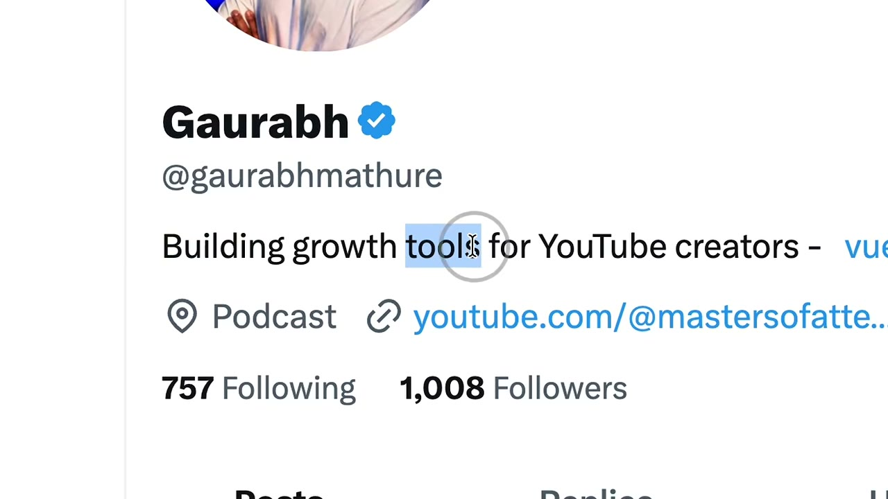
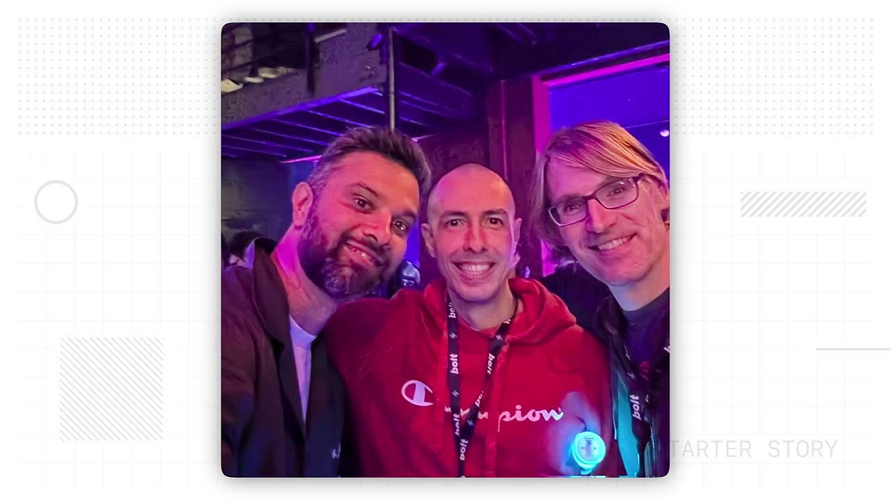
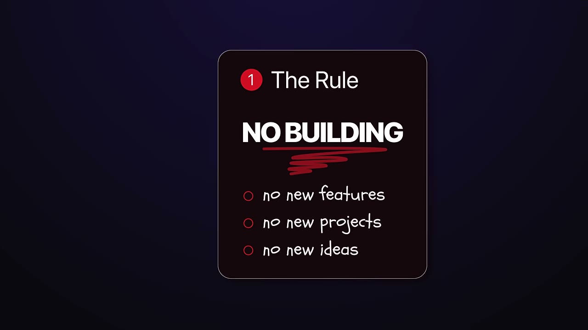
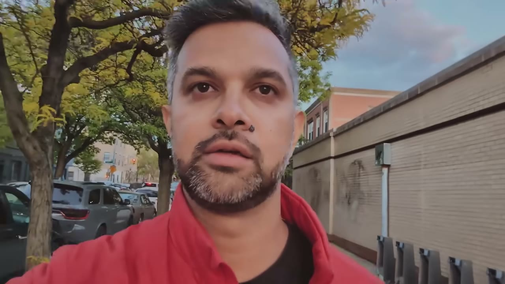
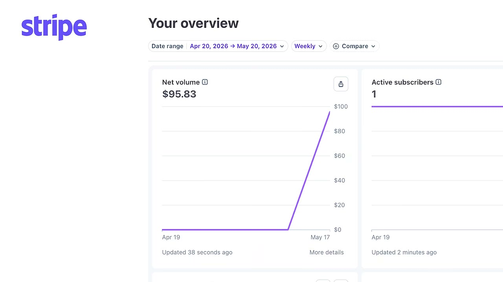
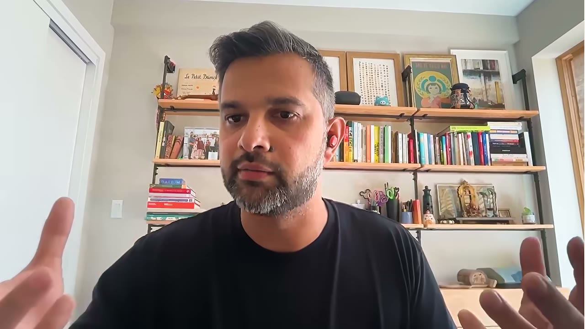
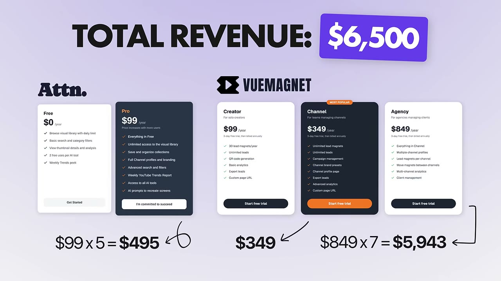

# He built 100 apps and made $0. Can he fix it in 30 days?

✅ **Đã phân tích sâu** → [`case.md`](case.md)

| | |
|---|---|
| **Video** | <https://www.youtube.com/watch?v=AoE1yX9ogCM> |
| **Đăng** | 22/08/2026 |
| **Thời lượng** | 14:09 |
| **Lượt xem** | 41,195 |
| **Lượt thích** | 1,355 |
| **Video ID** | `AoE1yX9ogCM` |

## Trong thư mục này

| File | Nội dung |
|---|---|
| [`case.md`](case.md) | **Phân tích đầy đủ** — ý tưởng, validate, GTM, áp dụng ở VN |
| [`meta.json`](meta.json) | Metadata gốc (chapters, heatmap, mô tả) |
| [`screenshots/`](screenshots/) | 10 ảnh 720p |

## Mô tả gốc

Meet Gaurabh. He built almost 100 apps in 60 days. But... he had a problem. Despite shipping all these projects, he has made exactly ZERO dollars. What happened? What was going on? Why hadn't he made any money? 
In this first episode of the Starter Story challenge, we challenge him to finally monetize his app. Can he actually do it?
0:00 - $1K in 30 days
0:42 - Welcome to the challenge
1:05 - 100 apps... zero revenue
1:34 - What's the problem?
2:21 - The Challenge
3:05 - Do you accept the challenge?
3:23 - It begins!
3:50 - 100 side project ideas
4:48 - Update
5:02 - The first 30 days
6:11 - M

## Số liệu bắt được từ transcript

> Các đoạn founder nhắc tới con số, kèm timestamp để tua thẳng tới đó trong video.

_(không bắt được con số nào)_

## Chương

- `00:00` 1K in 30 days
- `00:42` Welcome to the challenge
- `01:05` 100 apps... zero revenue
- `01:34` What's the problem?
- `02:21` The Challenge
- `03:05` Do you accept the challenge?
- `03:23` It begins!
- `03:50` 100 side project ideas
- `04:48` Update
- `05:02` The first 30 days
- `06:11` Making $100
- `06:53` The next 30 days
- `08:08` Numbers behind the content
- `08:58` Talking to customers
- `09:42` Revenue and results
- `10:35` Congrats on the challenge!!
- `11:09` Lessons learned and advice
- `12:57` What's next?
- `13:29` Join the challenge
- `13:36` Wrap up

## Ảnh

1. `01_00m15s_ch-1k-in-30-days.jpg` — 
2. `02_00m54s_ch-welcome-to-the-challenge.jpg` — 
3. `03_01m46s_ch-what-s-the-problem.jpg` — 
4. `04_02m30s_usd-1-000.jpg` — 
5. `05_03m17s_ch-do-you-accept-the-challenge.jpg` — 
6. `06_04m02s_ch-100-side-project-ideas.jpg` — 
7. `07_06m00s_usd-99.jpg` — 
8. `08_08m48s_usd-10.jpg` — 
9. `09_09m52s_usd-100.jpg` — 
10. `10_10m38s_usd-6-000.jpg` — 

---

← [Quay lại index](../../index.md) · [Toàn bộ video](../README.md)
