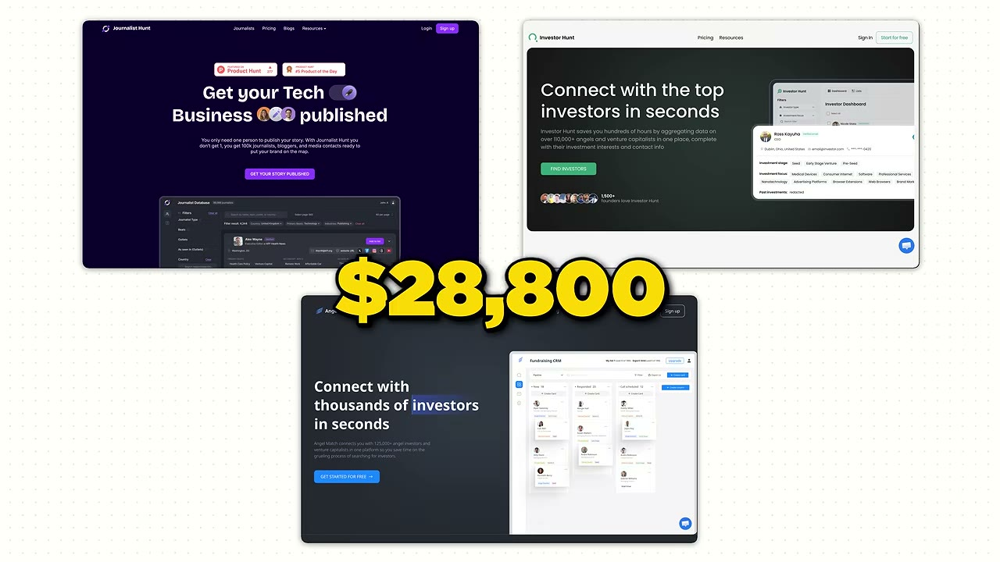
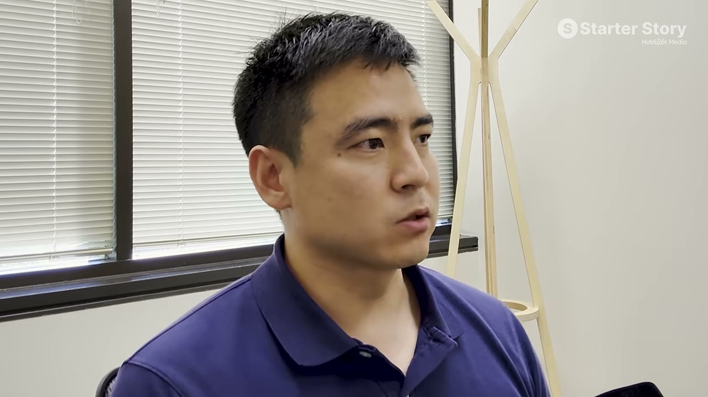
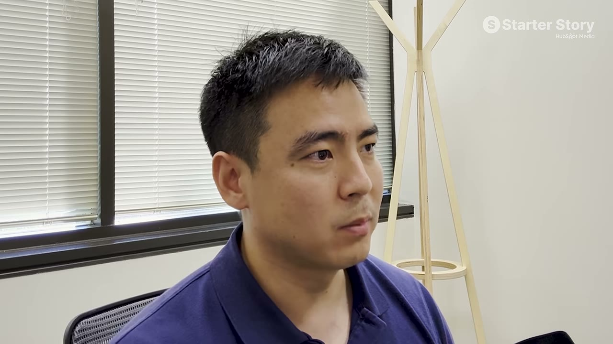
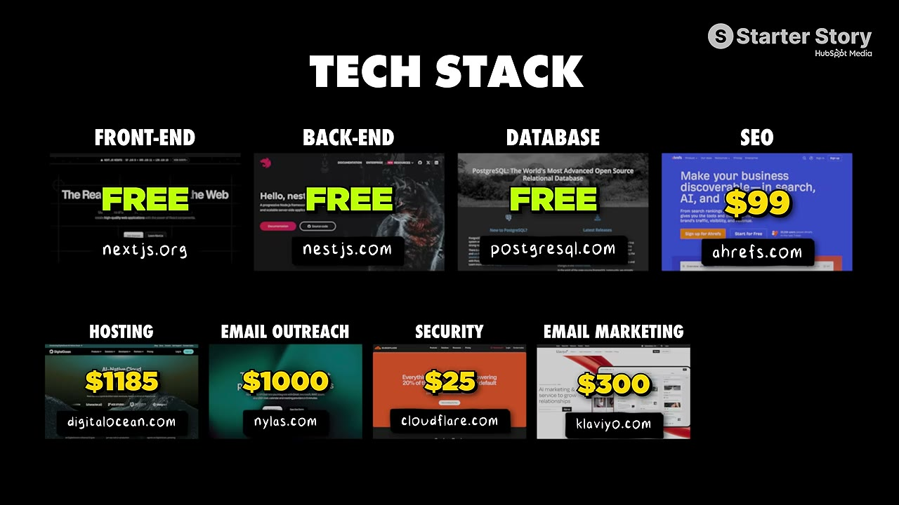

# I make $32K/month from 3 simple, boring websites

✅ **Đã phân tích sâu** → [`case.md`](case.md)

| | |
|---|---|
| **Video** | <https://www.youtube.com/watch?v=5-G9WHwQMwQ> |
| **Đăng** | 23/08/2026 |
| **Thời lượng** | 14:30 |
| **Lượt xem** | 50,476 |
| **Lượt thích** | 1,121 |
| **Video ID** | `5-G9WHwQMwQ` |

## Trong thư mục này

| File | Nội dung |
|---|---|
| [`case.md`](case.md) | **Phân tích đầy đủ** — ý tưởng, validate, GTM, áp dụng ở VN |
| [`meta.json`](meta.json) | Metadata gốc (chapters, heatmap, mô tả) |
| [`screenshots/`](screenshots/) | 10 ảnh 720p |

## Mô tả gốc

Rashid built three simple websites that make over $32,000 per month. But what's actually interesting is that he built essentially three identical websites. They all solve a very similar problem for a slightly different user. This is the story of how a guy built a few simple, boring websites and scaled them to where they are today.
0:00 - Making money with simple websites
1:00 - What’s your story?
1:33 - Business overview
2:14 - Revenue and numbers
3:23 - Painful problems win!
4:34 - Founder background
5:48 - Finding the business idea
6:33 - Growth and marketing
7:33 - Secret behind the website

## Số liệu bắt được từ transcript

> Các đoạn founder nhắc tới con số, kèm timestamp để tua thẳng tới đó trong video.

_(không bắt được con số nào)_

## Chương

- `00:00` Making money with simple websites
- `01:00` What’s your story?
- `01:33` Business overview
- `02:14` Revenue and numbers
- `03:23` Painful problems win!
- `04:34` Founder background
- `05:48` Finding the business idea
- `06:33` Growth and marketing
- `07:33` Secret behind the websites
- `08:15` Ideas to start in 2026
- `08:57` Database product playbook
- `10:12` Tech stack and tools
- `10:57` Final advice
- `11:57` Pat and Gus reflections: solve a painful problem!

## Ảnh

1. `01_00m37s_usd-30-000.jpg` — 
2. `02_01m12s_ch-what-s-your-story.jpg` — 
3. `03_02m58s_usd-57.jpg` — 
4. `04_03m35s_ch-painful-problems-win.jpg` — 
5. `05_04m46s_ch-founder-background.jpg` — 
6. `06_06m00s_ch-finding-the-business-idea.jpg` — 
7. `07_06m35s_usd-4-000.jpg` — 
8. `08_07m23s_usd-3-000-m.jpg` — 
9. `09_08m27s_ch-ideas-to-start-in-2026.jpg` — 
10. `10_10m46s_usd-62.jpg` — 

---

← [Quay lại index](../../index.md) · [Toàn bộ video](../README.md)
