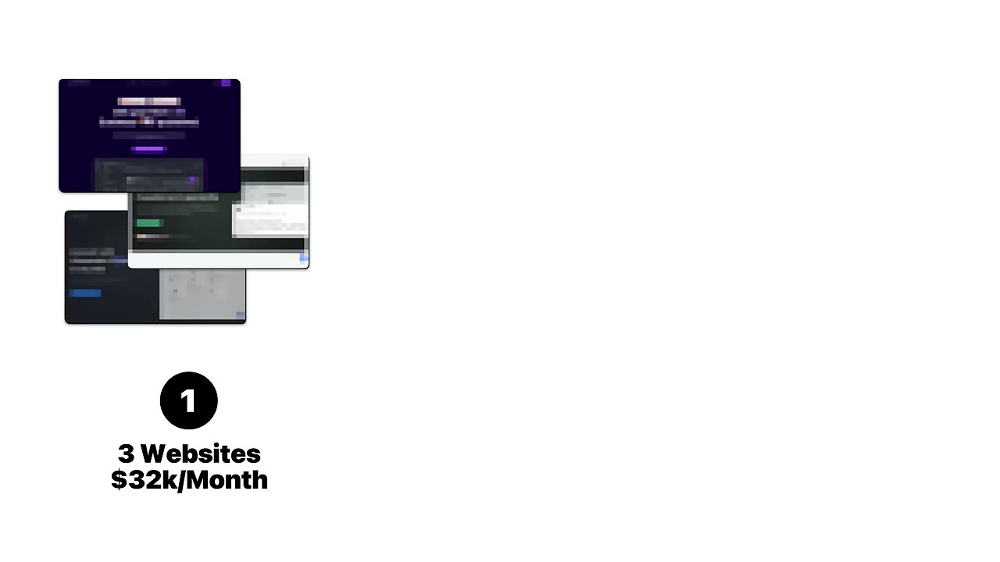
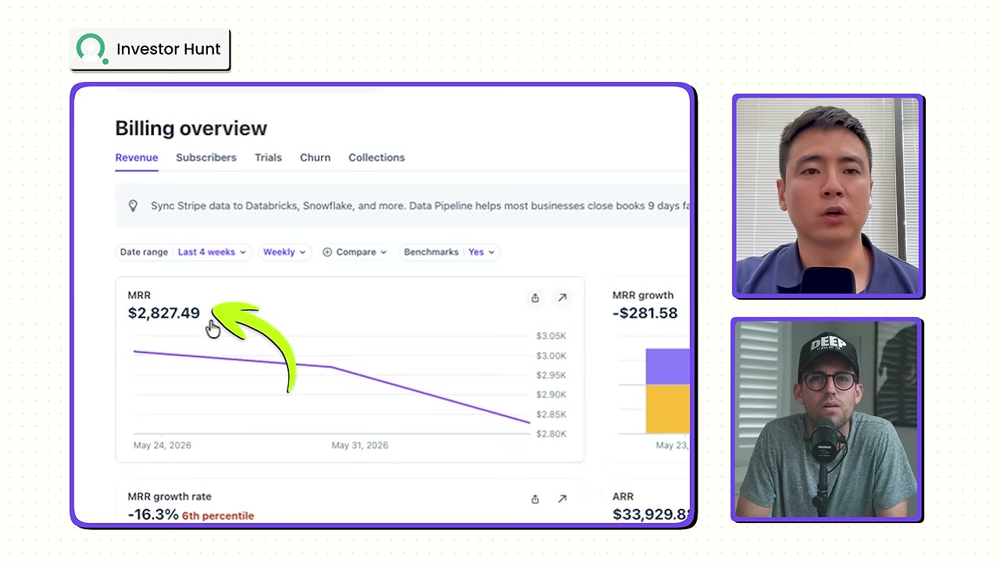
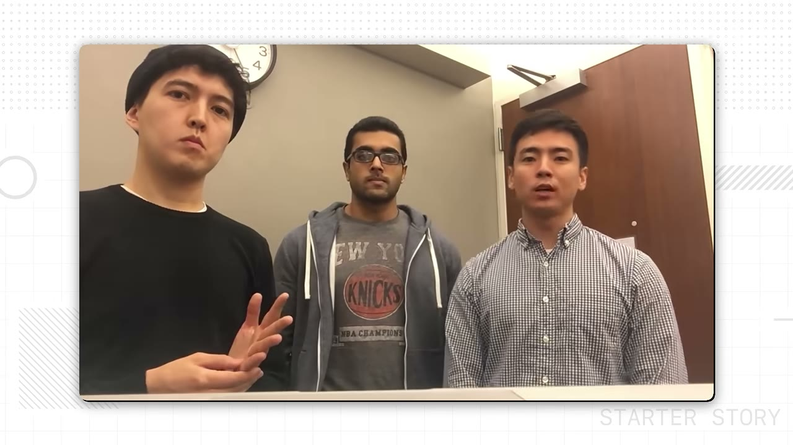
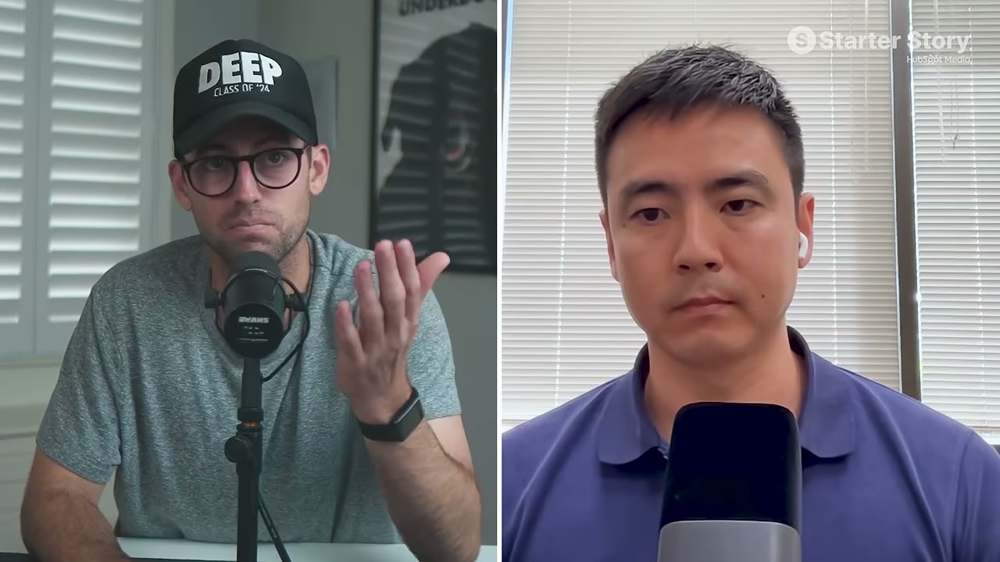
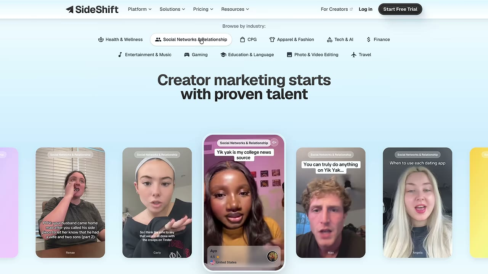

# AngelMatch & co — $32K/tháng từ 3 website "chán ngắt"

> **Tóm tắt 30 giây:** Rashid từng là founder startup fintech, phải tự tay dựng danh sách nhà đầu tư để cold email. Việc đó cực kỳ mất thời gian → anh nhận ra đó chính là business. Anh build **AngelMatch** (database 125.000 angel & VC), rồi nhân bản mô hình sang **InvestorHunt** và **JournalistHunt** (200.000 nhà báo). Tổng **$32K MRR**, chi phí vận hành **$62/tháng**. Anh không biết code. Động cơ tăng trưởng duy nhất: **programmatic SEO**.

---

## 1. Con số

| Site | MRR | Ghi chú |
|---|---|---|
| **AngelMatch** | **$29.000** | 125K angel + VC. 360 subscriber. Trial conversion **33%** |
| **InvestorHunt** | **$2.800** | Thuần SEO, **không marketing gì cả** |
| **JournalistHunt** | **$260** | 200K nhà báo. Mới, ít user |
| **Tổng** | **~$32.000/tháng** | Đỉnh từng chạm **$43K MRR** |

| Chỉ số vận hành | Giá trị |
|---|---|
| Chi phí công cụ | **$62/tháng** (toàn bộ stack) |
| Traffic AngelMatch | 800-1.000 click/ngày (organic + referral + direct + ít Meta ads) |
| Giá | AngelMatch từ **$59/tháng**, có gói vài nghìn $ tuỳ số lượt liên hệ InvestorHunt **$57 / $97 / $297** JournalistHunt **$49-$99** |
| Nguồn doanh thu | **~50% đến từ programmatic SEO** |

> **Biên lợi nhuận là điểm gây sốc:** $32.000 doanh thu trên $62 chi phí công cụ. Đây là loại hình có cấu trúc chi phí tốt nhất trong toàn bộ knowledge base này.

---

## 2. Sản phẩm giải quyết vấn đề gì

**Một nỗi đau B2B rất đắt:** founder giai đoạn đầu **buộc phải** tìm được nhà đầu tư, nếu không thì công ty chết. Việc lùng danh sách này thủ công tốn hàng chục giờ.

Sản phẩm chỉ là: dữ liệu đã được thu thập, phân loại, đặt sau paywall, cộng thêm công cụ gửi email ngay trong app (qua Nylas).

**Cả 3 site về bản chất là một sản phẩm**, chỉ đổi tập dữ liệu và đổi người mua. Đây chính là bài học quan trọng nhất: **xây một lần cái khuôn, rồi đổ khuôn nhiều lần.**

---

## 3. Ý tưởng đến từ đâu

Rashid học tài chính, cùng bạn làm app đầu tư fintech, **gọi $100K từ gia đình & bạn bè, tự max thẻ tín dụng và vay cá nhân**. Vẫn thiếu tiền → phải đi gặp angel và VC.

Anh và bạn ngồi dựng tay danh sách nhà đầu tư để cold email. Danh sách đó **có tác dụng thật** — mở được cửa vào các quỹ lớn. Hai kết luận rút ra:
1. **Cold email hiệu quả.**
2. **Việc dựng danh sách thì kinh khủng khiếp.**

Kết luận số 2 mới là business.

> Lại đúng cái mẫu hình của [Fastlane](../2026-08-30_the-insanely-obvious-secret-behind-this-69k-month-sa/case.md): **vấn đề gặp phải trong lúc làm việc khác chính là business tiếp theo.** Ở đây, business đầu (fintech app) thất bại, nhưng **công cụ tự chế để cứu nó lại thành công.**

> **Mẫu hình này xuất hiện lần thứ ba trong knowledge base:** [Jack Friks](../2026-08-02_how-i-work-40k-month-solo-app-builder/case.md) làm Post Bridge **chỉ để tự marketing cho app di động của mình** — rồi công cụ đó **lớn gấp 10-100 lần** sản phẩm gốc và anh bỏ luôn app ban đầu. Rashid, Jack và Fastlane đều không đi tìm ý tưởng; họ **gặp** ý tưởng trong lúc vật lộn với thứ khác. **Điều kiện chung có thể kiểm tra được:** nếu anh đang tự tay làm một việc khổ sở lặp đi lặp lại để cứu dự án hiện tại, hãy dừng lại và hỏi liệu chính việc đó có phải sản phẩm hay không.

---

## 4. Cách validate

Cực kỳ đơn giản, đáng học vì **rẻ**:

1. Đặt giả thuyết: *nếu việc này khổ với mình, chắc cũng khổ với founder khác.*
2. Build database **40.000 nhà đầu tư** cùng vài người (không phải 125K — bản đầu nhỏ hơn nhiều)
3. **Launch trên Product Hunt**
4. Tháng đó thu **$4.000** → xong, đã xác nhận

> **Bài học quan trọng: bản đầu chỉ có 40K bản ghi, không phải 125K.** Đừng đợi dữ liệu hoàn hảo. Đủ để bán là đủ để bắt đầu.

Công thức 3 bước anh đưa cho ai muốn làm database product năm 2026:

| Bước | Nội dung |
|---|---|
| **1. Chọn đúng database** | Không làm database bừa — phải là database **giải một vấn đề cụ thể** |
| **2. Thu thập dữ liệu** | Thủ công cũng được (anh đã làm thế). Biết kỹ thuật thì viết crawler |
| **3. Đẩy ra trước mắt người ta** | Launch, lấy feedback. **Có người chịu trả tiền = tín hiệu tốt** |

---

## 5. Go-to-market — programmatic SEO ⭐

**Khoảnh khắc bật đèn:** ngồi nhìn Google Analytics thấy **60 click/ngày**, anh tự hỏi: *nếu nhân traffic lên 10 lần, MRR có nhân 10 lần không?*

Việc anh làm:
- **Thuê 6 content writer**, đăng blog đều đặn
- Song song, team kỹ thuật **build và tung các free tool** làm mồi
- Kiên trì **6-8 tháng** → traffic mới bắt đầu lên

**Kết quả: $3.000 → $20.000 MRR nhờ SEO**, rồi thêm Meta ads đẩy lên đỉnh $43K.

**Programmatic SEO** là gì trong ngữ cảnh này: mỗi bản ghi trong database sinh ra một trang riêng (tên nhà đầu tư, ngành, giai đoạn đầu tư, địa điểm...). 125.000 bản ghi → hàng chục nghìn trang bắt đúng truy vấn đuôi dài. **Database vừa là sản phẩm, vừa là cỗ máy SEO.** Đây chính là lý do mô hình directory ăn khớp với SEO tốt hơn mọi mô hình khác.

> ⏱ **Kỳ vọng thực tế: 6-8 tháng mới thấy traffic.** Đây không phải mô hình tăng trưởng nhanh. Đổi lại, nó **không sập khi trend qua đi** — điểm host nhấn mạnh khi so với các app AI đang bùng rồi tắt.

> **Đối lập trực tiếp đáng đặt cạnh nhau — [Chart Detector AI](../2026-07-23_i-make-50k-per-month-working-5-hours-a-week/case.md):** Timo làm $43.700 doanh thu và **bỏ túi $11.500** (biên 25%), nhưng biết mình lãi hay lỗ **trong vòng 7 ngày**. Rashid làm $32.000 doanh thu với **$62 chi phí** (biên gần 100%), nhưng phải chờ **6-8 tháng** mới biết SEO có ăn không. **Điều kiện phân định là thứ anh đang thiếu:** thiếu tiền mặt thì chọn kênh có phản hồi nhanh và chấp nhận biên mỏng; thiếu thời gian thì chọn kênh trả tiền. Không có mô hình nào vừa nhanh vừa rẻ.

---

## 6. Vì sao mô hình này chạy được — và khi nào KHÔNG chạy

Rashid: chạy được vì (a) giải đúng vấn đề đau của tập khách xác định, (b) **positioning khớp** — chính anh cũng là founder early-stage nên nói đúng ngôn ngữ của họ, (c) **chọn ngách đủ hẹp**.

**Cảnh báo quan trọng từ host — ranh giới sống còn của mô hình directory:**

> **Directory/database gần như chỉ sống được ở B2B.**

Vì sao: doanh nghiệp trả $97/tháng không chớp mắt khi vấn đề đủ đau (không tìm được nhà đầu tư = công ty chết). Người tiêu dùng cá nhân thì không. Host lấy ví dụ *"directory huấn luyện viên chó"* — kiểu B2C này rất khó thu tiền, và nhắc tới bookamagician.com như một ca không thành.

**Bộ lọc rút ra trước khi làm directory:**
1. Người mua có phải **doanh nghiệp** không? (không → dừng)
2. Không có dữ liệu này thì họ **mất tiền hay mất cơ hội lớn** không?
3. Tự gom dữ liệu này có **khổ thật** không? (không khổ → không ai trả tiền)
4. Dữ liệu có **cần cập nhật liên tục** không? (có → subscription hợp lý, chống bị copy)

---

## 7. Ý tưởng database anh gợi ý cho 2026 ⭐

Founder tự đưa ra, và host xác nhận đang có nhu cầu thật:

| Ý tưởng | Người mua | Ghi chú |
|---|---|---|
| **Database influencer** phân loại theo vị trí, quy mô follower, chủ đề | Brand, agency | Host: "thật sự thông minh — influencer khó tìm, khó tiếp cận, và doanh nghiệp đang đi book họ" |
| **Database newsletter** nhận quảng cáo | Người mua sponsorship | Tìm tay rất mất thời gian |
| Database nhà đầu tư bất động sản | Môi giới, quỹ | Rashid nêu là hướng mở rộng |
| Database trader chứng khoán | Fintech, broker | Rashid nêu |

> ⚠️ Host cũng nêu SideShift như ví dụ ngách influencer database **đã có người làm** — nghĩa là phải khác biệt, không phải chỉ copy.

---

## 8. Tech stack — $62/tháng

| Hạng mục | Công cụ |
|---|---|
| Frontend | **Next.js** |
| Backend | **Nest.js** |
| Database | **PostgreSQL** |
| SEO | **Ahrefs** |
| Hosting | **DigitalOcean** |
| Gửi email trong app | **Nylas** (chính là phần biến database thành công cụ dùng được) |
| Chống bot đăng ký, bảo mật | **Cloudflare** |
| Email marketing / flow | **Klaviyo** |
| Email công ty | **Google Workspace** |

**Founder không biết code** — anh thuê developer. Đây là bằng chứng mô hình này mở cho người không kỹ thuật.

---

## 9. Bài học & trích dẫn

**Về sự kiên trì (đây là case chậm, không phải case bùng nổ):**
> "Hồi đó có những founder khởi đầu cùng tôi và kiếm nhiều hơn tôi bây giờ rất nhiều, nhưng họ bỏ cuộc và giờ tôi không còn thấy họ nữa."

**Host, về giá trị của kiểu business "chán":**
> "Đây không phải business AI thời thượng. Nó là một business rất chắc, sẽ tiếp tục lớn và tích luỹ — trong khi rất nhiều người đang xây thứ vọt lên rồi về không."

**Nguyên tắc chốt lại:** tìm một **vấn đề đau** và giải nó. Không đuổi theo công nghệ.

---

## 10. Áp dụng cho tôi (indie hacker VN)

**Vì sao đây có thể là mô hình phù hợp nhất với anh:**
- ✅ **Không cần kỹ thuật cao** — founder gốc còn thuê dev
- ✅ **Chi phí vận hành gần bằng 0** ($62/tháng) → chịu được giai đoạn dài chưa có doanh thu
- ✅ **Không phụ thuộc trend** — không sợ OpenAI ra tính năng rồi xoá sổ mình
- ✅ **Bán được cho khách quốc tế bằng USD** — né hoàn toàn vấn đề ARPU thấp ở VN
- ✅ **Nhân bản được**: một khuôn code, đổi tập dữ liệu → site thứ 2, thứ 3

**Kế hoạch cụ thể nếu làm:**
1. Chọn ngách B2B mà **việc gom dữ liệu thật sự khổ** và người mua là doanh nghiệp
2. Gom **thủ công 5.000-40.000 bản ghi** — đừng chờ hoàn hảo
3. Dựng Next.js + Postgres, mỗi bản ghi một trang (nền tảng programmatic SEO)
4. Launch Product Hunt / các cộng đồng ngách → **mục tiêu duy nhất: có người trả tiền**
5. Xác nhận xong → cày SEO **6-8 tháng**, tính đây là chi phí bắt buộc
6. Chạy được rồi → **nhân bản khuôn sang ngách thứ hai**

**Rào cản & rủi ro:**
- ⚠️ **Pháp lý dữ liệu:** thu thập thông tin liên hệ cá nhân dính GDPR (EU) và CCPA (California). Bán dữ liệu nhà đầu tư/nhà báo EU là vùng rủi ro thật. Ưu tiên dữ liệu công khai của **tổ chức**, có cơ chế opt-out.
- ⚠️ **Dữ liệu mốc = sản phẩm chết.** Phải có quy trình cập nhật, nếu không sẽ churn nặng.
- ⚠️ **6-8 tháng chưa thấy tiền.** Cần chuẩn bị tâm lý và tài chính.
- ⚠️ SEO 2026 chịu áp lực từ AI answer engine — nên tính cả **LLM SEO** (được nhắc ở case Fastlane) chứ không chỉ Google.

**Ngách VN đáng soi:** database nhà cung cấp / nhà máy gia công, database chủ mặt bằng cho thuê, database KOC theo ngành. Điều kiện tiên quyết vẫn là: **người mua phải là doanh nghiệp.**

---

## Nguồn

- Video: [I make $32K/month from 3 simple, boring websites](https://www.youtube.com/watch?v=5-G9WHwQMwQ) — Starter Story, 23/08/2026, 14:30, 50K views
- Sản phẩm: AngelMatch · InvestorHunt · JournalistHunt
- Transcript: [`_raw/transcripts/5-G9WHwQMwQ.md`](transcript.md) · Ảnh: [`screenshots/5-G9WHwQMwQ/`](screenshots/)
