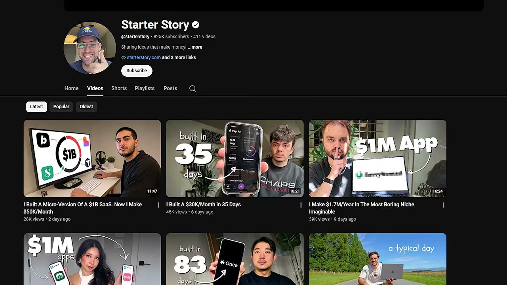
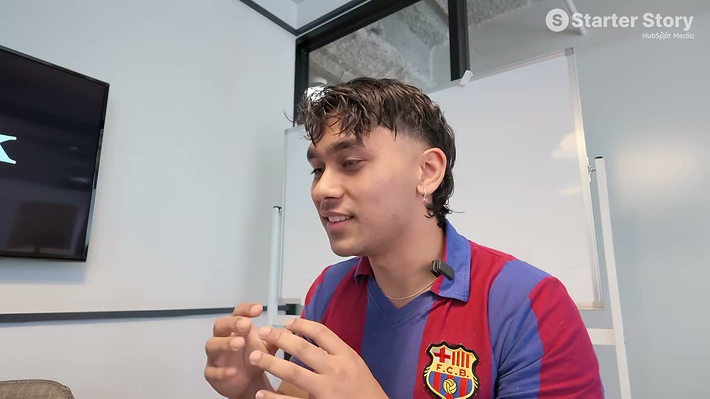
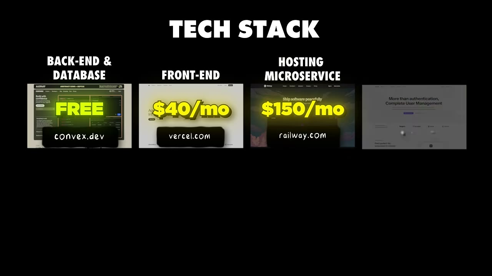

# The Insanely Obvious Secret Behind This $69K/Month SaaS

✅ **Đã phân tích sâu** → [`case.md`](case.md)

| | |
|---|---|
| **Video** | <https://www.youtube.com/watch?v=BA_fC95p43c> |
| **Đăng** | 30/08/2026 |
| **Thời lượng** | 17:12 |
| **Lượt xem** | 76,683 |
| **Lượt thích** | 1,182 |
| **Video ID** | `BA_fC95p43c` |

## Trong thư mục này

| File | Nội dung |
|---|---|
| [`case.md`](case.md) | **Phân tích đầy đủ** — ý tưởng, validate, GTM, áp dụng ở VN |
| [`meta.json`](meta.json) | Metadata gốc (chapters, heatmap, mô tả) |
| [`screenshots/`](screenshots/) | 10 ảnh 720p |

## Mô tả gốc

Gaurav built Fastlane, a marketing SaaS for indie developers. He’s grown it to $1M ARR and thousands of users, but the real story is about what he did to build it. In a few months, he had thousands of customer calls where he learned what worked, what didn’t, and exactly how to build the product for his ideal customer. 
This video breaks down why talking to customers is the most important thing you can do if you want to build a successful SaaS. 
0:00 - Don't skip this!
0:57 - What's your story?
1:44 - Business breakdown
2:29 - Finding the idea
3:26 - Background and build timeline
4:40 - Tech st

## Số liệu bắt được từ transcript

> Các đoạn founder nhắc tới con số, kèm timestamp để tua thẳng tới đó trong video.

_(không bắt được con số nào)_

## Chương

- `00:00` Don't skip this!
- `00:57` What's your story?
- `01:44` Business breakdown
- `02:29` Finding the idea
- `03:26` Background and build timeline
- `04:40` Tech stack and tools
- `05:14` Solve painful problems
- `06:09` The secret behind his success
- `07:45` The system that helped him win
- `09:32` Go talk to customers!
- `10:12` Customer calls breakdown
- `12:54` App demo
- `13:50` How customer calls influenced the product
- `14:07` Final advice
- `15:09` Pat and Gus reflections: face the fear of rejection

## Ảnh

1. `01_00m36s_usd-69-000-m.jpg` — 
2. `02_01m24s_usd-69-000.jpg` — 
3. `03_02m41s_ch-finding-the-idea.jpg` — 
4. `04_03m38s_ch-background-and-build-timeline.jpg` — 
5. `05_04m52s_ch-tech-stack-and-tools.jpg` — 
6. `06_05m30s_usd-69-000.jpg` — 
7. `07_06m21s_ch-the-secret-behind-his-success.jpg` — 
8. `08_07m57s_ch-the-system-that-helped-him-win.jpg` — 
9. `09_09m44s_ch-go-talk-to-customers.jpg` — 
10. `10_12m53s_usd-70-000.jpg` — 

---

← [Quay lại index](../../index.md) · [Toàn bộ video](../README.md)
