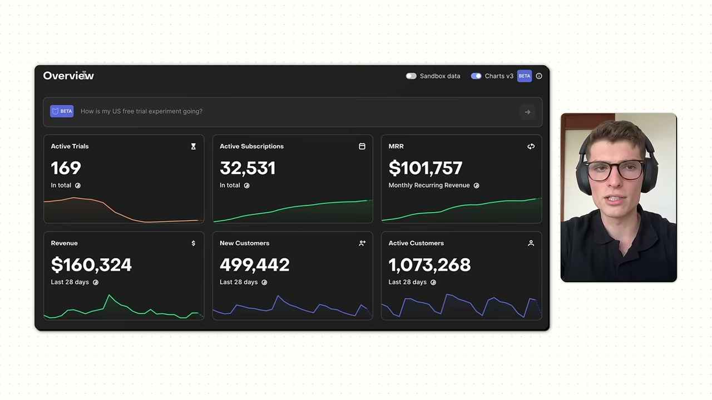
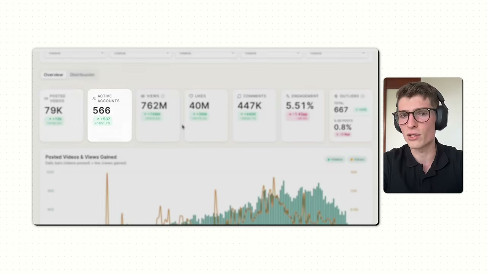
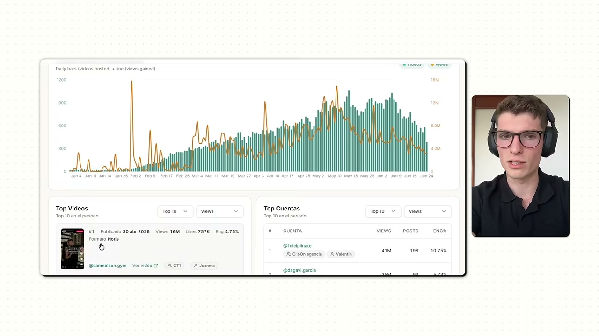
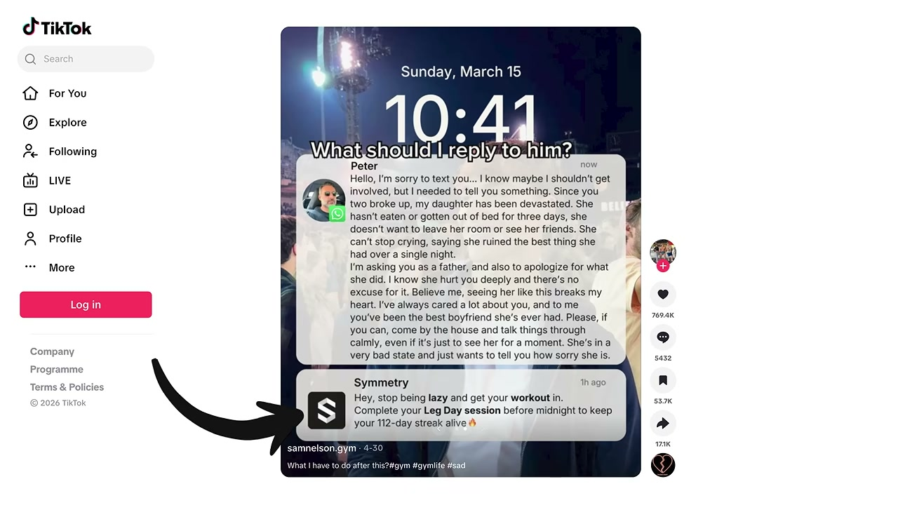
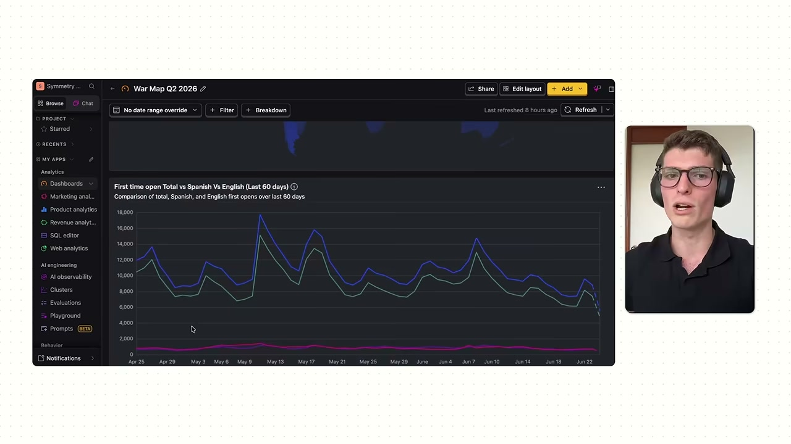
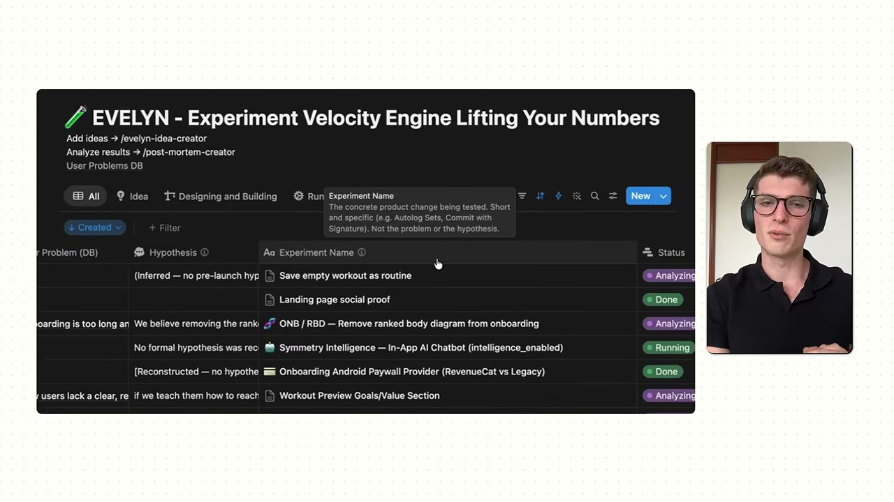
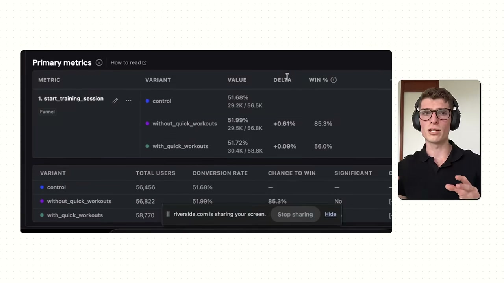
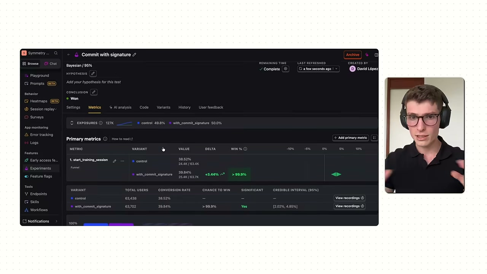

# How I Built This $160K/Month Gym App

✅ **Đã phân tích sâu** → [`case.md`](case.md)

| | |
|---|---|
| **Video** | <https://www.youtube.com/watch?v=OV09yPLf8BI> |
| **Đăng** | 09/09/2026 |
| **Thời lượng** | 17:30 |
| **Lượt xem** | 59,998 |
| **Lượt thích** | 865 |
| **Video ID** | `OV09yPLf8BI` |

## Trong thư mục này

| File | Nội dung |
|---|---|
| [`case.md`](case.md) | **Phân tích đầy đủ** — ý tưởng, validate, GTM, áp dụng ở VN |
| [`transcript.md`](transcript.md) | Transcript gốc, có timestamp |
| [`meta.json`](meta.json) | Metadata gốc (chapters, heatmap, mô tả) |
| [`screenshots/`](screenshots/) | 12 ảnh 720p |

## Mô tả gốc

Mauro built a gym app that last month made $160,000. What sets him apart is not the product or marketing... but his app development approach. He treats the product like a science experiment: A/B testing, validating features, and only building stuff that moves the needled.This video breaks down how to think like a product management expert, stop guessing, and start building what actually moves the needle.
This video is an educational case study of this founder’s experience. It is not financial advice and does not guarantee any income or results. Every business is different and your results may 

## Số liệu bắt được từ transcript

> Các đoạn founder nhắc tới con số, kèm timestamp để tua thẳng tới đó trong video.

- `00:00` I launched Symmetry a year ago, and now it's one of the biggest names in one of the most saturated app markets. >> This is Mauro. He's 22, and in just 1 year, he built an app that makes over $160,000 a month. But, this isn't really a story
- `00:48` …sode, we'll dive into the app that he built that makes over $160,000 a month, why most builders are wasting so much time on features that won't move the needle, and his approach on how to build apps the right…
- `02:13` …his sort of niche. This is clearly working. It's doing over $160,000 in revenue in the last 30 days, which is cool. And we're going to talk all about the growth, but before we do, I want to understand a little bit about your background. Had you always been…
- `03:34` …he main growth strategies you used to grow this app to over $150,000 a month? >> So, first when we launched, we had this YouTube community. And we thought it was going to be really good for growing the app. It wasn't. So, we started to try…
- `04:57` …it, I thought it was super cool because you got this app to $160,000 a month within 1 year and that's like really, really fast. Like usually you'll…
- `06:53` …dreds of proven app ideas, and many of them are making over $10,000 a month. And each of the ideas in the database has the numbers to back it up. Real revenue, pricing models, growth tactics, basically everything you need to validate whether this is a good ide…
- `13:34` …d you just give me a quick demo of your app that makes over $160,000 a month? >> Yeah, so our app we try to make it really simple. So the first thing you see when you come is just like your plan to work out. You click on the plan and you see a workout preview …

## Chương

_(không có chapter)_

## Ảnh

1. `01_01m58s_dashboard-revenuecat-mrr-usd-101-757.jpg` — 
2. `02_04m08s_dashboard-ugc-566-accounts-79k-videos.jpg` — 
3. `03_04m16s_dashboard-ugc-top-videos-countries.jpg` — 
4. `04_04m24s_ugc-format-lock-screen-notification.jpg` — 
5. `05_04m32s_viral-video-17m-views.jpg` — 
6. `06_08m06s_war-map-q2-2026-okr-dashboard.jpg` — 
7. `07_11m46s_evelyn-experiment-database.jpg` — 
8. `08_12m06s_experiment-inconclusive-172k-users.jpg` — 
9. `09_12m28s_experiment-commit-signature-won.jpg` — 
10. `10_13m44s_app-workout-plan-upper-body.jpg` — 
11. `11_14m06s_app-ranks-diamond-i.jpg` — 
12. `12_14m16s_app-social-feed.jpg` — 

---

← [Quay lại index](../../index.md) · [Toàn bộ video](../README.md)
