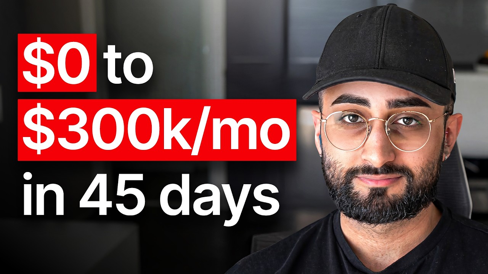

# 0 to $300k/mo in 45 days with my ai app (just copy me)

Start building & deploying paywalls in 10 minutes flat: https://superwall.com/

## Table of Contents

* [00:00:00] Intro
* [00:01:06] Dillion's Bold Move
* [00:03:06] Halo AI's Launch
* [00:05:19] Scaling with Creators
* [00:09:49] UGC Strategy Breakdown
* [00:15:52] Creator Onboarding Process
* [00:22:15] Viral Video Formats
* [00:31:09] Creator Payment Structures
* [00:40:40] App Monetization Insights
* [00:48:02] Bootstrapping Challenges
* [00:53:14] Future Growth and Vision

## [00:00:00] Intro

Dillian bootstrapped his first ever consumer app to $300,000 MRR in 45 days. He had never built a consumer app before, and he had just spent 18 months launching failed products and had almost nothing in the bank. So, he had one last shot at making something work. We had a bunch of failed products which didn't amount to anything. We had to make something work. [00:00:00 → 00:00:20]

Otherwise, like we're screwed. This is like the the last Hail Mary. And we were locked in like every single day, 14 hours a day for months straight. >> But then he found one data point. He got a creator to post one TikTok that paid him back 6X ROI. [00:00:20 → 00:00:33]

As soon as this one video proved to him he had a working model, he took out a $100,000 personal loan and went all in. I I just saw 6:1. I was like, "Okay, like just just take out all of my money. " I I emptied my bank account and took out a loan. Just put everything all in into this. [00:00:33 → 00:00:49]

That loan paid more creators. And what those creators built was a machine that hit 600 million views in 60 days. We went from zero to 600 million views on social media in 60 days. And also zero to 1. 2 billion views in 120 days for this application. [00:00:49 → 00:01:05]

600 million views, 85 creators, 300 posts a day. [00:01:05 → 00:01:06]

## [00:01:06] Dillion's Bold Move

But wait, wait, hold on. You heard this story before. They probably have this huge complicated UGC machine running 10 content angles at once, trying to figure out what works. Well, no. Actually, none of that. [00:01:06 → 00:01:18]

Dillian had a one single TikTok format. We only had one format. One format, 1. 2 billion views. There's no deviation of that. [00:01:18 → 00:01:26]

>> And how he kept 85 creators posting every day consistently, competitively, without someone managing them super tightly. That came down to a deal structure experiment with a very unexpected result. Both of them were structured in a way where the pay was equivalent or like very close, but CPM was slightly more. And we gave this contract to 30 creators. And you wouldn't believe, but like 29 of them picked this one. [00:01:24 → 00:01:49]

And one person took CPM in the end. 29 out of 30 creators chose the option that actually paid them less. In this episode, Dillian breaks down the entire system, the one format, the math behind his content machine, and the creator pay structure that keeps all of it running. Let's get into it. This is the Superwall podcast, and I'm Joseph Choi, founder of Consumer Club. [00:01:49 → 00:02:09]

The members in the Consumer Club Discord and the founders I interview on the pod build apps at a median of 1 million ARR. A lot of these apps that make the most money run AB tests on their paywalls to make more revenue with the same number of users. Superwall has a lot of data on the thousands of apps that use a paywall. So, recently they put together a free AI tool trained on 422 profitable paywall experiments. It lets you upload a screenshot of your own paywall and gives you an experiment idea to increase your revenue. [00:02:09 → 00:02:36]

You can use it for free at paywallexperiments. com. Also, if you're building a mobile app doing at least 100K a month in revenue, Superwall hosts dinners in San Francisco and New York. They keep each gathering small, thoughtful, genuinely useful for everyone. If you meet this criteria of 100K a month in revenue and want to invite, apply using the type form in the description. [00:02:36 → 00:02:55]

Let's get into the pod. You bootstrapped your first app to 300,000 MRR in 45 days. I think everyone wants to know what what's the app and how how in the world did you do this? [00:02:55 → 00:03:08]

## [00:03:06] Halo AI's Launch

The app is called Halo AI. And the way we did this was using UGC marketing. Okay, so this is the app Halo AI. So, what does the app do? The app is an AI photo editor. [00:03:08 → 00:03:19]

So, if you have any photos you want to edit with AI, you can just upload them to the app, put in a prompt, and get an output. >> Like, where did you get the idea for this? My partner, Krishan, and I were working on a bunch of products and stuff throughout the past year and a half, and last July, I think, Krishan brought up that the Gemini API came out recently, and there might be some potential opportunities to build an app around this. So, we figured, yeah, why don't why don't we just give it a shot? Later on, towards September, we spent two or three weeks building the app and went live, I want to say mid-October or end of October last year. [00:03:17 → 00:04:00]

And then did you like the the growth chart was like seemed like slow growth at first and then it kind of blew up in you know in the past 45 days. So were you doing distribution back then too? Yeah. Yeah, you can see actually the first frame of this of this video like October 20th to October 22nd or so right there. Yeah, like that's when we first started. [00:03:58 → 00:04:21]

I think the $5 MRR was basically like I think myself I just like testing the app and like seeing if it works and then around then we also started doing UDC. So for me uh this is my first consumer app. I haven't done UDC or any marketing or any sort of like app stuff before, but I had a general idea of like sort of what to do from what stories I've heard on on Twitter and and YouTube and other places. Like you basically just have to get a bunch of people together and post videos and then you should you should grow MRR or like grow your app. So that's what we tried to do in the beginning. [00:04:19 → 00:04:54]

Just got a bunch of people together, told them to post videos and in the beginning the growth was a bit slow. Uh we got some I got a a feel for the how to how to go about it in towards the middle and then it took off from there. How many creators do you have posting now? At the current moment there are 85 and for this video you see or the gif there was 25 with an initial scale up. Oh wow. [00:04:54 → 00:05:19]

## [00:05:19] Scaling with Creators

Okay. So you had 25 creators posting from around this point and then now at this point you have 85. It scaled throughout the throughout this period too, but in the beginning there was like 10 or so and then 25 towards the end of the video. Like we we grew uh everything during this period. So more creators, more videos posted, more views essentially. [00:05:19 → 00:05:41]

So like essentially what is the strategy? Why do you have so many creators and like what content are they making? So some of the context behind this is we went from zero to 600 million views on social media in 60 days. And also zero to 1. 2 billion views in 120 days for this application. [00:05:41 → 00:05:58]

But let me go deep into how we came across this, why it's working, and how we sort of boiled it down to a math and science, or you can say like a science and art in a way to make this work. So, a couple of things in the beginning which we realized very early on while trying UGC is when we posted a video in a specific format, we noticed that the conversion rate remained constant for that format. So, there's a video, the classic like hook and demo style format, and you post the same style of video twice or three times, the rate is always going to be like 0. 5% or 0. 3% of people who would watch the video and go down the video. [00:05:58 → 00:06:34]

Second thing we also learned in the beginning was you don't need followers to get views or go viral. Anyone can make a brand new account on TikTok, Instagram, etc. and their first video can get 10 million views. Like it's there's no barrier to getting views on a brand new account. And looking more into this, I realized this this was like a change which occurred in 2022 across the platforms where it enabled everyone to go viral. [00:06:34 → 00:06:57]

Last thing I realized was there are a lot of creators willing to make content for for brands and under supply of brands having deals or opportunities for creators. So, this is really interesting because essentially there's more pricing power or or power for brands to be able to like work with creators at scale when doing UGC. This is different than influencer marketing, but for UGC in particular, this was the case. Yes, let's go into like the breakdown of of what we did, how it works, and like how it all came together. One equation I want to highlight in the beginning overall was we realized very early that for our app, our revenue is equivalent to the number of views we get times the conversion rate of those views. [00:06:57 → 00:07:38]

So, if you get a million view video and maybe you get 500 downloads from that and they're all paying 50 a month, you can sort of get an estimate for how much revenue your your app is making. What this equation showed me in the beginning was, "Hey, like if this is the case, all we need really need to do is just increase the views and increase the conversion and then we're sort of good. Like we just make more revenue, make a lot of money. " And that was all we did. I just like broke it down further and focused solely on increasing views and solely on increasing conversion and it all came together very quickly. [00:07:38 → 00:08:10]

So, I made a little funnel here to describe how we view user acquisition, I want to call it, or how do we get users for the application? What we do is we post videos on all four platforms, Instagram, TikTok, Facebook, and YouTube. And if a user goes scrolling through their social media, they see our post, they may be interested to go download a product or try the product, which is when they go further down the funnel. And what's really interesting about about this is there are a lot of people on these platforms and it's it's like hard to conceptualize, but I actually pulled up a chart here to like dig into it, but there's 3 billion monthly active users on Facebook, also 3 billion on WhatsApp, 2. 6 billion on YouTube, and 2 billion on TikTok. [00:08:10 → 00:08:51]

So, there's a lot of people. Like a lot of people are on these platforms daily to like watch videos and and and you can reach them through these platforms to take whatever action. In particular, I also looked into the US as well because most um revenue for applications and for e-commerce or shopping in general comes from the US. The US is the biggest proponent. But, there's approximately 100 million people in the US who have Instagram and an iPhone. [00:08:51 → 00:09:18]

So, that's like basically your 10, like the number of people you can you can target for your application. It's a good reference to have in mind. But, yeah, after people view a video which has something about your app, they might go download it. To download it, they'll go to different stores, like App Store, Play Store, web search to search up your app and then eventually download. And later on, you can do a trial or go straight to hard paywall, what whatever it is, but eventually they become a paying users. [00:09:18 → 00:09:44]

So, this is an overview of the funnel. And for each of these steps, there is two different equations, you can call it, to you can work towards. [00:09:42 → 00:09:50]

## [00:09:49] UGC Strategy Breakdown

So, for the first step of the funnel, which is views, you can model views as something like this. Your total views is the number of creators you're working with, the number of videos each creator makes, the number of posts per video, and the number of views per post. And if you multiply all four of these together, you get the number for total views. So, to dig a bit deeper into this, our creators is pretty explanatory, just the number of people making videos. Videos as well, posts per video essentially means like the number of platforms you post on. [00:09:50 → 00:10:24]

Suppose you post on TikTok, and you get like a million views, you probably can also post that on Instagram, and maybe also get a million views, too. So, if you can increase the number of platforms you're posting on, you'll just get more views in general. And the last thing is if you use a post, um if you a views per post, you can modify by the way, like the format that you pick to give to creators to post. Some formats get more views or more virality, and some formats get less. It's your job to like figure out which format will get the most views possible, and also the highest highest conversion for you to drive up this equation. [00:10:21 → 00:10:58]

This is a really cool visual to show here because this is essentially all you need to do UGC. Like this is like literally literally everything. Your goal as a UGC growth person should be to maximize views, and the way to do that is to increase all these variables. Increase creators, increase the views per creator, increase the posts per video or the platforms, and increase the views per post. And if you do this every day for weeks, like you you're going to get views and get revenue for your application. [00:10:58 → 00:11:23]

That's essentially it. One question that I know a couple of people have asked me in the past is like where do you get creators from? Like how do you find creators that are or creators who are good to make videos? And, um, for that, we have a specific process we use to find creators. What we do is we actually go to a bunch of these platforms. [00:11:23 → 00:11:44]

Like, there are groups on Reddit called UGC Creators, UGC Brands. Also, there's actually like hundreds of Facebook groups, each with thousands of people, all dedicated to people doing UGC. And, uh, I just joined all of them. Also, a bunch of other platforms that are paid to also find creators as well. But, what I did was I posted a job posting on all these platforms, and every single one of these groups, for people willing to create videos for us. [00:11:44 → 00:12:09]

And, from that, we got a lot of applicants. So, we got like maybe 500, 600 plus applicants. From there, what I did was, I don't know who was good or not, but, but I essentially was looking for people who were familiar with UGC, or done it in the past. I was looking for that criteria amongst all the applicants. And, lastly, gave them all like a a paid trial to start. [00:12:08 → 00:12:26]

So, they were creating for us for about 5 days in the beginning, and we paid them for their work. And, if it's a good fit from there, we continue forward with them. And, if not, then we stop there. How much do you like to pay for those trials? For us, our base rate per video, which we set, was $20 per video. [00:12:26 → 00:12:45]

So, creators were paid for five videos during the trial. So, the full trial amount was $100. You said you'd post on all these platforms every day. How many applicants would you get like in a day? Maybe 30 to 50 per day. [00:12:45 → 00:12:58]

And, over a while, it, like, very quickly snowballed. As a rough example, yeah, I think so far we had like 600 overall in the beginning, and we went through and screened for a bunch of them, and then trialed a bunch of them as well. But, this is like a a rough numbers in the beginning for how many creators we got, uh, and how we got them. But, in general, I'd recommend the Facebook groups a lot. There's like a lot of people in all these groups that understand what UGC is, and are willing to create content, uh, for you. [00:12:58 → 00:13:24]

I'm just curious. Are Are a lot of these creators experienced with apps specifically, or they more kind of beauty fashion e-commerce type of creators. There were a lot of people who were interested in or had experience with e-com, but for me I filtered for that as much as I could through our screening. So, if people were for example not in the US or don't have a US VPN and they'd only done maybe like e-commerce clothing UGC ads before, they probably wouldn't be a good fit for us. So, we're looking for people who ideally have had past app or tech experience and also live in the US. [00:13:24 → 00:14:01]

And the criteria for living in the US was so that we can get them to make accounts to advertise to people in the US, too. It's pretty simple though. It's like some experience with apps or tech based in the US and it's kind of it. Like were there any other things that you would look for in the application, but then it looks like you have this whole funnel where it's like application and then you screen and then you do the trial. So, what are the things that you're screening for at each at each stage? [00:13:59 → 00:14:25]

Yeah, for screening the main thing was what you mentioned. So, past UGC experience is really really important and US living in US or US VPN. Other than that, there there's no hard requirements. Anyone can make the formats and for us in particular, we had a very strict guideline. So, our formats were set in stone. [00:14:25 → 00:14:45]

This is like one way to make the videos. There was no deviating from that or or like room for like fermentation in that in particular. So, that made it very easy. Like anyone could make the make the formats as long as like the instructions were very clear for them. And for the trial pass rate and like people who were going from trial to full-time creator, we had three criteria we're looking for. [00:14:45 → 00:15:07]

The first criteria was consistency. Do they post once a day or often? Do they have good communication? What it means is like were they actively talking to us proactively in the chat asking questions. And lastly was do they have an understanding of like the viral algorithm or like how to go viral? [00:15:07 → 00:15:21]

And the way we assess that is like more of a qualitative or like a vibe-based intuition, but if they can edit their videos with a strong emotional hook and then a build-up and a payoff, and the structure is very evident in their videos, then they pretty much understand like how to go viral or like how to make videos like that. But you'd be surprised, a lot of people don't understand that or like what makes videos go viral. And And even if you put them through many, many videos to to recreate and like try again and again, like they won't learn anything. Um so, you want ideally to not work with those people. Uh best-case scenarios they understand how to go viral from the start. [00:15:21 → 00:15:52]

## [00:15:52] Creator Onboarding Process

So, how do you design the trial? That seems like the the key part of all of it. Yeah, uh we just brought them into a Discord. Uh we told them to set up the app and set up their accounts and post 4 or 5 days. That was essentially it. [00:15:52 → 00:16:03]

And we have um our Discord with all of our creators. Each one has a private channel with us. We just talk to them daily if they have any questions or anything about that. And what what is the assignment? Are they just posting on TikTok like in the formats that you already know that work? [00:16:03 → 00:16:18]

Actually, yeah. One more detail I should mention is we're only going to have one format. One format, 1. 2 billion views. Uh there's no There's no deviation of that. [00:16:18 → 00:16:25]

So, people in the trial also post post the same format. They just post the same same videos in the same format, and we just assess them on that criteria. I see. So, you're basically just assessing them on are the videos getting views? Like you don't really need Like you're not really looking for anything about the video itself. [00:16:25 → 00:16:40]

Like as long as it gets views, it it passes, right? Yeah. I try not to set a hard threshold on minimum views to pass trial because the algorithms are unpredictable, and they act in a power law. Like 5% or 10% of videos get viral, but the rest don't. So, on trial, they only have five videos to post. [00:16:40 → 00:17:01]

You can't really expect them to go viral in that. Like there's there's there's no way to do that. But as long as um again, they're consistent, they have good communication, and they have a sense or display of the viral editing or viral editing techniques, then we're willing to work with them. I see. So, it isn't just results only. [00:17:01 → 00:17:17]

Like even though they're posting the videos, if they don't get a ton of views, you can just look at the video and see, you know, are they doing things like making a hook that seems like it could go viral in the future if they tried a few more times, things like that. >> Yeah, correct. Yeah. And some other, like, heuristics which help is people who have English as their first language, like, they generally understand how to make a hook that that works really well. Also, people who are Gen Z. [00:17:16 → 00:17:41]

If your app is targeting a Gen Z or a younger audience, or you're posting on stream TikTok, which is a younger audience, ideally your creator is also of that audience and understand the language. And are they posting on all the platforms during that trial, too? Like, you're getting four posts per day, really? Yeah, so it's five videos per creator and four posts per video. So, 20 posts overall during the trial across these four platforms. [00:17:41 → 00:18:06]

Do you see any differences in the platforms where creators get high views on one, low views on a different? >> Yeah, yeah, that all that always happens. There is, like, noise between each platform in general. Like, some of them get more, like, TikTok, for example, uh tends to get more views than other platforms. YouTube Shorts is also a proponent of getting a lot more views in general. [00:18:06 → 00:18:28]

But, what we have noticed is that if a video inherently has like viral potential, it'll get views across all platforms. Cool. Was there anything else in this section? Yeah, I I guess I can quickly touch on this. We have uncapped posting. [00:18:28 → 00:18:42]

So, people, once they're a creator, they there's no limits. There's no There's not one per day or two per day. You just post them unlimited. Some of our creators are posting like 20 videos a day or more. Wow. [00:18:42 → 00:18:51]

Just on the same on their own accounts? Yes. Across all the platforms? Like, 20 on TikTok, 20 on Instagram, 20 on YouTube, Facebook? Yeah. [00:18:51 → 00:19:02]

So, like, 80 overall, or or more. So, some of them are like very, very motivated to just like pump out a lot of volume because we have no posting cap. Do you run into shadow bans with that? Like, or like, do the platforms kind of look at these accounts that are posting so many I've heard from some people that the you know, you get rate limited or Yeah, I remember in the beginning we were suspicious so nervous about that but uh what we realized was YouTube and Instagram in particular like they don't care. You can just post unlimited videos and you'll get you're going to get views on all of them. [00:19:02 → 00:19:35]

Uh TikTok is a bit more I I think from my understanding right now you have to ramp up to it. So like post three a day, five a day, 10 a day and you'll see like they're pushing your videos out further and further and your your account's warmed up but then at scale like there's no limit and you can still post as many videos as you want from what I've seen. For Facebook we're not sure yet. It's still really new for us. Okay. [00:19:32 → 00:19:54]

So YouTube and Instagram are both okay to post multiple multiple like you know, 20 times a day. That I have heard that from a couple other people. Yeah, and then TikTok is a little bit stricter on how many times you can post. Yeah. I I want to get into the actual format cuz that seems like the magic element to all this but keep going through the these couple things first. [00:19:54 → 00:20:13]

>> Yes. Yeah, let's get into it. I mean um I I guess yeah, we can go right into that. So the views per post which is like the final element of this but this also goes over the format too. So what we learned was a good format has three criteria. [00:20:12 → 00:20:29]

Uh and those three criteria are it's viral or has virality, it's repeatable, and it converts. And if you have all three, you have like the golden goose or the the best formula essentially possible for for your app. They can also like maximize for certain elements of these um criteria. I guess yeah, we can go into one example format for us for our app. So I had an example pulled up here. [00:20:27 → 00:20:52]

So this is an example video that we posted that went viral for us. Pranking my dad I cooked his koi fish. And then there's like like image of the pot on the stove. Yep. Okay, and then it goes straight into the demo. [00:20:52 → 00:21:07]

And then now it goes to the screen recording of the texting the dad and then sending him him a picture of it. Yep, that's correct. It's kind of a long text conversation. They're like you're they're making you wait for the payoff. Is that intentional? [00:21:05 → 00:21:19]

Yeah, it's sort of like a story. Like you you get the hook in the beginning and then you the story builds up. And then at the end there's like some crazy twist or payoff. Yeah, essentially the dad is very mad. Like why did you cook my koi fish? [00:21:19 → 00:21:31]

And it has it has a lot of like references I guess for Asian parents and like how how they how they react. >> My koi fish are more expensive than you. They are my children. Yeah. Oh, interesting. [00:21:31 → 00:21:42]

Pranking my dad I cooked his koi fish {parentheses} he Asian AF. It's interesting. Are you like pretty granular about going after different like demographics of creators? We don't have instructions for that, but people naturally do like tend to go in specific demographics or niches. >> they know. [00:21:42 → 00:22:00]

Yeah, okay. Cool. So is this So you said this you you only have one format. Is this is is probably not like a koi fish and then texting your dad for every single video, right? Like what how would you describe the the framework for for the format? [00:22:00 → 00:22:17]

## [00:22:15] Viral Video Formats

Yes. So the format for us is in the beginning we show a absurd hook and absurd image or or video and that catches the view viewer's attention attention. Um so for us in this case pranking my dad I cooked my his koi fish and some people can relate like maybe there's some like emotional connection to that as well. So they keep watching. Then after this next step of the framework of the format is how to show using the app and also this like loading screen which shows the app name and logo. [00:22:17 → 00:22:43]

That's a good loading screen. It's like huge. It kind of reminds me of like you know, I feel like Cal A I kind of popularized the idea of you don't say the name of the app. You just show a demo of the app and then the name of it is like in big text. But for yours it's interesting cuz you don't have the name of the app anywhere really except for the loading screen. [00:22:43 → 00:23:06]

But then loading screen stays on the screen for like, you know, 2 seconds. So, and it's very big text, Halo AI. So, it's definitely a very good, like, subtle call to action. Yeah, that was the the call to action event. And after a while, most of the our audience has seen these videos multiple times. [00:23:04 → 00:23:22]

So, they got used to seeing the logo and name pop up again and again in the first few seconds. The rest of the format is just to have a story, a text message story between yourself and someone else, and have a build-up and a payoff, something like a weird twist at the end. The weird twist is what makes the videos sometimes go extra viral, as well. Interesting. It's the AI-generated image first that was that's generated with the actual app, and then a a screen recording of the generation of that image, and then the text conversation. [00:23:22 → 00:23:52]

That's it. And then it's like the text conversation is the rest of the video, and then um there's nothing after that. That's right. That's all. Those are the constraints. [00:23:50 → 00:23:59]

Is it always like pranks? It is mostly majority pranks, actually. So, the kind of like the guidelines for the hook are make something kind of absurd with the image generation, and then the caption should be something about a prank, and then the texting conversation is kind of showing the prank and the story play out. Interesting. It is a pretty good amount of creativity to come up with a viral story. [00:23:59 → 00:24:22]

I imagine, like, you said power law earlier. It's like a power law distribution for how many of these videos actually go viral when you pay a creator to make it? >> Yeah, absolutely. It's always going to be for us, like, rough example is 5% over 100K and like 1% over a million. >> 5% over 100K, 1% over a million. [00:24:22 → 00:24:44]

Okay, yeah, that makes sense. But if you have 85 creators, though, and they're all posting, let's say on average they're posting once a day across four platforms, that's still a lot. It's like like multiple hundred posts every day. So, that 1% a million. So, you're getting like a million You should be getting like a million views a day or more. [00:24:44 → 00:25:04]

>> Yeah, exactly. Yeah, we do a lot more than a million a day and I think right now it's like 300 posts a day or something. 300 posts a day, wow. That's crazy. Did you notice that there's certain ways to coach creators to to get that percentage up where, you know, more of them are able to to go viral? [00:25:02 → 00:25:22]

Yeah, absolutely. So, I think this is something that can apply to for like for us and also for anyone else making formats, too. But, the more you help people make formats, the better. So, for us, we have an open claw winning in our Discord and it's trained on all our viral videos. So, our creators are actually asking it like, "Hey, give me a a new script or give me a new idea and like help me make a new video. [00:25:22 → 00:25:47]

" And the open claw just like helps them do everything. So, that's like really helpful for them. The second thing is whenever we get one of our viral video, like this one for example, what we do is we have an automation which sends this to every single creator in our Discord and everyone is expected to recreate this video on their own accounts. So, if this video got 10 million views on one day, if 80 creators recreate that same video within the same day, like every single video also gets 2 million, 3 million, like etc. of views. [00:25:47 → 00:26:19]

So, you see there's like huge spikes when a video goes viral because we just replicate it across all of our accounts. You get one viral hit and it actually becomes like, you know, now 85 other people are able to replicate the same thing. Is it usually like everyone is able to copy it if it does well or is it hard to actually get everyone the same success? Yeah, uh even for creators, this is also power law. So, there are certain creators who drive majority of the views and everyone can copy it and pretty much replicate the success if they follow the specific elements of the video which caused it to go viral. [00:26:19 → 00:26:55]

Like I think in this in this video for example, there was a specific conversation which like spiked people's interest and then they're all commenting about this about it in the comments. So as long as you have that element in your own video which you repost, then you should you should go viral as well. The agent is really interesting that OpenClaw thing. Like how do you how did you train an agent to know how like what makes the videos good? We took all of our videos which had over a million views. [00:26:55 → 00:27:25]

We downloaded them, fed them through Gemini to get the transcript and like a general understanding, and stored all the data I think in text files locally with OpenClaw. But whenever OpenClaw our OpenClaw instance gets a question like tell me a new video format or like help me make a script, it can go refer to all existing videos and knows about and get idea of like what scripts work. So there's certain scripts which work really well, certain scripts which which don't. But it just knows the ones which work. And then it's sort of like pattern matches and makes a new script which is pretty good. [00:27:23 → 00:27:54]

Like actually what we've seen is a lot of our creators are actively using OpenClaw everyday. Like they're always asking questions, helping helping to generate script ideas for them. And we've also like hooked up the OpenClaw to TikTok API. So whenever there's a new trend on TikTok, OpenClaw can go pull the API, figure out like what the new trends are, get a list, and then fit the trend with our scripts, and then get like a new video idea or script ready for creators. This agent is essentially acting as a coach to your creators and a idea generator remixed from the you know all the million plus view videos. [00:27:54 → 00:28:33]

And I imagine like it's able to give pretty diverse feedback to each creator, not just spit out the same thing over and over because you're getting so many new million view videos every week. So the outputs are probably going to like shift over time and kind of follow the trends of, you know, which formats are doing well this week, which formats are doing well the next week. And then you said they you pull in the TikTok API as well. What are you pulling from that? >> Trending keywords and hashtags. [00:28:31 → 00:29:01]

Trending keywords and hashtags. Okay. TikTok just makes that publicly available? Oh, yes. Okay. [00:29:01 → 00:29:06]

Do you feel like hashtags uh and sounds matter? Sounds do matter from what we've seen. Like certain sounds go more viral than others. Hashtags in particular, I don't think it makes a difference on virality from what we've seen. But, it does help to figure out like what's what's trending. [00:29:06 → 00:29:24]

So, couple weeks ago, Olympics were trending and like different parts of Olympics. So, creators were able to make topics with Olympics and get views for that, too. The trending keywords, that's also available just like official TikTok API? Yeah. We use a provider called Scrape Creators. [00:29:24 → 00:29:41]

So, they provided all the data data. But, I'm pretty sure the TikTok developers API also exposes the hashtags and keywords for you to use. Yeah, keywords is smart. That's like a good idea. Like the big problem with a lot of these generative AI content startups are like it allows you to create tons of output, and the output's high quality, but then it doesn't really tell you like what are you actually supposed to make? [00:29:41 → 00:30:07]

Because what went viral last month might not go viral this month. So, like finding trending keywords to, you know, feed your agent or feed your creator is whatever it is. Like what content to make based on keywords is seems like a good idea. Do you find that turning keywords into video ideas is kind of like an automatic thing? Like the creators just do it themselves, or are you kind of in there looking at the keyword insights and then translating that into, "Hey, you guys should make these types of videos. [00:30:07 → 00:30:36]

" It's an automatic thing. Our creators just go and do it themselves to figure out new trending topics or new scripts. One thing that's that's I think really important, which I haven't seen too much talked about, I guess, is the importance of community and building a like valuable community for all your creators in one place. Like for us, all our creators are like friends with each other. Like they're always like late night in the Discord voice chat like talking about things or like posting in different channels like nonstop every day. [00:30:36 → 00:31:02]

And this is interesting because like the camaraderie helps them like be motivated to like keep building things, learn new ideas, share share learn with these others as well. [00:31:02 → 00:31:13]

## [00:31:09] Creator Payment Structures

We have multiple channels like ones for wins, ones for ideas, ones for feedback. People are posting all of them. If they get a win, they post in the wins. If they want to improve their videos or get get input, they post in other channels. So, I've seen different UDC programs have none of this. [00:31:13 → 00:31:25]

It's just like post a video, get paid. And you don't get that those those like compounded learnings in one in one place if you don't have that community. Yeah, I feel like people so often forget that there's a human element to this whole thing. It's like no matter how much you pay a person, the human elements of work almost always will affect the quality and the consistent consistency of the output um more than just like the pay. But speaking of pay, how do you pay your creators? [00:31:25 → 00:31:54]

Is it like per view or do you give retainers or both? Our pay structure for creators is performance-based. So, they get bonuses based off a few milestones which they hit. And this is aligned with the main equation which I told you earlier, which was like we want to maximize views. And the way to maximize views is to set incentives for creators to get more views. [00:31:54 → 00:32:10]

And to do that, you have to pay for performance. During our early testing, we noticed there was like four main pay structures which you can work with for creators. So, number one is fixed. You pay a creator a flat rate per month or per week or whatever time frame. You expect them to make number of videos for you. [00:32:10 → 00:32:30]

Second is CPM. So, CPM is like you pay them a dollar per thousand views with with a cap. Maybe it's like a thousand a thousand dollars or a million views, for example. Another is mixed, so you have like a base rate per video and then a CPM rate, which is probably lower slope or cheaper since you're already guaranteeing them base pay. And lastly is based on milestone. [00:32:28 → 00:32:51]

So you pay creators a base rate and then for every view milestone they hit, maybe it's 100k, 500k, a million, you pay them bonuses for those milestones. So these are the four that which we kind of also explored. Four structures and you use all all four of these with different creators? No, we standardize everything. It's one structure for everyone. [00:32:51 → 00:33:09]

Okay, one structure for every creator. And you said it's the base plus milestone is what you're using for everyone. Yeah, this is the one. Why this one instead of the other three? Yeah, so the goal to keep in mind is we want to pick one which will maximize views or incentivize to maximize views. [00:33:09 → 00:33:29]

So first one obviously to eliminate is probably this one. Like if you have 500 a month regardless of the the work you do, you're not going to be motivated to get more views. Like you're just going to make video and get your pay and that's basically it. So the only real options are like these three. And CPM and mixed were both interesting to me. [00:33:27 → 00:33:48]

What I actually did was I set out in our contract that you can pick in the very beginning. So our creators have the option. They could pick between option one, which is CPM, and option two, which is milestone. And both of them were structured in a way where the pay was equivalent or like very close, but CPM was slightly more. And we gave this contract to fellow creators and you wouldn't believe but like 29 of them picked this one and one person picked CPM in the end. [00:33:45 → 00:34:11]

Every single person preferred this even though I I I explicitly told them like this one will pay them less as well. And yeah, like that was like shocking to me, but essentially what it showed me was people value the the base expectation of $20 base per video or whatever base per video more so than expected returns for more views for CPM structure. Second thing was while running the structures, the CPM for one creator and this for 29 creators or so, like this one was actually more operationally complex. Like you have to basically go and get every person's exact view counts at a point in time and then pay them for that. And then if you pay them once, but then their videos get more views over time, you have to like follow up with again, like pay them the difference as a rough example. [00:34:11 → 00:34:58]

But this was just like pretty straightforward. Like as as long as someone crosses the threshold, you pay them an extra amount and that's and you're good to go. So as a business managing the operations, this is also easier, too. So it was like a win-win. Like the creators prefer this and it's operationally easier. [00:34:58 → 00:35:12]

In the end we standardized this is the the main format that we pay creators with. That's crazy. Cuz as you were describing the four formats, I was looking at the fourth one and thinking this is probably the best from the business side because it incentivizes creators to like hit big milestones. And then when they don't hit it, their pay falls back to the one before it. But because you have this like big number at each milestone, it gets people excited to try to, you know, be ambitious and hit those and get the big payouts. [00:35:12 → 00:35:41]

But it's interesting that people just naturally gravitate towards that, probably cuz they feel that anticipation and the excitement around, you know, I want to hit those big numbers. It's very much game of five. People are like in the Discord asking each other for like repost my video or like comment on my video, give me engagement. I want to hit the milestone. It aligns with the our overall goal of of getting the most views possible. [00:35:41 → 00:36:03]

What are the milestones that you like to set for the view counts? There's multiple ways, but in the beginning we did 20K, 100K, 500K and 1 mil views. For each one we had like a different payout. For this I think we did 60 additional and then we did 200, 500 and then 800. It's around like $1 per thousand views, like on average. [00:36:03 → 00:36:25]

That is like the expected based off of this. It is cheaper than that, though, for various reasons. And it's cheaper than $1 CPM because for each milestone jump uh like you're not paying for these views. So like this triangle and like this triangle and this triangle, for example, are essentially like free. You You You can call them Exactly. [00:36:23 → 00:36:47]

>> for. Yeah. And then also, if our your format has more virality, if you get like 5 million views, 10 million views very frequently, that drives down CPM. And the $20 base, is that like $20 per video? Yes. [00:36:44 → 00:36:59]

$20 base per video. Okay. One video has four posts. Does the post itself, like on Instagram or TikTok, have to hit hit the milestone, or do you add up all of the counts? We just let one hit. [00:36:59 → 00:37:12]

If one of them hits the bonuses, we pay out for that. Oh, okay. So if they hit like two, then they get like two bonuses? Uh no. It's not stacking. [00:37:12 → 00:37:21]

So just the one. >> Okay, yeah. So you just one hit at least one of them hits the milestone, you get the payout. Very efficient. 20 base plus, you know, about a dollar CPM minus some because you have the stack. [00:37:21 → 00:37:35]

You have the uh the cliffs. There's also more, too. Like I'll let you figure out maybe maybe you might might might see it. But there's one more thing which also decreases CPM by a lot. Usually when I've seen like clipping campaigns, you set budgets for the campaign overall, and then people race to like maximize the budget, and then um once the budget is out, the the videos that are already posted continue getting views, or I don't know. [00:37:35 → 00:37:58]

Is there anything Is it like that? That is one case. And also, yeah, like we also had get that, too. Like videos get residual views over time. But that's sort of a I would I would count that under one mill cap or or like a cap because they'll just keep getting views. [00:37:58 → 00:38:10]

There's one more thing which is which is somewhere somewhere here. Somewhere here I'll give give you the hint. I guess the posts, right? Cuz you're because you limit it to just one post out of the four has to hit the milestone. Yes, that's correct. [00:38:10 → 00:38:24]

So if a video, for example, is a viral video format and it gets views across all four platforms, you got like 2 million views on each platform, for example, you got 8 million views overall for the one video. And you're paying the one bonus. Yeah. And it still feels great to be the creator in that case cuz it's like you got $800 from, you know, your 1 million view and the the videos on the other platforms maybe didn't get as many views, so you just you're happy you got the 800 payout. >> It's like the a really good balance of risk and reward for all parties involved. [00:38:24 → 00:38:51]

So, let me show you this. A lot of app founders I talk to you have a feeling their app has viral potential, but don't want to be the person brain rot scrolling an hour a day hunting for formats, or worse, burning thousands on creators shooting videos that just flop. So, recently I've been telling every founder I meet about SpyTok. It's basically an AI TikTok viral marketer that I've seen a lot of top app growth teams using. You just paste a link to your app and this agent scrolls hundreds of thousands of TikToks for you, finds the outlier videos from competitors who've already cracked the best formats that are driving installs in the niche of your app. [00:38:51 → 00:39:24]

And then it remixes the hooks, the angles, and then it makes playbooks so you can pretty much copy-paste virality. And then it alerts you when it detects new breakout formats that would also work for your app. This is the only growth tool I 100% vouch for on this channel because there's a ton of gen AI content tools out there, but none of them tell you what to make. SpyTok makes sure you're never in the dark about what's actually working. Now, I'll put the link in the description. [00:39:24 → 00:39:51]

>> a little bit, 300k MRR in 45 days. How does it feel right now in the company? Like are is it chaos? Like are you just continue to hire more and more creators? Like is it still growing? [00:39:47 → 00:39:59]

Actually, we forecasted that it would plateau at 300k like in the very beginning, and actually hit exactly that that mark. So, we plateaued there for a bit. And the way we forecasted this was essentially like using all of these equations. We know we know our growth and churn rate would be approximately like right that mark. Aside from that, like things are pretty good. [00:39:59 → 00:40:19]

We've been increasing number of creators, increasing number of videos and views. Our operations are very stable. We have like a good flow of how everything works, so our main goals are just to keep scaling. So, keep getting more views and also keep expanding our distribution channels. So, trying out paid ads, trying out other channels as well. [00:40:19 → 00:40:40]

## [00:40:40] App Monetization Insights

Can we go into the the app itself? I'm curious how like the app works and how it monetizes. I think it'd be a good to see the onboarding and paywall. Yeah, this is an example of paywall running right now. It's a standard three-page paywall. [00:40:40 → 00:40:52]

So, we want you to try Halo for free. We'll give you a notification when your trial ends. This one is specifically for $8. 99 per week and you can go ahead and try it for free. There's a couple of other things as well that's on top like exit offer and abandoning cart as well. [00:40:52 → 00:41:07]

Your default is weekly, $8. 99 a week, and it looks like you don't have an annual. Not on this one, no. So, this is one experiment. Is this like the winning one? [00:41:07 → 00:41:15]

So far, the weekly's been really good for us, so we've been just running with weekly's. We have tested some yearly in the past. We went away from that. We're also testing that again. But, our standard go-to so far has just been weekly and yearly. [00:41:15 → 00:41:25]

I think also this is another example. Like, this is just trial cancel paywall, but it's like a different use case. Yeah, to be honest, like that that's like the the main overall is weekly, yearly. I have a bunch of other paywalls for different different cases or scenarios like deduction abandon or if they cancel the trial. We also have an interesting setup where we have two paywalls for our onboarding and the combined two paywalls actually have a higher conversion rate from what we've seen from our testing. [00:41:25 → 00:41:52]

So, if you go over here, this is an example of what it looks like. The the non-gated and gated paywall. Both have 16. 5% conversion rate. But, what's happening here is we present users with a paywall during onboarding, but they're allowed to skip it. [00:41:52 → 00:42:05]

They can close it and skip it and move on and get into the application. And they can go into the application, they can like look around for a bit and like do whatever they want, but then once they want to take an action in the application, the second paywall comes up, which is the gated paywall, this one over here. Both of these paywalls combined have a higher conversion rate than just having one alone. I'm using this like multiple times. That's very interesting. [00:42:05 → 00:42:27]

So, essentially, it is a hard paywall because you can't access the core functionality of the app unless you pay, but that for you has outperformed just putting one hard paywall and not allowing the user to like poke around. Do you have any theories for why this is happening? Yeah, I mean, what they're doing is uh like they're uncertain. So, like they don't know if they want to pay for it right now or not. So, they go into the application or they skip the paywall and go into the application to see what the app has to offer cuz so far they they don't have enough enough trust to know what the app has to offer. [00:42:27 → 00:42:59]

And I think what happens is that once they see what the app can do, and then they go to the to the page in the app where they can actually like take an action. Like you can go into the app and like upload your image and like put in a prompt, but as soon as you click submit to submit the prompt that edited the image, the paywall comes up again. Like these people are right at the border. Like they're they're just over the edge, and then as soon as they get come to an action, then the paywall comes up, then they're willing to convert there. Do you have any like screens that you could show for that? [00:42:59 → 00:43:22]

That's really interesting that you allow people to upload the photo and then write the prompt, and then that's when you present the paywall. When you're in the application, you can see different templates in the application. You can click on them, try them out, or just upload your own photo in the application as well. Eventually, when you upload a photo and like put in your prompt, there's like a prompt input box here. Uh you can click send, and that encourages you to sign in, and then the paywall comes up. [00:43:22 → 00:43:49]

You have to pay to continue. You can't use the actual functionality of the app without without paying. So, it is a hard paywall in that case. What came right before the photo upload? It's just sort of like a blank screen. [00:43:49 → 00:43:58]

Like you can either take a photo or upload it from your camera roll. Right. The dashboard part is interesting, too, though, cuz that's like where you show the potential results that you could get and you give them all these choices like what do these say there's like a trending section there's like a featured section they have the choice to do cartoons celebrities couples or cartoons characters it says bunch of examples like a lot of people use it for trying out new hairstyles or changing the decor of the room or trying on tattoos so a bunch of use cases for AI photo editing and we show all of them here in the dashboard it almost replicates the feeling that you get when you first see the viral Tik Tok where you see the end result from the app and then it makes you want to try it but then by doing the soft paywall and allowing them to kind of scroll around you're sort of like keeping them in the feeling of like okay you didn't pay you're not sure here's some images to remind you here's what the end result will be once you get to the paywall and then they're interested in one of them they tap in they upload their photo they write the prompt I'm curious about the timing of the actual prompt when they type in their prompts for the edit then what happens they type in their prompt they can just close the keyboard and click send if they want right here okay so then they click okay I see so then they click send right as they hit send that's when the create account flow pops up assuming they didn't subscribe in the first paywall yep yep so then create account pops up and then they sign in and then the paywall happens after that is there a reason why you put the sign in screen before the paywall we just wanted our users linked in our database but I think it could be either way it could be before or after as well >> sure this is a really great flow though I feel like a lot of people just do like onboarding questions multiple choice hit with the paywall and then the people who aren't sure they just kind of they don't have anywhere to go. They just close the app and then maybe you get sent notification, but then you don't have anything to like remind you like what are you actually getting? It's just hard paywall. [00:43:58 → 00:46:12]

So, I really like how you're able to navigate through. Do you also have notifications like that where you you bring people in and tell them to check out the app again if they haven't converted? No, we haven't done that yet, but probably down the line like more email or in-app notifications to keep people engaged. Yeah. I'm curious in general like this is your first app. [00:46:12 → 00:46:36]

I saw that you have like prosumer SaaS projects, more like B2B kind of side, but this was your first consumer app. Is this like becoming like a main thing now for you? Yes, it is. So, for some context, I've been building startups full-time for 3 years now. I graduated college and I've been doing this full-time since 2022. [00:46:36 → 00:46:58]

And a lot of things I built in the past like B2B developer tools and whatever. Those have been good, but nothing was a a major breakout like a viral breakout you can call it. After playing now with consumer, I love it. I I love it so much. It's like very very quick feedback loops. [00:46:58 → 00:47:15]

You get instant results for everything you do. You don't need capital to do this. You don't need much to do this to be honest. Anyone can make apps and post TikToks and just like have a profitable growing business like very very quickly. So, out of everything I've tried for 3 years, this is the best thing I've seen so far. [00:47:15 → 00:47:34]

I'm going to be continuing to like do more of these, more consumer applications, and also scaling the current one as well. I love hearing it. I'm I'm biased, but I love consumer. Yeah, that's really cool. People love looking at MRR screenshots and then their automatic criticism is is but but what's the profit? [00:47:34 → 00:47:52]

Is it is it profitable? But obviously it's profitable for you. Do you have to like manage cash flow or things like that or do you have like enough margin where you're not like having to reinvest the profits and have kind of like a tight loop? [00:47:52 → 00:48:04]

## [00:48:02] Bootstrapping Challenges

Yeah, I mean our main incentive or goal is still is to grow at all costs. So, we actually reinvest everything into growth. Any sort of marketing expenses to grow and get more out of the app, we're reinvesting into that. So, at the current moment it's zero. You can say it's zero percent margin. [00:48:04 → 00:48:20]

Everything's just we spent to grow more and the next month it just gets bigger and bigger. That's how we're doing it right now. And interesting story, but in the beginning we also needed to pay creators and I I don't have money to do that. Like we had a bunch of people to pay for making these videos. The way we got by in the beginning was I took out a loan. [00:48:20 → 00:48:39]

So, personal loan. I think it was like a 100k or so overall. Which we used to pay creators in the beginning to bootstrap and we're scaling at break even. So, for every dollar put in, we're getting a dollar out of the application at that same time. It seemed like you had a ton of conviction, you know, with the loan. [00:48:39 → 00:48:54]

Like you took a 100k and you just like felt that it would work. Like I'm curious if you learned all of the material and the frameworks of like how to build and grow consumer apps from somewhere and then just like went in with that conviction. Yeah, uh this is a really good question. So, there's a bit of context which led to this and I'm going to explain that first and then answer the question. So, at the time when we launched the app, the context was Karson and I, my partner, had building building products for almost a year and a half full-time now. [00:48:52 → 00:49:22]

And a lot of them weren't going anywhere. So, we were broke. We had little money. We had a bunch of failed products which didn't amount to anything. And just this past fall we had to make something work. [00:49:22 → 00:49:35]

So, the pressure behind us was we needed this to work. Otherwise, like we're screwed. Like this is this is like the the last uh Hail Mary. And we were locked in. Like every single day, 14 hours a day for months straight, we were like locked in. [00:49:35 → 00:49:47]

Like we had to make this work. And for me, um how I got conviction to take a 100k loan, how did I learn UGC, how did I do everything? It was all through essentially just first principles. Like I had to do it and make it work, otherwise we die. Like like the default is we we we go broke. [00:49:47 → 00:50:04]

I would see what other UGC programs are doing. I would um ask questions to creators and other program operators. I would learn from like different sources or like just cutting around. There was no centralized source for learning UGC. Maybe the podcast with Joseph um and a few other like small small small niche niche circles. [00:50:04 → 00:50:25]

And yeah, more specifically about the 100K loan, what I noticed was that insight where if we post a video and it gets a million or so views, the conversion rate was constant. And I did the math in the very early days and we saw uh like a ROAS or or LTV to CAC of like five to one or six to one or something. And when I saw that ROAS number, I was like, okay, this is enough for me to know that if I just throw a lot of money at this, it'll scale. That one conviction point was just the the return on ad spend for UGC for us. That's wild. [00:50:25 → 00:50:56]

Six or seven ROAS you said? With UGC in our application in the early days. Okay. Yeah. >> Yeah, I I just saw six to one. [00:50:56 → 00:51:05]

I was like, okay, like just just take out all of my money. I I emptied my bank account, I took out a loan, just put everything all in into this. You're at break even for how long? Like a couple months? Maybe like four or five weeks. [00:51:05 → 00:51:17]

The initial scale from zero to 300K, it was break even like for the first half of that or so and then the rest became profit. 100K loan and then you're you're break even for more than a month from then on to 300K. Do you mind sharing the margin on on it now? Like I think it's 50% or so approximately. Okay, that's very good. [00:51:15 → 00:51:35]

That's like healthy. Yeah, I feel like with mass UGC, you're able to get much better margins than something like influencer marketing. I think like a lot of people have seen some of these like huge, very fast scaling influencer marketing driven apps. You know, some of those have like pretty thin margins because just the influencers are very just like kind of expensive even though they're high converting. But with UGC, you're just you're doing the the bonuses and the the milestone payments. [00:51:35 → 00:52:05]

So, yeah, 50% is is awesome. Like 150 150k a month profit. And then you said you kind of hit a plateau where you're at, you know, 300k and it's not going to grow exponentially from there. Are you treating that as like, okay, so here is our profit amount. Let's just continue doing that forever, or are you trying to push into other like I think you mentioned like paid ads, like other distribution channels? [00:52:04 → 00:52:30]

We're not uh keeping steady with this. Like we're going to scale it to a million a month. Hopefully by June. That's our goal. And we're going to use paid ads to do that. [00:52:30 → 00:52:38]

So, it's going to keep growing a million a month. However much further we can take this, we're going to keep going as as high as we can. Do you think that the paid ads strategy will be pretty straightforward? Like you just take the formats you already know, and will that be really helpful for paid ads? Or it is it feel more like starting from scratch with the distribution strategy? [00:52:36 → 00:52:56]

>> I'm going to approach paid ads the same way I approach UGC and like break it down to a science or math. I I think in the beginning it will be an easier for us cuz since we already have content which goes viral and we have converting conversions from that. So, we can just run paid ads for that. But it won't be enough. It won't be enough to get to million a month. [00:52:54 → 00:53:13]

We'll have to try and make the new content and like I have to create create diversity and like different different content pieces for different levels of awareness to to maximize the our meta ads. [00:53:13 → 00:53:23]

## [00:53:14] Future Growth and Vision

One thing that stuck out to me in the beginning is you you mentioned that you and your co-founder kind of looked at Gemini, like the new Gemini models that were coming out, and you thought, okay, this is a really cool piece of tech, like this should be a consumer app. Are there models today that are coming out that you feel should also be, you know, kind of the the backbone of a of the next big consumer thing? Yes, actually, yeah. There are always new models being released every day at this point. And you can sort of think of it or break it down by modality, but text, video, audio, images like the four main ones. [00:53:23 → 00:54:01]

For each one, you can pick up a model and like I guess observe existing demand for problems I can solve and then build the application with AI to serve existing demand. A very concrete example is Character AI and Replika. So, you have a text model where you're communicating back and forth with this with this like character that you have conversation or relationship with over time. Another example is Character AI, but you can apply the text-to-speech models nowadays, which are like real-time voice. So, you can say same concept as Character AI, but you can speak to it like verbally. [00:53:58 → 00:54:35]

Yeah, there's there's so many. Do you like image generation now that you're in it or is there a shiny object that you're you've been looking at? Yeah, so we've been exploring more problem-solving use cases. So, right now image generation like there's a bit of demand which comes from AI hype. Like, "Oh, it's a new thing. [00:54:34 → 00:54:55]

I want to try it out. " but for it to be lasting and have high retention, we need to focus on core problems. Like, people want to use image editing apps to remove people from backgrounds or improve my dating profile pictures or things like that. So, that's one thing for image generation particular. But, in general, the thing we realized like the core niches that I want to focus on in the future are health, wealth, and relationships. [00:54:55 → 00:55:18]

And if you can build custom applications in those ones, they in general have high retention and high LTV and more revenue. If you can crack viral UGC along with those, you'll have a lot more growth. Yeah, health, wealth, relationships are the things that people want. Those are the things that people will pay for. Your like Halo is what would you describe it as? [00:55:18 → 00:55:39]

Like entertainment maybe relationships cuz like the prank aspect? It is very much entertainment focused right now. Entertainment is what causes it to go viral. And people are using it for entertainment purposes, too. Yeah. [00:55:39 → 00:55:52]

>> But it's not lasting in that way. You want to shift away from that. >> Any mistakes that you made along the journey that you feel like people would benefit from hearing about to avoid? I would say one thing that stands out for me is make the hard decision like as early as possible. As soon as you recognize something's not working or like you have to change course, don't delay that. [00:55:49 → 00:56:11]

A very concrete example is like we're working with creators, but we we can't continue to work with them. Like they're just it's not not a good fit. Like they're just not performing well. And like I delayed that for longer than I should have. Maybe like it was like two or three weeks, but it could have been like the day the day I noticed it. [00:56:11 → 00:56:25]

And these small things compound cuz if you if you have these like decisions you're delaying at scale, like it it all adds up. But the sooner you act on them to make these tough tough calls as early as possible, the better it will be. And I like to rely on the gut feeling or instinct you get. So, whenever you have this gut feeling that something seems off, like you should listen to that and act on that. Cool. [00:56:25 → 00:56:47]

We're going to wrap up. Thanks so much for being on the pod. What where can people find you? Yeah, you can find me on Twitter or X at DillionBurma or LinkedIn as well. I post on there. [00:56:47 → 00:56:57]

Thanks so much for being on the pod. Sweet. Absolutely. Thank you for having me. Something you might not know, most of the founders I cover on this podcast are hanging out right now in the Consumer Club Discord sharing with each other what's working now for consumer apps. [00:56:57 → 00:57:09]

So, you can apply to join Consumer Club if that sounds interesting to you. And this is the Superwall podcast. Of course, you got to check out superwall. com. We have more videos on the channel. [00:57:09 → 00:57:17]

So, dig into those to learn from app founders who are willing to share super tactical stuff about app growth. [00:57:17 → 00:57:24]
