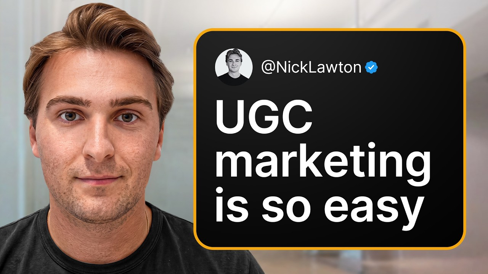

# #1 UGC EXPERT Reveals How To Market Consumer Apps

Start building & deploying paywalls in 10 minutes flat: https://superwall.com/

## Table of Contents

* [00:00:00] - Intro
* [00:02:54] - Who Is Winning With UGC Right Now
* [00:04:22] - Starting With a $4,000 Budget
* [00:06:39] - Researching Formats Before You Launch
* [00:07:52] - How to Pay Your Creators
* [00:09:03] - Finding Content Market Fit
* [00:13:38] - Why AI UGC Does Not Convert
* [00:18:40] - Warming Up New Accounts
* [00:20:19] - The 90/10 Scaling Split
* [00:25:16] - Where Paid Ads Come In
* [00:30:05] - How Much to Spend on Winners
* [00:38:23] - Using AI Agents for UGC
* [00:43:38] - Wrap Up

## [00:00:00] - Intro

We have people spending anywhere from a quarter million to north of 700,000 on the platform. >> 700,000 per month? >> 700,000 per month. Yes, correct. >> Nick Lawson co-founded SideShift, and basically every app you can think of runs their UGC creator campaigns through it. [00:00:00 → 00:00:17]

The interesting thing is Cursor is on there, but so are founders just starting out with a couple thousand bucks. Nick sees all of it, so he knows exactly which campaigns make money and which ones don't. So, we went deep on the whole thing, and about 15 minutes in he stops and says this. >> AI UGC, great for vanity views, terrible for conversions at the end of the day. I've not seen it convert. [00:00:17 → 00:00:39]

>> This is not a guess, by the way. He's looking at the conversion data across hundreds of campaigns, and AI UGC just doesn't convert as well as humans. What actually works is way more boring than people want it to be. We went into what kind of content doesn't just get views, but actually converts to downloads and revenue for consumer apps. Then he broke down how the biggest spenders actually split their marketing budget. [00:00:37 → 00:01:00]

>> You have a creative organic budget, which is about 20%, and then the absolute monolith of the budget is the performance budget, and that accounts for 80%. >> So, making the content, paying all those creators, that's only 20%. The other 80% is just paying money to put the winners in front of more people. The signal Nick watches for is a 5% engagement rate. A video hits that, and it gets ad spend. [00:00:58 → 00:01:22]

You can start with $100 a day, and the biggest teams are spending 100,000. In this episode, Nick walks through his entire process, his format research, how he avoids competitor saturation by tweaking videos 10 to 20%, his content market fit metrics, how he looks for at least one video that gets 10,000 views within the first 180 to 300 videos, and the 90/10 split after he hits that first winner. 90% of your creators running the winner, and 10% keep testing. If UGC is anywhere on your road map, you should watch this video before you spend a dollar. This is the Superwall podcast. [00:01:20 → 00:01:54]

I'm Joseph Choi, founder of Consumer Club, a Discord where top consumer app founders trade alpha and what's working now in growth. I've been talking to members doing a million ARR and they tell me they've been using these two tools. Superwall has this free AI tool trained on 422 profitable paywall experiments across thousands of successful apps. You upload a screenshot of your paywall and it gives you an experiment idea to make more revenue with the same number of users at paywallexperiments. com. [00:01:52 → 00:02:16]

And if your app's doing at least 100k MRR, we host vetted dinners in SF and New York to hang out and network with other top app founders. You can apply with the typeform in the description. Also, these app founders have been telling me they use Rorke. I met Daniel, the founder of Rorke, at a dinner and I got genuinely really excited when he told me about Rorke Max, which is out now and has honestly changed the game for coding mobile apps. It's AI that one-shots full native iOS apps with Swift code, camera, sensors, haptics, payments, the whole stack. [00:02:16 → 00:02:42]

And as you vibe code with Rorke, you can install prototypes directly onto your iPhone with one click and then publish to the App Store in two clicks. If you've been waiting for AI coding that actually does native iOS apps well, this is it. I got you guys a discount. [00:02:42 → 00:02:55]

## [00:02:54] - Who Is Winning With UGC Right Now

You can use the code Superwall or use the link below. I think where I want to start actually is what are some exciting customers you've seen popping off recently? >> Exciting customers popping off on Sideshift recently, you got to give a shoutout to the Cursor team. They've been absolutely crushing it lately. Um obviously a lot a lot of good stuff going on over there. [00:02:54 → 00:03:16]

Yeah, man, it's interesting to see UGC really start to trickle into some of these larger enterprise. I think when we started this thing, it was consumer apps that had just kind of started off but started out, but now we're seeing some of the biggest in the world use Sideshift and we're seeing them run massive UGC campaigns as well. Movies has started [music] to kind of pick up as well. I think entertainment is a great type of vertical for UGC. Obviously, it's predominantly all clipping right now, but I think, you know, there's a little bit of a of a title shift where we're starting to see some new types of content uh, circulate, movies and songs and >> That's pretty crazy that people I I never would have predicted that these big companies would start getting on UGC. [00:03:16 → 00:04:00]

For me, this all started with e-commerce and drop shipping and I see TikTok shop creators doing it, but now like B2B brands doing it is is pretty crazy. Aside from the the huge brands, have you also seen like new customers, any any like new apps that sign up for SideShift and then they just kind of see like immediate success? Have you seen any trends in like people that are able to do that? [00:04:00 → 00:04:24]

## [00:04:22] - Starting With a $4,000 Budget

>> Yeah, 100% man. I I can't really share any names just because obviously they're they're growing and some people like to remain confidential. However, the amount of I mean, I guess I can talk about space, right? Right now, I'm sure as you're aware that the peptide GLP-1 space has been absolutely ripping on the platform. There's a ton of peptide trackers using SideShift for distribution. [00:04:22 → 00:04:43]

Kind of back to your original question, yeah, I'm seeing tons and tons of, uh, new apps every day. Start with a small budget of maybe two to four thousand dollars, see good results and then from there they start to scale aggressively month to, [music] you know, >> I think a good a good way to start this pod, I think I just want to go through that whole journey of when you first start with two to four thousand dollars, like you said, what type of validation are you even looking for when you're trying out UGC creators, and then what's next and then what's next after that? Like I think that seeing like the complete workflow cuz you're one of these like rare people that can see the entire flow across hundreds of different customers and you've seen what works and what doesn't work. So it'd be really valuable, I think, to hear that end to end, like when you're just starting out until scaling up to I don't know how much how much do like your top people spend on UGC? >> We have people spending anywhere from a quarter million to, uh, uh, north north of seven hundred thousand on the platform, right? [00:04:43 → 00:05:51]

>> 700,000 per month? >> 700,000 per month. Yes, correct. >> Wow, that's insane. Okay. [00:05:50 → 00:05:56]

And like, why are they spending that much? Is it like profitable or is it like for impressions? >> It's profitable. It's different. No other channel is working as well right now. [00:05:56 → 00:06:05]

Once you have the flywheel really going and you have content market fit across the board, you have a great creator engine, you really can start to see some pretty low CPMs across the board and it's really just a matter of doubling down on creators that are working as well as formats that are working, right? It's like it's a tale as old as time. It's easier said than done, of course. Obviously, some of these companies have massive resources of not only capital but lots of time and human labor to help with this process. >> [music] >> But once the flywheel is absolutely running, it it becomes incredibly easy to sustain and grow. [00:06:05 → 00:06:40]

## [00:06:39] - Researching Formats Before You Launch

>> So, how do you start? Yeah, if you have that two Let's say a 4,000 on budget. Like >> When you have your app built, there's a couple things that you should do before launching your UGC campaign. I think the first and easiest is to go to TikTok, to go to Instagram, go to any of these platforms, search up any competitors you have in the space. [music] I think often times people get so overwhelmed with having to try and create a brand new format when in reality all you really need to do is just go and look at what competitors in your space are doing. [00:06:39 → 00:07:12]

Now, you don't need to blatantly rip them off, but you should start thinking about some potential formats that could be remixed about 10 to 20% and then [music] plug your product into those. So, I would say just start to get an idea of that before you even launch your first UGC campaign. And if you don't have two to 4,000 dollars, what you should do is you should still create these accounts yourself given that if you just launched an app, you're probably a small team, you might not have a lot of resources. One of the best things you can do to just actually accelerate your business is by showing up every day with UGC. You have an idea of, you know, the type of content you're going to want to create. [00:07:12 → 00:07:52]

I would go ahead and I would launch a campaign. [00:07:50 → 00:07:53]

## [00:07:52] - How to Pay Your Creators

When you launch said campaign, you're going to want to pay anywhere from $600 to $800 for 30 to 60 videos. You're going to also want to layer in view bonus incentives. What we found works really well is a structure of that guaranteed base retainer, $600 with either an uncapped CPM, because the idea is that if it's uncapped, you should be going viral and it should be bringing a lot more revenue to your app. However, if you want to cap them cap the upside, you can a little bit in order to just make sure that things are profitable. So, we'll say it's $600 with a dollar to two dollars CPM, either uncapped or capped. [00:07:53 → 00:08:38]

That seems to be the most fruitful for creators, which but also incentivizes them. So, obviously with a budget of between two to four thousand dollars, you're going to be able to get substantial amount of volume that's going to really allow you to A to optimize solving for one problem in your first month. And that is finding content market fit. That is the thing that I think a lot of people overlook, and it's also one of the things that leads to a lot of people to quit early on their UGC campaign. [00:08:38 → 00:09:09]

## [00:09:03] - Finding Content Market Fit

>> How do you define content market fit? Cuz let's say you have these $600 per month retainers for basically daily or twice daily videos per creator, and you're looking at like one to two dollars CPMs, so you're looking for them to go viral. Like does content market fit mean you get just at least a couple of formats to go viral, or is it like a certain CPM that you achieve, or some other metric? >> think it's a certain CPM in that first month, and I don't think it's even necessarily going extremely viral, right? Obviously, that's a very clear indicator, but if you have a format that has legs, like I was saying, that's starting to show promise where it's getting, you know, above 10k views, maybe you have a couple different iterations of one kind of like [music] pillar format that's starting to go viral. [00:09:07 → 00:09:54]

I mean, everyone's definition is is different. I I consider something viral after 100k, but let's say at that 10,000 view mark, right? You have consistent [music] videos that are kind of hitting that. Maybe it's like five or six out of the entire campaign. That's kind of how I would define content market fit. [00:09:54 → 00:10:12]

From there, I'm analyzing watch time, analyzing retention, uh trying to understand like why those videos are working, and then, you know, I'm also doing this. I'm very big on sharing all learnings with creators as I'm learning them, and the reason for that is I want these creators extremely bought in, and I also think that if you're managing if you're trying to manage creators one-on-one, you're going to have an extremely difficult time. The best way to manage everything is just by running it all in one massive group chat where everyone feels like a big family and you're sharing the wins and learnings along the way. So, I'll be breaking down videos in a group chat, you know, saying, "Hey, like look at the watch time here. I'm curious if maybe we maybe maybe like do we think it's this word that really is work really well for this video? [00:10:12 → 00:10:54]

Is it the audio? What is it? Let's try and, you know, extrapolate these findings onto a couple more videos and see if we can really identify those variables that are driving the videos forward. " >> So, you're you're just looking for like 10,000 view videos or like like signs of videos that could get more views because it's it's like it's basically like product market fit where you don't need to see it's not really the scaling phase. It's just you need to know that some of these videos have potential because you're going to iterate with the creators and like be able to multiply the success. [00:10:54 → 00:11:31]

But then, I'm curious like if there's existing formats out there. You know, in phase one you said you go on TikTok and Instagram and you search for videos in your niche that, you know, there's evidence that there could be something that works. What if you just copy the formats that already exist? Like shouldn't that take Like have you seen people that copy formats that already exist? And then it should take like pretty pretty It should be like pretty quick to find that that fit cuz it kind of the fit is already like validated in a way. [00:11:29 → 00:12:02]

>> 100% people to remix it at least 10 to 20% so it's not a blatant copy. Avoids a couple issues right there off the bat. The other thing is those accounts have already warmed up in that audience extremely well, right? So it's like they've built that account up usually over the span of a month or longer. Once you have kind of that warmed up account, then it's going to be a lot easier to kind of continue to pour gasoline on the fire, right? [00:11:59 → 00:12:29]

Don't get me wrong. There's plenty of accounts that, >> [music] >> you know, will start day zero. They don't warm up properly. They don't have the audience. They'll copy the format exactly and it doesn't necessarily work, right? [00:12:29 → 00:12:39]

[music] That's why if you can find a unique format that really isn't that unique. [music] It's It is a winning format that's copied, but it's remixed 10 to 20%. That will get your account a ton of validity through the algorithm and from there that's what's going to allow you to scale. >> I see. So let's let's go and do an example like for like the peptide tracker niche. [00:12:39 → 00:13:01]

Um cuz you said that was a niche that's popping off. So there's probably a lot of content already out there that's validated. So like I just searched peptide tracker on TikTok. And for example, let's just look at first video. This is like a slideshow and it's just like looks like it's from a UGC like a new UGC account. [00:13:01 → 00:13:19]

The first slide is a caption that's like, "Hey, this app is so perf. " And then it's just three slides. It's like another UI slide. And then And it's just like a screenshot of the app. Like And this video seems like this got like a couple thousand views at least. [00:13:19 → 00:13:35]

And there's like comments that are asking like what the app is. [00:13:35 → 00:13:39]

## [00:13:38] - Why AI UGC Does Not Convert

>> I mean, this brings up a whole other dilemma, right? Where AI I mean, sure we can get into this, but I'm sure you have you've had many people talk about this, but AI UGC great for vanity views, terrible for conversions at the end of the day. I've not seen it convert. As you can see here, like the user sentiment like is it that great? >> [music] >> Um whereas people should be asking like what does you know, what what's the app? [00:13:38 → 00:14:01]

What's this? What's that? That's like a true testament of [music] um like really strong >> Cuz this one got like, you know, 17. 9 thousand views. And but then all the comments are like, what the heck is AI? [00:14:00 → 00:14:16]

But then this video, I think it only got it got 10,000 views. But there's comments that are asking about the app. >> Transpiring, this is like a terrible account. Content's like pretty scattered all over over the place. This is not an account that's like doing a good job of finding content market fit. [00:14:13 → 00:14:31]

And even if they did want to keep running that AI format, which one I they should, but if they were smart, they would just keep doubling down on seeing that type of content since it sort of worked. Some people mix views. They think that views just correlate with success, and that's not always the case at the end of the day, right? Really has to come down to like how is this video actually converting? Like it's great that you could say you run a massive UGC program that does 10 million views a month organically, but if all those videos are slideshows and it converts at a 0. [00:14:31 → 00:15:03]

0001%, like then you're just burning money on fire. And it's setting a bad example kind of for the industry. [music] >> So when you're doing these this like research content research, you wouldn't even look at this to try to iterate on this 10 20%? >> That's for the mod. >> Let's start from the beginning again and try to find like how do you research a good format? [00:15:03 → 00:15:20]

>> Okay, so this is a real creator. This actually brings an interesting point, right? Yes, research a competitor, but this kind of goes back to what I was saying when we had no competitors, I had to draw on more regular just everyday type of creators who were experiencing or facing some sort of plot problem that my product was going to solve. From there, I was able to come up with something that makes, you know, somewhat sense in terms of a potentially viral converting video. You know, so for example, my face before peptides, if you click on that, extremely simple, it's not AI, it's not a slideshow. [00:15:19 → 00:15:54]

You can clearly see she passes the uncanny test. Super simple to get someone like this to do a before and after transformation and then layer in a CTA at the very end, right? And obviously you need some sort of creative imagination for that, but it's not the hardest reference or it's not the hardest jump to make, right? As you can see, the sentiment is pretty strong. I need I need I need. [00:15:54 → 00:16:17]

Um so, whether you are a peptide app or you actually had a peptide product yourself, something like this could stick and it's definitely something that I would try. >> It's kind of like a joke format cuz you're saying like my face before peptides and she makes you wait for like the whole 10 seconds. And then the last 2 seconds, she says, "My face still before peptides cuz I still don't know what the heck they are. " >> [laughter] >> But then like people in the comments are still asking like what's where's the how did where how did you get them? And then my then some people get it. [00:16:17 → 00:16:46]

Seems like this is a great format for you could tweak it a little bit and say you could just put a call to action at the end instead of saying, "Hey, I still don't know what it is. " Like this could be a simple before after format. And the viewer retention is probably very good. You're saying a a good way to research formats is not necessarily copying competitors because it's that means it's probably already a little bit more saturated, but just finding regular videos that talk about some kind of problem and and tweaking it to add a CTA. >> For us like, >> you know, we were research a lot of formats in the job market, right? [00:16:46 → 00:17:23]

Job market so good, this and that. And we ended up just like being able to take these actual just organic creators videos and then add in some sort of CTA. I think like yes, the easiest route to go is just copy a competitor, remake it 10 to 20%, but if you want to go into actual like format discovery and format creation, what you really do is is you're not copying other people. Yes, like you can still draw inspiration. This was a format that I created last year. [00:17:23 → 00:17:54]

And [music] funny story is I saw this from a girl who actually did get denied from an entry-level position at a zoo and she had a dual master's degree or something like that. And I was like, "Wow, this is absolutely crazy. This would definitely be a great way to plug Side Shift. " So, as you can see, even still a year later, we we still use this format. That um it doesn't convert super well, but it's a great warm-up format, which is a different type of format. [00:17:51 → 00:18:21]

It warms up accounts super well and it starts to get the the niche quite engaged. >> Oh, you actually did say Side Shift a minute into this yapping video, but this video got 700,000 likes, which is >> Yeah, that would be That would be That would printed, man. That would printed. >> It's not just warming up the account cuz I've heard like people talk about warming up UGC accounts, but you're saying like it's good to post just high view videos and then because that shows the account who you want to watch the future videos. [00:18:21 → 00:18:51]

## [00:18:40] - Warming Up New Accounts

>> Exactly. I mean, usually like when it comes to to warm-up videos, I'm trying not to confuse like the first the first-time UGC operator here too much, but like yeah, there's a thing where you'll essentially want to run a warm-up for a warm-up format, which is basically a video that doesn't focus on any sort of call to action. You're not worried about conversions. You're just trying to signal to the algorithm than you're a real that you're a real person and that all of the content that you're about to post as well is you know following all the guidelines and is real and is everything. So you really optimize for views on that right there. [00:18:49 → 00:19:25]

Often times the best format that uh warm up an account super well are those that are quite controversial just because that sparks virality. It's harder to like plug a proper CTA into those videos without it feeling off without without it feeling like inauthentic, which is you know obviously like one of the biggest hurdles that you must overcome and and UGC is making the call to action feel extremely natural, subtle, and not to a viewer to say, "Hmm, that's actually pretty interesting. Let me go take a action [music] now and try and convert myself. " >> It seems like really really simple actually to do these this format research. Like I was just looking at this video too and this is like in the job market. [00:19:22 → 00:19:59]

She's saying like job market is so bad. I've been applying to all these things. And then she kind of like shows her iPad screen but there's nothing there. It's just like LinkedIn or something. But this could easily be tweet. [00:19:59 → 00:20:12]

You know, you could just show your app on the iPad or something. Like >> Be curious to see how conversions are at the end of the day, but yeah, you you you're on the right track. [00:20:12 → 00:20:21]

## [00:20:19] - The 90/10 Scaling Split

>> It seems like pretty simple to to do the the format research and then so and then step two is just two to four thousand dollars budget to in your first month just to get maybe like five to eight creators, small base, a little bit of CPM as well. And then you're trying to find content market fit. So then what do you do once you find, you know, a few formats that have you know, maybe 10 you know, to 50,000 views. >> Usually like the best sign for us and just like even from our own personal experience is like when I have my campaign launched on SideShift and I'm checking my analytics tab and I go to my post page and I see okay, we finally have some content market fit here. Now it's time to double down. [00:20:19 → 00:21:01]

What I'll do is I'll usually just go back to our to the marketplace and I will source more creators. Or I may go back to my campaign listing and just find existing creators that maybe were new applicants or that I had originally just passed over for whatever reason, but I'll usually talk to those people on a 5 to 10 minute call, tell them how the campaign's going, tell them why we're scaling up, then I will assign them to the campaign, add them to the group chat, and then we're kind of off to the races. And this is really where you're just pouring gasoline on the fire. I still have about 90% of the creator cohort posting that new format and just dragging that into infinity. However, I will have maybe 10%, which is usually like one to two creators, still testing a couple new formats on the side for one of two reasons. [00:21:01 → 00:21:51]

One, I always want to be finding new formats, but two, if my other format gets too saturated, I want to have another one ready to go that I can then just kind of like slot into the chamber and have that cohort continue to rip it. >> What's that percentage of like new formats exploration versus just doubling down on existing one? >> Like I said, it's probably about 10%. I'm having 10% of the creator cohort finding new formats. Everyone does a little bit differently, but that's what we found to work really well. [00:21:51 → 00:22:19]

I don't think like, yes, put all your eggs in one basket, but maybe keep a slightly smaller basket to the side just in case. You really want to hedge your bets here a little bit. I mean, I know some people that just run one format and they just run that thing into oblivion. That's not us. We like to hedge a little bit and just be a little cautious that we're not saturating our audiences too heavily. [00:22:19 → 00:22:39]

>> It's actually a more than I thought, like 90%, and then you're saying some people even do just 100%. Like you you have six creators, maybe it's like kind of demoralizing to you know, three, four weeks, you know, you don't see anything, and then as soon as you get that one video, then you just shift all of the creators to just doing that one format, and then they should all like do much better. >> Right, then it's barbecue chicken at that point for the rest of the creators, you know, especially if they got the view bonus, like if they're on a view bonus structure as well, like everyone now has seen another creator in the cohort do well. They know the format works. Now they're going to spend a little bit extra effort here trying to copy that format and making sure that they can drag that thing out. [00:22:38 → 00:23:22]

And I think on the contrary for the creators that are a little bit more still in like the discovery phase while the rest of the cohort is kind of like dragging these formats out, I think it it's important for them to know that like often times some of those first videos of a new breakout format are the ones that will go the most viral, right? Just cuz the algorithm hasn't seen them before. >> So, let me show you this. A lot of app founders I talk to have a feeling their app has viral potential, but don't want to be the person brain rot scrolling an hour a day hunting for formats, or worse, burning thousands on creators shooting videos that just flop. Recently, I've been telling every founder I meet about Spytalk. [00:23:22 → 00:23:58]

It's basically an AI TikTok viral marketer that I've seen a lot of top app growth teams using. You just paste a link to your app and this agent scrolls hundreds of thousands of TikToks for you, finds the outlier videos from competitors who've already cracked the best formats that are driving installs in the niche of your app, and then it remixes the hooks, the angles, and then it makes playbooks so you can pretty much copy paste virality. And then it alerts you when it detects new breakout formats that would also work for your app. This is the only growth tool I 100% vouch for on this channel because there's a ton of gen AI content tools out there, but none of them tell you what to make. Spytalk makes sure you're never in the dark about what's actually working now. [00:23:58 → 00:24:33]

I'll put the link in the description. >> Do you see a big difference in this next phase where you're asking creators to come onto a campaign that's already doing well? Like do you see a difference a big difference in their willingness to to jump on? >> Creators are more willing to jump onto a successful campaign because they see it's working, they see there's content market fit, they see that if they can slot themselves in, they should be able to be one of those top creators that starts to produce, especially on side shift since we have all like the shareable links and stuff, often times brands will send their dashboards into the chat so all the creators can see like, "Okay, here's a leaderboard. Here's who's doing really well. [00:24:33 → 00:25:07]

Here's the format that's working. " So on and so forth. There's really like a million different ways to run a UGC campaign. So some people might be sitting here and thinking everything I'm saying is wrong. Although I would beg to differ, I'm not too wrong. [00:25:07 → 00:25:19]

## [00:25:16] - Where Paid Ads Come In

>> Do paid ads come into this at all, or is that the next the next phase? >> I think paid ads come into this pretty heavily, actually. I think there's some people in the UGC space that are just too organic marketing pilled. And like, that is definitely like where we started. And I think organic marketing is huge and it's amazing. [00:25:16 → 00:25:36]

But I think after working with some of these massive enterprises, what's become really apparent is that they use this channel as one, obviously a great way to go viral organically, a great way to get copious amounts of volume out onto the internet, a great way to drive millions and millions of sign-ups, downloads, whatever it may be. But what they're also doing is they're testing dozens of creatives every single day. These people have a massive performance budget. You have to remember that in a marketing budget, it's really like split into two. You have a creative organic budget, which is about 20%, and then the absolute monolith of the budget is the performance budget. [00:25:36 → 00:26:18]

And that accounts for 80%. So what these people are doing on their performance teams is they're constantly testing which creative is working for us, which seems to be resonating really well with our audience. Once they have those data points, obviously it becomes a little bit more of kind of a technical process in running a a monster paid ads campaign. But if they go on SideShift they see an engagement rate is above a certain percent, they know that that video works. They take that video and then they put paid ad spend behind that. [00:26:18 → 00:26:50]

And that is where I'm seeing some of the biggest differentiators between people running solely organic and people running organic and paid, which is why we're building this paid ads integration for all of our brands to now run all of their organic winners as paid ads on Meta, on TikTok directly through the platform, right? So, they don't need to necessarily [music] download the videos now. They can just run that all in one spot. >> refreshing take cuz I think a lot of people are just like like you said, like so organic pilled and just have any experience in ads. And I think that can be intimidating, too. [00:26:48 → 00:27:27]

Cuz like if you're used to organic and you're used to not paying per view base you're I mean, you're paying CPM bonuses, but paid ads is just it feels like a a whole different thing. Is it really that intimidating? Like what should a person do to get started with ads if they're already pretty good at organic? >> I would say it's intimidating because people only know the Meta Ads Manager as this like big scary monster. And to be fair, it is quite intimidating when you first get in there. [00:27:27 → 00:27:54]

Like I mean, that's why I actually think we're the right people to be building this because we were so organic pilled ourselves and we understand how simple organic really is at the end of the day that we wanted to apply that same philosophy to an ads product. So, what we really did is we took the Meta Ads Manager, we integrated it with Inside Sherpa. We made it extremely simple for you to run these paid ad campaigns almost as you were just running a UGC campaign. >> It sounds like the platform is really useful. Like operationally, regardless of the platform, like how how should you run your organics? [00:27:54 → 00:28:27]

Like if you're getting your next wave of creators on and you're starting to kind of pop off like 50,000 views, 100,000 views here and there, like what do you what should you be doing with Meta Ads? >> I think what you should be doing with Meta Ads is you should be taking your top winners once they hit a certain engagement rate. Everyone has a different engagement rate that it works upon for them. Our engagement [music] rate is around 5%. That's what we see work really well. [00:28:27 → 00:28:54]

Once that happens, we're going to allocate some spend behind it, and we're going to basically just test and start to see what the conversion looks like. Now, the great thing about paid ads at the end of the day is it solves the old the age-old question of organic marketing, which is where's the attribution? Luckily, with paid, you have attribution. It allows you to justify putting more spend behind certain things. You know, organic is is tricky because you have correlation spikes. [00:28:54 → 00:29:22]

You know, we have the ability to connect your revenue, CAD, your Superwall, your Stripe, all these different things, and you can see correlation spikes when, you know, you get a big view spike, does your revenue go up, does your installs go up, whatever. Now, in paid, like with direct UTM links and tracking, [music] you can see just exactly how everything is converting. How many trial starts are you getting? How much is that converting? What does this actually look like at the end of the day? [00:29:22 → 00:29:47]

So, my recommendation is to always start with organic. Yes, like if you are new to paid ads, start with organic, really understand how that game works. >> [music] >> But, as you could as you continue to scale up, you have content market fit, you have some budget now to deploy, start to put some of that budget into paid ads with those winners that are working. [00:29:47 → 00:30:08]

## [00:30:05] - How Much to Spend on Winners

>> If you look at like 5% engagement rate, I think is the bar that you said you want to look at um to start spending, how much do you spend on on videos that have that 5%? >> It all depends on your ROAS, right? If you're spending 200 bucks and you're getting 400 bucks out of it, then like great, keep spending and keep running that flywheel. Now, if you're spending and you're losing if like if you're putting dollar in and you're getting 75 cents back, then you're just going to accelerate the bleeding and you should probably not be running that video as a paid ad because then you clearly it didn't have uh organic content market fit. Some people start with like $300 a day. [00:30:05 → 00:30:40]

Some people are running up to $100,000 a day. It all just Now it actually depends on how much capital and resources you have to deploy. >> In the same example of like the work of the end-to-end that we were describing before where you have like 2 to 4,000 first month and then you bring on some more creators because it's working out and then now you have a bunch of creators copying the formats that you're already winning at and you have like maybe 10 examples of like formats that are hitting, you know, 100 plus K views and they have like 5% engagement, right? What's a good spend level like to just to try out cuz I think people are kind of intimidated by uh just spending. Like even beyond the Meta Ads Manager itself. [00:30:40 → 00:31:21]

It's just like what are you supposed to spend on these initial winners? >> I can make some assumptions off of that. Like let's say you started with that 2 to $4,000 budget, you found content market fit. Now your budget has grown to over 10,000 a month for marketing including organic and paid. I would start just simple, maybe 100 bucks a day, see how that bodes for the first 14 days contingent on obviously like what your funnel looks like. [00:31:21 → 00:31:44]

What is your free trial look like? All that stuff. Are you a 7-day free trial? Are you a 14-day free trial? But I would start there. [00:31:44 → 00:31:50]

If you're seeing a positive ROAS, which you should if you're doing it properly, then you can start to allocate more spend into that. >> Is that $100 per day per ad or just total? >> Collective across how many videos you're running. Maybe you're only running three. So, right? [00:31:50 → 00:32:05]

We're allocating 33 bucks across the board to each video. That's like it's it's going to be pretty small. To give you an example, when we first started running paid ads, we were running at an extremely small scale. We were doing like 100 bucks a day. We started seeing great results obviously as we had more creative and we started to put more money behind it. [00:32:05 → 00:32:23]

But $100 a day is like enough to get your feet wet and be like, "Okay, like this starts This is starting to make sense for me. I'm seeing a positive return here. What does it look like if I now start spending $300 a day? What does it look like if I spend $1,000 a day? " So on and so forth. [00:32:23 → 00:32:39]

>> And do you do meta ads or TikTok ads? >> We do meta ads primarily for B2B. >> Oh, interesting. So, if you're doing like organic on TikTok, you basically have to like download the videos from the creators and then like upload them to meta and then run them. >> So, that's what you had to do. [00:32:37 → 00:32:54]

Now, you can do it all through SideShift where you can just pretty much say, "Hey, I want to put $10,000 behind this. " And we have that integration now where you can just pour the spend directly into the video. The same thing with TikTok Spark as well. TikTok Spark very similar to meta. It's honestly a lot simpler to understand. [00:32:54 → 00:33:13]

Transparently, it's not as intimidating, but the the principles are are the same. >> So, you do both. You do like TikTok Spark ads and then also meta ads. >> TikTok Spark ads is more for like pushing organic, right? That's more for like if you have a video doing really well on organic that has a really high CTA. [00:33:11 → 00:33:29]

Like, let's say >> [music] >> I mean, to draw back to that example of Frank short, one of our creators. If that call to action was stronger and it was converting extremely well, we would maybe pour Spark ad dollars behind it to continue to push it into the organic sphere. You'll have a little bit of the It's going to give you an attributable CPM. It's not going to give you, obviously, the conversion and attribution that you're going to get from meta [music] ads. >> Oh, right. [00:33:29 → 00:33:55]

Because you're just pushing it in the for you page and it shows up as an ad, but there's no anchor on the Spark ad, right? >> Correct. No anchor. >> Yeah, there's no button to actually CTA and like download the app. But, meta ads, obviously, there's button, there's more attribution. [00:33:55 → 00:34:08]

I see. So, it's very different. So, I I would guess that CPMs are probably cheaper for Spark ads then? >> Yeah, CPMs are cheaper and that's really the only thing you can measure from it at the end of the day. Like you said, there's no anchor. [00:34:08 → 00:34:19]

I mean, if you want to run it now, TikTok ads, there's an anchor, that's different. But, you know, there's no CTA. >> The real scalability comes with meta and that's where you got to I mean, like met if it if you do it manually, you have to So download the video from TikTok, upload it into meta, decide how much to spend. But if you're already running organic on SideShift, you just put budget in and it just allocates it to the winners. >> Yes. [00:34:19 → 00:34:42]

>> I've never seen that an organic platform do cuz I feel like there's these organic marketplaces and you can like run your organic. But then it's always like kind of a manual process like pull the videos out and then put it into meta. >> Most brands should have an amazing organic pipeline, right? That's where you're testing everything, that's where you're getting to read those rewards. But as you start to scale up, you know, and you become a real enterprise like there's a reason why, you know, some of these platforms are spending millions and millions of dollars on paid ads every year, right? [00:34:41 → 00:35:12]

It clearly works across the board. So we wanted to just bridge that gap between organic and paid, right? We wanted to be able to go to a creator and say, "Hey, you were getting paid a retainer and a CPM. Now we're going to pay you a retainer and a percentage of those ad sales that you drive now that we can track that directly through SideShift, right? And that also becomes really compelling to creators and it opens up the world of, you know, I think TikTok Shop creators who are very familiar with this model, but now bringing them over to Canvas UGC, which is where which is the landscape that we sit in. [00:35:12 → 00:35:51]

>> One of the big challenges with ads also is just figuring out your ad creatives and so many paid ads are UGC-based ad creatives anyway. So if you're going to do UGC, you still have the creator somehow. But you guys already have all the UGC creators and you just start with organic and then you get to the ultimate goal which is paid. >> Right. Well, that goes back to what I was saying earlier when you asked me like, "Do we have brand spending X amount like six figures plus, six figures a month? [00:35:49 → 00:36:18]

" And like, "Yes, we do. " And like, that six figures may seem like a lot, but that's actually nothing in comparison to their overall advertising budget where they may be spending six figures with us for all this organic testing, but they might be might be spending seven to eight figures with their performance budgets as well. So now it's about, you know, intertwining both. >> That really is a next level of skill that I think people that are really, really good at organic, I'm just so bullish on them being the best in the world at paid. Cuz there's people that um go in the opposite direction and it's really hard to like unlearn paid and figure out how to do organic UGC. [00:36:18 → 00:36:55]

But if you know hooks and like, you know, algorithm and for you page and stuff, I feel like that's like the transition to paid is like not actually that hard. >> Our goal is to just make that process of learning paid and running paid ads like through Sider, it's extremely simple so anyone can really understand it at the end of the day because yes, there's so many great UGC operators out there that I think are missing out a little bit when it comes to can they double down their strategy with paid. And I'm starting to see that shift a little bit on Twitter as well, which is great to see. Obviously, you still got some people who are extremely UGC pilled, but the best people in the UGC space are ones that, you know, are aware of this. They're aware of how you test with organic and then run that as paid like >> I do feel like this is maybe the next shift cuz I feel like a couple of years ago when you and I probably saw the same thing with TikTok shop where it was like, oh, TikTok shop creators and marketers are the real marketers. [00:36:55 → 00:37:53]

Like nobody in app space is doing this real kind of marketing. But then a couple years before that, they learned from the affiliate marketers and the clippers and stuff like that. And then now it's like the whole space is kind of evolving towards okay, we're grinding this out and we're actually doing real good marketing with organic UGC, but it just doesn't make that much money compared to paid ads. And like if you just take that same skill set and apply it to a more scalable model, it's there's just so much more money to be made. [00:37:53 → 00:38:25]

## [00:38:23] - Using AI Agents for UGC

One last question I had for you was we got to talk about AI a little bit. Like what how how do you think the the best leverage teams are using AI? Not not in like ad creatives or videos, but just like in workflows like make stuff efficient. >> I've seen a lot recently on Twitter the rise of all these platforms claiming to do the GPT for marketing or GPT for UGC, Claude for UGC. But I think it's about like taking it a step further and like our vision for helping people run campaigns was like what if your AI could cut your existing creators, right? [00:38:25 → 00:39:02]

What if your a your AI agent could effectively deploy spend behind all these winners for you? How can we move into this extremely autonomous era that you know, it's taking over Silicon Valley and all these other industries and bring it into an industry that is relatively very creative, but there's actually a lot of nuances behind running a massive UGC paid ad system. And I think when you talk about automating these processes like what we just launched with our agent where you're able to go on SideShift now, type in your budget, drop your website, set the the amount of creators you're looking for and just hit go, it really makes this process as easy as possible, right? The amount of friction that there was for first-time UGC operators was extremely high because you need some you need a knowledge base of figuring out like what creator should I work with? Which brief should I be testing? [00:39:02 → 00:40:01]

Which hook works very well? What pay structure should I be working? >> [music] >> So now our goal, the same way that we're trying to make we're trying to take these UGC operators and make them really comfortable with paid ad spend, we're trying to take people who have never ran UGC campaigns and show them the ropes with our new AI agent effectively, right? Where they can come in and they can just do all those steps that I said, really just drop your link, drop your budget, and just hit go, and our agent will teach you the ropes, right? >> When you said briefs, that's kind of what is blowing my mind cuz I feel like the biggest challenge in like AI for marketing is like it's all slop in my opinion. [00:40:01 → 00:40:40]

Like most most gen AI tools are just like if you try to apply AI to marketing, it's just slop. But then it's like doing the judgment side and like figuring out who like which creators to cut, which ones to hire, how to manage them, that actually seems more like an AI thing that like an AI would be potentially better than a human at managing a bunch of creators. But then the brief part makes so much sense cuz you guys have data on all of the most and least successful UGC campaigns. So, you guys can probably make the best AI briefs to like tell creators what to make. >> Exactly. [00:40:40 → 00:41:17]

And at the end of the day, like we're training our own model based off all of you know, all of this really important data. And I won't go too into the weeds for it, right? But it helps give everyone the best chance of building an actual viral campaign, right? Instead of just guessing at the end of the day, you know? And it takes out all the ambiguity of what I talked about at the start where it's like, "Should I go and copy this format and remix it 20%? [00:41:17 → 00:41:44]

" Or what if I just know that the way that, you know, I string these words together and I use this audio for this niche it start it actually has a much higher success rate than even something I thought about copying, right? And we take a lot of the decision paralysis out of the equation and just make this extremely extremely simple and non-complex for both brands and creators. >> I feel like one of the first things that people think about when they're trying to do get into UGC is like, should I hire a growth lead or like some kind of like head of Tik Tok? Do you think that's necessary anymore with like SideShift Agent? >> Not necessarily, transparently. [00:41:44 → 00:42:25]

I think like you still do need labor to run your UGC campaigns. I [music] think our whole goal is to try and just make all of these archaic and complex processes extremely seamless. And like even if you don't have a growth leader, a campaign manager, like now you can just go on SideShift into the mark into the discover marketplace and just grab a campaign manager who can run your whole operation for you, who understands how to use our new agent, who understands how to use SideShift to its fullest, and then obviously run this viral UGC campaign. So, do I think that yes, there's still a need for a for human for human labor in the equation? Yes, I I always think there will be, but the agent is supposed to make their job extremely simple, right? [00:42:25 → 00:43:10]

Where they can focus just more on the high-leverage thing. >> Wow, this is super exciting. Yeah, Nick, thanks for thanks for being on the pod. >> Thanks for having me, Joseph. Always a pleasure. [00:43:10 → 00:43:17]

We'll have to We'll have to have you come by the office uh soon. I know you're due for a visit. >> Yeah, let's do it. Where where can people find you? Are you're on Twitter, right? [00:43:17 → 00:43:27]

>> I'm on Twitter. You can find me Nicholas N Lawton. That's probably the best place to connect. I'm always down to shop with anyone on uh anything UGC related. So, hit me up. [00:43:25 → 00:43:40]

## [00:43:38] - Wrap Up

>> Awesome. Cool. Something you might not know, most of the founders I cover on this podcast are hanging out right now in the Consumer Club Discord sharing with each other what's working now for consumer apps. So, you can apply to join Consumer Club if that sounds interesting to you. And this is the Superwall podcast. [00:43:38 → 00:43:53]

Of course, you got to check out superwall. com. We have more videos on the channel. So, dig into those to learn from app founders who are willing to share super tactical stuff about app growth. [00:43:53 → 00:44:03]
