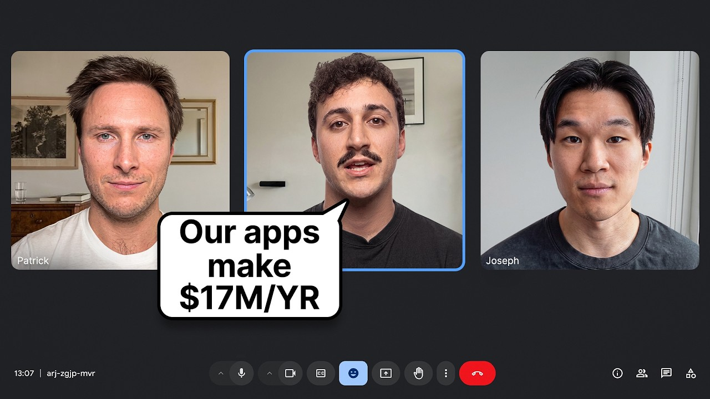

# $16M AI CEOs: How to Make $1.3M/Month With AI Apps

Start building & deploying paywalls in 10 minutes flat: https://superwall.com/

## Table of Contents

* [00:00:00] - Intro
* [00:03:41] - The $16 Million App Studio
* [00:05:24] - Which Apps They Buy
* [00:06:25] - Spotting Underpriced Apps
* [00:13:28] - The Growth Loop Explained
* [00:16:00] - Removing the Onboarding Paywall
* [00:18:26] - Tagging Every Test for AI
* [00:23:58] - Building the WiseSam Agent
* [00:26:56] - Running 4000 AI Ads a Month
* [00:41:00] - Why AI Grew Their Team
* [00:47:58] - The Infinite Search Space
* [00:52:43] - Verticals They're Excited About

## [00:00:00] - Intro

We're at 16 million annualized revenue. We're profitable. We're three years old. We only raised 1 million in equity for our preede and we haven't raised any equity since. We actually hit 11 million annualized revenue with only 11 people in the team. [00:00:00 → 00:00:13]

So, we were doing 1 million in revenue per employee. >> That's Patrick. He runs Social, one of the most efficient app studios you've never heard of. A portfolio of 22 apps has crossed 40 million downloads. Some of the apps are Font Maker, Celebs, Autopaste. [00:00:13 → 00:00:27]

They build apps, but they also buy them. And they scale these apps with pure data, running around 4,000 video ads per month, every single one made by AI. And the first thing that surprised me is how far they're willing to take that. >> My dream is sort of one day to be able to buy an app without even like knowing what the app does. Just like looking at the data, generating our own data, and making the decision like that. [00:00:27 → 00:00:49]

>> They buy apps most people would write off. A lot of them they picked up right after a viral peak when the numbers were falling and the owners had no idea what to do next. Celebs is one of those apps. It's six years old now and it's bigger than it's ever been. But how they actually grew it was pretty counterintuitive, including what they did to the payw wall. [00:00:47 → 00:01:07]

>> Removing payw wall at onboarding, funnily enough, was a big win on Celebs. Generally, it's a good practice to have a pay wall at the end of your onboarding. Here, the big win was removing it. >> Everyone in the industry will tell you to put a hard payw wall at the end of onboarding. They tested the opposite and taking it away made them more money. [00:01:05 → 00:01:24]

And all of that testing runs on top of an ad machine that barely exists anywhere else. >> We've been fully AI for all our ads for over 2 years now. >> 4,000 video ads a month, all AI for over 2 years profitably. In this episode, Patrick and Pablo break down the full machine behind a $16 million app studio that runs almost entirely on data. How they find apps that already peaked and started declining, buy them cheap, and turn them into their biggest winners. [00:01:24 → 00:01:49]

The onboarding paywall test that breaks the number one rule in the industry. and why removing the payw wall made them more money not less. How they run 4,000 fully AI video ads a month. Why that made them expand their human team instead of cutting it. And the infinite search space idea behind how they test these ads. [00:01:48 → 00:02:05]

The system they're building to hand the company over to AI agents by tagging the reasoning behind every single AB test they run. By the end of this video, you'll know exactly how Patrick and Pablo spot an underpriced app, multiply its revenue with relentless data and testing, and run an all AI ad engine. most studios can't get close to. This is the Super Wall podcast. I'm Joseph Choy, founder of Consumer Club, a Discord where top consumer app founders trade alpha and what's working now in growth. [00:02:05 → 00:02:30]

I've been talking to members doing a million ARR and they tell me they've been using these two tools. Superwall has this free AI tool trained on 422 profitable paywall experiments across thousands of successful apps. You upload a screenshot of your payw wall and it gives you an experiment idea to make more revenue with the same number of users at paywallexperiments. com. And if your app's doing at least 100K MR, we host vetted dinners in SF and New York to hang out and network with other top app founders. [00:02:30 → 00:02:54]

You can apply with the type form in the description. Also, these app founders have been telling me they use ROR. I met Daniel, the founder of ROR, at a dinner, and I got genuinely really excited when he told me about Ror Max, which is out now and has honestly changed the game for coding mobile apps. It's AI that oneshots all native iOS apps with Swift code, camera, sensors, haptics, payments, the whole stack. And as you vibe code with Ror, you can install prototypes directly onto your iPhone with one click and then publish to the app store in two clicks. [00:02:54 → 00:03:22]

If you've been waiting for AI coding that actually does native iOS apps, well, this is it. I got you guys a discount. You can use the code superw wall or use the link below. I'm super excited to talk to you guys. Um, you guys run social and you guys are building a sort of like an app studio. [00:03:22 → 00:03:36]

You have run a bunch of these apps and you buy apps and you use a lot of AI to grow them. [00:03:36 → 00:03:42]

## [00:03:41] - The $16 Million App Studio

So, could you give me some highle stats of the company? Yeah, of course. We're at 16 million annualized revenue. We're profitable. We're three years old. [00:03:42 → 00:03:54]

We only raised 1 million in equity uh for our preede and we haven't raised any equity since. So we we're basically preed strapping. Um we actually hit 11 million annualized revenue with only 11 people in the team. Uh so we were doing 1 million in revenue per employee. H now we've recruited a few more people and it'll be a few more months before we get back to that figure. [00:03:54 → 00:04:13]

And yeah, we have a lot of fun. We have 20 apps, 22 tour apps and actually we've also launched our first um agent for consumers which is a super easy to use uh very safe version of open crawl. Uh we're doing around 4,000 video ads a month. We're doing hundred of hundreds of playable ads a month, thousands of statics. Uh we're running probably about 100 AB tests a month. [00:04:13 → 00:04:38]

Uh so we do everything at quite a high volume with a small team uh across a diversified portfolio and a lot of that is thanks to AI. >> I feel like this is going to be a gold mine of insights. Like all the ads is pretty crazy. Like 4,000 ads and it's such an interesting operation. Like I feel like there's certain apps that are kind of the 100k a month like maybe a million you know r like completely bootstrap like a lot of people are building those and then there's like the venture scale apps which are like the more social like consumer social maybe gaming but then you guys are sort of like in between where you've raised a small amount of money you're actually profitable you you show all your numbers like LTV CAC like I think not a lot of people actually show their numbers so transparently and 1 million revenue per employee is also like super efficient business. [00:04:38 → 00:05:25]

## [00:05:24] - Which Apps They Buy

So, I want to dive into a bunch of aspects of this, but maybe first is like what types of apps do you require and and run? >> We're pretty generalist. Non-gaming uh that's pretty certain. I don't think we will go into gaming. There already a lot of very good gaming operators. [00:05:25 → 00:05:43]

It's a slightly different skill set uh for you know building those products, making them better and even distribution is slightly different. Um, then within non-gaming apps, we're pretty generalist. We probably won't do too many social networks, per se, at least not for the moment. Uh, because the monetization is slightly different. You really need to get to a big scale on each individual one for it to be meaningful. [00:05:43 → 00:06:09]

Uh, but yeah, honestly, you know, we've got a bunch of utility apps. Uh, we've got dating assistants, we've got entertainment apps. We do have uh one or two small social networks. We've got a couple of dating apps. Uh so yeah, we've got a lot of um quite a diversified portfolio. [00:06:09 → 00:06:30]

## [00:06:25] - Spotting Underpriced Apps

>> Is there a thesis for how you buy these apps and why you like why you buy certain apps? And I assume because you you have a growth machine. You know, you're running 4,000 ads a month and there's some reason that you think you can grow certain apps. >> Yeah, absolutely. We're very datadriven in our approach and so we look we've got at the same time a sort of top down approach. [00:06:25 → 00:06:53]

So we look at the market, the market structure, what seems to be the general willingness to pay in that market, how fast it's growing. And so there top down, but we also have a bottom up approach where we run ads for uh apps which don't yet exist or that we're looking at buying. And if the ads perform well and we've built quite a big benchmark and they're very standardized ads so that the data is as comparable as possible then that will be another very strong data point and then obviously you know just like looking into the data of the app itself you know the classic things retention any of their own marketing data if they've run any my dream is sort of one day to be able to buy an app without even like knowing what the app does just like looking at the data generating our own data and making a decision uh like that. >> That's really interesting. I want to dive like fully into the data part cuz I think that's a a differentiator that you guys have. [00:06:53 → 00:07:50]

But like what what is your just to get an idea of the apps first? Like what is your biggest app? Maybe maybe you're not able to share like >> uh we've got four apps which are similar sizes. There's lipstick, font maker, autopaste and celebs. And then we've got a couple other apps which [music] we're scaling up uh which are store a bit smaller. [00:07:50 → 00:08:14]

>> Yeah. Litick was Hotspots one of them or >> no? Uh Hotspots is actually the app we bought from Pablo and then Pablo joined us as our first founding head of product. >> Um so there's Font Maker which is one which is a font app. So basically you can turn your handwriting into your keyboard font. [00:08:12 → 00:08:32]

>> How many downloads does this have? This is like 120,000 ratings >> across your portfolio. We have uh just we've just crossed 40 million downloads. Uh Font Maker has been strong for a number of years. It's probably around the 7 million mark. [00:08:31 → 00:08:50]

>> Wow. 7 million downloads total or like per month or year? >> Uh total. >> And then how much revenue does this one make? >> This one makes um about 200k a month. [00:08:47 → 00:08:59]

>> Okay. So let's dive into that a little bit. So, Font Maker and then you got LitStick which is like a stickers app, iMessage stickers where you can like turn things into stickers. So, how yeah, what are the what are the stats on this one? >> Uh, this one's doing just uh north of 300K a month. [00:08:58 → 00:09:14]

>> And then what were the other two apps? >> Uh, then there's Celebs uh which is a similar size to list a tiny bit bigger and then there's autopaste which is a bit smaller than uh than these ones closer to to Font Maker >> and Celebs. This is like find your celebrity look alike. This one seems like it could be newer, but it it's like a little bit less of a utility than the other ones. >> Yeah. [00:09:13 → 00:09:38]

No, this so this one quite a simple premise. You upload your photo and uh you get to know which celebrity you look alike. I really like this one like this sort of app. Uh and that's one thing we've been good at. It's spotting mainly by looking at data um apps which may look like a shortterm viral sort of success and you know like that one we bought it and like a lot of our apps we actually bought after they had a viral peak then they were declining the people selling it didn't really know how to like grow it from there and so that's where we come in and we we buy it and then you know we grow it quite steadily and you know it's big it's now six years old and it's bigger ever. [00:09:38 → 00:10:21]

>> Correct me if I'm wrong, but it seems like you have the utility apps that just seem like they integrate very seamlessly into, you know, existing user behavior like like a lot of these keyboard apps like Font Maker and the stickers and the keyboard autope like you kind of have they're yeah they're like sort of basic utilities and it makes sense why these would be more retentive and you just buy them, operate them, grow them. But then you have these other apps that are like seem like they could be underpriced because someone has this huge viral moment. They do really well with the app, but then it kind of falls off, but then you figure out that there's actually some deeper value that you could unlock here. Do you feel like you have those like two different strategies for acquiring? >> Yes, definitely. [00:10:20 → 00:11:07]

And at the for us it really boils down to can we scale this app over the long term profitably you know and if we see that opportunity be it on a more retentive or less retentive app if we can buy an app and we can 20x its revenue and make a lot of money doing it and you know make multiples and multiples of the acquisition price then it's been a good uh it's been a good investment for us and you know Celebs for example it's a good example it looks like very short-term viral sort of success you know an app which you know has a few weeks in the sort of uh [music] spotlight but it sort of taps into this universal sort of curiosity. It's like you know there's a bit of vanity there. There's uh you know just simple curiosity. That's another thing. It's often people I think underestimate what is the potential t for [music] uh consumer software. [00:11:07 → 00:11:56]

Um, and you know, something like celebs, honestly, when you just talk about celebs to random people, you know, in the streets or wherever, I'd say at least half, if not more, of people are curious to know who the celebrity lookalike is. So, you know, your tab is basically half the world. Uh, and so, you know, even if it's had this sort of small [music] viral success and that's a very low hanging fruit, it's probably got the potential to grow much faster, much longer. There's been entire media companies built off of these types of interests. Like Buzzfeed, you know, is like the one that comes to mind. [00:11:56 → 00:12:34]

Like Listicles, like basically a lot a lot of these like media sites. But then the problem is I feel like a lot of those sites don't directly monetize, right? They do. They run ads instead. But you guys are directly monetizing and actually getting subscription revenue off of these like extremely high TAM I mean this particular extremely high TAM interest of celebrities we said earlier was pretty interesting. [00:12:34 → 00:13:02]

It's like I sort of assumed automatically that you see retention as the long-term goal for some of the things but it's not even about subscription retention. Sometimes it's just like you know that you see that the the market is bigger than than what other people think. So like for this one it seems like the the lever that you pulled is like you acquire and then you figure out that you could just run ads better. Like was that the the lever for this? [00:13:02 → 00:13:29]

## [00:13:28] - The Growth Loop Explained

>> That's part of it. It's you know it's sort of this virtual cycle where we're very good at user acquisition. So we get a lot of users into the app. Pablo translates that into, you know, dozens of AB tests a month for each app. Continuously lifts the average revenue per users. [00:13:28 → 00:13:47]

Like, you know, over the last 18 months, Tableau's probably 3xed uh the RPOU on average on our apps and uh certainly 2xed it over the last 12 months. There's this virtual circle where we we're good at user acquisition, bringing more users, we monetize those users better, we bring in more users, etc. And so, you know, it's it's by playing on both part of the LTV CAC on the LTV CAC that we managed to yeah continuously scale these over time. >> Double the RPO in in 12 months is is pretty insane on average. Yeah. [00:13:45 → 00:14:21]

Is that that's across the whole across the whole studio? >> Yeah, >> that's pretty insane. What is the CAC LTV on on celebs? >> Uh on our portfolio, it's 3x LTV CAC on average and most of our apps will be around around that mark. It seems like you mostly do weekly subscriptions on celebs for like anywhere between $6. [00:14:21 → 00:14:42]

99 to like 14. 99. You're you're basically just like running AB tests on absolutely everything like the onboarding, the pricing, all these data points in general. Are there certain data points that that have been highest leverage for for increasing revenue per user? >> I would say on boarding is an element very important. [00:14:42 → 00:15:02]

You know, all the apps have a funnel that is decreasing. The upper the interaction normally the bigger the impact. But that's just one of the general rules depending on the phase you are. Maybe you want to do things that really have big impact like [music] in the first screen. If you already have a 1 million users per month, we get more sophisticated and we try things all around the app [music] and we unlock value in every corner. [00:15:02 → 00:15:27]

But generally adding removing an onboarding screen could be something that makes a huge impact. But they don't have the key because even in our apps the decision that I take in selects or lipstick can be completely different. I just know that there is a lot of value there. But it will be testing. We run probably 20 AV test. [00:15:27 → 00:15:40]

10 of them are neutral, five are terrible, three seem to be giving us something interesting, two are good. So we have a system of scaling AV test. [music] We run it at small scale then bigger. And that way we're always adapting. for celebs. [00:15:40 → 00:15:54]

Could you give me one example of a pretty big test with that you ran like millions of users that had a [music] big lift? [00:15:54 → 00:16:02]

## [00:16:00] - Removing the Onboarding Paywall

>> Removing a payw wall at onboarding, funnily enough, was a big win on celebs. Generally, it's a good practice to have a pay wall at the end of your onboarding. Here, the big win was removing it and actually just getting the users as quickly as possible to the moment of maximal intrigue. Basically, >> for instance, that's a test that we have tried many times in the flow of evolution of the product. one day didn't work then [music] didn't work either and one day suddenly it worked is altogether he's going to be taking part on that but yeah like Patrick said removing the pay on the on boarding against all the rules of the industry was a big win for us >> that was an interesting point from Pablo it's I think a lot of teams AB test something once it doesn't work and they won't ever AB test it again but the truth is like an AB test works or doesn't work usually within a certain context within a certain flow etc and you know [music] as we're always testing There are things like parts of the apps are always moving and evolving. [00:16:00 → 00:16:57]

So it's often useful to revisit old AB tests or old assumptions [music] especially on things which you know can have quite a big lift and retesting them within the new configuration. >> I see. Yeah. Because there's so many different variables that you can run with the AB test. It's not just about payw wall during onboarding versus pay not no payw wall during onboarding. [00:16:57 → 00:17:18]

It's like what answers they gave during the onboarding gender. Like there's just so many other AB tests that you can run in different combinations that it makes sense that you would just you can't just like run it once. You want to see like which variables like really impact. So why do you think that in this case like the removing the payw wall actually increased revenue per user? >> We can get conversion in 10 different places in the app. [00:17:18 → 00:17:43]

Probably it's a matter of we managed to optimize all down the final places. So was making more sense to let the users go inside the app without the friction of a pay wall because our other placements are performing better. So in the end when you get your result when you want to share when you reopen the app we were grabbing better attention and getting better conversion and that's simply like when you fix parts of your app if the first one disappears because it's a half friction half conversion. If you remove conversion and friction, but you get extra conversion down the funnel, it turns into better results. So basically, part of the users we were losing at the on boarding in the new app are converting very well down the funnel and the maths make sense. [00:17:43 → 00:18:27]

## [00:18:26] - Tagging Every Test for AI

>> So like the kind of like the intuition and taste behind the AB tests is what matters in the long term. You're saying that when you run the AB test, you have to have a hypothesis for like the reason why you're running this test. And then if the test proves you right, then now you have like instead of a hypothesis, now you have like a proven you know insight that okay it seems like roughly like if we control for the other variables like this thing that I thought was true is actually true and we should do like more of those types of things down the line. >> That is exactly that like you tag your decision. You know when something is the conclusion of it feels better or I prefer it that's not tangible like there is a reason for everything. [00:18:26 → 00:19:11]

No we define an AV test [music] we try to give it a reason and that's also even more important nowadays that we try to feed all that information to an agent. If I tell an agent I have been winning this AV test means nothing. If I tell the agent here we have our backlog of AV test. These were all the hypothesis. This was all the results. [00:19:11 → 00:19:30]

These were all the learnings. we give a system with important information we will be able to better build the next iterations because me I have been in those 80 test if I get an app I know what I have to do but it's very hard to tell an agent or a new person coming to the team day one what they have to do unless you have everything perfectly tracked they can learn from that reducing friction on the on boarding in select was about removing the pay wall if what matter is removing friction in another app is going to be something different so if now our strategy is removing friction in on boarding We have five, six, seven things that we tried that made it happen and then we have to find the equivalent in the other apps but under the premise of I want to remove friction because I'm converting very good down the funnel >> and the interesting thing is sometimes creating friction is a great strategy for an app especially creating friction during onboarding can be like a great great way to create a very strong signal that you can then use in signal engineering etc for your campaigns. The important thing isn't about like not even a playbook like we have a playbook. We know that sometimes this works in this situation etc. But it's more of methodology and nearly a philosophy of continual testing which is the most important [music] rather than like small oneoff wins. [00:19:30 → 00:20:45]

The whole like decision science thing I think kind of ties into your whole thesis of the company which is like oh use AI to run the entire company and in order to do that you want to feed it signals of the the the reasons for making certain decisions right and then combine that with the AB test. I think that's really fascinating. We should like I want to like have a whole segment just like diving into that. Yeah. I think removing the payw wall from the onboarding and then trying to convert those users later down in the funnel or the the user experience. [00:20:45 → 00:21:20]

I think that hearing some of the insights from that will be super useful for a lot of people cuz I think the default assumption is yeah hard way hard payw wall is higher converting. It just makes more money. It makes sense that if you know you lose so many people uh if you do a if you do a hard pay wall and you're just basically not doing anything to recover those people back like is it notific is it like push notifications where you're like if they don't convert then you get them in later. I guess if you were if you were to put it into like a few buckets of things that if you're just starting out and you have no AB test running at all and you're just trying to let's say you make the decision that okay I want to try doing a soft payw wall and in order to make more revenue per user what what are the general buckets of like things that you think about like okay I removed the payw wall from the onboarding now what do you need to do to to recover >> you usually would need to get the user as quickly as possible was to either to a point of maximal intrigue or to what people call the aha moment. That's and that's you that's a tactic which often works well. [00:21:20 → 00:22:24]

If you don't have a hard pay wall or even a pay wall during onboarding, yeah, you do want to get the users as quickly as possible into the best part of the experience or at least the part of the experience which would create the maximum willingness to pay. someone building a new app. No, like what is the flow of decision that they probably have to take before taking that decision because if you're a big app, big studio, like you have to try everything. It's not like there is one answer. If you have a new app and okay, you love that app, you have just created that app. [00:22:24 → 00:22:57]

But ask you the question, is there going to be a better moment to ask for subscription? As simple as that. It's like you have your on boarding, which is something static. You control everything. in your on boarding is is your story. [00:22:57 → 00:23:11]

If after that end of the on boarding you there is something that you know is going to be better for the user like they're going to be even more excited feel free to just put a very soft pay wall try [music] try to convert later on if there is not yet because the apps evolve is like we took time sometimes to refine part of the inside the app [music] if you don't have that clarity keep your on boarding payable and maybe it's a hard payable maybe it's just a free trial of payable you will see but that's probably one gate of decision for someone with a small app starting and taking the decision of what I do. >> Let's look at let's actually just look at the ads in a second. But also what was do you have an example of an app that you guys that are it's in the portfolio where there's like that big investment and then that's what creates that conversion moment. [00:23:11 → 00:24:02]

## [00:23:58] - Building the WiseSam Agent

>> One of the closest ones to to that is our new um agent for consumers. So you know it's like an open crawl personal assistant and there it's we've got a really cool opportunity which is you know a lot of these onboardings like you like you know sometimes it's a 100 screens or something and they basically you know pretend that they're getting to know you and they're going to personalize the user experience and usually they don't or they might use 10% of you know the 100 questions you've answered or whatever. One of the cool things with agents generally I would say um particularly personal assistant is that [music] we can you like really get to know the user and then actually use that in the product and make the product better much better through it and get the user excited. Um [music] and I would say for agents generally that's a huge uh huge opportunity. The most profitable app founders I know have been using Superwall to AB test their payw walls because yes, they have the basics like building and deploying payw walls super quickly without coding, targeting users with different payw walls based on behavior and demographics. [00:23:58 → 00:25:06]

But now, Superwall AI actually predicts who will subscribe before they see a payw wall. The AI can do this because Superwal analyzes over 1 billion paywall interactions to score user intent and then recommends optimal pricing in real time. A good way to start is paywallexperiments. com. It's a free tool that gives you databacked payw wall experiment ideas to increase your app's revenue. [00:25:06 → 00:25:26]

Can you share the the the personal assistant agent? >> It's called wise sam. ai. >> Okay. Super interesting. [00:25:26 → 00:25:34]

So this is like so you use a lot of AI for personalization during onboarding in this. >> So yeah, we collect a lot of uh information that we then use for to personalize the the experience. Uh it's going to depend your entry point also. Uh here I'm talking about if you've watched one of our ads and then you click and you go through that the funnel afterwards. I believe uh Pablo correct me but if you're going directly through the website we try to just get you [music] to like the experience quicker because you haven't had that ad to sort of warm you up and get you excited and create that willingness to answer the questions. [00:25:34 → 00:26:09]

We are always super connected the marketing and the product is like the story starts at the ads. So like Patrick said you come very warm to the app. That's our philosophy. It's not a matter of my neighbor told me this app exists. It's more more a matter of we have presented the app the concept interesting so then we will convert. [00:26:09 → 00:26:29]

After that then we have the opportunity to do whatever we want and now we are trying in this products like to have a funnel where we have many questions and that's something that we prove could work very good very very good uh because the person invest quite some time. It's an interesting investment. is like friction but it's happy friction and when it's finished you have way more intrigue because you have the summary of exactly what the people were saying like they feel listen so we mix both things like an agent where you mix both >> wow this is that's a good this is fully AI too if I'm not mistaken >> we've been fully AI for all our ads for over two years now >> wow even even the like this the screenshot screen recording ones >> everything wow that's crazy so like on the marketing you're You're getting people excited about the productivity angle, the emotional angle. [00:26:27 → 00:27:20]

## [00:26:56] - Running 4000 AI Ads a Month

Basically, just all the stuff that people use like conversational AI for like productivity, but also like personal Oh, actually, let's just look at the CT right here. So, you got the subscribe button and then it says like, okay, it handles your email calendar, the things like you keep putting off right where you already chat. And then this is and it seems like this is where you get the like long onboarding where you start to probably use some of these questions in the personalization. So it's like what's your work situation? Um more about work, what types of tools do you already use? [00:27:20 → 00:27:53]

Uh where do you chat? And then it kind of reflects your answers back to you. Continues to go through pain points. What do you want from the thing? you know, showing you back like what your uh the the features and then get Sam for just $1, a full promo [snorts] week with your assistant, then $10 a week. [00:27:53 → 00:28:16]

Cancel anytime. Continue. Um [music] and then ready to plug in. So, you get started and then it immediately goes to Stripe. That's super interesting. [00:28:16 → 00:28:27]

Is the personalization mostly like during the the survey itself or are you doing like more personalization deeper into this? >> Yeah. And then afterwards you also continue like the personalization that conversion like just talking with agent. There's more and this would depend like you know we're constantly AB testing also these flows and you know these screens the length. So this is a shorter version but uh you know yeah we're constantly testing things around this one. [00:28:27 → 00:28:54]

>> We're trying a lot of things. We're getting data points because for instance this is a new product for us and we still need to find what is the good angle to invest and double down what is the target audience if they want short long funnels and this is web remember that we used to I think we cracked how it works in mobile but this is on web which gives us way more flexibility but at the same time it's a different context where they behave differently but our is the same you know it's like why exist for a few weeks And we have deco composed in three different parts. The ads, the funnel and then why some inside the product. Now these days we are building like a huge strategy of funnels to control what the user are interested in. The creative team are building a huge strategy of u creatives and we are also working on the product. [00:28:53 → 00:29:45]

But you know it's like start with your problems at the bottom and when you are getting more and more users you will have more volume to refine the product too. You shouldn't invest out of time on something that just a few users get there. The way we actually do this it's so it's an open cl but we do it in a very secure way. So we set up a virtual machine which is going to be preconfigured with your open etc etc. So it's yeah we tried to do things pretty well. [00:29:45 → 00:30:10]

Then yeah, you can different integrations. Uh some are coming. iMessage is going to be there very soon. >> It's basically OpenClaw but super super accessible to people. Like like I remember on Twitter like when people were getting crazy about OpenClaw, it was always step one, copy this token and then send it to this random Telegram address. [00:30:10 → 00:30:32]

And it was just very like inaccessible to like the average consumer. everything. This one it's like you come from an ad, you go through an onboarding, you actually talk about like what you want out of the bot and then you're you're getting like uh the chat interface as the first thing which I think is really important. Just talking about Wson because it's our new baby and we're very proud of it. We have cracked also the channels like we we have ready an integration natively with iMessage and WhatsApp and that's the point like we want to make it accessible because tech people understand open close and know how to set up but 99% of the population they don't leverage those agents and they don't know that they could be in their phone helping them for very daily easy task and can be a very impressive product. [00:30:32 → 00:31:21]

So we have democratized access to all these agents with wis 1 minute you set up and any person from any age that's why we have such a broad amount of ads right now like we are trying to nail all those sweet spots where we have to start investing on this is our user persona for the first evolution this is the other and probably it's a 65 years old person and a 20 years old student both of them can leverage why just with a tiny customization >> dang you guys are basically doing anthropics marketing for them like go to market cuz I feel like there's so much like obviously like in in this AI bubble like everyone of us knows like how powerful AI is but if you ask like any person on the street they probably have not used open claw maybe they haven't even heard of claude like they probably just heard of chatgpt this feels very familiar to me like chat memories soul skills like these are basically the things that you know people in Heck, use AI for, you know, you want to give the AI a personality and their behavior and basically their like system prompts. And then you have memories, which, you know, the chat bots are not the greatest at. You know, there's a lot of like um settings and fine-tuning that people do to their own chat bots to make them have like better memory. And then the chat interface also feels like pretty pretty different. Like this is like you you have more than just the chat, right? [00:31:21 → 00:32:55]

You have like these kind of opinionated buttons. Like it says helpful tasks, calendar, mailbox. So you're kind of already suggesting to the user like what what they could do. And then let's get to know each other. Do you feel like this is also is this like a a an engagement thing? [00:32:55 → 00:33:12]

cuz you was a $1 uh trial for the week and then $10 a week and then I'm curious like what what actually gets people to renew. They have to be really impressed like probably they subscribes at the very beginning because the intrigue or the excitement if they stays because it's classically it's useful they find it interesting. The problem is like [music] you have 2,000 AI tools out there, chat agents, whatever. You always land in a chat and you don't know what to do. Now, our vision, no, our taste is guiding us towards we have to guide the user the first moment that they use the agent. [00:33:12 → 00:33:49]

Normally, users will download this on the phone. We usually drive these campaigns on the phone. So, they can just click on one of those buttons and s okay, send me an audio talking to me about this. You know, it's like we prepare it. So it's like we guide the users towards giving the important information and the moment the the agent knows where you work who is important for you what are your goals that's not something that you how do you say suddenly share but if you have a little guidance on that and the agent gets to that level where it's already impressive how much it knows about me the people get more engaged >> I think like today the main sort of barrier to AI adoption isn't AI capability it's already capable of so many cool things. [00:33:47 → 00:34:32]

It's sort of uses imagination and like knowhow and like thinking ah actually I'm doing this task every day but I could get my agent to do it. [music] It's basically you know the art of delegating is actually quite a subtle difficult one and it's a skill you really have to learn how to delegate and so you know part of the uh problems we're solving here. It's how to make the users better at delegating and so you know that goes by knowing more generally about the user and how Sam can be helpful to him. >> Is that like all of business [laughter] like getting people to like cuz if you want to embed yourself into someone's daily week weekly routine that they're probably doing it themselves right now and but maybe they don't want to be doing it themselves. But also, it's it's very hard to give up control over like a routine that you have um that feels familiar to you. [00:34:32 → 00:35:31]

You know, you don't want to like change. Change is scary. I I love this prompt. Like you you tap helpful tasks [snorts] and then it created this message and just sent it automatically as if it's like coming from me and it's just saying I'd like you to help me with a recurring task. Uh a recurring task. [00:35:31 → 00:35:48]

one of those things you take care of on your own regularly without me having to ask or remember each time tell me uh let me tell you what I have in mind and this is like me telling the bot [music] and then the bot says sure tell me what you're thinking and then now I'm thinking about like oh I guess I should think about a recurring task now what what have you seen so far on this like are people actually able to come up with a like a like a thing that that you can help with >> it it helps to reflect but still they need more guidance [music] and probably they need more guidance to really unlock the things that are really useful. What we are working now is to really spot let's say then 10 cases that every single person will feel the value very fast and will be impressed. That's that's the next thing like the same way you get into this interface you touch couple of buttons and you end up telling oh help me remember the birthday of people in my agenda. Okay that's the classic one. There are some ideas out there sometimes from checking the price of a product like [music] can you check every day the price of this product and sometimes we don't get to see how obsessed we are with something that's something an agent does very easy so we probably have to prepare those cases that since day one it's easy to you know take care of this I don't better if you take this price instead of me then when you build that trust we will go to these things you mentioned Joseph like things that are mine you know belong to me like my morning check the mail probably I need a bit more of time until we start to do that because I don't trust you uh yet but the first interaction is where we want to give more guidance that's our objective now to nail the first three four five steps so I I just ask it like hey I need help remembering things and says okay like what kinds of things do you need to remember I don't know like um replying to email and then it'll take me through this flow and get to a point where it's able to like integrate with my email, I'm guessing. [00:35:48 → 00:37:46]

And then [music] once you have that, then it's it becomes like this recurring touch point uh and part of the routine. Okay. So, it says, "You want something regular where I nudge you about emails you need to reply to, maybe help with drafting. Useful way is to [music] um if I had my own mailbox, you could forward emails to. " Okay, so now the agent, the open claw is like creating its own mailbox and then it's asking me to set up their mailbox and then it and then it goes to the skills section. [00:37:46 → 00:38:16]

Okay, skill Sam's email and then you act. >> That's part of the challenges and problems you have to sol you have to balance like usefulness access of the agent and like safety and so you know for a moment we've always tried to like find like ways to do things as safely as possible. uh we've probably been initially a bit too much like on [music] conservative but you know it's it's also about finding the right balance over the next few few weeks like so for a moment and I think we continue agent has his own email address which we set up specially for him and then there's this sort of allow list of senders and uh we're probably going to be iterating on that in the next few the next few weeks potentially at least giving read access to your inbox. This was our original thesis like we want the agent to start from being very safe and then we iterate towards you know being productive but we we set that baseline now we understand that having our own mailbox is not the most productive thing but at least we were starting there [music] we didn't want to have an agent that can make dangerous things like we want to evolve always uh hence with safety and making sure that the things we allow to the agents to do will not make any harm on the person that is uh is owning the agent. >> Thanks for diving into that. [00:38:14 → 00:39:34]

I think this is like very applicable to a lot of different consumer AI businesses in general because a lot of it is just about education and getting people to understand like how to delegate stuff. And part of that understanding is just like setting it up for them. Like starting out with, hey, I like what do you like think of a of a of a thing that you need help with? And then it's telling the user, okay, you need help with this. here's how I can help and then getting them to set it up. [00:39:34 → 00:40:02]

And once you set it up, that's where I feel like the retention really comes in. But like this chatbot process, I think is like really good for really any like consumer AI onboarding and engagement. I think it's it's really interesting. So I wanted to ask you a little bit more about the AI part of of the the company as a whole. Like if you look on your website, you're saying we are a Gen AI native app rollup leveraging data precision and AI to extract maximum value from apps. [00:40:02 → 00:40:33]

And then earlier you're saying that when you're doing these AB tests, you're not only just do running a ton of AB tests, you're also giving inputs about the intent of the AB tests. [music] And eventually, like theoretically, an agent uh like a team of AI agents could probably run the entire company um and uh like make all these decisions autonomously based on like what it's learned about how you guys make decisions. So, is that right? Is that like the the thesis? [00:40:33 → 00:41:02]

## [00:41:00] - Why AI Grew Their Team

>> Our thesis is that our thesis and our thesis has been since the start is trying to automate as much as possible how an app operator functions by using AI a lot. We've sort of also developed some new thesises about what is a good idea to automate and what isn't a good idea to automate and where you actually need humans to do it. And so, you know, one of the things that we're very bullish on, for example, it's having a lot of human creativity in like coming up with the ad ideas, not with building the the ad, not you know, using like real actors like the ad is fully AI, but the idea usually uh comes from a human input. And so, [music] you know, it's about building this system where we have AI agents working with humans who are in the loop and, you know, each doing what they're best at. So, for a moment, I don't see us uh automating 100% of the of the of the company. [00:41:00 → 00:42:01]

Uh I see us, you know, automating more and more of it. But interestingly, AI isn't only about for us at least, I think, you know, that's fundamentally what it is. isn't only about replacing what already exists by an AI version and just saving costs. It's about using AI to do things which were impossible before. So, you know, be it create thousands of ads a month. [00:42:01 → 00:42:26]

You know, that would have been incredibly challenging if we were trying to do it the oldfashioned way, filming actors, etc. And so, you know, that's I think one of the things like a lot of other app studios companies like you know they were doing 30 ads a month with [music] actors now they might be doing 50 a month with AI they've saved some money it's faster easier but so we really lean into AI's potential and actually interestingly by doing that it usually requires a lot more humans like you know we uh we scaled up our ad production [music] by a lot and you know over the last 6 months I think we free the size of our creative team uh to make [music] ads while we were automating it more and more because you know as we scaled up the number of ads we also needed to scale up the diversity of ads and therefore was for creative input >> it's like you're you're you 3xed your your team but then you like hund [snorts] multiple hundredx the output so it makes sense you're extremely like each human is just like extremely high leverage. Um what I'm curious what does the ads team look like right now? Is it Yeah. What what's the team? [00:42:26 → 00:43:42]

>> So the ads team at the moment is six six people. Most of them are simply focusing on coming up with new ideas for ads and then execute like and then sometimes preparing some of the material uh that so that we can then produce it. We also have video editors uh to uh do some of the video editing that we can't automate. Um we work also a lot with a company called pool day. ai for our video editing and they basically do a huge amount of of our of our video editing. [00:43:39 → 00:44:13]

H but for certain use cases or for more one-off things or like more like original concepts we have our video editors come in and then we also have people working on playable ads. So like you know mini games uh miniame versions of the of our apps. >> The most human part obviously is the coming up with the ideas like looking out in the market like finding pain points finding angles [music] and then turning those into formats. But then I I I'm guessing there's some front-loaded work where you're creating the format and that's the human [music] part and then eventually AI like quickly will just like learn the format and then be able to make the execution of it. Well, we like moving very fast. [00:44:13 → 00:44:52]

Sometimes it's faster just to do the video editing with humans than what like when you're doing aic video editing on with people like pool date. It's it's a gentic prompting. So it's like it has to be very detailed quite complex prompts. [music] You have to have like basically an engineer's mindset where you change one variable of a prompt and you see the effect until you perfect it. So you know that's great as soon as you've got like you've nailed a use case, one angle, a concept, then you automate it. [00:44:52 → 00:45:17]

that you know when you're just testing loads of of things uh which we do constantly uh it's it's sometimes just quicker, easier, more efficient to to to do it with humans. There's also an amount of taste in video editing and so you that's also what some of our video editors are doing more and more. It's input on yeah taste input on the video editing rather than just doing the video editing themselves. So, do do you actually have that as part of your process where you're like testing small amounts of budget on specific hypotheses of like, okay, we have like 10 ad variations that the editors kind of thought of and then if those get validated, then you pump it into AI and do like the fourth. >> I think that's one of the important things when you're really trying to nail AI ads. [00:45:17 → 00:46:02]

It's not just doing endless variations of the exact same ads which you know win because you know they like perform less and less over time but it's constantly looking for new ad ideas, new ad concepts, new ad formats and it's balancing the two. And once you've got something which works, yeah, you can do variations and replicates of it. uh but uh the important part is to be continuing continuously exploring for new new marketing angles. >> Everyone asks like oh when when are we going to have cloud code for marketing? I think the problem is like there's just so many different layers of it, you know? [00:46:02 → 00:46:41]

I mean, similar to engineering, right? You have like the architecting that the Cto does and then you have like, you know, figuring out the the tech stack and then planning out all the features and then you actually do the execution. Like cloud code can do the execution part the best and then it's starting to be able to do the other ones better, too. But with marketing, it's just so it's just inherently such a human thing where yes, you can have like fully agentic video editing, but choosing which videos to add, you're going to you just burn so much money if you [music] if you test every single variation without taste. So like, you know, having the taste to like say, "Okay, we're going to do 10 variations instead of 4,000 up front. [00:46:41 → 00:47:23]

" It saves you so much money and also just like accelerates the scaling process. Have you seen any solution any any AI out there that helps with the taste part like helps you find like um here's the signals out there that we should be testing? >> So one thing people do but we don't really at all is you know simply copying what the market leader is doing and you know setting up automations basically just to copy what the market leader is doing. We can't really do that because basically for [music] all our apps within that niche, we're the market leader and so we've got nobody to copy. [00:47:23 → 00:48:01]

## [00:47:58] - The Infinite Search Space

Uh [music] and we m we maintain our lead by continuously inventing new things and being the first people to show those new ideas, those new concepts. Yeah. And to go back to your point, [music] it's exactly that the way I see ads and creatives, you basically got an infinite search space. What AI allows you to do, it's test much more that search space and you know there's places in that search space which don't have which don't contain any good ads. There are others which contain a lot of ads and so you know if you're if you you're taking one ad and you're doing endless variations of it, you're staying in the same part of a search space and it's to be really efficient you need to be testing lots of different things all over the search space. [00:47:58 → 00:48:41]

When something works, yeah, then you explore that part of the search space more [music] in depth. I don't think you can really brute force it. You know, if you sort of like reason by the absurd like, you know, [music] you could one day maybe get AI to, you know, create a trillion ads for you, but then you can't actually [music] test those trillion ads because there's just not enough impressions and eyeballs in the world to test them out. So, you do need this sort of mix of taste, data, and process to efficiently explore uh the the uh the search space. just like thinking about it as a search space makes a ton of sense because you want to find, like you said, those pockets of, you know, certain areas within the search space that will hit. [00:48:41 → 00:49:25]

Um, but you don't know what those are. So, you can't test, you know, all thousand. Let's say it's like a thousand grid squares in the space. You can't test every single one cuz you're basically just you're going to you're going to burn all your money um and time. And then I wonder if there's a way to like efficiently test all of it. [00:49:23 → 00:49:42]

This is a unsolved AI problem. If anyone in the audience has a PDP physist, I feel like this is super fascinating. Are there any other types of like consumer insight signals or anything that you look at? >> So, one thing we do use AI for is to surface potential inspiration for that that can be transcribed into uh winning ads for us that usually by humans. And so, you know, I usually don't think that just copying the ads of, you know, whoever's market leader in your space is the best strategy can like get you some traction, but you won't, I don't think, become a market leader by like that. [00:49:42 → 00:50:18]

But what I think is really interesting is looking at people in completely different industries, what they're doing, looking at their marketing and using that to come up with ideas for your own marketing in your own niche. And so we do use AI to basically surface videos, you know, Tik Toks, whatever that then creative analysts look at and then use to come up with uh when relevant with ideas for our ARBs. >> There's this tool called Spy Talk and it's like I think this is kind of trying to solve the thing that you that you just said where it's like it's trying to find formats um like proven hooks. So it's a little bit of like the copying part where it's like looking at market leaders. It's also like looking at adjacent niches, right? [00:50:18 → 00:51:01]

Cuz it has so many niches in the database. And then if you put in your app, it'll find things like within your category and then slightly outside your category. And I think that's the that's the whole basis of creativity, right? It's like finding things from other places and then turning it into the thing that's relevant for you. But it it is it is I feel like a kind of unsolved space. [00:51:01 → 00:51:21]

I don't think like because even like for a market leader like you guys, you would use something like this, but then you still need the step like with where your creative strategists are actually turning that thing into something that's relevant for you, which [music] is the human part that is really really hard to do with with AI. Um, so I'm guessing you guys haven't really automated that. >> Yeah, that's injection of human creativity. AI is artificial intelligence and it's very good at sort of logic thinking etc. But it wasn't trained for or designed particularly for imagination which is much harder to do reinforcement learning uh on you know poetry say than it is on coding where you have verifiable answers. [00:51:21 → 00:52:03]

part of the way like you know part of the objectives for which AI is designed and part of the way uh through which you know AI is trained like pure imagination creativity is still a long way away and might actually need a completely different form of AI than LLM >> because you're creating something new LLM is like it's a model you know it's a large language model there's a bunch of data and you put it in and then it finds something from that imagination like you're saying like creativity you're trying to find your something kind of brand do like you're taking something from a different industry, you're applying it to your own, but if nobody has really done that before in a big way, then that data is not in the LLM. [00:52:03 → 00:52:45]

## [00:52:43] - Verticals They're Excited About

So, how could it how could it make how could it invent that? Last question I want to ask you guys, what what spaces or like verticals are you excited about? you have like a bunch of verticals in your portfolio already and it seems like you're now getting into, you know, the OpenClaw space. Is OpenClaw like the the big exciting one or is it or like personal AI? I feel like what I imagine people felt like at the start of the app store, which is, you know, very few apps exist and it's like this huge playing field on which nobody's playing and you can have a lot of fun. [00:52:43 → 00:53:19]

And so [music] we're very bullish generally on multiplying the types of different agents we build and own. And we're still bullish on buying apps. Like there's certain use cases where having a deterministic traditional mobile app is actually the best format for it. There are other cases where having an agent is uh is is the best format. The future for us is going to be mixing buying the relevant apps which we believe [music] make sense in an AI world and will continue to make sense and building agents for you know the basically unlimited number of new use cases uh which are which are opening up. [00:53:19 → 00:54:00]

>> This is a great conversation. I appreciate both of you guys. Yeah, there's so many layers of of things to to go deep on. I feel like this could be like a 4hour podcast but >> [music] >> um yeah, where where can people find you? Do you have any like are you hiring also by the way? [00:53:59 → 00:54:14]

>> Uh we always hire very talented people and interesting we hire people from like most of the team didn't come from the app world so we're always open to true talent and you know whatever their experience is yeah follow us LinkedIn obviously we have substacks I've got my personal substack. >> Awesome. Thanks so much guys. >> No thank you Joseph. This is really fun. [00:54:12 → 00:54:35]

Something you might not know, most of the founders I cover on this podcast are hanging out right now in the Consumer Club Discord, sharing with each other what's working now for consumer apps. So, you can apply to join Consumer Club if that sounds interesting to you. And this is the Superwwell podcast. Of course, you got to check out superwwell. com. [00:54:34 → 00:54:50]

We have more videos on the channel. So dig into those to learn from app founders who are willing to share super tactical stuff about app growth. [00:54:50 → 00:54:58]
