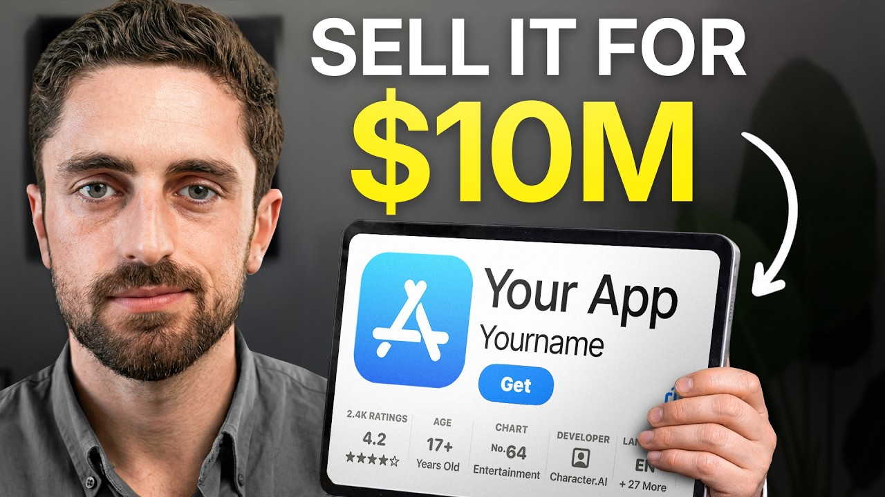

# $172M of App Building Advice in 50 Minutes

Start building & deploying paywalls in 10 minutes flat: https://superwall.com/

## Table of Contents

* [00:00:00] - The Premium Pricing Reset: 25K Downloads, $1M+ Monthly
* [00:01:20] - Meet Josh: Nine-Figure M&A Inside Blue Throne
* [00:03:24] - The Zero-to-One vs. One-to-Ten Acquisition Thesis
* [00:05:40] - The Two Paths to Nine Figures: Growth Story vs. Past Performance
* [00:09:20] - Rule One: Owning a Category Narrow Enough to Win
* [00:14:14] - Rule Two: Building for Locals, Not Tourists (Cohort Retention)
* [00:20:15] - Rule Three: Earning Organic vs. The UA Treadmill
* [00:24:47] - Rule Four: The ChatGPT Pricing Anchor & Premium Payer Math
* [00:34:31] - Rule Five: Engineering the Buyer Narrative Across Four Buyer Types
* [00:43:09] - Rule Six: Sell Before You Need To (Your Exit Alternative)
* [00:48:18] - Early-Stage Levers for the Six-Figure Founder

## [00:00:00] - The Premium Pricing Reset: 25K Downloads, $1M+ Monthly

When I look on SensorTower, this app only gets around 25k downloads a month, but it's pumping over a million dollars in revenue a month because it's charging at such a premium price point. >> This is Josh. He works on the M&A side at Blue Throne, a firm that buys consumer apps for seven and eight figures. Before Blue Throne, he spent three years buying mobile game studios for Polarium, the company behind the billion-dollar revenue franchise Raid: Shadow Legends. And in the past six years, he's been behind some of the biggest mobile acquisitions in the industry. [00:00:00 → 00:00:27]

The app Josh just described is called Waking Up, a meditation app. With just 25,000 downloads, it's doing over a million dollars in monthly revenue. That ratio is roughly 10 times what most consumer apps see, and it's only possible because of what Josh is telling app founders is an industry-wide reset in consumer pricing psychology. >> Before ChatGPT came around, the maximum people were kind of willing to spend on their consumer apps was maybe 60 bucks a year. And then ChatGPT entered the market and it reset the way consumers think about these products on our phone, and it said, "Hey, we're going to charge you 20 bucks a month and you're going to pay it. [00:00:27 → 00:01:00]

" The consumer mental understanding of what's worth paying for in terms of a product for their phone has now been reset. >> That reset is rule four in the six rule playbook Josh uses to evaluate every app that Blue Throne looks at. And the math behind it is surprisingly simple. >> The cheapest path to $30 million of ARR is actually fewer payers at higher prices. [00:01:00 → 00:01:21]

## [00:01:20] - Meet Josh: Nine-Figure M&A Inside Blue Throne

>> In this episode, Josh breaks down the full six rule playbook they're using at Blue Throne to buy apps for seven and eight figures. Everything from the category rule Flow used to become the first-ever women's health unicorn, the exit timing mistake MyFitnessPal made that cost them a hundred million dollars on their second exit, the buyer narrative rule Runna used to get itself acquired by Strava to become the front of their funnel, and much more. By the end of this video, you'll know exactly how Josh evaluates every consumer app, the specific metrics that move the exit multiple at each stage, and the four types of buyers who buy apps, and the deal narratives to build for each one if you you that you want to exit your app. This is the Superwall podcast. I'm Joseph Choi, founder of Consumer Club, a Discord where top consumer app founders trade alpha and what's working now in growth. [00:01:20 → 00:02:04]

I've been talking to members doing a million ARR, and they tell me they've been using these two tools. Superwall has this free AI tool trained on 422 profitable paywall experiments across thousands of successful apps. You upload a screenshot of your paywall, and it gives you an experiment idea to make more revenue with the same number of users at paywallexperiments. com. And if your app's doing at least 100K MRR, we host vetted dinners in SF in New York to hang out and network with other top app founders. [00:02:04 → 00:02:28]

You can apply with the typeform in the description. Also, these app founders have been telling me they use Roark. I met Daniel, the founder of Roark, at a dinner, and I got genuinely really excited when he told me about Roark Max, which is out now and has honestly changed the game for coding mobile apps. It's AI that one-shots full native iOS apps with Swift code, camera, sensors, haptics, payments, the whole stack. And as you live code with Roark, you can install prototypes directly onto your iPhone with one click and then publish to the App Store in two clicks. [00:02:28 → 00:02:56]

If you've been waiting for AI coding that actually does native iOS apps well, this is it. I got you guys a discount. You can use [music] the code Superwall or use the link below. So, this presentation is six rules to sell your app for nine figures. I think a lot of people in the audience are probably like maybe six, seven, maybe eight figures, but hopefully this will still be relevant for people because you actually buy apps for like seven, eight figures. [00:02:54 → 00:03:20]

So, could you explain kind of like what you do and all the acquisition app stuff? BlueThrone is essentially like a platform with like a fundamental belief that there are tons of apps out there that can be category leaders if they have the right resources and experience on board. [00:03:17 → 00:03:34]

## [00:03:24] - The Zero-to-One vs. One-to-Ten Acquisition Thesis

Honestly, when when BlueThrone hired me like 2 years ago, they gave me this pitch. They gave me the thesis, and I'll kind of say it like for like today because honestly, it's the same today as it was 2 years ago. And it goes a bit like this. Today, it's never been easier to go from zero to one in consumer apps. And the reality is you don't need to be the best in every given discipline in consumer apps to hit your first one or two million in ARR. [00:03:34 → 00:03:56]

You just need like a really strong work ethic, a pretty good idea, and you need to nail like one distribution channel. But, you don't have to be the best at AB testing, UI/UX, any of these things to kind of do the zero to one. Blue Throne saw this and was like, "Interesting, but people aren't making the whole one to 10 jump. " Cuz to do that, you have to suddenly be an expert in multiple distribution channels. So, Blue Throne was created to solve this exact problem. [00:03:56 → 00:04:19]

To find the apps that have done the zero to one, that have found product market fit, acquire them, pay the premium for them because they have found product market fit, and scale them, and do that one to 10. And basically, they built the team, they raised a bit of money to do this, and that's what Blue Throne's been doing for the last 5 years. >> That's great. And what what's your role at at Blue Throne? >> For the last 6 years, um I've basically been in the mobile business doing M&A. [00:04:19 → 00:04:42]

I spent 3 years in gaming. For the gamers out there, they're going to recognize the Raid: Shadow Legends uh logo. So, I worked for a company called Plarium. Raid was our main game. Raid was doing [music] a billion plus in revenue for many, many years. [00:04:42 → 00:04:52]

It still is. It's essentially a strategy game. And for them, we were acquiring other mobile game studios around the world for eight, nine figures. Did that for 3 years. And then about 2 years ago, I jumped into Blue Throne to head up our M&A team, essentially trying to fuel the company forward with finding the best mobile app companies that could really do that one to 10 jump with Blue Throne on board. [00:04:52 → 00:05:14]

>> I didn't know that Raid: Shadow Legends was doing a billion in revenue. That's completely insane. I've seen so many of their ads, and I kind of always wondered like what they are as a business. But, that's cool. Like, they had this they were involved in the in the acquisition game, too. [00:05:12 → 00:05:28]

>> Yeah, absolutely. Like, you know, most most gaming companies were and are. And I guess when you see so many uh Raid: Shadow Legends sponsorships and ads, you just got to ask the question like, "How much money are they making uh to afford all this? " >> Okay, so let's talk about nine figures. Why are we talking about nine figures? [00:05:26 → 00:05:42]

## [00:05:40] - The Two Paths to Nine Figures: Growth Story vs. Past Performance

>> We're talking about nine figures because I think for a lot of founders who are trying to go the distance, who are in this for the long game, they're really thinking about how do I achieve this outside as a return, this kind of exit that gets written about in the papers above the smaller stuff that kind of goes under the wraps. And I think there's a big difference in building your app and your app business for the long term, for the nine figures, versus building it for the slightly shorter to mid-term, for the kind of seven, eight figure exits. And I think there's a lot of information that doesn't quite add up online, and I really wanted to compile it into one place >> [music] >> for the founders who are thinking about that long-term strategy. To break this down is the numbers a little bit. In order to hit nine figures, you need to kind of hit a few different criteria. [00:05:40 → 00:06:23]

Either you need to have like a really strong growth trajectory with profitability in that. And when I say the words profitability, we're talking about 30, 40, 50% EBITDA margin, something really, really strong. And with this, people will start to value you based on your future potential. And that's where you get the 6x revenue run rate. For those who don't know, run rate means they're valuing you on revenue that will be earned in the future. [00:06:22 → 00:06:46]

The other side of this is if you're essentially a bit of a slower growth business and your profitability margins are slightly weaker, then valuers and acquirers are going to start to value you based on your past performance. So, when you see the word LTM, that's referring to the last 12 months of revenue. So, if we can kind of compile that into a a nice takeaway, it's basically what story are you selling about your app and what are people buying? Is it the growth story? Are you selling the future of your app? [00:06:46 → 00:07:13]

Or were the best days of your app in the past and are you selling the previous story instead? >> It just comes down to growth rate, basically. Cuz like a 6x multiple on revenue run rate is like you take your current month and then you multiply it by 12, or do you take your current month and then project out, like look at the growth and then project out, like oh, we're going to keep making more money each month? Compared to LTM, which is just you look at the last 12 months. >> I mean, generally, you don't want to take a month because months can be really sporadic. [00:07:11 → 00:07:43]

I mean, if we think about a fitness app that's popping off in January, December, you know, we don't want to be taking that single month and extrapolating it for the next 12 months because it's not going to be accurate. But, some people will then take maybe a quarter or some people maybe take 6 months and then extrapolate that. It really depends on on what the stability is of the app. Is there like a very constant level that the app performs at that is actually quite fair to predict on or is the revenue or downloads very choppy, very up and down cuz you don't want to be extrapolating on something that's choppy. And so, I think if we take those numbers from the previous slide and think about what are these two quite different paths to it, you know, $100 million plus in valuation. [00:07:43 → 00:08:21]

If you can sell the growth story and you can basically get people to value you based on the future earnings, the future growth of your app, then I put a couple of numbers here to kind of give you an idea of what that means, what are your goals here. But, if that's the case, then really around the 17 million ARR mark, you can start to think about the best-case scenario valuation, which would be really in the best best case 6X on run rate. On the other side of things, if if the growth is slightly slower, if people are valuing you based on past performance, based on last 12 months, then the kind of numbers you need to be hitting are around 30 33 million in ARR to get these really outsize returns. But, I think the point I was trying to make here, Joseph, is the story you're selling when you break that down to the numbers of revenue you have to be doing, they're widely different. People are paying [music] for the growth story if you can if you can have one. [00:08:21 → 00:09:06]

>> Yeah, if you're growing fast, you you can basically make be making half the revenue to get the same $100 million exit. >> Absolutely. And this is something we'll talk about quite a lot. It's about whether the best days of the app is in front or behind. So, what I've tried to do is I've tried to break this down to like six very easily digestible rules to try and help people think and plan in the future of how they're going to try and reach these goals. [00:09:05 → 00:09:30]

## [00:09:20] - Rule One: Owning a Category Narrow Enough to Win

And if we kick it off with rule one. So, rule one is really about owning the category. And what do I mean by this? It's really about defining the category the app is operating in narrowly enough so that you can comfortably say you're number one in the category because this is all part of the narrative. If you can say you're number one in a niche category, then that's defensibility. [00:09:30 → 00:09:49]

That's a moat and that's going to really boost the valuation. So, if we take an example, if we take let's say Flow for example, right now we all know Flow to be one of the top health apps, but a few years ago it wouldn't be able to define itself as one of the top health apps. So, what did it do? It narrowed down the category of health into women's health or or menstrual cycle tracking and it put itself in a position where it could comfortably define itself as the number one app in the women's health niche. So, they were taking a larger niche of health and they were narrowing it down to women's health. [00:09:49 → 00:10:21]

At that point with their, you know, 70 million plus monthly active users, they could become the first women's health unicorn and raise their 200 million plus from from General Atlantic at the 1 billion plus valuation because not only were their metrics amazing and and their funnels were amazing and their testing was amazing, but they could define their category narrowly enough to very confidently, without a doubt, define themselves as number one in that category. >> [music] >> And, you know, we could take another example here. Runner. Runner didn't try to be the number one sport app in the world. It tried to be the number one running tracking app, right? [00:10:21 → 00:10:57]

The number one Couch to 5K app in the world and that's what it did successfully and that's what got it a great valuation in order to be acquired by by Strava. >> It's not just health tracking, it's specifically women's health and I think in the very beginning they didn't even call it women's health. They probably just called it like period tracker and then for Runner it's like not just fitness, it's like specifically running and then I think they even it's like 5K to marathon training. It's even narrower. But I guess my question here is how narrow do you actually have to be? [00:10:57 → 00:11:29]

Can you be like would you say Flow and Runner are good examples of like nine-figure exit range? Like how narrow you have to be or can you be narrower or wider than these? >> It's a good question. I think it kind of comes down to keeping it realistic whilst helping yourself out. Right? [00:11:29 → 00:11:47]

So, if you define a category so narrow that people look at you and they say, "This is ridiculous. This is not even a category. " Uh then you've kind of dug yourself into a hole. But, if we kind of extrapolate this onto another, you know, very popular app category that I'm seeing a lot right now, which is sleep noises. Apps that give you noises to help you fall asleep would technically fall into the wellness category. [00:11:47 → 00:12:06]

You're able to define it narrowly enough that we are just an app doing sleep noises. And so, I think it's a it's really about defining the category in a believable way. To be able to show there is competition here. There are other people in this category. It has its own life cycles and it has its own ecosystem. [00:12:06 → 00:12:21]

As opposed to like, you know, taking it to a ridiculous levels where people look at it and say, "Actually, that's just not a believable category. " >> The new hot thing right now I feel like is like peptide trackers or like GLP-1 tracker apps. Are these too narrow? For example, like a GLP-1 tracker. Do you feel like this is a too narrow of a category for a nine-figure exit? [00:12:21 → 00:12:39]

Would you If you're this app founder, would you consider rebranding or repositioning? >> It depends on the size of the market. Like right now, GLP-1 trackers do fall into health and sometimes health and fitness. So, you could say it's a narrow definition within that, which works. You could go even narrower. [00:12:39 → 00:12:55]

You could say, "Number one tracker for Wegovy. " Or number one tracker for people taking peptides for the aesthetics. Or people taking peptides for their fitness performance. You could take it a bit narrower if the market was big enough to accommodate multiple categories. But, with the GLP-1 stuff, I mean it's so new. [00:12:55 → 00:13:13]

I think we're we're still yet to see how the ecosystem actually plays out. >> Is there any like rule of thumb that you use to estimate like how big is a market? >> That's a great question. I think with apps it's really complicated because the markets are pretty fragmented. Generally, what I'm doing is I'm I'm going on Sensor Tower and I'm essentially cutting markets into like categories that that actually make logical sense, and I'm taking the top, you know, performers and using that to size the markets up cuz often, you know, the top 30 apps are basically the majority kind of the lion's share of the market. [00:13:13 → 00:13:42]

The only important thing I'd say there is you need to just stay flexible cuz these markets are changing very frequently. I mean, GLP-1 is a great example. This is new. The other new [music] stuff, which I'm seeing a lot of right now and I I wonder I wonder if you're seeing the same thing, is food scanning apps. Obviously, Calorie AI started the trend, but there's a whole bunch of new ones just taking advantage of the LLMs they have available to do a ton of new things when it comes to food scanning, calorie counting, checking for whether foods are safe to eat, that kind of thing. [00:13:42 → 00:14:10]

That's also very much a new kind of category. >> Narrow until you can win it. >> Exactly. [00:14:10 → 00:14:14]

## [00:14:14] - Rule Two: Building for Locals, Not Tourists (Cohort Retention)

>> What's rule two? >> So, rule two um is really about the the KPIs of the app, and it's about building an app that has locals, not tourists, because tourists are going to come to your app, they're going to pay once, and they're going to leave, and you're going to count it as revenue, and it's going to feel good cuz it's going to boost your MRR. But, if you really want the outsized returns for your app, you need to be building for locals. These are people that actually stay for a really long period of time. These are the people that are bumping up your resubscriber rates, and these are the cohorts of people that actually cause your app to get an outsized valuation because their revenue is very, very sticky. [00:14:14 → 00:14:49]

To put it quite simply, revenue multiples are really just present value math on LTV. And the leading indicator of your LTV is cohort retention. In other words, how sticky is your revenue? So, if you jump to the next slide, the question I'd kind of give founders who are listening to this is, what is the retention curve of your top 20% by engagement look like? For you guys listening here, think about which metric defines engagement in your app. [00:14:49 → 00:15:18]

It could be session frequency, session length, how many daily logins. You need to define what makes sense for your app. And then find the top 20% of users by that metric and understand what their retention curve looks like. And what you're looking for is the moment the retention curve flattens. If the curve goes straight down to the bottom, you're in trouble. [00:15:18 → 00:15:38]

If the curve flattens, preferably higher rather than lower, then you're in a really, really nice position. >> So, you look at the top 20% users by engagement, and what is the retention for that? And then you say if it looks like SaaS, you may have a nine-figure asset hiding inside a consumer app. So, what does that mean? Are you saying that you and a potential acquirer would be acquiring your app because they want to turn it into like a different business model? [00:15:38 → 00:16:03]

Or are you just saying that you have SaaS-like retention, which is just generally useful for consumer apps? >> I'm saying the latter. I'm saying valuation is often driven by the retention of those sticky cohorts. So, the stickier those cohorts look like, the higher the valuation is going to be. And the reason I'm comparing it to SaaS is cuz we all know that SaaS in B2B is the revenue is far stickier than in consumer apps. [00:16:03 → 00:16:27]

In consumer apps, if your year-one resubscriber rate is 50%, you're in a great position. But that means 50% of your users are leaving after year one. And and the same numbers don't really add up in in SaaS, right? So, the sooner your retention curve flattens, >> [music] >> the more valuable your revenue is, the more valuable the cohorts are because they're going to hang around for longer. >> Are there any other benchmarks besides the like top 20% engagement? [00:16:27 → 00:16:54]

You mentioned like the year two or the renewal after one year subscription. Are there any other like benchmark? And also, I guess the benchmarks for, let's say, health and fitness categories since those are kind of like the like the top retentive categories. [music] >> It depends on the app and the category, but I think as like a very high-level rule of thumb, 50% retention of year one is amazing, 40 is good, 30 is okay, 20 is bad as a very like general rule of thumb, but every category plays different. I mean, you know, I wouldn't apply those metrics to dating apps for example, which you're going to have significantly lower retention. [00:16:54 → 00:17:29]

>> Is there anything that's the most important like the the top 20% engagement versus just the overall subscription retention? Would you say that the retention curve of your power users is like more important than actual like subscription retention overall? >> The reason I like to point to the power users is because that's revenue that's hanging around year after year after year after year. And the less power users will kind of fall off and then you'll have to use UA, meta, or organic traction to kind of bring new users back in. The more higher attentive users you have, the less your app is kind of on this treadmill of having to always bring in new users. [00:17:28 → 00:18:05]

>> Like logically that makes sense because the acquirer is buying something to be an asset, not to buy it and then have to run it, you know, 40 hours a week. But I guess that's not necessarily true. That was my first instinct of about the retention, but it's more about growth, right? Cuz like Blue Throne and like the acquirers usually they're not looking to just like run something passively. They want to see strong retentions so that every time they do an additional user acquisition campaign, they that revenue actually sticks and like compounds over time. [00:18:04 → 00:18:37]

>> Absolutely. Also, it's a really strong, you know, narrative. It's really strong story to to show these retentive users cuz it's a great proof that your product is doing what it set out to do. If you're losing all your users by year two, then is your product really solving the problem you tried to achieve or you tried to solve? >> Have you seen any metrics being used that are like very high signal besides, I don't know, is daily active users kind of like the the big one or or is it like a core action that you take inside of an app? [00:18:35 → 00:19:04]

How many times a day people are doing that? I guess it probably varies by app, but have you seen any like trends in like what which metrics people optimize for that get really good valuations. >> Daily active users is not necessarily a great one because it's it's downstream of your funnel. So, it's kind of indicative of how many downloads you're getting. I think really what I'd be looking for is subscriber retention because the question that's answering is when a user opens their wallet to pay for your app. [00:19:04 → 00:19:33]

And you may have had a very good onboarding and paywall flow that for a lack of better word tricks them into paying. Fine. But, the real test is once that year is up, do they resubscribe? And the question that's answering is did they get value from what they just spent a year paying for? And if the answer is no, they're going to churn. [00:19:33 → 00:19:49]

If the answer is yes, they're going to be very happy to keep that going. So, for me resubscriber rates um it is really really a a strong signal into stickiness there. >> If daily active users is not that useful, would a different retention metric like um like day 7, day 30 retention, like are those things that people optimize for? >> Yeah, absolutely. Especially if you've got um a free tier within the app, then then retention on that side super important. [00:19:49 → 00:20:16]

## [00:20:15] - Rule Three: Earning Organic vs. The UA Treadmill

>> Okay. Rule three. >> This one is is a tricky one, but essentially it's all about organic. Organic installs are such a great indicator that your app is working. I can't kind of emphasize this enough. [00:20:15 → 00:20:27]

To really get these outsize returns, you want to be making sure that you're getting a really large portion of organic. Otherwise, your app is kind of a UA treadmill. You have to keep spending to keep bringing in cash. And I've given some benchmarks here. 50% is great. [00:20:27 → 00:20:40]

35-50 is good. Under 20 is not great, and it probably means you're on a bit of a UA treadmill. The thing with organic is you have to earn it. You don't buy it. You cannot really buy organic traffic. [00:20:40 → 00:20:51]

I mean, the age-old debate here is really like is TikTok truly organic? What what's your stance on this? Do you think TikTok is organic or do you think it's it should be paid? >> It depends. It is paid, but even if it costs nothing to create a TikTok, it's a thing that you have to keep doing. [00:20:51 → 00:21:06]

But then, I think where it becomes more organic is like where like videos go viral and you end up getting a lot more downloads than you anticipated and that you like calculated for. And then especially when that compounds like when other people see that video and then creators start organically making videos about it then I would classify that as somewhat organic as well. >> [music] >> The jury's out like there's no industry standard in my opinion of like whether people value TikTok as organic or paid cuz yes you can have the outsize returns and it's less measurable but you still have to pay for those outsize returns. I mean your ROAS is going to be really strong but you still have to pay something for the video for the creator for the iterations you know going back and forth on the creative. There's no industry standard in terms of labeling it. [00:21:06 → 00:21:51]

Right now I personally lean towards TikTok is actually paid. It's just less measurable less predictable. You can get outsize returns. You can also get nothing but you're still paying for it. >> Let's say you spend $100,000 on organic UGC. [00:21:51 → 00:22:04]

The way that gets attributed is it looks like organic on the back end because people are going to close the TikTok app open App Store on their phone search your app and then it looks like an ASO download. Let's say you just didn't do a TikTok campaign. You spent no money on TikTok. You just made one founder led video and then a bunch of people like copy your video and it became a trend on TikTok and then you got the same number of downloads also from ASO. I would say the second case is like more closer to ASO and the first one is closer to like meta paid UA. [00:22:04 → 00:22:39]

>> It's true and like attribution is this kind of very difficult problem that we're all trying to solve but it's very very tricky especially if you're getting a stream of like true organic ASO downloads and you're trying to measure the impact of your TikToks on top of that. It can be very very difficult. I don't think there's there's a right answer here to be honest with you. It kind of depends on how you value it. My personal take at the moment is I want to know what you're spending on on TikTok and I want to know what you think give or take downloads it's bringing in how the videos perform. [00:22:37 → 00:23:07]

You know, a question I always ask when I'm trying to analyze an app and understand like how this business is working holistically is this. I don't want to know the last video that went viral. I want to know the machine you built to replicate it. How often you're going viral? How quickly can you redo do a creative? [00:23:07 → 00:23:22]

How quickly once a creative works can you start spinning up 20, 50, 100 videos on the same creative? Like that's the actual question. It's like what machine have you built to try replicate this time and time again? >> And even if you classify that way then organic ASO itself is sort of a machine. It's just a machine of you know, public perception of your app and where it's ranking in the App Store as well. [00:23:22 → 00:23:45]

>> Yeah, but it's becoming so hard to rank. I mean 80% more apps being submitted to the App Store this year than last year. One of the problems with that is that it's becoming so much harder to rank organically. I mean so many new entrants are not able to rank because the top keywords are kind of dominated by these legacy apps that were kind of there 5, 6, 7, 8 years ago. Becoming very, very difficult. [00:23:43 → 00:24:05]

>> Have you seen any standout apps that do like AI search really well? >> No, I have not seen something that's nailed AI search. What I can say is based on my conversations, I'm speaking to maybe four or five founders a day. People aren't talking about it. Like when I ask people like what's your growth strategy, no one says AI search. [00:24:02 → 00:24:22]

Maybe we should be, maybe we shouldn't be, maybe it's actually a bit difficult compared to the lower hanging fruit. I don't know. But but if someone's nailed AI search like send me a DM on LinkedIn. I'd love to talk about it. >> I know like no specific consumer apps come to mind either for me, but I do know that like a bunch of like other like e-commerce brands and just like other B2B brands are doing really, really well on AI search and there's like there's even like tools that can help you with that. [00:24:21 → 00:24:48]

## [00:24:47] - Rule Four: The ChatGPT Pricing Anchor & Premium Payer Math

>> This rule I really like because it's something that founders can implement like tonight to be honest with you. But essentially what we see in the market is that the apps that can command a premium valuation are actually charging premium prices. The cheapest path to $30 of ARR is actually fewer payers at higher prices cuz this means less spent on user acquisition, you need less people in total, but you can actually charge higher prices. The interesting point here that I I think should be a real key takeaway for people listening is before chat GPT came around, the maximum people were kind of willing to spend on their consumer apps was maybe 60 bucks a year. That was kind of the benchmark. [00:24:47 → 00:25:24]

And then chat GPT entered the market and it reset the way consumers think about these products on our phone and it said, "Hey, we're going to charge you 20 bucks a month and you're going to pay it. " And even though chat GPT offered an outstanding service when it first entered the market and then we were all blown away by it. That's a few years ago, but the the consumer mental understanding of what's worth paying for on in terms of a product for that phone has now been reset and they're willing to pay 20 bucks a month for apps that really solve their problem on their phone. So here we can see the difference between the number of payers you need to hit $30 of ARR. If you're charging $4. [00:25:24 → 00:26:01]

99 a month, you need half a million payers. That is a lot more UA, that's a lot more infrastructure problems we're going to have and you need to be able to sustain that number of payers as well. Very difficult. But if you're charging 20 bucks a month and you have a product where you're able to do that, you only need 125,000 payers. The math here is honestly unforgiving and it's something to really pay attention to. [00:26:01 → 00:26:20]

I'll point you to one example that I really love. It's an app that I've recently started using. One of my friends put me on it. It's an app called Waking Up. It's basically a meditation app by Sam Harris, the very popular podcaster. [00:26:20 → 00:26:30]

Few interesting things here. First of all, it's a great example of an app that essentially launched with distribution first. You had Sam Harris's podcast, his videos, etc. so he could push the app anyway. But what this is, it's a meditation app, but it's able to sit at the top of the category on price and it proves that a consumer app can sustain real revenue with a small premium payer base. [00:26:30 → 00:26:51]

Let me throw you some numbers here, okay? This app charges 20 bucks a month and 150 bucks a year. That is super premium. They're able to do that because Chat GPT reset the month, reset the anchor at 20 bucks a month. When I look on Sensor Tower at the numbers this app's actually doing, this app only gets around 25K downloads a month according to Sensor Tower, but it's pumping over a million dollars in revenue a month because it's charging at such a premium price point. [00:26:51 → 00:27:15]

>> That's one of the biggest ratios I've ever seen. Usually like one to one is like standard, maybe one to two or one to three is like pretty good. This is like off the charts. >> It's crazy. It's super super premium, but they're able to do that because I'm I'm a payer for the app, by the way, and even though it's expensive, it is so worth it because the level the quality of content on the app is is exceptional. [00:27:14 → 00:27:35]

And no, I'm not sponsored by this app. I don't get any kickbacks for this, but I've been using it every day. It's been amazing. >> Do you think that this is partly because it's Sam Harris? Like how dependent is the conversion rate do you think on like being attached to his persona? [00:27:33 → 00:27:50]

>> I think quite high on this app because in the onboarding, the first meditation track you listen to is Sam Harris's voice. So, he's absolutely using his brand here. But there are other examples of this. I mean, you've got Jeff Nippard, the fitness YouTuber. His fitness app, MacroFactor, uses his content to push it. [00:27:48 → 00:28:06]

You've got a new app by the guy who did The Subtle Art of Not Giving a >> I was doing research on this. This also has a crazy ratio. Purpose, your AI mentor. It's sort of like an AI therapy app, but a little bit more like Mark Manson vibes. Like you know, self-improvement type of stuff. [00:28:06 → 00:28:23]

20K downloads a month, $200,000 in revenue a month. I actually looked at this the day that it launched as well, and it had a a pretty similar ratio. Would you recommend like apps like this launching with big influencers like that that have very deep trust with their audience that will create such a strong conversion rate? >> The answer is yes. The problem is it's super hard to find those people. [00:28:23 → 00:28:46]

But if you have connection to a influencer or YouTuber with that kind of trust and distribution, you should be trying to build an app with them cuz you get distribution from day one. >> So, let me show you this. A lot of app founders I talk to have a feeling their app has viral potential, but don't want to be the person brain rot scrolling an hour a day hunting for formats or worse burning thousands on creators shooting videos that just flop. Recently, I've been telling every founder I meet about Spytalk. It's basically an AI TikTok viral marketer that I've seen a lot of top app growth teams using. [00:28:46 → 00:29:15]

You just paste a link to your app and this agent scrolls hundreds of thousands of TikToks for you, finds the outlier videos from competitors who've already cracked the best formats that are driving installs in the niche of your app. And then it remixes the hooks, the angles, and then it makes playbooks so you can pretty much copy-paste virality. And then it alerts you when it detects new breakout formats that would also work for your app. This is the only growth tool I 100% vouch for on this channel because there's a ton of gen AI content tools out there, but none of them tell you what to make. Spytalk makes sure you're never in the dark about what's actually working now. [00:29:15 → 00:29:45]

I'll put the link in the description. >> So, an acquirer wouldn't discount that at all? Like, oh, this is too attached or too dependent on this person's name? Or does it not matter because that person would probably be included in that in the acquisition anyway? >> Here's the problem. [00:29:45 → 00:30:00]

Your distribution is in an individual. Without him or her, you don't have distribution. So, you need to construct the deal in a way that keeps them on board, willing and kind of able to make content for the app. And if they kind of didn't do that, you're going to lose your distribution, which is all the value here. So, it's a tricky deal to negotiate cuz often influencers don't want to do like an earn out, they don't want to stay on board, they've got their own thing going. [00:30:00 → 00:30:20]

So, it's quite It can be quite tricky to sell these kind of products. >> Maybe if the if the buyer had access to additional influencers and could kind of like continue the the distribution machine so they're not completely dependent on one. >> Yeah, but like you don't even know if it's going to perform as well until you try it, right? It might not It might actually not perform. >> I I want to ask also about this slide. [00:30:20 → 00:30:40]

So, $19. 99, like $20 a month is sort of like the the price that consumers are anchored on because of ChatGPT. But, I've seen a lot of apps recently doing weekly versus annual pricing. So, do you still see like seven, eight-figure acquisitions on apps that are doing monthly pricing or are people doing like weekly annual? >> If the weekly is sticky enough, it works. [00:30:40 → 00:31:03]

But, weekly tends to work in certain categories. Like for example, dating can be very strong with weekly because people ideally don't want to be on a dating app for like two or three months. They want to be on it and then off it as soon as possible. So, if they can just do it for weekly, it's much better. The other categories where I saw weekly performing really well, in a nutshell, it's apps that you need for a short period of time. [00:31:03 → 00:31:22]

There's a bunch of apps now where you can like track people's Instagram actions, like who they're following, who's unfollowing them, who's stalking them, etc. A lot of people use these apps to like stalk their exes. They don't want to be stalking their ex for like three months. They want to do it once, maybe over a week, maybe after a breakup or when they think someone's cheating or whatever, and then get rid of it. >> So, in these short duration apps, weekly works, but weekly tends not to be as good of a long-term strategy. [00:31:22 → 00:31:49]

>> So, if you're doing weekly, it you're probably in a category that is not even a good acquisition target. Is that what you're saying? Cuz from the previous rule, like you want sticky revenue. You don't want like short, like weekly revenue. >> Yeah, but the caveat I would add is that not everyone is chasing an exit. [00:31:47 → 00:32:04]

And that's completely fine. Like so many people are just chasing like a really strong cash flow business. And and weekly can give you that because you're getting a lot of your revenue very up front. And I was going to say, it kind of comes down to this like, you know, this this idea of founder motivation. And the thing I always say, like when I'm speaking to founders, is like my job as someone who buys apps is actually not sales. [00:32:04 → 00:32:24]

Like I cannot convince you to sell your app because in every negotiation process, you kind of come up against bumps and hurdles. And if I've convinced you to sell your app, at the first hurdle, you're going to be like, "Listen, mate. I didn't really want to do this in the first place. " And a lot of people, they don't want to sell. And they just want to have a nice cash flow business, >> [music] >> good EBITDA margins, and you know, everyone's motivations is different, especially with apps that are very personal projects, very personal businesses to people. [00:32:24 → 00:32:48]

>> But the $20 a month thing is is interesting. Like I think if people are building like weekly versus annual subscription apps and the churn is high, then sure, maybe it's a good cash flow business, but maybe consider it like like ways to reframe your app to be in a category that can afford to charge $20 a month because that $20 a month, yeah, I think you're right, is like people are definitely more anchored onto it now because of ChatGPT. And [music] $20 a month is better than $10 a week [music] if the $10 a week churns like most of the time after 1 week. And it's better for the multiple. That is a good insight. [00:32:47 → 00:33:29]

Like the the $20 price point. >> Yeah, it's a good way of framing it. If you jump two slides forward, but I think the main takeaway for founders, if you do one more slide, the main takeaway is if you're charging under 10 bucks a month, even if you're not sure your app can command a $20 a month price, just try it. Start pushing up the price, do some AB tests. Don't test it on your whole audience, section it. [00:33:29 → 00:33:50]

So, you test it on 10, 15, 20% of the audience. But just start pushing up that number and see where the numbers start to break. Try and find the ceiling. I think it's really important. >> Was there something on this slide, too? [00:33:50 → 00:34:02]

>> Yeah, we kind of covered it. It's basically giving some examples um about the anchors, but we kind of went over it. >> Photo Room is charging 15 to to 30 a month. They're at 50 million ARR, and then Calm is $70 a year. And so, so you're saying like Calm is like the is the more premium. [00:34:01 → 00:34:20]

>> It used to be like a few years back, but I mean, we just looked at Sam Harris's one, which is doing 20 bucks a month. So, that ceiling is is almost being pushed up already. I mean, Sam Harris's app is charging 150 bucks a a It's crazy. [00:34:18 → 00:34:31]

## [00:34:31] - Rule Five: Engineering the Buyer Narrative Across Four Buyer Types

It's more than Yeah, it's more than double what Calm is doing. So, we did a few like very numbers-based, very factual-based rules. This is really important. This is now more about the narrative and the negotiation. And the point here is like when you're thinking about selling and you're kind of building up to that moment, your job as the founder or the CEO is to build a story. [00:34:31 → 00:34:49]

It's to build a narrative. This is something that investment banks help with. It's something that brokers help with. But essentially, you're trying to build the growth story so the buyer believes that what they're buying today will be worth [music] more in the future. Sounds really simple when I put it this way, but it's your job to convince someone that that is the case. [00:34:49 → 00:35:07]

And you can do that through your numbers, through the story, through the growth plan, product roadmap, etc. But when you're doing this, you want to make sure that you're building the story for the right buyer because there are different buyers. There are actually four different buyers here. And there is a fifth one, which is IPO, another exit opportunity, but only 2% of consumer companies um actually make it that far. So, it's kind of irrelevant for most of us. [00:35:07 → 00:35:28]

Otherwise, we have four different types of buyers. We have the aggregators and the hold companies and the platforms, which are people like Blue Throne, where we're essentially looking for strong traffic, uh strong products with recurring revenue, clean books, and we're looking at our ability to essentially look at this app and say, "Can I 10x this? Can I take it to the next level? Can I hold it for a multiple multi-year lifetime? " Next, you have the strategics. [00:35:28 → 00:35:51]

The strategics are generally willing to pay the highest multiples because they have the most synergies available. Strava to Runner is a great example of this. In this situation, Strava noticed that they were really good >> [music] >> at retaining hardcore runners, but they were really bad at attracting beginner runners runners because people looked at Strava and they were kind of intimidated. It was so social. They were comparing themselves to other people, but they had never run a 5K before. [00:35:51 → 00:36:17]

It's kind of scary. And Runner built their whole brand identity on Couch to 5K. "We're going to help you do your first 5K. " So, when Strava bought Runner, they really bought it as an extension of their funnel. So, a user starts with with Runner, they get to their first 5K, and then they graduate now into Strava, and it becomes one long beautiful funnel. [00:36:17 → 00:36:36]

That's one example there. The third example of a another type of buyer is private equity. These guys are looking for predictable cash flows plus strong EBITDA margins, and they'll pay heavy for really category leading stuff. One example here is when Francisco Partners invested money into MyFitnessPal. Uh the problem with private equity for a lot of app founders is that >> [music] >> the private equity guys don't have the talent to manage your app. [00:36:36 → 00:36:59]

So, what does that mean? It means you as the founder have to stay on board and run the thing for 3 to 5 years. Can be shorter, can be longer, but they're going to need you. Whereas with the aggregators like like Blue Throne for example, you know, we have all the chops and the talent to essentially manage and run the app. So, >> [music] >> if you want to join us and run with us, amazing, we love that. [00:36:59 → 00:37:18]

Um but also if you want to leave and kind of take your cash and do your next next project, we have the ability to facilitate that. Then finally, we have also kind of a niche category, which is where it's an acquihire or an IP buyer. And this is where you have a team model or IP and extraordinary capabilities that aren't very commonly found in the market. When Google invested in Character AI, this is one of the examples. This is kind of rare with consumer apps because most consumer apps don't have [music] you know, category leading technology that someone else couldn't build. [00:37:18 → 00:37:47]

I mean, most consumer apps that we know of you can build them yourself if you really wanted to. So, less relevant. I think for people listening to this that are really trying to think about their exit, think about those first three, aggregators, strategics, and private equity, and and think about the one that makes the most sense for you, and then try and build the story of your app for those people. Once you've decided which acquirer probably makes the most sense for your app, start building the network, start building the relationship maybe 12 months to 6 months in advance because as a CEO or founder, your job is to make sure that there is a level of trust, there's a level of relationship building with the people about to buy your app. So, what I would do, find your targets, read about their last five deals, try and understand why they bought what they bought. [00:37:47 → 00:38:32]

Do a little bit of Sherlock Holmes on it. Try and be a detective there. And then once you have a good understanding of that, build the net metric narrative that they want to see. I'll give you an example. Strava and Runtastic. [00:38:31 → 00:38:41]

What metric do we think Strava wanted to see with Runtastic? Now, I'm guessing, I wasn't part of the deal. This is like an educated guess here. But they probably want to see top of the funnel. They want to see how many new people that weren't runners or were kind of beginner runners are they is Runtastic able to onboard onto the app? [00:38:41 → 00:39:00]

And how many of those people actually graduate to the point of they're running a 5K and they're willing to move up to the level of of Strava and start to be public about their runs. >> That's like a good strategic one where it's like a yeah, very specific metric which is you know, you're trying to graduate these users to become these other type of users. Would you Do you think that Calorie AI and MyFitnessPal is likely a a similar strategic where they're trying to get like younger users like kind of eventually graduating into the MyFitnessPal level of product? >> Yeah, I think I hadn't thought about it in that framing. I think you're right because the kind of viral effect of the food scanning is one element that MyFitnessPal has, but they have a whole suite of other capabilities that they probably want consumers to level up to. [00:38:58 → 00:39:50]

The other thing I would add is that they weren't buying tech. MyFitnessPal is not buying the tech of Calorie AI. I think they were also buying the funnel. Zach and the team are incredibly good distributors and they understand top of the funnel really really well in a way that MyFitnessPal doesn't. And so I think the real value there was was buying their ability to attract new users and keep new blood coming into Calorie AI which hopefully they can graduate to MyFitnessPal. [00:39:48 → 00:40:15]

>> Is that a niche that Blue Throne doesn't look at as much where you guys care more about retention versus some other acquirers might care more about the distribution engine? >> Not at all, because if you've got a distribution engine that works, that can bring in consistent critical amounts of traffic, actually could be an amazing fit for Booth Room because a lot of our specialty is around product work and and monetization. So, if your app is bringing in the users but struggling to retain them, a lot of the value we've brought to apps in the past is actually doing a lot of hard work on the product to make sure the users you've worked hard to bring in are actually hanging around. >> Would that affect the multiple? Like do you value certain certain aspects like retention versus distribution differently in terms of the multiple? [00:40:12 → 00:40:57]

>> Yeah, I mean ideally you want both, but it again it depends on on the category as well which has a higher weighting. Ideally you want something that brings in users and retains them, but if you're coming to market or you're coming to to me or to Booth Room with an app that says, "Listen, I'm getting 60,000 downloads organically a month, they're just not hanging around. " That's pretty interesting because there's a lot we can do with that. The kind of deals that I I love to see in those situations are when a founder comes to me and says, "Listen, we've got distribution, we haven't figured out product. I want to use Booth Room's resources and experience to to essentially figure out product with you guys. [00:40:56 → 00:41:29]

And then, you know, we've done a couple of deals like that where we end up getting really outsized returns for both the founder and us um by combining those two things together. >> Speaking of like the team capabilities, what are what resources do you add? Not just Booth Room, but like in general, like what what should people be looking for in terms of like what talent and what resources will be invested after after the close? >> We've structured ourselves to essentially be able to cover like all the bases that potentially an indie app founder might not be able to cover. So, we're 70 people right now, 7-0, and that includes infrastructure, R&D, QA, um distribution, growth, monetization, ad monetization, CFO functions, HR functions. [00:41:27 → 00:42:09]

And the whole idea is we want to find apps that are great standalone apps and kind of level them up into a standalone business, like something that can really stand on its own two feet. So, we try and bring all those pieces needed, which has worked really well for us. But, you know, different acquirers bring different things to the table. Some people are much better at distribution. Some people are much better at ad monetization. [00:42:09 → 00:42:29]

Um it really depends on what you're looking for. And I think one big tip I'd give to any founder having any discussion around the next exit is really ask the buyer what their main skills are moving the needle. What have they done on past deals that gave them their returns? Was it adding ads? Was it price testing? [00:42:29 → 00:42:48]

Was it product features? And you can use that to really get a good understanding of what this person is going to do with your app once they buy it. >> And implicitly, like you're you're sort of also asking like what are you missing? Like if they say, "Oh, we're really great at building features for retention. " Then now you know, "Okay, well, I should pitch them. [00:42:48 → 00:43:05]

Hey, I have a great distribution engine. And then you guys combine that with your retention and then it'll be a great outcome. [00:43:05 → 00:43:13]

## [00:43:09] - Rule Six: Sell Before You Need To (Your Exit Alternative)

" >> I love this rule because you could get all the other rules right, but if you mess this up, it's all irrelevant. This is like the single biggest needle mover in your your selling process. Sell before you need to. The biggest predictor of your like exit price or the success of your exit is your alternative to the exit. What do I mean by this? [00:43:13 → 00:43:34]

If your company is struggling, growth is slowing down, and you don't sell, and your only option option right now is to sell, you're in a pretty tough position. You don't have a lot of negotiating leverage. But, if you're in a great place, you're growing, the future looks bright, you just on boarded a couple of new guys, and you don't need to sell right now, you can come into a negotiation like with with with a lot of strength, you know? You you don't need to sell. You'll take a great deal with the right person. [00:43:34 → 00:43:57]

You don't have to. We can see the story play out with MyFitnessPal, you know, in 2015, Under Armour paid 475 million for it, and they're paying for the future growth. That's why they're paying a premium. But, the growth slowed down. You know, the the peak was in the past. [00:43:56 → 00:44:11]

And so when that second deal came around in 2020, and Francisco Partners bought MyFitnessPal, they paid over 100 million less for it because they weren't buying the future as much as they were paying for the past. And so it's really about making sure you come to the table A, fully committed to a sale, like this is what you want, you've thought about it, you've built your priority list, but making sure that it's not your only option. Making sure that you've thought about other alternatives at the same time. >> At what point do you think growth becomes a a credible story? Is it like [music] 12 months straight of increasing growth every month? [00:44:11 → 00:44:44]

Or can you do it from like 3 months after launch? Like what's a what really like reads as trajectory to a buyer? >> The more consistency you have, the better the story. I mean, 12 months is way more convincing than 3 months. 3 months of growth could really be distilled down to like three viral videos. [00:44:44 → 00:45:01]

But 12 months of growth means you have a machine that produces viral videos. >> Is that like a a threshold, like 12 months, or is it maybe somewhere in between there? >> Not necessarily because uh you know, with the 3-month growth stories, you could be jumping on a train very early. And then you could be saying, "Okay, we want to ride this thing and actually take it to the top. " And there's a lot of growth and kind of opportunity for you to absorb. [00:45:01 → 00:45:23]

Whereas with the 12-month, you know, maybe it's been growing for so long that it's actually starting to peter out. You don't know. But um I think it all comes down to this idea which I talk about quite a lot, which is price is on a sliding scale. And all of these different pieces we're discussing, 12 months of growth, 3 months of growth, optimizing for distribution or retention or product, all of this is affecting like this kind of sliding scale of how the app exits when it's ready to exit. >> It's all a range, but the I guess the longer you've been growing, the the the higher multiple you're you're going to get, like closer to that 6X. [00:45:23 → 00:45:59]

>> What this boils down to is is don't try and time your peak. You don't want to be selling after your peak. You want to basically let the buyer pay for the peak that's coming in the future. That's how you're going to get a much better outcome for yourself. Let the buyer pay for what's coming in the future as opposed to waiting, trying to perfectly time the peak, and then selling at the peak. [00:45:57 → 00:46:16]

You will never time effectively. It's completely out of your control. So, the idea is to kind of do it a little bit of before. So, kind of the same idea with like stocks, right? You know, you want to try and time the peak ideally, but you never can. [00:46:16 → 00:46:27]

So, it's all about selling before the peak. >> Like if someone is really on fire with their distribution, and they found a channel that really works, and they're starting to scale it, is there a certain point where you look at that, and you think that that's a good acquisition target? >> we target any apps doing around 400k a year minimum all the way up to like 15 million a year. Um so, we can catch apps at very different uh times on their journey. The biggest thing influencing our decision as to whether we crack on with something or not is do we believe we can take it to the next level? [00:46:27 → 00:46:59]

You know, there are some apps I see where I'm like, I actually cannot grow this thing anymore. Like you've done a fantastic job. Um you've maxed out all the distribution channels. Your pricing is super efficient. You've tested it like like crazy. [00:46:59 → 00:47:12]

There's just not much I can do. In that situation, it's amazing for the founder. You're probably living off great great cash flows. But from a buyer's perspective, there is just not much I can do with it. >> At that point, would you would you look at like a private equity, or are there certain different kinds of buyers that would value that type of asset more even if it's not growing fast? [00:47:12 → 00:47:30]

>> If you think you've peaked, then a private equity is probably a pretty good buyer for you because they're looking for like solid reliable cash flows. But if you think the peak is yet to come, and you need a few pieces you're missing to hit the peak, then Blue Throne's probably a great option. Other aggregators, platforms are a great option because they'll be trying to give you what you need to get to the peak. That's it. They're the rules summed up. [00:47:29 → 00:47:52]

Even if you follow all of these rules, and you don't get your nine figures, don't come at me. It's not a uh actual science. I was just trying to give a little bit of insight on on kind of what I've seen >> [music] >> being in this this business for like almost 6 years now. But, I think the most important thing is to really be thinking about these things earlier on and thinking about how you build like healthy, sustainable, growth-driven app businesses. But, it's a very exciting time. [00:47:52 → 00:48:13]

I mean, the the amount of new apps we're seeing popping off doing crazy things, I think we're going to see a couple of really incredible outsize returns from this period in the next few years. [00:48:13 → 00:48:23]

## [00:48:18] - Early-Stage Levers for the Six-Figure Founder

>> One last question, cuz I think there's a decent chunk of the audience that is doing maybe like six figures a year in revenue, and they're probably looking at these things and thinking about like okay, maybe if I want to exit in the future, how can I make some decisions now that will change the trajectory of like how I build a company? Would you say that there are any levers that you can pull like earlier in the like six-figure ARR journey that can really help optimize for this? Absolutely. So, number one, the earlier you can fix organic traffic, the better. It's hard, but the earlier you crack it, the much better for you. [00:48:22 → 00:49:03]

You don't want to be stuck at 10 million ARR fully reliant on UA. >> [music] >> So, try and crack organic early even at the small scales. Second thing is, you should be testing pricing, you should be testing uh UI UX on your paywall, you should be testing color schemes, fonts early, frequently. I remember seeing a graph of like the Flow team, and they were running like over 100 experiments a month. Like, you need to be pushing the number of experiments you're doing. [00:49:01 → 00:49:26]

And then you get the final piece of advice I would give is that don't try and do too many distribution channels at once, especially on the paid side. You probably haven't found the ceiling of the distribution channel you're focusing on right now. Push push and push until you find the ceiling when ROAS curves start to be less favorable towards you, then start to find the next channel. But, really try and find those ceilings before you jump ship because it's all about developing talent and specialty with the channels you're currently on. You want to make sure you're a master. [00:49:26 → 00:49:57]

>> Thanks for being on the pod, Josh. What How can people find you? >> So, people can always ping me an email. Always very, very happy to chat. You can also find me on LinkedIn. [00:49:56 → 00:50:04]

I tend to reply to pretty much everything. So, feel free to drop me a message. Like I said before, like if you're thinking about an exit and it's not today, but it's in 12 months, some of my favorite deals I did with founders I knew for like 12 months. And we just exchanged messages for a long period of time and kind of built relationships. So, it's never too soon to reach out. [00:50:04 → 00:50:20]

It's going to be a very exciting year for Blue Thorne. We've got some very, very big plans. You can find me on on email or LinkedIn. >> Thanks so much. >> Thank you. [00:50:20 → 00:50:27]

>> Something you might not know, most of the founders I cover on this podcast are hanging out right now in the Consumer Club Discord sharing with each other what's working now for consumer apps. So, you can apply to join Consumer Club if that sounds interesting to you. And this is the Superwall podcast. Of course, you got to check out superwall. com. [00:50:25 → 00:50:41]

We have more videos on the channel. So, dig into those to learn from app founders who are willing to share super tactical stuff about app growth. [00:50:41 → 00:50:50]
