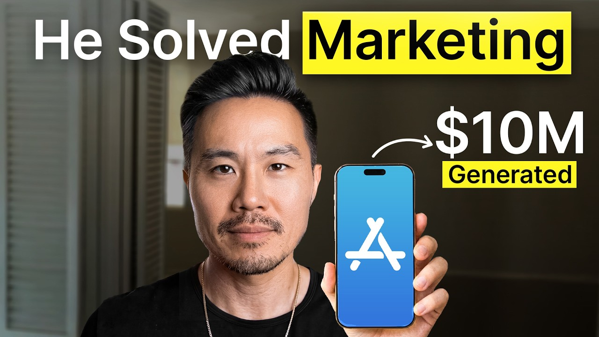

# Beginners Guide to Buying & Selling Apps 2026

Start building & deploying paywalls in 10 minutes flat: https://superwall.com/

## Table of Contents

* [00:00:00] - Buying Apps With Loans
* [00:03:49] - Distribution Is The Moat
* [00:05:29] - The Main Growth Channels
* [00:07:10] - Finding Ignored Keywords
* [00:10:53] - Hunting Painkiller Niches
* [00:19:32] - Doubling Revenue Case Study
* [00:20:56] - How ASO Actually Works
* [00:27:37] - Hard Versus Soft Paywalls
* [00:33:30] - Making Meta Ads Work
* [00:38:29] - Paywalls By Traffic Source
* [00:40:51] - Buying Apps Like Real Estate
* [00:48:47] - Wrap Up

## [00:00:00] - Buying Apps With Loans

This is an app we just purchased. It's made over a million dollars since the life of it. Last year alone, it did about 500,000. This is Steve Young. He's been in the app space since 2010, and he's turned buying apps into a machine. [00:00:00 → 00:00:13]

His process is he finds apps that already have downloads, but with high growth potential through app store optimization, ASO, then he buys them and sometimes doubles the revenue in a couple months without adding a single feature. But the way he pays for these apps is the part that kind of broke my brain. You can buy an app that's making $10,000 a month profit. Let's say you buy it for $350. So you take out a loan for $350. [00:00:11 → 00:00:33]

I'm technically profiting $5,000 a month. >> He buys a cash flowing app with a loan and he's profiting from day one on money that isn't even his. You're like buying a house with a pipeline of tenants already paying you the MR. You just profit instantly. But the reason the returns get crazy is what he does the week after he buys. [00:00:33 → 00:00:53]

one tiny change to the name of the app to drive more organic downloads and then a small adjustment to the payw wall. >> The hard payw wall doubled the trial activation rate. The start trial rate went from 6% to 13%. Trial to pay did not change. >> Double the people who start a trial, keep the conversion the same, and now you've doubled the revenue on the exact same number of downloads. [00:00:53 → 00:01:13]

In this episode, Steve breaks down his full app acquisition playbook, how he spots undermonetized apps that already have distribution, and the exact ASO metrics he looks for before he ever makes an offer, the loan structure he uses to buy a $10,000 a month app for almost none of his own cash. The economics of hard pay walls that can double an app's revenue the week after he buys it, and the keyword research that lets him build brand new apps from scratch. By the end of this video, you'll know exactly how Steve buys apps like rental properties and turns under monetized ones into cash machines. This is the Superwall podcast. I'm Joseph Choy, founder of Consumer Club, a Discord where top consumer app founders trade alpha and what's working now in growth. [00:01:13 → 00:01:51]

I've been talking to members doing a millionaire, and they tell me they've been using these two tools. Super has this free AI tool trained on 422 profitable paywall experiments across thousands of successful apps. You upload a screenshot of your payw wall and it gives you an experiment idea to make more revenue with the same number of users at paywallexperiments. com. And if your app's doing at least 100K MR, we host vetted dinners in SF and New York to hang out and network with other top app founders. [00:01:51 → 00:02:15]

You can apply with the type form in the description. Also, these app founders have been telling me they use ROR. I met Daniel, the founder of ROR, at a dinner, and I got genuinely really excited when he told me about ROR Max, which is out now and has honestly changed the game for coding mobile apps. It's AI that oneshots all native iOS apps with Swift code, camera, sensors, haptics, payments, the whole stack. And as you vibe code with ROR, you can install prototypes directly onto your iPhone with one click and then publish to the app store in two clicks. [00:02:15 → 00:02:42]

If you've been waiting for AI coding that actually does native iOS apps, well, this is it. I got you guys a discount. You can use the code superwall or use the link below. This is Steve Young. Some of you guys might know him from his own YouTube channel. [00:02:42 → 00:02:53]

I've been watching you actually for a while and I appreciate the content from another consumer apps person, but I think people will enjoy hearing about a lot of your marketing takes and just like a lot of the tactical stuff that you share on your channel. I'm also just excited to riff with you on what actually works and like kind of where do we see the space going? Yeah, maybe you can just like give an overview of yourself. Yeah. What are you seeing right now in in app marketing? [00:02:53 → 00:03:20]

>> Joseph, thanks for having me on, man. It's been a long time. you know, congrats to you and what you've been able to achieve with Super Bowl and Consumer Club. I've been in the app space. Just a quick little intro for those who aren't familiar. [00:03:18 → 00:03:28]

Been in the app space since 2010, started a podcast in 2013, started YouTube in 2015, and then really we we have a YouTube channel where we really try to share and try to do these type of interviews too. And for me, like I love doing these interviews cuz I am always like inspired and I'm trying to learn from this. For me like what I'm seeing the app space I think it's these are things I want to riff with you too Joseph is obviously we all understand is like distribution is the moat like now that you can build anything there's been so many shifts in the app space that now with AI I feel like everybody feels like a superhero and they can do everything by themselves from a development and from a marketing perspective as well but I think for me it's really about distribution and understanding distribution and a lot of people get inspired by what they see on Twitter what they see on YouTube and they go okay I can do let me replicate it. [00:03:28 → 00:04:14]

## [00:03:49] - Distribution Is The Moat

But you don't understand a few things in my opinion. You see like some app take off and you're like, "Oh, I'm going to just copy that strategy, but they might understand UGC's better than you, right? They might understand influencer marketing better than you. " And for me, it's almost like, "Okay, I've got an app because everybody can build a product. " Now, it's like truly understanding what is your superpower, what makes you unique, right? [00:04:14 → 00:04:39]

Not just the app unique selling point, but what is your unique angle that you can take? And for me, like it's always been ASO and Apple ads. That's my primary differentiator from a marketing perspective. Don't just copy what you're seeing other people do because they already have an advantage over you. They understand this versus you not understanding it and you just think, "Oh, I'm going to build a similar app or I can build a better app than somebody else. [00:04:39 → 00:05:03]

" And it's like, no, the better app is the one that has better distribution. >> It's kind of like product market fit, but it's like founder channel fit. What do you think about this archetype of vibe coders and or like maybe engineers that are now trying to build their own thing with the consumer app? I feel like the first natural channel to focus on maybe is ASO. You talk a lot about ASO and maybe even like Apple search ads. [00:05:03 → 00:05:30]

## [00:05:29] - The Main Growth Channels

When you look at the growth channels, what do you have? You basically have like paid social which is like meta ads. You have organic social which is like Tik Tok and Instagram organic. And then you have like influencers which is like very similar to or organic social and then you have ASO just optimizing your store page and looking at keywords and stuff and then you have Apple ads and then maybe Google ads maybe chatbt ads but is that a good overview of like the growth channels and then also do you think that ASO is like a good one to start for like engineer or like vibe coders? >> I put this sheet together and I've seen this personally with our apps and some of the clients we work with. [00:05:29 → 00:06:07]

I think you can reach 5 million MR and you only need one or two of these channels. And you kind of alluded to a lot of them. ASO, Apple Ads, Meta, Google, and Tik Tok. And I think the big three is going to be ASO, Apple Ads, and Meta. Like that's just what I've heard from a lot of people who've reached, you know, 100,000 MR. [00:06:07 → 00:06:22]

I hear some people doing Google and Tik Tok, but not a lot, right? Like, but mostly these three. Not to say that these can't work, but like you said, founder channel fit. It's like what is it that you're uniquely good at? And if you're not good at any of these, then I would agree with you. [00:06:22 → 00:06:41]

Maybe start with these two, Apple ads and ASO, because they're the easiest to learn. They're not that difficult. Whereas the these get into creatives. Google is just a mess, especially for iOS apps. And then Tik Tok, you got to be really good about creatives. [00:06:41 → 00:06:54]

So, if you understand this, you're a younger person, you understand social media, go ahead and start with these two, like the organic or the paid stuff. But if you don't understand any of this stuff, ASO and Apple's ads are probably the easiest lowhanging fruit to start off with cuz all you need are keywords. But even on top of that, Joseph, like a lot of people, especially indies out there, I feel like overindex on ASO thinking that that's enough, right? [00:06:54 → 00:07:17]

## [00:07:10] - Finding Ignored Keywords

And ASO, I put this together, too. It's like ASO is a pool. Like you're pulling people in. So people have to search for it. If no one's searching for your type of app or it's too competitive, you know how many calorie trackers there are or macro trackers there are now. [00:07:17 → 00:07:34]

If people are searching for it but it's too difficult, then ASO is not the game for you. And I think you know indies get just caught up with like Steve nothing's happening with ASO. You talk about ASO. It's like my ASO strategy is to focus on keywords that nobody is going after not that ones that are everybody is going after. And so for me right now, if you're an engineer, you could build anything you want. [00:07:34 → 00:07:56]

I always start with distribution first. And if you're going to rely on ASO and Apple ads, like really do a lot of keyword research and the the ones that have gotten to profitability really quick for us. It's just the ones that were like we find the keyword first, Joseph, and then build the app. [music] And so we already have distribution first, then we figure out the features. I guess in a way like ASO and keyword research is basically just ideation or like it's it's thinking about what what's a good app that has demand right now. [00:07:56 → 00:08:23]

Have you ever seen an app make a lot of money? >> What's a lot of money? Tell me what's a lot of money. >> 5 million ARR is what you can get to with like one to two of those channels. But I'm curious if you've seen it with just purely ASO and Apple ads. [00:08:23 → 00:08:38]

>> So this is an app we just purchased, right? This is Apple ads and a little bit of ASO March of 2024. It's made over a million dollars since the life of it. Last year alone it did about 500,000. So I did a half mill and you can see sales app store search primarily and then app store browse. [00:08:37 → 00:08:53]

So very little from app refer. Here's another app. This is an older app so it's got a good brand already associated with it. It's made last year did 6 million. You don't believe me? [00:08:53 → 00:09:02]

That's primarily ASO after search, right? Like it does big. It's in the health and fitness space. So January is always a bigger month. But you can see that it made that much money. [00:09:02 → 00:09:13]

So about four million with just app store search. >> And are these two organic app store search or paid search? >> No, it's all organic. Yeah, this is primarily organic. We're doing a little bit of paid here. [00:09:13 → 00:09:23]

This one that we just purchased, I'm spending about 5,000. I'm I'm lowering it. So last month I spent about 10,000 on Apple ads and this month I want to lower that because I found that ASO there's a lot of keywords that I can still go after. So, I'm actually going to I'm scaling down Apple ads and scaling up ASO because again, this is a niche that no one's paying attention to. And so, when I'm when I'm talking about ASO and the way I approach ASO is like, I'm not trying to compete with everybody. [00:09:23 → 00:09:49]

I'm trying to be in the corner, Joseph, and be like, nobody pay attention to me type of thing. You know what this reminds me of? You know how people compare consumer apps to drop shipping because the marketing is similar, right? it because building is so easy now. You can just market your app on ads and Tik Tok and it's like similar to drop shipping. [00:09:49 → 00:10:09]

The way that you're talking about it right now with ASO is almost like Amazon FBA. This is a deep cut. I don't know if people are into internet marketing and stuff, but Amazon FBA is all about finding these underserved categories that are low competition but high revenue per like one to, you know, a few competitors. And there were these, you know, keyword research tools back in the day when FBA was popping off. But I feel like marketing kind of goes in cycles. [00:10:09 → 00:10:39]

And right now we're we're kind of in the drop shipping cycle where we're kind of doing a lot of uh social marketing, you know, paid paid and organic, but also like ASO has been here the whole time. Like more than 5 million a year with pure organic search is kind of insane. [00:10:39 → 00:10:54]

## [00:10:53] - Hunting Painkiller Niches

Let's talk about keywords. Like how do you find underserved niches? I like to start off with the category. Figure out which categories have the highest like RPI, revenue per install, right? And you really want to think through that. [00:10:53 → 00:11:06]

And so for me, I'm really studying the categories without giving away all my secrets, Joseph, right? Because this is a first mover advantage in my opinion. But that's what I try to do. So I just try to figure out, okay, which category is going to get me the highest conversion and then what keywords are going to ultimately lead to the highest conversions. And so the the example I had previously was like okay so meditation right versus like even if you just pick green noise so green noise and it's an app that we have but it's doing nothing but so I'm willing to talk about this but if you think about that category you green noise has search volume so I like to use you know app follow I like to use app radar ASO mobile who's a sponsor of ours they're a great keyword research tool so I'm finding categories that are more niche so when you think about meditation it's like it's a little bit like a vitamin. [00:11:06 → 00:11:54]

But when you think about like green noise or binaural beads, you're starting to get more niche into this. And then when you feel the keyword, so the the other keyword that I gave away, and I did a video about this is migraine tracker. Migraine buddy does about 50,000 a month. And dude, if you look at their onboarding and their payw wall, not good, right? So you try to find these painkiller keywords that people are more likely to pay. [00:11:53 → 00:12:16]

And that's when you can hard payw wall them. And Super Wall is really, really good. A lot of our community members in the app founders community that we have, they're all sharing their superw wall stuff. And so that's how I would try to do this. And then you build the app. [00:12:16 → 00:12:31]

And so I always look at the search results for let's say Migrade Tracker, right? What are the apps that are showing up like the top three apps? How many reviews do they have? And how many people have it in their title? And that's a clear indication. [00:12:31 → 00:12:42]

I don't care what any ASO tool says about the difficulty. That's a clear indication to me that, hey, is this a competitive keyword or not? Because if there's not a lot of people targeting that keyword in their title and the number two or three apps only have a 100 plus reviews, then I know I could probably beat them. >> You want to see that they're doing revenue, but then they're just not optimizing something about it. Like the reviews or the onboarding or something like I'm I'm on sensor tower right now. [00:12:42 → 00:13:10]

It's like migraine um my tracker. The top three are not that good. There's this one that has 5K downloads, 10K revenue a month. And then the one you just told me about, Migraine Buddy, is like 70K a month from 30K downloads on on iOS. Um, which is a good ratio, but it just seems like it's yeah, like pretty low competition. [00:13:08 → 00:13:32]

We start on the category level. So like this app, my Green Buddy, it is in health and fitness category. Like niching down allows you to make it more of a painkiller product rather than like a vitamin product. Green noise is a perfect example too. This is very similar to marketing. [00:13:32 → 00:13:47]

It's like it's kind of product selection, but it's also like sort of marketing. It's like what thing will resonate more acutely with people cuz I feel like the psychology of a person who knows about green noise, they probably saw it on a Tik Tok one time. Okay, let's just look this up. What is this? Is ambient background sound that emphasizes mid range frequencies that filters out harsh high-pitch sounds. [00:13:47 → 00:14:08]

It mimics the organic calming frequencies of nature like leaves and rain and stuff. Okay, so that that's a good story. Like I believe it like I I just read that and now I believe it. Like I want to do green noise now. Um cuz like you know everyone's stressed these days you know they've probably tried multiple different solutions and stuff. [00:14:08 → 00:14:26]

If something new comes along then you're like there's like some novelty I guess. Do you have an approach to finding these very specific things? Like is do you just like scroll Tik Tok or do you like look at Google trends? Well, dude, that's that's your strategy. Like I I cut, you know, I have something from you cuz I took it from your AppSumo article that you wrote and I I have a slide that I when I was talking about distribution first. [00:14:26 → 00:14:45]

I was I was saying like, "Hey, if you focus on distribution first and you were talking about spy talk and doing all that stuff, which this is your unique advantage, right? And for me, that's the article that I was like, hey, I love this. " And I kind of took inspiration off of that into the slide that I put. I gave you credit, bro, but I it was a great article, dude. like you you did an amazing job of that and for me it's just different right like I use a different tool you use spy talk I use app follow that was a great tool right now ASO mobile so when I see an app like this like migraine tracker or migraine buddy and I'm like oh let me go into ASO mobile see put that key put that app in there and then ASO mobile unlike other ASO tools will give me all the keywords that it indexes for and I can just see okay great it's indexing for these keywords okay how much volume does it have. [00:14:45 → 00:15:34]

So, I'm looking for keyword volume, the search volume for around 30ish and up. So, that's where I feel like one of the clients we launched with, we used this exact approach and I was like, "Dude, do you want to call your app this? " Cuz I found a keyword that I felt like I could rank for and it was search traffic around 30. Two keywords, think Superall one word and Super Wall two words. And I was like, "Do you want to call your app that? [00:15:34 → 00:15:56]

" And he's like, "Okay, let's do it. " So, we did. And we were able to get to number one within the first week. And then after that you and we brought in $1,600 within the first month. It's now close to 20K MRR a few years later and now he's starting to do but we were able to get it to about 125 with just ASO with just like a couple of keywords and [music] that was it. [00:15:56 → 00:16:16]

If you're trying to build a six-figure business you can do that with ASO. To get to like a seven figure it's a little bit harder. I think for me I feel like okay I use ASO to just sort of figure out and that it's something's here and Joseph this is what I wanted to riff with you on because I think a lot of people talk about meta and ads and not enough about like the economics behind it cuz I talked to a lot of people and a lot of people are just like break even. So a lot of people they can share their MR but like what is their profit? Like I almost feel like people share their MR and their rorowass at the same time. [00:16:16 → 00:16:48]

I get it. But I've heard really from people who are doing amazing MR, but their rorowass is just like 100% which is break even for those who aren't math nerds. So I've heard from those or just slightly under at 90%. But you know they're so proud of their MR and they're sharing it on social media. But internally they'll tell me oneonone they're like gh you know we're barely breaking even. [00:16:48 → 00:17:09]

Anyways the what I feel like is you got to be at least a $3 RPI before you can think [music] about meta. And so what I like to do with organic and Apple ads is what is the RPI that I can get to? And the app that we purchased that I showed you that's doing half a mill, you know, it's about a $3. It's about a $3 RPI. So I was like, okay, cool. [00:17:09 → 00:17:29]

Now we've been able to achieve half a million using ASO and a little bit of Apple ads. Can I [music] take it to seven figures using a little bit of Meta into a category that I don't feel [music] like a lot of people are paying attention to? >> I was just about to ask you about the math of ASO. You said like 30 search volume. What What is the What does that number mean? [00:17:29 → 00:17:49]

Is it 30 searches per day? >> Dude, I have no clue. And honestly, it's because we the reason why I came up with the 30 was we bought an app in 2022 range and it was getting about 100 downloads to 100 to 150 downloads a day and it was ranking number one for two keywords that had a search traffic of 30ish. Like one's 28, one's like 34, right? So it's like 30-ish for both keywords, right? [00:17:49 → 00:18:11]

And we bought it. We did a hard pay wall. We increased the price. It was just charging a onetime fee of like $2, $3. No pay wall on the onboard, no nothing. [00:18:11 → 00:18:20]

It was just very much undermonetized. So, I found this keyword because Joseph, I was trying to go after this keyword for another client. And I just couldn't beat this app. So, I downloaded the app and I was just like, "Oh, this is super undermonetized. " And I knew how well the client was doing. [00:18:20 → 00:18:35]

The client was doing about a mill ARR and they had a web product too that was bit doing a much bigger, but they were doing about a mill. So, I was like, "Okay. " And they were charging $60 a year. So I was like, "Okay, I think we could purchase this app and then charge $60 a year. " And there. [00:18:35 → 00:18:47]

So we ended up purchasing it and we did. So hard pay wall increasing $60 a year. It went from $1 to $2,000 a month to $8 to $10,000 a month with just 100 to 150 downloads. So that's the number I came up with. And then when my client came up with me and said, "Hey, I've got this new app idea. [00:18:47 → 00:19:05]

" I was like, "Okay, well fine, but do you want to call your app that? " I was like, "I don't know anything right now, but I know my app does this. since number one for these type of keywords with this type of volume. You want to call your app that. And so that's why I feel like more confident saying like okay that 30 search volume and the data I have is about if you can get find those two keywords you can get about 100 150 downloads a day. [00:19:05 → 00:19:22]

And if it's niche enough you can build a six figure business pretty easily. I'm curious to go into that case study a little bit more like you kind of like you doubled it seems like you around doubled the revenue in how long >> again it was making about a thousand came into our port portfolio right here about a thousand right it's about maybe here 2,000 and then March we did a hard payw wall and started going and then April I mean May I'm sorry May and then June is when it went fully hard pay wall so in May was when we first launched the payw wall mid May and then June you can see the hard payw wall with no addition downloads, no additional features, just payw wall and onboarding, increasing the price and a hard payw wall. [00:19:22 → 00:20:02]

## [00:19:32] - Doubling Revenue Case Study

So, this is sort of and then we had to put an X, Joseph. The the interesting thing is if it's niche enough, the hard payw wall doubled the trial activation rate. The start trial rate went from 6% to 13%. With the hard payw wall, this was 6%. Trial to pay did not change. [00:20:02 → 00:20:19]

And that's the number you got to look at. Trial to pay did not change just because we had an X or not X. So that's what I mean by like niche product because your trial to paid would be really really good and if you can hard payw wall them as long as the hard payw wall gets you double the start trial rates and your trial to paid remains the same you've got something here. So we lost half our revenues just because of that tiny X. That's all the ch that was the only difference between June and August. [00:20:19 → 00:20:44]

The downloads were the same. It's just the payw wall. That was it. That was the only difference. But I you know I do say like you do get one star reviews when you have a hard pay wall though. [00:20:44 → 00:20:53]

So keep in mind that that might happen. [00:20:53 → 00:20:58]

## [00:20:56] - How ASO Actually Works

>> So what is the actual mechanism to like implement ASO? Are you just changing the title? I I've heard from some people that basically the subtitle and the title of the app is like 80% of ASO. Is that true? >> Yeah, 100%. [00:20:56 → 00:21:11]

That's all I I pay attention to. Right. So like here I'm going to pull up Green Noise and I'll show you because one of our apps is still number three for green noise. So when when I first launched this app of ours, we called it green noise app and then the subtitle was green noise for better sleep because if you do the autofill result, it just says green noise and then our keyword was green, noise, app, comm, free launched. And I was a you know like I know a lot of tricks with ASO so like that's that's sort of my advantage to it. [00:21:11 → 00:21:38]

We were number one for a few time but I just stopped paying attention to this app. Still generates some revenue but not a whole lot but that's it. like the words separated by commas. That was the subtitle you said. >> No, that was the keyword field, bro. [00:21:38 → 00:21:51]

The subtitle was green noise for better sleep because when you search for green noise, the the autofill result is green noise for better sleep. So, I was just like, let's just call the subtitle that. I just didn't have time to fully optimize the the ASO. So, I just said, f it. The the keyword that I'm going after is green noise. [00:21:51 → 00:22:09]

So, let me just go after every green noise term related to on the search the autofill, right? And you can see green noise [clears throat] free green noise >> free green noise for better sleep. So, that's why I said green noise for better sleep. Like, forget it. Let's just call it that. [00:22:09 → 00:22:21]

Then we'll optimize for all the autofill results. >> You look at your main keyword. So you just look great green noise on the app store and then you look at all the best results and then you take all of those best results and you just put those into your subtitle or if possible you jam all of them into your actual title. >> I mean that's how I did it because I was just like I don't have enough time like my team was like hey this is ready to launch Steve can you give me the ASO and I didn't you know I wanted to do it myself and I was like I don't have enough time let me just try it this way and see what happens and it worked. So that's why I would start with ASO because like you know you don't need much. [00:22:21 → 00:22:57]

You just need to find the right keywords to go after and then call it a day from that end. >> Is there a science at all to it? Like let's say you look up the the top five results and it's like green noise app, green noise free, green noise sleep. There's a few different combinations that you could put those words into to put into your app. And then you probably also want to create some sort of brand around it maybe. [00:22:57 → 00:23:20]

So you put your own branded name in it as well. Is there like a a science to it? >> I'm trying to figure out the science. So here is this is why right this I use I'm using app follow so you guys can see the autofill search results. So when you put green noise these are this is what Apple is autofilling. [00:23:20 → 00:23:35]

Some people I feel like people are lazy. They'll just be like green. Oh, okay. I'm just going to click on the autofill result, right? And then what I used to do at follow used to be. [00:23:35 → 00:23:44]

I [music] would pick out like this app. Be like what the hell? How is this ranking number three with only 138 reviews? So I click on this little eye icon and then back in the day app follow was really good about finding these new keywords. You start off with let's say meditation and then I try to see which app does not kind of belong. [00:23:43 → 00:24:01]

So I'm like okay this is 400,000 2 million almost 1 million almost for headspace 71,000 42,000 4,000. I was like what is this keyword and I would just click on what is this app right? they must be doing something right with ASO that I'll click this little eye icon or I might put this app into ASO mobile and see like all right how else what other keywords am I not paying attention to and this is the exact strategy I did for that client that you know we we made $1600 within the first 21 days just it was no free trial like no nothing and it just launched and we got 100 downloads a day just because we found the right keyword and I got it to number one and I was like dude I found this keyword say inside timer although it's not insight timer it has 57 700 traffic like do you want to call your app that because nobody's calling their app Insight Timer. He's like okay let's do it. And I was like cool. [00:24:01 → 00:24:47]

>> That's a good tip. Just like look at the look at popular keywords and then find one that has like not that much revenue or downloads and there's there probably something that they're doing differently. Is it always ASO or like maybe they're going crazy on meta ads? >> I mean you can look that up right like through sensor tower. You can be like are they advertising anywhere? [00:24:45 → 00:25:06]

Or you can look on meta ads library and see if they're advertising anywhere. That's what you can do. And if they don't have that many ratings, I feel like they're probably not doing a lot of paid stuff, too. So, it's like I was able to just find unique keywords just using that strategy. But now, it's like it's not App Follow's fault. [00:25:06 → 00:25:21]

Apple changed a bunch of their APIs that makes it hard for App Follow to give me those keywords, but it used to be really good at getting just staying very focused on the particular space and giving me keywords around that space. >> Do you have a basic idea of how the algorithm works for Apple Search? Is it like ratings or revenue or or what? >> Look, I think ratings has a whole lot to do with it, but I've been able to beat certain apps that have way more ratings and a bit more revenue than me. So, because I just fully kind of can optimize it. [00:25:21 → 00:25:50]

So, that's why I say like what is your unique advantage that you can beat me on because you might not be able to beat me on certain things like ASL. For me, I think it's partly about optimization, title and subtitle first and foremost. That's what I look at. And then I look at the ratings. And then maybe I look at the revenues. [00:25:50 → 00:26:09]

But those ratings and optimization I feel like are the two primary ones just because I've seen certain apps that been able to outrank bigger ones just because they're better optimized in the title and subtitle. You would search a popular term and a lot of the top apps don't make as much money as they could because they just haven't dialed in the, you know, the onboarding and the pay walls and stuff. It must be true because Apple must care about they probably do care about revenue. Like it's a signal that the user had deeper intent with the app which is good for them. >> It's so crazy because I think it's different. [00:26:09 → 00:26:41]

like one of our clients were able to like outrank Canva and it started off just going after a niche keyword and then eventually going up and so we were able to outrank Canva on this keyword and it obviously we're not making more than Canva but like Canva can't go after those R keywords right the most profitable app founders I know have been using SuperWall to AB test their pay walls because yes they have the basics like building and deploying payw walls super quickly without coding targeting users with different payw walls based on behavior and demographics. But now, Superwal AI actually predicts who will subscribe before they see a payw wall. The AI can do this because Superwal analyzes over 1 billion paywall interactions to score user intent and then recommends optimal pricing in real time. A good way to start is paywallexperiments. com. [00:26:41 → 00:27:29]

It's a free tool that gives you databacked paywall experiment ideas to increase your app's revenue. Okay, I think people are mad at me because I didn't ask you about hard versus soft paywall um 10 minutes ago. [00:27:29 → 00:27:39]

## [00:27:37] - Hard Versus Soft Paywalls

I'm going to ask now. So hard versus soft payw wall. So you you mentioned like the X, right? Like do you know what's the current like what's the status on Apple and how they treat that little X button on the on the payw wall? And when I say hard payw wall, I think there's like actually two different definitions. [00:27:39 → 00:27:55]

Like some people say it as like no trial is hard payw wall. And then there's like a literal hard payw wall, which is you just can't get past the the payw wall, trial or not, because there's no like X button. And there's like some stuff with the Apple reviews and maybe gray hat stuff like Yeah. What's the like what are you seeing with with the apps right now that like do people still do like complete hard hard pay walls and how is it achieved? >> If you get a reviewer that says no to a hard payw wall, you might just have the wrong reviewer because there's just too many apps doing hard payw walls. [00:27:55 → 00:28:30]

>> There's a lot of like well-known like respected like highquality apps and it's just hard payw wall. like it's just a I think it's just like a normal thing now >> the 5 million all organic our payw wall the way I define it is the nox when we launched the the app that I was talking to about we did a soft payw wall with no trials probably call it I was say soft payw wall no trials it was converting because it was niche enough that it was converting and then we went hard payw wall with a trial and it started to perform a little bit better there's ways and super wall makes it super easy but there's ways to do a hard pay wall and still try to leverage a soft payw wall, right? Using exit intent, using all these other strategies, [music] you can still kind of mimic a soft payw wall. For me, in the beginning, you want to do a hard pay wall cuz you just want to force the issue. You want to see product market fit. [00:28:27 → 00:29:15]

And there's no better way to force a product market fit test than doing a hard pay wall. That means no X. For me, Joseph, I don't know what you've seen, but typically seen better results with trials than without trials for the most part. Some apps I've seen no trials works pretty well, but for me, most of the time, generically speaking, having a trial tends to work a bit better than not having a trial. >> I guess for like people starting out with a new app, I mean, whether it's your first app or you're just, you know, trying to validate an app idea, do you feel like no trial is better to start out just because like you don't have to like completely dial in the the first 3 days of experience as much? [00:29:15 → 00:29:55]

My personal take is I want to see if I can get at least a five and maybe 10% tri start trial. Now, if I'm not hitting my 30 to 40, which is industry average for trial to paid, then I know I have a product problem. So, for me, the way I like to approach apps cuz we're still building apps and we're using our same approach. The onboarding has to be good enough. You should be there's enough content out there. [00:29:55 → 00:30:14]

Joseph has done a lot I've done a lot about onboarding and payw walls. And so, you should know what a good onboarding and good pay wall looks like. That's good enough. like what's good enough is good enough and only if you can get distribution is when you start figuring out monetization. I feel like monetization should be close behind distribution but should still be secondary to distribution. [00:30:14 → 00:30:35]

And because if you're doing paid it has to be very very close together. If you're doing organic it can be a little bit further apart because for me like if if I can't get downloads there's no point in me trying to fix monetization. It's a math problem. So, I'm always thinking distribution first. And if you're doing paid distribution, then you you your monetization has to be like 1 A 1B to distribution. [00:30:35 → 00:30:53]

But if you're doing organic, it could be one and two versus 1 A1B. >> Yeah. It's just more pressure when you're doing paid, you just have to like your LTV just needs to be a lot more tight versus um if you're just doing organic. If you're just posting Tik Toks or you're just changing the name of your app, like you it doesn't cost anything. So, you can you can just try to get more volume and then focus on monetization later. [00:30:53 → 00:31:14]

It's similar to here, Joseph. I'll tell you I'll show you this slide that I I give you credit for it. Here's a little I call you out. And it's like it's the same thing, right? You test you test it and for me it's just like building the app and getting it live and if there's crickets and I'm not getting downloads, I don't finish the product. [00:31:14 → 00:31:30]

You know what I mean? So, it's it's similar things in a way where I'm just but we have to for organic I actually have to build the product but the product is just good enough. It's not perfect. And then if I can't get downloads, then I [music] don't really try to invest in the monetization or building out the features. But then forcing the tri trial and the if the trial paid is not there, then I know I have a product problem, not a a channel problem. [00:31:30 → 00:31:54]

So at least the the market wants this product market channel market fit, but my product didn't live up to the promise. So now I know I have to build finish building the product. >> Yeah. One quick thing I would add to this also is like [music] yeah, you can use spy talk to find viral videos and then you can even make a test flight. So I'm working with >> a client right now where we're just building a test flight that has only the viral feature >> and then we give that to the creator. [00:31:54 → 00:32:26]

So then the creator just can make viral videos with just the test flight and then those people that watch if it goes viral then people will you know go and like try to download the app it won't exist but you still got that validation of like wow >> people thought there was an app it got tons of views >> is the test flight just to because you want to show the product and you know showing the product tends to do better is that why >> because a lot of a lot of like or organic Tik Toks that actually drive downloads and convert um tends to show the actual [music] app in the usually like an app screen. So you have two phones, one to record and then one to like show the app um being demoed. So usually there's like some kind of hook uh like a text on screen or UGC reaction or something like that. But then actually showing the feature that looks cool on camera. a lot of times it has some sort of like AI component uh where there's like this wow factor and then that is kind of like what drives the downloads. [00:32:26 → 00:33:26]

Is there anything else like top of mind in in the whole like marketing world that you're seeing with ads? [00:33:26 → 00:33:32]

## [00:33:30] - Making Meta Ads Work

I'm curious about like paid meta cuz meta has just meta has been around for so long and it's gone through so many different phases and now it seems like it's like very contentoriented like a lot of organic now kind of uh translates over to paid. Yeah, I feel like there's a lot of different angles to this. What are you seeing? >> You have to really understand your economics if you're running meta. The best thing I heard from meta is like sending the right signals. [00:33:32 → 00:33:57]

Obviously, everybody understands how to do it. But I think for me, it's like a lot of people do meta because they hear the success of other things and then they're like trying to mimic certain things, but I say understand the economics. So, make sure you're able to get if you're optimizing for trial. This is my personal opinion, so like disagree with me if you disagree. I think you got to be somewhere around at least a 10 to 15 cost per trial or a $3 revenue per install to even consider it. [00:33:57 → 00:34:25]

because we tried Meta for one of our apps doing about 3K a month and that's been all organic. But when I tried Meta, our revenue per install is about a dollar, Joseph. So I'm like, I can't make the economics work with that type of numbers and I could just and we tried hard payw wall and just didn't work as well. So this the newest thing I heard from a past podcast guest was like he's like, oh, I start sending different signals to Meta. So he does require registration before payw wall. [00:34:25 → 00:34:49]

I'm usually against that. I'm using payw wall then registration but he has a registration and he has a high registration so he sends meta registration event content view event which is a standard meta event that's a payw wall view initiate checkout and then obviously he has no trial so he does subscribe like purchase event so and then he obviously optimizes for the purchase event because he has no trials but by sending those early pre purchase signals allowed him even though he's still optimizing for the same thing allowed his meta account to be a lot better and a lot smarter. >> In the meta campaign setup, you're still optimizing for the the purchase ultimately or the trial start, right? Not the actual [music] conversion, but the the trial start or the conversion if it's a conversion. But then before that, you just make sure it's tracking all the other high intent signals as well. [00:34:49 → 00:35:41]

What is the um tool that that they use for that? Is that like does that have to go through an MMP or is it just like Facebook pixel? >> Facebook pixel. It's just these are a standard events. Content view is you just have to match that up with a payw wall view and then registration just it's been around because you know e-commerce. [00:35:41 → 00:35:57]

So [clears throat] he's like I I heard this from an e-commerce brand. So he just sort of brought it into the app world. And so content view is really just like maybe shooting a item page, right? And so he called that as a payw wall view and initiate checkout everybody has. So it was interesting. [00:35:57 → 00:36:13]

I was like oh that that was the newest thing. a comment on that. Like I feel like maybe maybe under the hood like what's happening with that is that maybe it's like uh almost like a retargeting campaign where like back in the day you would run like multiple campaigns at once and then you would like one would be uh like if it's a video ad uh you would like find all the people that viewed 3 seconds at least uh and then launch another campaign. uh show those people a slightly different ad that's a little bit deeper funnel like hey you saw our last ad by the way here's the objection handling xyz um and and that's like higher converting but maybe meta like automatically does that now where like you give them the payw wall views and then they're like those people are of a certain type of demographic and you know all these data points will we'll now show more ads to like those people that viewed the payw wall but then didn't convert even though you're you haven't even told us that. You just said, "Hey, optimize for the conversion. [00:36:13 → 00:37:13]

" Is that basically like what you're trying to do with Meta? Like you're trying to tell Meta and what they're doing. >> You said it best. I didn't even think about that, but you said it best cuz I bought this thing for my daughter play softball and I've been advertised this so much, Joseph. Like I've been clicking on it. [00:37:13 → 00:37:28]

I've been thinking about it, buying it, and they just show they just ro keep rotating ads. So, I think you're you're on to something cuz they keep just showing me different ads knowing that I'm almost there and I did end up buying it. But I think that's what happened. That's what happening. So, it's like, okay, well, you clicked on it. [00:37:28 → 00:37:45]

You initiated checkout or you saw the payw wall, but you didn't go on. So, let me try a different one that gets a higher initiate checkout and let me see, you know, give it favor. So, I think just by sending that signal, you're you're I think you're you hit it spot on. That kind of actually is a bullcase for um uploading every single creative into one ad set. [laughter] >> Bro, I think so too. [00:37:45 → 00:38:09]

>> Yeah. I try to talk to a lot of people and I'm like, "What do you guys do? " And I'm just like, cuz we [music] we just launched our meta campaigns and I was like, "Dude, release them all. " Like, I don't give a crap. Let meta. [00:38:07 → 00:38:18]

I think what I've learned is just don't try to outsmart the algorithm. They're smart. Let them do their thing. Give them everything that they might need and let them figure it out based off your objectives. So the last thing and I got some good feedback. [00:38:18 → 00:38:30]

## [00:38:29] - Paywalls By Traffic Source

We talked about hard pay wall. So I started thinking like hard pay wall on paid traffic, right? And only because of the one star reviews. Now I know you can do this with some integration with super wall on appstack and but I'm going to kind of share this. So this is obvious this is me. [00:38:30 → 00:38:43]

You have these normal onboarding flows. How old are you? And then where did you hear about us? From what I've heard from others, where did you hear about us is a great way to as a backup MMP or a backup to your attribution. So and then obviously you get to the payw wall. [00:38:43 → 00:38:56]

So I started thinking like what if on if they search for the app store or they heard it through a friend, you're going to hit them a soft pay wall just to negate some of the onestar reviews, right? Negate one star. So you have the X right here. But if they came in from Instagram and Facebook, why don't we just remove it? And and I think this is the next phase of monetization is and so it worked, right? [00:38:56 → 00:39:18]

This Lucas from AppStack shared this on LinkedIn and talked about the integration with Superwall and AppStack and how that performed a lot better for this guy on Twitter. But I started thinking through like these onboarding screens that we all have. Could you pre-qualify people? So, could you show a higher price for those that are coming in? You know, there's other screens where it's like, what are you here for? [00:39:18 → 00:39:41]

You know, like eating healthy. Using those as an indication to like, do I do a soft pay wall, hard pay, well, do I increase the price or not increase the price? >> [music] >> And I think like apps like Uber, apps like Door Dash, you know, they're they're all doing it already based off like Uber, you know, if you're coming in from Four Seasons, you're you're going to probably get a higher price than Motel 6, right? So, it's differentiating your users and seeing higher intent, [music] showing a hard pay wall, maybe seeing higher intent and professional. So like the easiest example I can give too is like if I'm Canva and I'm using it for professional or personal maybe if you're using professional you show them a higher price. [00:39:41 → 00:40:20]

If you're using it for personal you show a lower price. Things like that. >> The biggest levers on payw wall optimization people think of as the actual pricing whether you do a trial or not if you do an abandon or not. But if you actually change the offer based on the onboarding questions or like based on the traffic source, I think not that many apps are are going super deep on that yet. That's good to watch out for. [00:40:20 → 00:40:45]

That's a good prediction. I think like the next year or two, I think like like a lot more people are going to start doing that. So, I want to ask you about like what's going on with your stuff, too. [00:40:43 → 00:40:52]

## [00:40:51] - Buying Apps Like Real Estate

like you you have the like the consulting, the agency, the like the content stuff, but then you like I'm curious about your your acquisitions. So you you acquired like the app that's doing like 500k a year. Have you always done that like buying and operating apps? >> Yes. So we we purchased Indie App Santa in 2024. [00:40:52 → 00:41:13]

We're able to make that money back in like 3 or 4 months and we purchased one in 2022. For me, I was just impatient, Joseph. Like I started making apps and I was like, "Okay, this best the best one I have is $3,000. " And you know, the funny thing was this app that I acquired, they followed my YouTube channel and they copied my exact strategy, that ASO strategy I just kind of showed you, I knew that keyword existed from a couple of years ago. So when I I was talking to Evelyn and she, you know, she was trying to work a deal with me and she's like showing me all these apps [music] and I was like, I want I want to talk to this one. [00:41:13 → 00:41:49]

I was like, they did half a million in this keyword I knew about two years ago. And I looked at where they're ranking. I was like, oh my god, they're number one. And dude, I was just too lazy. It's in the health and fitness space. [00:41:49 → 00:41:58]

I was like, I don't want to hire a trainer. And I'm like, this is too much work. And so I stopped. I didn't I didn't build it. But then they built it and I was like, dude, I'm not going to let this opportunity go. [00:41:58 → 00:42:06]

And so yeah, for me, [music] like the best purchases I bought another one and we paid $18,000 and it flopped. Like it. So, the best purchases I've made are the ones that have distribution but are like either undermonetized or I can find a different distribution. So, the reason why I bought this was like I saw the other keywords that we can go after. So, they're [music] they're still maximizing. [00:42:06 → 00:42:29]

They they're doing good on the ASO, but they can do even more. So, I was like, okay, there's more keywords and more traffic that I can go after. And then secondly, they haven't even thought about meta and it's targeting an older audience where I'm like, "Okay, meta could work better for older audiences because then I'm not fighting with the younger audiences that everybody else is fighting for. " So that's why I started to think through and I'm like, "It's a it's got enough money embedded in it that I can make this purchase. " And the the way I think about it, too, is I don't know if I'm right, so just take this with a grain of salt, but my math is look, you can buy an app. [00:42:29 → 00:43:03]

So, let's say you can buy an app, Joseph, that's making 10 to keep math easy, $10,000 a month profit organically. Let's say you buy it for 300,000 or let's say 350 just to keep the math easy. 350. So, you take out a loan for 350. Long as you're doing well, that loan you have to pay back in 10 years for five and the loan is about 5,000 just to keep the math easy. [00:43:03 → 00:43:26]

$5,000 a year a month. So, my math says, okay, I just paid you $350 for your app that's doing $10,000 a month. I have to pay back my loan for $5,000. I'm technically [music] profiting $5,000 a month, right? And I know I will make back my money if it everything holds in 3 years, but I have an additional seven years cuz it's a 10-year loan to figure the rest out or I can just pay back free. [00:43:26 → 00:43:53]

So, I think that's an interesting model for those who are just trying to come in. But the the elements of a like successful acquisition has always been distribution is embedded in it. If it's not in there and I prefer organic, I've talked to other acquisition folks that I'm like, okay, they do look for the same thing because then I can add on to something else, right? If you fully if it's paid, then it's like it's a money eating machine. Like I'm like, oh isn't it? [00:43:53 → 00:44:21]

Right? I got to keep paid going otherwise the sales go down. So, if there's organic already in there, great. And so, now we're trying to build more apps using the same exact strategy. And I'm trying not to be lazy anymore, Joseph. [00:44:21 → 00:44:33]

I'm like, f it. I know these keywords exist. I'm not going to be lazy anymore. I'm going to find a trainer, build the app. >> It feels like real estate. [00:44:33 → 00:44:42]

You're like buying buying a house and with the tenants, like a pipeline of tenants like already paying you the MR and you you just profit instantly. Uh, that's that's a interesting model. Do you know other uh app acquirers? Like do do people tend to do the loan method or is there like seller financing? >> Like you can do both. [00:44:42 → 00:45:04]

Like if you want to get really creative, it's you can do a bit of both. So I just trying to keep it everything simple the mathwise. We could have paid it, right? We have the cash, but like why, right? We're in the US. [00:45:04 → 00:45:14]

Like this is the beauty of the US. So why why do that? Especially if the economics make sense for you to do it. So obviously there's a bit of embedded risk but there's embedded risk in everything you do. So I think for most people they either get VC funding or they either just use their own money but for me it's like I could have used my own money but why let's not do it this way. [00:45:14 → 00:45:35]

Even when I purchased Indie App Santa it was only like it was not that much and I was just like I could have paid for it but I was like doing the same math. I was like well I know it makes this much money you know if I took out a loan I would only have to pay this much. Wait so I'm making money regardless right? So instead of just giving a full lump sum and just being like out this much money, I was like, let's just take the loan and we'll still make money and I don't have to use my own money to do it. >> Okay, one last tactical thing on the acquisition. [00:45:35 → 00:46:01]

So you turned around like the ASO or you kind of like increased the ASO within a couple months. Is that just about adding keywords to the title? Like if they're already doing really well in a keyword, are you just tackling almost a different demographic slash like different intent from a category by putting like the other keyword in parentheses or like something like that within the title? >> It's a little bit of both. So this is the way that I'm executing the the current app to doing half a million last year. [00:46:01 → 00:46:30]

So I know that the primary keyword, let's just call it green noise, that there's other green related terms that I can go after. So there's other noises, let's say as an analogy without giving the way the the way I'm approaching this, but the analogy would be like, [music] oh, there's blue noise, there's purple noise, there's all these other noises that I can go after that have search volume. So I'm using data. I'm looking at the spreadsheet right now for the app that I just acquired and I'm like, "Wow, there's like I just sorted it by the main keyword that we're already number one for, but like also that word is has different iteration. There's 24 keywords [music] that have at least 24 search volume and up. [00:46:30 → 00:47:12]

That's 24 keywords with the main green already in there that I can start to go after and nobody not a lot of people are paying attention to it. [music] So my approach is instead of like diluting this, why don't we just keep moving this and calling everything green blah blah blah. >> Here's another analogy like migraine buddy track headache. This in a way has three different keywords, right? Cuz it's like migraine which is the main one, buddy is their brand migraine buddy and then track, right? [00:47:12 → 00:47:42]

Cuz like some people might be searching migraine tracking and then headache is like another keyword, right? cuz I know people search for high headache tracker and headache stuff and chronic pain, right? So these are all like painkillers related terms. So you got chronic pain, you got headache, you got migraine, you got all these and just instead of going after let's say symptoms tracker, the analogy would be instead of going symptoms tracker. Just keep going. [00:47:42 → 00:48:05]

>> Oh, you could just keep going here. Like you just add chronic pain, add uh triggers, right? [laughter] Share reports, predict end of attack. Yeah, there's like so many. I've noticed that like over time you see like these super long app title names. [00:48:04 → 00:48:20]

Amazon too, right? They people load up like 50 keywords into an Amazon product title. >> This is what we used to do in drop shipping days. It was like in on eBay. You go like not Gucci sunglasses. [00:48:20 → 00:48:32]

[laughter] That's what we used to do way back in the day. We go not Gucci sunglasses to try to rank for Gucci sunglasses. But obviously you can't do that here. But yeah, you can go super long on the migraine. That's a great analogy. [00:48:31 → 00:48:44]

I'm going to use that for the the migraine cuz I'm not going to build a migraine tracker. [00:48:44 → 00:48:48]

## [00:48:47] - Wrap Up

>> This is a great combo. Steve, thanks for being on the pod. Um, where can people find your stuff? >> appmasters. com or just go to the appmasters YouTube channel, digest the free stuff before you think about anything else. [00:48:47 → 00:48:58]

>> Cool. Thanks, Steve. >> Thanks, Yosov. >> Something you might not know, most of the founders I cover on this podcast are hanging out right now in the Consumer Club Discord, sharing with each other what's working now for consumer apps. So, you can apply to join consumer club if that sounds interesting to you. [00:48:57 → 00:49:12]

And this is the Super Bowl podcast. Of course, you got to check out superwwell. com. We have more videos on the channel. [00:49:12 → 00:49:18]
