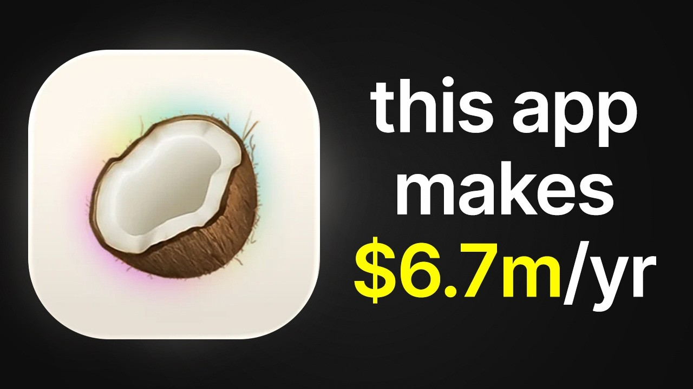

# COPY this ai app's $6.7m/yr marketing strategy

Start building & deploying paywalls in 10 minutes flat: https://superwall.com/

## Table of Contents

* [00:00:00] Intro
* [00:01:23] Superwall Podcast Overview
* [00:02:17] Coco Note Introduction
* [00:03:23] Viral Growth Strategies
* [00:05:23] TikTok Success Story
* [00:07:32] Content Creation Insights
* [00:10:14] Creator Talent Development
* [00:15:04] Discovering and Nurturing Talent
* [00:20:33] App Monetization Tactics
* [00:25:25] Building a Lean Team
* [00:30:00] Conversion and Retention Strategies
* [00:38:39] Strategic Partnerships and Acquisitions
* [00:45:02] Future Innovations and Opportunities
* [00:51:00] Closing Remarks

## [00:00:00] Intro

Within 45 days, we crossed 100,000 ARR. Within 4 months, we had crossed a million ARR. And within 5 months, or just 1 month after, we were about 2 million ARR. And then after a year, we were at 5. >> This is Brett and Zack. [00:00:00 → 00:00:15]

They built an AI note-taker for college students, which quickly became one of the fastest-growing apps. >> We crossed 2 million registered users. Last year, we crossed 6. 7 million ARR. >> They used TikTok to blow up their app, but not in the way that most people would expect. [00:00:15 → 00:00:30]

Because while other people chase views, Brett and Zack ignored it. They only cared about one thing. >> We would rather have 10 million views on a video that converts well, because it's actually targeting our target audience, as opposed to a 40 million view video that is just unique and novel and drives low-intent traffic to the product. >> They built a team of 10 to 12 part-time creators, not influencers, but people who understood the product and the audience. >> We wanted to build the equivalent of the Navy SEALs, not the Navy. [00:00:30 → 00:01:00]

So, how did two ex-Loom employees go from side projects to even getting acquired by Quizlet in under 2 years? In this episode, Brett and Zack break down exactly how they built Coconote to 6. 7 million ARR, including the exact UGC playbook that drove millions in revenue, the changes that boosted trial conversion by 16%, and the anti-churn tactic that stops 27% of users from canceling their subscription. [00:01:00 → 00:01:24]

## [00:01:23] Superwall Podcast Overview

>> Let's get into it. This is the Superwall podcast, and I'm Joseph Choi, founder of Consumer Club. The members in the Consumer Club Discord and the founders I interview on the pod build apps at a median of 1 million ARR. A lot of these apps that make the most money run AB tests on their paywalls to make more revenue with the same number of users. Superwall has a lot of data on the thousands of apps that use a paywall. [00:01:23 → 00:01:45]

So, recently they put together a free AI tool trained on 422 profitable paywall experiments. It lets you upload a screenshot of your own paywall and gives you an experiment idea to increase your revenue. You can use it for free at paywallexperiments. com. Also, if you're building a mobile app doing at least 100K a month in revenue, Superwall hosts dinners in San Francisco and New York. [00:01:43 → 00:02:03]

They keep each gathering small, thoughtful, genuinely useful for everyone. If you meet this criteria of 100K a month in revenue and want an invite, apply using the typeform in the description. Let's get into the pod. Yeah, why don't we give people the the scoreboard? Like, where is where is Coconote right now? [00:02:03 → 00:02:19]

## [00:02:17] Coco Note Introduction

Coconote is an AI note-taker and study assistant, primarily for college students, but also for any learner. And we crossed 2 million registered users. Um, last year, we crossed 6. 7 million ARR. We've done generally over 50% EBITDA, and uh, we've kept the the team quite small. [00:02:19 → 00:02:39]

And you just got acquired. So, how how long did it take from launch to exit? About 18 months, a little less than 2 years. Wow, okay. Exit to Quizlet in 18 months. [00:02:39 → 00:02:49]

So, before all of this, you guys were both at Loom, I think. And yeah, what what were you guys doing there, and then why did you end up leaving Loom? I was the first PM. I actually joined as a second designer at Loom, and one of the first employees. And then I moved back into product management, eventually product lead, and started the the mobile team. [00:02:49 → 00:03:09]

Yeah, and I was on the the iOS team. I was an engineer at Loom. So, you guys and you guys were not just like corporate employees and then just suddenly had this like crazy viral startup. Like, it seems like there were a bunch of products in between. [00:03:09 → 00:03:23]

## [00:03:23] Viral Growth Strategies

Like, what was the moment that it clicked from like we're doing all these side projects and or just like other like main projects to yeah, when it really clicked. Brett, you want to take that from your side? Um, yeah. I mean, we Zack and I tried a few various things together. Not not nothing really felt that special until Coconote. [00:03:23 → 00:03:44]

And it felt like people were kind of pulling it out of us once we started market marketing it. Zack was able to find pretty pretty quick traction on the socials, and that's when it really made sense to us. Joseph, I could just add something there. I would say the best quote on this that I've ever heard is momentum is like oxygen for a startup. And so, the sooner you're able to find momentum, the more willing you are to just put more and more energy into it, because you see that it's actually helping people and people clearly want what you're building. [00:03:42 → 00:04:13]

>> You guys had some crazy momentum with some of these uh, TikToks. Let's just get straight into the TikToks. This is kind of what you guys are known for. Um, I want to start with this one. This this one TikTok got 40 million views. [00:04:11 → 00:04:28]

So, was this one of the first videos that really popped off? No, actually, this was about 8 9 months into the journey. It took us a little while to find that level of traction on TikTok and Instagram Reels. But the irony of this is that, yeah, 40 million views, and for all of this feature, uh, PDF to brain rot, we probably did 100 between 100 and 200 million views just for this feature alone. The irony of all of this is that it doesn't convert well. [00:04:28 → 00:04:58]

And so, we did from all of these videos, 3,000 trial starts over the course of a couple days, which is by far and away our our highest number of trial starts over that period. If those would have converted, you know, in like at 100%, it would have been 360,000 in revenue, but they converted to something like 25,000. And so, one of the key takeaways is you can go viral. You know, there are ways to get hundreds of millions of views on socials, but that doesn't necessarily mean you're solving a real problem, and you're building something that people really want. [00:04:58 → 00:05:30]

## [00:05:23] TikTok Success Story

It could just be like a novel tool, in which case that's not really going to convert to paying customers. >> I remember this this spike in virality. I was seeing these PDF to brain rot videos all over the place. Basically, like it's this video where a person is in their text. It's like a super long text that they just sent, and then they go on their desktop, they write pdftobrainrot. [00:05:30 → 00:05:58]

com, and then they paste in the long long text. And then it turns it into like a Minecraft parkour brain rot video is like the punchline. It basically it was kind of like a lead magnet product, where you guys would convert people from the the PDF to brain rot site to actual product. Yeah, that's right. It's a little bit of a Trojan horse, right? [00:05:58 → 00:06:17]

So, if we can get students uh, in the door from this like brain rot style video, very novel and unique, then in theory we could convert them into the actual product, which is really helping them learn and summarize and create study materials. Let's let's pull up this other one, too. You're going viral on TikTok and Instagram at the same time, it seems like. So, this one's a reel. Uh, this is more talking head style, where she's like, "Hey, I just found this site. [00:06:17 → 00:06:45]

This is crazy. What is our attention span coming to? " And then it seems like it's the same demo video as well, where you're like zooming into the laptop screen. Uh, actually, this one is a little bit different. So, even though the revenue you said, you know, 25K revenue, even though you got like, you know, 200 million views or something. [00:06:45 → 00:07:06]

So, the conversion rate wasn't perfect, but the virality itself seems like it was a really good exercise in learning how to go massively viral, while also showing a product. Like, we're going to get to the conversion rate, I think, in a bit, cuz I want to figure out like how did you even convert this into, you know, the several million ARR that you have today. But what did you learn from this? Um, did were you creating these videos yourself? Did you have a bunch of creators? [00:07:04 → 00:07:32]

## [00:07:32] Content Creation Insights

Like, what was your process to actually create these videos? So, given this was maybe 8 months into the journey, we had built out a small content team. And so, the creators that you see here on the screen, Allison and Sydney, they were part of the content team. Prior to that, we had a much smaller content team, and we were going viral, you know, it depends on what you consider viral, but we had several videos with around 20 million views on our main page, just the @coconote app on Instagram. And those were converting much better, because they framed Coconote for what it is, which is a solution to a problem. [00:07:32 → 00:08:11]

Whereas these PDF to brain rot videos were much more novel and unique, and there certainly is somewhat of an aha moment, which is one of the reasons why I think they did so well. But what we realized when we dug deeper is, you know, we would rather have 10 million views on a video that converts well, because it's actually targeting our target audience and an audience that wants to solve their problems, as opposed to a 40 million view video that is just unique and novel and drives low-intent traffic to the product. Yeah, let's look at let's look at a couple of examples of the actual product ones that did better. So, this is your brand page that you're talking about, I think. So, this video got 18 million views, and it directly shows the core product. [00:08:08 → 00:08:54]

And you even the call it out. Hook is, "My mom just changed my college life forever. " Ooh, that was that was a quick hook. That was two like two, three seconds of just like showing the lecture hall, and it immediately goes straight down, showing the phone screen recording the lecture. She showed me this app, and all I do is hit record. [00:08:54 → 00:09:15]

It listens to the professor, starts talk taking notes. That's crazy. This is like 18 million views. So, how many views did this get initially? And then did you end up boosting this um, post? [00:09:15 → 00:09:27]

Pretty much all of the 18 million came, you know, within the first 2 months, I would say. And we I'm sure we did put a little bit of money behind it, but we haven't really found a ton of success in that. And so, it's very minimal. I'd say 99% of those views are organic. That's wild. [00:09:27 → 00:09:46]

What would you say is like the difference between a, you know, the PDF to brain rot videos that are doing massive, you know, 200 million views, versus these that maybe get a little bit less views, but um are actually higher converting. Well, two things I would say. The first thing is that I think I've on content grown to have some sort of perspective on it. Depends on where the product is in the product life cycle. And so, if the product's very early on, you can get away with, for example, a shock hook and product demo, which is a much lazier form of content. [00:09:46 → 00:10:20]

## [00:10:14] Creator Talent Development

And our content in the earlier stages being in a lecture hall, this is a you know, there are a lot of details here that I don't want to minimize. A very talented uh creator on our team named João uh made these for the most part. And so, I don't want to minimize that work at whatsoever, but it is a {quote} {unquote} lazy form of content that you can get away with when the product itself is more novel and unique because it's early in the general market of it, right? We were posting these March, April, May 2024, right when we were coming out. We were posting the PDF to Brainrot, you know, 6 to 8 months after that. [00:10:20 → 00:10:55]

And it just framed It was a different product intended and I think resonated with a different age group. One that has most likely less disposable income. It's not framing the product as a solution to a real problem. It's just more of a toy. And that's the big learning. [00:10:55 → 00:11:11]

And then some more like behind the scenes on on this video is like the recording screen uh and the transcribing screen are are not real screens in the product. These are screens that the content creators have access to for making content easier and things that are just a bit more eye-catchy than like a more like boring recording screen that you might might find in like a the actual app. That's interesting, too. Like this uh this wave screen, is this one uh like a creator's only screen? Yeah, exactly. [00:11:11 → 00:11:44]

And then you can like see the the name of the app on the screen. All right, yes. It's Coconut. ai like in huge text. Interesting. [00:11:44 → 00:11:51]

Yeah, so that screen, when you think about it, it is kind of impractical. Like why do you need to have like this gigantic rainbow wave like as you're uh recording a lecture, but it it does look very eye-catching. Were there any other creator only screens on in this video? Not in that one, but we had a variety of screens that were really only for creators to use whenever they were filming content. Okay, and then this was another like core page or brand page. [00:11:51 → 00:12:19]

This one got 2 million views. This one says um it plugs the URL 2048, but help me study. com. And then that just redirects to Coconut, it seems like. Yeah, so at the time we were experimenting with a lot of study games. [00:12:16 → 00:12:35]

It's still something that we're excited about, something that Quizlet has as a broader category of study games, but there are a lot of good things to say about this video. One, it's a novel concept to take a, you know, proving game that a lot of people have recreated and to integrate, you know, studying in between these little quick dopamine hits of playing, for example, 2048. The second thing is Ally, who is doing the content on this, did a phenomenal job. There are so many small details in terms of the hook and the script and, you know, fast-forwarding in certain parts of the video. I think we did a great job building the team to attract the best creators that pay attention to those little details. [00:12:33 → 00:13:17]

I want to get into that that part, like the creator sourcing. How do How do you guys approach creator recruiting and training and coaching and management? Yeah, I think one of the interesting things about our creator team is that very early on, Brett and I were on board with we wanted to build, you know, the equivalent of the Navy SEALs, not the Navy. And so, we've always kept the content team uh quite small, at least before the acquisition. The content team at its biggest was maybe 10 or 12 uh content creators. [00:13:17 → 00:13:50]

All part-time, all contractors, all with a lot of uh freedom and flexibility in terms of the content that they're creating on Coconut's behalf. Allison ended up joining as a larger member of the team and she was uh kind of a uh leading a team of contractors as well. And so, that was very helpful. Allison ended up doing hundreds of millions of views with us. And so, I think one of the things that we did well in hindsight is to make sure that whoever's leading your content team has the respect and kind of admiration of the team overall. [00:13:50 → 00:14:23]

Uh and I think that comes down to, you know, having produced content that has gotten millions or hundreds of millions of views in that case. Got you. So, did she have a bunch of views or followers on her own content before you guys hired her? Yeah, so we reached out to her through DMs and then I think eventually through emails. And then to answer your question, Joseph, more broadly, we've used Handshake, DMs on Instagram and TikTok, email outreach, uh referrals, all kinds of ways to find great creator talent. [00:14:22 → 00:14:58]

You know, I would say whenever you're building out a creator program, it's more akin to a talent manager and someone that's finding undiscovered talent because that's where, you know, part of the {quote} {unquote} alpha is is like finding people that are not yet discovered and then working with them to create great engaging content. [00:14:58 → 00:15:20]

## [00:15:04] Discovering and Nurturing Talent

No one that we've worked with would I believe identify themselves as like an influencer. They are first, you know, and at their core marketers and they care about helping a product grow and leveling up their marketing skill set. And the way they do that is through making, you know, making engaging content. That's so key. I I think There's two things you said that that are really interesting to me. [00:15:20 → 00:15:44]

Um the undiscovered talent, those are like my magic words. I love thinking about talent acquisition and finding like under discovered sources of talent. And then, yeah, hiring marketers, not influencers, is also huge. Where did your best creators come from? Was it college students or um who are just marketing majors interested in marketing or what are some like signals that you look for? [00:15:44 → 00:16:08]

Yeah, undiscovered creators. It's a really good question. So, I don't think there's a single right answer. It's not like we found one channel and that was the clear winner. I'll tell you another interesting and uh funny story that I like to share with folks. [00:16:08 → 00:16:24]

So, I came back from a wedding in Mexico and realized uh I am terrible at Spanish. And so, I found a Spanish tutor online. And 15 minutes into my call with my Spanish teacher, I said, uh "Luisa, have you considered making content? " I could just tell her energy was so infectious and she was so good on camera as a teacher. I really thought that would translate into content. [00:16:24 → 00:16:45]

And she said, "You know, I've thought about it, but I've never made content. " And then, you know, fast-forward 9 months and she's one of our best content creators. She focuses on LatAm, so she makes content natively in Spanish. At some point, she's made content in English for us, too. So, I really think you can just find talent everywhere. [00:16:45 → 00:17:02]

Is there some kind of protocol that can get most people from raw talent and charisma to actually creating high-converting, high-view videos because it's kind of crazy that you got your Spanish teacher to become one of the best creators? One way that I've started to think of it is in terms of like a pyramid. So, at the base of the pyramid, you have to want to win. If you don't want to win and you don't show up to win, then there's not a lot that, you know, anyone, in my opinion, can do to spark that. So, wanting to win means you engage in the Slack channel, right? [00:17:02 → 00:17:37]

You engage with other people that you're working with. You show up. You show up on time. You show up with your camera on. There are a lot of just small details that you want to get right there. [00:17:37 → 00:17:49]

And that truly is like the baseline, I would say. Do you care and do you want to win? The level on top of that is can you heavily use other content for inspiration? So, if I show you a video, do you understand the level of detail that went into that video, that viral video? Could I start to show you videos and hide the view count and the likes and everything and you start to identify whether or not you think that video went viral and why. [00:17:49 → 00:18:18]

So, like really paying attention to other people's content and understanding the inputs to that. And then the third level, the highest part of the pyramid in in my belief, is can you create your own? Can you create your own videos, your own scripts, your own trends? Uh like the top top creators are trendsetters, right? They're not just copying what other people do. [00:18:17 → 00:18:41]

One One of the parts that stuck out to me was the uh just watching videos and estimating is it was this a viral video or not without seeing the view count. Um is that something where you actually just give people a few videos each day and then just quiz them until they like get better at it or are you just having them dive right into making the videos and then kind of like quizzing them on the side? Is there like sort of a curriculum that you put people through? That's a good idea. Maybe we should do that. [00:18:41 → 00:19:11]

We could use some Quizlet flashcards maybe to do something like that. So, no, we don't. We don't quiz anyone. We interview every person. At this point, I interview every person, every creator that we work with, which is nice and very fulfilling. [00:19:11 → 00:19:23]

You know, usually that decision's made within 15 or 30 minutes whether or not we're going to work with each other. And then we have content coaches. So, we have a great team of content coaches that work more closely with the creators themselves. Yeah, what was the ratio of of coaches to creators? Right now, it's 1 to 12. [00:19:23 → 00:19:40]

One coach for every 12 creators, yeah. Okay. And they're just like reviewing the content and like teaching them things. Like is there a I don't know, like a curriculum that they're teaching or are they just kind of like reviewing, giving them feedback? More so the latter. [00:19:40 → 00:19:55]

Yeah, I can't give away all the all the internal secrets, but yeah, they're they're they're generally coaching them, walking them through metrics. Yeah, I mean, something you asked about earlier is like how an individual person is successful as a creator inside Coconut and really is everyone is working as a team and different creators have different strengths. And so maybe one person is filming and yeah, is okay with their face being in content. Another creator wants to doesn't show their face and they're but they're really great at editing. Creators are all in Slack with the engineers and the product team as well providing product feedback and asking for those hidden screens and things like that. [00:19:55 → 00:20:31]

So, let me show you this. A lot of app founders I talk to have a feeling their app has viral potential, but don't want to be the person brain rot scrolling an hour a day hunting for formats or worse burning thousands on creators shooting videos that just flop. [00:20:31 → 00:20:44]

## [00:20:33] App Monetization Tactics

Recently, I've been telling every founder I meet about Spytalk. It's basically an AI TikTok viral marketer that I've seen a lot of top app growth teams using. You just paste a link to your app and this agent scrolls hundreds of thousands of TikToks for you, finds the outlier videos from competitors who've already cracked the best formats that are driving installs in the niche of your app, and then it remixes the hooks, the angles, and then it makes playbooks so you can pretty much copy-paste virality. And then it alerts you when it detects new breakout formats that would also work for your app. This is the only growth tool I 100% vouch for on this channel because there's a ton of gen AI content tools out there, but none of them tell you what to make. [00:20:44 → 00:21:20]

Spytalk makes sure you're never in the dark about what's actually working now. I'll put the link in the description. When you guys were first thinking of the idea for Cocoa, um were you aware of the competitive landscape and were you thinking about this in terms of hey, let's just ride this trend of AI study tools or did you have this kind of like principled approach from day one? Yeah, it's a good question. The short answer is there really weren't many if if any like uh you know, competing AI study tool apps on the App Store. [00:21:20 → 00:21:56]

When we uh when we launched, you know, it's a there are a mix of things that kind of inspired us, but the quote-unquote AI note takers that were getting traction on the App Store as far as we could tell were really more towards professionals. Um so, Wave is one that I admired early on um when kind of ideating Cocoa Note. It was a very much a mix of things. Uh Joseph, if you'd like, I'm happy to like walk through the those mix of things and see if it resonates. Yeah, yeah. [00:21:56 → 00:22:23]

I yeah, I'm curious to know that about those. So, in 2000, right after I had left Loom, I started a company called Scout. Very different approach than Cocoa Note. Um we raised venture. I was a solo founder. [00:22:23 → 00:22:36]

Um so, you know, plenty of differences there. No pressure to monetize, which is one of the biggest differences between, you know, raising uh venture versus not. And so, I started Scout. Crew was one of our uh products. It was a a way to listen to music and connect with other fans. [00:22:35 → 00:22:57]

Um and we were one of the first apps period to do quote-unquote UGC style. So, I've linked to some of the content that we did uh with Crew, but we were going viral on TikTok and Instagram Reels uh to drive, you know, hundreds of thousands of sign-ups uh with with uh Scout as a product studio and Crew as one of our products. There are a couple of things that stand out about this. One, I learned if you build it, they will not come. That is one of my biggest takeaways. [00:22:57 → 00:23:24]

My background was in product and design. I always assumed if you build a great product, the users and the customers will find you. And I realized as a founder, that is very much not the case. Another thing is that uh I had worked on this Chrome extension that would let you summarize any blog post or YouTube video that you were on. At that time, it was called Essence and it was built on top of GPT-3, so it was a little bit early in the product life cycle. [00:23:24 → 00:23:56]

And this was, I believe, in 2000 2022. And so, it came from a personal problem of I don't want to read a, you know, spend 10 minutes reading a blog post when I can just get the summary. So, I was already thinking about notes and ways to summarize long-form information. And then the the last thing is Brett and I were building a way to uh replace Siri with GPT-4. And it was a very rough demo. [00:23:52 → 00:24:21]

Brett knows how excited I was about it. We had some trouble uh getting this approved by Apple, but we actually made use of a uh an accessibility setting where you can still, to this day, double-tap the back of your phone and and trigger a shortcut. And that was a, you know, very simple product uh that ended up not really going anywhere. But this was interesting because you could use voice as the the method of input. And so, you mix all of those things, kind of put them in a blender, and out came Cocoa Note. [00:24:21 → 00:24:47]

And thankfully, like we said, we got traction from the early from very early on, and that gave us a lot of oxygen and momentum to keep building. Wow. Okay. Yeah, I I can see where it all comes together. It's like Crew is like the viral UGC, the Chrome extension was like using AI to summarize things, and then this is like, you know, putting that on mobile and creating a a cool like mobile experience. [00:24:47 → 00:25:15]

Um yeah. Okay, that makes sense. So, then when you're building um Coco, what was the um I guess, did it start from like thinking, oh, we could make this go viral on TikTok, or was it more like oh, this is a grand idea for a product, or a little bit of both? [00:25:13 → 00:25:38]

## [00:25:25] Building a Lean Team

I think it's very wise to think of how you're going to grow and where your your users and where your customers hang out online. And so, it was very natural to do short-form video content. So, that that was um that was a a major assumption that you know, thankfully, we were right on, but I was extremely confident that that was the best way to frame it. For us, um one of the things that I was confident in is that what we were building could help people with ADHD. And so, we leaned into that from the start. [00:25:38 → 00:26:04]

Yeah, ADHD is a big I I don't know if if trend is the right word, but it's definitely like on the rise. People are either getting ADHD more or realizing they have it or just have symptoms of it. Um I noticed that on your first app screenshot in the App Store, you say great for ADHD. Is this like a continuity thing where you're seeing where you're talking about ADHD in your content, and then when people hit the page, they see, you know, that congruent messaging? Yeah, it's also a lot of saying back to users what they've told us. [00:26:04 → 00:26:36]

Um you know, some like never miss a key detail is uh things that users have told us either in App Store reviews or when talking to them. The ADHD thing as well is like they tell us they have ADHD and that it's so helpful to them. Okay, so we went back to the origin story, but uh we were talking about product. You have this principle of like build for, you know, building Navy SEALs, not the whole Navy. Um and it seems like you apply that to the marketing side and the engineering side. [00:26:36 → 00:27:04]

Four engineers is like pretty a pretty small um team. How do you how do you accomplish building a great product with with a small team? So, I can I have been doing this for a while, and with AI being added onto it, uh we're able to get a lot done. We have a great team of engineers. Um and something that I always look for in hiring them is being able to flex uh across more than just their one uh like strength of ownership. [00:27:04 → 00:27:38]

So, like what I mean by that is an iOS engineer needs to also be able to do some back-end work. Um or the web engineer needs also be able to do some back-end work or maybe someone does iOS and Android. We have all native apps and don't do any cross-platform stuff, but um that's been important for us to be able to get a lot done with a small team. That was really helpful. I think like seeing the inner workings of the marketing team, um it seems like that is like a pretty huge pillar of your success. [00:27:38 → 00:28:13]

Um and then on the other side, like, okay, so you you get all this attention, you get a bunch of um people into the product. How do you actually make money? So, I'm you guys mentioned that you made your onboarding longer and that really affected conversion rates. Um can we talk a little about about that and what changed? >> Definitely, yeah. [00:28:13 → 00:28:36]

I think this is becoming kind of a like meta or like is a meta at this point within consumer apps where um you have people are getting kind of crazy with like counting their screens and trying to make their onboarding as long as possible. Um and then ending in a paywall or even multiple paywalls throughout onboarding. Um but it does it does work for certain types of apps, and we had one approach that we started with where we were very iteratively experimenting in onboarding like one or two screens at a time, testing the uplift, moving things around. Um and it just felt it felt like you would get a lot of small wins, but difficult to make big progress. Uh so, we then just kind of made a big jump where you don't know exactly why uh which particular screens are most helpful, but we at least doubled the length of our onboarding to I think like 13 screens, and that really really helped with our initial trial conversion. [00:28:36 → 00:29:43]

Um I think it went up 16% and which was pretty huge for us. And that was just from increasing the onboarding. How many screens did you did you add? And what And like what How did you How did you actually change the onboarding? Yeah, I think we went from like five to to double or more screens and some of them are your standard you know you got to log in got to create an account some permissions for things like push notifications. [00:29:43 → 00:30:17]

## [00:30:00] Conversion and Retention Strategies

But a lot of it is making the app feel more personalized for the user going through it understanding what they're studying and also moving login to the last screen after the paywall was significant for us. So you know we're happy super long customer and we are able to let people uh pay us before creating an account and that was a a big deal. Yeah, that's pretty huge. A lot of people I mean for me personally I always use the Apple one for login and it's like one click and then face ID so like I wouldn't think that would be a churn moment. That's a good insight. [00:30:14 → 00:30:57]

Yeah, putting the putting the paywall before the login. Yeah, like yeah are there moments for any of the paywalls where you show the product value first and then that leads to the paywall. Similar to to onboarding but even outside of onboarding you want people to be as invested in what they're doing as they can be before you ask them to pay and so a big win we found there was we can let people record their entire recording their entire lecture so they're an hour plus into using it before making them pay or start a trial and so showing the paywall after audio recording instead of before was a big win for us as well. Another insight that you guys have talked about is some of the anti-churn tactics. You know retention is like a a big problem in consumer software. [00:30:57 → 00:31:52]

Um How do you how do you prevent cancellations? This is something we've tried multiple things and experimented with but what we've found works really well is when going to cancel you know it's pretty common to like try to show them the value that they're losing and ask them some questions. But what worked really well for us was offering a trial extension. So if you're on a free trial which most of our our our customers come in through free trial you really want them to keep that enabled. It's it's really hard to win them back once they turn it off and giving them another seven days extending that trial a little bit farther is has been huge for us. [00:31:51 → 00:32:39]

I think we ended up saving like 27% of the people who go through the cancel flow by extending their trial. That's pretty That's pretty huge. 27% of people who would have churned end up not churning because of this trial. Is that because they extend there's like more than 27% that extend the trial and then a fraction of those actually convert after that trial? Yeah, yeah that's correct. [00:32:39 → 00:33:09]

Yeah, so we're we're preventing 27% from canceling right now in that moment a smaller percentage convert on the trial but it's still a big win. Let's talk about the revenue timeline. You know as we're talking about monetization because it's it's pretty insane. You What What was your ramp up like for the for revenue growth? Yeah, so as I mentioned getting momentum early as early as possible is like oxygen for a startup and so within 45 days we crossed 100,000 ARR within four months we had crossed a million ARR and within five months or just one month after we were about two million ARR and then after a year we were at five. [00:33:09 → 00:34:00]

That's wild. 100k in 45 days a million in four months five million in a year and you guys didn't raise VC did you? No, I'm completely bootstrapped. Okay, so you had this huge ramp up and then you you know grew to you know multiple seven figures revenue and then you guys got acquired by Quizlet. So let's talk about the acquisition. [00:33:56 → 00:34:20]

You guys mentioned that way before the acquisition company started reaching out even when you guys were just a couple months old. So yeah, what is what did that inbound like start to look like? Yeah, I think I'll tell the story Brett if you have something to add on please do. Um we started getting inbound messages from strategics just when we were a couple months old and I remember Brett came to me and said hey we got this email you know should we take the call and I said you know most M&A is not a good use of our time we should just be you know say we're heads down and we're building cuz that was very much the case. And then Brett I think slept on it and came back and said I think we should at least have the conversation and so we did and we started having those conversations. [00:34:20 → 00:35:08]

I do think just like founder to founder advice it's important to know that most of those conversations are not going to be a great use of time and energy. I think it takes a really special company and a really special partnership for it to be worth it. And so you know we're Brett and I are very happy and excited to to be under Quizlet. And the other thing I would say is that if you are a founder on a really lean team consider going through an investment bank if you if you commit to selling and and finding a home for your company. Consider going through an investment bank. [00:35:08 → 00:35:41]

We went through an investment bank when we made the decision that we were going to talk to companies more seriously. We went through an investment bank that helped us focus right because one of the biggest things that you're going to lose or at least risk when you go through an M&A process is you're going to take your eye off the ball a little bit. You're going to spend less time talking to customers you're going to spend less time building and less time marketing but going through an investment bank or having a financial advisor through that process can help with that. And what exactly is the role of the investment bank? They do the like the finance side of it but then did did you also try using or anyone to do the kind of like the acquisition process or the lead generation and that that kind of stuff? [00:35:41 → 00:36:29]

Yeah, the the banker plays a lot of that role. I mean we don't we only know our experience and it could be different it could vary but we worked with someone named Chris Parker at Creative Partners and he was really awesome and he handled things like that and and having early conversations all the way through to the end of closing the deal with with Quizlet. So you mentioned like the the sort of like split focus that can happen if a founder is somewhat early or maybe like you know middle of their journey and they're they get a a corp dev email tomorrow what do you recommend like what should they actually do? I think the first thing that comes to mind is is this a company that you respect admire value? What is the strategic fit? [00:36:27 → 00:37:15]

The second thing is are you in a position right now to be talking to someone? If you think that you are then you're you know I would suggest taking that intro call but I would really tamper expectations right? The the most likely outcome is that it's not going to result in anything. The most likely outcome could be that it's not going to be a good use of your time and energy. At the same time if it's a company that you admire and they're like there's a great strategic alignment then I I do think those conversations are worth having. [00:37:15 → 00:37:44]

And I would add on like to to you you know like you're you're charting on the App Store and this big company reaches out to you and it's it's awesome right? It's a huge you should be proud that you're in that got into that moment to begin with. if they're in the place where they're reaching out to people they're probably talking to you know more than just you and after a couple conversations I would recommend like trying to get them to give you a like a ballpark range of numbers to make sure you're that you're even in the right place and and if not that doesn't mean that you never have to talk to them again you can keep the keep the conversation going can check in every once in a while but you don't want to get too invested in it both like mentally and on the amount of time that you're spending. So you mentioned that you know you want to find someone who a company that is like the right home for your customers and enables you to think more long-term. What what has Quizlet enabled for you guys? [00:37:44 → 00:38:40]

## [00:38:39] Strategic Partnerships and Acquisitions

Yeah, a couple things come to mind for me. One is a fantastic global user base and so we're able to scale some of the things that you know we've worked on at Coconut to and you know beyond an order of magnitude larger amount of learners which is really exciting. Another thing is the really strong I think financial health of a company being in a position to take bigger swings and think longer term is very real. Again to go back to it Joseph like Brett and I were very focused on running Coconut in the leanest way possible. Whenever you relax some of those constraints you can think about much bigger and more inspiring swings. [00:38:40 → 00:39:23]

You know building out a media arm taking risks in ways that we wouldn't have as an independent company because we were expecting ROI within a month or two and I think under a bigger company like Quizlet we can look at the longer term and think about ROI on marketing initiatives or product features etc. on a much not only a much bigger scale, but on a much larger, longer time horizon. Yeah, I think that when we got together and started talking, you know, like Zach and I had our vision of what we wanted to build and a lot of what Quizlet wants to build is is is similar and when you find someone that lets you enable that, like Zach and I, the Coconote team, can only build so much and there's a lot that we want to do, so it made sense and was exciting. That's awesome. Are you guys both staying at Quizlet post acquisition? [00:39:20 → 00:40:15]

Okay, awesome. I want to go into like some of the perspectives you guys wrote down. So, one thing that is interesting to me is you guys have this approach of building products that give people a wow moment and it seems like for Coconote, you did that in a bunch of different ways with the podcast episodes, with like the transcriptions just being naturally like giving people a hit. I'm curious like with AI, how much faster people can build products? Is that wow bar like changing? [00:40:13 → 00:40:46]

Like do you feel like it's it's harder to get people to say wow at at things? The length of time that something is like mind-bending is getting shorter and shorter, you know, we go outside and get in a Waymo and it's totally normal, right? Like we have self-driving cars and no one seems to really be that impressed. I audio recording and and turning it into a transcript and then a summary and then a podcast what is is uh a wow moment that you have to keep innovating on. I think it's especially absolutely the the timeline has been extraordinarily compressed because the barriers to entry to creating software have lowered and so you have a lot more competition. [00:40:46 → 00:41:27]

A lot of people are using socials to to market their app and so even if you do have a product that makes people say wow, there are going to be a hundred of those copycat products next week, maybe sooner. And it's something that we've seen firsthand and that's just the dynamic of the market. You know, I would say gone are the days of resting on your laurels as a software company, especially if you don't have a deep moat and you know, at at least one or two of the seven powers, if you want to look at that as a framework, then you're going to be reliant on your team executing and building really interesting products, products that make people say wow and that is going to be your primary growth engine until you figure things out. >> The seven powers is this like is this what you're talking about? Yeah, so Joseph, if you listen to the Acquired podcast, they used to go through at the end of every episode and talk about the seven powers. [00:41:27 → 00:42:21]

It's by I forget the guy's first name, but it's Hemler, I believe. And yeah, they're like network effects, economies of scale, cornered resources, brand, counter position. I won't name all of them, but it's one way to look at {quote} moats, which of course the Twitter sphere X community kind of loves to talk about these moats in software. You know, it's one way to think of growth where if you don't have these deep moats in your product, you're going to have to build products that make people say wow because otherwise why would anyone care? So, are you saying that it's hard to genuinely have moats nowadays, so it's better to lean into trying to find more and better wow moments? [00:42:21 → 00:43:02]

I wouldn't necessarily say that. I would say if your product is not as fortunate to have deep moats, like network effects would be a good moat. Brand is a great moat. Like Quizlet has an amazing brand that's been built over the last almost 20 years. If you don't have the uh another phenomenal moat, of course, may be TSMC, right? [00:43:02 → 00:43:23]

With a cornered resource and uh processing power. Another one would be Nvidia. If if you're not fortunate enough to have one of these, you know, one or two of these seven powers which end up creating these economic uh or technological moats or something, then I do think you have to lean into making people say wow. Otherwise, I just don't know why anyone would care at this point because you're going to have so many competitors copying what you're doing because the barriers to entry for software have declined. Are there any products that you guys have used personally in the past few months that have made you say wow? [00:43:23 → 00:43:57]

I'm a huge fan of Ladder as a business and an app. I think that um they're doing really cool stuff and doing doing I I would say consumer very differently than um than what's more common as far as UGC and like utilizing influencers. W- uh if you haven't used Ladder before, it's a a workout app, but when I'm in it, I'm I'm working out hearing this um coach in my ear and it basically feels like it's his app um rather than some uh like corporate entity. I tried five or six tools to measure the success of our content creators and I was disappointed in every single one of them until I found a product called Viral App. It's viral. [00:43:57 → 00:44:50]

app. And I've gotten to know the founders and I think they're fantastic group of guys and they really get it. They really understand how to build great software for people that are building out a UGC or creator program like we are with Coconote and Quizlet. [00:44:50 → 00:45:06]

## [00:45:02] Future Innovations and Opportunities

You know, truly the aha moment for me was finally someone that can build great software solving a very obvious problem for us, which is tracking, managing and optimizing our program. I wonder if this gave you guys inspiration at all for like what is the future of these wow moments? If you were to build um a a brand new product from scratch or even like add a brand new feature to Coco, is there other types of wow moments that you feel like people should be focusing on? Something I look for in general with successful apps are apps that cover two things. One is uh is this like a repeatable use case and two is is it core to the person's identity? [00:45:04 → 00:45:56]

Uh I think if you can cover both of those, then it's something that they'll use for a long time and if you can then add a wow factor on top of that, which are three like hard things to get all at the same time, then um I think you'll find success there. So, it's it's not just the wow, it's kind of like under underlying. What do you even choose to build? And you want to build something that is attached to someone's identity and something that they do repeatedly, something like working out. Zach, curious if you have any like frameworks for, you know, what's what's the direction of of wow moments? [00:45:56 → 00:46:33]

I think Yeah, wow moments are especially helpful for consumer products that you're going to market on short-form video because again, that's like the aha moment that you're advertising or promoting on short-form. I think Brett said it really well. I do think that there are more foundational needs that you identify with. So, what's the core reason someone wants this? And like Brett said, if it very deeply relates to who you are as a person like at an identity level, then that's really strong. [00:46:33 → 00:47:01]

M- maybe Joseph, I could add something that's a in answer to a tangential question that you certainly didn't ask, but you know, what's what is possible with AI today that wasn't possible 1 year ago or maybe 6 months ago, right? The timelines are compressing, so it may be 3 months ago this wasn't possible. That that is an interesting way to think about building new products. We look at between Coconote and Quizlet and you know, integrating with Quizlet, etc. One of the companies that we look at as for inspiration is Runna being acquired by Strava. [00:47:01 → 00:47:35]

I think Runna, I'm not a user, candidly, I've never used it, but my understanding of the product is that it's a running coach in your ear and I could see if you are a runner, this is going to be amazing because in the same way that Ladder is your coach at the gym, that Runna is your coach, you know, while you're running. Perhaps you're training for a marathon or whatnot, but I would say that most of the people that are using Runna, as Brett mentioned, identify as a runner and so you're building a habit. This is very much like a deep level identity thing and so this is something that I think is fascinating and then to my first point, it wasn't possible before Runna switched to this iteration of their product. It could not have happened, you know, 6 months or a year prior to that. You would have literally had to have a human coaching you in real time based on your metrics. [00:47:35 → 00:48:30]

So, that's a fascinating framework to think about like what's possible today that wasn't possible 3 or 6 months ago. I don't know if you guys can talk about this, but are you applying that to Coco or Quizlet? Coconote's mission has has always been to give learners superpowers and we are intentionally vague when we say that. So, learners doesn't have to be a student, right? I'm sure everyone here, the three of us, are lifelong learners. [00:48:28 → 00:48:52]

And so we are also a target customer of Coconote. We want to recognize that we are not a, you know, deep learning foundational model company. We will never compete with the likes of OpenAI, Anthropic and Google, etc. Our job is to take the foundational model work that these great companies are doing and apply it to our target audience, which is learners. The other thing that comes to mind Joseph is a story I like to tell, which is like if you can imagine, you know, you're the son or daughter of Jeff Bezos. [00:48:52 → 00:49:21]

If you say you want a tutor tonight, you're going to have one of the best tutors in the world at your door to help you prepare for your exam or whatever you have coming up. I think something that's very near and dear to Brett and my heart is making sure a great tutor is available to basically any level of socioeconomic background. Instead of you know, someone from a very high socioeconomic background having the best tutors and only them having the best tutors, we think that if you have a phone in your pocket, you should be able to have a great tutor. So, it's a it's a great analogy and that's absolutely something that we're thinking about and working on. This is sort of like a sort of a random tangential question, but are there any subjects that you feel like are underserved right now? [00:49:21 → 00:50:05]

It's a great point. I think there's certainly subjects that we know are underserved in Cram and Quizlet as a whole. It's much easier to make flash cards about health and biology or take notes on them than it is on computer science or or math, right? And so, that's something something that we we think about and are trying to innovate on. Yeah, that makes a lot of sense actually. [00:50:05 → 00:50:34]

Yeah, flash cards like works better with like English words or just like words on it rather than like symbols in math and stuff where you benefit more from maybe a more like a just a different type of user experience. Okay, cool. Yeah, I just wanted to talk about the future a little bit. That was like really interesting to hear you guys' perspectives. Um, I think it's a good place to wrap, but Brett, you said you're hiring for iOS. [00:50:34 → 00:50:59]

What kind of person would thrive on your team? [00:50:59 → 00:51:01]

## [00:51:00] Closing Remarks

That's a a great great way to phrase it. So, I'm working with Cram and Quizlet on specifically on subscription growth. So, if you're out there listening, iOS engineer, even Android engineer who loves using Superwall, loves running paywall experiments, and wants to do it at scale, we run experiments where you can easily increase revenue by a million dollars a year and that's something that excites me a lot. If that excites you, then definitely reach out to me. You can find me either on my email it's brett. [00:51:01 → 00:51:35]

bauman@quizlet or you can find me on Twitter. And Zach, you said you you like when founders DM you. What kind of founders are you looking for? Yeah, I would just say if you're building something interesting and you'd like perspective or feedback or informal jam session, you're more than welcome to DM me. Well, Zach and Brett, thanks so much for being on the Superwall Pod. [00:51:35 → 00:51:56]

It's great to great to hear your story. Thank you, Joseph. Something you might not know, most of the founders I cover on this podcast are hanging out right now in the Consumer Club Discord sharing with each other what's working now for consumer apps. So, you can apply to join Consumer Club if that sounds interesting to you. And this is the Superwall Podcast. [00:51:53 → 00:52:10]

Of course, you got to check out superwall. com. We have more videos on the channel, so dig into those to learn from app founders who are willing to share super tactical stuff about app growth. [00:52:10 → 00:52:21]
