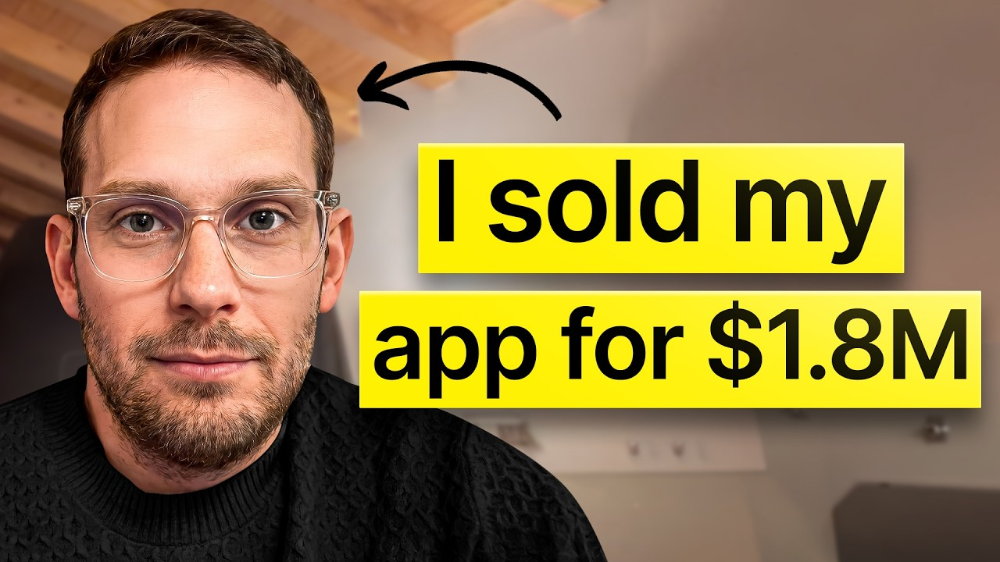

# Copy This Facebook Ads Strategy, It'll Blow Up Your App

Start building & deploying paywalls in 10 minutes flat: https://superwall.com/

## Table of Contents

* [00:00:00] – Intro
* [00:01:02] – Massive creator outreach: Running 1,000 Gmail accounts for scale.
* [00:01:32] – Surviving permanent bans: Dealing with Meta’s automated flags.
* [00:01:58] – The 3 core ad lessons: Captions, Green Screens, and Hooks.
* [00:04:00] – Boost App Social Journey: Scaling from a web tool to $100k MRR.
* [00:06:16] – Transition to iOS: Why mobile was the better UX fit for hashtags.
* [00:11:03] – Creative Strategy: Using VAs and Telegram to manage 300+ creators.
* [00:13:16] – Internal email systems: Sending 30,000 emails a day to influencers.
* [00:21:20] – Ad Hooks: Analyzing visual vs. copywriting triggers for high engagement.
* [00:25:03] – AI in Ads: Using agents to find outlier videos and breakout formats.
* [00:32:03] – The Exit: Negotiating a 7-figure deal with private equity.
* [00:41:12] – Screens.design: Building a library to analyze top-performing apps.

## [00:00:00] – Intro

This guy Alex spent $800,000 on Meta ads that didn't work. Not total ad spend, just the wasted portion. 800k down the drain on bad creatives, banned accounts, and the 84 out of every 85 videos that ran and barely worked. >> We spent in total probably 1. 5 to 1. [00:00:00 → 00:00:19]

8 million dollars. Something like 800k was wasted. One time I made a mistake, I duplicated an ad at 11:30 p. m. and I wasted 8k and a blip. [00:00:19 → 00:00:28]

>> That 800k was his tuition and what it taught him was a 100k MMR app, a seven-figure exit, and a paid acquisition playbook that most people will never build because they quit before the data gets interesting. Here's what the data actually said. >> One video out of 85 would get all the ad spend and work and then a lot of waste, in a way, was spent finding the kind of video that was working for Meta. >> One in 85 ads. His whole operation was built around the one question: How do you generate enough volume that you hit one in 85 often enough to make profit? [00:00:26 → 00:01:00]

Well, the answer started with creator reach, but nobody was doing it at the scale that he was. [00:00:57 → 00:01:04]

## [00:01:02] – Massive creator outreach: Running 1,000 Gmail accounts for scale.

>> We do have our own it's a little bit black hatty, but we have a thousand Gmails loaded onto a shared inbox. There's also a script running and we send basically 10 emails for each Gmail. >> A thousand Gmail accounts sending 10 emails a day, every day. Creators get funneled through a Telegram group where his VAs negotiated, sent $100 up front to prove to creators it wasn't a scam, and then locked them into perpetual rights contracts. By the end, they had 300 ad creatives ready to deploy, all with ownership rights. [00:01:02 → 00:01:30]

But, Meta kept burning the whole thing down. [00:01:30 → 00:01:34]

## [00:01:32] – Surviving permanent bans: Dealing with Meta’s automated flags.

>> So, this happened to us like six, eight times with permanent bans as well and we always managed to get them back. I'm sure that a lot of people would quit the first or the second time. That's the natural reaction and what Meta tells you is that don't even try, but we didn't really have any other option, so we kept on going. >> Six permanent bans, each one a months-long fight through offshore support asks, legal calls, appeals, but each time they got back, they had more data than before. Eventually, that data compressed down to three things. [00:01:32 → 00:02:00]

## [00:01:58] – The 3 core ad lessons: Captions, Green Screens, and Hooks.

Number one is put the captions. As you can see all these videos, they have the captions, right? Because 80% of the users do use Instagram or TikTok a lot of times, Instagram especially, without the sound. And so, really important if you're advertising there to have the captions. Second thing, for us in the app business, to use green screen. [00:02:00 → 00:02:17]

Why not? You have a person that is talking to you, and then on the back you can have a huge app demoing like your cool features. And other than that, go crazy with hooks, captions, green screen, hooks. Four years and 1. 5 million dollars to earn those three words. [00:02:17 → 00:02:33]

So, when PE came with a seven-figure offer, it wasn't really a hard call. It's basically taking chips off the table. This is what we did. The Warm Space Book account, the meta rep, 300 perpetual rights creator contracts, dashboards, all of it went with the sale because the infrastructure was the actual business. In this episode, Alex breaks down everything. [00:02:33 → 00:02:51]

The creator outreach system that built a pipeline of 300 UGC creators without a single paid platform. The green screen and hook formula that scaled BoostAppSocial on pure meta spend. And the real math behind the one in 85. What it takes to run enough volume that the winners keep coming. This is what four years of paid acquisition looks like when you write it all down. [00:02:51 → 00:03:10]

Let's get into it. This is the Superwall podcast and I'm Joseph Choi, founder of Consumer Club. The members in the Consumer Club Discord and the founders I interview on the pod build apps at a median of 1 million ARR. A lot of these apps that make the most money run AB tests on their paywalls to make more revenue with the same number of users. Superwall has a lot of data on the thousands of apps that use their paywalls. [00:03:10 → 00:03:31]

So, recently they put together a free AI tool trained on 422 profitable paywall experiments. It lets you upload a screenshot of your own paywall and gives you an experiment idea to increase your revenue. You can use it for free at paywallexperiments. com. Also, if you're building a mobile app doing at least 100K a month in revenue, Superwall hosts dinners in San Francisco and New York. [00:03:31 → 00:03:51]

They and they each gathering small, thoughtful, genuinely useful for everyone. If you meet this criteria of 100k a month in revenue and want an invite, apply using the typeform in the description. [00:03:51 → 00:04:00]

## [00:04:00] – Boost App Social Journey: Scaling from a web tool to $100k MRR.

Let's get into the pod. Your app was making 100k MRR, it's called Boost App Social, and then you sold it for seven figures. So, yeah, tell me how that how that all started. >> Uh well, at first we we we wanted to make a web-based tool. This was the first venture that we scaled back in 2018-2019. [00:04:00 → 00:04:20]

Uh and then we realized that we wanted to we we could build something like a hashtag tool, uh a search and generator with uh some cool database technology uh that would uh suggest related hashtags on a vector database. And and we started building that, but we realized pretty quickly that uh it was not a it didn't have a lot of traction or product market fit. And uh we saw that there were some other players with uh hashtag apps, especially one. It was called Hashtag Expert that was having traction, and we already had the technology, uh a better database actually. And uh we we just like decided to become a app player as well in the subscrip- to delve into the subscription app space. [00:04:19 → 00:05:06]

And so, yeah, at first we only started with the hashtag thing, and uh and then we had to learn a lot. Al- also what you of what you teach yourself, I mean, all the optimizations, because at first we we didn't understand the math, we didn't understand the statistics, we didn't understand the importance of onboarding flows and paywalls. Uh and uh but then uh we kept at it, we we learned a lot, we studied a lot, we we broke down uh successful apps, and we start started to try to understand what what made them successful, and uh and then experiments, and then a lot of mixed panel, uh a lot of AB testing, and uh I mean it was a it was a uh a lot of effort. >> Let's go back to the beginning. How did you How did you get started? [00:05:06 → 00:05:49]

How did you get to 100k MRR? >> The start was a a web-based tool and then we uh we moved that to a an an iOS subscription app because we we thought there was a a much a much better match with the usability. Simply people researching hashtag on a mobile phone on an iPhone and then immediately immediately pasting them on Instagram rather than going from the uh web to the to the mobile experience. [00:05:49 → 00:06:19]

## [00:06:16] – Transition to iOS: Why mobile was the better UX fit for hashtags.

That was That was a much more clunky UX. And so, we just went all in on the iOS app and it uh proved to be a right move. And and the 100k MRR was a mix between uh adding uh interesting features that might help other than the hashtags themselves so that people would see more value and would stick more and would be willing to pay more rather than the 40 uh bucks a year, maybe 100 bucks a year. Uh paired with uh a lot of uh Facebook ads, Instagram ads. So, a lot of spend on Meta. [00:06:19 → 00:06:54]

Uh we started spending 100 a day, 500 a day, 1,000 a day, 10k a day on Meta. And uh we learned a lot there. There was a lot of fighting to gain back accounts when you get randomly banned because you didn't break any policy but just their algos go >> haywire. Let's get back Let's get back to the ad spend. So, like you were spending $10,000 a day on on Facebook and Instagram. [00:06:54 → 00:07:19]

That's That's a lot of That's like a scaled ad spend. Um and like you said, that's like pretty hard to scale. I met uh there's a lot of things you can run into. Um What What was the biggest challenge in scaling to 10k and how did you overcome that? >> The biggest challenge was uh the fact that the accounts uh can get banned. [00:07:19 → 00:07:39]

Uh I mean, we were playing this sort of game where we have a an app that is totally legitimate, but uh you uh promote an Instagram optimization marketing tool that uses legitimate things like hashtags and fonts and video editing and photo editing and things like that, but I mean, it's very easy to cross the line. And if the Facebook Instagram if the meta gods Instagram gods are not with you, you can run into account restrictions. And then once you run into account restrictions, meta doesn't have a billion people manually handling a accounts. I mean, now we have a now we have a rep because we spent so much money, but at first when you start, you do not then you simply get a you get some help that doesn't doesn't really do anything sometimes in third world countries and without people who can really push the buttons and who can change things in your favor. And so it takes a lot of time a lot of fighting to gain back these accounts to explain people internally at meta why you should be allowed to advertise there. [00:07:38 → 00:08:54]

And so this happened to us like six eight times and with permanent bans as well and we always managed to to get them back. I'm sure that a lot of people would like quit at the first or the second time. >> That's interesting that you say the biggest challenge is getting banned. I feel like most people would say figuring out ad creative volume, you know, increasing spend like more of the normal, you know, how do you do distribution? Well, let's just go over your over your product cuz it's it's Boost Social. [00:08:54 → 00:09:28]

So tell tell me like why did you decide on this product idea? Is this like a almost like a product that sells itself because on meta ads like you're literally on Facebook and Instagram. So, um like getting more social media growth is sort of the you know, the default thing that almost everybody wants. Um I'm guessing that's like that dynamic might kind of be there, but yeah, why did you decide to to build this product? >> You are right there. [00:09:28 → 00:09:57]

We we pretty much understand pretty quickly that the TikTok style that nowadays goes uh super uh it's super popular would work well there. And and also the platform itself Instagram immediately spend on Instagram and there are a lot of people either mom-and-pop shops or influencers who simply want to grow there. And so, the media product market fit was there. You also have to consider one thing, Joseph. We were already in the in the Instagram services business. [00:09:57 → 00:10:27]

So, we already understood our target market intuitively. And so, we immediately understood what kind of uh what kind of buttons to push in order to make them uh be interested in a product like that. So, you are right there. Uh and also I have to be honest with you when you ask me the question what was your biggest challenge? Uh I I will tell you the truth. [00:10:27 → 00:10:48]

And in that case, this was the truth. But you are also right that if you ask me is was that the only challenge? I would tell you hell no. This was just the biggest challenge, but it was not the only challenge. >> Interesting. [00:10:48 → 00:11:01]

So, you were doing um UGC based ad creatives then, right? [00:11:01 → 00:11:05]

## [00:11:03] – Creative Strategy: Using VAs and Telegram to manage 300+ creators.

>> Yeah. >> Okay, so you'd reach out, you'd do mass cold email to tons of creators to have them film videos for your ads. >> Right. And I will tell you something interesting that I didn't say in the other podcasts. So, uh what we did was I create like a diagram, a big diagram on like we're going to email them, we're they're going to reply, we're going to uh we're I'm going to have my VA talk to them via email, send them a video pre-recorded by me, then move them to Telegram uh in in a Telegram group so that we can chat back and forth in a group. [00:11:05 → 00:11:38]

We would send them a contract, they would sign the contract. This also helped us in the sales process because we could offload all the creatives to the company that purchased us with the creatives included. We had probably 200 or 300 creatives, something like that. I don't remember right now, but it was something like 300 creatives and we just dropped the videos together with all the contracts as well. that these influencers signed giving us the rights to the perpetual rights. [00:11:38 → 00:12:07]

And this is also what they something that we did. We We didn't want to play the game of I'm going to pay you for 1 year and then I we need to renovate the contract in order to keep running the ads. It was like, "No, it's going to be a perpetual perpetual thing. We can run the ads for as much as we want. " >> I see. [00:12:07 → 00:12:22]

So, you would buy the rights to the content outright whenever you did UGC. >> That that would have been too much of a headache and and they could see in the in the scenario where the an ad goes really well, then they might ask you for 100k or something and yeah, that was a big no. And we realized we realized pretty also quickly that there were some winner creatives that would get the favor of Meta and the favor of the public and they would work really well and there were other creatives, 97% of them, that no matter how good they looked to you, they would wouldn't work either because Meta didn't love them or because just audience wouldn't wouldn't convert. >> Yeah, I was curious about the email part. You said you built some pretty good like email infrastructure to be able to send out tons of emails and also also do the negotiations. [00:12:22 → 00:13:15]

Yeah, tell me about some of the systems that you built. [00:13:13 → 00:13:17]

## [00:13:16] – Internal email systems: Sending 30,000 emails a day to influencers.

>> We do have our own It's a little bit black hatty, but we have a thousand Gmails loaded onto a onto a shared inbox and our assistants simply There's also a script running and we send basically 10 emails for each Gmail and and then we can we get reply replies from these influencers who say yes, I'm interested and then we move them down the flow. So, we we we we couldn't use any any other tool. This also is something that we developed through the years. It's something internal that we don't sell sell out and when we need to send a burst of emails we just use our own internal tools and it works pretty well. We've been in the in the business of Instagram. [00:13:16 → 00:14:04]

So, we know how these people will reply and of course on Instagram they put their email address many times in order to be contacted in order to do work and we got back I don't know 10 20% replies. I mean I I know that especially in the past 1 2 years other other tools have came out but we we have our own and it works pretty well for us. >> That's pretty amazing. A thousand Gmail accounts and you would send 10 emails per day from those accounts. And then you would send 10 emails per day from those accounts. [00:14:04 → 00:14:33]

And then you would send 10 emails per day from those accounts. And then you would send 10 emails per day from those accounts. And then you would send 10 emails per day from those accounts. And then you would send 10 emails per day from those accounts. And then you would send 10 emails per day from those accounts. [00:14:33 → 00:14:40]

And then you would send 10 emails per day from those accounts. And then you would send 10 emails per day from those accounts. And then you would send 10 emails per day from those accounts. And then you would send 10 emails per day from those accounts. And then you would send 10 emails per day from those accounts. [00:14:40 → 00:14:48]

And then you would send 10 emails per day from those accounts. And then you would send 10 emails per day from those accounts. And then you would send 10 emails per day from those accounts. And then you would send 10 emails per day from those accounts. And then you would send 10 emails per day from those accounts. [00:14:48 → 00:14:55]

platforms out there where you can you know get creator emails and then for the sending infrastructure there's tools now like instantly and smartly where you know you can send these things but just that just that like mindset of volume is is pretty unique I think. Did you have a whole team where you were was it like a I imagine there's probably so many assistants doing the emails but then there's also people doing the sales the sales calls and negotiations. Yeah and I know we We a we we had a our our head of VAs VAs do like I was creating the diagram first and creating the process and trying to think well these people are going to going to be going to feel that Telegram is something sketchy to send them on but we we we we thought about it and and we realized like look we need to be in a group we need to be in a group where we can chat back and forth and we need to be in a group where we can send files like the contract signed and stuff like that and we don't we you can do it via email but back and forth chatting and negotiation happens better better on on Telegram and we can we could send them like bigger videos and and things like that so we prefer to and they would send back also the the content like the videos that the MP4s on Telegram and so we we felt that that space was right and it worked very well for us especially because we we sent them up front some money once we understood that the creator was promising I was I was sending them like 100 bucks up front already so they would they would feel that it wasn't a scam and they were weren't wasting their time. Of course one of two one or two ran with the money but at the end of the day it's a cost of doing business. >> That's a cool insight that Telegram chats to negotiate cuz if initially you want to reach out via email cuz that's the email in their bio but then once you negotiate over email I feel like people just don't check their email like that and like you don't really want to like have a back and forth I feel like the that's so true like the text message base I mean it doesn't have to be Telegram but like you said like the like the Telegram had good like file hosting and stuff so that's that's actually a good idea. [00:14:55 → 00:16:59]

>> yes yes yes yes especially when you send them the money up front and you sign the contract and you send them 100 bucks they feel that it's real and they're going to do the step of downloading the Telegram and because they feel that they can make another 1000 bucks you know and so once they have downloaded that they get to receive the notifications on their phone it worked very well for us. >> So let's talk about the the actual ad creative strategy cuz that's I think that's kind of like, you know, content is king. Um you you had so many creators who were like making the ad like the UGC ad creators for you. Um but I'm sure there was someone at the top. Was that just you who were who is like coming up with the ad creatives? [00:16:56 → 00:17:37]

>> Yeah, me and my business partner we we were giving them some freedom and uh we would we signed that if the if the hook was like a really bad usually we could we could reject the creative and tell them, "Hey, look like this is never I mean, of course you like I would say there is a balance between giving them freedom to create stuff and then rejecting stuff that is obviously just low effort. Somewhere in the middle there is once in a while you're going to find one creative that is a diamond that is it's going to it's going to pay back a hundreds of thousands of dollars in profits. >> So, how did you what was the creative strategy? >> The creative strategy basically it was all UGC. It was all people recording themselves doing TikTok style videos talking about hey, do you want to grow your profile? [00:17:35 → 00:18:25]

I I found this app. Sometimes, you know, with the green screen cover with like a note app behind with like a list of things to do or lifestyle videos where people talk about I couldn't believe it was possible but this this using hashtag helped me with growing my profile. So, these people were already TikTok creators. So, these people already had a creative spirit and we would simply provide them with an A4 A4 document telling them, "Hey, we think this is good marketing. This is our app. [00:18:25 → 00:19:00]

These are the kind of triggers the hooks that work for our type of customers. Maybe you want to check them. Maybe you want to adopt them with your own style. Go ahead and create. " And then and then we would test stuff on on Facebook ads, Instagram ads especially. [00:18:57 → 00:19:13]

I mean, we put put stuff on Meta ads. >> Do you have any of the ads still that you could show? >> So, you also can get a good sneak peek on how we were managing the content thing. Uh as you can see, there is a Telegram group here. And uh it's very good for like uh to host heavy files and everything in a sequential way. [00:19:13 → 00:19:32]

As you can see, we were captioning everything because a lot of people uh use Instagram uh without the without the sound. And then we were cutting the cutting ads after in order to make them crispier sometimes. I mean, after we got the creatives many times, we were also giving cuts in order to make it more Mr. Beastie style, you know, with the uh quicker transitions. Uh so, they were so, the videos would be more engaging. [00:19:32 → 00:19:59]

As you can see, caption, hook, green screen. Those are all good uh those are all good uh good types of contents uh of content. Then you have also, of course, to see if Meta likes it. I also feel that many times it's understated how much sometimes I think I feel that Meta itself might like or not like a specific creative and so give you more reach, good CPMs and stuff like that. >> Yeah, so the the seems like the ad creative strategy is basically um a hook around some desired outcome. [00:19:57 → 00:20:31]

Like, "Hey, I I can't believe I just discovered this app. " And then it just goes straight into like a 30 seconds of just pure like product demo and showing features. >> Uh I mean, that was working very well for us, but you have also to account that one video out of 85 would would get all the ad spend and work. >> That's what I wanted to ask you about, too. You said you burned through a million dollars in ad spend testing these things. [00:20:29 → 00:20:58]

>> We spent in total probably 1. 5 to 1. 8 million dollars not in a year, but in 2 years and a half, something like that. Yeah, more than 2 million probably, something like that over the full app life cycle before we sold. Uh something like 800k was wasted. [00:20:54 → 00:21:10]

I mean, sometimes one time I made a mistake and duplicated an ad uh at 11:30 p. m. and I wasted 8k. In the like uh in a blip. And then again, it's cost of doing business. [00:21:10 → 00:21:21]

## [00:21:20] – Ad Hooks: Analyzing visual vs. copywriting triggers for high engagement.

You just >> Yeah. >> laugh and move on. What can you do about it? >> So, out of a million ad spend burns testing, um and you had a lot of you had successful ads, too, that got you to 100k MRR. W- If you had to distill all the lessons you learned from all that wasted ad spend, if you're starting over, like what are maybe three things that you would do to make good ads um without wasting too much money? [00:21:21 → 00:21:48]

>> I think look, these ads that you're seeing at the end are good ads that, you know, compress our learnings over the months and the years. Uh and so, very important, number one, have the captions. As you can see, all these videos, they have the captions, right? Uh because 80% of the users uh do uh do use Instagram or TikTok a lot of times without Instagram especially without the sound. And so, really important if you're advertising there to have the captions. [00:21:46 → 00:22:17]

Number Second thing for us in the app business, to use green screen. Why not? You have a person that is talking to you, and then on the back you can have a huge app demoing like your cool features, your cool value prop, all these things. To me, it's a natural perfect match. Because if you just show the app and how the app works without the person, it's not the same, you know? [00:22:17 → 00:22:40]

You have someone keeping you company and entertaining you uh while watching how the app demos. And in my opinion, it's a really good combo. Other than that, I mean, go crazy with hooks. Of course, it's something that is being said over and over again, but it's true. Because the first 5 seconds are the most important part of the ad. [00:22:40 → 00:23:01]

And go crazy with the hooks. I would say not just not just as far as the copywriting angle, but also as the image angle, video angle. You know, what do you see at the beginning? Also, it's really, really important. >> And you have any examples of some of those like good copy and and good visual hooks? [00:23:01 → 00:23:21]

>> All of these are really solid. These ones Why why am I telling you that? Because these ones are the last ones. Those are all sequential. And so, if they're sequential and they're at the end, it means that they encompass all the learnings that we had through the months and the years. [00:23:20 → 00:23:36]

But, I can tell you, Joseph, the best creative sometimes Meta is just not going to like it. It's it's not fair, it's not nice, but it's just how it is. Uh and so, if you're running ads there, often times you can have like a great creative that is technically excellent, but then it doesn't like it bombs for for whatever reason. Either audience reason, either Meta reason, either either Meta sees because, you know, Meta is very predictive and it tries to understand if a creative with some colors or something like that is going to work. And for it, like if he if he believes that a creative works, he's going to really try to push spend on that. [00:23:36 → 00:24:12]

And then it has to encounter, also, in my opinion, the of course the the audience. It has to be both a Meta match and an audience match. And nowadays, you can especially go crazy with the AI because the AI creative thing is has evolved so much that, in my opinion, you we can do what you said before, like can show me some some some crazy video hooks at the beginning. In my opinion, this is the edge right now. Can be the edge right now, which is have AI create crazy hooks at the beginning that capture the audience at first that you couldn't do before because you had human beings in their apartment. [00:24:12 → 00:24:52]

>> So, let me show you this. A lot of app owners I talk to have a feeling their app has viral potential, but don't want to be the person brain-rot scrolling an hour a day hunting for formats, or worse, burning thousands on creators shooting videos that just flop. [00:24:50 → 00:25:04]

## [00:25:03] – AI in Ads: Using agents to find outlier videos and breakout formats.

Recently, I've been telling every founder I meet about Spytalk. It's basically an AI TikTok viral marketer that I've seen a lot of top app growth teams using. You just paste a link to your app, and this agent scrolls hundreds of thousands of TikToks for you, finds the outlier videos from competitors who've already cracked the best formats that are driving installs in the niche of your app, and then it remixes the hooks, the angles, and then it makes playbooks so you can pretty much copy-paste virality. And then it alerts you when it detects new breakout formats that would also work for your app. This is the only growth tool I 100% vouch for on this channel because there's a ton of GenAI content tools out there, but none of them tell you what to make. [00:25:03 → 00:25:39]

Spytalk makes sure you're never in the dark about what's actually working now. I'll put the link in the description. Let's do both of those topics. So, first, like, I want to break down some of these hooks. Like, these are the your most, you know, some of your best ads. [00:25:39 → 00:25:52]

So, I want to I want to look into some of these and figure out what are the you know, what what what's interesting about these hooks? And then second of all, like, how would I'm curious how like how you would think about AI hook AI hooks if you're to do that today. >> How to avoid getting stuck on 1,000 views? It speaks to It speaks to something very specific rather than something generic. I mean, something generic can work as well, but a lot of people, as you know, they post Instagram Reels maybe, and they only get 1,000 views. [00:25:52 → 00:26:19]

And so, this is a very real frustration, and it's very specific. And there can be very well an ad that maybe doesn't have the reach of 50 million, but it can have a reach of like 1 million people that targets that specific frustration. And for that reason, it can work really, really well. >> Cuz there's probably some people that might get stuck at 200 views, or some other people that might get stuck at 10,000 views. But for these specific people, they're getting stuck at 1,000 views, and then an ad comes and literally speaks to them to the exact thing. [00:26:19 → 00:26:56]

>> You you could be a business that does not yet started making videos and you're simply posting photos, for example, a bakery. And so, it doesn't really like goes over your head. But, for those specific people who have understood the importance of creating reels, and they have that specific problem right now, roadblock, something like that is going to hit them in the ad, you know? And I mean, as you can see, like playing pretty creative with the both the green screen, both the stroke, the orange stroke around it, and the label with the the button with It's not really a button, I would say call it a label with text. Uh really interesting. [00:26:55 → 00:27:32]

And the green screen again. Uh as I was telling you before. >> Yeah, let's show like literally showing her account with the reels in the back, and then kind of showing the results, too. She That was like half a second in there, but she showed that all the followers pouring into her account. >> Yeah, exactly. [00:27:32 → 00:27:50]

And And also, if you Another interesting thing is sometimes, we what we noticed as well is that in the apps business, it's really interesting to show apps on the hand as well. So, not just the video recording on the iPhone screen, but take another phone, another camera, and record you using with the hand. Also sometimes helps really really like works really really well. >> Right. So, in this ad, you did both. [00:27:50 → 00:28:17]

You had the green screen with the app interface in the background, but also like the phone in the hand. >> Correct. And then sometimes, they would send us videos, different videos, and we would mix match stuff because we saw, "Okay, in this one, there is the there is the screen recording from the iPhone, and in this other one, there is the hand hand recording. " And sometimes, we would mix and match in order to test stuff as well. So, you can do that. [00:28:17 → 00:28:43]

I mean, once the creator sends you stuff, and you have signed the right type of contract in a way. Even if you haven't, I mean, you can probably just try stuff depending on the agreement that you have. We we would sign in the agreement that we were at freedom to edit the videos as well and mix and match. So so we were doing that actively, yeah. >> Right. [00:28:43 → 00:29:04]

So just from one uh UGC ad creative, you would actually get like you know, 20 because you can mix and match them and cut them up. >> My take is that you don't want to overdo that, like go hyper crazy with like I'm going to spin it 2,000 ways with every single micro bit. I would like spin maybe if we receive five videos from the creator, maybe we'll turn it into 15 or something like that, you know. With with our own with our own judgment though. Like we would give them this document with our ideas first and they would put on top their own creative mindset and then on top of that, once we receive the final stuff, we would edit in order to remove to trim noise, but also mix and match sometimes in order to maybe go from five videos to 15 and have more variety and feed the algo better. [00:29:04 → 00:29:57]

>> Interesting, yeah. So now if you were to use AI to help you make ad creatives, how would you do those hooks? Like how would you use AI to do hooks and also to do the remixing? >> I would get a good glass of whiskey and then maybe probably ask the top tier LLMs with something really really crazy that throws people off the chair. Something uh something mighty, something weird, something scary, something something that triggers whatever kind of emotion, either awe or something scary, you know, at the end of the emotional spectrum. [00:29:54 → 00:30:36]

So yeah. >> Well, where would you get inspiration for some of those like weird or scary or like high emotion concepts? >> So what I would do right now is I would still hang around the Instagram library, the Meta Instagram library as a library. That would be one. But also probably I would use Valar 3, this this video creation tool from Google. [00:30:36 → 00:31:00]

And I would write first a script with an LLM and then try to come up with some concepts and then mix and match and edit with CapCut maybe and put stuff together as well. >> This is a cool This is a cool hook right here. Pouring the water onto the paper. It's like very weird. >> Yeah, as you can see this is weird. [00:31:00 → 00:31:21]

But again, it's at the end of the emotional spectrum, whatever kind of direction it is. But it can These are all very very solid solid videos and that's why they pass our final filter. And and then we it's simply in the hands of the of the algo, you know. You have to do the best and sometimes you But oh my god, this creative is so great so great so great then you spend I don't know 20K on it and it it doesn't work no matter how much you try to to slice it, you know. It's just part of the game. [00:31:21 → 00:31:51]

You can only do half of it and then the other half is uh the other half is is Meta itself, yeah. >> So, when did you when did you get acquired? >> We got acquired at the end of like January in January January this year. [00:31:51 → 00:32:13]

## [00:32:03] – The Exit: Negotiating a 7-figure deal with private equity.

So, the negotiation though was longer. The negotiation was probably four five months. I mean, price of course, terms of course, very complex deal because the contract was like 100 pages at the end of the day because these these buyers I cannot say who they are, but they didn't have a lot of We used the broker. Charlie from UpFlip, but we we didn't really know who these players were. They were They didn't have a lot of presence online and so they they were coming from the gaming from the gaming niche. [00:32:10 → 00:32:48]

Apps, of course, and they were transitioning to subscription apps as well. And they were operating quite like a private equity. So, they were buying a lot they had a lot of hundreds of millions to deploy to to buy up apps. But we weren't in a in a rush. We we also negotiated from a place of strength because we were in a very good position. [00:32:47 → 00:33:10]

We as you can see we nailed the kind of process with ads creation. We nailed we had a warm up account. We had a rep that could help us, you know, with whatever troubles might happen. At the end of the day we were in a very good position and once you negotiate from a place of strength and you're not in a rush at the end of the day you can make a good deal. They were very interesting interested because our numbers were really good because we gathered towards a business a businessy app. [00:33:07 → 00:33:34]

It's not really like a fitness app. And so business apps you tend to get paid better because people these people they can see that they can have they can have a money making outcome out of growing their presence online growing their business through through social media marketing. And so our numbers were pretty good as far as conversions as far as profitability and these kind of things. The process was was pretty complicated. I mean we hired a lawyer that was both a European lawyer and an American lawyer. [00:33:34 → 00:34:01]

Very competent guy and together with him we came up with a contact a contract because we didn't really have the trust, you know, we didn't really have enough trust to to simply like sign a quick deal because these players were didn't have a lot of presence online and you know, it's not like it's not like selling to one of the big revenue infra players in the industry who might be I don't know buying some another SaaS or something like that and you know them. You know them who they know who they are you've shaken their hands at conferences or whatever. This is more like selling to private equity and it's like pretty secretive or something like that and and so you don't know if you're going to give them the app and maybe they only send 20% at first and then they're going to run with the rest, you know? So then we use the escrow in Singapore. There was an escrow in Singapore with a contract that's inside and okay, the broker helped because they put us in touch with another guy who guy who sold to them as well. [00:34:01 → 00:34:56]

And so the other guy told them, "Look, these guys, they don't want no problems. They pay the cash. If the deal is right and you did everything right, it's going to go fine. " And so since he also sold this other person, we had a quick chat with him on a call. We said, "Okay, fine. [00:34:56 → 00:35:11]

Let's just do a very strong contract and and then let's just it's always a a leap of faith as well at the end because you know, there is infinite amount of there is infinite amount of stuff that can be written on paper. >> Yeah, that's wild. That's a that must have been a exciting and nerve-wracking process. >> For 3 months, my job was legal. 3 months my job was legal stuff. [00:35:11 → 00:35:33]

>> Yeah. >> Basically, not 3 months maybe but like 1 and 1/2 for sure. >> That's awesome. How did it feel to when it was all when it was all done? >> It was a big paycheck, man. [00:35:32 → 00:35:43]

It was a big win transaction. >> Seven figures, right? >> Yeah, seven figures. Yeah. Felt relief because of course you're always fighting with Meta and you never know either like maybe you're not even going to get banned, you know? [00:35:43 → 00:35:55]

But but maybe maybe it's simply the CPMs are going to double. You never know, you know? And and maybe you're not profitable anymore running ads and we were relying on that very much. So we didn't have like a lot of organic like nowadays with Screens Designed. We have a lot of we don't do only organic nowadays. [00:35:55 → 00:36:10]

So we are in a very strong position. But before we to it was purely a push with like ads, you know? And this game with the loaded dice of statistics and good creatives and good management there and good app. And so but anytime, you know, you you can get a lot more apps for example that playing in same niche and maybe the CPMs double, then what do you do? You're not profitable anymore. [00:36:10 → 00:36:31]

You cannot run anymore. You see, it is a possibility and you never know. And once you once you take It's basically taking chips off the table. This is what we did. >> Yeah, when you're so reliant on Meta and you you had all the precautions in place. [00:36:31 → 00:36:42]

You had the warm up Facebook account. You had the rep, but still you're still there's a platform risk there. But one other thing you said that was interesting was um it was a business app, you know, it's like it's kind of geared towards customers that maybe want to promote their business or promote themselves as a creator. Um and you said you can get like a pretty good deal or a pretty good multiple because, you know, there's a lot of money in business type apps. Do you Do you still feel like consumer business apps are still like a big opportunity? [00:36:42 → 00:37:15]

>> Absolutely. I I feel that they are a very good opportunity, but I also feel that too many people these days they simply uh sit on cloning apps. You know, they simply see an app and they try to copy it. Copycat it. And in my opinion, this is number one very sad and number two not going to going to put you in trouble, probably. [00:37:13 → 00:37:32]

And number three not going to work very well. Why don't you come up with creative like new niches, new solutions, like see it better, do something new? Then you're going to be in a blue ocean. Then you can run crazy hooks, crazy ads. And you're in a better place. [00:37:32 → 00:37:45]

Uh consumer is good uh because consumer can have organic, can have more like virality. Like you can tell like share with your friends and maybe get, you know, whatever kind of bonus freebie. >> So, there's more like virality uh virality loops uh compared to us. We were relying more of on like get the business with Facebook ads. You spend 50, you make 100, then you're in your profitable in the middle. [00:37:45 → 00:38:07]

Consumers are really interesting, but I would tell to people come up with cool concepts, fresh concepts. Don't simply kill your soul copycatting stuff, cloning stuff because I see it many times these days and uh turn on your brain and come up with something. And maybe five apps and I look I I I had lunch with Adam Little in in San Francisco at Apple at Apple conference this year and he did 100 apps and basically two or three are doing really good money and then maybe a couple more are making money. He made 100 apps. Of course many things are not going to work but also what he created was apps at the beginning and so he has all the ASO benefit because Apple sees that these apps are older, they have good reviews and now someone else new comes and think that they just by by placing some couple ASO keywords are going to outrank him. [00:38:07 → 00:38:55]

>> Come on. >> Yeah, don't don't purely copycat. Is there like are there any interesting categories within business that you think are are good opportunities? >> Right now we launched the extreme design create but if we I think also we have an NDA so we cannot really play in the same space for for for a one year but we can reuse some of the code like so the contract limits us a little bit in the business like Instagram game but we can do other business apps. In my opinion business apps are very interesting. [00:38:55 → 00:39:25]

To be honest with you this is the place where I would put myself into nowadays with apps. I think I will do that with the new year. Business apps very interesting. It has a clear use case many times. It really helps people. [00:39:25 → 00:39:40]

You can charge 200 bucks a year, 300 bucks a year with weekly's or monthly's or whatever you want however you want to slice it but because there is a real there is a real pain there. There is a real use and people can feel that they spend 200, 300 bucks a year and they make back 2000 so it's a no-brainer for them and it smooths out the conversion. So business apps also I feel that a lot of people who build apps these days are very young people and many times young people they simply put themselves into this mindset of oh I will make another to-do list. I will make another whatever journaling app. I will make another whatever like nutrition app and it's fine as long as you have an angle in my opinion. [00:39:40 → 00:40:20]

It's fine as long as you create something niche. But why not also why not also graduating to business apps that have huge huge potentials. There are many apps that can be remade, made better, and make really really really nice profits there. >> Yeah, it's definitely overlooked. I mean, in the consumer app space, you think of it as consumer apps, but a lot of them are like somewhat B2B apps, but also on on mobile. [00:40:20 → 00:40:44]

>> At the end of the day, subscription apps. Like you make money with through through I app or web web funnel or whatever, but but look, making a prosumer app and then making an app for a business, I mean, I'm not saying like do salesforce. You can You can make an app that is like businessy, but still subscription. You do have a point that the concept itself of of consumer apps is tricky because it locks you into doing only consumer apps. But in my opinion, the better term is subscription apps. [00:40:43 → 00:41:15]

## [00:41:12] – Screens.design: Building a library to analyze top-performing apps.

>> So, you exited earlier this year, and what are you What are you up to now? >> Right now, we do screens design. Yeah, it's an intelligence library that was missing badly in the industry because you either had to rely on downloading 50 apps on your own phone, and then once you are onboarded, you don't see onboardings anymore, or you had to rely on Mobbin, but Mobbin is focusing only on designers. And so, what was missing was for someone who needs to build apps or already is in the app space, and they want to test something new, they want to come up with experiment, they want to see niches, they want to see new players that are making good cash, to see their full app and onboarding flow and paywalls. And so, we made that with a video. [00:41:12 → 00:41:54]

We have the biggest library in the world, 2,200 apps inside, more than that right now. And so, yeah, it's going very very nicely with like purely organic growth. We're getting a lot of recognition in the industry for that. And right now, we have also just are about to launch this Monday a canvas that is going to allow people to create create apps and then export them to Figma and then or feed them to you know cloud code or course or whatever and it it is it is based on intelligence principles from the best apps in the world. So truly really nice. [00:41:54 → 00:42:36]

So it's going to be both screens design library and screens design create and create is going to you're going to basically either create a concept of an app. I want to make I don't know a whiskey tracker app for whiskey aficionados and it's going to it's going to output you an app that is really delightful from a design perspective but also follows the best principles in subscription app conversion and conversion rate optimization. >> That's cool. I love it. This is a good take on AI coding or like AI design cuz it's built on the library of like the stuff that you've curated. [00:42:34 → 00:43:13]

>> It's built on the principles. Yes, it's built on it's built on the best principles that these these apps have discovered have come up with and and we study them. We abstract the principles and then we allow anyone in the industry to come up with their own concepts that no matter how related they can leverage good principles or good UX, good design, good conversion and good marketing. >> This is pretty cool. It's like it kind of shows you like look at this app, daily devotional app for women 15K revenue from 7K installs. [00:43:11 → 00:43:47]

So that's good. It's double the revenue than the installs. >> This is not just a copycat copycat like devotional app. It's already like it has an angle. It's like devotional for women. [00:43:47 → 00:43:58]

>> And then even this like you can see that you can kind of like it analyzes the like how good each part is. So it's like really great like low friction design but like nine out of 10 but then over here it's like one out of 10 for social proof density, which makes sense. Like there's no really social proof. So, if you were to make something in a similar niche, then this is a good learning to like, "Hey, I I should probably make it with more social proof. " >> Or for these guys themselves. [00:43:55 → 00:44:24]

>> Yeah. >> Uh for these guys themselves, they can they can go and look and say, "Hey, this maybe what we can test out. " >> Yeah, I feel like we covered a lot of a lot of like the good meat of of the stuff that you're like a lot of the insights that you got from your story. Um is there anything else that that stands out that that you wanted to talk about? >> No, man. [00:44:24 → 00:44:44]

You You made me want to really get back at building apps as well. I mean, we took a break after We took a break in order to pre-build the the library screens design this year after the sale. It's been really really cool, but uh I don't know, man. I'm getting the pension back, I guess. I feel I feel want to make cool apps, unexplored apps. [00:44:44 → 00:45:04]

Especially these days, it's really interesting. Especially with what we build now with Screens Design Create. You can blast out concepts in only like less than a minute, and they are really really well-made. So, but we don't want to attack it from like the We don't want to do apps that are so common. We want to make more niche-y apps, more maybe business business apps, stuff like that. [00:45:04 → 00:45:28]

>> Well, Alex, thanks so much for being on the pod. This is a really This is a masterclass in just like scaling ads. >> You You helped me with your insights as well, so. >> I'm glad glad to hear. >> That was good teamwork. [00:45:26 → 00:45:41]

>> Yeah, good teamwork. Something you might not know, most of the founders I cover on this podcast are hanging out right now in the Consumer Club Discord, sharing with each other what's working now for consumer apps. So, you can apply to join Consumer Club if that sounds interesting to you. And this is the Superwall podcast, of course you got to check out superwall. com. [00:45:39 → 00:45:56]

We have more videos on the channel, so dig into those to learn from app founders who are willing to share super tactical stuff about app growth. [00:45:56 → 00:46:04]
