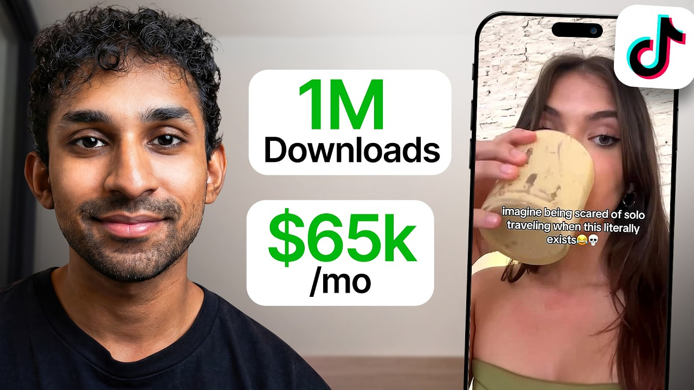

# Copy This UGC Strategy, It'll Make Your App Go Viral

Start building & deploying paywalls in 10 minutes flat: https://superwall.com/

## Table of Contents

* [00:00:00] - Intro
* [00:01:09] - The "Golden Metric": Why 75-80% retention predicts virality
* [00:02:43] - Breaking down the UGC machine: How 60+ creators post daily
* [00:03:01] - What is Nomad Table? Solving the solo traveler problem
* [00:04:02] - Origin Story: Recreating "Hostel Magic" without the grimy rooms
* [00:06:03] - Revenue Reveal: Making $65k/month as a solo founder
* [00:07:43] - High-volume UGC: Why "surface area of luck" matters
* [00:09:15] - "In the Trenches": Why the founder must remain a top creator
* [00:12:35] - Content Framework: Testing hooks and product demos
* [00:17:30] - The View Trap: Why high views with low engagement is dangerous
* [00:21:50] - Analyzing a viral TikTok: Why "hook-to-demo" formats work
* [00:28:15] - Benchmarking Success: What a 70% hook rate yields in views
* [00:35:05] - Bootstrapping vs. VC: Avoiding the pressure of paid ads
* [00:36:05] - The case against Paid Ads for social apps (Low ARPU vs. CAC)
* [00:38:46] - Payout Structures: Paying creators $1–$2 CPM on performance
* [00:39:50] - Negotiation Tips: Proving your app can go viral first
* [00:43:18] - The $8,000 Payout: What a single "mega-viral" video costs
* [00:44:30] - Fairness in tracking: Paying for old post views for 3 months
* [00:46:42] - Solving the Cold Start: Building density in a mobile market
* [00:47:15] - Resource: The Cold Start Problem by Andrew Chen
* [00:48:50] - Founder-led Growth: Building an audience that wants you to win
* [00:50:03] - The Leap: Quitting Big Tech to go all-in on an idea
* [00:54:10] - Outro

## [00:00:00] - Intro

Jay built a UGC machine so efficient that as a solo founder, he manages 60 [music] creators, generates 44 million views a month, and pulls in $65,000 in monthly revenue. All without a team, all without VC. His solo travel app, Nomad Table, hit over a million downloads. But here's what's different about Jay. He didn't start with a creator network. [00:00:00 → 00:00:21]

He tested everything personally, got good at going viral, and only then brought in creators. And he's [music] still the top performer, highest views for the past 3 months. >> I do think that it helps a lot that like I'm also posting alongside them. I think it motivates them a bit more when they see me as the founder getting in the trenches as well. But he's not just posting for show. [00:00:21 → 00:00:38]

He's the quality filter. He tests all the ideas first, validates them, and then gives them to creators. >> I come up with all the ideas that I give them. I tell them to like stick to my formats most of the time, but I do think that it's important to give them some freedom. >> This is how you scale without losing control. [00:00:38 → 00:00:53]

Early on, Jay chased vanity metrics. He'd get 300k views, but that video would only get 174 likes, brutal engagement. He was falling for the view trap, posting clickbait that gets great views, but has zero ability to convert users. Then he discovered the only metric that really matters, watch time past 3 seconds. [00:00:53 → 00:01:11]

## [00:01:09] - The "Golden Metric": Why 75-80% retention predicts virality

[music] Specifically, 75 to 80% retention in the first 3 seconds. This one signal is how you can predict if something will go viral or not. >> If that is hitting like 75 and 80%, usually it's a good format. If it's hitting that consistently, I know that it's going to go viral eventually. With this system, virality becomes predictable and inevitable. [00:01:11 → 00:01:31]

He posts once a day, gets one viral video per month. And those videos don't just spike and die, they feed him [music] for months. So in this episode, Jay breaks down the entire playbook, how to test formats before scaling to creators, the watch time metric that predicts virality, and how to build a creator network that generates 44 million views a month. [music] This is a masterclass in doing more with less. Let's get into it. [00:01:31 → 00:01:50]

This is the Superwall podcast, and I'm Joseph Choi, founder of Consumer Club. The members in the Consumer Club Discord and the founders I interview on the pod build apps at a median of 1 million ARR. A lot of these apps that make the most money run AB tests on their paywalls to make more revenue with the same number of users. Superwall has a lot of data on the thousands of apps that use their paywalls. So recently they put together a free AI tool trained on 422 profitable paywall experiments. [00:01:50 → 00:02:18]

It lets you upload a screenshot of your own paywall and gives you an experiment idea to increase your revenue. You can use it for free at paywallexperiments. com. Also, if you're building a mobile app doing at least 100k a month in revenue, Superwall hosts dinners in San Francisco and New York. They keep each gathering small, thoughtful, genuinely useful for everyone. [00:02:16 → 00:02:33]

If you meet this criteria of 100k a month in revenue and want to invite, apply using the typeform in the description. Let's get into the pod. [00:02:33 → 00:02:45]

## [00:02:43] - Breaking down the UGC machine: How 60+ creators post daily

You got 44 million views on organic UGC. How does this whole machine work? Let's see. I think I have um including myself probably around um like 60 or so creators. We all just kind of um post every day on TikTok and Instagram. [00:02:45 → 00:03:03]

## [00:03:01] - What is Nomad Table? Solving the solo traveler problem

So this is for your app Nomad Table. You have over a million downloads. Is are those downloads mostly from UGC or do you have other like traffic sources? Yeah, it's it's mostly UGC. Um I guess counting my own accounts. [00:03:03 → 00:03:18]

I think as the app has grown like word of mouth has also become a pretty big driver. Um so I mean I'm just estimating it based off like the the onboarding kind of like thing, but I think as of now like um between 10 to 15% of people that are new users come from word of mouth. Um and the rest are pretty much all UGC I think. Okay, so the new users coming in through like cold uh cold traffic are completely just organic TikTok and Instagram. And then uh some of those users like invite other other people, but like more just like sharing with their friends. [00:03:18 → 00:03:57]

Just like kind of like talking about it. But yeah, yeah. >> Talking about it, yeah. So, this is where the app Nomad Table, uh, Travel Friends. [00:03:57 → 00:04:03]

## [00:04:02] - Origin Story: Recreating "Hostel Magic" without the grimy rooms

What does this app do? How did you How did you come up with the idea? Yeah, so basically it's it's a app to, um, meet friends when traveling solo. Um, you can kind of make activities. That's kind of like the main point of the app. [00:04:03 → 00:04:17]

You can make these activities which notify people nearby and, um, they can join them and you can make stuff for just, you know, any kinds of plans from getting drinks to, uh, you know, go like doing some touristy thing. Um, kind of like whatever you want to do. Um, for example, I just played some paddle today with some friends off the app that I met. But yeah, I got the idea when I was on a solo trip last summer. Um, I've always loved to like travel solo. [00:04:15 → 00:04:41]

Um, and the best part for me about it was people I got to meet. Um, it's always really fun. And I would stay in hostels most of the time. And, um, hostels have like a really fun social environment most of the time if it's a good hostel. And it's really easy to meet people cuz everyone's Not everyone, but most people are traveling solo and they're very like open to hanging out and, you know, just doing stuff together. [00:04:41 → 00:05:05]

So, I I always loved that social environment. It was always really fun. And I just want to kind of recreate that but without having to rely on a hostel because, um, I'm not sure if you've done the whole the whole hostel thing before, but, um, it's kind of like grinding you know, sharing your room with eight people. And, um, also some hostels just weren't as social as others. So, just wanted some other way to kind of create that same social magic as a hostel without having to actually stay in a hostel. [00:05:05 → 00:05:33]

Yeah, it's just like it seems like this is the way that young a lot of young people want to travel. Like they're You're not going to go to like a travel planner and to like, uh, you know, a whole elaborate thing. Like people just kind of want to go to a place, have a bunch of other young people there to hang out with, and just explore and and do stuff, and it seems like this app basically is like in that niche. You have a million downloads on this app. Um what is that convert to in terms of revenue? [00:05:31 → 00:06:05]

## [00:06:03] - Revenue Reveal: Making $65k/month as a solo founder

Yeah, so right now we're doing I think um like 65k a month, I want to say. Yeah, I mean it it it is a social app, so um you know, your your ARPU is definitely going to be a lot lower than um you know, a classic hard paywall app, and that's [music] something that I kind of knew going into this. I think with, you know, social apps, more of your your power comes with like your user base. Um >> [music] >> you know, I think that is the more valuable thing, and I think there's always like ways to monetize with a big user base later on, but [music] the user base is kind of like the hard part about it in social app, but I don't really want to add like, you know, ads or anything, but like, you know, if I was just like like I want to just squeeze this thing right now, which I which I don't want to do, but if I wanted to, I could add a bunch of ads, and you know, probably make, you know, you easily over 100k a month if I wanted to. Um but I don't want to like flood the app with ads, and I I really care about the quality of the app, and like I'm trying to build like a generational kind of thing right here, so um I'm I'm like okay with, you know, not making as much as I could from the app. [00:06:05 → 00:07:12]

Um but yeah. But still 65k a month as a solo founder is still pretty incredible. This is like all subscriptions, right? So it's like weekly, monthly, annual. The annual is like 69. [00:07:12 → 00:07:22]

99 a month or a year. >> Yeah. Yeah, totally. Yeah, yeah, I I I guess it definitely still is like a good amount. I'm not like trying to downplay that. [00:07:22 → 00:07:29]

It's it's it's solid. I'm I'm very grateful for it. Um but just most of the time with an app with this many downloads, they tend to have a bit more. Um that's why I was saying that, but but yeah, no, still very grateful. It's it's it's been great. [00:07:29 → 00:07:41]

So how do you Yeah, like at a high level, what is the UGC strategy? [00:07:41 → 00:07:46]

## [00:07:43] - High-volume UGC: Why "surface area of luck" matters

Do you have a lot of people Yeah, like what's the strategy for organic UGC? I think it's just like your classic, you know, high-volume UGC engine, just, you know, operating, you know, at scale with a lot of creators. Um, you know, we've really um, nailed down kind of like, you know, our formats and, you know, what goes viral. And, um, when you just have, you know, lots of people making those videos every day, of course, your surface area of luck just increases. So, yeah, I mean, I kind of started off with just making content by myself. [00:07:46 → 00:08:18]

Um, I was the only one for a long time. I probably got like the first, I don't know, 50 to 100k downloads from my own content, I would say. I kind of just got good at it, got good at, like, you know, going viral. And then, once I had like the confidence that, you know, [music] these formats would just go viral again and again, because it happened for me, you know, I kind of just took the the uh page out of the the classic, you know, playbook of just hiring much creators, and you know, having them just make those formats at scale. How many creators do you have right now? [00:08:18 → 00:08:48]

Cuz also, this is 44 million views, but then I just noticed that it says 34 million views the previous period. So, is this per year? That's That's the per month. This is per month? So, you get 44 million views a month? [00:08:48 → 00:09:01]

Or, you know, roughly like 30 to 40 million views a month. Those Those are the last two months. I mean, of course, you can't can't like see the future, but, um, but yeah, that's that's what's been so far. And, um, but yeah, no, I mean, it's it's been going really well, thankfully. [00:09:01 → 00:09:15]

## [00:09:15] - "In the Trenches": Why the founder must remain a top creator

Um, we [music] have I want to say like 60 to 70 creators, something in that in that range. Wow. >> Um, so, yeah. Are you actually managing all those creators yourself? Yeah, yeah. [00:09:15 → 00:09:27]

I do all all by myself, all in-house. That's crazy. Do you just have like a WhatsApp like a giant WhatsApp group with like everyone? Yeah, I do have that. Um, and I also talk to them like one-on-one. [00:09:24 → 00:09:36]

I mean, of course, not like all time, but um I'm I'm definitely like very involved and um I feel like that's something that's like, you know, led to a lot of the success. Um I think I spend like a lot of my time talking to creators, giving feedback, you know, making sure that they're doing well. And yeah, it's it's a lot of time. Um Look at my WhatsApp, it's it's uh it's crazy in there. There's so many messages, but I think it really does pay dividends. [00:09:36 → 00:10:00]

Um I think uh when you have like um I think I mean, you know, with with apps like this, distribution is everything. So, I think it's it's time that's, you know, well >> [music] >> um worth investing in cuz, you know, they are kind of like my power, they're my distribution. So, I'll absolutely spend like most of my time um with that, probably. Yeah, that makes sense cuz, yeah, you're a hun- like 100% of the cold traffic that's coming through this UGC. So, yeah, that's like Is there anything you do um with your creators that you feel like other founders don't do? [00:10:00 → 00:10:33]

Um I guess like the level of the hands-on management. I mean, I don't like micromanage them, but like I just give them lots of feedback and I do think that it helps a lot that like I am also posting alongside them. I think it motivates them a bit more when they see me as the founder um kind of getting in the trenches as well. Um and also, I think I've been like the the top views person, like the um highest-grossing views for the past like 2 3 months now. So, I think it it helps a lot that I'm as the founder like one of the best creators. [00:10:33 → 00:11:05]

And um just working alongside them, giving them feedback helps a lot cuz, you know, if you're a founder, but you don't have like, you know, in the trenches like that, um they might not take your feedback like as well because like you're not really doing the same thing as them. But I think when you're kind of be kind of like working alongside them, um it goes a long way. That's cool. I did actually didn't realize you were doing your own content still. So, you were the first one to create the content and kind of like figure out the strategy, and then you give the content strategy to all these creators that you hire, but you're still making the content yourself, too. [00:11:05 → 00:11:40]

Are you the one that's coming up with the strategy still and all the types of content that the team has to make, or is the team coming up with their own like ideas, too? I give them like a bit of freedom, for sure. Um I mean, I have I tell them to like stick to like my formats most of the time, but I do think that it's it's important to give them some freedom just cuz like, you know, obviously it's not enjoyable to just be doing the same thing over and over and over again. Um so, I'm like okay with knowing that most of the time, like when it's stirring, it's not going to go well. I mean, there's there's definitely sometimes that it's gone well, which has been great, but um I'm very okay with that just because um I want them happy. [00:11:40 → 00:12:20]

I want them enjoying what they're doing. But yeah, I know, I I kind of do all the kind of testing um I guess most of the testing myself, and I try different things. Um I feel like that's one thing that I've gotten pretty good at is just strategy with content and like making good hooks, that kind of thing. That makes sense. What's the general like framework for coming up with new content ideas? [00:12:18 → 00:12:38]

## [00:12:35] - Content Framework: Testing hooks and product demos

I I guess before we we do that, we can just look into the actual content. So, this is one of the um Reels that you shared with me. This is a you video, and the hook is just I've been solo traveling for 2 years, and now I find out about this facepalm emoji, and then your your face is just like you do like the reaction, like OMG. I just now I find out about this. Yeah. [00:12:38 → 00:13:06]

>> you go straight into the product and just like the phone on the table, and you just like start using it, and then you you just immediately say like, "Oh, you can plan activities with with nearby solo travelers. " And then there's a chat. Forgot the details. Where was this when I had the most unsocial hostel in Thailand? Okay, that's interesting. [00:13:03 → 00:13:24]

Yeah, what's the approach for this? Yeah, yeah, so this is actually my like first ever viral video that I had. Um so that was pretty cool. Actually, it's funny cuz um I made this when the app wasn't even out yet. It was still just um for pre-order, I think. [00:13:23 → 00:13:38]

Um and like the UI's totally different now, which is funny. Um but yeah, I I I think the thought behind this was um I mean this is a hook that like I mean, I did not invent this one. Um there's definitely ones that I feel like I've probably like invented, but this one like totally took from a different niche. Um I forget what niche it was, but there's some other kind of niche. Um not like travel, but it was the same kind of idea like I've been doing like X for, you know, X years now I found out about this. [00:13:38 → 00:14:06]

I think this is like a very versatile hook, and I think I still see I still see it being used to this day. Um it probably works for like any niche, honestly. It's like a It's a good one. So I just saw that, and then I thought, you know, "Hey, this might work for for my niche. Um how can I, like, you know, fit this? [00:14:06 → 00:14:22]

" And this one was pretty simple, didn't take too much thinking. Just kind of replaced like the other thing with solo traveling, and this hook them out which is them. So, yeah. Yeah, and people are like actually engaging and asking about the app itself. What about the last part? [00:14:22 → 00:14:39]

I'm curious about like the very end of the video where you say, "Unlike my other, you know, bad experience with this hostel in Thailand. " Was that um unsocial hostel in Thailand. What What was the purpose of this? Was this just a Like are you making it feel a little bit more organic so that, you know, people still share or comment and like. Otherwise, it seems like kind of like the whole video feels It doesn't feel like an ad, but it it does like people might get suspicious. [00:14:39 → 00:15:11]

I don't know. Like are you um kind of just adding a little bit more personality into it and making it like organic? Exactly like you said. I think um adding details like this makes it feel a lot more real. Um I think that goes with like across the board. [00:15:11 → 00:15:24]

Like when you add details about things, like it makes stuff more believable. That's what people want to hear. That's what makes it real. You can always just say some general thing, but um, I think it really starts to stick and become real when you add details like this. Um, so yeah, you know, I I'd said some specific thing like about some unsocial hostel in Thailand. [00:15:24 → 00:15:41]

Like maybe I could have even said the exact hostel name um, to make it more real. Um, but yeah, I think these small details go um, a long way. Yeah, and then this this whole account, would you consider that UGC or like are there certain ones that you would want to share? Yeah, you can I guess whichever ones you want to like look at. Um, I mean, I think there's probably better ones if you scroll down. [00:15:41 → 00:16:04]

Um, I think this is like an old account that I stopped posting on um, because it got like I think it got shadow banned or what, but like my my reach just got like killed. So, [music] I stopped posting on it, but if you scroll down a little bit, you should see some ones that have better views. I mean, these are all getting around the same Okay, actually yeah, I'm curious about this. So, if you scroll all the way down and you see this one, you got 300,000 views 26 weeks ago. This seems like it did well. [00:16:04 → 00:16:30]

These are These are all like ads, I'm assuming, cuz they're not getting that many views. They're all organic. Like they're not I mean, they're they're not not like paid ads, if that's what you mean. Like they're all organic. Right. [00:16:30 → 00:16:43]

Okay, and then this is getting Yeah, this got 300k views. It's like kind of like a at a hostel and then you're zooming in on this girl. It says, "Um, so this random girly in my hostel just showed me this and I'm not I'm never staying in a hostel again, lol. " And then you just >> Yeah. Oh, interesting. [00:16:43 → 00:17:03]

And then instead of So, now you don't even need two different shots. You just zoomed into the girl and then you come back and and look at your >> Yeah. phone. That's Right, that's all one take. Yeah, so this this format um, yeah, actually this is something good to talk about. [00:17:03 → 00:17:17]

So, this this um, is good. I mean, so I stopped doing this one um but I used to try it a lot. Um I thought it was good cuz it got lots of views, but as you can probably see, the engagement is like >> [music] >> pretty bad. [00:17:17 → 00:17:30]

## [00:17:30] - The View Trap: Why high views with low engagement is dangerous

Like, 174 likes with 300k views is like is like horrible. So, one thing that I learned um that other people might be able to like, you know, take some advice from and benefit from is um don't fall down like the view trap because on like I think when you make these kinds of like clickbait hooks, like for example, like in the in this hook, I'm saying um you [music] know, some girl showed me this. I'm never staying in a hostel again. Um what the audience is probably expecting is like to see like some gross thing in like the hostel, but they just see like my app. So, it's like kind of like clickbait, and that's why it got why it gets lots of views because Instagram's algo is like, you know, just cares about watch time mainly. [00:17:30 → 00:18:11]

So, people are staying and watching past that hook. Cuz it's it's a good hook, but I'm not delivering on the hook very well cuz it's just a clickbait thing. So, I think that's why the engagement is so bad, and that's why like I kind of stopped doing these because even though it got lots of views, um it wasn't very good engagement. >> That makes sense. Yeah, so it's almost like a Yeah, it was like a red herring. [00:18:11 → 00:18:34]

Like, you have these this big view count, 300k, but then yeah, 174 likes and eight comments. So, you're It's a great It was a great hook, but then you don't deliver on the hook. You did that a like a bunch of times with this style of video where you're kind of like zooming into a person in a hostel. Yeah. >> With the caption, and you say, "So, the hostel volunteer is definitely getting fired for showing me this. [00:18:34 → 00:18:59]

" Okay, so that's like another like clickbait hook. >> [music] >> And then you show the app again. Okay, so you you do this strategy like quite a bit. Um is there a reason why you kept repeating it? Like, are you trying Were you trying to just like kind of see if the mass volume would would get [music] some downloads. [00:18:59 → 00:19:16]

Yeah, so I mean I think I was a bit naive when I was doing this because like like I was saying like I thought I got a lot of views and I didn't understand like the whole engagement thing that well and I was like oh lots of views this is good. But I will say like I do think that these look very organic like they come off as like not an ad at all like no one's going to make an ad like this. Not many companies will will do UGC like this. So that part is good but um it also has its cons. I mean with I guess with these hooks I was using there's the clickbait. [00:19:16 → 00:19:47]

And then also so I took all these while I was traveling like when I was actually staying in hostels so like they required me to actually be like staying in a hostel to make these videos. Which >> [music] >> obviously that's not something that's like scalable. I'm not going to have all my creators stay in hostels. So but yeah I I do think it has like it was good because it was shot in the hostel so um you know as soon as my target audience like you know you can pick up on like the small things in the background and understand it's a hostel and like the second that they see that they're probably going to stop scrolling just because of that. And I think having that scenery in the background is like was really good to get like that you know initial hook in in those case that wasn't delivering that well. [00:19:44 → 00:20:29]

But yeah I think as as a hook I think those are really good. But just I stopped doing them because it's just not scalable. I'm not staying in hostels all the time anymore. So [music] yeah. Yeah. [00:20:29 → 00:20:41]

Okay, that's interesting. Yeah, so I mean I could see I could see how that would happen where you get like 300,000 views or even just 10,000 views and it feels like it's a pretty good format. Like you're showing like you're getting 10,000 views and you're actually showing the app. So it's like okay why not let's just like continue to post this format. So then you posted it like hundreds of times. [00:20:41 → 00:21:06]

>> Yeah. And then you're probably getting downloads from other places too, like from your other creators um at the same time. So, it's kind of hard to tell like is it working or is it not? But then at what point did you decide to just stop doing it cuz you it seems like you kept doing it all the way till 19 weeks ago. Yeah. [00:21:03 → 00:21:25]

Yeah, yeah. Yeah, I mean I think well that was like the end of my trip. So, I just like stopped I stopped um being in hostels and stuff. So, that was why. I think at this point I was probably still getting most of the views and like getting most of the downloads. [00:21:25 → 00:21:39]

Um there was some down there that got like, you know, like I think a lot more views. Still like not a great engagement, but like just because there was like, you know, I think like multi-millions views it got good downloads. So, it seems like yeah, you prefer like the standard hook demo that you originally started with to the like compared to the format that you tried. [00:21:38 → 00:21:59]

## [00:21:50] - Analyzing a viral TikTok: Why "hook-to-demo" formats work

And then you're going back to like uh yeah, let's look at the Tik Tok. So, this is a more recent Tik Tok, I think or you know, when This is what I was >> was like I think summer of last year. So, it's still like a little old. Um but yeah, I think this was around the same time that I was posting those videos. Um but I had about like 10 creators back then and they were making all kind of like the hook demo UGC style videos like this. [00:21:56 → 00:22:20]

>> Yeah. Um And this is like this is a lot more engagement. 74,000 likes and 30,000 bookmarks. Basically the same exact video as yours um just with a creator and then the hook says imagine being scared of solo traveling when this literally literally exists. Emojis. [00:22:20 → 00:22:42]

And then yeah, just straight into product demo. Huh, that's interesting. Oh, one thing I noticed about this is the the hook is slightly different. So, it's like she she like drinks the drink and then like does a wink at the camera. >> [laughter] >> Does that matter? [00:22:42 → 00:22:56]

Like cuz cuz your your hook was like the hand over mouth like surprised. I don't know. I I've seen like different >> [music] >> types of like face reaction hooks. Does like the type of reaction matter any think? Yeah, I mean there's like all kinds of rabbit holes that you can go down with this kind of stuff. [00:22:56 → 00:23:11]

I I try not to anymore, but um but yeah, I think I feel like uh it's just good to like be in general just doing something in like the hook. So um I think lots of people have like said this just like, you know, lots of those you know, coaches on how to get like lots of views that you know, come up come up on your reels um page, but I feel like one thing that I I saw a lot early on that people said to do was like always like [music] be doing something like be drinking a drink like have some object in your hand like have something I don't know if it's like some kind of psychological trick. I think like tying your shoe was like one of them. Um I used to do all these things back in the day. I kind of stopped because I didn't see them like making that big of an impact. [00:23:11 → 00:23:52]

Um I think at the end of the day like just a good hook is a good hook and um if you can make it look organic then it's fine. Um I think you know, doing stuff like drinking a drink might make it look more organic. Um but I think there's like lots of ways to do it. I don't think it's like a requirement per se, but Yeah. That's crazy. [00:23:52 → 00:24:10]

I wouldn't I wouldn't even think about that like just starting out like figuring out what to actually do in the hook cuz like a lot of people just see that you know, maybe it's just about the text like oh imagine being scared of solo traveling when this literally exists. Then you can do whatever you want. You can do the the face reaction or um does this ever not work where you do the standard hook you know, like you tell a creator okay do something anything in the first 3 seconds and then put a caption that's that you know, [music] is in like TikTok language and then you you put the the demo right after. Does that ever just like flop and then why? I think with a good text hook, the answer like not really. [00:24:10 → 00:25:01]

Like it will do well most of the time given enough reps of course, you know, of course like if you just post like for you know, a week or so maybe it's not going to hit, but >> [music] >> I think at least this is all just from my experience. I'm not sure how you know, it is for others, but when we have a good hook, it works like across the board for like a bunch of our creators and like eventually like pretty much everyone will get like a big video with it. And yeah, I mean the reactions are kind of all varying. I mean they're all like pretty similar, but I mean some are probably better actors than others of course, but yeah, I mean I've definitely seen some that like um I mean I have to have some creators that like are better at like acting than others and some of them like, you know, didn't seem like that believable to me in my opinion, but like some of them still do great despite that. So I do think that like a good text hook can go a long way even um you know, if you don't have like the perfect like person to do it. [00:25:01 → 00:25:59]

I think a good text hook can really go um far. >> Wow, that's kind of crazy that if you have a good text hook and you have all the creators try that text hook, it pretty much does well across the board. That kind of it just kind of like proves the theory that like TikTok really is a science and like the algo if it if it does work once, it'll work again. That's encouraging to hear cuz I feel like people think that TikTok is kind of a lottery and it just like sometimes it works, sometimes it doesn't. [music] Were there other hooks that didn't make it and like never got replicated across the creators? [00:25:59 → 00:26:33]

Yeah, I've definitely come up with like hooks that like didn't work. Like for sure we've had hooks that are like similar that just didn't hit, but in general like I only have my creators remake the ones that hit like all the flopping's done on my end. Like I test out stuff. Um and I flop a bunch. Um but like yeah, that's all this kind of done by me and I feel like I've gotten good at just, you know, moving on from stuff that doesn't work. [00:26:33 → 00:27:03]

Um, like fast. I think there's always signs. Um, >> [music] >> for me like the biggest thing, I mean, I think this is like pretty common knowledge, but in case it's not, just like the average watch time. And um, on Instagram they have it. I'm not sure about TikTok, but like it's the percent that watched past 3 seconds. [00:27:03 → 00:27:19]

Those are And like also just kind of like the the engagement, of course. But those are just like very good signals. Um, even if I mean, yeah, I think going like viral like has a bit of luck to it. Not every video with viral potential will go viral. Um, but given enough reps, I think it absolutely will. [00:27:18 → 00:27:37]

But um, I think you know when you have a good format when like >> [music] >> it's consistently getting like, you know, 75 to 80% people watch past 3 seconds. Average watch time is like, you know, I mean, >> [music] >> for me like around like 6 to 10 seconds. Um, but I think the average watch time past 3 seconds is like one of my most important ones. If that is between like 75 and 80%, like usually it's a good format. Um, even if you go viral like that specific time, um, if it's hitting that consistently, [music] I know that it's going to pretty much for sure go viral eventually. [00:27:37 → 00:28:09]

Just a matter of time. Um, so that's like one I always look at. Yeah, 70% watched through the first 3 seconds. [00:28:09 → 00:28:16]

## [00:28:15] - Benchmarking Success: What a 70% hook rate yields in views

That feels like a really high number. Basically means like, you know, the majority of people that watch the video actually are engaged by the hook. That that is a very high amount actually. Like how many views can you expect for like a 70% um, view through rate? All my good formats have at least like 70% um, past that. [00:28:16 → 00:28:38]

And then as as for the views, I mean, it it depends, right? I mean, that's where it can get tricky because like just because you have that doesn't always guarantee a lot of views. Like from what I've seen, the virality is like a bit of a lottery like I was saying. Just because it has like the potential to go viral doesn't mean that it always will. So, but I mean I think usually like on TikTok, you know, a good format like that that has around that stats. [00:28:38 → 00:29:01]

Like you'll get at least like 4 to 5k views. [music] And if you're getting like around 4 to 5k views consistently on each video, that's like really good. Like it's just a matter of time before that's going to go viral. And yeah, I I think it's just good [music] to you know know when to move on from formats. Like if you're getting like sub 50, like you know, it's probably cooked. [00:29:01 → 00:29:20]

Like you probably shouldn't be pursuing that like long-term. Of course, this is just all from my experience. I know it is a bit of a black box, so I feel like this is at least what's worked for me. And like I feel like for my content and like my niche, I have a bit of a bit of a science down to it at this point. I'm not sure how that applies across the board, of course. [00:29:20 → 00:29:41]

But yeah. >> Sure, yeah. So, what what's the difference between a 4,000 view video that has a good, you know, hook rate versus one of those that just goes viral and gets hundreds thousands of views? That's the thing. Like there's like not really anything sometimes. [00:29:41 → 00:29:59]

Like you know, it can be the same video. And I mean, I'm sure people have seen this as well too. Like you know, you'll you'll post the same video on Instagram and TikTok and it blows up on one and just gets like not that much on the other. In just my opinion, I don't think like every video that like can go viral will go viral. And I mean, yeah, I've had like periods where like I posted videos for like a month and each of them had like 81% >> [music] >> people watch past 3 seconds and like nothing went viral. [00:29:59 → 00:30:27]

So, that part's a bit of luck. And that is where having a big UGC network is really helpful because with that many people that luck is a lot more distributed and like you get lucky like a lot more. With that many people like it's pretty hard to not go viral like, you know, once a week if you have a good format. Right. >> So Right. [00:30:27 → 00:30:45]

That's like what I was saying. >> a good format, as in like your your view your videos are actually getting, you know, around that 70% hook view rate, which should result in about 4,000 views. So, that's that's a huge misconception that I feel like a lot of people have is that, you know, TikTok like people hear that, oh, TikTok is just all about consistency. You just have to keep posting because it's luck, and eventually you'll hit. You're you just said that, but with the important detail that, you know, as long as you're posting good content, >> [laughter] >> then it's then at that point it's about luck. [00:30:45 → 00:31:25]

So, like, you can post, you know, 100 videos that get 4,000 views each, and all of those are actually good videos, but it's pretty you're but you're saying it's like pretty random to guess which one of those will actually go viral. So, you may as well just have a ton of creators posting tons of variations of similar content, and as long as they're all getting like a a decent, you know, hook view rate, then after that it's kind of just luck. What what what is the hit rate usually of, you know, you post 100 like decent videos that get a few thousand views? Like, how many would you expect to go viral? I would say from like my own accounts, I probably have like a viral video around like once a month, I would say, just for my own. [00:31:25 → 00:32:14]

And um I would say for like most of my creators like it's pretty similar. Like, definitely you'll have some months you just go bonkers and you'll have like three or four. I would say like average is probably about about about once a month, yeah. Mm. And you're posting once a day? [00:32:14 → 00:32:26]

Yeah, once a day. Um also like the thing is if the people don't realize is once you have a network that's big enough with like, you know, 60, 70 people, um if all of them are getting 5,000 views like every day, it's still like a lot of views. If nothing's going If nothing's going viral, like it's still like you have a pretty good baseline of views right there, which still is a lot of downloads. So, even if nothing's going viral, like you still have a lot of um, solid downloads. And um, also like what will happen too is when you get viral videos that go like super viral, which you probably will if you have a good format eventually. [00:32:26 → 00:33:00]

There's like lots of longevity, so they'll just pick up views for like literally like months sometimes. Like I think I had one that got views for like literally a whole year. Like insane. So, once you have those like those will be like a consistent kind of stream that will just be there for like a long, long time. So, those are super good to have. [00:32:58 → 00:33:20]

It's like an evergreen marketing asset at that point. It's like an SEO article or like a I don't know, like a YouTube video. I feel like a lot of people have this perception that TikToks are just you just post it once and then you get a flash of virality and then it's over. But you're saying that you're you're actually getting like if you have a really, really good video, then TikTok will just keep showing it to more people. I mean, that makes sense cuz when I scroll my for you page, sometimes I see a video that's like 6 months old and has a ton of views. [00:33:18 → 00:33:48]

I'm like, why why is this showing up? But it's still it is an engaging video, so like why not? So, it makes Yeah, it makes sense. So, when you reach out to creators and you're about to invest into organic social and maybe boosting those videos with paid ads, you don't want to just let the creators do whatever they want. Most of the app founders I talked to on this channel basically have the same content philosophy. [00:33:48 → 00:34:09]

The videos need to go viral, but also convert and promote an app and ideally are also repeatable. And those formats are like gems and really hard to find. That's why TikTok can sometimes feel like a lottery system. So, what a lot of Consumer Club members do is they use this tool called Spytalk, which Brainrod scrolls hundreds of thousands of TikToks and just finds the most viral ones that promote apps. So, here I search for fitness, gym, workouts. [00:34:09 → 00:34:34]

Let's say you like run a fitness app. I'm going to sort by most viral and here's this 106X outlier video that promotes a fitness app and it shows the text hook, it shows the image in the background, and then on the second slide it has this CTA in a really creative way. And SpyTalk has been the secret weapon for growth strategy for 11 Labs and Amo and Voodoo, which is the app studio that owns BeReal. So, I recommend SpyTalk. It really is the only other tool I explicitly recommend on this channel other than Superwall. [00:34:34 → 00:35:04]

Are you bootstrapped or do you have funding for this company, by the way? [00:35:04 → 00:35:09]

## [00:35:05] - Bootstrapping vs. VC: Avoiding the pressure of paid ads

>> Yeah. So, um I'm like totally bootstrapped. Um I will say like I worked in big tech for 3 years um before this. So, like I had like savings. Definitely used like some of that for like the start cuz I think the first like, you know, couple of months obviously I wasn't profitable. [00:35:07 → 00:35:24]

Um I am now, but definitely some months in the red that, you know, I had savings for. I mean, nothing [music] like crazy like, you know, but Yeah. that was definitely helpful to have. Yeah. I guess I was I was wondering because um I feel like a lot of VC-backed startups don't like to do ads, like a actual like paid acquisition, because they think that it's like it doesn't prove PMF as well as organic does. [00:35:24 → 00:35:47]

But, I'm curious why you don't do ads um cuz you have a lot of these really good UGC formats that you could probably turn into ads and like maybe this could earn like more revenue. Is Do you feel like ads just a different game that's that you're like kind of all in on organic? Yeah, I think it's a couple reasons. [00:35:47 → 00:36:05]

## [00:36:05] - The case against Paid Ads for social apps (Low ARPU vs. CAC)

Um I think with a social app, I'm just pretty bearish on paid ads for social apps because >> [music] >> you have a much lower average revenue per user. Um so, it's pretty hard to get to a level where you're going to be making money um even if you have like, you know, a crazy good ad that's like, you know, very very low cost per download. When you have a social app and your RPU is like that low, it becomes pretty tough to justify. So, um I mean, I think at the very start, maybe it can make sense when like, you know, you're just trying to solve like your your a cold start problem. I think maybe at that point paid ads can make sense just to get the thing off the ground, but I think it's not like it shouldn't be like a long-term strategy for any social app because it's not going to make you money ever. [00:36:05 → 00:36:52]

And um with a social app, you shouldn't ever rely on paid ads. Like, you should eventually hope that your users will just be spreading the word themselves. Wow, that actually makes a lot of sense, yeah. Cuz I feel like there's certain other types of apps, like I talked to some of these like betting apps recently, and they're saying that you absolutely need to do ads in order to scale. That that makes sense for them because like you have a very high average revenue per user, so you can just calculate, okay, how much can I spend on customer acquisition cost? [00:36:52 → 00:37:25]

For this, influencer marketing and UGC organic is generally a lot cheaper. It's a lot cheaper downloads, but then it's not as scalable. So, what you're saying is that's that's a fine trade-off for you. You you'll go for the cheap customer acquisition cost and figure out a different way to scale um for social app, which is, you know, word of mouth and like sharing. Yeah, I mean, I do think that UGC is scalable. [00:37:25 → 00:37:53]

Um it's not as predictable, I would say, cuz you know, paid ads are very much like, you know, I put in this, I know what I'm going to get for like the most. I mean, I I know your um the cost for like that audience will change like your your CCPM will change for that audience sometimes. I know that, but um I think overall, it's you kind of know what you're getting, whereas organic like there's a bit more uncertainty. Feel like with paid ads like there's a lot of playbooks that are just very like public and people know about. Um because like organic and UGC is so new, there's no like rulebook on like what to do for these things. [00:37:53 → 00:38:27]

Um, it's just like random podcasts like this, random kind of tweets. Um, there's no article that says how to do UGC marketing. Um, so it's not like I think for like a like a a big brand, like it's not very attractive. But I do think it's very scalable for sure, at least I mean from what I've seen so far, it it scaled well for me. [00:38:27 → 00:38:46]

## [00:38:46] - Payout Structures: Paying creators $1–$2 CPM on performance

How do you pay your creators? Yeah, so it's a bit of a mix, but mostly just all performance based on just views. The thing is, I mean of course everyone wants performance based as like the founder of the um the company, but it's a lot harder to get people to agree to that of course. So I think before you get into the performance world, um, you have to like be able to prove to the creators that like your app goes viral. So you [music] need to be able to show them like other accounts, other videos that have gone viral. [00:38:46 → 00:39:22]

Um, so like show them like, "Hey, like this is what you could be getting. " Because if you have some like brand new app that like, you know, has not done one video yet and you try to get someone on like a CPM deal, like um, no one's going to want to do that cuz they don't really know like if your app goes viral yet. They don't like there's nothing that they can see that they're going to get money with for. So I think at the start I would recommend to like do retainers, um, just because you kind of have to at that at at that point like it's tough to get people to to to join without having that. [00:39:22 → 00:39:53]

## [00:39:50] - Negotiation Tips: Proving your app can go viral first

But even even better, um, I would suggest kind of like what I did. So and just make content yourself. Um, like prove from your own content that it goes viral and then, you know, you can show them that and be like, "Hey, like, you know, here's my account. You can just copy this format. I've done this format like eight times, it's gone viral a bunch of times. [00:39:53 → 00:40:11]

Like this could be you. " So I think it's very important to prove that you have had success to the CPM. Cuz then it's framed as like, oh, this is easy money. Like, yeah, it's it's it's not a retainer, but I believe so much that if I just post this one TikTok, it's probably going to get views cuz there's so many other examples of other people doing it or the founder themselves doing it. So, sure, yeah, I'll do performance. [00:40:11 → 00:40:38]

And then, yeah, that that psychology kind of makes sense to me. And then, do you have um like benchmarks of like [music] good CPMs to pay? I think like between a dollar and two dollars is good. Um I think, you know, I think it comes down to be a lot of negotiation too if you get a kind of that stuff. Um people will always try to like get more, of course, so you just got to kind of kind of be good at like negotiation. [00:40:35 → 00:40:59]

Um but I think between like a dollar or two dollars is like is like decent. At that CPM, like you're still like that's way better than any paid ads like by by a long shot still, so Definitely, yeah. >> That's like a decent range to to do, I would say. $1 to $2 CPM. Do you think that varies across different niches? [00:40:58 → 00:41:15]

I guess it might be hard for you to say cuz you're just you're in the social app niche, but it seems really really low. Maybe because like your willingness to have like a a higher CPM is just lower because of the average revenue per user thing, so you want to get cheaper downloads. Like, do creators ever say like, I got paid, you know, $4 CPM from this other app and try to use that as negotiation? Yeah, I mean, it's it's hard to say for me cuz I mean, yeah, this is kind of all I've I've I've seen, but I definitely seen many other apps like do with our CPM just cuz like my my creators have multiple clients sometimes and and they'll tell me. Um or I mean, I've even I actually get a lot of offers in my DMs cuz I have like my UGC accounts, so I have a lot of people DM me like from other apps that like asking to do UGC for them. [00:41:15 → 00:42:01]

>> [clears throat] >> Um so, I'll I'll get those sometimes. I think the highest I've seen was $3. Honestly, at three bucks, I was kind of I was kind of considering like, should I be should I do this and get some extra money on the side? Cuz that's a lot. Um but but yeah, I mean, I think from like what I've seen, like a dollar to two dollars is like pretty standard, but [music] I mean, yeah, it could vary by niche for sure. [00:42:01 → 00:42:22]

That makes sense. That makes sense. That is pretty impressive. You have 60 creators, and they're all doing one to two dollars CPM, like no retainer. And you just >> Yeah, it it sounds low, but like if you like look at the views that we're getting, like people get a lot of views, so even though like maybe >> Yeah. [00:42:22 → 00:42:41]

I'm sure someone's probably paying higher, but like I think because we just have that virality kind of like, you know, aspect to it, and it's proven people get lots of views, like people still make a lot of money. Totally, yeah. I mean, if you especially if you're the one who's testing all the hooks yourself, you're kind of just giving them the sauce like for free. Um and [music] then like just making it as easy as possible for them, so that they're almost guaranteed to make money if they follow the the hooks that you give them. That makes sense. [00:42:41 → 00:43:17]

Um Yeah, I mean, I've I've made like I think my highest payout might have been like $8,000 in a month, so like, you know, uh people can make a lot. [00:43:16 → 00:43:24]

## [00:43:18] - The $8,000 Payout: What a single "mega-viral" video costs

Um and you know, at that level like you're probably making a lot more than like retainers um if you if if you do well, which there's definitely a lot of potential to to do well, so. Right. >> Yeah. $8,000, that's crazy. What's the breakdown on that? [00:43:24 → 00:43:36]

Is that like uh how many views is that? It's like Like 8 million views. 8 million views, and then you get That's probably like several viral videos in a single month. Yeah, I think that one might have just been like I think sometimes you just get these ones that go crazy. Um so I think that might all honestly all been from one, if I remember correctly. [00:43:36 → 00:43:58]

Um but I I know I know some people do cap their payouts, um and I honestly would probably suggest doing that with CPM, just cuz like when someone hits like a video like that, it kind of hurts. But, um I mean, I personally don't because I mean, I just try to be fair. Um and I mean, if someone gets 8 million views, um then it's converting well, then I mean, I'm very cool with paying them the full amount because all the money that I'm getting from subscriptions eventually, so I'm super cool with that. And then do you pay that out like at the end of the month? Yeah. [00:43:54 → 00:44:29]

Yeah, just like once a month. [00:44:29 → 00:44:30]

## [00:44:30] - Fairness in tracking: Paying for old post views for 3 months

Okay. So, you're seeing like how many views they hit and then you do the payout. And then you don't look at like views past cuz like the What if like the videos just continue to get views month over month? Are you like continuing to pay out for those, too? Or is it just like how many views do you get in a month and then, you know, pay that out? [00:44:30 → 00:44:50]

>> I track views on old posts for I want to say like 3 months. Um so, yeah. I know Also, I think lots of people don't do that and I do. Um again, like I just like to be fair. I think like having a good relationship with your creators goes a long way. [00:44:47 → 00:45:05]

And I just like to be fair. I feel like if someone's getting views, even if it's in the past, you know, it's still it's still views, so I'm still paying for it. That's cool. So, going back to the one of the original questions I had was for a social app, do you feel like the marketing is any different? Are you trying to get just as many users as possible? [00:45:05 → 00:45:23]

I guess with solo traveling app, you're not necessarily trying to find people that like live in the same place or like groups of friends that already know each other. You're just going for like solo people. So, actually, maybe it maybe it's actually just the same marketing as if it was a single-player app. But, yeah, do you think about it any differently from like a single-player app marketing? Yeah, like not not really with some caveats. [00:45:23 → 00:45:50]

Um yeah, I mean, I don't do like location-based marketing. Um when I was in my early phases, that was something that like I thought I would need to do just cuz like, you know, most of the other apps to meet people like this, like you know, dating apps, you know, like those kind of I mean for me like the dating apps are like the closest corollary. So that's kind of like the closest thing I have. But um the playbook for all those dating apps pretty much is you start off with one place. You you know, advertise in that area to get enough people on it and then once you like solve that location, you kind of expand just you know, copy that same playbook except for just more and more locations. [00:45:48 → 00:46:27]

That works really well. But because my audience, you know, are travelers, um I can't do that because um I could solve one location, but then after a month it'll be gone. So uh it's it's a bit useless. So yeah, I mean it's pretty much the same as any other app like what like whatever the algo takes it that's where it goes. [00:46:27 → 00:46:47]

## [00:46:42] - Solving the Cold Start: Building density in a mobile market

I thought that it would be like a really hard problem for me to solve at the start cuz I was like if everyone's always moving, like how can I ever guarantee enough density in one place? Like [music] the uh cold start problem would like just sounded like really hard to solve. Um and I guess it kind of was. I mean I had to build a waitlist before launching cuz you know, with the app like this, you kind of have to have the the critical mass on day one of the app because if you don't, it's like a revolving door. And if anyone's building a social app out there, I'd recommend reading this book called the cold start problem by Andrew Chen. [00:46:47 → 00:47:18]

## [00:47:15] - Resource: The Cold Start Problem by Andrew Chen

It's really good. Um it talks a lot about this kind of stuff. Um that [music] book was very helpful to me. But so I think I had probably like about 12 15K people on my waitlist before before launching. Um and probably like only 6K people um got the app the first day from that. [00:47:18 → 00:47:36]

Um which looking back like is not that many for like the whole world. Um but the thing is I guess like the beauty of the app is >> [music] >> you only really need two people in one place for it to work cuz they can just meet each other. I mean obviously it's better if there's more people, but um it at least kind of works with only two people. Um and like you kind of to I'm like the biggest hot spots like with 6K people [music] like Barcelona probably had like, you know, 20 people. You know, those kind of big cities probably had at least 10 plus people. [00:47:36 → 00:48:05]

So it kind of worked at the start. Um and then from there, you know, had some, you know, saw videos that went viral and, you know, got more people and it was okay. But looking back I'm kind of surprised that it was enough people to start off with to be honest. Yeah, that that's pretty cool that it still worked with 6K people and, you know, just distributed all across the world. Like who knows where they are and where they're going. [00:48:05 → 00:48:30]

>> [music] >> Um but it kind of it kind of makes sense. Like how many how many popular cities are there really for traveling? Like probably a couple hundred like or less. And, you know, 6,000 people divided by that many there's probably like a few people in every city or at least like the more popular ones. Um so that that makes sense. [00:48:29 → 00:48:53]

## [00:48:50] - Founder-led Growth: Building an audience that wants you to win

Um Yeah. It was that and then also I think one aspect to it was like I think my content at the very start was all just like very founder led. Like um my face was in everything. I had some like talking videos that I just kind of like explained like my background, my story and stuff. I kind of stopped those now. [00:48:50 → 00:49:07]

I should probably start doing those again, honestly. I just don't have time really, but um I was like very open with the camera. I was very kind of like, you know, very kind of like um public with everything how the app was going. Like um every time we had like a big milestone with sign ups I would share it. Um so I think I got an audience of people that like, you know, were very invested that like wanted me to win. [00:49:07 → 00:49:28]

Of those 6K first people I think a lot of those were like people that like really liked me. Like really liked the app and maybe even if it wasn't like perfect on the first launch they still like, you know, sticked around like wanted me to win and and kept using it. Um so I think that goes a long way too. Just kind of like, you know, being public with like you're building. I mean at least on like Instagram and stuff and, you know, those kinds of platforms is make people like want you to win. [00:49:28 → 00:49:54]

I feel like that goes a long way. I think that just if people want you to win, >> [music] >> you know, stuff will probably end up being okay. Okay, I'm I'm curious to know a little bit more about your story. [00:49:54 → 00:50:06]

## [00:50:03] - The Leap: Quitting Big Tech to go all-in on an idea

Like you said you were were working in big tech and then did you start this app like and then try to get it to a certain amount of revenue and then quit or what was your journey there? Yeah, so I I got the idea for my I guess on my solo trip last summer. That was just kind of like PTO off of work. I took three weeks off to go travel. >> [music] >> And um that's where I got the idea and then I got back and um I mean honestly, I just like was really passionate about the idea. [00:50:04 → 00:50:32]

I think even like on that trip itself, I was already kind of like >> [music] >> doing some research and talking to people and like asking their feedback on stuff. Um like I was like really fired up about it. And so yeah, when I got back, I think after a week, that's when I managed to tell my manager I was going to quit. Um it was like a bit of like a you know, risk, but I just like never felt that passionate about an idea in my life and I just had to go like try it out and like just you know, go all in on it. I don't think it was as risky because um at these big tech companies, you kind of have this one policy where if you leave on good terms, I think at any big tech company, if you if you leave on good terms, um you can come back within a year with like no kind of like you can just come back like like they'll just take you back without an interview or anything. [00:50:32 → 00:51:16]

Um because like they know that you're good and they prefer you over some like random dude on the street, you know? So, I knew that was my back pocket probably and um like if all didn't work out, I could do that and like I had savings and stuff. So, um definitely was like privileged to have that as like you know, like a an offer in my in my in my back pocket. Um I know most people aren't that lucky. So, um that was also one reason why I just kind of took the leap and and went all in. [00:51:16 → 00:51:42]

That's pretty awesome. I didn't realize that the companies had that policy. That is that probably helps, but it's still a leap. Like you you you know even before like really launching seriously, like you kind of just took the leap. Is that Also, I'm thinking about the timeline now and the Greg Eisenberg video that you mentioned to me that I was in, that was about a year ago. [00:51:40 → 00:52:06]

So, did you launch the like I'll show people what I'm talking about. So, this is the like the Greg Eisenberg YouTube video where Greg Eisenberg interviewed me about viral apps and like organic Tik Tok and I just talked about like the founders that I had been talking to and like what I've been seeing with like Tik Tok Shop and finding creators and stuff. Did you find this video before you quit your job or after? Um I think it was after. Yeah, this is this this is like November. [00:52:06 → 00:52:36]

So, yeah, I think I quit um I want to say September. But, um I remember like I told my friend that I was building a consumer app and he was like, "Oh, like you have to watch this video. " And I was like, "Okay. " So, I watched it. But, yeah, no, this was like very close. [00:52:36 → 00:52:49]

I think it was like probably a month after I quit. Um and I saw this and I was like, "Oh, this is like this is pretty cool. " So, this definitely was was very helpful. Um >> That's crazy. That's so funny. [00:52:49 → 00:53:01]

Did you Wait, so did you know that you were going to do organic Tik Tok strategy before you saw this video or were you were you like trying to kind of like wondering about it and then you um started researching? Like I'm curious like how you got the idea to do organic. Yeah, I mean, I guess like the whole multiple accounts thing, I knew about it from this point, but like I didn't really like act on it just cuz like I think it was like the back of my head that I was just still like so confused by it. I was just like this is like so strange. Like multiple accounts and stuff. [00:53:01 → 00:53:31]

Like would anyone do this? So, I was just like it felt kind of weird to me. So, I didn't end up like really doing it back then, but um I think I started first hiring creators I think in April. I think probably like around like 2 months after this, I realized that it would be a good growth strat to do. But like I knew that it would be useless to pay creators to make content that if it wasn't like vetted to go viral. [00:53:31 → 00:53:52]

So that's why I just did stuff myself and I was like, you know, once I can go viral myself, then I can hire creators because if I just hire them now, like there's no point um cuz they're not going to know what to do really. Is there anyone you're trying to meet? So we're going to put this on on YouTube and put your Twitter link in the description. [00:53:52 → 00:54:11]

## [00:54:10] - Outro

Is there anyone any type of person you're trying to meet? Like I don't know, certain types of founders or hiring engineers or anything like that. I mean, I'm not like hiring people, but um I mean, yeah, I like love to meet all I mean I mean, I just love to meet people in general, but um yeah, if there's any founders that are out here in like Bangkok, I'm happy to chat. Even if you're not a founder, I just like to meet people and be social. So um yeah, if if you're in Bangkok or um if you're like a nomad and you travel, like definitely hit me up and we'll have to link up. [00:54:11 → 00:54:39]

Nice. Cool. Thanks for you for being on the pod. This is a good one. Yeah, of course. [00:54:39 → 00:54:43]

Thank you, Joseph. Um it's great to be here. Thanks Thanks for having me. Something you might not know, most of the founders I cover on this podcast are hanging out right now in the Consumer Club Discord sharing with each other what's working now for consumer apps. So you can apply to join Consumer Club if that sounds interesting to you. [00:54:43 → 00:54:59]

And this is the Superwall podcast, of course you got to check out superwall. com. We have more videos on the channel, so dig into those to learn from app founders who are willing to share super tactical stuff about app growth. [00:54:57 → 00:55:10]
