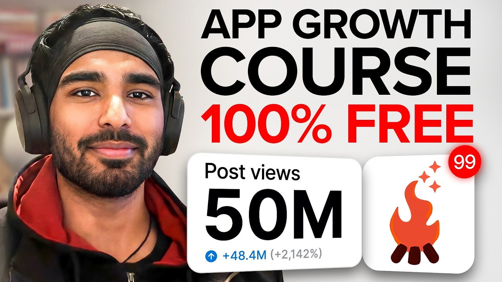

# Full App Growth Guide 2026 - How to Make Viral Content to Get Users & Make Your App Retentive

Start building & deploying paywalls in 10 minutes flat: https://superwall.com/

## Table of Contents

* [00:00:00] - Intro
* [00:00:13] - Flame’s 50% day-30 retention vs. TikTok
* [00:00:46] - The "carrot and stick" habit framework
* [00:01:08] - Learning TikTok by scrolling 4 hours daily
* [00:01:32] - The VSC Framework (Viral, Scalable, Convertible)
* [00:03:33] - Founder background: From gyms in China to tech
* [00:06:38] - Launching the first AI for relationships
* [00:08:20] - Trademark lawsuits and rebranding to Flame
* [00:10:18] - Pivoting to the "Daily Question" feature
* [00:14:04] - The pitfall of ignoring distribution
* [00:22:23] - Scaling via TikTok farming and multiple accounts
* [00:24:50] - Hardware logistics: Managing "iPhone farms"
* [00:27:58] - The 300-view rule for account health
* [00:33:20] - Conversion rates by content type
* [00:34:30] - Using AI playbooks to automate content
* [00:41:40] - Advanced prompting and master prompts
* [00:46:58] - Deep dive into the VSC framework
* [00:56:09] - Networking: The "Small Ask" and "Give First" approach

## [00:00:00] - Intro

What if you could build an app so retentive it was stickier than Tik Tok itself? Onap Flame has 50% day30 retention. And Tik Tok, which is arguably one of the most addictive apps to ever come out, is only at 40%. [00:00:00 → 00:00:15]

## [00:00:13] - Flame’s 50% day-30 retention vs. TikTok

>> We were able to increase our day 30 retention from 4. 2% to roughly 30% and then all the way up to 50% by doing this. Tik Tok barely touches roughly 40% on day 30. >> But unlike most stories, it wasn't always this way. His first version had a dismal 0. [00:00:13 → 00:00:32]

8% 30-day retention. >> Joseph, you know, how much was the day 30 retention on this product? Zero 0. 8%. >> So, he went back to the drawing board, studied habit formation, and reverse engineered what makes people come back. [00:00:32 → 00:00:45]

And what he built was a retention machine with a carrot and stick approach, widgets, and notifications that pulled users back in every day. [00:00:43 → 00:00:52]

## [00:00:46] - The "carrot and stick" habit framework

But with a killer product and no money left, he had to figure out distribution or the company would die. We decided to monetize because we didn't have any money left brother because we raised a small round in 23. We were running out of money at the end of the year. We were like we need to monetize or we won't survive. >> So he dedicated himself to one thing mastering Tik Tok. [00:00:52 → 00:01:11]

## [00:01:08] - Learning TikTok by scrolling 4 hours daily

>> I realized what I had to do was I had to go into Tik Tok. Tik Tok was going to be a savior. What I did is for 2 months I dedicated myself to scrolling Tik Tok for 4 hours every day. >> And unlike 99% of people, he didn't just doom scroll all day. >> I started collecting these little babies. [00:01:09 → 00:01:25]

What I can tell you is as compared to a bigger iPhone, scrolling on a smaller iPhone takes a lot more work. It takes a lot more effort. >> He built a system and developed the VSC framework, his method for finding content that is viral, scalable, and convertible. [00:01:25 → 00:01:39]

## [00:01:32] - The VSC Framework (Viral, Scalable, Convertible)

>> If you go to the comments, if people are not asking what is the app, what is the product, where can I get this, etc. , then it is not content that converts. Then it's content that's getting views. Then it's content that's going viral, but it's not content that can convert. He created 10-page playbooks with winning scripts and master prompts, feeding them to AI to generate hundreds of videos a day across multiple accounts. [00:01:38 → 00:01:57]

And he built the product itself to be visually appealing on Tik Tok with every animation and loader designed to be eye-catching. >> Your product should be built for Tik Tok. What I mean by that is if you look at the flows on this product, if you look at the way it's positioned, like even the loader that comes in this little AI animation, we built it so it would appear visually pleasing on Tik Tok. This system generated 50 million views and 150,000 users 100% organically. And in this episode, Anne breaks down his entire playbook from how he built a retention machine that's stickier than Tik Tok to the VSSC framework for finding content that actually converts and how he uses AI and a systematic approach to dominate organic Tik Tok. [00:01:57 → 00:02:34]

This is a masterass in building something people love and systematically getting it in front of millions. Let's get into it. This is the Superwall podcast and I'm Joseph Choy, founder of Consumer Club. The members in the consumer club discord and the founders I interview on the pod build apps at a median of 1 million ARR. A lot of these apps that make the most money run AB tests on their payw walls to make more revenue with the same number of users. [00:02:34 → 00:02:55]

Superwall has a lot of data on the thousands of apps that use their payw walls. So recently they put together a free AI tool trained on 422 profitable paywall experiments. It lets you upload a screenshot of your own payw wall and gives you an experiment idea to increase your revenue. You can use it for free at paywallexperiments. com. [00:02:55 → 00:03:14]

Also, if you're building a mobile app doing at least 100K a month in revenue, Superwall hosts dinners in San Francisco and New York. They keep each gathering small, thoughtful, genuinely useful for everyone. If you meet this criteria of 100K a month in revenue and want an invite, apply using the type form in the description. Let's get into the pod. So you got 150k users. [00:03:13 → 00:03:32]

You have this huge organic machine with tons of account types and formats and everything. [00:03:32 → 00:03:38]

## [00:03:33] - Founder background: From gyms in China to tech

But I actually want to start with just your story in general cuz I think it's pretty unique and interesting. You can just tell me like how you got into entrepreneurship and startups and stuff. But even before that, >> let me begin the chapter with my first move, right? That's where it all started. So I was really young, man. [00:03:38 → 00:03:53]

I didn't know what to do next. I was thinking, you know, this is back when I was in India. I grew up there and I was like, where do I move next? what do I do? And I had the choice of moving all the way to the west. [00:03:53 → 00:04:03]

I could try and do a master's program somewhere in the west or I could move to China. I was like, why the f not, you know, let's try this. So I decided to move to China back in 2013. I had no idea. I didn't speak the language. [00:04:03 → 00:04:14]

I couldn't move around the country. I didn't know about the food. I was just thrown in there and I landed there and I was like, "Okay, what is happening now? " Like I took this move, but I have no idea what's going on. But learned the language, finished my degree there and then I opened my first business there in China. [00:04:14 → 00:04:30]

Can you guess, Joseph, what the business was? >> Something to do with fitness. >> Of course. Of course, man. It was uh we were the first 24-hour gym in Beijing. [00:04:30 → 00:04:41]

Uh so we opened in Ping and then we spread across to a couple of other cities across China. Seven locations. Had no idea how to, you know, I couldn't speak Chinese at that point. I learned by talking with the people who I was working with, communicating with them, understanding what was going on. Uh so I carried on with this. [00:04:40 → 00:04:56]

That was my first business. Scaled that to seven locations. We did 15 million R&B in revenue and uh I made a lot of mistakes. I made a lot of mistakes. I was really young then man. [00:04:56 → 00:05:07]

I didn't have a complete idea. So things did work out well. But I also made a lot of mistakes along the way. Learned a lot of lessons. And I decided to take all that learning and move to Europe actually. [00:05:07 → 00:05:18]

So I moved to Europe. I worked for Jono, German scaleup back in Berlin. I took them from a series B to a series C. And it was interesting for me because in that chapter I switched from being an entrepreneur to working for someone else. It was in a high growth startup but I also learned a lot along the way and I figured out that even though I enjoyed the structure that came with the scaling, I wanted to get back into building something of my own. [00:05:18 → 00:05:44]

Now that was back in 22nd 23 starting. I moved to the US. I launched Flame. I raised money for Flame in that year. And this was my first tech product I was building. [00:05:44 → 00:05:55]

I didn't have a complete idea regarding tech, how it operated. I didn't even know what coding languages were at that point, Joseph. So, I went to a friend's house of mine who was a developer. I was like, I want to build this app. And they said, okay, but do you have the UIU UX? [00:05:55 → 00:06:08]

I said, what is that? I just want an app to the screen that looks like this. They said, okay, but do you know what language are you going to build it in? Is it a web app? Is it a mobile app? [00:06:08 → 00:06:15]

I said, I just want to build an app. How complicated can it be? So I learned a lot through that entire process. Made a lot of failures again as well and we successfully scaled flame to a certain level. I can say we were one of the first ones in the couple's market. [00:06:15 → 00:06:28]

Right now there are a lot of players out there. Candle couple joy paired has been there in the market since a long time. But when back when we entered this was a new domain and there were not a lot of people in there. [00:06:28 → 00:06:38]

## [00:06:38] - Launching the first AI for relationships

Also u this will be interesting for you. the first AI ever launched for relationships which is basically a wraparound chart GPT but it was us. We launched back in December 2022 and it was called Flame AI. It was a website we blew up. We were on LA Times. [00:06:38 → 00:06:53]

We were on Techrunch couple of other places as well. Yeah. We were just the guys who were doing AI for relationships. >> Gotcha. You're building Flame now. [00:06:53 → 00:07:03]

How did you get the idea initially for a coup's app? I could tell you a story where I struggled with a breakup and I realized that I need to do this for couples but it wasn't anything like this. I wanted to get back into building. I looked at the market and dating relationship is something that is integrally tied to who we are as humans. Looking at the dating market I realized it's really crowded. [00:07:03 → 00:07:21]

There was Tinder, there was Bumble, there was Hinge, there were so many other apps which came out every day. But there was nothing at that time for the after part after you got into a relationship after you had a partner after you started you know being with someone. So we decided to build something for the after. We wanted to build something for when people were in a relationship, when they were with each other, when they were facing struggles together. And that is how Flame was conceptualized. [00:07:21 → 00:07:45]

Tell you a little fun story about it. We launched the initial version of Flame and it was a date planning app. So it didn't have any of these questions, any of these elements. It was just a app to help couples plan dates together. We released with quite a bang. [00:07:45 → 00:07:58]

It was October 2022. We got featured on Techrunch as a startup Battlefield company. We were invited to San Francisco. Uh things were going crazy, bro. We launched in 1 month. [00:07:58 → 00:08:10]

We grew 800% organically. I I had no idea about TikTok then. No idea about anything else. So, we were just growing organically really rapidly. And then we were hit by a lawsuit. [00:08:10 → 00:08:19]

Like we got a seasonless desist letter right into my inbox. [00:08:19 → 00:08:22]

## [00:08:20] - Trademark lawsuits and rebranding to Flame

I wake up in November, things are going really well. And then there's this letter that lands in telling us, "Hey, you got to pull the app down. " uh it was a trademark and brand infringement letter which said that because we were using the name sparks and there was another player in the dating market which has reg which had registered the name spark network that's why we couldn't use the name and they you know we had no choice either we could fight it and lose a lot of money doing that or just change the name so we decided to be a bit more pragmatic about it talked with a few lawyers and realized that hey it doesn't make sense for us to do so we pulled the product down we renamed it the spark evolved into a flame and evolved into a French flame because that was the letter that was not copyrighted. So, exactly. That was the first launch we did ever. [00:08:22 → 00:09:10]

>> So, then Okay. Yeah. So, you're building Sparks. It was just for like helping people plan dates if they're already, you know, if like you're already in a relationship. And then you pivoted the the name and the and the actual app functionality as well. [00:09:08 → 00:09:26]

>> Yes. Because Joseph, you know how much was the day 13 retention on this product? Zero 0. 8%. >> Because people like plan one date and then they don't come back. [00:09:24 → 00:09:38]

There's no like recurring thing. >> I think there was a combination. One was that the date planning was not completely built. So we put it out as an MVP, but it wasn't enough to bring people back. Also, it was a tool similar to let's say similar to Airbnb, right? [00:09:38 → 00:09:52]

where you book an event, but you don't do it unless you need to go for the next event. So, you would book a place to stay, but unless you're traveling next time, you won't come back on it. And being in the consumer social space, we we really found it hard to raise money with 0. 8% retention on day 30. So, we pulled the app down. [00:09:50 → 00:10:08]

We rebranded it as Flame. And then we also realized something. We talked with a lot of couples and we tried to ideulate what was that one thing they would do every day. What was that one thing they would repeat on a regular basis? [00:10:08 → 00:10:20]

## [00:10:18] - Pivoting to the "Daily Question" feature

This was also coupled with the times chat GPT came out. So it was December 2022 when it was released and we decided to leverage this opportunity to build an AI first product which was Flame AI. >> So Chad GPT came out you said like late 2022 and then you immediately hopped on the kind of like GPT rapper wave and then how did that go? At first >> retention went up from 0. 8 to 4. [00:10:20 → 00:10:49]

2. >> Okay. So that's day you said that's that was day 30 >> retention day 30 and u we had to do another pivot man just to be very honest with you this flame this AI rapper was enough to get us in the media get us published like you see we had another article in techrunch February 14th Valentine's Day we came out as the AI product for relationships we also featured on LA Times or a lot of other places but we realized that it wasn't working like even though we could get media presence even though the retention went up to from 0. 8 8 to 4. 2 it was still dismal and we realized we had to do something else. [00:10:49 → 00:11:22]

What we did is this product had AI as its main feature but along with that we also launched something called the daily question where we would give couples a daily prompt they could answer together. Now I know it's really common right now and almost every other app does it but back in that time we were one of the few like I think paired was the only one apart from us which was doing it. We realized that people were coming back not for the AI coach but for that daily question feature. They were coming for a daily way to connect with their partner. And we took that nugget we extracted it from the product and we made it the main stay in the product. [00:11:22 → 00:11:57]

We put it right on the homepage and big we were like hey daily discovery question this is the main thing we want you to come back for. Now what I did regarding retention is I studied the work of a Stanford professor called BJ Fog. He works a lot in habit formation and we realized that every retention event needed to be tied with a trigger. It needed to have something which was a daily habit to call people back on a regular basis and it needed to have a carrot and a stick approach. What was the carrot and the sick approach in this case? [00:11:57 → 00:12:24]

In the morning if you would answer or not answer your daily question when it was live, you would get a carrot notification reminding you, hey, come back, answer your question, take care of it. And as the day passed, if you did not answer your daily question, we would send a stick notification reminding you that, hey, it's time for you to answer the daily question. You're going to lose your street. Your partner is going to be sad. Your partner is going to be missing out. [00:12:24 → 00:12:45]

Um, and it worked really well for us. And we were able to increase our day 30 retention from 4. 2% to roughly 30% and then all the way up to 50% by doing this. 50%. That is a pretty big number. [00:12:45 → 00:13:00]

But can you put that into context for some other consumer apps? That means basically 50% of the users will still be there on the 30th day that they open the app from the time that they downloaded the app. So is that good or bad? Like how how good is that? Because spoiler alert, it's actually an insane number. [00:13:00 → 00:13:17]

But I want to Can you give some context to it? >> Yeah. So we studied a couple of other big social apps to understand what her retention was looking like. If I remember correctly, X has a 30-day retention of 30%. Don't, you know, not exactly sure about the numbers right now, but I know it was in this range. [00:13:17 → 00:13:37]

Instagram is at 35%, Tik Tok barely touches roughly 40% on day 30. And uh so we knew we were doing something right when we touched those numbers. It took us a lot of pivoting, lot of anchoring the product, a lot of working on the main feature to unlock this. And if I'm not wrong, we invested roughly around 8 months to get to this point. So it took us eight months and continuous iteration on the product. [00:13:34 → 00:14:00]

I did one big mistake though, Joseph, in this which you'll agree with. I focus on the product too much. [00:14:00 → 00:14:05]

## [00:14:04] - The pitfall of ignoring distribution

I didn't focus on the distribution enough. So what happened is we were in the end of 2023. We had a product with insane retention working really well, but we were almost out of money. We're almost out of money. We had raised a bit of money before and we were running out of it. [00:14:05 → 00:14:20]

we had no other way to find out. So we then decided to monetize the product instead of going and raising more money. So this was a completely free product in that entire span of time and we hadn't put monetization in the product which was another one of the mistakes I made. As I mentioned I made a lot of mistakes with flame as well which I figured out along the way. We put in monetization in the product. [00:14:20 → 00:14:38]

We barely made it out of running out of money at that point end of 23 and we bought the product back to life. So the carrot and stick uh framework that you talk about for retention, you use that to bring your retention from one to four to 50% day 30 retention and which was like higher than popular social media apps like Tik Tok and Instagram at the time. And how the heck do you make an app more retentive than Tik Tok? So the stick was like you send a notification to warn the user that their streak is about to expire. So there's sort of like the fear of loss. [00:14:38 → 00:15:17]

You have this a streak built up and you don't want to lose it. So that was the stick. And then what was the carrot? Was it just the streak itself or are there other like features that you put in? >> I don't think actually it was that directly. [00:15:14 → 00:15:26]

I think it was what it was linked to. Now that is a big advantage we got. You losing the streak was not linked to you losing the streak. It was linked to you making your partner sad. >> Mhm. [00:15:26 → 00:15:39]

>> Do you see the difference? you doing something to get a carrot was not you getting a carrot, it was your partner being happy. And I think this is where we got a big advantage because this was an emotional product. This was linked with not only what you did, but also what your partner did. Right? [00:15:36 → 00:15:52]

You'll hear of these incidences where people go above and beyond to make sure their partner is happy. This was kind of similar. They didn't want to make the partner sad. They wanted to make the partner happy. So they would make sure they would come back on the product, answer the question so the partner would remain happy and they wouldn't end up missing it in the end of the day because they didn't want to make their partner sad. [00:15:52 → 00:16:09]

>> Yeah, that makes a lot of sense. Is there anything you did in the product that created those emotional stakes? >> One of the things we used at that point was the missing out effect where if you did not answer the question, you could not see your partner's answer as well. So it kind of created the situation where you really wanted to discover what their answer was and if they answered you would want to answer but if you answer they want to answer as well. So it would create this loop which would carry over to increasing the retention. [00:16:08 → 00:16:35]

Apart from that we figured out notification was one of the best tools. One thing we discovered too late which helped also is widgets. I think one of the big advantages you have in a mobile app as compared to a web app is you can place a widget on the home screen and that widget is a easy way to call the user back every single time. One of the apps which did this really well was Couplejoy. I think Couplejoy was one of the first ones which put a widget on the lock screen and that is what their social media strategy was based around as well. [00:16:34 → 00:17:01]

So we found that what they uncovered worked really well. We incorporated it after they did and most of the other players did as well. But these were the three things I would say were the top ones. Yes, exactly. So here as you can see on the app itself, they've got a distance widget which shows the distance between the partners. [00:17:01 → 00:17:17]

Now, this is really, really, really valuable when you're in a long-distance relationship because you want to understand how far are you from your partner, how close can you get, also the amount of days you have together. It makes you feel more attached to your partner even though you're not there with them. Really strong incentives to pull the person back on the product and to remind them that the product exists, right? Because, as you know, Joseph, our mobile screens are full of products right now, and it's really hard to stand out as a product. Notifications help, but almost every other app sends you notification nowadays. [00:17:16 → 00:17:46]

So, how do you stand out from that? By using widgets like this, by using strategies like this. >> The widget is also just a lot bigger than the other apps. Like, there's so many other apps on the screen and then you get a widget and it's like >> kind of big like it just stands out and then you can dynamically >> send content and like send updates to it so that it shows something. >> It just it's just like that thing, right? [00:17:46 → 00:18:08]

It's right there in your face. It's showing you like every time you open your phone screen, you see this massive widget saying something about your partner or saying something about the product itself and you want to come to it. You're intrigued. You want to go in there. You want to see what's happening. [00:18:08 → 00:18:20]

>> That's really good. >> Actually, I'll tell you a part which might be helpful to other consumer founders as well linked with the retention. >> Mhm. >> We had really high retention, but we did not have enough numbers to convince investors. That's one of the reasons we had to monetize the product as well. [00:18:19 → 00:18:36]

End of 23 because even though the retention numbers were really good, we got into meetings with tier one investors, talked with general capital, say 16Z, SEOA, you can name all the big shots. We had to talk with all of them. But the numbers were not big enough. The baseline numbers were not big enough to convince them because we did not unlock distribution. We did not invest enough time into it. [00:18:36 → 00:18:55]

So any consumer founder who's going to go out there to raise I would recommend you to invest a good amount of time into distribution before you try and go and talk with investors. The way the pitch deck worked is they would look at the retention numbers. They would get on the call with us and then they would ask us how are you distributing the product and we wouldn't have an answer and I would try to I would try to work up some sort of saying that yeah we'll we'll look at talking to influencers or we'll do this that but they knew they knew I was bluffing. So a tip to any consumer founder who wants to go out there, make sure your product is solid, but also make sure you have unlocked distribution. They will ask you about it. [00:18:55 → 00:19:29]

They will drill into it and if you can't answer, then usually you don't have a second conversation. >> So you decided to monetize because it would add a little bit more proof point to hey this app is worth investing in. >> We decided to monetize because we didn't have any money left, brother. >> Yeah. Okay. [00:19:29 → 00:19:46]

So you're bootstrapping. You're basically bootstrapping. >> Yeah. Yeah. because we raised a raised a small round in 23. [00:19:46 → 00:19:52]

We were running out of money at the end of the year. We were like we need to monetize or we won't survive. We were not able to raise more money because as I mentioned once we raised the initial small round to raise a bigger round we needed to get more conviction on the product and the distribution. We had product conviction. We did not have distribution conviction. [00:19:52 → 00:20:12]

So we monetized because we had to survive. >> And then did that work out? How how much were you able to monetize? It was a struggle. So I started monetization and initially in the first month we had a surplus of users build up. [00:20:10 → 00:20:25]

We monetized and we had a 15% conversion rate. So I was like wow this is incredible man. A 15% conversion to pay for every user who's coming onto the product. We have incredible product market fit regarding monetization as well. Let's try to scale. [00:20:25 → 00:20:41]

What I didn't realize is how to calculate that conversion to pay. I calculated that as anyone who is paying for the product. It could be new subscribers. It could be old renewals as well. So let's say the this sum in total was a thousand. [00:20:41 → 00:20:54]

And I would divide that by the total amount of users who were coming on right now. Now the the tricky part with this is if you're getting someone who has been on the app for a couple of months who's renewing their membership, but you count them in this cohort, then it's not really conversion of the new users. It's just con like who the total amount of users who are paying for your product. >> Gotcha. Okay. [00:20:54 → 00:21:12]

So you have this like crazy retention machine more retentive than Tik Tok but you want to you need to grow it. So how do you grow this app? >> So once I realized that uh we did make enough money to survive barely the question came back to the same thing I mentioned before distribution. We had to unlock distribution or we would not be able to carry on. We would not be able to survive. [00:21:12 → 00:21:34]

We sludged through 2024 Joseph. It was a hard year for the company. It was more so because we didn't understand what direction we should be going for. We were a very small team, right? We were three or four people. [00:21:34 → 00:21:44]

We were focusing on unlocking monetization, understanding how can we convert the retentive users to paying for a product right now. At the same time, a part of the team was figuring out distribution. At the same time, you know, I was still trying to talk with investors. Uh I even had a round with A6Z speedrun. I love their team. [00:21:44 → 00:22:02]

So even had a round with them. I talked with the team as well. And at the midpoint through 2024, I realized that we need to stop everything else we're doing. No monetization, no talking with the investors because the talks were ending with me having the first two rounds of calls, one round of call and ending up with no term sheet in my hands. I realized the only thing I need to do as a founder, the one and the only thing is go and learn how to distribute. [00:22:02 → 00:22:24]

## [00:22:23] - Scaling via TikTok farming and multiple accounts

That is when I I don't know if you remember this. This is a dejàu moment, but that is when you started consumer club. You >> remember on Discord? >> I do remember. Yeah, I remember you came in and you were like, "We have this insanely retentive app. [00:22:24 → 00:22:36]

We're just trying to learn how to do distribution. " >> Yeah, man. I had no idea. So, I'm so thankful for your community because I learned so much through that, man. Like, I I remember I came in there and I just saw people saying that Tik Tok list that, yada yada. [00:22:36 → 00:22:47]

I was like, what are you guys talking about? I have no idea. I I talked with so many members of the club. I tried to communicate with them on a regular basis. I learned I would say, you know, my zero to one in distribution was because of what you set up there. [00:22:47 → 00:22:59]

It was because of the community you set up. So, thank you for that. >> I appreciate that. That's awesome. >> Yeah, I remember that time. [00:22:59 → 00:23:09]

So, yeah, we we I realized what I had to do was I had to go into Tik Tok. Tik Tok was going to be a savior. Tik Tok was going to be the reason we would be able to save the product. I went into Tik Tok and I learned how the algorithm works. Now, I am an Instagram guy man. [00:23:09 → 00:23:23]

I I lived my whole life on Instagram. I started using that when I was young. We used to have Orcut and MySpace. Then it came out to Facebook. Then it came to Instagram and I've been on Instagram ever since then. [00:23:23 → 00:23:36]

What I did is for two months I dedicated myself to scrolling Tik Tok for 4 hours every day. I just had no idea how Tik Tok works, right? I had to look through every single piece of content. I had to understand how it works. I had to understand, you know, why was what we were putting out, why was it working, why was it not working? [00:23:33 → 00:23:51]

So I spent four hours every single day for two months on Tik Tok to understand how Tik Tok worked, what was the language used there, what was the kind of content there, you know, what were the hooks, why were people getting more traction, why were people getting less traction, why were we getting less traction? And once I understood this, once we started unlocking views for our own single account, I realized I had to multiply this if we had to make this work for the business. What I mean by multiplying this is we had to take what was happening on one account and we had to multiply it across accounts. I'm not talking two. I'm not talking three. [00:23:51 → 00:24:29]

I'm saying couple of dozen accounts had to be set up. Couple of dozen accounts had to be aligned for this to work. Tik Tok was a volume game for us at that point. We were not creative geniuses. I won't even call us creative geniuses right now. [00:24:29 → 00:24:38]

We right now know how to really well take a format that's working for someone else, multiply that into our own format and how to scale it from there. But we don't invent formats right now. Once I realized this, I started looking into and I went back again to the consumer community you set up. [00:24:38 → 00:24:53]

## [00:24:50] - Hardware logistics: Managing "iPhone farms"

I went back to it. I started looking at how do you set up multiple accounts? How do you set up multiple phones? How do you push out content to the US FIP from outside the US and this was on the learning curve like the amount of accounts we had banned the amount of accounts that had no views coming even though we were putting out the right content we had the right hooks. We had everything calculated. [00:24:53 → 00:25:09]

We were trying to do it in the right manner. And then I realized that it's Tik Tok farming is another layer of learning I will have to go through. What I did is you know I went back to the founder community. I talked with some of my friends and I started collecting these little babies. These uh you see these these nice little babies. [00:25:09 → 00:25:28]

I started collecting iPhones man. I became an iPhone collector. So the biggest amount of iPhones we have is iPhone 8. And this is not even all the iPhones we have. My team right now has 10 iPhones lying with them, each of the iPhones has three to four accounts on it. [00:25:28 → 00:25:44]

>> Um, what I can tell you is as compared to a bigger iPhone, scrolling on a smaller iPhone takes a lot more work. It takes a lot more effort. And even the like, let me show you something fun. All of the iPhones were even numbered. So, I don't know if you can see this, but all of them have a number behind it. [00:25:42 → 00:25:59]

iPhone 1, iPhone 2, iPhone 3, iPhone 4, iPhone 5. Yeah. So, we started doing this, man. Setting up iPhones, you know, numbering them. Even like literally every day I would get to work, I would take out the iPhones from my bag, be like, "Hey, what happened with iPhone 1? [00:25:59 → 00:26:09]

What is happening with iPhone 2? What is 3 4 9 10 11. " Uh it was a it was a fun but uh long process and we finally figured out the first part of the process was figuring out how can we push traffic to USF without getting banned. How can we set up all these iPhones? And it was a whole process. [00:26:09 → 00:26:27]

It's you know Joseph, it's not only about downloading the Tik Tok app on your phone and setting it up right. It starts from setting up the entire iPhone. Like setting up the entire iPhone from scratch. You have to reset the entire iPhone. You have to make sure there are no fingerprints left on the iPhone. [00:26:27 → 00:26:40]

Then the Apple ID. One thing we learned along the way. One of the shortcuts I took is we paid for a IP provider, which is a client which allows us to link up different proxies. I paid for it and I thought I would be clever. I would use the same Apple ID to log into every phone. [00:26:40 → 00:26:55]

So I could download the client for free. I won't have to pay for it again and again. It cost us a week of our work time. That is 40 hours for three people, 120 hours. Why? [00:26:55 → 00:27:06]

Because we realized once we did that that Tik Tok has a way of fingerprinting Apple IDs. And when you do that across multiple phones, it connects all these Apple IDs and the accounts link with them under one device. So it doesn't matter if you had a different IP, doesn't matter if you had a different setup on a different phone because we use the same Apple ID, all of these accounts were connected and one account getting flagged led to the other accounts being impacted as well. >> Interesting. So you're you're simulating a brand new person setting up a brand new iPhone. [00:27:04 → 00:27:34]

So you're kind of like factory resetting. Make sure you don't have the fingerprints. New Apple ID for each phone. You have a proxy as well for each phone to have it in different locations. >> Yes. [00:27:34 → 00:27:45]

Once we had all this set up, then we were ready to download Tik Tok. Now this was the second part of the learning. When we're downloading Tik Tok, when we putting it in play, how do we realize that Tik Tok is going to work on these devices? How do we realize that it's not going to get flagged? [00:27:45 → 00:27:59]

## [00:27:58] - The 300-view rule for account health

One thing we came across was and this would be useful for other founders as well. I share a lot of this stuff on X as well where I put out articles on how do I be doing this Tik Tok farming, how is it working, how did we scale to 50 million plus views on Tik Tok. Now this is one of the accounts we've got here. This is actually one of the safest accounts. The reason is because it was created before we knew anything about Tik Tok farming. [00:27:59 → 00:28:22]

This was created natively. You know, one thing about this account, Joseph, this doesn't push traffic to the US because this account was created in Europe and we figured that relocating the account to the US actually ends up costing us a lot. >> Now, we have accounts like this. We have roughly 20 to 30 accounts for flame running. The there's one reason I don't put the accounts out on X because when I share on X, I share a lot about what we are doing without naming the accounts specifically. [00:28:20 → 00:28:49]

We also do not name the accounts with the name flame because X even though it's lovely, one thing I realize on Tik Tok is if there's a format which is working which you put out there, if everyone starts doing the same format, then it doesn't work anymore. >> Yeah. >> And that's why when I put out content on X, I'm quite happy to help people out with what is working, what is going on. But I'm very private in sharing out what exact account are we putting it out on. So yeah, while we're putting out content on Tik Tok, we realized a lot around how do we exactly put out content, how does it get enough amount of views. [00:28:49 → 00:29:19]

Now, one thing we learned while putting out content on X or Tik Tok is that if you have under 300 views, then there's an issue with your account. Either the content is getting shadow flagged or your account is banned and your account isn't private to that happening. If it is under 300 views, then it's not a content problem you have, then it's an account problem you have. Then you have done something wrong with the setup. You're not pushing it out in the right manner. [00:29:19 → 00:29:40]

You need to ideate on it further. You need to move on it further. If you're getting over 300 views but under thousand views then it's something to do with your content. Then you need to iterate more on your content. Then you need to hone down deeper into it. [00:29:40 → 00:29:51]

Then you need to figure out try different formats, try different hooks, try different things which are working in the content. If you get between 1 to 5,000 views, then what we do is we continue with that same format, same type while changing the copy slightly until it hits the right marker until we end up crossing 100k views with that format type. >> So is that basically how you so you have a video here that's 340,000 views. Did this start as a format that got, you know, two to 5,000 views and then you kind of iterated on it? >> This was when we were employing the meme playbook and we were trying to do that. [00:29:50 → 00:30:24]

We're putting out memes of different kind and trying out what's going to happen. And by putting out the memes, we realized that there were ways we can curate the meme to make sure people increase the watch time on the memes. And this is how we got to these amount of views on this video. Uh it was one of the early successes we had when we were trying out this entire Tik Tok farming strategy. And uh one thing we learned from this and all the other viral videos we had is that the part that helps the most is the total watch time. [00:30:23 → 00:30:50]

If you can increase the total watch time in your videos, Tik Tok favors that content a lot more as compared to the initial 3se secondond hook. The 3-second hook is important, but what's really important is the initial watch time. If you can increase that watch time, then you can increase the views on your video. >> That makes sense. And another aspect of like couples apps or like couples content on social media is it gets a lot of shares I feel like is because you you like send it to your significant other. [00:30:50 → 00:31:17]

So are you when you're making content are you were you aiming for shares? Also >> what we optimized for always was depending on the kind of content we optimize on whether they would like the content whether they would save the content whether they would share the content. Now if anything featured the app directly we wanted them to like the content. Why? Because liking showed that they resonated with the content. [00:31:15 → 00:31:40]

You can have a content with high views, but if people don't like it, it means they're not resonating with it. Think about it. What what is the most native thing you do when you come across something and you enjoy it, you would like that thing. If you resonate with it, that's a natural impulse we have. If people did not like the content, then the chance of them converting to app download was quite low. [00:31:40 → 00:31:57]

Even though we might get a lot of views. So we have some of the accounts in which we got a million plus views but the content did not get a lot of likes like the engagement percentage rate was quite low on that. Once we discovered that we optimized on the light part we tried to figure out what kind of content would get higher like ratio and then another thing we discovered when we were putting out slideshows was the slideshows that worked the best were the ones which got high shares. >> So if your slideshow was getting a high share ratio and save ratio it was working really well. Why? [00:31:57 → 00:32:29]

Because we employed the strategy of putting out questions and we found that if people enjoyed the questions instead of only apart from liking they would also share it with their partner they would also save this to use later. >> I gotcha. So for for the regular meme formats you just want you want people to like it and for the questions you want it to be sharable which which kind of like replicates the action that is in the app too like you're sharing this question with your partner. That makes sense. So in these slideshows uh format you you would say five uncomfortable but healthy questions to ask your partner and then on each slide you just have like five sample questions that are from the app and you have a watermark flame the couple's app right there. [00:32:29 → 00:33:14]

Um do you have a good idea of how well the slides convert versus the memes? >> Memes and slide both of them are on the very low conversion ratio. [00:33:14 → 00:33:25]

## [00:33:20] - Conversion rates by content type

So anywhere from 0. 05% 05% to roughly 0. 2%. This is the conversion you can expect. The videos where we had a reaction with a clip of the app followed after was better converting roughly 0. [00:33:25 → 00:33:41]

3 to 0. 5%. And then the videos we had where we showed the app in use where the app was the main thing had 0. 5 to 1% conversion rate. So this video right here would be a reaction >> and then the app demo. [00:33:41 → 00:33:57]

>> Yeah, >> these ones always come somewhere around you 0. 2 to 0. 5 and then would you have here's another reaction one. So was there some kind of formula for for writing the hooks to this because I feel like the the actual demo is pretty straightforward. is just you know showing the features of the app but then the first two 3 seconds seems like it's the hardest part to figure out how to make that engaging >> we are operational people we are not creative people so what I did is what you would do to operationalize the entire thing I created playbooks playbook would have three big parts playbook is this PDF document which my team would feed into AI and get an output what the playbook would have was three parts and the first part would be around the section A would be product and brand context. [00:33:56 → 00:34:47]

## [00:34:30] - Using AI playbooks to automate content

It would define the product name, category, what is it in human terms, core features etc. Then the second part would be winning script references where we would put every single winning script we could find. We would put it as a context reference that hey um these are formats which have worked in this category. This is what we want you to take from them. Do not repeat them. [00:34:47 → 00:35:07]

Section C would be the master prompt where we broke down a system role. You are a viral Tik Tok question slideshow copy engine for a couple slap call flame. Your role is to do this. This is the context. This is the output requirement. [00:35:07 → 00:35:21]

And that is how we discovered a winners. We would keep slamming the playbook until we would have something that resonates and then we would dig down deeper into it. >> You give AI winning scripts. That seems like almost the most important part. If you just said, oh, write make us like viral Tik Toks or make us um viral slideshows with good questions. [00:35:21 → 00:35:40]

It's not going to generate stuff based on good curated data. So, what data did you actually put in there? Would you just scroll TikTok and find good examples of like viral videos? >> If you look at this link, if you look at the playbook, this is exactly what I sent over to the team. And section A is details regarding the product. [00:35:40 → 00:35:57]

Hey, what is working in the product? You know, what is the product about? You would define also the target audience, what are the features, psychological, etc. Then the second part would be the winning scripts where you you would take content that's worked for you before or worked for someone else before in the same category. You would take the content and we would drop it in here. [00:35:57 → 00:36:15]

All of the content types you could find regarding hey what is working in this format, what to avoid and then all of the formats entered. Now once we would do this as you can see this is a collection of all of the slideshows that worked for us that were performing well. uh then you would come to the core part and this is also scripts regarding what questions worked for us, what questions were good. So we went went quite into detail in this playbook man. Uh playbooks are easily 10 pages long which I'm sharing with the team. [00:36:13 → 00:36:44]

>> Wow. Wow. Script three. Okay. And then it gives the exact slides and then a visual suggestion plus the text >> um quote >> outlining each slide. [00:36:41 → 00:36:54]

So you gave it basically Yeah. you you give it three different scripts and then like 10 different visual example five to 10 like visual examples >> and then there's the section C which is also crucial if you keep going down you'll find it now this is the master prompt this is now how I exactly break down what the structure of the output should be how should it be aligned you know this this takes me a lot of work to create but it pays back because I don't have to every day have a new idea have a new conceptualization we let AI do all the work what happens is if something works out Joseph then we add it to the prompt and we create a new playbook. This is the process we have every single time. The way the structure works is the team has this they generate something they put it out there we track the performance on day two in one of my Excel sheets. Now I put a lot of those Excel sheets on on X as well and I'm famous for the colorful ugly Excel sheets on X. [00:36:54 → 00:37:47]

So we put out the stuff on the Excel sheets. We analyze them every single day. We see what's working. If something works, we add it back to the playbook and then we use it to generate again and again and again and again. That's that's really important because you have a you have like a flywheel now where AI I feel like a big mistake that people do with AI generated content is just not changing their system prompt and or like the master prompt and just generating stuff based on old data because if you're if you continuously use that one prompt and you go back to your cloud project and say okay here's a new topic make a tweet about this or make a Tik Tok about this it's going to be good for like a week or a couple weeks and then you know after a while you're you're starting to put out this the same type of content all the time and it just becomes um exhausted. [00:37:47 → 00:38:36]

So you have to >> exactly >> feed in new data continuously. That is where we have this really ugly Excel sheet which we I love which people have made so many comments on hey you should use this tool you should do this that but we keep putting out content on the same Excel sheet and I'll tell you the reason why Joseph it forces us to look at every piece of content every single day if you use something that tracks all your views for you become lazy you stop looking at the content you stop seeing what is happening in the content what we do every day is we track every single piece of content we track the account status we track if it's online. We track what is the content type going out on it. We track what are the notes regarding it. How many times a day is it going out? [00:38:36 → 00:39:16]

And we do this every day. Every single day. Every morning I have a meeting with the team for 1 hour. We keep it trading. Keep it trading. [00:39:14 → 00:39:21]

Keep it trading. Can we figure it out? Accounts going offline. Doesn't matter. Account is unhealthy. [00:39:21 → 00:39:26]

Doesn't matter. Try to bring it back. Doesn't work out. Doesn't come back. Okay, dish the account. [00:39:25 → 00:39:29]

Let's start with a new account right now. Let's start the whole process all over again. Put a lot of work behind setting up the system. >> Wow, this is crazy. And look here. [00:39:29 → 00:39:38]

Here's the iPhone 1, iPhone 2, come down to iPhone 11. Yeah. Wow. This is insane. So, then you have a few categories here. [00:39:36 → 00:39:46]

There's like the content type it looks like and then notes on, you know, what kind of thing it is, how many times per day you're posting it, and then would you track like how many views >> on the right side like which is not present here. We would be tracking it would be a daily tracker basically on daily basis. How many views are we getting? How many likes are we getting? And then you track if something gets higher views. [00:39:44 → 00:40:06]

Why is it getting those high views? What is happening on that front? >> And there's like softwares that track this kind of stuff. But you're saying that it's worth it to do it manually because you're actually paying attention to every single stat because you have to write every single stat down. And that kind of gets you into the just into the flow state of knowing more of the art of it and like figuring out why did this actually do well or why didn't this do well. [00:40:06 → 00:40:31]

I think tools are really good when you're doing UGC because you can't go into huge piece of content, analyze the retention chart, see where people are dropping off, how many, what total watch time did this video get. But when you're putting out your own content, the best way, I think that's the golden gem you have, right? That you can actually dig into the content, analyze it, see what is happening, say where people are falling off. And you stop doing that if you're using a tool. You stop doing that if you're using something that's automatically tracking the views. [00:40:31 → 00:40:56]

You don't need to go into each account. You don't need to track what's happening. You don't need to see why things are working. You pick the top accounts and you see why things are working, right? But as you realize, Joseph, the the cream lies in realizing why something is not working rather than in realizing why is it working because when something doesn't work, you get to learn so much about what are you doing wrong and not repeat the same failures again. [00:40:56 → 00:41:17]

>> Yeah, that makes sense. And yeah, all of these all of these insights are going right back into the master prompt and the AI is now like generating better and better outputs. Um, it looks like you have like a nano banana image prompts too, which is cool. >> Um, that's like, yeah, one of the newer models. And you're doing like hyperrealistic vertical images, and that's probably good for like slideshows. [00:41:15 → 00:41:43]

## [00:41:40] - Advanced prompting and master prompts

>> Exactly. And we tried playing with a lot of models. We realized Nano Banana Pro was the best at generating realistic lifelike images for us. And we also realized that we could standardize the whole process to get the output from GPT regarding what kind of image should we generate and the prompt to generate that image as well. >> Is there anything you do in prompting that you feel is different from other people that you've seen? [00:41:41 → 00:42:04]

>> Two things I would say. One is the initial prompt we set in place. We try to give it as much context as we can. I know people who go to it and say that you know I want to put out a slideshow for Tik Tok. Help me generate something. [00:42:01 → 00:42:15]

That is really shallow. I think AI is this tool which works really well. The more you give it, the better context it has, the better it knows what is winning, the better it's able to give you something that wins as well. This is the first thing we do. Well, we provide a lot of context initially like to create each of this playbook. [00:42:13 → 00:42:30]

It takes me one working day. It takes me a whole day to put up this entire playbook. I have to collect the right formats. I have to collect the right screenshots. I have to make sure that they align with whatever product is. [00:42:30 → 00:42:38]

I have to make sure that I create the master form to firstly give an output that has the potential to go viral but also give an output for what we need which means it should have the title slide it should have these categories it should have an anobanana prompt as well once I do all of this then I put that into AI and then I test the prompt to see what is the output coming out if it comes out well then I pass it on to the team if it doesn't come out well then I go all over the process again this is one of the key steps which is setting it right in the first go the second thing which a lot of people ignore is iterating on it right because this is like us as well we have new information that comes in every single day we have new data points we have new way to improve on what we are doing but for your AI playbook is the same it needs to improve as well it needs to become better and it can only do it if you tell it what to do better if you expect it to get better by itself it doesn't happen as I told you as a second part of the process as well we feed it data back on what's working well we keep iterating on this playbook again and again and telling Hey, this works well. This doesn't work well. You know, it's like a cursor MD file for coding, but this is for Tik Tok. It's like a Tik Tok MD file you create. >> Yeah, that's crazy. [00:42:38 → 00:43:47]

One like random specific question. When you're iterating on the master prompt and you want to put in some new insight, do you use GPT or Claude to help create a new adjusted prompt or do you manually put in new context into the prompt? I do it manually because one thing I realized is that once we have the initial prompt structure laid out, it's more about me coming in and filling the gaps. I've tried doing that with AI but there are times when AI hallucinates or it fills some things which I don't want it to fill and I have to go over recursive or process of making it correct that path again in this manner. I know that we have something that's working really well. [00:43:47 → 00:44:24]

We keep that and I just keep adding on top of it or removing the parts that are not working. >> Mhm. So it's like it's like you know AI bakes this entire cake for us and then I come in and put the cherry in the right place or make sure the decoration is aligned well or the happy birthday sign is in the right manner. >> Mhm. Yeah. [00:44:24 → 00:44:39]

Okay. That's interesting. When you reach out to creators and you're about to invest into organic social and maybe boosting those videos with paid ads, you don't want to just let the creators do whatever they want. Most of the app founders I talked to on this channel basically have the same content philosophy. The videos need to go viral but also convert and promote an app and ideally are like also repeatable. [00:44:39 → 00:44:59]

And those formats are like gems and really hard to find. That's why Tik Tok can sometimes feel like a lottery system. So what a lot of consumer club members do is they use this tool called spy talk which brain rot scrolls hundreds of thousands of Tik Toks and just finds the most viral ones that promote apps. So here I search for fitness, gym, workouts. Let's say you like run a fitness app. [00:44:59 → 00:45:23]

I'm going to sort by most viral. And here's this 106x outlier video that promotes a fitness app. And it shows a text hook. It shows the image in the background. And then on the second slide, it has this CTA in a really creative way. [00:45:23 → 00:45:36]

And Spy Talk has been the secret weapon for growth strategy for 11 Labs and Ammo and Voodoo, which is the app studio that owns Bereal. So I recommend Spy Talk. It really is the only other tool I explicitly recommend on this channel other than Superwall. So, was this one of the first Tik Tok accounts that went well and then you started basically replicating these formats across all these all the different phones and accounts? >> This was the OG Tik Tok account on which we up so much. [00:45:36 → 00:46:02]

Like I had to pull out some of the content on it because we were just we just terrible at it. >> Yeah, >> we made this account back two years ago and we had no idea what we were putting out, man. We're just launching random things on this account, trying out this, trying out that, seeing what works, what doesn't work. Uh so this account had a lot of crap on it and a lot of it is not available right now on the account but this was the account where we realized that hey this is something we can actually replicate we can push forward to other accounts as well and we started doing it from here. >> So overall you got 50 million views across all the accounts. [00:46:02 → 00:46:37]

>> Yeah across all the accounts across all of the content we put out. We managed to scale them to 50 million views with one caveat. It took me in the later part of those views to realize that certain kind of content performed better, certain kind of content did not for conversions. So I look at it from the BSC framework whenever we are picking out something. Wii is virality. [00:46:34 → 00:46:56]

I'll actually share this with you as well. [00:46:56 → 00:46:59]

## [00:46:58] - Deep dive into the VSC framework

So I put out something on X regarding how do we exactly find content. >> So we follow the VSC framework in which Vi is for virality. Something that can go viral. How we find this out? By picking content that has gone viral on accounts with less than 5,000 followers. [00:46:59 → 00:47:14]

Like we have a very structured approach for this. And if there's a piece of content that has gone viral on accounts with less than 5,000 followers and the content has got over 100,000 views, then we understand this content can go viral. Then what we try to see is is it trending right now? Is it present across other accounts as well? If it is, then it bears this check. [00:47:13 → 00:47:30]

Second part is scalability. Now this is something a lot of people ignore, but it's really important when you're doing Tik Tok farming at scale. If you cannot scale the content, if you can just have one hit, then it doesn't work for your product. You need to have content you can recreate yourself at scale and do it consistently to push it across five 10 accounts at the same time, multiple times a day. If you can't do that, man, if you have this brilliant video of you speaking and elaborating on something, but you have to manually record it every single time, it doesn't work. [00:47:30 → 00:47:56]

So find something that you can scale. Right now, what I would recommend everyone to check is we have a lot of AI tools available which allow you to do that. We use Sora quite extensively. We used the influencer. ai. [00:47:56 → 00:48:07]

We also use nano banana as I showed you. We use nano banana pro. We tried putting out videos with VO but they always got flagged for AI content. So we always found struggle with VO when we putting out content. And then the final part which took me too late to discover but which is the most important is the C part which is the convertability. [00:48:07 → 00:48:25]

Now this is the most important. If you go to the comments, if people are not asking what is the app, what is the product, where can I get this etc. then it is not content that converts. Then it's content that's getting views. Then it's content that's going viral, but it's not content that can convert. [00:48:25 → 00:48:38]

You need something that converts. You need something that's going to force people to try to find the product. They want to use the product. They're desperate for the product, right? They really want the product to be there. [00:48:38 → 00:48:48]

And this is the VSC framework we now utilize in pushing out anything. For me, with the 50 million views we came across, we struggled with the C part. Cart is something we didn't focus at at all. I'll tell you one of the things, right? the meme video you see, I would never put that out right now. [00:48:48 → 00:49:05]

Never. Even though it got views, it crossed over 300,000 views, I would never put that video out right now because I realized that that format doesn't convert. It's a lot of the work you're putting in from our side for a format that is not converting. >> Yeah, that that's a really interesting insight. And you and you said that the memes converted the lowest and then the slides would convert the next and then the hook reaction would be the next and then straight up like product video would be the highest converting. [00:49:03 → 00:49:33]

>> Exactly. >> Did you have anyam examples of that on this account or is it basically just showing the app straight up? >> Yeah, I'll show you one of the parts that working that we experimenting with right now. We've just started putting out this format. One of the format we know is going to lead to high conversion when we unlock it is this kind of video. [00:49:32 → 00:49:53]

If you can open any one of the first videos which is directly showing the product in play. [00:49:51 → 00:49:58]

>> So this is one of the we just begin experiments on this content. You can see the date is like one or two day old. So we're beginning the experiments on this content where we I'll tell you how we pick it. We go to Reddit. We locate screenshots where people are like, "Hey, what do I reply to this? [00:50:01 → 00:50:16]

What do I say? I have no idea what to respond. " We take those screenshots. We put that into our own product. We generate a reply and we show the product in action here using that reply. [00:50:16 → 00:50:30]

>> And this this is for a new app, right? >> And this is for the new product. So, we have just begun the experiments on this. But I know that if we manage to unlock this format, then this is going to convert really well. I would place it anywhere from zero to 0. [00:50:27 → 00:50:42]

5 to 1%. because you're just straight up demoing the product as the main point of the whole video. >> And one of the things I also learned I was watching I I this is also from the consumer club. So thank you Joseph in the end you know I said most of my early successes or early learnings we've got actually the zero to one of Tik Tok learning has been because of the club you put up. >> Now that's awesome. [00:50:42 → 00:51:06]

>> One of the things we also learned is that your product should be built for Tik Tok. What I mean by that is if you look at the flows on this product, if you look at the way it's positioned, like even the loader that comes in, this little AI animation, we built it so it would appear visually pleasing on Tik Tok. This is another lesson we learned that similar to what Cali did, right, as well. They built the product so it would be easily able to spread across social media. It has this little scanning feature which works really well. [00:51:05 → 00:51:30]

We use the same approach and we built the product. This is actually designed by my partner Laurian who's also my my wife Tubi. So she designed the entire product with a French touch and we built it so it would appear visually appealing on Tik Tok. >> Yeah, that makes a lot of sense. Yeah, this animation itself is just is very very eye-catching. [00:51:30 → 00:51:52]

>> And we spent so much time on that animation. >> Yeah. And then I like how obvious the home screen is. It's like decoder, >> replier, opener, and it's and everything's like really easy to understand. Yeah, this is interesting. [00:51:50 → 00:52:06]

It seems like this this type of content it doesn't need to get as many views and yeah like for it to get more downloads the you know >> five to 1% seems that'd be a lot of downloads even if you had had only a thousand views and you got 10 downloads for 1,000 views that's like it's actually a lot. >> I mean also we're putting out let's say between the content types we put out 200 pieces of content a day. So 10 downloads per content 200 pieces that's 2,000 downloads a week. If nothing goes viral that's 2,000 a week. Now, one of the things I also realized is that views can be an ego metric, right? [00:52:06 → 00:52:39]

Because I wanted to get views early. I thought there was a cool thing to do as a consumer founder. I realized that views don't matter if your product if your videos don't convert. And for the video to convert, it needs to show the product in action as blatantly as it can. Also, one more note. [00:52:39 → 00:52:53]

I don't know on on X, I've been receiving a lot of requests to collect all my all my Tik Tok farming learnings together, release a farming playbook. So, I'm doing that. That's the next thing I'm working on. I'm launching it for the X community. I'm putting out a farming playbook of all the lessons I learned from farming. [00:52:53 → 00:53:08]

How to set up your account, how to target the USF IP, how to choose the right proxy, how to, you know, set up the Tik Tok correctly so it doesn't get flagged, etc. , etc. So, that'll be cool. I'm I'm going to drop it this weekend or the week after. >> Okay, nice. [00:53:08 → 00:53:21]

Yeah, by the time we edit this episode, it'll probably be out. So, >> yeah, >> uh follows XAI on Twitter and you'll find it. Yeah, >> that's spelled. Yes. Yes. [00:53:21 → 00:53:35]

>> That's great. Yeah. The Tik Tok farming playbook. I love that >> cuz there's so many of those little things that you wouldn't expect that cost you, >> you know, weeks and months of learning. And yeah, that sounds very helpful. [00:53:33 → 00:53:48]

There's just so many like random things with the proxies and setting up phones and stuff. >> Yeah. And then when you combine that with the VSC framework that makes >> that kind of pulls it all together because you want to find you want to apply these like Tik Tok logistics and Tik Tok farming tactics to something that actually you know content that actually goes viral that actually converts and is also scalable or repeatable. >> I can uh I can share something with you on that. This is initial part of the document but in this I basically curated together what the structure is going to be. [00:53:46 → 00:54:25]

Now it's a comprehensive playbook. The amount of messages I receive every time I put out an expost. I have 50 people asking me, hey, how did this work? How did that work? How does that go through? [00:54:25 → 00:54:36]

So I said, okay, I'm going to compile all of the things I've learned together. As you'll notice on the left side, we've got the part one. We've got the foundations. Then how do you set up the hardware part, hardware and infra is really important. What is the network and geo control? [00:54:36 → 00:54:50]

What is the account creation SOP warm-up system content systems which has the VSC framework which you mentioned then content life cycle posting distribution which is part eight account health fail status recovery system in place go and scaling and team and operations like how do you manage to scale this with a team in place it's a lot of work building this is a lot of work but I know that it's going to help a lot of people out who have been coming into my inbox always ask me hey how do I manage this that and the thing is Joseph it's the same series questions they ask. It's around the same cities and I want to make sure that they have it available. Also, I'll be putting my ugly Google sheet template into this so they can use the same ugly Google sheet template. >> I love this so much. I feel like um yeah, a year ago when you joined Consumer Club, none of this was really in a playbook yet. [00:54:50 → 00:55:38]

Like nobody really knew. Everyone just kind of had ideas of how to do things and you know, some stuff was working, some stuff wasn't working. And now the space I feel like has evolved. so much and people that are like just getting into, you know, viral consumer apps, like the the playbooks are kind of like out there now. Um, but it is still a little bit confusing cuz like even though a bunch of people >> have made it work, there's still a lot of different opinions on like organic social and this seems like super helpful. [00:55:38 → 00:56:07]

So, last question to wrap this up. [00:56:07 → 00:56:10]

## [00:56:09] - Networking: The "Small Ask" and "Give First" approach

I yeah >> I'm curious if you have any mental model or approach to asking people for help because it seems like you use the community really really effectively and you learn so much and people were so willing to help out. But I'm sure there was also some part where you are like people just want to help you out for some reason. Like is there something that you you do to just make like r people up? Like what what's going on? >> R people up. [00:56:10 → 00:56:39]

There we go. Two things I always do. I always start with a small ask. So, I'm not going to try and get Joseph on a three-hour call and then initial get go be like, "Hey, bro. I love the work you're doing. [00:56:39 → 00:56:51]

You want to come on a three-hour call with me? " No. I will ask you for something small and I'll build up that trust because this is, you know, ma'am, in your inbox, the amount of inbounds you must be getting, the amount of people who need your help, who want your help, who you want to help out as well, but you have limited time right now. If everyone comes in, it's like, "Joseph, can you get on a one-hour call with me? can you help me out with this thing? [00:56:51 → 00:57:10]

It's overwhelming. It's really hard to do. Also, it's really hard for you to filter out who's genuine, who's not. Then the second thing I do which is really important which a lot of people miss out is give something back. Don't just go in with the ask. [00:57:10 → 00:57:21]

A lot of people just go in saying that hey I want want want. They never want to give anything and that is why they don't receive anything as well. When you want something please give something as well. It doesn't matter if you need it right now or not. Joseph, right? [00:57:21 → 00:57:35]

I went in I told everyone this is what we achieved regarding retention on a product. This is something I can share with you. These are the learnings I have. I would always offer doesn't mean that they would take that learning right now but they appreciated the part where I try to put something back give something back and people tell me often that hey because I also mentor for an MBA program. I have 10 plus founders I'm working with right now. [00:57:35 → 00:57:58]

People always ask me that hey how do I ask for help right? No one is going to help me or no one wants to give help back or I don't have anything to offer them. I tell them it's not true. One of the things I did early in my career, man, when I came off the gym business, I had no idea in tech. You know what I offered people, Joseph? [00:57:58 → 00:58:12]

I offered them personal training advice. >> Yeah. >> I was like, I ran a chain of gyms. I understood a lot about how the body works, how to work on this method. I was a bodybuilder in the past. [00:58:09 → 00:58:19]

One thing I can help you with, maybe not on the tech side, but I can help you with your own health, own fitness. >> So, always there's something or the other you can give back. >> That's really good advice. I think that's something that people don't think about a lot. just I think people might have heard like oh give first but like if you're joining a discord community or you're on Twitter or you're like meeting people in person like not a lot of people just give first like that. [00:58:19 → 00:58:41]

I remember like the first day you joined the discord and you were just like hey guys here's like our our retention is like really amazing and here's like a few principles that are you know how we how we actually achieve that feel free to DM me uh if you have any more you know I can I'm happy to help other people and a bunch of people would DM you and like talk like ask you about retention but then those people were like people that are really good at organic Tik Tok >> so then naturally you just kind of got all the learnings and you don't have to reply to all those people that ask you about retention, but some of them are going to be like really useful to you as well. So, I think just that like give first mentality like helped so much. That's awesome advice. And >> thanks for telling your story, too. This is just really good to to hear the complete thing end to end. [00:58:41 → 00:59:26]

I I I think we've talked a couple of times, but I haven't like heard the whole thing end to end. So, really cool to hear the journey. Thanks again for being with >> Yes, sir. It's time for the gym now. I'm going to head to the gym and do a bit of working out. [00:59:26 → 00:59:39]

>> Yeah. Um, but yeah, this is amazing. Let me know if you need something else, brother. >> Yeah, >> apart from this as well. If I can just help with anything, you know, I'm here. [00:59:37 → 00:59:48]

>> Yeah. Awesome. Something you might not know, most of the founders I cover on this podcast are hanging out right now in the Consumer Club Discord sharing with each other what's working now for consumer apps. So, you can apply to join Consumer Club if that sounds interesting to you. And this is the Superwwell podcast. [00:59:46 → 01:00:01]

Of course, you got to check out superwall. com. We have more videos on the channel. [01:00:01 → 01:00:06]
