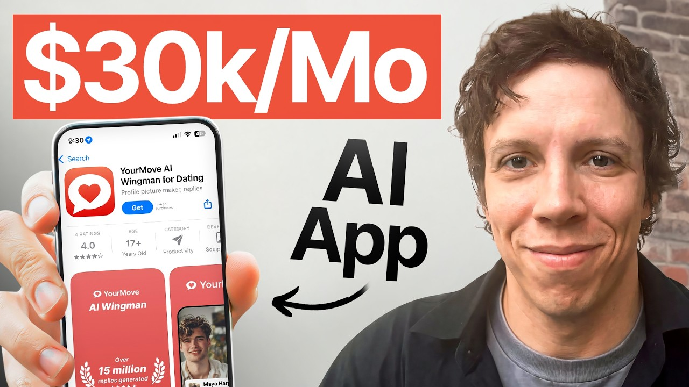

# he had nothing.. until he built a stupid simple $30k/mo app with AI

Start building & deploying paywalls in 10 minutes flat: https://superwall.com/

## Table of Contents

* [00:00:00] – Intro
* [00:01:58] – The side-business playbook (from zero to $30k/month)
* [00:03:09] – What YourMove AI is & how it made $30k/month
* [00:04:40] – The accidental idea that turned into a real business
* [00:07:28] – The brutal 2.5-year grind before real money
* [00:09:03] – Getting massive PR (and why it didn’t convert)
* [00:11:44] – How SEO actually became the growth engine
* [00:15:08] – Why SEO changed (and what no longer works)
* [00:20:06] – Google vs Meta ads: capturing vs creating demand
* [00:25:24] – Why dating is one of the most profitable categories
* [00:29:14] – Painkiller vs vitamin products (what to build first)
* [00:33:40] – Failed projects before the breakout success
* [00:43:14] – Hiring contractors early (even before profitability)
* [00:48:44] – Lifestyle changes after hitting $10k–$30k/month
* [00:51:01] – The exact moment he quit his job (and why $20k/month)
* [00:55:18] – Final thoughts & lessons learned

## [00:00:00] – Intro

Imagine working 20 hours a week from anywhere in the world on a business you love while it prints money in your sleep. That was Dimmetri's life for 5 months. There was like a period of like 5 months during which I was just working on your movie AI and it was making money and I was just working like 20 30 hours a week traveling exploring having fun watching numbers go up. Being not accountable to anybody and just like making money in your sleep is incredible. >> But getting there was a brutal 2 and 1/2 year grind. [00:00:00 → 00:00:29]

He wasn't a marketer. He didn't know how to build apps. And for the first year and a half, he made almost nothing. >> Six months before I started monetizing, another year to hit the first thousand dollars, then a year to hit like 10. And then a year later, I was at 28. [00:00:29 → 00:00:43]

>> So, what changed? Some would say he got lucky. He was early to AI and he was building with GPT3 before ChatGpt was even a thing. And the novelty of his app got him featured everywhere. >> We were early to this. [00:00:41 → 00:00:53]

So, there was also a lot of excitement around AI. So, we wound up getting a lot of media attention. At one point I was on like Fox, CNBC, Wired, Washington Post. >> But here's a twist. These PR articles didn't actually bring in users. [00:00:53 → 00:01:05]

It gave him something a lot more valuable. >> The PR itself didn't generate any money but allow us like a really good SEO strategy. We had very good domain authority at the door. >> With that domain authority, he built an SEO machine that drove half his traffic all the way to 30K a month. But he didn't do that part alone. [00:01:05 → 00:01:24]

While he was still working his full-time tech job, he hired a team all from Upwork. At >> one point, I had like 10 to 12 different contractors, most of them working only a couple of hours per week. I was a manager at the time. I didn't need to pay myself the money. I could afford to be not profitable for a while cuz I still had my day job. [00:01:24 → 00:01:40]

>> He scaled the business to $30,000 a month using his salary to pay the contractors that fueled the SEO machine. And just when he was about to quit, >> Open Door did a giant layoff in November. So, I got a severance package and an exit on top of everything else. That was like the happiest, probably the happiest moment in the past couple of years. >> In this episode, Dimmitri breaks down the playbook for building a profitable side business from scratch, how to turn PR articles into a defensible SEO moat, how to hire a team of contractors on Upwork to scale while you're still employed, and the exact revenue milestone you need to hit before you can quit your job for good. [00:01:38 → 00:02:14]

## [00:01:58] – The side-business playbook (from zero to $30k/month)

This is a master class on the slow but strategic and sustainable path to building a business that sets you free. Let's dive in. This is the Superall podcast and I'm Joseph Choy, founder of Consumer Club. The members in the Consumer Club Discord and the founders I interview on the pod build apps at a median of about a million dollars ARR. In my conversations with dozens of these founders every week, one thing I've noticed is most of them AB test their payw walls to increase their conversion rates and make more money. [00:02:14 → 00:02:39]

Now, most people know that one of the best ways to AB test payw walls is Superwall. But one thing you might not know is Superwal has a lot of data on the thousands of apps that use their payw walls. So, recently they actually put together a tool that takes 422 profitable paywall experiments and put those into a paywall experiment generator where you can upload a screenshot of your own payw wall and it'll give you an experiment idea to increase your revenue. You can use it for free at paywallexperiments. com. [00:02:39 → 00:03:05]

All right, let's get into the pod. What is your move AI and how much money did it make at peak? [00:03:04 → 00:03:12]

## [00:03:09] – What YourMove AI is & how it made $30k/month

>> Um, your move AI started as a joke, but it became an AI that basically automated online dating. Um, at peak recently, it's been making 30K a month, about 80% margin. um and doing everything from telling you what to text to writing your profile to telling you what photos to use to I think as of like a year and a half ago we started actually making the photos. That's that's interesting. Is this the only product that does the profile review and profile writer stuff and the photo? [00:03:09 → 00:03:45]

Cuz I think I've seen these various like I've seen chat obviously, right? cuz that's um you know that's the whole Blake Anderson you know um RZ GPT type stuff and that was really popularized but this what what what year did you start this? >> So this was I think I started my thing about a year before the whole RZ thing. Um I at the time did not know how to build apps or how to market at all. So I was early but just did not capture nearly as much of the market. [00:03:45 → 00:04:12]

There's other people that do both photos that do profile writer that do profile reviews. Um, all in all, we tried like 12 different products. Um, and these are the products that stuck around that make money. It's uh, yeah, it's a bigase, but I I think I I started this back in 2022, back when it was just a like literally a text box on your move. You copy a message that you get from Hinge and it will give you three flirty responses. [00:04:12 → 00:04:38]

>> Interesting. So, you said it started out as a joke. How, like, tell me that story. [00:04:36 → 00:04:43]

## [00:04:40] – The accidental idea that turned into a real business

>> I was literally drunk at a party. Um, I think it was originally called Aspie. ai. AI um very quickly rebranded from that after about a day. Um but I was I was drunk at a party and I was telling a friend like what if we um this was back in like the Da Vinci 2 days um of AI back before Chad GPT before anybody was talking about it. [00:04:41 → 00:05:02]

Um and I was a data science manager and I was spending a lot of my time reading hacker news and playing around with tech because that's what managers and thought leaders seem to do. It actually originally started with I was building a Slackbot as a joke to replace myself as a manager using Da Vinci too. I was like actually what if I use this uh to text on dating apps and my friend was like you should build this and spent a weekend seeing if we could get the uh then like GBT2 AI to flirt. Um realized it was terrible at flirting but it was still better at flirting than I was at the time. Um, so put it up on a website and uh very quickly realized that this is something that people want. [00:05:02 → 00:05:44]

As funny as I thought it was, there was like a lot of friends that were like, "Wait, can I use this? Can I give this to friends? " And I'd built a lot of stuff before cuz I'd wanted to build a company, but I've never felt that like that pull. It was always kind of the push like, "Oh, like would you try this thing? Would you use this? [00:05:42 → 00:05:58]

Oh, are you a target user for something like this? " I've never felt that like, "Wait, this halfbaked terrible thing that you built in a day. Wait, can I can I use it? " Can I give it to people? Oh my god, this is so helpful. [00:05:58 → 00:06:12]

>> That's a that's like a very strong signal for consumer products or I guess any product in general. To me, that's a strong signal that it's highly monetizable, too, cuz it sounds like people have it's like very high intent. And when there's a high intent, like I really need this problem solved, then people want to monetize. So, this is is this like a hard pay wall or is it fremium? >> It's still soft payw wall. [00:06:10 → 00:06:35]

I mean, at the time when I started building this, um, it took me like 6 months to even monetize cuz I I think I was still running on the old vision like, oh, you build a company and you get users and then you monetize it later. Um, that I I think everybody now knows kind of doesn't make sense, but this product is still running on a soft payw wall. Um, the AI photo is obviously hard payw wall because the compute cost on that is quite high. Um, but yeah, >> so this still makes money to this day. Yeah. [00:06:35 → 00:07:03]

Um I sold the company about four or five months back. I don't know the financials currently. Um but when I left it was like I think it peaked at 30 and then I was making 28k in revenue when I stopped working on it. >> Wow. Okay. [00:07:03 → 00:07:18]

So like around 30k in revenue pretty consistently and then can you say anything about the exit price or not? >> But it also took a while to build it up. [00:07:18 → 00:07:29]

## [00:07:28] – The brutal 2.5-year grind before real money

I feel like there's a bunch of stories of people that like hid that amount of money in like a month. This took me like two and a half years. Um, I was working full-time for almost the entire time of it. Um, but it was it was very much like a slow process of building up my first business, my first startup. It was it was not an art. [00:07:28 → 00:07:45]

It was very much a like like a year and a half to hit the first $,000. Like 6 months before I started monetizing, another year to hit the first $,000, then a year to hit like 10, and then a year later I was at 28. But did you have like motivation milestones? Because it's really easy to quit when you have like no progress for a long time, but I imagine you had like user numbers flowing in so you kind of thought, okay, there's something here. I had user numbers like I feel like with consumer stuff especially like like you see the engagement, you see people interacting with it. [00:07:45 → 00:08:17]

Um we we were early to this so there was also a lot of excitement around AI so it wound up getting a lot of media attention. At one point I was on like Fox, CNBC, um, Wired, Washington Post. I wound up writing an OpEd for Newsweek. Um, so this this got a lot of media attention. Um, and then the user numbers were always like like it was a slow hill, but they were consistently consistently going up. [00:08:17 → 00:08:41]

And also just hearing feedback from people who like genuinely found this transformative. The upside of working on something that you believe in is that like like this is a genuine problem for a lot of people and like I was an awkward kid that didn't know how to talk to girls at one point and I like I think I found it very relatable to work on something that like would have been something that I would have found helpful at an earlier stage in my life. [00:08:41 → 00:09:05]

## [00:09:03] – Getting massive PR (and why it didn’t convert)

>> Mhm. Here's one of your press articles, Wall Street Journal. Can you flirt better than artificial intelligence? This is so interesting. And okay, we're going to we're going to get into the growth story in a second, but this is like I just think it's so crazy how you built this in 2022. [00:09:03 → 00:09:22]

Was it GPT2 at the was that the latest version at that point? They they were calling it they had like scientist names for the models at the time. It was like Cury I was using the the most powerful model, the one that I was running on was called Da Vinci 2. And this was in the days where you needed to like if you wanted to use AI for something commercial, you had to fill out a Google form on OpenAI and they would like take a couple of weeks to decide if they would allow this or not. This is back in the days when everybody was like super nervous around AI capabilities. [00:09:22 → 00:09:53]

>> Wow. >> This is like this is this is the old the old model. >> Okay. Okay. So, I think it was I think it was GPT3, but Da Vinci 2 was what it all started on. [00:09:52 → 00:10:04]

Wow. Okay. But yeah, that's way before. So that was before Chad GBT, right? >> Yeah. [00:10:04 → 00:10:13]

>> Yeah. Wow. That's crazy. I was a data science manager um at a company called Open Door and I knew how to build the AI stuff cuz I knew Pi like I knew Python. I like I knew how to build ML models which was not particularly useful here, but I also like knew how to write enough Python that I could like build something there. [00:10:09 → 00:10:29]

But like but the the entire front end was everything was so janky. Um, and I didn't know how to market. I didn't know how to sell. Um, I didn't have anything resembling a social media presence. I still don't. [00:10:29 → 00:10:39]

To some degree, it was like the the process was like discovering all these things one by one. Um, I think the other hard part is that like no matter what you hear or read about on the internet, like nothing really compares to actually doing it. Like nothing that you read will like like you might be able to fast track things a little bit. you can like save yourself time with mentors, but I I do feel like with entrepreneurship, you have to learn a lot of things the hard way, especially if you're coming from a big tech background, but honestly from any background because like so many of the things that you're used to doing just make no sense in the context of building >> like building a small business and even building a moderate business. >> I think the biggest failure point that I see is people trying to take lessons from big tech and apply it here and just like like so many things just don't work. [00:10:39 → 00:11:21]

Um, with with marketing in particular, with marketing and with product, it is such a discovery process. I don't know. Anybody's like, "Oh, I built the product, the writing joke, is like somebody builds a cool product. Cool. Now I just got to find somebody to do the marketing. [00:11:21 → 00:11:35]

" Like, come on. But I but I also like I I didn't know that. I was like, "Okay, cool. Now, how do I how do I grow this? " Uh, and it turns out that's hard and that's where the money is. [00:11:35 → 00:11:46]

## [00:11:44] – How SEO actually became the growth engine

>> Um, >> yeah. So, how did you grow it? What was your biggest channel that worked? So the the the honest answer um with this particular company is I I got lucky. Um I at first it was I think the like the the early amounts um there was a lot of like I did everything from Reddit. [00:11:46 → 00:12:09]

I was at one point cuz I really didn't know any better was handing out flyers in Washington Square Park here in New York. Spoiler did not work that well. I did Reddit. Um I did a little bit of Google ads. Ultimately, the two things that worked was like one, the product was very early. [00:12:09 → 00:12:23]

This was before most people had been exposed to AI, so most people that saw the product like were super excited about it. Uh, it was super novel. Um, I posted a lot and yeah, oh, my account is suspended. It's suspended, but I mean, okay, you still have the you still have the stuff like the the comments out there, but this is like >> this was this was by a customer. That's interesting. [00:12:23 → 00:12:49]

You were handing out flyers, you were doing Reddit. Was there any strategy to the Reddit? Did it work? No, nothing. Um, I found like small communities. [00:12:49 → 00:12:59]

So, for me, this was um our Swipehelper. There was a a subset there was a couple of subreddits of people that um like were very focused on like optimizing their dating apps. I started posting on those and I got some early attention on those. Actually, I still get a decent amount of SEO from some of those posts. Um, and then because it was so early, my app also started to get media attention. [00:12:59 → 00:13:26]

Um, so I wound up being on a lot of major news channels. Um, Wall Street Journal, Washington Post. Um, that got me a lot of media coverage and like the media coverage in itself didn't actually convert to that much user. Um, I at one point I was on like uh Fox Business um and that got me less views than a single decent Reddit post. Um, it was it was kind of ridiculous, but um, what it did give me was domain credibility. [00:13:26 → 00:13:56]

And so that um, ultimately made the SEO strategy that we took a lot easier. >> Um, so we wound up building out kind of an SEO pipeline. Um, if you look at our blog, I'll I'll caution that like I don't know if the SEO strategy would work now. Partly >> SEO has changed a lot, but yeah, it it'd be interesting to learn from the from the story and like the tactics of how you did this. >> So, we we benefited a lot from the fact that um one again just like the media attention. [00:13:56 → 00:14:25]

We had really good backlinks and so we built up a really strong domain as a result of like credible media agencies linking to us. Um, and then we found an opportunity. There was a variety of keywords that were like relatively low competition, um, but that had like relatively high volume. And so we started targeting those with blog posts. And that ended up driving like nearly half of our traffic. [00:14:25 → 00:14:48]

We ran a bunch of experiments, um, around like what to market on these things. So you'll see various pop-up ads showing up on these screens. Um, so SEO ended up working reasonably well. Um, again, the Google like SEO as a whole is now an entirely different beast. [00:14:46 → 00:15:09]

## [00:15:08] – Why SEO changed (and what no longer works)

We've seen our SEO decline pretty meaningfully. Um, and like some of it we're working to recapture, but some of it is just like like a lot of the SEO strategies that people were using 5 years ago just don't work anymore because like a lot of blog posts like this have effectively become redundant with AI, right? Google and so a lot of the a lot of the things that people would randomly click into are now people are just generating. Um the other thing we we w up trying a bunch of different marketing channels but we also wound up doing a decent bit of Google ads. Um, I think one lesson there is we had a variety of products and like for some of those ads worked quite well, for some of them they didn't work at all. [00:15:09 → 00:15:49]

And so different channels worked for different products. And so for us, we wound up like even if you click around the different blog posts and certainly if you look at our Google ads like different content routes to different products. Um, it helped that we have a web funnel. So we have a primarily a web product and so it made it a lot easier to direct people to different things and it's it's a single website but in effect this was like a collection of different products that we tested and like different strategies that we tested out. Um at one point we were doing very briefly we were testing dating coaching um and that in itself was actually not a bad product. [00:15:49 → 00:16:27]

It was just like very high maintenance and ultimately decided that we didn't want to do that. But >> there's a lot of different ways to make money if you can figure out how to get attention. Like the cuz the two moving pieces there is like how do you get eyeballs and then how do you convert those eyeballs into dollars? >> And so acknowledging that this was all on a very small scale. The entire game was playing around with those two levers. [00:16:27 → 00:16:47]

Like how do we get eyeballs on this site and then how do we convert these eyeballs into the most monetizable thing possible. So, it sounds like that you're basically you're you're collecting SEO authority by making all these um pretty targeted organic articles. So people would search up things like people would probably search something like what do I text my crush or and then they would arrive at this article 100 good morning messages to send your lover him or her and then maybe someone would search up like you know best dating apps and then you would get 10 best dating apps in 2025 and then inside the article there's useful content and then there's an ad for your own site and it says hey do you want more personal pickup lines you know your move AI I can uh generate the pickup lines and then you click and then it's like right there. Yeah. And then the PR articles are like from NBC and Wall Street Journal and all these PR you're not really driving traffic through those but um it just gives you better domain authority because they're linking back to your site and they have a very reputable site. [00:16:47 → 00:17:56]

So you're getting good domain reputation which should boost you in the in the Google search results so that you're more likely these articles are more likely to show up when people search those terms. Is that a good like recap? >> It kind of with one small alteration like we built the domain authority through getting the PR articles. Um, so like the we had very good domain authority at the door >> like from from from the starting point we had really great domain authority. >> Um, and then once we had that domain authority were like, "Oh, there's an SEO opportunity. [00:17:56 → 00:18:30]

" And then we capture that SEO opportunity. We didn't really like slow build out SEO or like build up domain authority over time or do any of that placement. Like we never paid for backlinks or hunted for backlinks. It was more of just >> we're in the right place at the right time with a very viral product. Um, but yeah, like the the PR itself didn't generate any money. [00:18:30 → 00:18:52]

Um, but allow us like a really good SEO strategy. >> Yeah, it is a interesting step-by-step process though cuz you start with the domain authority which allows you to do have a huge advantage in SEO. Everyone is trying to make SEO articles, but not all of them have really good domain authority. So, you had the foundation already set. Then um you know you make the articles and then people start coming in and then you can do Google ads too to scale that once you figure out you know what messaging is is hitting. [00:18:52 → 00:19:29]

But it was also a very unsaturated space. Like even before um like even once the RZ stuff kicked off like there was a bunch of people doing uh like running app store and Tik Tok stuff but there was only one like real serious competitor that I had at the time. I'm sure there's more now um that was taking an SEO strategy for this. like everything else was just like cheap content and farm blogs that like weren't making as much money as this and so they couldn't put as much resources into it and then like kind of like weird personal sites and like like small strange matchmaking operations uh and there's a the thing about Google ads versus meta ads um is with Google ads and SEO you're capturing latent demand so there is already a like certain certain amount of demand as like signified by um people searching for things. [00:19:27 → 00:20:24]

## [00:20:06] – Google vs Meta ads: capturing vs creating demand

In our case, a lot of the keywords is like pickup lines. There's a variety of like topics that were like had a lot of search volume that were related to our product um that we could capture, but there's a ceiling. And so like how much opportunity you have is dictated by the volume of that stuff. Whereas with meta and Tik Tok, you are creating induced demand. So you you are able to get people that weren't looking for your product or looking for something similar before to explore and pursue it. [00:20:24 → 00:20:58]

So there's a lot more upside in theory, but those people are harder to capture cuz you're competing with everybody else that could theoretically be converting those people into dollars. I had a small captive audience of people that was interested in optimizing their online dating. And within that audience, I was able to offer like a very compelling and well monetized product. But when Google and SEO, you're like capped by the like area under the curve of people that are searching for those things. And like maybe that area expands, but like but you're limited by that Google search volume. [00:20:58 → 00:21:33]

>> Yeah. Yeah, that's a good lesson. I think a lot of people try to just randomly try every channel, but it's important to remember what the purpose of each channel is. Google is about capturing intent that's already there. So people are searching out proactively these things looking for a solution and you only pay for a Google ad when people actually search and click for that term. [00:21:30 → 00:21:59]

So your job at that point is just to nurture and convert the person who you know already has the problem versus with Facebook ads you're kind of just you're blasting it to any anyone in a specific audience and then guiding them through that journey. And that's why Facebook funnels seem to be a lot longer. You have to have this whole like onboarding sequence and pay walls and stuff. >> All of these ads run as auctions, right? you have to your app needs to monetize as well or better than like or at least like monetize like close to the people that you're competing against. [00:21:57 → 00:22:32]

And so like in Meta's case, you're competing against anybody that could monetize a user of this demographic. It's also why most of the like things that you'll get on meta ads and Google ads are like definitionally like a little bit scammy because they have to be like as or more exploitative than the next best thing to like justify the cost of the ad. So, when you reach out to creators and you're about to invest into organic social and maybe boosting those videos with paid ads, you don't want to just let the creators do whatever they want. Most of the app founders I talked to on this channel basically have the same content philosophy. The videos need to go viral, but also convert and promote an app and ideally are also repeatable. [00:22:32 → 00:23:11]

And those formats are like gems and really hard to find. That's why Tik Tok can sometimes feel like a lottery system. So what a lot of consumer club members do is they use this tool called spy talk which brain rot scrolls hundreds of thousands of Tik Toks and just finds the most viral ones that promote apps. So here I search for fitness gym workouts. Let's say you like run a fitness app. [00:23:09 → 00:23:34]

I'm going to sort by most viral. And here's this 106x outlier video that promotes a fitness app. And it shows a text hook. It shows the image in the background. And then on the second slide, it has this CTA in a really creative way. [00:23:34 → 00:23:47]

And Spy Talk has been the secret weapon for growth strategy for 11 Labs and Ammo and Voodoo, which is the app studio that owns Bereal. So I recommend Spy Talk. It really is the only other tool I explicitly recommend on this channel other than Superwall. One of the first lessons that I learned is like like you really like all of every single marketing channel is hard. Like every single marketing channel like to do a given marketing channel well to run a particular marketing channel profitably requires a pretty significant time investment. [00:23:47 → 00:24:18]

Not every marketing channel works for every app. So there's some work to be done and like discovering and like learning will this marketing channel learn for me. But there are very few marketing channels that you're just like cool. I'm just going to do this and I'm going to do that and it's going to work for me right off the bat. Most of these like they marketing channels require different levels of maintenance like doing UGC takes an insane amount of work even when you're managing people like running that effectively um as an operation is like a huge lift. [00:24:18 → 00:24:47]

Google and meta ads still require very significant amounts like SEO will take you like 3 months of like very intentional investment before you see anything at all. that's like if you don't know what you're doing, it'll be like 3 to 6 months before you realize that it's not working for you at all and you give up. Um, so like just being being hyper intentional about the marketing channels and like like putting in enough work that like you know it's not working because it's not viable rather than just execution failure. There's no real marketing channel that you can just spin up in like two weeks and be done with it. [00:24:47 → 00:25:24]

## [00:25:24] – Why dating is one of the most profitable categories

This category is dating. I think dating is a highly monetizable category on Facebook ads and Google ads. But that I think that's just an indicator of just human nature. Like why is it so monetizable in your opinion? And are there other categories that are on this level or around this level >> from a monetization category? [00:25:24 → 00:25:48]

Yeah. Like like if you think about the value the value versus monetization gap in dating like if you if you asked a friend like I don't know like how much actually you how much would you be willing to are you single? >> No I'm I I have a girlfriend but I've been single. >> Okay. Imagine yourself single like how much would you pay to be introduced to like the love of your life your like life partner? [00:25:48 → 00:26:12]

Well, I I had a friend actually that literally said like we were having a conversation about this and he was like he was working in tech and he just like had a very demanding job, but he made a lot of money. He's just like I would I'll pay $10,000 bounty to anyone who introduces me to my future wife. >> And it's like a very weird thing to say. Like nobody like does that really, but when you think about it like Yeah. I guess I would too. [00:26:12 → 00:26:41]

Yeah. >> Yeah. I um I've seen numbers at 50. I've seen numbers at 100. I think ALF famously has a $100,000 marriage bounty. [00:26:41 → 00:26:48]

It's a central problem for a lot of people. Um it is probably one of the most transformative things that like can happen to you in your life like being in a like positive healthy relationship versus being like it it changes every aspect of your being. Um and so it's something that a lot of people obsess about. It's like something that a lot of people want to solve. But the value being captured in the space is actually relatively limited. [00:26:46 → 00:27:10]

And so there's products all along the chain of like we will help you have a slight advantage to like we will go ahead and solve this problem entirely for you through matchmaking. And so if you can if you can give people results or if you can even like make the promise of like giving people better outcomes, then it's a lot easier to monetize in the space than like anything else that's like quote unquote a vitamin problem than any like friend making apps or like interacting apps. Like people will drop off of other social apps, but people will like if something has the promise of like helping them meet their life partner, then it's a it's a pain that doesn't go away until it's solved. >> Mhm. >> Yeah. [00:27:10 → 00:27:48]

>> It's hard to against like core human instinct. >> Yeah. I mean, finding a romantic partner is one of, you know, core human needs that basically everyone wants. And and then you said, you know, there's other problems that are vitamin problems. It's like painkiller versus vitamin dichotomy, right? [00:27:46 → 00:28:05]

Where this is a this is definitely a painkiller. The analogy is people are willing to pay a lot for painkiller solutions. People think about these things a lot. They like the yeah like the classic vat problem is like we'll build a new like friend making app or like a new to-do list app or like a new like like anything that like will like make your life like 10% more efficient or something like that. And there's like a certain like very specific niche of people that would pursue that. [00:28:05 → 00:28:27]

But like if you're single and I mean certainly a lot of the people that I know that are single when I was single I like spent a disproportionate amount of my time thinking about that vitamin problems you have to convince people to do them. Um I think I think the exception there I will note is like if you can promise people longevity people will pay a lot for those vitamins cuz there's a lot of Peter Task types that are like 60 years old and freaking out that they might might not be immortal. So you can you can capture a lot of money there specifically, but for any sort of like life convenience, like look, this makes my calendar 10% better. Um, it's a much much harder cell versus something >> seven deadly sevens or however you want to frame it, like kind of like core human demands. >> That's actually a principle that I would recommend. [00:28:27 → 00:29:13]

I'm curious if you agree with this, but if you're just starting out as your first business and you want to make money, I would just start with a painkiller problem and solution rather than trying to go after something that has less of that extreme uh pain point and thus demand because it's easier first of all like you just you don't have to think so deeply about how do I guide this person down this whole journey of like why it's important to make your calendar 10% more efficient versus you don't have to explain the dating problem. [00:29:13 → 00:29:46]

## [00:29:14] – Painkiller vs vitamin products (what to build first)

It's just like look at your landing page. It just says like dating apps are exhausting. >> Like that's all you need to say cuz like everyone knows that already. >> Yeah. It it's it's much easier to make money on a product when you don't have to sell a person on why they need that product. [00:29:46 → 00:30:04]

Um, and I think one of the advantages that we had was that like like technology evolves the way that we date evolves. And it introduces new problems. And in fact, we've like we're proposing a new solution to a problem that wasn't really a problem a couple of years ago. like dating apps first emerged and now they've gotten competitive enough that like everybody basically needs to be their own marketer. Um, in effect like like finding maybe there's something in there about like finding solutions for problems that like we as a society have only invented in the past couple of years like all the screen time blockers. [00:30:04 → 00:30:46]

Honestly, it's like kind of a vitamin thing, but like but it is but like people want it because everybody's tired of not getting enough sleep because of a problem that we invented for ourselves like 10 years ago. >> So, this is a whole category of product you like products that alleviate the problems that you get from other products. >> Products that alleviate the problems that we've invented for ourselves uh through technology. uh all of the like anti-AI cheating things, all of God, the amount of the amount of apps that like like helps you like scan is my boyfriend cheating on me or like are people unfollowing me on Instagram or like >> there's something to be said about like there there's this whole like ongoing discussion of like do you bootstrap or do you do something venturebacked? >> Um and I think an important answer there is like the amount of capital that you take in should match the scale of the problem that you're trying to solve. [00:30:46 → 00:31:40]

And so you're trying to solve like a global problem that needs network effects, you probably need if you're trying to solve something that is going to be a billion dollar business, then you probably need venture capital competing against everybody else trying to do that thing. >> But there are an assortment of problems that are like just too small for people to do viably with venture capital. This is actually one of those problems. We had a couple of competitors that were venture back then. I don't think they went anywhere. [00:31:40 → 00:32:03]

like this like solving problems introduced by another bigger app that like helps you with like apps that help you with other consumer apps feels like one of those things that like >> that's a good heristic or like a a bot that helps you write better tweets right it's it helps you get better at Twitter so you you're never going to be as big as Twitter unless you make some sort of you know so it's um it's like it's like curing cancer versus like making a slightly better painkiller, you know, like if you make a slightly better pain, you're not going to disrupt >> the whole medical industry, but if you cure cancer, you know, that's an industry disrupting thing that needs venture capital. Totally. And if you're building something that doesn't need venture capital, like it makes the like bootstrapped approach a lot more viable cuz you're like your competition is spending less capital. There's like fewer entrance. They're moving slower. [00:32:03 → 00:32:56]

there's a lot more opportunity to do something like that as a person sitting at home like doing this like nights and weekends in between your day job or even like doing it full-time but it's your first thing. Um building building an app that sends tweets versus like building the next Twitter is like a really good example here. I think this is also where people go wrong with like people trying to build dating apps at home. I'm like, good that you built that you're looking at like a painkiller solution. Bad you're building something that requires network effects, which means like you definitionally need a really high budget. [00:32:54 → 00:33:28]

Um, and like two, you're like trying to go toe-to-toe against like people that like is inevitably a venture back space. So, even before this, had you done other side projects or entrepreneurial, you know, businesses before? [00:33:28 → 00:33:47]

## [00:33:40] – Failed projects before the breakout success

Yeah. So, I I can give you the whole arc. I um in case anybody finds this interesting. So, I like I graduated UT with a mechanical engineering degree and I realized mechanical engineering jobs suck ass gas. Um was like the smartest people that I knew were going to work in oil and gas. [00:33:44 → 00:34:00]

And I wasn't a big markets guy at the time, but I was enough of a markets guy to realize that like going to work in an industry that like looks and feels like it's dying and or like should be dying at age 20 feels like the wrong move. Um, so I did the really clever thing that a bunch of people do when they get good grades and they're motivated. And I went to work at Deote Consulting. Um, and that was horrendous. That was just the like the overlap. [00:34:00 → 00:34:25]

I think the overlap between like people that enjoy entrepreneurship and people that like like doing client work that involves making slides. >> Um, it was just not a good fit. Um, but I spent two years there and got out, got into tech, became a strategy person, became a data analyst, started like hacking on stuff and like early on a friend gave me a book called The Millionaire Fast Lane. And I I think the the awakening that I see a lot of people that are watching podcasts like this have at like age 15. I had at 25. [00:34:25 → 00:34:52]

I was like, wait, I want financial independence. And so I tried like three different things, all of which failed catastrophically. I think the first project that I built had like an overall TAM of like less than a million dollars. Like if I capture the entire market, the business would make under a million. Um, so you can probably guess how well that went. [00:34:52 → 00:35:10]

Um, and there was like two other projects along the way that like didn't go anywhere and made no money. Um, I did some consulting for startups that I was like considering joining and I got some offers to join other startups. But ultimately, I think from when I started trying to like my first dollar was 4 years and from when I started trying to like, oh, I don't need a job anymore was five. It's a grind. It's a journey. [00:35:10 → 00:35:39]

What was this? This is an interesting book. I I think I discovered this book like 7 years ago as well. like something like I don't know where I heard about this. Probably some random like Reddit like obscure Reddit forum or something, but what what was your main takeaway from this? [00:35:39 → 00:35:56]

I feel like once you read one of these, you read all of them. You don't you don't need you don't need to like between this and like Rich Dad Poor Dad and like that entire cannon like like all of that. Um, most of them are not that interesting, but the idea of that like, you know, you don't have to just work a W2 job for the rest of your life. There are like other options. >> Yeah. [00:35:56 → 00:36:17]

Yeah. The issue is none of these books can actually tell you how to do it cuz the meta for how to do it changes on like like a 6 to 12 month cycle. >> Yeah. >> Yeah. It's similar to I think one of my frame breaks on on this same thing was um Naval Ravocant and just his like tweets and podcasts and stuff and just the concept of you shouldn't tie your time to money and you shouldn't perform like a service for someone else in order if you want to actually be rich um and have like an outlier financial outcome, you can't you have to build an asset. [00:36:17 → 00:36:55]

And I think that was basically the takeaway from this guy too. I think the outcome distribution for how you want to handle it. Like if you want to become extraordinarily wealthy, you need to do something like this. But also like I don't know when I left my job and my startup was printing money in my sleep. There was also like a magical moment of like oh wait I can work 5 hours a week and this prints $15,000 and I really don't have to do anything like that. [00:36:53 → 00:37:22]

like however you want to handle that freedom like it's it is absolutely magical. >> That's cool. >> Well, how Wait, can I ask when when was your moment? What was your breakthrough moment? I feel like you got there earlier than I did. [00:37:20 → 00:37:34]

I'm always a little jealous of the folks that like discovered this. I'm annoyed that it took me until 25 to be like, "Wait, what? " >> Yeah. I think it's just cuz like the internet just keeps I don't know. There's just more and more information so it reaches people faster. [00:37:34 → 00:37:48]

Like I feel like these days it's reaching kids at like 13. But yeah, like I was probably 19 or 20. I was in college and I read some of these things online and uh I was studying computer science and so the path was like oh I'm going to become a software engineer. Y >> and then I started, you know, listening to these gurus online and then it's like, oh, actually, you know, and they they they always they make fun of 9 to5s and they, you know, they show the differences and lifestyle between different and and just like the whole like approach to life and I was just like, oh yeah, it makes sense. Like I'd rather rather be entrepreneurial. [00:37:48 → 00:38:31]

So, I started drop shipping and all these like online businesses and let's try to make money online. >> So, did you ever end up having like a normal ass 9 to 5 job? >> No, I did. So, I actually I I hedged it really really hard. I I did both tracks at the same time. [00:38:31 → 00:38:47]

So, I applied to internships. I I got tech internships. I I did Google product management as my first job. But the entire time I was doing side projects. So I was doing side projects while I was in college, while I was applying to jobs, while I was in the job at Google, and I built Consumer Club while I was at Google and then quit. [00:38:47 → 00:39:06]

>> Wow. >> Earlier this year, actually. So I I I I did the similar thing as you where I did like the whole corporate path, but I was trying side projects for multiple years before. >> So when I met you last year, you were still full-time at Google. >> Yeah. [00:39:06 → 00:39:23]

I don't think many people knew. I yeah for a little while I like I put Google as my personal brand and I'd be like hey I'm a I'm a Googler like but like nobody in startups cares so I just kind of just stop talking about it. >> Yeah >> it's like an anti- signal sometimes >> I I feel like Google it it depends on what circles you're in but yeah it's like like big tech is like much less of a signal than it was. I feel like I feel like 10 years ago there was still like >> now there's just like enough antipathy and like cynicism I think around the whole thing. >> Yeah. [00:39:23 → 00:40:00]

Yeah. Nowadays it's like if you work at Stripe or RAMP maybe it would be like oh that's kind of cool like maybe you're smart >> but if you work at Google it's like >> I I do think there is like something important there which is that like there's there's a lot of different ways to slice this but the whole like keep your keep your 9 to 5 job and like do this on the side like it's not a terrible idea. Um, I don't know if it was the right path, but like but having that like financial cushion, I think it goes a long way. I feel like I see a lot of people like quitting their jobs and then flounder. They like try to do something for 3 to 6 months, can't figure anything out, start panicking, get a job again, and then it goes nowhere. [00:40:00 → 00:40:43]

There's something about like do this aggressively on nights and weekends that like you don't you don't have a deadline, so to speak. like you have I mean you should still move fast but like but the I think the like lack of like time pressure on the opportunity to discover versus just cool I'm giving myself 6 months full time to build a business. Yeah, it's it's a different psychology for sure. And you have for me, one of the one of the psychological elements was I had a six-figure job in tech. So then that that's the the benchmark for success for the side project. [00:40:43 → 00:41:24]

Like if I if I don't make that much at least with the side project, then it's not worth quitting. So, um, or it could be for some people, but I just like it kind of reframed all the ideas that I would think of towards that benchmark. Like if this idea can't make this much, then I it's not worth trying. >> Yeah. Like like if this if this drop shipping project or like this particular consumer project, like if it can't get to the point where it's comparable to Google, like is it worth pursuing? [00:41:24 → 00:41:51]

And that >> um there's one more like slightly grosser thing there which is that like the like sense of selfworth that you get um like the sense of like legibility like I'm doing something that is like moderate to high status. Doing low status things is terrifying and like not going to lie like maintaining a high status job until what I was doing was adequately high status like is it stupid? Is it kind of vain? Yes. But it it made the like transition a lot easier psychologically. [00:41:51 → 00:42:22]

>> Yeah. I think if you're trained to be high status, sir, like look like I went to, you know, it's like >> you see same just down south. >> Yeah. It's like you Yeah, exactly. Like you you it's hard to get out of that mindset even though it's probably the better thing to do or like the thing that you truly want to do. [00:42:18 → 00:42:42]

So, it took a year to make your first you said $1,000. >> Yeah, it was it was a very slow curve. I mean, I can pull it up on Stripe. Um, but it was it was like took like 6 months from when I started building it to like when a personal mentor of mine convinced me like, "Why aren't you monetizing? " And then from there like like 11 months until what was like a,000 bucks um altogether cuz at the time I didn't know how to build apps. [00:42:42 → 00:43:08]

I didn't know how to market. Are you doing all this yourself? Are you hiring people? >> Yeah. Um, I think something else that I did differently from a lot of other indie hackers is like I I hired people pretty early on. [00:43:08 → 00:43:18]

## [00:43:14] – Hiring contractors early (even before profitability)

Not full-time people, but like literally like contractors on Upwork. Um, people doing like everything from like our our dev was working 40 hours a week, but like everybody else like people that helped me write email sequences, people that helped me with SEO, people that helped me manage ads, people that like like a designer, people that helped with web flow. I think at one point I had like 10 to 12 different contractors, most of them working only a couple of hours per week. I was a manager at the time and like I I don't know, I've been doing management BS for a while and so like it helped that I had like still like I I didn't need to pay myself the money. I could afford to be not profitable for a while cuz I still had my day job. [00:43:18 → 00:43:57]

But I I found it much easier to like scale by like having people to help out. there was like a customer support person that I paid like $5 an hour that would handle a lot of different things and handle a lot of small pieces. The the other thing that I wound up being quite helpful was that like a lot of times I was getting ramped up on something new like Google Ads for example, I would hire a person that would do some of the work but also like train me and like I would like learn from them and like get onboarded to at the same time. So a person that was like both doing the work and also like acting as a coach so that I could like the process and understand it. It's hard to hire people when you don't know what's going on. [00:43:57 → 00:44:30]

And so a lot of times what wound up is like I'd make a hire, we'd spin something up. It was kind of janky, but I'd also like learn what good looked like, what bad looked like, what worked, what didn't work, and it would make it a lot easier to hire the next person. Um, dev that I hired was terrible. The second that I hired was like pretty good. And then from the second one, I learned and I got help from that to like hire people. [00:44:30 → 00:44:54]

Hiring devs is like one of the biggest problems in starting uh you know starting software companies because you're just especially if you're non-technical you just don't know what to look for and it's expensive. It can be expensive. So did you just dive in and say like I'm just going to waste the money if I waste the money and I'll learn something or were you like careful about the initial vetting? >> I was trying to be super careful when you don't know how the blackbox works and like you don't know the code yourself and you don't know how long something takes. I think the the first project that we wound up building with a dev team was the like we had a keyboard app which that in itself turned out to be a really bad product bet actually performed much worse than literally just our core flow. [00:44:54 → 00:45:33]

It was like an app that integrated into your keyboard so that you wouldn't have to switch screens and just like tell you what to text like right there while you were on the dating app. interviewed a bunch of people, were super careful, were like very aggressive about budgets, but then like what they built was still like it looked and felt like what we needed, but it was like deeply broken on the inside and took like longer and cost more than it was intended to cost, which I think is the case with I think every story that I hear of somebody like not that technical building something out. It helped that I was technical enough that I like worked with devs and that like I operated the back end myself so I had like some sense of smell for what was good and what was bad but like god hiring an agency terrible time and then like yeah hiring somebody before you know what you're doing. I'm wondering like how do other people do this? Like is there is there any sort of shortcut or are you basically just kind of the first time you hire a dev if you're like not that technical? [00:45:33 → 00:46:29]

Has anybody actually found a good workound for this? I've talked to >> there's this guy lots. He was one of the um first members of Consumer Club and he was on this channel as well. I interviewed him and he uses Upwork for all his apps. He he's like a multi- uh time founder. [00:46:29 → 00:46:49]

He built all these iOS apps and he just he hires out of uh Upwork every time. And I think there's just some basic stuff that you can do. Like he says that you basically just you got to break down the functions of the app into at least three parts, like three to five parts, and then put a price on each of the parts. Because one of the biggest problems is the costs bloat over time when the dev says like, "Oh, sorry. This is taking longer than I expected. [00:46:49 → 00:47:18]

" And then you just don't know how to say no to that. You're just like, "Okay, I guess I'll trust you. " But part of it is is also like chachbt where you you know you can use chatbt to estimate you know how complex are each of these features and then put a price on that based on a benchmark of you know what are the costs and then he just has his own like I don't know if this is arbitrary but he just sets his own like cap on each iOS app. So, he's he has like very problem-solving type of apps that are just painpoint solution, hard payw wall, and all he does is um I think his cap is like something around $2,000. So, he never pays more than like $2,000 per iOS app. [00:47:18 → 00:48:01]

I think that requires just good SOPs, good vetting, and negotiating on price. I think a lot of people just don't negotiate on price or are really clear about like build this part it's $500 this part 1,000 this part like 200 and the core feature should always be like actually the least for him at least he says it's the least labor intensive part the core uh feature of the app and the onboarding and stuff like that is like the most labor intensive >> when you're doing hard payw wall stuff especially like your sales pipeline is like the the onboarding experience and the payw All I want to talk about the lif style too a little bit. So did any do you feel like anything changed with each phase where you're working full-time and then you started making you know up to like 20k a month 30k a month and then you you also moved right so you moved locations you like did you did the whole like digital nomad thing and then you exited. [00:48:01 → 00:48:58]

## [00:48:44] – Lifestyle changes after hitting $10k–$30k/month

So I'm curious to like go through those uh life moments. >> Um so I was a digital nomad when I started building the company. I was traveling around Latin America. I'm wound up settling in New York about halfway through the process. I don't know, New York is expensive. [00:48:58 → 00:49:11]

I don't think my lifestyle changed meaningfully at various points. There was like one big moment when the I think when the app hit around like 10k a month revenue. At the time I was still doing no profit cuz I was funneling everything back into it that I was like, wait, this could be my career. Like I could just do this. I there's like line of sight to like my future is just like building apps and making this stuff. [00:49:11 → 00:49:33]

Um, and that was I think just like a fully transformative moment. Like tech jobs can be fun, but like but it it never like I don't know how your experience was working at Google like like it's never like that that fun like when you're like layer seven of like 20 layers of people. Like there's only so much autonomy and so much agency that you get. Um I was getting paid good money but it was like the most fun I ever had was managing a data science team. It still wasn't ever that fun. [00:49:33 → 00:49:58]

Like building this stuff is so much fun. and the idea that it was like wait like this could just be my life. So the lifestyle didn't change. I like didn't spend any more money than I did before, but it was like uh like oh wow, holy Like the I think the amount of optimism and confidence that I got was a lot higher. And then when I sold the company, it actually I had started working on something new and so my lifestyle didn't change at all. [00:49:58 → 00:50:24]

We just did um we did a 16Z speedrun and so my life honestly my life for the past 5 months has been a mess. Um we've been trying to do the same thing that I did here but like very different industry, very different space, but like like grow like 10x faster with a lot more resources behind me. So I I defected from the bootstrapping thing. Bootstrap is great once it's making money. Like I I will say there was like a period of like five months during which I was just working on your move AI and it was making money and I was just working like 20 30 hours a week. [00:50:24 → 00:51:00]

>> You started your move AI at open door then right >> at open door. [00:50:57 → 00:51:03]

## [00:51:01] – The exact moment he quit his job (and why $20k/month)

>> Okay. So at what point did you quit your your tech job? >> Literally when it was on track to I think I told myself that once it was making like 20,000 a month and quit. I think like I hit the like 17 or $18,000 mark and I was like cool it's time for me to go. M um and then I was I was on track to leave I think in December like hiring for a replacement. [00:51:01 → 00:51:26]

My manager and the whole like team half the team knew about it. Um and then Open Door did a giant layoff in November. >> So I got a severance package and an exit on top of everything else. That was like the happiest probably the happiest moment in the past couple of years. >> Yeah. [00:51:26 → 00:51:44]

>> The one time when you really want to get fired. The timing could not have been better. >> Yeah. So, why why 20K a month? Why was that the milestone that you said you quit? [00:51:42 → 00:51:56]

>> I'm a terrible like I don't know like I I'm an immigrant. My parents are immigrants. There's like something like I don't know like I borrowed money from like a drug dealer at one point to pay for like food in college. There's like there's just like there's some there's some like scarcity mindset that I think certain people have and I'm one of those people where like it is I found it very very terrifying to like leave something that was like secure up until I knew that like I had like something resembling an infinite runway. Um and I also told myself that like honestly like my the the the argument that I made with myself was that like I was making a lot of money at open door and I would actually take that money and reinvest more of it into growth. [00:51:54 → 00:52:35]

So, I actually wound up being unprofitable for the last year that I was at Open Door because I was spending I I would like pour extra money into experimenting with things, experimenting with new growth channels, experimenting with stuff versus doing it all myself. I like wound up hiring more talent and like running it in the red and treating this as like this is better than me leaving Open Door and just doing everything by hand. It's like if my hourly rate is like what, like $150 an hour and I can hire a bunch of people for $50 an hour that know better than what I'm doing. Yeah. >> Um, so the line in the sand was explicitly the moment where I can cover all of my expenses like I without burning any savings. [00:52:35 → 00:53:15]

It was like 20k profit. It wound up being like or sorry 20k revenue wound up being like 10k profit a month without having to like cut any staff. New York is expensive. >> Um, and I didn't want to cut down on my lifestyle either cuz I like partying in New York and being an idiot. Um, again, lots of variables in that equation. [00:53:15 → 00:53:35]

If you're willing to be more frugal or if you're willing to play things less safe. That's actually a very interesting mindset that I don't know if if that many people take that mindset of you're almost treating your job, your full-time uh W2 job as it's like when people have an agency business on top of their uh tech business and they're building a product and the product costs a lot of money to build. So then they do agency services on the side and then use that cash flow to fund the thing that they actually care about. And you're basically doing that but with your jobs. And so you take your your job money and then you put that into the thing that will allow you to escape the the service job. [00:53:35 → 00:54:20]

I think I see the the the version that you're describing. I almost see that more often, but actually no. There's there's I feel like there's a decent amount of people that like are like doing their day jobs and like have a hustle on the side, but yeah, it it worked great. >> Yeah. >> Um was I very effective at my day job? [00:54:20 → 00:54:39]

Not nearly as much as I'd like to be. >> You made it. It worked. >> Trade-offs. >> Yeah. [00:54:37 → 00:54:43]

>> Yeah. >> Um caveats. Um did it suck? Was it like a lot of hours? Was I working most weekends? [00:54:43 → 00:54:53]

that I have to like ditch a lot of social events so that I could like work on Sundays. Yeah. Um but I think having a community in New York City of other people that are builders and like literally just like a group chat called Shriet Sundays I've made a bunch of friends that would meet up every Sunday to like build stuff a lot of different ways up to the top of the mountain. >> Thanks so much Tamishi. This is awesome. [00:54:53 → 00:55:15]

Great great story and very inspiring. Thanks for being on the pod. [00:55:13 → 00:55:20]

## [00:55:18] – Final thoughts & lessons learned

>> Of course. Something you might not know, most of the founders I cover on this podcast are hanging out right now in the Consumer Club Discord, sharing with each other what's working now for consumer apps. So, you can apply to join Consumer Club if that sounds interesting to you. And this is the Superwwell podcast. Of course, you got to check out superwall. [00:55:18 → 00:55:34]

com. We have more videos on the channel. [00:55:34 → 00:55:37]
