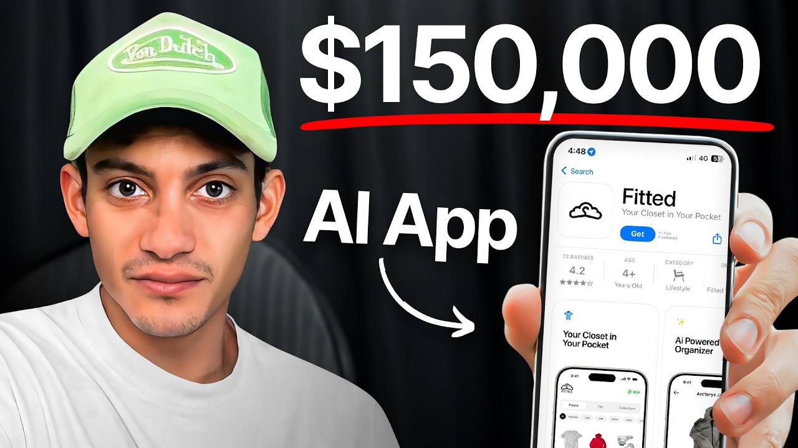

# He went from 0 to $150k by building an ai fashion app (no-code)

Start building & deploying paywalls in 10 minutes flat: https://superwall.com/

## Table of Contents

* [00:00:00] - Intro
* [00:02:33] - Getting downloads for pennies & TikTok growth playbook
* [00:06:00] - From dorm-room laundry service to Fitted
* [00:10:05] - 500M views, 600K downloads & business performance
* [00:13:23] - Why Fitted’s videos go viral
* [00:15:11] - What the app actually does & key features
* [00:17:46] - Closet data, AI resale marketplace & crypto token
* [00:22:20] - Partnerships with Paramount, Poshmark & TaskRabbit
* [00:23:44] - Scaling users, fixing churn & product roadmap
* [00:25:52] - How to copy this creator-led model in other niches
* [00:30:39] - Reid’s mindset, product-market-fit journey & next steps

## [00:00:00] - Intro

Today on the pod, our guest is Reed Moncada, the founder of Fitted. Reed has one of the most interesting stories out of anyone I've personally met. He started with nothing, spent every day grinding as a caddy on a golf course to earn a scholarship to Penn State. Then in college, he built a laundry service in his dorm room, scaled it to 18 cities without owning a single washing machine. Then, he shocked everybody when he pivoted into something completely different. [00:00:00 → 00:00:22]

Reed created a viral AI-powered closet app that's racked up north of 500 million views and got over 600,000 downloads. >> release the app a few weeks later, have a video go mega viral, and then we get a couple hundred thousand downloads, you know, off the rip. And yeah, it was just it was super exciting. >> Here's his playbook. Find a creator with 1 to 50K followers who has viral potential but isn't expensive yet. [00:00:22 → 00:00:45]

Pay them $20 per video just to test content, and once you see traction, bring them on as a co-founder with meaningful equity. Reed's co-founder Max went from making outfit videos in class to driving half a billion views for Fitted, all because Reed structured the partnership as crawl, walk, run instead of typical influencer marketing. >> That was kind of the the idea was, all right, let's give them equity, let's give them like percentage of the rev share. And then, as things come along, right, it's like, "Hey, like I'm putting in a lot more work. I I want more equity. [00:00:45 → 00:01:11]

Hey, I'm putting in more work. " And, you know, any normal relationship, founding relationship, employee relationship just over time, right? You put in more value, put in more effort, and you know, weeks back increases. >> In this pod, we break down the exact formula Reed used to get app downloads for 1¢ to 15¢ each, why he's now launching a crypto token that's doing a quarter million dollars in volume daily, and how he's positioned Fitted to become the AI resale marketplace sitting on hundreds of millions of dollars worth of closet data. This is Reed Moncada's advice on going viral, building with creators, and bringing 100 million people into crypto through consumer apps. [00:01:11 → 00:01:45]

This is the Superwall podcast, and I'm Joseph Choi, founder of Consumer Club. The members in the Consumer Club Discord and the founders I interview on the pod build apps at a median of about a million dollars ARR. In my conversations with dozens of these founders every week, one thing I've noticed is most of them AB test their paywalls to increase their conversion rates and make more money. Now, most people know that one of the best ways to AB test paywalls is Superwall, but one thing you might not know is Superwall has a lot of data on the thousands of apps that use their paywalls. So, recently they actually put together a tool that takes 422 profitable paywall experiments and put those into a paywall experiment generator, where you can upload a screenshot of your own paywall and it'll give you an experiment idea to increase your revenue. [00:01:45 → 00:02:29]

You can use it for free at paywallexperiments. com. All right, let's get into the pod. You've said that your apps have gotten downloads for a cent to 15 cents per download. [00:02:29 → 00:02:38]

## [00:02:33] - Getting downloads for pennies & TikTok growth playbook

That's kind of insane. How do you accomplish that? Have really good organic videos, and then you put ads into them. And so, I'll I'll go way back. So, I mean, my first foray into like realizing Tik Tok could be a hack is watching my friend Max Gomez build his brand Breathwrk. [00:02:38 → 00:02:58]

So, this is 2020, kind of like right off the tail end of, you know, like right when like Tik Tok was getting popping, and you know, I watched his Tik Tok account grow from like zero to like 3 million followers on Tik Tok, and they drove all this traffic and engagement. And the playbook was find a content creator that had an audience that is overlapped with the target market that you're going after, give them meaningful equity and upside into the company, and then bring them on board. And when I set forth on building Fitted, I had six friends send me this Tik Tok of who is now my co-founder Max, who created this outfit generator for himself in class, and it went viral, and I reached out to him on every single platform imaginable, LinkedIn, Instagram, I guessed his email, um you know, you name it, and before I even had a product. And I would pay him 20 bucks a video to just like just cook. And it worked. [00:02:58 → 00:03:54]

And he would get videos with like 20 to 30,000 views, and we didn't even have a product. And he was just talking about his fashion, so I was like, "Okay, there there is something here. " So, we did that for a little bit, went cold, and as fate had it, he lived in LA, and he graduated without, you know, anything lined up after, and he said, "Hey, I'm I'm down to go all in. " And at this point, we were still like really bootstrapped, and I raised like 10K from a homie, and I flew everyone out for my team into a apartment in Palm Springs. And uh for a week, we just like cooked with the devs and our content creator, and it was like magic. [00:03:54 → 00:04:30]

That first day, we woke up with a video that had 2 million views. And then we threw on a waitlist, and then we got 100,000 people on the waitlist, and yeah, it was just like pretty crazy. And then we built that initial momentum, and then we just kept riding it. In the past year and a half, I'd say that we have a video go viral about like once a month, and really the playbook is just like just keep finding new content formulas, and then keep iterating, and then just keep cross-posting them across all of our socials. And then, with the ones that hit, you just put ad dollars behind them. [00:04:30 → 00:05:00]

And you have a really compelling video, and you're not really selling the user, you know, it all kind of trickles in. At first, when we started, it was a web app, and it just didn't convert. I mean, we did pretty well, you know, all things you know, all things considered, but it wasn't that breakout success that we were looking for, and it was really clear that web apps just didn't really resonate with our audience. And so, after we released the web app and growth kind of stalled, it was clear that we needed to build a mobile app. And you know, we spent the 400 $1,400 on a call with you know, a 15-minute call with Nikita Bier, and that was his two cents. [00:05:00 → 00:05:34]

And yeah, so then it was it was six grueling months of just like locking in with my team and pushing out the the the mobile app. And just like clockwork, right, we released the app a few weeks later, have a video go mega viral, and you know, we're at you know, then we get a couple hundred thousand downloads, you know, off the rip. And yeah, it was just it was super exciting. >> That's amazing. What was that first 2 million view video? [00:05:34 → 00:06:00]

>> My first taste of virality was in 2021. [00:05:56 → 00:06:01]

## [00:06:00] - From dorm-room laundry service to Fitted

And and Fitted has had a lot of different arcs. Um I the the lore of Fitted is that it actually I've been working on it for 8 years, and it originally started as a laundry service. Like, I started it in college. I wasn't technical, caught an entrepreneurial bug, wanted to build a business, and Fitted first started as an on-demand laundry service. I go to your house, I pick up your laundry, your dry cleaning, take it to the cleaner, bring it back, scale this to 18 cities without owning a single washing machine or van. [00:06:00 → 00:06:26]

And my first taste of virality was on Tik Tok. I was just about giving up on Tik Tok, and one of my early investors was just like, "Give me the give me the account. Let me try something. " And then he just posted just like this the simplest video. It was just like screen recording, backdrop of like our site, and here's like what it does, and it hit 600K like views. [00:06:24 → 00:06:47]

I mean, this was like 2020. It wasn't like mega viral, but like that was my first taste of virality. It was insanity because I had like all these comments, like, you know, all these people that wanted to invest. I had all these like different brands that wanted to come and partner with us. But I mean, I was like a service business, so, you know, it wasn't like it wasn't like really scalable to do influencer or like, I don't know, going viral as like a service-based business. [00:06:47 → 00:07:11]

Like, most of your audience that finds it is not kind of who you're you're looking for, right? That was my first taste of virality. Then the video after, like the one that really like hit with with Fitted, it was just how to use the app. There was no there was no gimmick. There was no like sauce. [00:07:11 → 00:07:24]

It was just like, here's the product. And Max already had an audience, right? He already had like 50, 60,000 uh followers that were hyper engaged on his fashion, his taste, and this tool that he was building. And so, when he actually released something, um it wasn't going on deaf ears, right? There was already like a really invigorated audience, and then that's when it really started to catch fire. [00:07:24 → 00:07:46]

Was it this video? Yeah, yeah, yeah. What was the hook here? It's just how to use the Fitted Closet. So, it's almost like he's promoting the app as if everyone like should already know what Fitted Closet is. [00:07:44 → 00:07:58]

Would you consider this influencer marketing or UGC? Like, is he tapping into an audience, do you think? Or do you think these videos could go viral on any account? >> just building an audience. And like, his audience was just really captivated on his style, his his aura, his rizz, and like the he was building, right? [00:07:58 → 00:08:16]

And so, they're already kind of like fanboying and like fangirling him, right? And so, like when I think about like building like a community community or audience, it was all there to start, right? So, like, you know, when we when we launched, we already had kind of like a couple thousand people really excited about to use the product from the get-go. Yeah, that's really interesting. How did you go about the initial partnership? [00:08:15 → 00:08:39]

>> I structured it was that I wanted to give him like very meaningful upside. I wanted to give him very meaningful equity. I mean, it was, you know, the way I treat all my relationships is very much so like crawl, walk, run. And so, you know, to start, right, we were just paying him, you know, 20 bucks a video before we started kind of really leaning in deep because, you know, he had the opportunity cost of like working somewhere else or you know, doing going to another startup or going to another company or running marketing somewhere. And so, you know, we had to give it make it, you know, meaningful for for him, right? [00:08:38 → 00:09:10]

And um you know, it worked out because he built this tool, but really didn't have the means to build the full product. He didn't have the full engineering team, but, you know, he had the audience. But uh and so, it was kind of like a perfect perfect match at the beginning. I'm curious, like what's his role now? So, he obviously has his own audience, and he makes these videos, and it's just kind of like banger after banger. [00:09:10 → 00:09:29]

Like, there's so many like multi-million view videos. How many lifetime views have you gotten for the app? >> Probably over like 500 million. >> 500 million views. So, is that all from him, or do you have other accounts that are posting? [00:09:29 → 00:09:40]

Yeah, I mean, we had a few other accounts. Uh I would say like probably like 95% of the distribution was from from Max. And then, we would be, you know, we would do that on Tik Tok, we would repost on our main account, and then we would repost it on Instagram Reels as well. >> Wow, so you got 600,000 downloads from basically one account plus a couple of other creators and influencers. >> Yeah. [00:09:40 → 00:10:01]

Wow, that's insane. How much revenue has the app done? [00:10:01 → 00:10:05]

## [00:10:05] - 500M views, 600K downloads & business performance

App has made about 150k from like subscriptions. Our top of funnel is like cracked. Now where I'm at is like the actual app is like not where I want it to be at all. And so like where my attention has been is just been like tech, building a product, making it better, making it stickier, more retentive, more you know, inherently viral, right? I haven't found product market fit yet. [00:10:05 → 00:10:26]

It's clear that there's a market pull, but I haven't found product market fit yet. And so like that's kind of the next journey, right? That's the next, you know, milestone. Yeah, I want to dive into the product as well. But just an interesting thing to note is a lot of people focus on building a product first and then distributing it. [00:10:26 → 00:10:44]

But you guys basically distributed nothing at first and just you know, got an audience and he was getting an audience and then you release like the web app version and then you release the mobile version and now you're starting to make money, but you completely started with like what is the market demand? What do people resonate with on content in TikTok? And then you are now getting into, I guess we'll build the product. >> Yeah. That's interesting. [00:10:44 → 00:11:11]

And like in our community, right? Like I know the thing you asked is kind of like what is Max's role? Like he is so much more than just like, you know, an influencer, right? Like you know, we brought him on and it's, you know, we we basically needed like a day zero team member that interfaces with the community, sits on the product, right? Because like he has an audience and they they live in his comments. [00:11:11 → 00:11:32]

Like they are like they message what they want. They comment what's bad about it. They comment saying like hey, you know, we should have XYZ features. And so that's kind of how we like weigh like all of our like product road map. And so he kind of sits in this like such a unique position where not only is he like the huge megaphone for the company, but he also is, you know, does the temperature checks of kind of what is their audience and community saying? [00:11:32 → 00:11:56]

What are they expressing? What do they want? And at the same time he's like sits in the design meetings with me and makes these key decisions. And you know, maybe it's not as useful for him to sit in the product and engineering calls, but like it gives him context of like what the hell is actually going on, right? Uh and so, you know, then it gives him a little bit more foundation to, you know, go and and be a megaphone about specific things. [00:11:56 → 00:12:20]

Yeah, it's a really good reframe of how most people think about marketing as a function in in their company. A lot of people do influencer marketing. They you know, partner with tons of UGC creators or, you know, a bunch of influencers or paid ads people, but then those people are not really embedded into the company and like really understand the product. And on the other hand, you guys have like a complete loop where the guy who's doing the distribution is actually in touch with the customers, listening to the comments, talking to people in DMs. And then he's able to give you like probably the best like product feedback. [00:12:20 → 00:12:56]

Mhm. Because he's like actually the voice of the customer. That's really awesome. Is breath work like run similarly where it's like right influencer led? >> Yeah, it was it was sort of influencer led. [00:12:56 → 00:13:04]

They just had a core creator that was very into breath work and they just kept iterating until they found a a playbook that worked for them. And yeah, they just like just kept doing it, right? And then they just like they just kept going, right? And then there's just like banger after banger after banger. But it is an insane top of funnel. [00:13:04 → 00:13:24]

## [00:13:23] - Why Fitted’s videos go viral

5 500 million views and 600,000 downloads just from this one Tik basically one or a a couple more TikTok accounts. So, why are these videos actually going so viral? Yeah, uh I mean we we get the algorithm. Like our team is, you know, we're chronically online. We're always scrolling. [00:13:24 → 00:13:41]

And so there's I think there's like two buckets. Like what is like trending and like what are like are there certain metas? Are there memes? Are there inside jokes that like we can lean in on that like we could take advantage of? And then there's like more like evergreen content that like I think could hit, right? [00:13:41 → 00:13:59]

It comes down to like having like a hook, right? Like my mindset is like everyone you know, attention is like so fleeting. So you have like a split second to like hook people in and then also just like provide value in the form of like showing them a product, right? And for us it's never about like hey, download this app, it's going to blah blah blah. It's like can you can we can you follow along in our journey as we build this product? [00:13:59 → 00:14:26]

And then some days there's periods where like, you know, it's the algorithm is a little bit more dry than than others, but that's why we like kind of diversify across different channels. Right. So once this format went, this is a huge video. 136 million views. Did you rep Were you able to replicate this again after Yeah, yeah, this is there's another one right there. [00:14:24 → 00:14:49]

Oh yeah, they did it again. 60 million views. So okay, interesting thing you said was you approach product development with the thought in mind of how's the customer going to first interact with the brand on TikTok? And then you kind of reverse engineer, okay, what product can we make from that? So can you like walk through your thought process and the product itself? [00:14:47 → 00:15:09]

So what like what is Fitted? >> Yeah, so like the product is we make it really easy to digitize your closet, style yourself, resell your clothes and share it with friends. [00:15:09 → 00:15:17]

## [00:15:11] - What the app actually does & key features

So like that that video that has like 135 million views, like the the value prop is there just like we just like make an outfit for you, right? Like an outfit delivered to you daily. Super simple, right? Even that initial video that Max made that like went viral was like I made an outfit generator. Like that just hit, right? [00:15:17 → 00:15:35]

And so like all right, there is market demand for that. And so like when we were building the Fitted Closet, when like, you know, we have the ability to like see everything you had, right? So then okay, it seems like there's market pull for this, you know, outfit generator. So like let's have that be the first tool that, you know, yeah, like this, right? Like let's have that be the first tool that we build, right? [00:15:35 → 00:15:54]

And that hit really hard, right? And you know, then and and kind of where we're at now is like we'll tease out different features or things that, you know, we're thinking of building and we'll see what the engagement is, right? Is like does resale If we start hinting at resale, do people start wanting that? You know, I think about it as like what are these taglines that like would make people stop scrolling in their feed to like perk up and be like oh, what is this? Mhm, interesting. [00:15:54 → 00:16:17]

Do you have any examples of that where you like thought of a new feature and then you put it on TikTok first to test it out? >> Yeah, go to Fitted by Sydney. Scroll down. There is one where it's yeah, yeah, stalking my boyfriend's closet. And so like we just had this feature. [00:16:17 → 00:16:33]

It wasn't even on mobile and um it wasn't on mobile. It was just on a web app. And so I was like let's see if this hits. Then it hit. So now it's going to be coming up in our next update. [00:16:33 → 00:16:41]

Where did you get this idea of flex your neck worth? That's a really that's just such a smart idea. >> Oh and like I just like I just like love fashion. I'm a I'm a huge collector and I don't know. Like I feel like a lot of our generation like they have like four to five figures tied up in their closet. [00:16:41 → 00:17:01]

And uh that is like a financial asset. And I mean for some they want to keep that private, but like if you think about like, you know, dudes and guys that like want to flex, like they want to show off what they have. And uh you know, I thought neck worth was just like a funny term. Um that that kind of hit. Has that done well on TikTok? [00:16:57 → 00:17:17]

I imagine it's sort of like a not really controversial, but sort of edgy like uh viral Um full flywheel isn't there yet, but I I think it I think it will. Um so like you're just going to I guess I'm just going to give out all my sauce, but like you know, there's going to be a a flow where like you can just like quickly share like the most expensive pieces in your closet and like share to like your Instagram or your Twitter stuff like that. And I have a feeling that that will like that'll hit really hard. >> What's the direction of the product now? Like what signals are you getting from TikTok and what what direction are you is that pushing you? [00:17:17 → 00:17:49]

## [00:17:46] - Closet data, AI resale marketplace & crypto token

I am transitioning out of this mindset of building a like indie hacker scale MRR to then like let's build a generational business that retires my bloodline. And so that happens by winning market share, you know, by instead of like fighting over MRR, it's like winning market share. And so currently I'm hamstringing user growth because my app is hard paywalled. And we've just been we've been experimenting with a lot of different like revenue streams. And so in the next two updates we're going to be making the app entirely free so that anyone can use the app and upload as many pieces. [00:17:49 → 00:18:22]

And we're going to have like different kind of like paywalled features, of course. But uh and then once that app once that's out, it's just going scorched earth on partnerships, influencer marketing, celebrity marketing, athlete marketing, brand marketing. Um cuz we're building like a really interesting ecosystem, right? Like fashion is a trillion dollar industry and everyone's closets are offline. And I'm like farming closet data, right? [00:18:22 → 00:18:44]

There's, you know, over 2 million pieces uploaded to Fitted, right? I know people's favorite brands, color, style, spending habits, lifestyle, favorite sports team, how often they go to the gym, right? Like brands know what people buy, but they have no idea what we actually wear. And two, I have hundreds of millions of dollars worth of clothes uploaded to Fitted, right? And we are so uniquely well positioned to become an AI resale marketplace. [00:18:44 → 00:19:07]

And so that is also the kind of the next iteration, you know, of of Fitted as well. And then I also have this token, uh you know, FitCoin which is you know, doing close to a quarter million dollars in volume a day. And uh you know, I I'm building this huge audience and community on on Twitter, you know, over the future success of Fitted. And so and the future success of FitCoin is tying it into the product, building like a flywheel so that I have consumers, I have brands, and I have speculators all bidding on the same token. That's wild. [00:19:07 → 00:19:40]

The AI part is really interesting. These people are actually using the app. They're uploading their own clothes. You can feasibly say like oh, you're you're wearing these clothes. Like you would probably want to buy these similar clothes, right? [00:19:39 → 00:19:52]

So it's like people are feeding you data. Amazon doesn't even have that, you know? Like, Amazon doesn't know exactly what's in my closet or Shopify, right? They They only know what I'm buying, but they don't know like everything in my closet. You have You have that data. [00:19:52 → 00:20:07]

It's an interesting formula for these like bootstrapped apps that could turn into like venture scale apps. Cuz once you have that moat, which is the data, that could feed the AI, it could turn into a much more generational company, like you said. Do you see that model happening anywhere else besides fashion, like in any other verticals or Do you think that it could be applied to any other like AI viral apps? Yeah, yeah. And that's the whole beauty of ICM, which is kind of in the Believe Launchpad, which is what we launched, right? [00:20:07 → 00:20:40]

There's a lot of these other tokens and products that are just doing exceptionally well. A Dupe is an example, you know, is a platform that makes it really easy to find for like cheaper furniture. You upload a picture of something and it finds you like a duplicate price. I've like taken a lot out of their growth playbook on like Tik Tok and Instagram. And you know, so they've integrated their token natively into their ecosystem where you earn Dupe by shopping and you can redeem it for gift cards and stuff like that. [00:20:40 → 00:21:10]

And so, um they're very much so a a North Star in um how we're looking to integrate. I mean, even too, uh you know, Web3 aside, like even like Duolingo, right? You know, uh Duolingo has gamified the entire experience around their app using like gems and tokens and coins. And you know, consumers are used to that. And so, zooming out, like my my thesis is that you know, consumer apps are going to be the what drive the next 100 million consumers into into crypto, into Web3. [00:21:10 → 00:21:43]

And if I have if I kind of mask, you know, the purchasing of Fitcoin behind, you know, an in-app paywall that consumers are really used to, right? You know, I've like subconsciously onboarded them into like our ecosystem without them even knowing. And now they're able to intergrap- integrate into our app and do all like, you know, the fun features and stuff like that. >> That's interesting. You're almost like operating at like a public company in a way where you're You have your share- shareholders, which are the people that buy the token. [00:21:43 → 00:22:08]

And then you have like the customers and you're actually operating the business. Yeah, pretty interesting. So, yeah, what about the partnerships? Yeah, you mentioned you have uh some big names. So, this summer we collaborated with Paramount. [00:22:08 → 00:22:22]

## [00:22:20] - Partnerships with Paramount, Poshmark & TaskRabbit

We were the official virtual closet of the movie Clueless, which is like a chick flick came out in the mid-90s that had a virtual closet in it. So, that was super cool. And then last month we announced our partnership with Poshmark. So, we have an integration with our app to facilitate a one-click resell experience. So, you, you know, click you uh build your closet, here's a piece, you click a button, and then, you know, then boom, your your clothes are are listed in on Poshmark. [00:22:22 → 00:22:48]

And then tomorrow we're announcing our partnership with TaskRabbit to basically, you know, enlist their 20 to 30,000 taskers to uh tap in and help you, you know, digitize and catalog your closet. So, closet organization is a top 15 task on TaskRabbit. And um you know, they don't have a a platform to digitize their pieces into the the users' pieces into. And so, you know, we're going to be running a fun campaign with TaskRabbit to, you know, work with influencers, work with, you know, people that just don't have the time to digitize their closets. And you you can have someone come to your door and and do it for you. [00:22:48 → 00:23:23]

>> That's cool. That's interesting. Cuz like part of the onboarding of your app is you have to scan each item of clothing so that the algorithm can recommend you the outfits and mix and match and stuff. Um and that takes a little bit of work. So, you can like hire someone to like do the onboarding for you. [00:23:22 → 00:23:41]

What do you think about scaling user acquisition from here? [00:23:41 → 00:23:44]

## [00:23:44] - Scaling users, fixing churn & product roadmap

I mean, you basically have like built-in audience as your marketing co-founder. And you're doing a bunch of PR. Is there kind of like a mastermind plan? >> Yeah, yeah. I mean, getting it to a million users is not hard. [00:23:44 → 00:23:59]

Cuz like like I said, we're able to drive down where we go viral once a month and then I'm able to drive downloads for like really cheap. What's hard is getting the app to a place where I want to spend even more money to keep riding it, right? Like, I know my churn is high. I know my app isn't sticky enough. And so, to combat that, I'm like rebuilding it and adding more bells and whistles and adding more features so that the app is stickier, the app is more attentive, the app is uh more shareable, right? [00:23:57 → 00:24:24]

So, you know, that's why, you know, on our next few app updates we're we're focused in on making it free, right? So, then, you know, we're not turning away more users that, you know, get turned off by a paywall. I want to make it even easier to build a closet, right? So, you know, working with TaskRabbit or we work we built this tool where it scrapes all of your online receipts and adds it to your closet. There's a tool where you just take a selfie and boom, and you know, it adds it to your closet. [00:24:24 → 00:24:48]

You have quick add, right? So, like one of the functions in this in this calculus like making it really frictionless to build a closet. So, that's one of the things that we're like really focused on solving for. You know, like I said, delivering on that value of like making really good outfit recommendations, right? And so, having more AI tools, you know, talk to your closet, you know, weather integrations, widgets, stuff like that. [00:24:48 → 00:25:08]

You know, my superpower is like I'm one degree of separation away from like anybody in the world. And uh I can I can go and get any celebrity that we we go and need to. But like we're not ready for it, right? We're not ready for Kim Kardashian to post us. I'm not We're not I'm not ready for Drake to post us yet. [00:25:08 → 00:25:22]

But the time is going to come, right? And so, when it does, I want to make sure that the app is in its most dialed spot ever. And then, you know, we'll be able to, you know, execute on it. Yeah, cuz then, you know, current it's you know, it's clear that um you know, we we'll have these we'll have these moments. We'll go viral, we know have a huge step increase in like our MRR. [00:25:22 → 00:25:40]

And then, you know, it'll start trickling down, we'll go viral. And so, like I want my chart to just be like consistent up into the right. Uh and so, to get there is just iterating on the product. I want to kind of unpack that a little bit, how you would replicate this in another industry. [00:25:40 → 00:25:54]

## [00:25:52] - How to copy this creator-led model in other niches

Cuz I feel like there's a lot of influencers like this out there where they're not really monetized. Like, they're building really powerful, thriving communities and audiences. And all they do is like shill random e-commerce products. Like, there's just so much potential there to combine that powerful audience with a really good app. What industries would you say potentially might have some of those? [00:25:54 → 00:26:20]

>> The same way that there's product market fit, there's founder market fit. And I was just so lucky cuz like for Max, right? Like, it was a match made in heaven because, you know, he he told me his favorite thing to do was get dressed in the morning. And so, for any product, right? It's like, who is that creator or who is that persona that like that has that same desire and burn and, you know, that that fire under their ass to like go and actually like build something and like figure it out. [00:26:19 → 00:26:50]

It's not easy. But also at the same time, these people are like very visible. Cuz if you go to like someone that has like 50 to 100,000 followers, like they know that they're an influencer. They know give or take their worth. They know that they have a little bit more leverage going into it. [00:26:50 → 00:27:06]

There's also this like kind of bucket of creator that's like between 1,000 to like call it like 50,000 that might not be like a quote-unquote influencer, but they're good at making content, they're good at getting views, and they're building, you know, engagement, right? So, like there is this spectrum kind of creator/influencer. So, like finding that like sweet spot of creator where they're not going to like be really expensive, they're not going to like want to take like expect like huge payouts or expect like crazy amounts of equity, right? Then it's like a crawl-walk-run approach. >> Could we walk through each of those three phases? [00:27:04 → 00:27:38]

So, in the crawl stage, what type of partnership are you trying to create with that? >> Yeah, so for us with Max, you know, I reached out to him and then we just made like a sub account under Fitted called Fitted by Max. And we just had him like post and we just had him like post like 20 bucks a video. That was like the first phase. And then we just started recognizing like, oh, okay, like this is like starting to work, right? [00:27:38 → 00:27:59]

Like, even if nobody had a product, like this is starting to work. And in the beginning it was like kind of like noncommittal. And then when he and I found out he lived in LA and I found out that he, you know, had a lot more bandwidth to lean in, it was like, okay, like how do we give you more meaningful upside, right? Tying the success of the company, right? To your effort, tying the success of, you know, tying revenue to his, right? [00:27:59 → 00:28:20]

So, that was kind of the the idea was, all right, let's give him equity, let's give him like percentage of the rev share. And then as things come along, right? It's like, hey, like I'm putting in a lot more work, I I want more equity. Hey, I'm putting in more work. And, you know, that that that comes over time, right? [00:28:20 → 00:28:34]

Like, I feel like it's just any any normal relationship, founding relationship, employer relationship, just over time, right? You put in more value, put in more effort, and you know, we expect increases. At what point did you decide to start to give equity? Like, were there any metrics or any milestones that you you you kind of made that transition? I think we were pretty eager in the beginning cuz it was like vested. [00:28:32 → 00:28:56]

Uh and then, you know, basically like the rev share was just like a percentage of, you know, any of the revenue generated on the app. Uh and so, like that incentivized him to just go viral more. Yeah, rev share seems like a pretty low-risk way to start out compared to equity. Do you think that you could scale to more creators? >> 100%. [00:28:54 → 00:29:12]

I mean, every I mean, that's like such a huge part of our flywheel because fashion is like super social, right? And it's not creators, it's like I want the most interesting people in the world having closets on Fitted, right? I want the A-listers, I want the athletes, I want the influencers. I mean, there's a there's a lot of different angles to like building closets, right? So, like, you know, there's this tool. [00:29:12 → 00:29:32]

And then to like get the higher-level people, working with celebrity stylists, and then building like an ecosystem of stylists. And so, like cuz I think that's going to be one of the most important flywheels is people like sharing their closet. Like and flexing their closet. Like influencers like a it's not the main, but it will be like a very important piece of the flywheel. Do you feel like there's another industry that has like under-monetized influencers or creators? [00:29:32 → 00:29:53]

Do you feel like there's other niches that you feel like people could find >> mean I feel like there's a lot of app ideas. Yeah, there's like so many app ideas. And like I can't even like I feel like there is an app for every creator, right? There's probably an app for every single creator out there. I don't know what it is, right? [00:29:53 → 00:30:08]

Like obviously if there's like, you know, a travel creator is going to like do very well with a travel app. So, I think that there's like and there may be like a studio model where like you can just like find these creators that are good at going viral and then you just build an app around them. Like in you know, you let them decide kind of what the direction is. But cuz I I think that that that answer is like so open-ended because like I feel like every creator could have an app that hits. It's just like what is that app? [00:30:08 → 00:30:33]

I don't know, but it's all about like what resonates with their audience the most. Yeah, that makes sense. Is there anything else that you feel like is interesting about the app or your or the company? [00:30:33 → 00:30:43]

## [00:30:39] - Reid’s mindset, product-market-fit journey & next steps

Anything else you wanted to like dive into? I feel like I went into like all of like the all of the lore. Yeah, I mean I like to think I solved the distribution, but the core product is not where I want it to be yet. And so, I'm excited to basically just like wake up, push the rock up the hill, and just make it super refined, super performative, and find product market fit cuz I'm I'm like almost there. I'm just not there quite yet. [00:30:43 → 00:31:07]

But no, it's just been fun to just make a whole lot of noise on social media. Like you know, it's like the one the most it's most like thrilling drug ever. Like it's just like the most like the the dopamine from having something hit on the timeline or having like your mentions blowing up, like that's like that's like crack to me. Well, thanks so much. This was like sauce. [00:31:07 → 00:31:27]

This was really good. Uh No, no, dude. Thank you for having me. I think the community you're building is like second to none. Uh and so, always happy to support kind of everything that you're building and hopefully I've gotten so much sauce and so much like knowledge from just like the the community that you've built. [00:31:27 → 00:31:44]

So, always here to kind of give back in any way, shape, or form. Cool. Thanks. Thank you, Joseph. See you. [00:31:44 → 00:31:48]

Something you might not know, most of the founders I cover on this podcast are hanging out right now in the Consumer Club Discord sharing with each other what's working now for consumer apps. You can apply to join Consumer Club if that sounds interesting to you. And this is the Super wall podcast, of course you got to check out superwall. com. We have more videos on the channel, so dig into those to learn from app founders who are willing to share super tactical stuff about app growth. [00:31:48 → 00:32:13]
