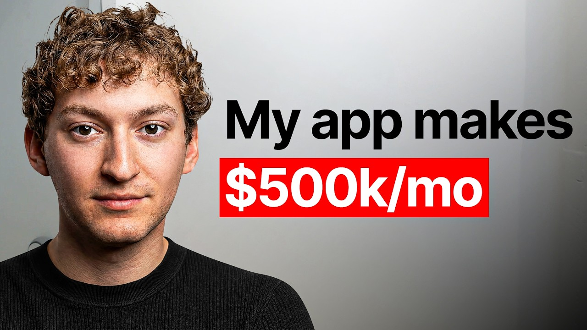

# How I built a $500k/mo ai app (so you can just copy me)

Start building & deploying paywalls in 10 minutes flat: https://superwall.com/

## Table of Contents

* [00:00:00] Intro
* [00:02:15] Scaling Pingo Globally
* [00:05:02] Language Learning Innovations
* [00:10:16] Viral Video Strategies
* [00:15:02] Creator Recruitment and Coaching
* [00:20:11] Paywall Experiments and Insights
* [00:28:04] Targeting International Markets
* [00:34:00] AI Tools for Viral Marketing
* [00:40:50] Coaching and Content Creation
* [00:52:03] Y Combinator Experience

## [00:00:00] Intro

In the last 30 days, Mori's app got almost 400 million views. One app, one month, and they're approaching 500k revenue a month 14 months after launching from his college dorm. Ballpark between 350 and 370 million, I want to say. That's a conservative like There's a part of me that wants to say 400 million, but I don't know yet. >> Most founders would call this luck. [00:00:00 → 00:00:22]

Maybe he just rode an AI trend at the right moment, but the thing is it's not like Pingo just went viral once and had its 15 minutes of fame. This language learning app is consistently going viral in Korean, German, French, Arabic, Japanese every month with multiple formats with the same conversion rate baked in. Mori calls this going meaningfully viral. Every single video his 100 creators post has to show the product. No gimmicks or cheap views. [00:00:20 → 00:00:46]

>> I want us to go viral because of the product, not necessarily any gimmicks. And that way when we do go viral, it converts well. And the video format that finally cracked the code, the one video that hit 52 million views, is Pingo roasting a user so hard they start crying on camera. And here's what nobody expected. >> Did you do any product development work to actually sort of make the the roasting concept more viral? [00:00:44 → 00:01:09]

No, actually. What we've had in the product since day one is sort of the ability to make what we call custom scenarios. And so what the creators will do is they'll go into custom scenario. That realization that the best marketing insight didn't come from Mori or his team at all reshaped how he built everything that came after. He stopped trying to engineer virality in-house and started building infrastructure to let creators repeatedly find virality themselves. [00:01:09 → 00:01:32]

>> Everything that's has gone viral for us since August only has used Pingo. We have one creator who tries videos not doing that, and they'll go viral but they don't convert. >> He now runs his creator program like a VC portfolio. The top 20% carry the views, the rest get cut. He's coaching the mid-range, scaling the winners on CPM-based platforms, and running weekly format experiments across languages. [00:01:30 → 00:01:51]

But scaling to 20 languages comes with its own set of problems. We got about in February 200 something thousand Russian users who couldn't pay us anything. Russia is completely unmonetizable because of sanctions. These were like kind of like dead users. >> 200,000 users, zero dollars. [00:01:51 → 00:02:05]

The content went viral in the wrong country. So he rebuilt his entire distribution strategy, not just tracking which videos go viral, but which country they go viral in and whether those users can actually convert. [00:02:05 → 00:02:17]

## [00:02:15] Scaling Pingo Globally

>> And he's doing all this while scaling to $500,000 a month. We're at around like 500k a month, like 450 February K a month. >> In this episode, Mori breaks down the full playbook. How creators found the mean Pingo format inside a feature that was never designed for marketing, and what that taught him about product-led virality. His creator VC model, how to recruit, rank, coach, and cut 100 creators across 20 languages. [00:02:15 → 00:02:40]

Why going viral in the wrong country can be more damaging than not going viral at all, and how to build geo-targeted distribution before it costs you. And the paywall experiments, three-day versus seven-day trials, transaction abandoned flows, country-level price localization that took Pingo to half a million a month. This is how you build a distribution machine that compounds across languages, cultures, and formats. Let's get into it. This is the Superwall podcast, and I'm Joseph Choi, founder of Consumer Club. [00:02:40 → 00:03:04]

The members in the Consumer Club Discord and the founders I interview on the pod build apps at a median of 1 million ARR. A lot of these apps that make the most money run AB tests on their paywalls to make more revenue with the same number of users. Superwall has a lot of data on the thousands of apps that use paywalls. So recently they put together a free AI tool trained on 422 profitable paywall experiments. It lets you upload a screenshot of your own paywall and gives you an experiment idea to increase your revenue. [00:03:04 → 00:03:31]

You can use it for free at paywallexperiments. com. Also, if you're building a mobile app doing at least 100k a month in revenue, Superwall hosts dinners in San Francisco and New York. They keep each gathering small, thoughtful, genuinely useful for everyone. If you meet this criteria of 100k a month in revenue and want an invite, apply using the typeform in the description. [00:03:31 → 00:03:49]

Let's get into the pod. How many views did you get for your app this past month? Ballpark between 350 and 370 million, I want to say. I'd probably err like that's a conservative like There's a part of me that wants to say 400 million, but I don't know yet. We still got We still got a few days, but like at least 350 million so far. [00:03:49 → 00:04:09]

That is so crazy. And your So your app Pingo, you guys only started like a like a year ago, right? Yeah, a year and two months back in I guess January 25th was like what we call launch. It was really like the last week of December. Tell me about your app first, and then we'll get into the distribution stuff. [00:04:09 → 00:04:28]

>> Yeah, so Pingo started The background is like I've been learning Chinese for like 7 8 years, not fluent. My freshman year roommate Michael, his parents are from China, he speaks Chinese. He would say he's not fluent, but he is fluent. Um and we were random roommates freshman year, and we'd practice speaking Chinese. And he's been an entrepreneur building apps forever. [00:04:25 → 00:04:44]

Um and I think he's like the smartest guy. And sophomore year comes to me and goes, "Hey, like I have this app idea. Like I'm working on Pingo, and like here's what it is. " And he kind of brought me on, and from there it's became what it is today. And what Pingo is is from that kind of problem of us speaking Chinese freshman year it's like an AI companion to help you learn languages. [00:04:44 → 00:05:03]

## [00:05:02] Language Learning Innovations

Our whole philosophy is like There's a lot of apps like Duolingo that don't actually help you get conversationally fluent. Most people want is to be conversationally fluent. You want to go to China? Like you really want to be able to talk to a local and get around. You anywhere you visit, people are going to like speak and connect. [00:05:03 → 00:05:17]

And not everyone has like a Michael, which is what I had. Not everyone has someone who's a native speaker to practice with. So which is why we built Pingo. It's evolved over time. It started just in like what we call like the role-play scenarios, which is literally like it'd be like what you and I are doing right now, but in Chinese, German, insert any other of like 20 languages. [00:05:17 → 00:05:37]

And then we plan to evolve the product a lot more to be more focused towards beginners, more of a guided and structured lessons, more of a plan, more memory, like all these things to really enhance the experience and like index on conversation quality and like new learner experience. And so what it is now is like a full AI companion to help you learn and help you speak and get really conversationally >> a year ago. The AI component's interesting too, cuz yeah, Duolingo already exists, is huge, but then huge >> uh they don't like they're starting to use more AI in like conversational stuff, but they've always been a little bit more like multiple choice. When you're in the ideation stage, were you already thinking about like, okay, what kind of AI app can I build? How much was like AI a a driver in your ideation? [00:05:37 → 00:06:22]

>> A lot. So My Michael really ideated it, um my co-founder. I don't know if I had mentioned he's the co-founder. That's what Michael is. And he was kind of like in the whole viral app space. [00:06:20 → 00:06:31]

He'd built an app for a bit, like a food app. Wasn't doing super well. And he was like, "I'm only I don't want to build an app that's not going to go viral. " Like right now virality is like just such like by far the best growth lever. And so there's kind of not a point in building a consumer app that won't go viral. [00:06:31 → 00:06:45]

And between our problem root of the speaking, the philosophy on virality, looking at other viral apps, and AI being the big thing, it was like, "What AI feature like seems like it would be inherently viral? " It's like, "Well, like talking to an AI is kind of really interesting. " Like that's like It's been around, but it's getting better and better. So the thought of having like a really good conversation with an AI, that could be an interesting hook. Like we could try that out and see what happens. [00:06:45 → 00:07:10]

Which was kind of the root of all like our early UGC. So yeah, like AI and the virality within using AI and that in itself being interesting to people was kind of a big core component of like the early idea. That makes sense. Yeah, starting with the actual product development with the distribution in mind seems to be what a lot of like viral app founders are doing these days. Is this the main thing that is sort of like the viral feature, like talking to the AI, or is there other things? [00:07:10 → 00:07:37]

Talking to the AI is the main thing. Like that screen right there is like a little vocab practice. That's like a really small feature in the app that like we don't really use in marketing all that much. There've been some creators who like use the vocab and go viral with it, which has been interesting, but it's mainly like if you look at that second screen, like the whole Sorry, the third one there. Yeah, the whole to speak. [00:07:37 → 00:07:56]

Like that is kind of like the main screen we use in marketing. People holding that and talking to Pingo. Or the flip side of it, which is when you're not speaking, it'll show Pingo. Pingo's like kind of like the character in a way. Like you're talking to Pingo, which is just the sort of like sound waves of different colors. [00:07:56 → 00:08:14]

And so when Pingo's talking, that plus the user holding the screen are the two things we use mainly in marketing. Pingo is like >> Yeah. This char- That's interesting that like a character can just be like four colored lines. Like >> Yeah. Yeah. [00:08:12 → 00:08:27]

>> That's our whole thing. We don't really like the whole like AI characters people do with with voice AI. Like the super like ChatGPT like fake Disney avatar thing. We don't really like the avatars. And so our whole thought is we want Pingo Like this is Pingo. [00:08:25 → 00:08:39]

And we're do working a lot right now to make Pingo more dynamic and more interesting kind of evolve and morph shape. We have a lot of cool ideas in the pipeline for how Pingo can be expressive as just four lines. But we really want to stay away from like the avatar route for for lack of better word, and really like index on like creating Pingo to be as expressive as you can. Though we'll still be like really minimal and simple. >> Do you feel like that's a contrarian take? [00:08:39 → 00:09:01]

Is that Cuz I feel like there's so many apps these days that start out with a character because they feel like it builds a personal connection with the user. It might be. I'm not really sure. Like our our philosophy is like building like we totally are with building a connection with the user, right? Like we we think of ourselves like an AI companion to learn languages before like just an AI language learning app, which maybe is like on paper sounds kind of similar. [00:09:01 → 00:09:23]

But we think like we build connection with the user through conversation, like through the way Pingo learns about the user and like their their wants, their needs, like their experience learning language, where they currently are, where they want to go. And like we've seen like even without having like an avatar, like we can build that connection between the user. Like it doesn't matter that Pingo's have this like inanimate object in a way. It still works really well. And I just don't like the look of it as much. [00:09:23 → 00:09:49]

Michael doesn't either. Like we want to have like a really clean, minimal app. Like we really want to be like uncluttered. And so part of that was was Pingo this Yeah, Pingo. Maybe it's just just like a trend thing. [00:09:49 → 00:09:59]

There's like so many um minimal apps to start out with, then people started building characters, and then now there's like too many characters, and now minimal is like you know, stands out more actually. Yeah, we'll see where it goes. Um I'm curious to see how many characters stay around like in the long run. [00:09:59 → 00:10:17]

## [00:10:16] Viral Video Strategies

Okay, so let's look at some TikToks. So, this is the viral feature. Did Did you have like some things you could uh screen share? Let's look at some of the most viral ones first. So, this is the video that got 52 million views, and that scaled I don't remember the number for like how many views we had that month. [00:10:17 → 00:10:32]

And then even so much as like mid-October, this one, so like same concept went super viral again. This one at a lower scale, but it's kept going viral. Here's one in Russian from this month or last month. Oh, this is December. Like, it's just in every language. [00:10:32 → 00:10:48]

Here's Arabic. So, like there's a few variations on it, which kind of evolved over time, but like that is like our most viral format by far. So, it started mainly with this this crying format. Like, you mispronounce a word, right? Like, it reads as one thing in one language, it's totally like something else if you pronounce it like as an English word that's easy to mispronounce, and then Pingo just kind of roasts the user a bit. [00:10:48 → 00:11:10]

And you have the Snapchat hook, you have the crying. And then over time like there's been a bunch of those. It's evolved a bit, and it's not always necessarily crying. Sometimes Pingo's just mean to you, and you're not crying. Sometimes you're crying, you're not mispronouncing, you're just kind of or like if you're not mispronouncing as like some, you know, inappropriate word, you're just bad at speaking the language. [00:11:10 → 00:11:30]

And so, it's taking a few modalities, but the root of it all is like Pingo's mean to you, the creator has some sort of emotion, and then sometimes there's other hooks. Like, people have gotten like more creative with props. This one in Russian, he's writing. Same like kind of mean. So, I don't know what Russian means, so I couldn't say exactly what that is, but like some in Japanese also like knitting. [00:11:30 → 00:11:52]

So, like it kind of varies on like the exact modality, but like the through line through the way it's evolved over time is like Pingo's not just saying great job or say it like this or do it like that or you could pronounce it a little better. Pingo's just like insulting the user, and that kind of hook like wait, why why is an AI behaving like that? That's kind of weird. Works really well for going viral and also conversion. It's kind of like I would say one of our better middle grounds we found for virality and conversion. [00:11:52 → 00:12:21]

That's like the biggest There's like these are some other types of viral concept, but like this kind of mean crying format to just mean Pingo is like definitely our most viral format. Did you do any product development work to actually make the the roasting concept more viral? Like, is is Pingo actually mean to you all the time like this? No, so what we've had in the product since day one is sort of the ability to make what we call custom scenarios. So, the like V1 of Pingo is just what we call roleplay mode. [00:12:21 → 00:12:52]

Again, it's just talking like you and I are doing right now, but in a certain language. And in the first iteration of that, all you could do was input your own scenario. Like, I am blank, you are blank, we are doing blank, go. And we've kept that custom scenario in the product like since day one. And so, what the creators will do is they'll go into custom scenario in roleplay mode. [00:12:52 → 00:13:11]

We have other modes now, but we'll go into roleplay mode in a custom scenario, and they'll prompt Pingo and say like, you know, sometimes with like models you have to like do a little creative prompting to get around it like saying we're actors in a play or like this is a script, but like you can prompt Pingo and say like, be mean to me, say this to me, act like this. Creators can sometimes like give scripts or give lines and be like, once I say X, you say Y, and say it in this tone. And so, we've always had that feature built in, which has been really useful for making creators, you know, prompt Pingo to be mean, prompt Pingo to be nice, and really just get Pingo to do whatever they want to make content they believe will go viral, and it gives us a lot of flexibility for thinking of content ideas cuz the possibilities are a bit endless. And now, the funny thing is users really want a dedicated feature toggle to like learn with Pingo in that way. So, people don't always use custom scenarios, we give them like a a sort of lesson path, and they'll follow it, but they still want to be like in that lesson path like, hey, I want to learn how to order a coffee in French, but I want Pingo to be mean to me like in the videos. [00:13:11 → 00:14:11]

How do I do it? And so, we'll tell them to go to custom scenarios, but people still kind of want like a little toggle that's like Pingo like, you know, 18+ or Pingo like mean. So, that's been interesting. We haven't built that in yet, but it's somewhere on the road map as like we should add this for people. That's really interesting. [00:14:11 → 00:14:28]

I feel like there's not that many apps that figure out how to make their app easier to use for creators. Like, creator marketing is just so important. Like, you got 400 million views in a month. So, it obviously it works, and like to make it as easy as possible for a creator to make viral content on their own, it seems like that's a big part of your strategy cuz I feel like coming up with really viral ideas that are repeatable and like high converting is that's the whole game. It's like it's really hard to do that repeatedly, and if you do that if you like enable the creators to just kind of come up with their own ideas using the app itself, that's really interesting. [00:14:28 → 00:15:06]

## [00:15:02] Creator Recruitment and Coaching

Did you start out with that custom scenarios thing just for the creators? No, that was just like literally like product V1 like day one. It was like just the whole product of custom scenarios. It was like it was like practice like practice speaking whatever you want whatever language you want like in the same way like have like a language partner. Like, here's a language partner you can talk with anything. [00:15:06 → 00:15:26]

And then it evolved to be like users want more than that. Let's build on top of it. Um our early marketing wasn't even using that. Early marketing like that's been really useful for the more like humor-oriented content. The early marketing, which I can I can pull up in a bit, is like all just purely learning-based. [00:15:26 → 00:15:44]

Like, the very first stuff wasn't necessarily like trying to make Pingo be funny. It was just like basically showing product value. And we'd still use that custom scenario mode, but not to its full potential. It'd be like, you know, I'm learning this is my first day of learning Chinese, teach me the basics versus roast me, be mean to me, say this, say that. So, people have really like taken that feature and kind of evolved it to be really useful for marketing, which wasn't how it was originally intended, but it's worked really well. [00:15:44 → 00:16:13]

So, how has the content strategy evolved from the beginning cuz it sounds like in the beginning it was just show the product value, and then now it's like show the product value with some humor in like embedded into it. And then is the modern, you know, is the like today's strategy basically that? Just show product value, add humor in the videos, or are there like other nuances? It's definitely evolved over time, but the core thesis has kind of stayed the same. So, like our belief like from day one, we always want Pingo to be the focus of the videos. [00:16:13 → 00:16:45]

Like, our belief was that to get meaningful conversion, we have to show the product. Like, show don't tell. And that's something that I've at least my personal belief on virality like virality that converts shows and doesn't tell. And that's what we've done since day one. So, there's a few things we tried that didn't work. [00:16:45 → 00:17:00]

Like, kind of all similar concept, they all use Pingo, but the hooks weren't quite it. So, like this is one of the first videos that we made. Yeah, this was I think the first day Pingo went live, maybe the sixth the 17th or 16th of like December. And all these videos like I have four pulled up that were kind of early ones. Um they all used different hooks, they all ended up using Pingo, but they didn't all go viral. [00:17:00 → 00:17:19]

We didn't really know much about virality then. So, this one for example, I remember when we made this, I was like, this is really good. Like, I really like this. How did it not go viral? And like looking back, we learned a lot more about what works on the platform and specifically what works for Pingo. [00:17:19 → 00:17:33]

And these other videos are kind of similar. We have different hooks about language learning that aren't using Pingo. Some of them are talking. This one's about talking about people on TikTok talking about languages. This one, I speak a little Chinese and do a product demo. [00:17:33 → 00:17:47]

This one here, we're talking about learning. So, like we tried all of those, and none of them went viral. But, the first one that did go viral was like this one. So, like that original one that we show like this like little feedback screen, but like this was the first one that really went viral. That got like 100k views, and we were like, okay, we have something here. [00:17:47 → 00:18:07]

And so then, we kind of were like, what We looked at it like, what at the time did we think made this go viral? And like the hook was like, POV your Chinese teacher on Sundays used to hit you, so now you seek validation from an AI. We added English captions and the Chinese captions for like accessibility. If you didn't know Chinese, you could still watch it. And it was talking with Pingo. [00:18:07 → 00:18:27]

So then, we were like, okay, and it converted pretty well. At the time, you know, when you know creators and you're the only creators, um and that's the only thing you're doing for distribution, it's really easy to measure conversion because when your one video gets some virality and you get a spike in users, like there's not really anything else we can attribute it to. So then, we kind of improved upon this and tested different hooks geared towards different language audiences starting with Chinese and Korean. And then over time, we learned like speaking with Pingo just worked really well for views, and it was basically an app demo, so it converted really well. And we kind of took that and we ran with it. [00:18:25 → 00:19:01]

And that for the first 3 months, we had like one or two actual influencers we tried, but it was mainly just Michael and I making videos till like 20k MRR, just the two of us. And he did the Korean account learning Korean from scratch. I did the Chinese account, and every video is just talking with Pingo. Like, it's me and in my college dorm room and Michael like in my dorm room. Like, we're just like holding the iPad and like talking to Pingo every time. [00:19:01 → 00:19:23]

And trying different things. The Korean account did a lot better, but like it's again, just like holding the iPad talking to Pingo at like a random room at Northwestern where we were in school at the time. Every video is talking with Pingo, and we're trying different hooks, and we kind of found that like a few things worked. One thing was basic conversation like really geared towards learners. Like, basic Korean quiz. [00:19:23 → 00:19:45]

This one got 77,000 views. Things like learning blank in blank language. And like really gearing those towards beginners. We also have been like cultural hooks that work pretty well. Like talk about K-drama, talking about cultural events going on. [00:19:45 → 00:19:59]

I had one that went really viral in Chinese. I think this one got a million views. So this was like when TikTok was getting banned and the whole Red Note thing. So like we ran with that and that worked really well. Any like cultural thing we'd run with and it would work really well. [00:19:59 → 00:20:12]

## [00:20:11] Paywall Experiments and Insights

And that was kind of one of the first things we did that was kind of a little more humor oriented and also culture oriented. So right, we started with like basic learning and culture. And those worked well, both talking with Pingo. And then we kind of shifted towards the humor stuff and it went even more viral. And so like in Chinese that worked. [00:20:12 → 00:20:28]

So we tried other things. This one of Michael, he's not going to he's maybe funny that I'm feeling it. So like have to embarrass him a bit. But like that worked really well. It converted well, it went viral. [00:20:28 → 00:20:38]

Um in French, like this one. This one's a little more recent but same concept. So like that was my friend who's fluent in French. So he would make French content for us. But it kind of was always like that sort of starting with talking with Pingo. [00:20:38 → 00:20:53]

Then we're like, all right, we're a language app. We want to target people learning the language. So let's do basic things. Like let's appeal to what they're interested in. And the humor stuff evolved. [00:20:53 → 00:21:00]

We're like, okay, this kind of goes viral. And then between that realization of like the funny goes viral, we first connected more with culture. So like with Chinese videos it was kind of like the whole TikTok ban and Red Note and Chinese government stuff. And then Korean we do culture things. We tried different audios, right? [00:21:00 → 00:21:15]

Like Squid Game's audio on Korean stuff. Like, you know, random French music on French videos and like the audio we don't really care about as much anymore. But at the time it like worked. And from there we're like, all right, this cultural, this humor, this blend like learning and culture and funny works really well. And then we tried different things. [00:21:15 → 00:21:33]

Tried slideshows. Tried not using Pingo. And the slideshow stuff with a really good CTA could work. It could go viral. We had some that got a million views. [00:21:33 → 00:21:41]

But I found at least for for Pingo and they don't know if this is necessarily the case for all other apps. But with Pingo they burned out pretty quick. An account would go up, they go really viral on slideshows and then they kind of crash. And so they worked well for a bit and they converted well. But like we haven't seen them work as well since. [00:21:41 → 00:21:57]

And it really had to be a strong call to action. We had a lot of slideshow videos that really didn't like where people would be like top five phrases to get fluent in Japanese and it'd be five slides of phrases and the last slide would be something something something I learned it on Pingo. And like the conversion difference between that and the strong call to action slides, but let alone the conversion difference between those slideshows and our videos using Pingo was like night and day. And so there's a few variables you mentioned there. There's the virality of the video. [00:21:57 → 00:22:26]

There's how high converting you think it will be, which is basically like how much do you show the actual app in the video. And then the there's a third variable that you didn't mention but is sort of like baked in, which is cost. Like when you're mentioning like slideshows, slideshows with AI nowadays are like completely automatable, right? Like you can just generate the images and then generate the text to put on top of it. And then you can mass generate like a thousand combinations and then post it across thousands of accounts. [00:22:26 → 00:22:58]

Like how much is cost a factor? Maybe not cost but just I guess efficiency of automating. Like how much is that a factor in how you choose to do distribution? Yeah, at the moment we're not. Like it's honestly just what we have works so well that like we're just going to keep pulling that lever. [00:22:58 → 00:23:14]

I think we'll obviously experiment with it at some point. I just haven't gotten around to it yet. Like it hasn't been the highest ROI on time for me and my my content higher right now. But when it comes to finding creators that can use Pingo to the fullest to go viral, we recently started content coaching like a week ago. And the goal with that is to get more people using the app to the full potential, coming up with the right ideas, like understanding what works, how to make content. [00:23:14 → 00:23:36]

Cuz we have some creators who have like really great ideas but bad execution. We're working on fixing that. But in terms of sourcing like not everyone has it. To be fair, like we definitely go through a good amount of creators. We have our VAs who like do the outreach. [00:23:36 → 00:23:48]

I did outreach for the longest time and then it just took up too much time. So now we have VAs who do it. We give them guidelines. Creators get in and we kind of have an internal clock on like how long we want to give a creator before making a decision on cutting or keeping them. We just make sure like obviously the more creative creators get better views. [00:23:48 → 00:24:03]

The creators who can execute well and follow those other creators get pretty good views. And we have a Discord so people share and like it's pretty engaging. There are some people who just don't get content as well and they don't make as good content. And you know, that leads to them not being creators with us anymore. But at the point that we're at, we use the VAs to get a really high influx of creator volume and we keep the best ones. [00:24:03 → 00:24:25]

And the goal with our content coaching is that we don't have to churn through as many. Like we want to make sure we give them we just don't have the bandwidth to give everyone all the tools they need to succeed. So for a long time it was like scale mode. Like we're just going to get as many creators as we can doing as many high converting forms as we can to get as many views to installs to conversions. And now we're at a point where like we have a really good volume. [00:24:25 → 00:24:46]

Let's kind of like slim it down a bit. Let's be really deliberate now about who we have creating for us and how we get new creators and how we make sure they're working at their fullest potential. Cuz at least with us it's kind of like a VC model. The top 20-30% of creators are doing most of the views. The bottom percent are doing none of them and they're kind of dead spend. [00:24:44 → 00:25:05]

And so we kind of like took our VC model. We cut the bottom of the portfolio. Kept the top, working on the mid-range. And then we're just going to work on bringing in more creators and making them better. But AI stuff like is to come and experiment with. [00:25:05 → 00:25:16]

But again, it's just like what we've been doing with using the app has been working so well. Like if it ain't broke, don't fix it. Yeah, I want to break that down a little bit. So the there's the outreach part with the VAs. So there's like top of funnel and then there's the coaching. [00:25:16 → 00:25:30]

I'm curious about both of those. So for first of all, like the the the top of funnel, what are you looking for when you're like mass outreaching to creators? With Pingo it's a little interesting cuz I kind of want some like we're looking for someone with a tangible skill. If you want to market Japanese, obviously people can fake it. I don't know French. [00:25:28 → 00:25:46]

I made French videos for us for a bit. I faked it. But like it's a lot easier if you actually to market Japanese if you know Japanese. Cuz you know how to do the language. Like that's not an issue. [00:25:46 → 00:25:56]

You can go quicker. You're likely at least a little more clued in to cultural nuances or like language learning like pain points and can make that content better. And so when looking for like that, we need someone with that skill. And so what we kind of have them look for is like definitely micro creators. Like under 10,000 followers in the Japanese learning niche. [00:25:56 → 00:26:12]

I kind of want them to see have at least one breakout video. It shows that they've gone viral before. They know what it looks like. They know what it feels like. It's not this foreign concept to them. [00:26:12 → 00:26:20]

It's not intimidating. We pay creators a base pay plus a bonus. And so creators need to be able to think and believe that they can hit that bonus. You know, if they execute the content we give them to the fullest, like they can. And so if they've had that viral experience before, I just see that they're a lot more inclined to like work with us and try and get that virality versus if they've never gone viral, they're like, wow, like getting like 50,000 views is like crazy. [00:26:20 → 00:26:41]

Like I I don't know. Like I'm not going to hit that. And we want people who are like driven and like incentivize them. So we look for like low followers relatively. Like if they have mid-range followers, like on the low end, they're between like 10 and 30,000. [00:26:41 → 00:26:54]

They don't always want to do UGC. But if they do, they tend to be better creators. They have more experience. So when looking for creators now, I look at like the language they're making content for and where they're based and kind of trying to like guess their geo target as best as possible. So this is our new users this month. [00:26:54 → 00:27:12]

This is iOS on the top. This is Android on the bottom. Pretty like healthy. Like the big spike here, we went really viral around here. These videos kind of died off around here. [00:27:12 → 00:27:21]

But if we look at the breakdown, so this is Android on the bottom here. Look at the breakdown of Russian users, it's like half Russian. So like, you know, 10 a little over like 12,000 users. That's like 23,000 users. There's 12 and a half of those 23,000 users are from Russia. [00:27:21 → 00:27:40]

5,000 of those 12,000 users are from Russia. And it tapered off a bit cuz we killed our Russian content here. But our Russian content was working really well and so we got half our user base from Russia. It's a huge spike in Russian users. A lot of virality. [00:27:38 → 00:27:52]

They converted well. Like we got a lot of users. It was like really exciting. Until then we kind of realized, oh wait, like they're not converting well. And we completely forgot that you can't transact in Russia. [00:27:52 → 00:28:03]

Google Play blocks it. [00:28:03 → 00:28:05]

## [00:28:04] Targeting International Markets

Apple blocks it. You know, all they let you do is web payments. Like you're not allowed to do business in Russia. And so these were like kind of like dead users. Like it was just a lot of spend on views that did not monetize at all. [00:28:05 → 00:28:18]

>> Are you able to control that just through the content itself or is it something about the location that they post from? It's not even the location that they post from. Like I think there's probably some way to not figure it out yet. And that's something I want to work on like in March. But like we'll have US creators making a video for Spanish and half the viewership will be from LATAM or Spain or Mexico. [00:28:16 → 00:28:38]

And like it just happens. Like some of these Russian creators aren't, you know, one of them's in the UK. And her she has 90-something percent Russian viewership. Which is kind of interesting. I always thought at first I thought it was geo-based and then we got other analytics and it's not. [00:28:38 → 00:28:50]

And my hunch, like I haven't looked like this is like a discovery of like a week ago. I was like, we really need like look into the why. My guess is that in the same way if I saw something funny in English, I think it's funny, Russians will also think it's funny. And maybe like in fact more funny than someone learning Russian cuz they get it more. And so it's going viral amongst Russians. [00:28:50 → 00:29:08]

And so that's like a big problem for me to figure out is like how do I make sure that we go viral amongst the target audience that's learning language and not just the native speakers. This is interesting cuz I think a lot of people if they are international, they're trying to reach the US market. If the entire video is in German, like the creator is speaking German because they're American and they're trying to learn German. But then that video goes viral in Germany. That's not ideal for you guys, right? [00:29:08 → 00:29:36]

Cuz you want US users trying to learn German. Or do you do you see like conversions from that anyway where German people are watching this American like learning German and then they kind of just put two and two together. It's like, oh, it's a language learning app. I could probably use this to like learn some other language. " Like, is that Yeah. [00:29:36 → 00:29:53]

Is that what happens? It totally still works. Like, we haven't marketed English deliberately ever. Um just cuz the app's base language is only English. Like, you could only learn English to one of 25 languages until like this month. [00:29:53 → 00:30:07]

And now you can be any cross language combo, which is a unique thing we have. But, yeah. So, we didn't market English at all, but we were still seeing a really high amount of English learners join the app. >> It's because of that. Like, someone in Germany would still put two and two together. [00:30:07 → 00:30:19]

It's a language app. Okay, like cool, and download it. And so, like English is kind of in this catch-all bucket for our marketing. Like, if something goes viral, it's going to go viral in the target language or like amongst people learning the target language or people learning English. And so, it still works well, but only in countries that are higher converting by default. [00:30:19 → 00:30:37]

So, going back to the creator outreach, that you you're going for people that actually speak the language who have, you know, 10 to 30k followers, um ideally if if you want them to have some like UGC viral experience. Is there anything else? Like, are there keywords or like types of creators that you're looking for? Or is it literally just anyone who speaks that language natively and has, you know, a few thousand followers? Yeah, good question. [00:30:37 → 00:31:04]

It is a totally like side tangent from that. But, yeah, we look for like certain keywords. Like, I normally start with looking for learners versus just native speakers. Like, so let's call it let's say German, right? Like, learning German, practicing German, speaking German, like kind of any of those basic keywords. [00:31:04 → 00:31:20]

Sometimes we'll go like, if the well runs dry, like look at college students, like German major, like German minor, like German class, things like that. Native speakers do work, too. But, I search for them a little less. Like, that's kind of like the last step. And like 10 to 30k is like a healthy range, but we have most creators like we have a lot of good ones who are like under 10k. [00:31:20 → 00:31:42]

Like, 5 to 10k is also a really nice range. Like, we had some diamond in the roughs um that were like under 2k who blew up. So, it's like the follower count doesn't really predict the success. It's just like I find at least like they tend to have a little more exposure with making content and like their base quality, like their content quality is a bit higher, which is kind of proved useful. That's the main keywords I would say. [00:31:40 → 00:32:03]

Logistics-wise, are you reaching out on just TikTok DMs or you also doing Instagram DMs or emails? Mainly just TikTok. Yeah, TikTok and Instagram. Like, we'll convert to email if they have an email. Like, just gets a little easier to organize. [00:32:03 → 00:32:16]

But, normally like we'll message them on TikTok. If they seem like they want to make content for us, we'll then move to email just so it's separated and like kind of step two. Like, we're already onboarding them. We can keep track of like the CRM, like what creators are in the funnel, where are they in the funnel, like you know, we can know like, "Okay, like this person hasn't responded in a few days. Like, we need to bump this. [00:32:16 → 00:32:33]

" Whereas, the TikTok DMs get messy with like the volume. It's like um we need to cut down our volume a bit to make sure we're getting higher quality versus quantity at this point cuz we have a high quantity. But, yeah, it's kind of on TikTok and Instagram. Like, it makes follow-ups hard, I will say. Like, following up at the volume we do on TikTok gets kind of messy. [00:32:33 → 00:32:53]

And it's doable, but the TikTok at least I found like when I was doing all the outreach myself, at a certain scale, like after every shout to like a few thousand creators, like my TikTok DMs would be super slow cuz it'd load all those message histories. Like, that got kind of annoying for me. Are there any changes that you made to your your first DM over time that increased our reply rates? That's a good question. I think it's stayed relatively similar. [00:32:53 → 00:33:15]

We just kind of update stats. It'll be like, "Hey blank, I love your insert language content. I'm with Pingo. We're a language app with X million users," which has changed from like a few hundred like tens of thousands to few hundred thousand to one to two to three million. Um so, now it's like we have three million users. [00:33:15 → 00:33:30]

Like, we'd love to make content with you. Like, if you we love your content, if you're interested, like let us know. " And then people reply, "Yeah, sounds awesome. Like, love to hear more. " And then go, "Great. [00:33:30 → 00:33:40]

Like, here's how it would look like. You make a new account. You'd warm up your account. We pay you this rate per video and bonuses. Like, we give you app access. [00:33:38 → 00:33:46]

Any questions? " And then from there, if they go, "No, that sounds great. " Then we'll be like, "Great. Here's some next steps. Like, let's move to email. [00:33:46 → 00:33:53]

" And that's the general flow. So, let me show you this. A lot of app founders I talk to have a feeling their app has viral potential, but don't want to be the person brain rot scrolling an hour a day hunting for formats or worse burning thousands on creators shooting videos that just flop. [00:33:53 → 00:34:08]

## [00:34:00] AI Tools for Viral Marketing

Recently, I've been telling every founder I meet about SpyTok. It's basically an AI TikTok viral marketer that I've seen a lot of top app growth teams using. You just paste a link to your app, and this agent scrolls hundreds of thousands of TikToks for you, finds the outlier videos from competitors who've already cracked the best formats that are driving installs in the niche of your app. And then it remixes the hooks, the angles, and then it makes playbooks so you can pretty much copy-paste virality. And then it alerts you when it detects new breakout formats that would also work for your app. [00:34:08 → 00:34:35]

This is the only growth tool I 100% vouch for on this channel because there's a ton of gen AI content tools out there, but none of them tell you what to make. SpyTok makes sure you're never in the dark about what's actually working now. I'll put the link in the description. So, what does that deal structure look like initially? Yeah, so we set them a base pay per video because we want the creators to know that like we value their time. [00:34:35 → 00:34:58]

But, really like the money's in the bonuses. So, like the numbers are like 50,000, 100,000, 200,000, 500,000, and million views. So, we actually set milestones. They're not stacking. So, if a creator gets $100 at 100,000 views on $50 at 50,000 views, they don't get 150 when they get 200,000 views. [00:34:58 → 00:35:16]

They get 100. So, it's kind of like you earn the highest tier. They don't stack, if that kind of makes sense, plus the base pay. And then that way creators are motivated to make the content cuz they're getting paid for their time and motivated to go viral. And then on something like Noise that you mentioned, like we talked about this earlier. [00:35:16 → 00:35:32]

So, we we use Noise for a lot of distribution to scale what really works and also really quickly test ideas. That's on a CPM model with a cap. So, you kind of have these two different spend buckets. We have in-house program with base pay, fixed tier bonuses that we manage. And we have Noise with their creators, which is CPM post cap. [00:35:32 → 00:35:50]

And it makes spending interesting cuz it can really easily change our Noise budget, whereas our in-house spend is a lot more fixed because of the way we do it and our creator base. We can't just like turn it off. And then we use Noise for kind of like scaling what works and really quickly testing. And then with our creators, you have a cohort of creators that we use to test ideas that we know are really good. We know how they make content. [00:35:50 → 00:36:09]

Like, kind of call them our core creators. And our core creators are like our our testing cohort. Like, we say, "All right, we have this idea. We think it's going to work. Like, make it like this. [00:36:09 → 00:36:17]

Give it a try. Post it next week, and we'll see how it does. " Have you ever thought of this random idea, but have you ever have you thought of like asking people post conversion, like "Which TikTok creator do you remember seeing like before you downloaded the app? " We can just assume where they what video they came from based on the language. If they're like learning Russian and said they came from TikTok and they sign up on this day, like we probably know what video they came from. [00:36:17 → 00:36:38]

Or at least like what set of videos. Like, the thing I want to try that I don't know if it would work at all is like if we have all these core creators of ours testing a new idea. You have 20 people the same format that we've never tried. We want to see if it goes viral. If they all post it on the same day, so like let's imagine this is like a the best video format ever and it never went viral before and like we struck gold. [00:36:38 → 00:36:59]

Then we get a really huge view spike from those creators on that day, give or take a day, right? Maybe one takes off sooner. But, like versus "Hey core creators, here's a format. Post it sometime next week. " And then they're spread out. [00:36:59 → 00:37:12]

And so, something I'm we might try is like can we try and engineer near those mass spikes like we kind of used to see easier? Like, you know, if before if we had 10 creators and two went viral on the same day, you know, all right, we have 20% of our creators going viral at once, and that's all the view boost and whatever. Can we like re-engineer that proportion and be like, "Let's have Let's see if we can have 20 of our creators go viral on the same day with the same thing. " And if they all do the same format and like all goes viral on the same day, and attribution follows via conversions or downloads or revenue, then like, "Okay, like that tells us something. " And I have no idea if it would work. [00:37:12 → 00:37:46]

It's like it's like a shower thought I had the other day. By the way, how what what's your revenue at right now? Right around like 500k a month. Like, 450-500k a month. Okay, nice. [00:37:46 → 00:37:54]

We'll see we'll see what this month closes in on. Today's been a good day, so I'm not sure where We have 3 days left in February, so we'll see where it lands. But, >> Yeah. Going back to the testing phase, I thought that was pretty interesting. Like, you said that you use Noise and in-house for testing. [00:37:54 → 00:38:11]

Noise for CPM-based creators, and in-house for your like retainer creators. Do you basically just give a brief and then tell everyone to just, "Hey, try this. " Or are you more granular and like ABCD test, you know, different variables for each creator? Like, how do you approach uh testing new formats? We're not as granular. [00:38:11 → 00:38:29]

I think one day probably. Like, I like getting really granular about testing. Like, we've gotten really deep into paywall testing recently. I've gotten granular. But, when it comes to content, we'll give them like a brief. [00:38:29 → 00:38:39]

We'll say, "All right, here's like an example video. " If it's something one creator's made before, like we had a video a format that we sent recently. It was like sort of like a modulation of like the meme crying Pingo, but a bit different. One creator did it. It went really viral. [00:38:38 → 00:38:51]

And we took that and scaled it. And so, we said, "All right, here's an example. And here's why we think it went viral. " Kind of like what Noise likes to do. Like, here's why it went viral. [00:38:51 → 00:38:58]

Here's the key steps to recreate. But, recreate this as close as possible in your target language. Like, go. That's kind of what we do both in-house and on Noise. And if it's a format that we haven't ever made before, right? [00:38:58 → 00:39:08]

We think of like, "Okay, this is a really cool idea, but no one's done it. " Then we'll make an example. Like, "All right, here's like an example. Here's what we're looking for. " That is unique. [00:39:08 → 00:39:17]

I think there's not that many founders who are willing to get that in the weeds and like literally make the videos before their own creators. I've talked to like successful founders who do UGC, and a lot of them actually do say this. It does seem like this is the way to do it. Like, are most of the ideas sourced from you? Or do your creators come up with ideas and then you actually execute them? [00:39:17 → 00:39:41]

And then if it goes well, then you give it back. Yeah, I think it's changing now. So, it's been a lot of creator oriented. I think what's been really unique with us, like I've talked to other viral founders who like we have this thing going viral and it goes viral for a week and then it dies. And we have to find a new thing or a month. [00:39:41 → 00:39:56]

Our virality like lasts a really long time, which I took for granted for a while. Like the first format we did when we were just talking with Pingo, learning without any humor or anything. That lasted for like four or five months. And then crying format has still it's working. That's been since September and it's still working. [00:39:56 → 00:40:14]

Like there hasn't been like a burning like need to ideate and ideate and ideate. Because like, you know, it was just two of us until mid-October. Now there's four of us. So, one content hire and one engineer. But when it was just me, like I didn't have the time to fully like spend 100% of time on content versus anything else I needed to do. [00:40:12 → 00:40:33]

So, I wasn't as experimentation oriented as I'd like. So, how many creators would you say you have now who are like really good and and creative and kind of come up with their own ideas? Maybe like 20 to 30 are like really good at coming up with their own ideas. Yeah, so here's a ton. Some of these guys are from noise, some are ours, but it definitely varies. [00:40:33 → 00:40:53]

## [00:40:50] Coaching and Content Creation

I would say like there's like 30 that tend to come up with ideas. There's 20 of those who are pretty good and there's 10 who are like goated. And then the rest of our creators, there's a large section that like are really good at learning and like, you know, we have some like active creators who will talk about like, oh like they'll share what went viral. People ask like god, like how do I do this? And they'll teach each other and like we have a large section of creators who will follow that virality. [00:40:51 → 00:41:15]

And then we have some creators who we really need like improve and work on getting them up to speed. But we probably have about like 100 creators right now. We just cut like, you know, 30 to 50. Um but we're probably sitting at about 100 right now. So, again, like the top 20 30% lead a lot of that creator led growth. [00:41:15 → 00:41:29]

And then the middle pack kind of follows their lead. So, what does it take to get a person from decent creator to like that top 20%? What is that coaching process? And maybe like one part of the question I also have is like you said that a lot of creators, there's a disconnect between coming up with really good ideas versus execution of those ideas. Like what why is there that difference and how do you get someone to be good at execution? [00:41:29 → 00:41:56]

We just started coaching. So, it's kind of TBD like exactly like the percent improvement. But to start with like the idea to that execution, sometimes people have like a really great idea. Like I'll look at this and go, "This is a really funny video. " And it flops. [00:41:56 → 00:42:08]

And it can be as simple as like their lighting was bad. They held their camera at a weird angle. Like they weren't doing anything interesting. Like, you know, a lot of people do like the cutting fruit, right? Have some people We have some creators who use slime. [00:42:08 → 00:42:19]

Some creators like do knitting or like drawing and writing while they talk. And so, it's sometimes as simple as just like, "Hey, like really great idea. But just like let's change your lighting. Let's change your camera angle. Like maybe you should be doing something. [00:42:19 → 00:42:32]

Um let's make sure like your audio quality's good. Your framing is good. " Sometimes people frame themselves awkwardly. And what we tend to see is like at least amongst the good creators who are already good, when we point out these little nuances like, "Hey, like you did really good. This recent video could be a bit better. [00:42:32 → 00:42:48]

So, like let's just tweak this small thing. " That tweak tends to help. >> How's like coaching just has a lot to do with like building a good community, tweaking like small things in execution, like the basics. But then like a lot of the ideas are kind of just community based, like crowd sourced from each other. Yeah, is there any central planning of creativity? [00:42:48 → 00:43:06]

Like you're looking out for certain cultural things? Like for example, with the TikTok ban, like if a couple years ago, were were you thinking about like are you personally on the lookout for things these days for okay, how can we like think about these like different cultural nuances or trends within each language and then giving those to creators? A bit. Like not as much as you should be. We definitely we talk about it a lot. [00:43:06 → 00:43:29]

Like it's something we want to do, but it can be a little hard. What happens is we'll see something and then go retroactively, oh this would be really good. Like heated rivalry. If we wanted to market Russian in the US, we do oh my god, we can market heated rivalry to Americans like by learning Russian. We aren't doing it anymore cuz we just had to kill all Russian marketing, but like that would have been something good. [00:43:29 → 00:43:50]

My content lead, like she lived in Germany. She gets a lot of German culture. So, like she's coaching our German creators on like cultural things they can do well. Um when we were doing like Korean, we were looking out for like K-pop, demon hunters, and other cultural things. I think my grand vision, like I want to try and get like a really diverse range of coaches from language niches such that we have these people in a bit more of like an elevated position above a regular creator that can do that sort of cultural outsourcing per language. [00:43:50 → 00:44:18]

>> It sounds like it just all starts in the recruiting itself. So, you're just finding a person who knows a language, who is actually learning the language and because they're learning the language actively, they actually know the pain points and the quirks and what's funny and what's culturally relevant for that niche. And as as long as you find that person, they're probably going to have just inherently the creativity that you're looking for. Yeah, exactly. Even if they're fluent, too. [00:44:15 → 00:44:44]

Like they also still know that maybe from even a different perspective that's equally good. Do you have any paywall testing insights? Yeah, I think I've gotten really into the weeds of this recently. I think for a really long time they like tested like a few things and found something that worked kind of well and like set it and forget it. And then now that we have more people, more bandwidth, it's like, all right, now I have like the time like really get into this and like I want to optimize as much as we can. [00:44:44 → 00:45:09]

Like on the content side, we try and build it as many systems as we can. Like we built an internal tool for paying creators cuz it took too much time. We have a really meticulous organization for coaching. Like we want to be as organized and efficient as possible on all aspects of creators. And that same thing applies for paywalls. [00:45:09 → 00:45:25]

So, now Lunatic I've tried to get really meticulous in like paywall testing. Like the first thing we tested was like designs. Like we had the same paywall design for like a year. We're like, okay, we need to like we need to step this up. This was like the OG paywall right here. [00:45:23 → 00:45:36]

So, it was just this for like a really long time. That's it. Um this and we tried like other copy, right? We do like show the full annual price, annual with like the monthly equivalent. Like this is the overall design. [00:45:36 → 00:45:47]

We just changed the copy on these buttons. And we tested like a few of those. That was the OG one page. Then we added our our 7-day free trial. So, then we added our our multi-page paywall. [00:45:47 → 00:45:57]

And that looked like a few different things. So, the front page was this. Learn to speak any language with Pingo. You are reminded 2 days before trial ends. And then here's a timeline. [00:45:57 → 00:46:07]

This is not the OG. This is what has worked best so far. So, we keep these two pages constant when we're testing so far. We'll test them again at some point. But right now like our biggest impact is here. [00:46:07 → 00:46:15]

And so, we'll test this copy. So, this is the newest one that works best. I actually took this I think from a Super Bowl podcast. But it was like today you unlock Pingo in 5 days just a variable, you set reminder and you'll be charged, and try it free. You get the annual and then like a weekly equivalent. [00:46:15 → 00:46:33]

Cuz like, all you know, 100 years like daunting. We really push the annual plan. Like you just higher LTV, higher ARPU. Like we incentivize the annual plan. You don't get a trial on the monthly plan. [00:46:33 → 00:46:41]

And we don't even show it. We hide it behind another page. If you go down here, if you were to click on view all plans, then you get to this like monthly area. Where you can see 12 months or 1 month. But you get no trial. [00:46:41 → 00:46:54]

So, we really push annual. But like $99. 99 a year is like daunting to people. So, we've tried a few different ways. We show like the monthly, we'll show the weekly. [00:46:53 → 00:47:01]

So, like one thing that you do is like, okay, this worked really well. Let's break it down. Like let's try it without this copy. Change this to monthly copy. How does that work? [00:47:01 → 00:47:10]

Some other things we've tested that also work well are so, like yearly monthly comparison. So, again, like this is the same first two pages as before. And then this page is different. The format here is a little messed up on this example. This one's not live. [00:47:10 → 00:47:26]

But we'll show the monthly and then the yearly equivalent with the monthly equivalent like side by side to try and show that the yearly plan's better. The other main one that we've tested recently, so this is the first one we tested when we were doing a multi-page. Again, same first two pages and then like just join over 3 million learners. Like we kind of anchor like there's a lot of people using this app. Here's a real review. [00:47:26 → 00:47:48]

We have this many ratings, this many stars. Like little accolades people like. And you again, like you reinforce like it's like user psychology. Like no commitment, cancel any time. Like this is this is really a nothing for you to do. [00:47:48 → 00:48:00]

And like here's proof that you should do this. What we found, um I know a little bit disjointed in like the organization here, is like that trial timeline one has worked best. And then we've segmented by the US and other countries. The main reason we started with that is cuz we wanted to use Stripe web checkout in the US cuz the margins are a lot better. Like that's been a new thing that Super will add and we've been trying. [00:48:00 → 00:48:21]

So, right now we're slowly shifting our whole US billing to Stripe. But you can't do that internationally. So, we were forced to segment by the US and international users. One thing that stood out to me was the trial notification being really like a a big lift in conversion. That's interesting. [00:48:21 → 00:48:38]

Like I wonder if people generally just have subscription anxiety or like trial anxiety where they don't want to forget and that outperforms just testing, you know, different value propositions or different ways of communicating the product. Like did you also try out different ways of communicating the value of the product as on the paywall, but the trial timeline just outperforms those, too? Yeah, exactly. So, like on the notification end, I recently like tested out like a 3-day versus 7-day free trial. What we still have to do, like the data's still coming in. [00:48:38 → 00:49:11]

There's still like 2 days left of data to sat from that. But in that, one thing I tested is like, okay, like what if we change like the trial notification? Like you get notified 2 days before your trial ends versus 1 day before your trial ends. And like that leads to a different in conversion. Like people like perform differently depending on when they think they're going to be notified. [00:49:11 → 00:49:27]

Cuz again, like I think people generally like I know I do. Like there'll be times someone shows me free trial. I'm like, "I don't want to do this. Like I'm going to forget. " Like or like I don't really care enough. [00:49:27 → 00:49:36]

I just want to try it out. But if they reinforce like we really try and reinforce like this is really low cost to you. Like you will be reminded that your trial is going to end. Like you can cancel this anytime. Like pressing the start trial button does nothing to you. [00:49:36 → 00:49:49]

Like you're good. Like if you don't like it, cancel it. You forget, we'll remind you. Like you're really low risk here. I think as much as like the the kind of showing like app value and testimonial experience like makes sense. [00:49:47 → 00:50:00]

I think it just boiled down to at least with our users and it like different with every app is what I've seen too. Like reinforcing the low risk nature of this trial like really helped with conversion. Like we really reinforce like here's exactly what you can expect. Like that timeline was like today you're going to get Pingo and you here's in 5 days you're going to do this and 7 days you're going to be billed. We're going to remind you 2 days before that 7 days and you can cancel anytime. [00:50:00 → 00:50:24]

We're just throwing all this info to them without over cluttering it that like rest assured like here you know exactly what you're getting into. You know exactly what you have to do. Like you don't have to worry. So like our OG what we ran forever was basically this paywall. This was it. [00:50:24 → 00:50:37]

Like one time offer like start your it wasn't trial and it had one but like this much a month billed this much a year claim your offer now. What we then tried is with the success of that timeline paywall used the timeline. It changed. So this is without intro offer. If you have an intro offer it looks like this. [00:50:37 → 00:50:53]

Here's your one time offer for 55% off and again here you can expect in terms of your like trial end like your your trial experience. And then here's like the monthly price billed annually. And like this performs better. It de-risks it for them. Something else interesting I found so our 3-day trial it performs maybe equal in the US but like internationally worse. [00:50:53 → 00:51:18]

People want a 7-day trial. But when they have a 3-day trial and their transaction abandoned is a 7-day trial that convert higher. So like an experiment on the docket is like all right, what if we offer like a 10-day or 14-day trial to people who get a 7-day trial um but turn away. Like that will improve conversion but like I wonder how they convert after the trial. Like that's the experiment we have to run. [00:51:18 → 00:51:37]

Superwall I know like talks about like this like choose your trial model that we want to run which is like you can have like a no trial or a short trial or spend five bucks for like a 30-day trial. Like there's a lot of things to experiment and I think it's been kind of fun for me learning like they all play into each other. Like if you especially if you have multiple paywalls like transaction abandoned and main like maybe we add more. But like whatever you show on one like will impact the conversion on the other and vice versa which has been a cool finding. [00:51:37 → 00:52:03]

## [00:52:03] Y Combinator Experience

Which makes sense but like I didn't really think about until I saw it. And then I was like oh wait that yeah if you offer someone 3 days and then they say no and you say here's cheaper and 7 days for free they go oh that's a good deal. Like yeah that that kind of is a little intuitive. Like cool like we should do more of that. Like give people like layer your messaging so that they get a real they feel good about the deal they're seeing in the price and whatever they're being offered that they really want to take it. [00:52:03 → 00:52:27]

>> Really good insights. I appreciate the in-depth analysis. Is the 3 versus 7-day like a big difference? Do you are there tradeoffs between doing 3 and 7-day trials as the first option that people cuz I know like you said you present the 7-day after they've abandoned the 3-day um or said no to it. >> It's pretty interesting. [00:52:24 → 00:52:47]

So like so far conversion like really mildly different in the United States on 7 versus 3. Like point . 7 to . 3% difference. ARPU is like a 20 cent difference and trial conversion rate is marginally different. [00:52:47 → 00:53:01]

The cancel rates may be like 5 to like 7% higher. The cancel rate is higher in 7 or 3? Higher on the 3-day. Yeah. Cuz I think it's because people are getting notified. [00:53:01 → 00:53:09]

Like you subscribe today and you get notified tomorrow like it's really fresh on your mind. Internationally if you look at 3-day versus 7-day conversion rate was a lot different. It was like 2% difference. 7-day was 2% higher. But like again like the ARPU was like a few cents higher on one of the 3 days but like the conversion rate was a little higher. [00:53:09 → 00:53:30]

Like oh it's kind of interesting. The variables have been really different in different categories. Like I have to do a deep dive and see like this experiment technically like I closed the experiment but like the data polling stops on like Monday. And so then I need to go and see like exactly like what's the best. Cuz for us too the other consideration is like I need to see how much people use Pingo in the first 3 days of their 7-day trial because if what we learn is that like okay people on the 7-day trial they use it all 7 days pretty equally which I don't think is the case. [00:53:28 → 00:53:57]

Let's say they did, right? People use it a lot all throughout but the conversion and ARPU are pretty similar to the 3-day. Then our net revenue is a little higher we save a lot on costs. What we find is that people are always using Pingo a lot the first 3 days of their trial and days 4 through 7 they use it a little bit. Then like our costs aren't saved that much and if the ARPU is a little bit higher and the conversion rate is a little bit better than like net net maybe it's better off. [00:53:57 → 00:54:19]

Like we really got to go into like the CAC of it all. But all that said all that data is like iOS. Android's a little more drastic. Like people are a lot more susceptible. Awesome. [00:54:19 → 00:54:26]

You know basically covered everything that I was really interested in to learn about about the app. Um I guess one last question is you guys did Y Combinator uh for this app, right? So what do you recommend for young people that are building companies? Do you think the venture route is is a good idea? Yeah, it's a good question cuz I know like a lot of viral consumer founders go the bootstrapped route. [00:54:26 → 00:54:50]

I personally thought it was the right move for us. Like YC delivered a lot of value for us. Like the common like you know if you had debate you see online is like the cash value for the equity versus like the value of like the experience. And like I kind of going into it everyone's drinking the Kool-Aid of like the experience and the network of YC and all the investors you get and I was like wow everyone's drinking the Kool-Aid. Like this is crazy. [00:54:50 → 00:55:12]

And then I get there and I'm like people are drinking the Kool-Aid. And then I get through it and I go they're all right because at least what I found like the connect like it's so easy to fundraise after YC. Granted the big asterisk there is we had really good metrics. Like our revenue is high. Our CAC LTV is good. [00:55:12 → 00:55:27]

Like we were like doing really well. But like everyone just sought us out. Like we had like hundred like at least like a hundred meetings scheduled and canceled most of them because we closed around in like 3 days. Like it's really easy to raise and the value of the advice you get in the community you build is great. Like the partners are really direct. [00:55:27 → 00:55:45]

They've literally seen like 5,000 companies. Like they give it to you straight. They kind of point us in the right direction. And I think for us like you know having not built an app at this scale before. For me being the first app ever like I've never done anything before Pingo. [00:55:45 → 00:55:58]

Like this is the first thing I've ever grown. Um Michael's built some other apps before but like at least for me on like the growth side like it was just really nice to have these like guys who've been around the block and seen everything to tell me like what I'm doing like what's stupid or not. I remember there's a time I went in and I'm like all right we're doing this UGC it's working really well. Like what else do we need to do? Like you know growing an app there's like so many things you can do and they're like yeah you have this lever that's working like just keep doing that. [00:55:56 → 00:56:21]

Like index on this and like some of it's like really obvious advice but like it's kind of hard to think of on your own and then when someone tells you like oh that makes sense. But I think the real value in like at least YC versus general venture was like the community the fundraising and the connections like the network and the advice you get. In terms of venture in general for an app like us like again like at least what I've found is like we had negative cash flow for a while and that was just due to like the timing of costs and like revenue kind of like receive back from the App Store Play Store. That the venture route made that a lot easier. Like we we had funding. [00:56:21 → 00:56:55]

If we had a negative cash flow it didn't matter. Like we weren't going to go bankrupt. We were fine. Not everyone has like as high costs like a a voice app. But I personally like it. [00:56:55 → 00:57:02]

Like I totally see the value in both. It kind of just depends on what you want your lifestyle to be. Like if you go to the venture route you drop out of school. If someone's giving you like YC half a million dollars investors other millions of dollars. Like if people are giving you money like they want to know that that's your full that's what your full time is. [00:57:02 → 00:57:16]

So you got to be really like commit to that. If you're not then like still bootstrapping school like there's kind of like pros and cons to both and like depends on what you want and like I understand both sides of it. But I personally enjoyed the venture route. It's been like a really fun experience. Like we have an office. [00:57:16 → 00:57:29]

We have a team. Like you don't need venture funding to do that but it made that a little easier and less stressful. That's great. Where can people find you? Uh LinkedIn? [00:57:29 → 00:57:37]

Are you are you guys hiring too? Is there any uh Um yeah we're hiring. We're hiring some engineers right now. We're on LinkedIn. We're on X. [00:57:37 → 00:57:44]

We're not super active on X but we're there. But yeah LinkedIn X just Pingo. We'll be hiring for growth in a bit. We just hired which has been great. LinkedIn and X and TikTok. [00:57:44 → 00:57:53]

Hey if you look at Pingo on TikTok you'll find us. Thanks Murray. Yeah of course. Really nice talking to meeting you. Something you might not know most of the founders I cover on this podcast are hanging out right now in the Consumer Club Discord sharing with each other what's working now for consumer apps. [00:57:53 → 00:58:07]

So you can apply to join Consumer Club if that sounds interesting to you. And this is the Superwall podcast. Of course you got to check out superwall. com. We have more videos on the channel. [00:58:07 → 00:58:15]

So dig into those to learn from app founders who are willing to share super tactical stuff about app growth. [00:58:15 → 00:58:22]
