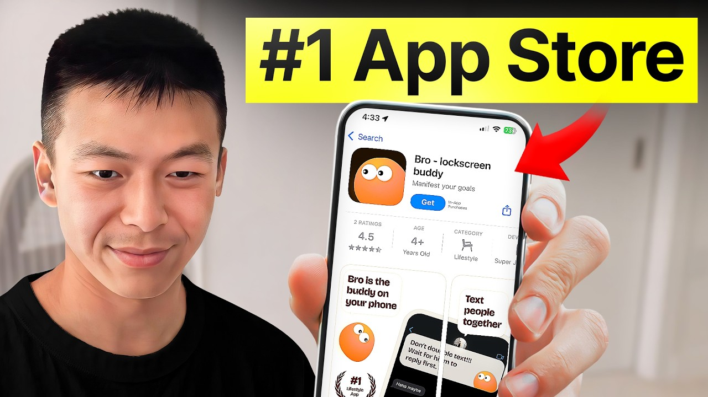

# How I Built the #1 App on The App Store (Twice)

Start building & deploying paywalls in 10 minutes flat: https://superwall.com/

## Table of Contents

* [00:00:00] - Intro
* [00:00:42] - The Vision Behind Lobby & Bro
* [00:01:37] - Validating Ideas Without Building
* [00:03:24] - How Bro Hit #1 on the App Store
* [00:05:09] - TikTok Strategy & Creator Scaling
* [00:08:51] - Using Ads for Fast Product Feedback
* [00:12:04] - What Actually Went Viral
* [00:15:55] - Making Online Conversations Feel IRL
* [00:20:01] - Lobby’s Breakout Growth Story
* [00:23:02] - The Group Picture Viral Loop
* [00:27:47] - Designing Spontaneous Social Experiences
* [00:29:01] - The Future of Social + AI
* [00:37:33] - Advice for Consumer App Builders
* [00:40:52] - Final Thoughts & Next Steps

## [00:00:00] - Intro

Roger Chen built two viral consumer social apps. And the crazy thing is both hit number one on the app store. The first one, Lobby, reached 500,000 daily active users and hit number one in the app store in five different countries. No paid marketing, just pure productled viral growth. The second one, Bro, is an AI companion that lives on your lock screen and floats over your text. [00:00:00 → 00:00:21]

It hit number one on the US app store off the back of Tik Tok, but Roger didn't even finish building the app before he started testing it. So this one is made by my co-founder Leo. It's like a mockup, but it's not the real apps like PowerPoint. Like we use this product called Protoy and then he just films everything like it's just like a fake mockup and then see if people like it. The central problem Roger's been thinking about for years is how do you make online conversations feel like IRL hangouts? [00:00:21 → 00:00:48]

## [00:00:42] - The Vision Behind Lobby & Bro

Because right now every video call feels like a conference room and every group chat eventually dies. So with lobby, he literally rebuilt the college dorm lobby experience. spontaneous, low pressure with background activities like YouTube and SoundCloud, so you're never just staring at each other in awkward silence. The app idea was great, but consumer social is notoriously hard. Everything changed when they made this one single breakout feature. [00:00:48 → 00:01:13]

>> So the the feature we made is a >> that change was a turning point for them. And once that feature was implemented, people started inviting their friends to the app like crazy. And with Ro, Roger is taking it even further. He's embedding an AI companion directly into the apps you're already using, your texts, your dating apps, your camera roll, because the insight is basically AI companions should not live in a black box. They should live with you in the apps you already use. [00:01:10 → 00:01:36]

But he validated this idea before writing a single line of production code. [00:01:36 → 00:01:40]

## [00:01:37] - Validating Ideas Without Building

All he did was buy Tik Tok ads, test formats, and found which user interface of the app resonated with people. Then he scaled the concept with 50 creators on Tik Tok. in the beginning like ads are really the fastest the fastest way to get feedback. There's this period of time between you first have the idea and when you first launch like that period could take 2 weeks a month even 2 3 months like that's the most dreadful period because you're just in your head you know you have no feedback and you can easily go on the wrong path. So, in this pod, Roger breaks down everything. [00:01:40 → 00:02:15]

The exact productled growth strategy that got lobbyed to 500,000 daily active users. Why he prototypes everything in his platform before he builds and his framework for using ads as validation instead of for scaling. This is a master class from Roger Chen on consumer social viral growth and building products people actually want to hang out in. This is the Superall podcast and I'm Joseph Choy, founder of Consumer Club. the members in the consumer club discord and the founders I interview on the pod build apps at a median of about a million dollars ARR in my conversations with dozens of these founders every week. [00:02:13 → 00:02:46]

One thing I've noticed is most of them AB test their payw walls to increase their conversion rates and make more money. Now most people know that one of the best ways to AB test payw walls is Superwall. But one thing you might not know is Superwall has a lot of data on the thousands of apps that use their payw walls. So recently they actually put together a tool that takes 422 profitable paywall experiments and put those into a paywall experiment generator where you can upload a screenshot of your own payw wall and it'll give you an experiment idea to increase your revenue. You can use it for free at paywallexperiments. [00:02:46 → 00:03:19]

com. All right, let's get into the pods. So yeah, you're trying to take up this lock screen real estate, but you need to provide value. [00:03:19 → 00:03:25]

## [00:03:24] - How Bro Hit #1 on the App Store

Um, and you're doing it in this like kind of light-hearted way, but you hit number one on the app store, right? like how did this happen? >> So, it was a lot of Tik Tok honestly. So, the idea here is that we want to position like like I said before like bro is like always there like a companion that's like that's like really with you with you like whatever you're doing like bro is always there to give you help to chat with you about it. You see like that's a very ambitious vision right and the problem with that is that it's not specific. [00:03:25 → 00:03:56]

So even though we found like the whole vision like just super super exciting, we still need to find a wedge like a concrete wedge like a concrete scenario in people's lives. And the we and the wedge we found like is like obviously number one is just texting. So we focused on texting first and then uh a lot of the dating app stuff and then finally some other like miscellaneous stuff like you you go through with your life. Wait, so is this the is this the main format that you're doing? Kind of like the face reaction and then demo of the product. [00:03:56 → 00:04:34]

>> Uh yeah, it's basically it's a classic hook and demo. So it's like the hook is a scenario. You need a real person there because you you don't have a real person there. People swipe away. People love people, you know, they see a real human, they stop and they see an app interface, they scroll. [00:04:31 → 00:04:50]

So yeah, hook like with a scenario and then demo. So yeah, >> and a lot of these videos don't have a ton of views, but are you just mass-producing so many that in aggregate there's a lot of traffic or are there like big viral hits that you had? >> Yeah. So we have um so first of all like we did like massproduce a whole bunch. [00:04:50 → 00:05:14]

## [00:05:09] - TikTok Strategy & Creator Scaling

That's one. And uh the second thing is like we do have a few outlier hits like a few videos got like two two three million views. So it's like really really topheavy. Like you really don't know like where it's coming from. Like so I I've been like truly humbled by by the experience. [00:05:12 → 00:05:29]

Like the ones I thought that would work just didn't work. And the ones that I thought were like ridiculous like worked surprisingly well. >> Interesting. This was a 7. 9 million views. [00:05:29 → 00:05:40]

This was on your brand account. And is this like is this you making this video or is it a creator? >> Yeah. So, this one is made by my co-founder Leo. So, when we made this video like uh we haven't actually finished building the app yet, but we want to like make a demo and uh see if people want to use it. [00:05:40 → 00:06:02]

So, what happened was like he made this like they all made this amazing like prototypes like it's like a mockup but it's not the real apps like PowerPoints. We use this uh product called ProtoI and then he just films everything like it's just like a fake mockup and then see if people like it and uh funny thing here is that you know you know like the Tik Tok audience just so perceptive and uh supposedly like this video should be you know like the point of view of someone testing a guy right but then everyone realized that hey you know like it's a man like it's like those are like And yeah, so uh yeah, so yeah, basically that's what we trying to do. Like we want to we build a mockup and then we first like use it amongst ourselves like the mockup like so so every day I'm like an idiot like carrying around like my phone and I whip out this like little PowerPoint thing and I just like when I'm on the toilet I just like play with it. Everything's like set. It's not a real app but you know just to get a feel you know. [00:06:02 → 00:07:01]

So every time you you try that like you get some new insight. It's like hey like this flow doesn't work like it's too long. Uh, and then the second thing about having a mockup is that you can really test like whether people want it, like just a rough concept. So, yeah. Um, we do that first and then we finish building the app and we start testing among like family and friends and then and then we do like the whole Tik Tok thing. [00:07:01 → 00:07:24]

>> I see. Interesting. And when you're prototyping, are you optimizing for what you think will look cool on Tik Tok? >> I want to say no. Like the number one thing should be uh I should feel good using it even just a mockup. [00:07:22 → 00:07:39]

Like I I I think I specifically remember like this uh story about you know I I think 10 years ago there was this like cell phone brand. Uh I think already died but um but the but founder of the cell phone brand is like super obsessed about like the design of the cell phone. So so he car he basically carries around like a brick that's shaped like the next version of the phone. And it's just a brick. he doesn't do anything and then he just like whips it out and try to points at it and then puts it back in his pocket. [00:07:39 → 00:08:06]

It's kind of like that. So the mockups can be anything. It could be like you know the flow starting from the lock screen or it could be the core like talking flow or it could be like the flow of you know swiping in the community feed. So it could be anything but there just such a huge gap between the Figma and something that you can tap. uh it's just such huge tab like a lot of things look good in Figma but it just does not work once you get your hands on it. [00:08:06 → 00:08:32]

So by having that mockup we uh reduce a lot of engineering like unnecessary engineering work because like we have that mockup and we already know something doesn't work. >> That's really that's really interesting. I haven't seen that many people do this strategy before proto just prototyping it before you even make the app. [00:08:32 → 00:08:51]

## [00:08:51] - Using Ads for Fast Product Feedback

Like why do you think this video did so well? So for this very first one, we did buy some ads uh because it's the fastest like if you see like the official the ones in the official account like we have to buy some ads to get some very quick reactions because you know like the UGC program like the ones the breakouts that we saw like lately like those took like two three months and uh when you're still validating your idea you just don't have that time. So before we have the app, we just test it real fast uh with some with some ads and see if people are interested in it. And then in this process, we gain two things. Number one, we gain like at least one format that could work. [00:08:51 → 00:09:32]

And two, we see if people like our product. That's cool. Yeah, that makes a lot of sense. I feel like ads are one of the best ways to iterate in the beginning. Like people think of ads for scaling, but you know, you don't want to negotiate with influencers for like two weeks and then finally get out some creative formats and then have it all flop um after you put all that work into the prototyping and everything. [00:09:32 → 00:09:53]

Um just plug and see see if people resonate. That makes >> exactly. Yeah. I think like like Yeah. Like you said, like I think the reverse like people should be working in the reverse way, right? [00:09:53 → 00:10:04]

Like people should uh so when you're actually scaling like no ads, right? because that's like that's like because the more you scale the more expensive it becomes and uh uh no one wants that right but um in the beginning like ads are really the fastest the fastest way to get feedback and you know like um there's this period of time between uh you first have the idea and when you first launch like that period could take like two weeks a month even two three months like that's the most dreadful period because you're you're just in your head you know you have no feedback and you can easily, you know, go on the wrong path. So in that period of time, you just like desperate for feedback and you just cannot wait. Add on top of it, think we're all startups teams here, right? Like we're all like burning money and um you know like ask a few thousand dollars of ads is nothing uh if you can get in feedback instantly. [00:10:04 → 00:11:00]

So this is like the best bet you know you can do like early in the product life. >> That's really good advice. I feel like a lot of people are like especially for like pivot hell phase of entrepreneurship where you're we have an idea and you think it's just such a great idea you iterate on it like a few for a few weeks like you said and then you launch and it doesn't work >> and then you're like hm okay and then you pivot but then the pivot itself involves another month of you know working on it. >> Yeah. Um, I I feel like just the ads ads as validation is actually really really smart. [00:11:00 → 00:11:36]

Did you make a bunch of variations of this creative to land on this one that you ultimately scaled to like 8 million views or you just make like one ad? >> Uh, what money on it? >> I think we have like five or six more. Uh, but um, uh, they're not here right now because they're based on a previous design. Uh so so you can see like the one here is like the key here is this like little bro on your screen like floating above uh the text interface, right? [00:11:36 → 00:12:11]

## [00:12:04] - What Actually Went Viral

So we decided we decided to make that the main wedge into the product. Uh so so we just went all in on this format. But before that we also have formats that um focused on lock screen. So, it's like things like, hey, you know, you're you just got up, not in a good mood, and bro gives you like morning affirmations, and you're like, yay. You know, stuff like that. [00:12:11 → 00:12:37]

Uh, so focusing on the lock screen instead of like the the floating window. >> I see. And did you basically invalidate the lock screen concept by putting those prototypes out first and then you it didn't do as well on the ads? >> Actually, no. It's uh those do pretty well, too. [00:12:37 → 00:12:53]

Like that's actually where we got the hunch that um this proactive caring thing could really work. The reason why we decided to go with this one is just that that one has had and then like like in some of the demos like in some of the segments it had like outdated designs and we don't want to confuse the like confuse people. >> Quick question is this picture and picture like is this is this a video on the iPhone or like how do you actually get the the little rectangle on on top? So when you're facetiming someone or when you're zooming with someone on your phone, like you always see a window like floating above whatever you're doing like So it's exactly like that. So yeah, it's a video and uh you just animate it. [00:12:53 → 00:13:34]

Yeah, >> that's so cool. That's that's such a good idea. That's cuz And it's very smooth, too. You can kind of move it around, but nobody I don't I don't think I've seen people use it in this way. You know, it's usually this the self camera for FaceTime or like a YouTube video or something. [00:13:33 → 00:13:55]

>> Yeah. Actually, when we made bro, like the mental model is really uh it's really some kind of FaceTime, you know, like you open a lot of these apps, I'm not going to name them, and then you see like a character in the middle and and it's it's like mastery finally come, you know, like yeah, it's just so I I guess like we really really want to go to the other direction. Um yeah, so so like I see tremendous value in companions. Um so a lot of people a lot of people are like Don Kong companions for you know hey for for it being dystopian. Uh and the reason they think that is that a lot of the companions out there are trying to like displace your real world relationships. [00:13:53 → 00:14:37]

Uh it's like hey you don't need to talk to your friends but you know just talk to it instead. And uh I think like two things around that right. So first of all definitely like that's not what we want to do. So we want our product to augment your social relationships instead of like displacing them. Like having some kind of interactions with your friends is just inherently fun while talking incessantly to an AI black box is kind of depressing. [00:14:37 → 00:15:03]

Uh we can we can theorize on why that is but that's just the case. And um I think the second thing about companion is that you got to stop thinking of it as some kind of like real world friend entity and start thinking about it like some kind of like convenient uh in between. And what I mean by that is that I think whenever some new tech comes out uh people will dunk on it for not being as good as the real thing. it it's like Door Dash is never as good as a restaurant, but that's not the point. The point is that it's more accessible now. [00:15:03 → 00:15:41]

So, I think it's a little bit like that. So, we want to really make it more accessible, but at the same time, instead of like replacing social interaction, like really try to augment your social interaction. So, that's the thing we're obsessed with. One thing we've been grappling for a long time, and this actually like relates to back to my last company, lobby, is the idea that like when you actually hang out with like your friends in real life, uh you don't have a specific intent, right? [00:15:41 → 00:16:08]

## [00:15:55] - Making Online Conversations Feel IRL

You just want to hang out and you just want to say whatever and it's about the vibe. It's not about the topic. However, like I think in the online world, especially like when everything happens like asynchronously, it's almost like every time you reach out, there has to be an intent. And what we trying to do with everything we do here is like normal days bro or lobby is that we want to make it so that you can get together even when you have nothing specific to talk about and that really unlocks a whole lot more conversation. >> Yeah. [00:16:06 → 00:16:39]

What's the biggest learning that you got from lobby that you're taking into bro and like future startups? >> Yeah, maybe I can share a little bit more about like the the the context like things like behind lobby like why we why we started it. So yeah uh we started it uh after co and um I think like after co a lot of people are like video chatting uh talking to friends like catching up online and we always get this feeling that you know supposedly it should be like people hanging out online right just like chatting but it always feels less like a hangout and more like a conference call um and because it like think about it like you're in Zoom you're like staring at each other and it's like if there's a moment of silence then it becomes really awkward. Um it's almost like people are hanging out in a conference room. So that's the process of it and the and the trigger of starting that conversation is also pretty weird. [00:16:39 → 00:17:35]

It's like hey do you hey want to hop on a Zoom right now? Like people just don't do that right? Um, let's say if you want to hang out with a friend, uh, you never say, "Hey, let's go to a room and talk. " It it's like the friend is the friend's going to think you're going to fire them or something. Uh, and um, yeah, it's always some you always find some kind of excuse like, hey, let's get some coffee, let's get some drinks, watch a movie. [00:17:35 → 00:18:02]

There's always some kind of uh, background activity. So, and the insight behind lobby is really that like people are going to hand out online, but it's got to be spontaneous and chill. Like by spontaneous, it means that nobody should ever feel like they are organizing a handout. Like there nobody should ever feel like they're initiating something like the inspiration really came from like our college days like which is um you know like you're going back to your dorm, right? And uh you're going upstairs and there's always this like big common area where people are like just sitting there like they're just lying there uh pretending to do homework but never doing homework and uh and there's always some like music or old movies playing. [00:18:02 → 00:18:46]

So that's a background activity and whenever you're free you just sit down there and people know you're free to talk. And that's why it's called lobby because literally like when I went to where I went to school at Chicago like uh like there's a huge lobby area like in my dorm building and people are just like sitting there all the time. So yeah so that's the idea behind lobby which is you know hey you know you should just be it should just be a place where you can drop in and chat and when you chat there should be some some kind of background activity. So for lobby it's like people are watching YouTube together, SoundCloud together, uh, and they're playing games together and screen share together. So if you think about it, there's actually a line from lobby to bro, which is you're doing stuff together instead of, you know, just like staring at you in the face and hey bro, let's find something to talk about. [00:18:46 → 00:19:38]

Yeah, >> right. That's totally true. I feel like college is just this magical spontaneous time that everyone wants to get back to if you went to college and they're just like there hasn't really been like a >> no there has not >> widescale solution to that. Yeah. >> Yeah man. [00:19:38 → 00:19:54]

You know especially now in SF man like every >> every place is very high intention. [00:19:54 → 00:20:02]

## [00:20:01] - Lobby’s Breakout Growth Story

>> Yeah. >> Yeah. So then how how did this go? you got 500,000 users, daily active users on lobby and then what happened? >> So yeah, so what happened was we actually like struggled with it for a while. [00:20:01 → 00:20:13]

So in the beginning we did not get like meaningful like quality growth. So what that means is we would have people coming in and there will be like power users but overall like retention was not that good and uh and what and as a result we did not really grow for like a year. I think our big break came uh in 2022 like of all places like lobby just suddenly went viral in Israel uh of all places. Uh so yeah, nobody's going to market in Israel, right? It's like like 7 million people and but it suddenly like went viral and became number one on the app store and just stayed there and all the data is just like super super good. [00:20:13 → 00:20:51]

uh like I think like the day 90 uh for uh lobby in Israel back then was like 25 to 30%. Uh so like super solid and like the retention in other places like half that and when we looked at it like there's only really one key difference uh which is the network density because like in lobby we do have public rooms but it's majority like people talking with their friends uh and which is very intuitive because like nobody's like outgoing enough to talk to random people every day right but you always have some time to talk to your friends every day >> um in Israel um like the key difference between Israel and and the other market I think in like at the start of 2022 is that I think on the first day uh so we we tracked this like one number which is like the percentage of people who got five friends um day one uh in other places it's like like 20% but in Israel it's like 60%. So that's the difference and that led to like super high retention which leads to even more growth. So that was a huge inspiration, right? And um so we know that the answer is really really to double down whatever it takes um to get our density up. [00:20:51 → 00:22:07]

What that means is like this is not something that's solvable through content marketing and obviously if you do content marketing you're just going to be a whole lot more of you know like like random people without friends. Starting from that we started to really work on growth features. So it really has to be people inviting their friends through using the product. So we did like a whole lot of things to boost like inviting and sharing like we did the common things I can think of and then we also did some pretty wacky things. Um yeah like one thing I I still love to this day is a feature called like group picture. [00:22:07 → 00:22:43]

The idea is when you hang out in real life, let's say you are hanging out like in Dolores Park or something, you're just like sitting on the on the grass, right? And uh you have nothing to talk about with your friends and what will people start doing? They're going to start taking group pictures. So like when you have nothing to do, people are going to start taking pictures and uh and when you start whip out camera and people get excited again, people like, "Yay! [00:22:43 → 00:23:05]

## [00:23:02] - The Group Picture Viral Loop

" And then and then they're gonna you're going to have like something to talk about afterwards. So the the feature we made is a group picture when uh during the the video chat handout. So it's like you press the button and then everyone sees on their screen like three two one like a countdown and the phone vibrates and then you take a boomerang of a picture. Um and then people are going to share it to their like stories like Snapchat stories, Instagram stories and that does like two things like number one it um obviously gets a lot of more sharing out right and uh number two the friends who are not in a handout are going to be like how did this happen without me and then they're going to come the next time. So yeah, so we did a lot of wacky things to get the network density up. [00:23:05 → 00:23:49]

Uh and uh three months later lobby became number one in the UK and then Italy and then Germany. Oh yeah. And then and then starting from the UK I think like some people in the UK spread it to some some people in international schools in Cairo, Egypt. Apparently those people are like kind of like influencers in Egypt. So when they started using it like a lot of like young people in Egypt started using it too and my lobby became number one in Egypt and then Saudi too. [00:23:49 → 00:24:16]

So it's uh pretty magical. So lobby is really a tale of you know obviously you have to do seeding like I'm not saying like you don't need to do any content marketing because you do you do still need to like seed the users for them to invite their friends but after that to scale it really comes down to the product. Yeah, >> that's one of the most insane growth hacks, like productled viral growth um strategies I've heard about. That's really interesting. It's like you're combining the IRL experience with the invite flow. [00:24:16 → 00:24:43]

A lot of people do the classic stuff where it's like invite, you know, five friends and you unlock some sort of social benefit or um invite a friend and you get a discount or whatever it is. But this was literally just like it tells you to take a group picture with whoever you're with during your video chat and then it creates a a sharable piece of media which is the boomerang. You could share that on Instagram and then everyone else sees it. Was that watermarked? And then like people see the see the >> Oh, of course. [00:24:43 → 00:25:15]

100%. Yeah, you bet. >> And then how did you get people to take the group picture while they were actually with people? If they're on a video chat, aren't they like sitting in their room like on their bed like you know doing these one minute video chats? >> I think we have a rule where you know every like five or 10 minutes like the button is going to light up you know it's it's going to hint that you can take the picture right now. [00:25:15 → 00:25:40]

And one key thing about like the group picture feature is that um it has to it has to be a shared experience. What I mean by that is that even right now I'm talking to you, right? I can like I can take a screenshot, right? But that's just creepy, you know, that that's not fun, you know? That's just like sniping you, you know? [00:25:40 → 00:25:58]

And and what we want is that everyone needs to know a picture is going to happen and then they get excited. So it's not about, you know, me, you know, taking a picture on my own. is about everyone be like it's happening and then let's take let's pose let's do some like crazy you know let's do do some crazy faces. So that's like a very key ingredient. It has to be a fun like group activity instead of like something instead of like a secret screenshot. [00:25:58 → 00:26:26]

Uh so so that's one. And number two is like we do have this um feature where when you exit a chat you're prompted to take a picture. It's like, "Hey guys, see you >> picture. Bye. " And uh uh yeah. [00:26:26 → 00:26:41]

And and the third thing is like you mentioned the uh one minute uh video call, right? So that's actually like not the main feature. That's like a growth feature. Um so the main feature is really just like people staying there and then when you're free, you can drop in to chat with me. Uh and um that's the main feature. [00:26:41 → 00:27:01]

The one minute thing is more like it's more like a roll call. So we talk about density, right? Like one thing we struggle with is you know with a real-time product you don't you not only need like relationship density you'd also need like temporal density which is like density in time. You have to be online at the same second. If I miss you by one second the app is useless. [00:27:01 → 00:27:24]

The one minute call thing is really just a a little game like to that we added on top of that which is like you know at night um you know at a random minute you know the app is going to you're going to see like a little little bar pop up and then you can it's like hey talk to your friends for one minute like catch up for one minute right now and then you can join it and you can you see your friends and you go ah wah wah wah and then and then one minute is over the the chat just ends. [00:27:24 → 00:27:51]

## [00:27:47] - Designing Spontaneous Social Experiences

The reason why we made it one minute is that we want to make it like super low pressure. It's like, Joseph, I want to see you, right? But um I I don't wanna >> I don't want to talk to you for like an hour. >> Yeah. I don't want to I don't wanna >> I don't want to Yeah. [00:27:49 → 00:28:02]

I don't want to be held hostage, you know? It's like >> Yeah. The thing with video chat is that, you know, sometimes you you join the chat, you feel like you can't leave. >> Yeah. >> Yeah. [00:28:02 → 00:28:11]

So So the one thing is like, hey, it's not it's not me, it's a game. Even though don't blame the player, blame the game, you know. >> Yeah. >> You need relationship density and temporal density. I guess that's like the central feature of Bereal, right? [00:28:11 → 00:28:25]

It's like one Yes. >> uh picture per day at a randomized time every day, but everyone does at the same time. So, everyone kind of like sees each other's stuff. >> Yeah, we're definitely very inspired by B real at that point. Uh basically the the way they just like forced uh some kind of like synchronous experience because you think about it, right? [00:28:23 → 00:28:43]

Like be real like one full a day that sounds very um that sounds easy enough. But the reason why it worked is that um when you post that picture, you get a whole lot of picture back at the same time. You know, that's a magic moment. If it if the pictures just like trickle in throughout the day, not sure it would have like taken off. >> So, what's next? [00:28:43 → 00:29:01]

## [00:29:01] - The Future of Social + AI

You hit number one with bro on the app store. You did lobby. You you're figuring out all these like human psychology like social uh hijacking things. Like, is this all leading up to like a grand idea in consumer social? >> Hopefully. [00:29:01 → 00:29:16]

Yeah. Uh so um we're still working on it and uh but the whole the idea is that we want to make something social because like that's what we are really really passionate about. I think at the end of the day we we just need all the people and um no amount of like human like AI speech attacks can replace that. It's uh and um I think we're going to take away all the learnings from bro and use it towards a real social app. So in bro there's like there's social features in bro but the core flow is not social. [00:29:16 → 00:29:48]

We want to make something that's like social in the core flow and uh what we learn from bro is that like a concrete character >> can really um enforce like the game rules of a very fun game like because when you have a character he can tell you to do stuff he can do stuff for you and uh it can bridge a lot of context in like everyday social interactions. Uh what I mean by context is that um in lobby right you got a bunch of people chatting in the same room. If it's just me and you maybe the chat would have ended a long time ago but if there's a third guy then the third guy can be uh some kind of hype man or you know the third guy is going to say like really smart things or really stupid things but it's going to like keep opening up more topics uh and then both you and me are going to share more. So that's what happens when you have a concrete p concrete character uh that can like interact with like the real people. Right now there's a lot of talk around AI content uh which is great you know I I I love it like I first day I got my hands on Sora I made like maybe like 20 videos and um but but but in terms of our company we want to go the other direction which is instead of using AI to create content we want to use AI to create context because at the end of the day I feel like when you have so much AI flying around like authentic human interaction uh becomes even more valuable. [00:29:48 → 00:31:19]

So, and if we can use AI to get everyone to talk more, that's going to be something that's going to be very meaningful to me personally. >> That's so interesting. I feel like um the the whole timeline makes sense because with lobby the context was uh like YouTube and SoundCon like you would watch stuff together or even before that even before lobby it was just you know the college the university lobby the dorm lobby um and the context was you know hanging out like pretending to do homework watching TV and then it's like YouTube Soundcloud on lobby and then it's like the AI buddy that inserts you know just funny things. It just says stuff and then adds uh more excuses to like talk and and continue conversations. So, you're going in that direction of like how can you use AI to create more types of context? [00:31:16 → 00:32:12]

>> Yeah. Like it's like this is not a specific uh product UX, but think about it, right? You know, in every friend group, you need that one yappy friend uh who's willing to put themselves out there to get the group going, right? Like that's not that's a pretty thankless job, you know, like when people go like when people go quiet, when people are tired, like that yappy friend is going to have to uh like keep carrying the conversation, you know, and uh it's a it's a thankless job. And now that's something we we can offload to AI maybe. [00:32:10 → 00:32:46]

>> Yeah. It reminds me of like the the talk shows where there's like the host and the guests and then there's like the random like third guy sitting >> Yeah. Yeah. Yeah. Yeah. [00:32:44 → 00:32:54]

Yeah. Oh man, >> I always wondered like why is there just a random guy that's like barely saying anything and it's like the same guy every time, but it's like it's it's just like to kind of fill the gaps. It just adds a little bit more chaos and spont >> Yeah. Exactly. Exactly. [00:32:54 → 00:33:10]

Yeah. >> Okay. I want to go back to bro for for a little bit. Um >> because I'm interested like how you actually scaled to number one in the app store after you validated the concept. So you got to you found this format that's like you know you hit 7 million views with that and then after that did you basically just go to creators cuz this is your proof of concept. [00:33:10 → 00:33:33]

It's like oh can we create a cool like new social experiment how that worked? Like did you get this format and then just spam this across all your creators and have them make variations on this specific video or there like other formats? So um in a nutshell, yes. So this video validated two things like the product UX itself is uh minimally interesting and uh it's also already set in a very specific scenario which is texting. So we validated two things. [00:33:33 → 00:34:01]

Um I think that's when we really started like recruiting creators. Um, and what we did was we tried to get creators from Tik Tok by searching like hashtags like relationship and um, and then you know you go into those people and then you see you try to find people like those creators and then you just like email them and uh, get them to start posting. And honestly like this process took way way longer than I thought. uh not not the outreach part, but more like the getting getting uh the content to work part. That's actually when I reach out to you and you know ask you for help with with you know like people to like help with like managing this these campaigns because oh my god it's so so much work. [00:34:01 → 00:34:47]

It's like um uh and so like when you think about product right like that thing is it's logical in a way like you know like this lead to that and this didn't work so that didn't work but with content right like it's really hard to predict these things like there are not like rules they're not so you just have to try everything so yeah I think at at our height we had like maybe like 50 creators and then a lot of them stopped posting so it went down to maybe like 10 20 But yeah, we um and and we have like creators like outside of the US too, like in Norway or something. And um yeah, so it's really just try and try and try and and uh until like videos started popping off. >> Do you remember any of the videos that like did really well besides your own one? >> Uh yeah, like I can send you one. >> There we go. [00:34:47 → 00:35:40]

>> Oh, I just sent I love you to my crush by accident. It was auto quit and now he left me on red. Send autocorrect hates me. Lol. Meant to say something else right now. [00:35:40 → 00:35:51]

>> Blame the phone and laugh it off quickly. >> Wow. I love it. >> It's pretty random, right? Like like if it were like to be like >> totally honest with you, like this would this is not the video I thought would pop off. [00:35:50 → 00:36:04]

So, but uh >> I guess you know, you never know. And uh just uh getting humbled every day by you know, Tik Tok UGC marketing. >> Yeah. 2. 3 million views. [00:36:04 → 00:36:14]

That's really good. That's really interesting because it's like uh yeah, it's a good hook and then it's a good demo, but I feel like a lot of apps try to do hook and demo and the demo is clearly like an app. But with this, it almost like is a hidden demo because it just looks like you're showing the iMessage conversation. That's the central topic of the video. And so it's almost like if you don't notice the thing immediately, you're like, "Oh, he they're just showing the messages, like the conversation, because that's what the hook was about. [00:36:14 → 00:36:49]

It's like, "Hey, I texted my crush. I I love you. " But it was autocorrect, uh, crying emojis, and then they go to the phone demo, and then it's like the actual conversation that they were just referencing, but then bro is right there. >> Yeah. Yeah. [00:36:49 → 00:37:02]

Yeah. Bro is with you. And uh yeah, as Yeah, but but you know, it's just like these like tiny tweaks. So like there are all the versions where it's so this one the story is she made a mistake and then bro she's in a panic so bro helped her fix it. It's a very very simple thing, right? [00:37:02 → 00:37:20]

And then there are other more complex ones like hey you know how do I risk this guy up you know like but uh like for some reason this one did best. >> Yeah. Yeah. I think there's a lot of people who bootstrap their way to really nice cash flowing businesses with consumer apps, >> um, typically subscription apps. [00:37:20 → 00:37:41]

## [00:37:33] - Advice for Consumer App Builders

And these days, it's the barrier to entry to doing that is so low >> that, um, there's a lot of people that that are doing it, especially just in the super well YouTube audience and just like my Twitter audience. And um I think some of these people reach a certain level of success and then they start to get bored and they're like, "Okay, what can I do next that's like really meaningful? " Do you have any advice to those people for how to think about okay, like what kinds of products should I start building that are a little bit more ambitious, potentially VC backed, because I think a lot of these people come from like very strong marketing backgrounds. They know how to like storytell. they know how to like seize a movement that is really popular and then create a product that serves that need. [00:37:41 → 00:38:23]

But then is there like a different mindset that you use to create products that you build? I think there there's a it's a real thing uh founder market fit. Um it has to be something I think a lot of things can be done super well but you have you have to be the right person for it. Like one example would be so at one point we did try like in 2023 we tried an app called Super Movie and uh it's basically like an AI generated like interactive story app like think episode uh but everything's AI generated like you can like generate interactive stories now with just like a few lines of prompt and then everything's like visual has sound and it's just like a branching story and yeah like that that was a cool idea but like I personally did not feel that much passion about it so it's pretty hard to keep tweaking the details. But on the other hand, like this friend I know uh who made this app AI dungeon uh and right right now they moved moved on to like like a bigger version of AI dungeon like that dude like that dude is just like super passionate uh about uh the world building like uh you know like fictional world building like he loves it like he can stare at like text stories all day and not get tired. [00:38:22 → 00:39:36]

uh and that's a person who can do this super super well and uh on the other hand what I what I love is social you know that's what our team loves you know like we we love building products that connects you with other people that brings you joy it's kind of a founder market thing like >> it's like yeah you know like I I think even in lobby right like the the metaphor we always used is that like lobby's like just imagine like building a neverending music festival where people just super nice to each other. You're just there to hand and there's no like baggage. You just like you let go. You don't think and you know that's the most fun. I think like the best kind of social experiences provide a kind of like um relaxed joyful experience where you just like connect with other people. [00:39:36 → 00:40:23]

Um and that's something that's like innately like appealing to us and um so it's just so so personal. I feel like we've been working on social products for a long time. uh and we get like slap in the face every month for some decision that didn't work. But the process of making that of designing new experiences is just so so fun and we feel like we can keep on doing it forever. Uh but if you make me do some you know anime chatbot then I'm going to give up very soon. [00:40:21 → 00:40:54]

## [00:40:52] - Final Thoughts & Next Steps

So >> yeah. Yeah. That's good advice. Yeah. Thanks so much Roger. [00:40:54 → 00:40:56]

This was a great great combo. I learned a lot and it's great to see inside your mind. I think this this episode is a little bit less tactical and growth hacky, but I think if you take the principles and almost like read between the lines of what you're saying and kind of like just get a feel for like how you think about things is very valuable. Just like the mindset of how you approach stuff was very cool to hear. >> Yeah, because we were here for the long term, right? [00:40:56 → 00:41:20]

It's uh I think I think we obviously like I'm not proud to say but I scroll on Twitter a lot and and on Twitter it's a lot of the like the tactical stuff but I think at the end of the day when you building a product it I almost feel like once in a while you got to use less of the brain and more of the heart. Uh it's it's otherwise you just like fall into these like micro optimizations and then you're just like torturing yourself. >> Love that. All right. Thanks again so much. [00:41:20 → 00:41:49]

>> Thank you so much. Something you might not know, most of the founders I cover on this podcast are hanging out right now in the Consumer Club Discord, sharing with each other what's working now for consumer apps. So, you can apply to join Consumer Club if that sounds interesting to you. And this is the Superwwell podcast. Of course, you got to check out superwall. [00:41:47 → 00:42:05]

com. We have more videos on the channel. So dig into those to learn from app founders who are willing to share super tactical stuff about app growth. [00:42:05 → 00:42:13]
