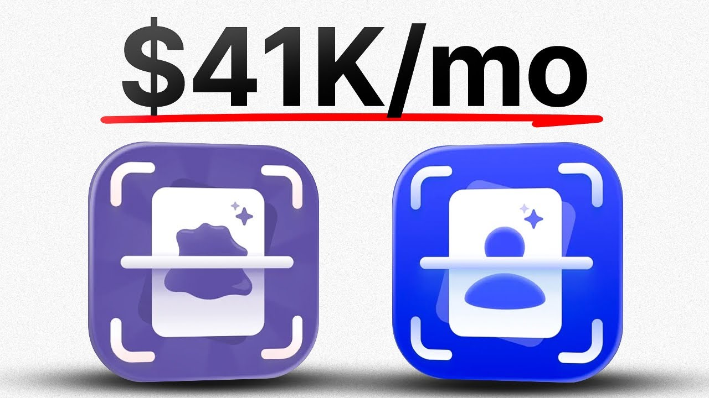

# How I make $42k/mo passively with simple no-code apps (copy me)

Start building & deploying paywalls in 10 minutes flat: https://superwall.com/

## Table of Contents

* [00:00:00] - Intro
* [00:02:58] - Cardstock origin story & Reddit validation
* [00:06:04] - Launch day results, early revenue & first ASO wins
* [00:16:04] - Kyle’s ASO playbook & keyword strategy
* [00:22:23] - Cracking TikTok: hiring Jacob & the card-scanning format
* [00:33:00] - From indie dev to CMO: marketing mindset & channels
* [00:36:45] - Launching Scanomon & expanding into Pokémon cards
* [00:41:02] - Scaling with TikTok slideshows, Noise & UGC
* [00:53:58] - Community, learning from others & closing remarks

## [00:00:00] - Intro

Kyle Fowler has made $700,000 from two simple apps he built years ago. But the real interesting part is that these apps have been earning $10,000 basically passively every month for 2 years straight, all while he was in college. He does this with two apps, Cardstock and Scanon. Currently, the apps make $41,000 in monthly recurring revenue. He's never taken VC funding, just him, his friend from Wendy's, and a Reddit post that got 12 paid downloads on launch day. [00:00:00 → 00:00:28]

He's come a long way since then. >> And it was $4. 99 on the app store. Yeah, the first Reddit post was like how we got our initial like downloads, I think. Here's the launch launch day. [00:00:28 → 00:00:43]

We got 12. So, the Reddit post did its job. But no, this isn't just luck. Kyle's secret weapon is ASO, app store optimization. He spent two weeks researching keywords like baseball card scanner and find value for baseball cards. [00:00:43 → 00:00:56]

Put them in his title and held the number one ranking in the app store for 2 years. Zero ad budget, just people searching the app store and finding his app. But it all changed when he lost his rankings in May 2024 and had to figure out a new channel fast. So he did what nobody would expect. He hired his friend Jacob from Wendy's to make Tik Toks. [00:00:56 → 00:01:15]

Neither of them knew what they were doing and their first videos were barely getting more than 20 likes. But they kept iterating until they cracked a format. Show a desirable card for 3 to 5 seconds. Scan it with the app in your hand and then reveal the value of the app. Repeat this 9,000 times across different creator accounts. [00:01:15 → 00:01:36]

We've generated like 8,000 like 7,600 posts in the last month. And we paid 2,600 for this amount of views. you know, like that's not very much money for a lot of views, but it's the sheer bulk of posts that just leads to like conversion rate. >> So, in this pod, we break down Kyle's exact ASO research process using free tools, how he reverse engineered Tik Tok slideshow formats to scale to 150 plus creators, why he thinks everything works instead of obsessing over which channel is best, and how he's using a niche platform to generate thousands of videos at a dollar CPM. This is a master class from Kyle Fowler on bootstrapping ASO and the power [music] of just doing the thing. [00:01:36 → 00:02:14]

This is the Superall podcast and I'm Joseph Choy, founder of Consumer Club. The members in the Consumer Club Discord and the founders I interview on the pod build apps at a median of about a million dollars ARR. In my conversations with dozens of these founders every week, one thing I've noticed is most of them AB test their payw walls to increase their conversion rates and make more money. Now, most people know that one of the best ways to AB test payw walls is Superwall. But one thing you might not know is Superwwell has a lot of data on the thousands of apps that use their payw walls. [00:02:14 → 00:02:44]

So recently they actually put together a tool that takes 422 profitable paywall experiments and put those into a paywall experiment generator where you can upload a screenshot of your own paywall and it'll give you an experiment idea to increase your revenue. You can use it for free at paywallexperiments. [00:02:44 → 00:02:59]

## [00:02:58] - Cardstock origin story & Reddit validation

com. All right, let's get into the pod. How did you get the idea for this app? So, the origin story is that I was in back in 2020 or back in 2019 even, I wanted to sort and catalog my baseball cards. And as I was doing, I was like, "Oh, well, like I'd love to digitize them while I sort them. [00:02:59 → 00:03:23]

" And so, I went on the app store to look for an app. And no app existed. And I was getting into app development at the time. This is like way preI or anything. So, I'd done a course on it and so I was like, "Oh, I guess I'll build it. [00:03:23 → 00:03:37]

" And then I started building it and knew nothing, but like kind of got into it. And then I eventually like stopped working on it for a while until some dude on Reddit DM'd me and was like, "Hey, you still working on this? " Cuz I made like a Reddit post to validate my idea before building because I'd seen on Twitter or some something that I was supposed to do that. So, I like had a Reddit post and 10 people replied and I was super excited about it. But anyway, this dude reached out. [00:03:37 → 00:04:05]

I have the I don't know if it makes sense. I was I have the screenshot of this dude DMing me. >> Yeah. Yeah. Wait, let's see the screenshot. [00:04:05 → 00:04:12]

>> But yeah. Yeah. Yeah. So, this is back. You can see like six years ago that this dude was uh DMing me and I was like, "How do you mention it? [00:04:10 → 00:04:20]

I left it unfinished cuz like literally I couldn't figure out how to put images in the card rows on like or in the rows in the list because it's still way harder than it should have been at the time to do that. But I was just like I knew nothing and this dude reached out and then so I owe it all to this guy on Reddit I guess cuz without this >> nothing. I I don't know if I would have ever finished it >> but I just like completely forgotten about it. So, you made a Reddit post. Did the Did that initial post get a lot of reception for the idea? [00:04:20 → 00:04:55]

>> It didn't get like crazy reception, but like I made it in r/ baseball cards, which wasn't like a huge subreddit, >> but I got I don't know. I mean, like 12 people replied or something or like 15 maybe and they were like, "Oh, I I'd love to use this. " And so that gave me a decent amount of validation. It's funny thinking about it now because now we make Tik Toks that go to, you know, thousands and thousands of people and with tons and tons of comments, way more engagement, but like that Reddit post was like huge for us. >> Interesting. [00:04:52 → 00:05:25]

So, did you get did you actually get like users and revenue from that first Reddit post? Uh, well, this first post was before I even made it, but yeah, once I launched the app, after I like got back into it and made it and it was $4. 99 on the app store. Yeah, the first Reddit post was like how we got our initial like downloads, I think, cuz that was before I knew anything. So, it was pretty cool. [00:05:25 → 00:05:46]

And I kept posting updates as we made new updates and stuff. >> I've noticed this about popular apps. They kind of get their start on Reddit from the founder themselves. like the founders just saying like, "Hey, I had this problem and I decided to make an app for it. " Was that kind of like the vibe of your first launch post on Reddit? [00:05:46 → 00:06:08]

## [00:06:04] - Launch day results, early revenue & first ASO wins

>> Exactly. Yeah, it was um just very like Yeah, very much just like, "Hey, I made this. " And it helped that I made the validation post before cuz then I was able to be like, "Hey, I hope some of you guys some of you guys might remember me posting about this [music] and I heard that that happened. " I know it's a big thing that a lot of people try to use Reddit for marketing now and it's like so probably optimized more but definitely made it not seem like an ad. Like I I just felt like I'm I wasn't really a member of the community so I felt very it was very hard for me to like post at the time cuz I felt like I was I'm not a big social media guy so it was weird but >> I see. [00:06:05 → 00:06:44]

So it was this one right here r/ baseball cards. Yeah, you can if you look up uh cards stock on the on I don't know if it sure it'll show up there. Oh, well, it's that one right there. >> Oh, is this >> actually? Yeah. [00:06:44 → 00:06:57]

>> Oh, this one. >> Yeah, >> the third >> that was the launch post. >> Wow. Six years ago. Okay, nice. [00:06:56 → 00:07:02]

>> So, like Yeah, like I linked to the post, the original post and said that and like you look at the like you Oh my god. Like you look at the original stuff. Any plans for Android? Still waiting on the Android app. But >> so people, this is pretty cool. [00:07:01 → 00:07:19]

Like you you actually said like, "Hey, I made this baseball card scanning app um a few months ago. I made a post about it and got a good response and now I finally built it and it's $4. 99 on the app store and you actually linked it. " This is pretty interesting. I feel like a lot of subreddits are kind of like anti-selfpromotion and stuff like that. [00:07:19 → 00:07:40]

Did you have any issues like getting around the subreddit rules and stuff like that? Yeah, because I I built it. Um there's a lot more to my story, but uh when I ended up hiring two of my friends during COVID to work with me and we just split the rev 3030 or like three ways and so I had one of them who was kind of our like marketing person even though he was still we were all developers but he did some of the Reddit post and so later on like in r/OC cards I think I got banned and they got kind of annoyed about it but I was just like I didn't really care at the time cuz I knew I was building something that directly helped people and it would make their like and I had validation from the prior posts. So, a little bit of trouble, but none on baseball cards. They were nice. [00:07:39 → 00:08:24]

But some of them just didn't get that many views, but knowing what I know now about uh hook optimization and stuff, I didn't know anything. I was just kind of like, "Oh, let me just try to make an engaging title here and hope it works out. " >> That's awesome. Do you remember how many downloads or how many um paying subs you got from this one post, launch post? >> I mean, I can look on the thing. [00:08:24 → 00:08:45]

I have app store connect pulled up here. Let me I can share that real quick. I don't think it was anything like crazy. But let's see here. Total downloads. [00:08:45 → 00:08:57]

Yeah, it was definitely a few though. Like the launch I remember like cuz we weren't making a ton of money, but it was a little bit enough that when I recruited my friends, I was able to be like, we won't make a ton, but we'll make some. Here's the launch. La la la la la la la la la la la la la la la la la la la la la la la la la la la la la la la la la la la la la la la la launch day. We got 12. [00:08:57 → 00:09:12]

So, the Reddit post did its job, >> right? But that's cool because it was 12 paid downloads, which I think a lot of people would just do like the free uh free download and then subscription model, but you just did straight to paid. So, it was like 12 12 paid downloads. So, that was like five times 12, $60 on day one. So, did you >> which is low, but you know, >> right? [00:09:12 → 00:09:37]

But but just from one Reddit post which was free to make and you just like wrote a couple paragraphs just saying, "Hey, I made this app. " >> Exactly. And I think it's pretty interesting cuz knowing what I know now, it's kind of fun to see a lot of people get into the space via like even consumer club and like uh a lot like app Twitter or app X whatever. Like it's funny because like I didn't know anything. I was just like, "Oh, I want to make an app. [00:09:37 → 00:10:04]

" And then I tried to research my best, but you know, I was just like, "Oh, I guess I'll charge $5 for it. " It didn't even cross my mind that like doing premium was an option or something that I could do. >> Right. So, do you recommend >> That's kind of funny. >> Do you recommend subs to anyone or sorry um like paid download apps at all to to anyone to try or were you just doing cuz that was what you just the first thing you thought of? [00:10:04 → 00:10:31]

It [snorts] was the first thing I just knew it would be easy because then I knew I wouldn't have to handle paid. I mean, honestly, these days with stuff like guess I got to promote Super Well, but uh the stuff like Super Wall is so easy. There's just no reason not to do a like a hard pay wall. If you if you want to if you insist on it, you might as well just do free cuz the switch to switch to free for us was by far like the biggest revenue jump ever for us. It was insane. [00:10:31 → 00:10:56]

>> What was the revenue jump when you switched to free? Let me just keep expanding here until I find it. But like it was crazy. Like initially we took a little bit of a hit. I think I'm trying to remember all the dates. [00:10:55 → 00:11:10]

I was about to have Pack go through and make us a story line, but when we switched I think it was probably like here cuz we were already getting No, it couldn't have been there. It It has to be like this. I'm telling you this giant bump has to be the switch to paid. >> Yeah. on the on the graph cuz it was pretty crazy when we switched. [00:11:10 → 00:11:32]

I remember like I had had a few calls with people. A few people were trying to like hire me cuz they saw the app and they saw that I wasn't making like that much money. They were trying to like recruit me to work for their pro like similar products in the space. And then at some point I just like people kept mentioning that I should switch to a free trial and I was just like I just could not believe anyone would pay $5 recurring. I was like, "It costs $15 for a Netflix subscription. [00:11:32 → 00:11:57]

Who's paying a third of that for cards stock? " And then they people were like, "Just make it $5 a month. People will buy it. " And I was like, "People are paying $5 for lifetime access forever right now. " And people were like, "Nope, they'll buy it. [00:11:57 → 00:12:12]

" And then so I did it and switched to that and it exploded from there. Like that was when our revenue really started grow cuz cuz maybe the the downloads I guess were actually pretty high. Like you can see they weren't actually that big of a jump ever because by this time for sure had all like come come about but >> and what was your pricing plan >> or five a month 50 a year and 99 lifetime >> cool >> was how I did it and we started with a lifetime access. >> Yeah. >> But so what did you do for growth? [00:12:12 → 00:12:44]

How did you grow from $60 on launch day to switching to a free model? Are you just continuously posting on Reddit or are you doing other growth strategies? >> Right. Yeah, the um the biggest growth like the initial hit we just kind of like had that uh initial post and just let downloads trickle in which I assume were from ASO but I didn't know. I just kind of had the if if you build it they'll come strategy which doesn't really work but worked a little in our case cuz it was so niche. [00:12:44 → 00:13:12]

But eventually I heard about uh Apple had this $100 free ASA promotion like for app store ads and that kind of got me into the idea. I looked into that and I was like, "Oh, if I'm going to spend $100, I want to use it optimally. " So then I Googled and looked around at some websites on uh like I think uh Sensor Tower, whatever um app figures, they had some posts on it about ASO and optimizing that for organic downloads. And it just made so much sense to me. I was like, "Oh my gosh, all I have to do is change this and then people can just find me naturally by searching the right keywords in the app store. [00:13:12 → 00:13:46]

" We optimized for that pretty early. That was huge for us downloads wise. That was when we really started taking off. I think that was actually probably the spike we saw on there. >> Interesting. [00:13:46 → 00:13:56]

What were the keywords that you optimized for? >> Yeah, so we optimized for baseball card scanner was the biggest one. We held the number one spot for that keyword for two or three years honestly because there were some competitors in the space by the way. First one to make a like baseball card scanner app. So I'll take credit for that. [00:13:56 → 00:14:15]

First one in the app store and now there's a billion of them if you search them and most of them not not even all like clones of our app or anything. Some of them do things different but there weren't any. I think there might have been a Pokemon card scanner before but I'd never heard of it so it was fun to invent that. But yeah, no, the we optimized for baseball card scanner, baseball card value, like basically anything that felt like it was worth it. Like I did the free trial of the sensor tower and looked at all the top keywords that were related or I just kind of brainstormed a list and there's tons of good resources about how to do this online, but I just brainstormed a list of ideas and things and then checked the keyword rankings and then just picked the most highv value ones I could to fit into my title and top. [00:14:15 → 00:15:01]

So we had like the whole thing is this card stock sports card scanner. So because baseball card scanner doesn't fit in the keyword amount and then it was like find value for baseball cards I think was our thing. And so we had that high ranking keyword for so long and it it brought us in like all all the rev for like like it got us from like 10k recurring forever. Yeah. You can see the find value like it's still the same thing. [00:15:01 → 00:15:27]

Like I spent like a week or two weeks like really researching and diving into what it meant ASO, but then the rewards we reaped were insane. And now like there's a lot of competition in the keyword space now or in the space now. So >> like or most things, but >> like especially if you're in a smaller niche or you're like in a novel new idea, like optimizing ASO can be such a big win because it brought us in like I was making like 14K I guess not recurring, like probably like 9 or 10K recurring revenue, but for a long time without any marketing for like a couple years all through college when I was growing. [00:15:27 → 00:16:07]

## [00:16:04] - Kyle’s ASO playbook & keyword strategy

>> That's insane. You're making like nine tk a month for two years straight >> while you like it was like from it grew pretty crazy. Yeah, it was just like I mean you can see on the on the chart it was just like Yeah, it was insane just purely from people searching and so we had that number one spot and we lost that in like May of 2024 and I kind of started tweaking at that point cuz I was like this is bad. I need to find another revenue stream. But like yeah, I mean it was it was really good and like not much done to the app. [00:16:04 → 00:16:37]

Like I was kind of doing I was floating, doing school, traveling a lot and it still was just making passive income. >> Okay, so you broke out you broke out from 10K a month. You did find some other revenue stream or some other marketing channel, but let's go back for a second. And what were the keywords that you were doing before you kind of discovered the highv value keywords of basically like find value for baseball cards and baseball card scanner and then sports card scanner. It sounds like those are basically the keywords that you tried to optimize for. [00:16:37 → 00:17:06]

But what was it before? >> Dude, I'm almost certain I had like I didn't even have keywords in the title. I'm pretty sure it was just card stock and then find like I don't even think I had a subtitle. >> I think it was just card stock. So before before I found the optimization, we weren't really getting that much passive at all. [00:17:06 → 00:17:25]

It was just >> if people searched it because I had no idea that's even how it worked. >> Yeah. I feel like people like to complicate ASO or make it sound like mysterious, but it sounds like you just did the bare minimum research, just went on Sensor Tower, just uh did like the free audit thing that the app store gave you, and then you just chose like ones that seemed good, and then you just put them in your title. Don't get me wrong, I did do a lot of research and I'm way over perfectionistic. So, I thought a lot about it before launching, even though I know now what I should have done is just get, you know, done the bare minimum, put in the keywords and tested. [00:17:25 → 00:17:58]

And I I've done some tweaks and testing since then. But yeah, I think the best advice for I could ever give for ASO is literally just go on Sensor Tower. And I haven't done as much research for other niches. So I don't know, maybe some niches have more keywords and more longtail, but I've done a ton of ASO research with Censor Tower and I track everything on Astro, which is a like on a Macbased app for it. But yeah, like just putting the basic highv value ones there. [00:17:58 → 00:18:28]

It's so good and you just order them by their priority and [music] what you want to do. And there's some more detail to it, but like at the end of the day, just putting them in there is such a big win that takes like no time. >> That's really interesting. In a second, I'm gonna ask you to go back to your chart because it's a it's a big number on that lifetime chart. I feel like a lot of people are getting their first win with their apps like this year or last year and they're going really viral on TikTok and they get to like 10 20k a month. [00:18:28 → 00:18:54]

But for you, you've been making at least 10K a month passively for years, which [laughter] is it's a different model, you know, like but it's pretty nice. Like if you figure out a keyword niche that is a gap in the market, you can just make 10K a month like forever at least until you kind of like lose that lose the ranking, which it sounds like you kind of slipped in the rankings and then you found other marketing channels. So we'll get to that in a second, but can we go back to your lifetime chart? >> Yeah. Yeah. [00:18:54 → 00:19:25]

Yeah, I got that. >> There we go. 700K lifetime. That's crazy. And it's it's fairly consistent. [00:19:25 → 00:19:33]

Like it's been at least 10K a month for like a very long time. Yeah. Those two years in between there, that's like 10k a month passive every month. >> It's pretty crazy to look at that we went from like, you know, making like nothing in to like like this is all we were launched in here. Like this was I was running it. [00:19:31 → 00:19:50]

We did it. I worked a whole summer, two whole summers in here until [music] like I think I remember now like this is definitely the time when I launched the subscription like the 2021 that was the big jump is we started we switched to subscriptions. It was just a long time in between because it was a whole summer and a year and then we launched subscriptions and started like actually growing. Like if you were starting ASO today and you're trying to find a new app niche that's underserved and your goal is to just make 10K a month passively for the next two years. How would you do that keyword research? [00:19:50 → 00:20:21]

Yeah, honestly I'm not the best at knowing that because you know I had my one niche. I've done app development the wrong way from every what everyone would say and everyone on Twitter loves to talk about of like throw a bunch of at the wall and see what sticks. Like I threw one thing at the wall and it stuck. So, I get it's a little tough, but from what I know about it is the best thing is just to like come up with ideas that seem helpful and then look on the app store if they are being served or maybe you find something that's like an adjacent thing. Like I would just look for problems that like bother you in your daily in like daily life and then try to generalize it enough to make sense. [00:20:21 → 00:21:03]

You can do a free free trials of sensor tower for like one month with as many emails as you want and then or Astro. You put in the keywords and then check the keyword ranking and then see if the popularity is high enough to justify it. It's the best advice I can give. But >> okay, no, that's helpful though. So, let's talk about Tik Tok. [00:21:03 → 00:21:21]

How did you break out from your 10K a month to now doing, you know, 30 40K a month? Uh, sounds like organic social was a big part of it. Like I I've been doing this 10k recurring and I've been working with my uh friends and they went off and got internships and stuff because that was their journey I guess. But it was always my I always had 100% ownership. So it was always my thing and I knew going into this that I'd been like having fun and I'm making 10k but I was going to lock in once um once I stopped college and like really grow my company. [00:21:21 → 00:21:51]

And I finally graduated and I went to Europe and came back and then I was like one of my friends I play competitive roundn net or spikeball. So, one of my best friends I'd met from there did a lot of like social media stuff. He's a big in on the social media game for them. So, I was like, "Oh, well, it sounds like like all these brands are posting a ton on TikTok. Like, there must be a reason for that. [00:21:51 → 00:22:09]

" So, like I was just imagining like brand content like thinking like Dolingo or like Flickbus or Britta, like that style of thing. And I was like, "Hey, I'll hire you. You're working at Wendy's. " brought him on board and we had no idea what we were doing, but we just started making some social media posts. [00:22:09 → 00:22:26]

## [00:22:23] - Cracking TikTok: hiring Jacob & the card-scanning format

Like if you go on cards stockck and you go look at the beginning ones, it's pretty funny like what we tried to do cuz like I didn't know like I didn't know anything like the first one like we were trying to mimic some like drop shipping stuff or the ne the next one's better. But like we spent so long on this video trying to uh like figure out how to do it. We like oh like I wonder how many it's going to get and it's like like 23 likes, you know, and there's no downloads. But we were sitting there with our uh ring light type stuff and lamps and you know really trying to mimic the whole idea. I always knew that the idea would be mimicking existing content. [00:22:26 → 00:23:00]

I knew that from the beginning. So I don't know why I knew that but I always figured that would be the thing but then [music] between me and I didn't want to make any. So Jacob did did it all and he was uh good. And we uh we we found some like some of these you'll see I I can't remember the first one that was success but we tried for a long time without any like we tried the memes and we tried a lot of stuff and yeah eventually we found this we tried to like do a silent pack opening cuz we saw that one working and we were able to like get some success there. But the thing is is like this didn't convert to downloads because there's no like there's no app promo. [00:23:00 → 00:23:36]

I just imagined that the way it worked is that if you grew your brand page, like people would see, oh, the cards stockck app, oh, that's a thing, and then go go go like click the link in bio and and download it. But over time, we learned that that's not how it works at all. We still had a ton of ASO ranking. Oh, that it had 184. That grew a lot over time cuz it didn't used to. [00:23:36 → 00:23:58]

This was the first format that we found out like or this was kind of one that worked. You can see the app in hand. And we um we went to card shows cuz uh I don't know if you're familiar with sports code shows. Essentially just a bunch of people get together and buy and sell cards. So we went there and there's a huge scene on Tik Tok for um like people like sellers and stuff like posting videos about them at the shows and stuff. [00:23:58 → 00:24:20]

And we realized that we could actively use cards stock to make great deals and make better deals than most people. Like at when we go to shows, we out compete most people because we have better data and cards stock is a great product for finding the value of cards. So like like we went to a show um earlier this year and we found a $500 card and they were selling it for 30 bucks and we bought it for 30 bucks and then flipped it the next show and we sold it for like 500 bucks cuz that's how it works. But yeah, we had these fire videos ended up doing good. There's uh one that's really good somewhere that Jacob made. [00:24:20 → 00:24:51]

But this box style was pretty good. We just kind of like we eventually took the like generic videos that were doing well. Like we just went to the first one that you saw with one in 84K, went to the card shows and condense that into like more of a hook demo style. That's why you can see all these like repeatable ones. So the basic format that you discovered was you show a card that's like desirable and then you show that for like 3 to 5 seconds and then you pop up the app phone in hand and then you directly demonstrate the product, scan the card and it shows like hey this is how much it's worth. [00:24:51 → 00:25:27]

So there's sort of like a a little bit of suspense because you have the text on the screen as well in the hook that says what this MJ card worth and then [music] the viewer has to wait a few seconds and it scans and then it shows the value >> and then in the comments there's a couple people that say hey what's the app? >> Yes, exactly. That's the whole premise. Like the goal is the what's the app comments. That's that's the whole goal cuz you don't talk about like we've done a few where like you actually mention card stuff like Jacob voices over these so he's like talk like it the thing will be like I was at a card show in Orlando and I found this Michael Jordan card and then like sometimes he talks about it just to keep it engaging throughout. [00:25:27 → 00:26:05]

I actually have I can screen share that you were asking about um the documents like yeah >> that's interesting. So it's it's basically a vlog. It kind of reminds me of these like garage sale videos where with Gary Vee or like other people like resellers and stuff like that where they're just vlogging their experience like showing kind of like the thrill of the hunt like here's here's what I found at the you know at the value bins or at the conference or whatever and then they're literally just voice overing like hey here I found this one. I found this one. Here's how much it was worth. [00:26:05 → 00:26:36]

Maybe I bought this one. Maybe I sold this one. But the entire time you're like scanning each card that you see with the app and this one I noticed you actually called out app link in bio in the text caption of the Tik Tok. Do you feel like that increases the conversion rates? >> I don't know that I could say with like enough certainty that it does. [00:26:35 → 00:26:56]

But I I would say probably no. I'd say sometimes call to actions are nice based on the type of video, but if you're able to like not it's not really needed like the the people will see the app on screen. One big thing we did do though is eventually we added uh in the scanner it says like cards stock at the top like a bit like there's a logo within the scanner and that's big I think I think honestly a lot of these videos on this channel are older because we have more like we have some newer ones. I think Jacob reposted cuz you can kind of do that on Tik Tok now. I was going to show you if you want the visual I condensed all the knowledge I thought about what made Tik Tok videos go viral at some point. [00:26:56 → 00:27:33]

This is my like core Tik Tok strategy and it was like hook users and like I wrote down like all the keys to success. I thought like this is all like a hook and then underneath it is all my thoughts about a hook and like what matters and every single aspect and like story tell like storytelling commentary. That's what I I just said with Jacob talking about it the whole time. And like every action text word should have a purpose. Like people love to just like put stuff on the screen and sometimes there's a there's merit to it like cuz you know you like you can't prioritize making every second but every second counts. [00:27:33 → 00:28:04]

Like every single action in text should be done for a reason if you can control it. That's why we condense down to those like value bin ones cuz it's so easy to control. Like some of the negotiations are better and stuff but it's like you don't know what people are going to say and then you have to cut it and hope that like they just say good things. you can't control where the camera goes. In this case, like we know we can control the hook. [00:28:04 → 00:28:29]

We can test different texts until we get a valid the one that works really well and then iterate on that and we know we can control what the like first image they see is of the value bin and the whole story we're trying to tell and so it's like all that same with the like minimum amount of time to create our idea like it should be as fast as possible feel organic all kind. Anyway, we like wrote I wrote all this down and I even wrote like this section where I was trying to like define things still. So, I put view at your your peril for Jacob cuz I didn't I didn't know if it would be valid and sometimes I steer people in the wrong directions with my ideas. But essentially, I think like you don't need to write this, but like writing it down is really helpful. I think >> that's really thinking through it. [00:28:29 → 00:29:16]

I like the philosophy of like try to do formats that you can control almost every aspect because then you can have a series that's repeatable instead of just going viral once and getting some downloads like a spike. You find a format that you can do variations of and control each little variable within that format and just repeat it over and over again. Did you come up with this strategy yourself through iteration or how did you like collaborate with your friends that you hired? We did a lot together for a long time. It would be like I was doing a bunch of dev stuff and like growing the product because I really had a couple things I wanted cards stock to do before I felt comfortable sharing it to like you know before it was getting marketed cuz I I didn't know anything about retention stats and a lot of business things I know now and why they matter. [00:29:16 → 00:30:06]

But I just had the intuitive sense that I was like, if the product isn't good, I just wasn't proud of it enough to the point where I was like, I want to market this to a ton of people cuz like I don't think they're going to like it. Cuz at this time, the product existed as you got five free scans and then you had to pay. But we also showed a payw wall off of initial RIP and there was no free trial and a ton of most of our subscriptions came from people just seeing the first payw wall, but no blocker. There's an X button. just hit it and but most people would just buy it right then sight unseen without even using the product. [00:30:06 → 00:30:37]

So, but just to me, I wanted the product to be good. So, for my own sake, but yeah, we would just sit down every day and he'd be like, "Okay, I'm making these videos. " And I'd be like, "Okay, these are my thoughts and why this is good, this is bad. Like, could we try this? " And then he would have ideas, too. [00:30:35 → 00:30:50]

And it kind of led to something like this where like I really wanted him to have something cuz like it came to the point where like every now and then like I felt like I ended up repeating myself of being like, "Oh, I think this and this. " And so I tried to write down all the things I was super strong about so that we could use it as a checklist, you know, because if it's on here and if it's not in this, if the video contains anything that I would reply with feedback from here, I'd just be like, you know, it's on here. What are we doing? Like, >> yeah, >> don't forget this is the important thing. So >> crazy. [00:30:50 → 00:31:19]

You basically became a CMO from scratch, like from zero. Like you started out building your own app. You grew it like passively with ASO. You hired your friend from Wendy's. Neither of you knew how to make content, but like you kind of just created a marketing strategy from scratch just from like seeing other people do it and then copying and then iterating. [00:31:19 → 00:31:40]

>> Yeah. And all this throughout this I was learning a lot from like Twitter and then like Discord and stuff. I think I I joined consumer club at some point around here and like so I was getting more info on like what other people were doing and like I'd been tapped into like the creator flywheel and all this but we were always just like oh I'd rather like I want to solve it ourselves first so that we understand and get like a true grasp. I've never made a successful TikTok video, but like I know exactly what goes into all of them because like we me and Jacob worked together so hard and it it's so fulfilling now because like I don't need like Jacob knows all this now. Like he's he's better than me at it. [00:31:38 → 00:32:15]

He's surpassed my knowledge because like he's the one doing it and so it's really fulfilling cuz like we have another one of our friends who works and makes content and like Jacob helps him and it's been very fulfilling and there's a lot of research. It's not like people do not have to make it from scratch. There is there is great resources and there's great people with a lot of advice that are willing to like help. But to some extent, Tik Tok is very it's like so niche specific and the key is that like you just have to find what works and like tweak it till you can like prove it's like successful, >> right? That's a good model. [00:32:15 → 00:32:48]

I feel like a lot of people the initial urge is like they see people going viral on Tik Tok and their first thought is I should hire an agency or some like cracked Tik Tok kid who can run this whole thing and I'll pay them however much. [00:32:48 → 00:33:00]

## [00:33:00] - From indie dev to CMO: marketing mindset & channels

But you just did the complete opposite. You're just like I'm just going to absorb as much knowledge as I can from Twitter and Consumer Club and just other founders. and then you just completely owned it yourself and then hired your friend and was just very in the weeds with it and now you have like a a complete system and a whole strategy. Would you recommend this approach? Like what's your take on um hiring people with experience or like big creators versus just kind of taking more ownership of it? [00:33:00 → 00:33:29]

I don't remember where I saw this recently, but this is not I guess it's something I've always saw but never known is I saw at some point it was like you have to learn enough of how to do something yourself in order to recognize someone great at it. And so that's something that I found very key is now now we're scaling and we're trying to recruit creators and get people and I'm learning how to run a business and you know and we're working with um an agency now for uh we're about to start trying with the agency for UGC and stuff but it's like I'm very easy to validate like it was so easy when we were talking to this person who runs this and being like oh they're cracked like they doing all the things we've struggled led with they have the solutions to the problems we're facing. if you don't do it yourself, you would have no clue what the problems are cuz I thought about hiring an agency earlier. And it was like they just no I like didn't know like I was like I would have no way to do if they're good. And I think a very cool forcing function because most people aren't bootstrapped and so like like we're like we're bootstrapped no funding like like I have full ownership of everything and it's it worked out really good with the way I was able to do it cuz I always knew and I was just like oh like hopefully if I could just make 10k a month forever I'm I'm chilling like and I get to do what I love wake up every day and do what I love like perfect. [00:33:29 → 00:34:48]

I'm great. And then I hired Jacob and I was like, you know what? I think we could make 20K by the end of like next year. Like that would be so awesome if we make 20K. And then we like blew it out of the W. [00:34:48 → 00:34:58]

Like we with Christmas we got the organic success and we like great. And then we added a hard pay wall and I was like oh my god we're making like like 30k a month. What is happening? Like and so like and now I have like I've hired people and stuff so it's kind of like there are restraints but doing it organically was like a good restraint almost because like I had to learn this. I had no other choice. [00:34:58 → 00:35:18]

I couldn't hire an agency. I couldn't I couldn't afford to make the wrong choice hiring an agency. So therefore like I needed to know and so by like needing to know and now I'm in the weeds and like I know all this and same thing I'm I'm excited for the world where I eventually get to like hire a developer as well and stuff cuz like I know how to do it. I've done it myself. I know all the problems they're going to face. [00:35:18 → 00:35:39]

And so this someone put it really eloquently about the uh like having to do it yourself to know some recognized talent. But so there's a quote somewhere, but it's I think it's ranks pretty true. I would recommend to some people doing this, but also like if you're someone who has like VC funded cash, like maybe you don't need to like be as in the weeds. This maybe there's higher priority issues to tackle. >> I think that's helpful for to distinguish VC back versus Bootstrap cuz with Bootstrap, you do have the the cash constraint. [00:35:39 → 00:36:09]

Like if you're if your goal is to make 30 50k a month and you're spending 5 10k on an agency, that's like that's a big deal. If you make the wrong choice there, that's a significant like risk compared to, you know, a VC back company that you can spend however much money they want. They just need to go fast. Yeah. It seems like you [music] achieved the result that you wanted, which is you learned exactly how to do Tik Tok on your own terms. [00:36:09 → 00:36:34]

You didn't have to spend that much money to do it. You just a little bit more effort and now you hired the agency and you knew exactly how to spot a good agency. Um, tell me about Scandaman. How did this [clears throat] idea come to you? [00:36:34 → 00:36:45]

## [00:36:45] - Launching Scanomon & expanding into Pokémon cards

And then how was it like launching this? >> It was pretty natural of evolution of like, oh well, we should scan Pokémon cards. Especially we went to the f the first card show we ever went to, me and Jacob. Like I'd been to card shows, but the first one we went to for like kind of getting into it cuz we knew like at the very least we' go pitch our app to like the people there cuz we know it helps them or we can get and we can get marketing content while we're there and we needed to buy sports cards anyway. So, I went to to go get some sports cards and there was this Glacion card that was just like calling to me, but like I have this I don't know if the camera can see it well. [00:36:45 → 00:37:19]

>> Nice. >> I saw this Glacion card and I just I love Glacion. They're my favorite Pokémon. So, it's like well I didn't even know that before that I saw this card and it was just like the allure of collecting which is just like that vibe where you're just like oh my gosh I have to have that. And I had that feeling for the first time since like so when I was growing up I I would always go over to my grandpa's house and like get sports card or like look at his sports cards collection and there'd be cards I'd pick out that I was like I want that like it's so cool and then my grandpa be like oh you can have this one. [00:37:18 → 00:37:49]

I'd be like oh and then take it home and add to my collection. I used to sit up late at night looking through all my cards. I collected a little Pokemon when I was younger but mostly sports cards. But essentially the Pokemon cards called to me and then I was like well honestly like I don't know how hard it would be to build an app. I already have an existing framework. [00:37:49 → 00:38:07]

And so then I built Scanamon using like AI, a lot of like AI dev tools and then a lot of my knowledge of you know what distilled to what mattered in a product and launched it and I was just like I'll just get it out there and we'll see because like I really wanted to see if the marketing would like take off and work and we're kind of missing a a a gap in time here. But essentially what I knew was that the Tik Tok slideshows were doing really good for card stock and I had a theory that the market was bigger for Scanamon. If you look up look up I'm trying to think of what what's a good one. Look up Pokemon P O K E and EI. Yeah, that one. [00:38:07 → 00:38:47]

And then like if you scroll down there, they kind of like the I think the slideshow format's not as successful anymore for whatever reason. So, like we found this format that's like really successful for our specific niche. And it's kind of funny cuz like you'd think like you just use the same ones over and over again. You mostly can, but like we uh ended up growing with that and we just kind of did this. It's actually really funny. [00:38:46 → 00:39:10]

I don't know, maybe it's in bad faith, but like this account is like my other friend I hired, his name is Pack. He posts on this account. We just like AI gen this profile picture of this girl and then cuz like it appeals to girls more. guys not gonna mind looking at a girl's profile and like girls prefer that so it's like win-win but um essentially we found this format that does well and we put the the branding right there is actually super important I think we don't have enough data to fully back that but having the brand name in the app right there is like that's not something that exists on like on the like consumer product like we made it so that for the marketing like Jacob and Pack when they make this there's a setting in scanon that allows you to like show the app promo Okay. And >> so >> show the marketing text, >> right? [00:39:10 → 00:39:55]

So like just having the the name of the app right there is >> it just like associates it in people's minds >> and like same thing. I picked that one up from like Fig. I think they do that well and like Cali does it as well in this scanner. That's why all these apps show them there. And I kind of hated it cuz I'm someone who's like the whole design of all my apps has been very iOScentric and Apple explicitly is like don't put branding in random places. [00:39:55 → 00:40:18]

That doesn't break their own dang rule in uh in news. in news and sports they throw the branding everywhere. So, but uh it's fun. But >> yeah, it's like a very cool Yeah, same thing where they they do it in a pretty cool way where it shows here even with the half sheet allows it to show behind, [music] but they're a lot more finessed. But it is very good. [00:40:17 → 00:40:39]

It's it's really hard to measure conversion rate in organic content. Almost impossible, actually. So, you might as well not take your chances and do the random little tweaks that'll up it when you can. >> You basically are running slideshows on TikTok to grow this. And what's the revenue on on this one? [00:40:39 → 00:41:00]

>> Like 20K monthly rev and it's around like 9K MR right now. [00:40:57 → 00:41:04]

## [00:41:02] - Scaling with TikTok slideshows, Noise & UGC

>> Got to figure out the retention and stuff. But also, we haven't been running like the campaigns for that long when we're doing the slideshows. And then actually the the biggest thing we've done recently to grow scan on and cards is uh via this platform called noise which is a platform for like distribution and you allows you to like run slideshows and stuff pay creators to post low key. Maybe I should be gatekeeping this knowledge but um I don't really know how much knowledge to gatekeep. I don't care the the platform. [00:41:02 → 00:41:31]

We're going to have to find new channels eventually anyway. Essentially, you post there and any their whole thing is they run their own UGC content with their own platform or UGC/s slideshow content to get people on Noise and then the creators come and post on Noise and they just like like Noise will autogenerate them a slideshow template. So, you just have to create yourself a repeatable slideshow format and Jacob was actually like super goated and already had like a perfectly repeatable format. So, we're able to just like bring that to noise because we've also been trying to bring on creators to post slideshows and pay them CPM directly in like a campaign on Growy and then they just like pull from our Google Drive and take the photos and make a slideshow and then post it and we have all the hooks pre-made for them and stuff and so it's like not much effort as simple as possible for them. >> That's really good advice for scaling. [00:41:30 → 00:42:19]

So, you already have the formats, you have the slides and you also have the card stock format. You just need more manpower now. You just need like a bunch of people like replicating it over and over again. And one way you do it is through this noise app. It's creators. [00:42:17 → 00:42:37]

What What's like the pricing model on this? >> So you pay the creators like $1 CPM or whatever or $2 CPM and then Noise takes half of the CPM and the other half goes to creators. >> So it's like essentially you pay the creators like 50 cent CPM to post but noise brings you tons of creators. Like I said, we know all this core Tik Tok strategy stuff, too. Like that was about posting on one account was when I learned a lot of that. [00:42:35 → 00:42:59]

And then I know a lot about making new accounts and how to make sure they perform well and warming them up and stuff, but like uh a lot of the noise creators don't do that. But they just post in such a huge bulk. Like if you go to Tik Tok and just look at like go to Tik Tok and look up Scanon. I don't know if Tik Tok lets you uh search slideshows, but it's pretty insane. Yeah. [00:42:59 → 00:43:17]

You can see these like like there will be a lot of low view ones like that 33 like one but like there's thousands of posts like let me show you this essentially like we're running these like slideshows and like this is how many views it's generated over the last like this since October to November so 2 months I don't know what engagement means but like this is we've generated like 8,000 like 7600 posts in the last month and like this is how many like total views it's getting so you can see all these things and like the average views and it'll like break down by um text hook. So like these hook like we can see this hook is outperforming the other ones and we haven't done a lot of adjusting but you can see which images do the best and they'll give you a ton of data on everything. Yeah. Like it's uh show you like the top posts and like so like so none of them are getting crazy amount of views. I showed you Pokémon our in-house one was able to get like multiple posts over like 100,000 views and like most of there's hardly any over like that many but it's the sheer bulk of posts that just leads to like the down like conversion rate just so many views like 27 views and we paid 2600 for this amount of views you know like that's not very much money >> for a lot of views. [00:43:17 → 00:44:32]

>> Yeah. So it's a dollar basically a dollar CPM a dollar per thousand views. You have 9,000 over 9,000 posts and the top ones have like you know 10,000 20,000 views and the rest have like you know a couple thousand a couple hundred views but there's 9,000 of them. So that's a lot of views when you add them all up. >> Yeah. [00:44:29 → 00:44:51]

Exactly. And the the thing about Tik Tok is definitely one outperforming video way better than a bulk of small videos. But a bulk of small videos is still good. They still convert. So they but like one outperforming video converts better. [00:44:51 → 00:45:06]

It has like like trust as well. Like if you see from a creator, you're like if you're like, "Oh my god, this video has this many likes and bookmarks and shares and this many comments. " You're like, "Oh, I trust that the knowledge here is good. " Like these are still useful content. Like the thing that I always felt weird about with like a lot of marketing stuff is like I don't really just want to be like a shill and making posts that like don't benefit the world either. [00:45:06 → 00:45:27]

Like I don't want to generate slot, but these videos aren't really slop. They genuinely would have been helpful to me at a different time in my life when I didn't know this stuff. Like they are card show tips, >> right? Like helpful tips on collecting and card shows. And are are you generating those tips yourself and then giving them to the creators or are they kind of generating their own? [00:45:27 → 00:45:48]

>> No. So like noise like directly delivers them the template like we have in here and you go in here and you can see like there's 38 images in here. Like these are the images that pull for the hook. All these are the hook images. And then so to pull one of these, one of these 230 images that go here with like this captions that go with them, I think we had to do something explicit cuz like our format was like weird. [00:45:45 → 00:46:12]

But I think even noise can like AI generate related images or related captions as well >> to like help test as well. But essentially and then we have all these hooks with like all the things essentially like it generates them for them, gives them directly to the creator to post. post it and then noise attributes and then like handles like payouts as well. So it's a really simple way to get started I think. >> But I I don't really know how well it would go if you didn't have like explicit stuff, >> but this like what we've found that it was able to scale pretty well >> for us. [00:46:12 → 00:46:45]

So, >> this solves the big like operations problem that a lot of influencer marketers run into where takes so long to negotiate with each creator and reach out to hundreds or thousands of people and then get on calls with them and then give them the brief and then iterate and tell them, you know, give them feedback every time they post. But this, you're just loading up all your images and then it kind of just combines them for you, [laughter] >> right, >> for the creators posted on their own phones. >> And yeah, we ended up finding this cuz I like reached out to some people after like finding our slideshow form. I was like, we just got to scale this. I just need people to post this thing. [00:46:45 → 00:47:23]

I I can tell them exactly what to do. I just need to post. And then slideshows seem to be trending out a little on TikTok. So, [music] I'm not exactly sure how um how that'll go for everything. So, maybe I'm giving this advice a little too late. [00:47:23 → 00:47:34]

Like I mean yeah it's exactly that problem like we face that exact problem trying to scale our UGC and we're like working on solving that too because I think influencers and um UGC and like people posting are still in general better than this overall and I know from talking to the creators of noise that they want to be something like that eventually too. So with all the UGC they have a premium section that you can uh pay for premium creators and get UGC there. We haven't tried that out yet but I imagine it'll be pretty successful. >> How do you find underpriced channels? I feel like nobody was talking about this noise app even a few months ago. [00:47:34 → 00:48:11]

>> Honestly, being overly on Twitter and like making connections and networking with people who like know what they're talking about. And so I feel like if people respect you as someone who knows what they're doing and like trying to do things I guess like quotequote the right way, it's like easy to get help from people and like sharing what knowledge you have with other people. Like I I feel like I just like I don't know. It's not like I've been like searching, but I've just been kind of like around there and then like having Jacob and both of us like looking for these things. It's like like in this case we found the slideshows cuz I was like at some point I was like [music] the the process that has led us to here I can explain. [00:48:08 → 00:48:42]

I was like Jake like I've been saying this for it's probably been like 6 months or something or like 5 months like I was like oh Jacob like we need slideshows they'll be great. Like I was sitting at home one day and I was like Jacob you should figure out slideshows. That was the extent of what I did like which is not like a very specific thing. I was like, "Dob, I'm seeing these slideshows. I know they can convert. [00:48:42 → 00:49:00]

I know there's a way to make it work. Here's the broad topic. Like, figure it out. " And so, like, we eventually tried some and I tried some I tried some slideshows back in like December of last year even, but like I didn't really know what I was doing, so they didn't go well. But with all our knowledge, again, Jacob started making these slideshows and he found this like tips format based on like some other ones online. [00:49:00 → 00:49:21]

not even copying brands, but more just like in our niche, copying that and then like knowing how to plug our app in. And so he started posting that and then saw that they were working. So then the more they worked, the more we systemized so to make it easier for himself and everyone else once we had that validation and then we went from there to being growing growing and like seeing it work and we had pack posting them and then we were like at some point I was just like okay this thing looks great. there's no reason we couldn't just have like more people posting this is just better. And I was like, okay, it doesn't matter who posts this. [00:49:21 → 00:49:56]

We know how to make accounts. I'd heard before about there was a thing that some people have people post overseas and stuff like that. And then like we try to hire some people from Sideshift to do it and like from uh other channels and just DMing people on TikTok. But then eventually I found out about this noise for scale and I was like, "Oh, well that sounds perfect. We should try that. [00:49:56 → 00:50:15]

" And then here we are like almost learning enough again to like know what is good because like surely there's a lot of platforms and stuff like available but like I learned enough to know what the solution to my problem looked like generally enough to find it I guess or ask the right questions right cuz like there's a ton of people who would be happy to like share so much knowledge with so many people myself included but it's like really hard to kind of know the right questions to ask to get the info. like it's like not the same for every niche. It's not like this probably doesn't work in a bunch of niches. It's some probably oversaturated in a lot of places and it's like maybe some things do work for every niche and it's like you just had to like open your mind to like the right possibilities. I guess really underrated advice. [00:50:15 → 00:50:58]

Um I like how you completely redirected my question cuz I think when I asked you the question, you know, how do you how do you find underpriced channels? It's almost like the wrong question. It's like everyone's asking that, right? How do you find these like breakout channels, these viral things? From your perspective, you just do stuff. [00:50:58 → 00:51:16]

You like see something and then instead of wondering like, hm, I wonder if that's going to work, you just you just do it. And then when like through the iteration cycle, then you figure out, oh, hey, I tried influencer marketing and and now I'm I'm realizing it's really hard to reach out to influencers. How do I reach out to more influencers at scale? Oh, noise app. But if you had just stumbled across Noise app without ever having tried anything, you probably wouldn't have like realized how it was the exact solution to your specific problem. [00:51:16 → 00:51:49]

>> Yeah. And like I the noise the people at Noise are actually really helpful. They do a lot of like they like put us on Slack channel and like give us advice and I think they're willing to do that for anyone cuz they print. I mean like [laughter] you know like we get we get we spent 20 you know they made 1300 off us like and just they they directly make money when you succeed. So like they're very much willing to help you succeed. [00:51:47 → 00:52:11]

But you're exactly right. I think the biggest thing that I've tried to take is in my company and like my role as I've uh like grown from like just a dev to like someone building or someone trying to run a company is to like generalize as much as I can cuz like like I'm just a very curious person by nature and a very like exploratory person. And so like I'm just always asking myself the question of like [music] what's the bigger thing that connects this thing? And it's like that's how I feel like I've I've grown. And the more people I put myself around, the more ideas I've been able to like convince myself to watch and learn. [00:52:08 → 00:52:42]

I mean, you just got to take it one step at a time. Like what ch it's more like what moves the needle? Like what's next? I recently wrote down a bunch of stuff about like my vision for like what everyone in my company, me included, are like trying to pursue marketing wise. And it's like there's a billion channels. [00:52:42 → 00:52:57]

Like I really want to try Reddit out at some point. I really I know like paid ads are a thing and like there's too much to just like do. So it's like you find one that works and then just like iterate cuz like you know you I feel like the key is that they all probably work. I feel like I see so much on Twitter everyone being like oh everyone says this about X thing but really it's Y thing you need to be doing. And it's like well like X thing probably works. [00:52:57 → 00:53:20]

You probably just didn't try it hard enough or like you just didn't figure out how it works. If other people are having success with I mean maybe some people are just lying or some people are wrong like like I see it all the time with paid ads. I see both takes on Twitter like every week of people someone being like paid ads best decision I've ever made. They're so good. And someone else being like paid ads are a scam only organic. [00:53:20 → 00:53:41]

It's like yeah well these channels all probably work. I mean it's just like what one are you best at? What one can you make work for your company? And like what do you have enough time? What do you enjoy? [00:53:41 → 00:53:52]

It's like a very weird metric. I think maybe VC funding pollutes a lot of minds every now and then. But like I'm biased. I'm biased towards not VC funding in the same way I just mentioned. [00:53:50 → 00:54:02]

## [00:53:58] - Community, learning from others & closing remarks

I think VC funding I'm sure works great for a lot of people. I just didn't want the time time expense. But anyway, I think any channel can work for anyone probably like or maybe not any channel but most channels. >> Yeah, you've successfully, you know, discovered and then started and then iterated and then scaled brand new channels that you had no experience with in the past. and and now you say you're kind of interested in Reddit. [00:54:02 → 00:54:29]

So, I'm curious like what would your approach be to just getting started with Reddit? >> I don't know if I'm like that interested. It's just one in the back of my mind cuz I've seen it a few times and it I think it just makes sense to me and then like especially us talking about like like I started there almost. >> Yeah. >> So, like I know it works. [00:54:29 → 00:54:46]

>> But yeah, I don't know. I guess I can think through it. I kind of have a weird spot where like I have Jacob to be like I guess he's essentially my CMO. I would probably have him do it. But the process I would probably take and explore would definitely just be like, "Okay, let's see if I know anyone on Twitter. [00:54:44 → 00:55:00]

" Like at this point, like I just have a decent amount of connections that I'm probably reaching out to someone to see first if someone knows that. One of my like main people I have in my network that I try to ask a lot of questions to just like I know have like broad general knowledge. Probably ask them that. Then next probably look at somewhere like Consumer Club or Twitter to see if any of the people I know talk about it there. I know someone on Twitter, but sometimes searching Twitter is hard cuz like I've seen posts about it on Twitter and stuff. [00:55:00 → 00:55:27]

And so I'd look at one of those channels and if I still don't find anything, probably like going to like GPT, Perplexity, Google, like trying to find like best practices regarding it cuz I'm sure there are some really good ones on there as well. I'd probably get there regardless to the Google. Like that's the same thing same strat I've taken ever since the ASO thing is like finding that. Like the crazy thing is like certain like Reddit feels like a channel that would probably have info online about how to do it, but stuff like organic marketing is like so slim. You'll look at it and it'll be like captions don't matter, watch time does. [00:55:27 → 00:56:02]

And I'm like, oh well this is helpful advice, but like only for someone who's like in their like first two days of like understanding organic marketing. And so it's like and that's the bulk of all content online. So it's like trying to find the niches. I've honestly been exploring a lot more with like YouTube and like podcasts as like a learning method because there's a lot of sauce shared there that's just like pretty good to point you in the right direction. So like that might be something I take. [00:56:00 → 00:56:27]

I don't know. Honestly, >> yeah, maybe. Yeah, [laughter] I need to watch some now now that I'm participating. >> It's a great process actually. I think a lot of people kind of play around with each of these, but you crystallized the purpose of each one pretty well. [00:56:27 → 00:56:43]

It's like reaching out to people with general knowledge just to figure out where to get started first and figure out maybe do you have any blind spots or assumptions and then you go to like more specialized experts to try to find and you know cuz the SEO articles are not always going to be like that helpful. Um, >> but if you find like specialized people like in consumer club or digging deep on Twitter, then you're going to find people that actually have experience with that specific channel and then you can go back to Google or Chad GBT or whatever. And then when you're consuming that information, you're like, you kind of know where the holes are and you're like you can decipher it a little bit better. And even, you know, at that point when you consume any information on podcasts or whatever, you have a lot more context to filter out BS and what works. I think that combination of like actually talking to real people who have experience and then also doing your own research is like a really good combination, good philosophy for learning. [00:56:43 → 00:57:41]

>> I think about it a lot. The biggest reason I'm so successful right now, it's hard to not attribute that to directly to Twitter and Discord and like consumer club itself, like the connections I made joining like so valuable to me. It's hilarious to me. It is an absolute joke that like I talk to so many people in their daily my daily life that just like don't get it. I don't feel like they understand like what I've really built. [00:57:39 → 00:58:04]

And like maybe that sounds like cocky, but it's just kind of funny that like I'm like I really wasn't that difficult. like it was, but it was really the focus that was difficult. It was the like focus and the opportunity to have that much time to put that focus. The main thing I've learned is that like I always value like expert advice very highly, but I never really understood that so many people were just like happy to help. Like I always figured that like if I was asking someone questions about something that they were like I was a burden to them, you know, cuz like I'm not giving them anything by asking them these questions. [00:58:03 → 00:58:35]

But so many people just like helping. I mean, I guess I'm the same way at this point. And I used to always be like, oh, like the ideas are like what matters. And the ideas, people still undervalue them, but like the hard thing is being committed long enough to like see it through through the troubles. It's just people don't have the persistence. [00:58:35 → 00:58:51]

So, it's like just do the thing, be committed to it, ask the right people for help and like you're going to succeed. Like it's a time thing in my head. It So, maybe I'm just lucky and I don't know it, but surely there's always some luck involved, but I don't know. Yeah. No, it's it's really inspiring. [00:58:51 → 00:59:09]

Like even if like right now obviously like let's say someone is making five times the revenue that you are, I'm sure they would still want to talk to you because if you just listen to the way that you talk, it's very clear that you're going to grow from here every year that you stay in business and as long as you stay committed like you said. And by the same principle, if you're at 1K MR, there's going to be people at 10 20K MR that's probably going to be willing to help you as well if you feel like you have the same values and you're committed to sticking with things and you're curious and you want to explore and learn. I found this to be very true as well. Like people are experts that like advice that you want to get. People are happy to help and there's some reciprocity involved of course, but people want to help people that are just down to learn. [00:59:09 → 01:00:00]

>> It's really hard to be like value your own skills as you should and like I struggle with it a lot too, but it's like the quality of wanting to learn is and being willing to take feedback and like listen is like lowkey a rare skill. like cuz I'm I am so willing to help people, but like a lot of people you'll start giving them advice and they act like they just know better than you for some reason or they know what they're talking about or they're not willing to respect your expertise in something and it's like they think they know this and that. It's like so when you find someone who's just like a sponge or just like oh why like why do you do that? That's interesting. like you're just not annoying and like you're asking people advice, they're they're going to help you cuz like I love talking about my business. [00:59:57 → 01:00:41]

Like I would talk about it all day if I could, but most of the time there's not people that listen to me talk about it all day. So it's funny to like literally if someone want is curious and actually wants to know about it and is willing to like stay really listening is rare. Like even the people who ask me for help aren't like they don't really want it as much as like >> I think they c they could. Like >> they like rarely anyone gets this much info out of me. And like sometimes it's not possible cuz you know you there's only so much info you can get. [01:00:41 → 01:01:10]

But >> it's pretty cool. The networking thing is cool and like being a part of a greater community is like a huge thing. I'm still trying to figure out how to be part of like more community and like more like I want to learn from people greater than me too. So it's like >> that's awesome. >> It's fun. [01:01:10 → 01:01:25]

>> I love this philosophy. This is like I I'm I'm vibing with this super hard. I'm I'm going to like try to figure out how to integrate this into my life a little bit more cuz I think with like having this vibe in business, I think it it brings a lot of success just this like giving first mindset and it's kind of an opt-in thing as well. Some people just don't think like this and they gate keep stuff and then some people just give first. And I'm sure there's people watching right now that are super down to just slide in your DMs and just give you a bunch of free secret information because they know that you're probably going to do the same. [01:01:23 → 01:01:58]

And there's these people that, you know, if you opt into this ideology of just like giving, then it's just good. Like everyone will just swear and everyone wins, you know. >> Thanks so much for being on the pod, Kyle. This is a great conversation [laughter] and looking forward to the video when it comes out. >> Yeah, me too. [01:01:58 → 01:02:15]

Thanks for having me. >> Awesome. Something you might not know, most of the founders I cover on this podcast are hanging out right now in the Consumer Club Discord sharing with each other what's working now for consumer apps. So, you can apply to join consumer club if that sounds interesting to you. And this is the Superwwell podcast. [01:02:15 → 01:02:31]

Of course, you got to check out superwall. com. We have more videos on the channel. So dig into those to learn from app founders who are willing to share super tactical stuff about app growth. [01:02:31 → 01:02:40]
