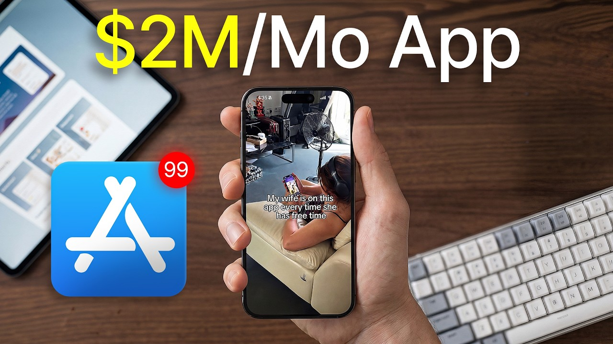

# How to Build a $2M/Month App (Copy Me)

Start building & deploying paywalls in 10 minutes flat: https://superwall.com/

## Table of Contents

* [00:00:00] - Intro: The High-Leverage Skill of App Scaling
* [00:02:20] - Marcus Burke’s Background: Transitioning from Air Traffic Control to Mobile Gaming UA (2012–2019)
* [00:04:31] - The Evolution of Mobile Ads: Gaming vs. Subscription App Verticals   5:15 - Moving to Blinkist & Pioneering the Web-to-App Blog Funnel
* [00:06:56] - Why In-App Optimization (Onboarding, Paywalls) Dictates Upper-Funnel Meta Ad Success
* [00:07:55] - Why E-commerce D2C Talking-Head UGC Formats Fail for Subscription Apps
* [00:08:11] - Mitigating App Store Friction: Priming Users in the Creative to Protect Install Rates
* [00:09:08] - Case Study: Deconstructing a $1M+ Spend Creative Concept for Moonate
* [00:11:13] - Algorithmic Targeting: Using Hyper-Specific Ad Copy to Inform the Meta Algorithm
* [00:12:13] - The Reddit + Claude Research Workflow: Extracting Vivid Emotional Language Patterns
* [00:14:33] - Soft CTAs vs. Feature Demos: Deciding Where the True "Sale" Happens
* [00:16:49] - Funnel Architecture Breakdown: Web Advertorials vs. Direct App Store Installs
* [00:18:53] - Static Image Ad Delivery Constraints in App Promotion Campaigns
* [00:21:40] - Integrating Generative AI (GPT Image, Google Nano) to Control Creative Testing Variables
* [00:38:11] - Top-Level Variables for Performance Scale: Message, Media, Content Type, and Funnel
* [00:40:52] - Media Buying Analytics: Evaluating Placement Composition and Demographic Purchase Power
* [00:43:42] - Correcting Trial-to-Paid Conversion Disparities Using Meta Value Rules
* [00:52:11] - Account Structuring: Leveraging Multi-Ad Set Budgets to Force Spend Across Distinct Niches
* [00:55:30] - Capitalizing on Cultural Micro-Trends (ADHD, Toxic Attachments) in Mental Wellness Creatives
* [01:00:29] - Where to Connect with Marcus Burke

## [00:00:00] - Intro: The High-Leverage Skill of App Scaling

I'm willing to bet that if you're running a subscription app, you need to run meta ads to grow at scale because being able to put a dollar in and have it print back more than the dollar that you put in is one of the highest leverage skills an app operator can have right now. But if you don't understand the ad creative format intricacies that apply specifically to apps, you're probably leaving on the table six figures a year to operators who do. That's why today I'm sitting down with Marcus Burke, who has spent 14 years running meta ads for apps, scaled an app to $2 million a month, and whose single best performing ad has crossed a million dollars in spend on its own. And the first thing that surprised me about his approach is that his ads barely look like the UGC and organic creatives people see on Instagram all day. Everyone was very inspired by the D2C ecom industry for the longest time for all the kind of talking head content they were doing, which I feel isn't the best format for apps. [00:00:00 → 00:00:50]

One thing on the app side of things is that you want to prepare people that they are going to land on the app store. Otherwise, your install rate tends to suffer. In this episode, Marcus breaks down his full system to scale meta ad spend to six figures a month and beyond without burning through creative budget. The exact Reddit plus Claude research pipeline that writes copy so good people feel like you're reading their mind. And the framework he runs on every single ad account to figure out which audience and placements these spend should actually go to. [00:00:50 → 00:01:17]

This is the Superwall podcast. I'm Joseph Choy, founder of Consumer Club, a Discord where top consumer app founders trade alpha and what's working now in growth. I've been talking to members doing a millionaire ARR, and they tell me they've been using these two tools. Superwall has this free AI tool trained on 422 profitable paywall experiments across thousands of successful apps. You upload a screenshot of your payw wall, and it gives you an experiment idea to make more revenue with the same number of users at paywallexperiments. [00:01:17 → 00:01:42]

com. And if your app's doing at least 100K MR, we host vetted dinners in SF and New York to hang out and network with other top app founders. You can apply with the type form in the description. Also, these app founders have been telling me they use ROR. I met Daniel, the founder of ROR, at a dinner, and I got genuinely really excited when he told me about Ror Max, which is out now and has honestly changed the game for coding mobile apps. [00:01:42 → 00:02:05]

It's AI that oneshots full native iOS apps with Swift code, camera, sensors, haptics, payments, the whole stack. And as you vibe code with Ror, you can install prototypes directly onto your iPhone with one click and then publish to the app store in two clicks. If you've been waiting for AI coding that actually does native iOS apps, well, this is it. I got you guys a discount. [00:02:02 → 00:02:22]

## [00:02:20] - Marcus Burke’s Background: Transitioning from Air Traffic Control to Mobile Gaming UA (2012–2019)

You can use the code superwall or use the link below. Marcus, welcome. Tell me about yourself and how you got started in ads. So, I've been doing this for like 14 years now, I think. Uh quite a while. [00:02:20 → 00:02:31]

Uh actually before that, I did one job was which was becoming an air traffic controller. And I'm happy I I switched to marketing afterwards. I started my career in gaming where I worked for a company called Inogames here in Germany. Um they're based in Hamburg. I got really lucky that I started like in a hot time in that industry when kind of things were moving from browser games to to to mobile games. [00:02:31 → 00:02:52]

So there was a lot happening and my company was well funded. They had a few kind of games running that like were very profitable. I still remember like when when I joined the company, I think it was our head of marketing back then was like Facebook is dead. It's pretty crazy that your team thought that Meta was dead back in what was that 2012 to 2019. That's when some of the biggest companies scaled through Meta. [00:02:52 → 00:03:15]

It wasn't even clear it would become like a global social network yet at the scale that is today. And back then kind of performance was degrading a bit. So my head of marketing was like, well, we're not sure if this is going to stick around. >> What were the biggest apps at the time that you were getting inspired by from the ads back then? We locked a lot at Clash of Clans and I think everyone did like they kind of were one of the early advertisers then went like they just had a very strong product. [00:03:15 → 00:03:41]

Also any kind of marketing tech partner we were working with to even figure out how to run mobile ads um was always referencing them as well kind of look at what that team is up to. They're doing cool things. A lot of this was really trial and error like there weren't a ton of mobile advertisers doing well to look at and ultimately we were I think one of the advertisers people looked up to. So like we were invited to like all of the big events over at the Meta headquarters because we were like up there with like a king uh a supercell um spending like millions every month. It enabled a lot of like in the end also benefits because we would be the first ones letting uh that they would be let that they would let into new uh beta products and a lot of was happening at that time like really the the ad ecosystem as it works today has been largely really formed by by meta like they introduced things like app event optimization value optimization later >> I don't want to spend like too much time on on this topic but I I am curious like to bring it back to today like would you say that there's any industry right now that is kind of like ahead of the curve and fully fully taking advantage of meta ads compared to everyone else similar to how like gaming was doing that in 2012 2019 there's very strong UA talent in in gaming and um I think that's true to this date but subscription apps have really caught up in a lot of kind of these newer tactics like for example web to app that's something that kind of the subscription app advertisers have been pushing um so I feel like it's at least on par now between like gaming and and subscriptions And I mean you can see it in kind of the the revenues on the store how how subscriptions have caught up there. [00:03:41 → 00:05:17]

## [00:04:31] - The Evolution of Mobile Ads: Gaming vs. Subscription App Verticals   5:15 - Moving to Blinkist & Pioneering the Web-to-App Blog Funnel

>> Okay. Well, that's a good good transition. So like subscription apps versus gaming. So yeah, what happened from 2019 2022? >> Yeah. [00:05:15 → 00:05:24]

So I switched over to Blinkist in 2019 because a good friend of mine from from Innoame um started running the paid social team over at Blinkist. And that was my introduction to the um kind of subscription app economy. It's a well-known subscription app. They knew what they were doing. We again had pretty good budgets. [00:05:24 → 00:05:41]

Um we're playing with a lot of novel tactics also in that web to app um segment for example. We were I think one of the first scaling ads while sending them to a website like our blog instead of directly to the app store. I tried a few other kind of subscription apps after I stayed with Blinkist for I think like one and a half years. Stayed in ad tech working for like a company called study smarter a like a student at tech a bit like Quizlet here in Germany and then Tandem a language learning social network. I don't do a lot of operative work anymore. [00:05:41 → 00:06:09]

It's just a lot of kind of it's hiring, it's reporting, it's um administration. And I noticed that that's not for me. And that's when I decided to go uh yeah freelance and start my consulting business in 2022. >> Now you do consulting. So you don't do like the like what does that entail in the ads stack? [00:06:09 → 00:06:26]

I really honed in on meta ads for for subscription ads as kind of my my primary channel and then going really deep on that but kind of more of a vertical integration then where I for the purpose of getting better like running better meta ads I do app optimization I do onboarding optimization payw wall activation period so really kind of looking at that full upper funnel first-time user experience to ensure we're doing everything we can to like in the end convert that audience and that has been getting more and more important important over the last years. [00:06:26 → 00:06:58]

## [00:06:56] - Why In-App Optimization (Onboarding, Paywalls) Dictates Upper-Funnel Meta Ad Success

Just optimizing for like a purchase event um and like having a very minimal funnel of hey here you are welcome like register and then show them a payw wall that's just not enough anymore. >> Let's get into the ad creative. So like people want to know like how do you make good ads? Can you show us some of the ads you've made? I did another webinar where we kind of we mapped out a bit like app ads versus web ads. [00:06:56 → 00:07:20]

So I thought that maybe would be kind of a good starting point here as well. One thing I think that's very important when you're trying to make ads is like I mean everyone copies everyone. That's pretty normal. Like you're always going to take inspiration from other apps, you're going to take inspiration from other products. I think you want to be very clear about well what's the product that is using this ad and have an hypothesis in mind of why they're using it and um why it works for them because you might have to adapt something so it fits your product. [00:07:20 → 00:07:45]

And I see a lot of like issues there where people like they copy something one to one because they think hey this looks cool let's do it for our app. it doesn't really make sense. And that happens between industries. [00:07:45 → 00:07:57]

## [00:07:55] - Why E-commerce D2C Talking-Head UGC Formats Fail for Subscription Apps

So, everyone was very inspired by the D2C ecom industry for the longest time for all the kind of talking head content they were doing. And it's always like people showing a product and oh my god and like a like a strong hook and then just kind of walking people through pain points and positioning the product as the solution, which I feel isn't the best format for apps and I don't see it working a lot. [00:07:57 → 00:08:14]

## [00:08:11] - Mitigating App Store Friction: Priming Users in the Creative to Protect Install Rates

And the same applies to whether someone is sending people to the web or the app. Like that's those ads tend to look inherently different. One thing on the app side of things is that you want to prepare people for that they are going to land on the app store otherwise your install rate tends to suffer. So don't try not to be an app. Um make it very clear um so that the funnel holds up. [00:08:14 → 00:08:35]

So a lot of the very successful ads I see out there they either mention app in the copy they show an app demo of some form just so to set the right context already. >> That's an interesting insight already. just like prepare people that they're going to land on the app store. I guess that's like just from my perspective when I'm scrolling ads uh or Instagram or whatever and I see an ad, it seems interesting. I click the call to action and then the interstitial thing pops up or like pushes me to the app store. [00:08:35 → 00:09:03]

It's like super super jarring actually. Like sometimes I don't want to install an app unless I know like okay this is an ad. [00:09:03 → 00:09:10]

## [00:09:08] - Case Study: Deconstructing a $1M+ Spend Creative Concept for Moonate

You push the fact that this is this is actually an app in your ads. But yeah, let's look at some of the examples. I'm I'm curious like how this is implemented. Okay, so it's like I showed my husband the Mogate app and he passed out instead of picking up the kids and then the hook is just like she opens the door, the front door with a key and then opens the door and then you're like laying there on the couch and that was how long? That was like 5 seconds and then it just transitions to this like glowing green orb and then it like zooms in slowly. [00:09:08 → 00:09:36]

Okay, this is green noise and then every every couple seconds it's giving like a sentence. Are those sentences like intention? Like it seems like some of them are benefits, some of them are features. Like are is it very intentional like the structure of this ad? It has been tested quite a bit. [00:09:36 → 00:09:52]

There were probably 100 versions of this. For this client, for example, we found that a lot of people use their noises to mask their tinus. So then we had like tinus specific ones like how can you use this for like relief there? So what's that language people use to describe their pains and like their desires and how can you basically frame your product as as a solution um in their language that's usually very very powerful. So of this concept there was probably in total 400 iterations that we did um where we of course a lot of different copy but then also different scenarios with different people sleeping outside inside um in very absurd situations and less absurd ones. [00:09:51 → 00:10:32]

Do you know how much you spent on this specific ad creative? >> I would say over the course of that its lifetime and all the iterations, it's probably well above like a million dollars or so. Um, but a million dollars on this specific ad format. >> Yeah, I would I would think so. >> Wow, that's crazy. [00:10:32 → 00:10:48]

It's It's so unexpected, too. Especially a lot of people from the UGC organic world, they see something like this and they're like, there's no way this is like high converting. Because in the organic world, you're just so used to it has to be like a super outrageous hook and then the demo has to like clearly show the product because there's no CTA in organic. And this one like barely shows the actual app. It's really interesting. [00:10:48 → 00:11:15]

## [00:11:13] - Algorithmic Targeting: Using Hyper-Specific Ad Copy to Inform the Meta Algorithm

Do you have like a list of formats that are like the best uh in the past, I don't know, 6 months uh for app install ads? Generally, I'm skeptical when someone tells me, "Oh, try this kind of ad for your product. " It's always like, well, it highly depends on like what audience you have, where you're sending people. Is it the web? Is it the app? [00:11:13 → 00:11:31]

I rather think about kind of certain styles that are usually originated in organic content. As you said, like this could be to some extent an organic piece. It would need tweaks. Another one that would be inspired by that are these kind of texts. Ultimately, it mirrors the kind of content someone in their 30s, 40s would make. [00:11:31 → 00:11:48]

gentle reminder that if you're waiting on their text, delaying your response, overanalyzing a non-existent future, we made this app to rewire toxic attachments and support your emotional regulation. 10 seconds long and then there's like it starts with the girl and with just like weird camera angle kind of like looking up at like her face. It's basically just like a threeclipip ad and then there's um uh the text on screen the entire time and the text in the end is what drives conversion here. [00:11:48 → 00:12:18]

## [00:12:13] - The Reddit + Claude Research Workflow: Extracting Vivid Emotional Language Patterns

So you want to find these kind of text blocks that in the end people feel seen by like your audience feels like okay like they understood me they're using or all the language that someone would use and usually that's kind of rooted in a lot of Reddit research and you can do that easily with LLM these days. So saying things like my emotional regulation revive toxic attachments. Toxic attachments in the kind of wellness space is a big thing people kind of self diagnose with um just like ADHD was before or overthinking there all these kind of buzzwords that are pop up in content quite a bit these days and kind of people self diagnose with and selfidentify with. So if you manage to write like they would about this topic and you plug your product as a solution to that um that's usually kind of a pretty good strategy and then again they say here we made this app just to prime for you're going to land on the app store this is an app product um and make sure that people also install. How much less effective do you think the ad would be if you used language that was already a little bit more popularized and not quite like trendy or like rewire toxic attachments? [00:12:18 → 00:13:27]

Feels like that that phrase was probably invented like in the past like 5 years, but like what if you used like something that was a little bit older and like more well-known? Do you just feel like it's not as targeted and specific and like resonant with the audience? any of these ads is going to run on meta in a adset that is just broadly targeted. You rarely define targeting these days. It's always the algorithm doing it. [00:13:27 → 00:13:52]

So ultimately the algorithm is going to pick your targeting based on the engagement and conversion signal coming in. If you're like highly specific about that audience and you really give them that you really show that you understand them and how they speak, then that means those people are going to likely engage and that means the algorithm is actually going to figure out targeting. The more generic, the more broad you go, the harder that gets. Meaning you're going to end up targeting bigger, broader, generic audience, which is harder to convert if your funnel is made for these people that are looking to rewire toxic attachments, for example. Overall, so far, my observation is that these ads are very emotional and they don't talk about the app almost like at all. [00:13:52 → 00:14:35]

## [00:14:33] - Soft CTAs vs. Feature Demos: Deciding Where the True "Sale" Happens

They talk about the pain points in the language of the target audience and they mention that the app exists, but they don't really say the benefits or the features of the app. Our app ads in general just a lot more of a like soft CTA, more focused on the emotions in general because a lot of these subscription apps have like a long onboarding where the sale is actually done. You don't need to like sell the user on their purchase like inside the ad. I would say the Moonate one that is a bit more salesy like when that once that orb comes out. We we are going through a few USPS like what you're what you're going to do in the app and what it's going to do for you. [00:14:35 → 00:15:13]

Here's another one from an app called Picnic who also works with the third party observer one. My wife is on this app every time she has free time. And there's over the shoulder. She's just like literally using the app and then there's captions that talk about the features. Interesting. [00:15:13 → 00:15:28]

That's like a very This is like a very um demo focused one. >> So I would say that one actually has is a lot closer to then also preparing people for what's going on in the app. I mean depending on your app category like some things just need less explanations than other stuff. I here's another example from um this is me plus a habit tracker. Like in the end a habit tracker you don't need to explain a lot like it's pretty clear. [00:15:28 → 00:15:54]

It's like a task list just uh advanced. Um so ultimately this is a an ad that is very much just content and then they have like a few app demos in between but otherwise it's really more of kind of a content focused approach. Weekly cleaning schedule for ADHD. Okay. And then just goes through each day like Monday, Tuesday, Wednesday toilet. [00:15:54 → 00:16:15]

But then in between each clip, there's a B-roll or there's a um demo clip of the app just like checking off the checklist. I think I've seen this format. Yeah, this one seems very specific to like to-do list app where you're like using the the app every day. You can think about, well, how does your app integrate in a day and how can I can I fit it into that? But ultimately, this needs a little less explanation because kind of the the app will be pretty clear to everyone. [00:16:15 → 00:16:42]

Like you'd see them ticking off a box and it's clear, okay, that's that's what I do with it. While other stuff might need more education, that's always something to figure out. [00:16:42 → 00:16:51]

## [00:16:49] - Funnel Architecture Breakdown: Web Advertorials vs. Direct App Store Installs

>> Do do you think that web ads and and app ads fit into different parts of that framework? >> I would say so because app ads are always going to be very close to kind of the the the product already. So, it's very hard to like build your funnel just around kind of creating awareness and like tapping into an audience that is very far away from even being problem aware. So, I would say a web ad and webfunnel taps into audiences further away from you this being the solution while apps tend to be a bit closer to it just because I mean you're you're starting already on a product as a solution or something like the whole funnel is always based around that product because your first step is downloading an app. So there's no way of like um in the end making it about just the problem and not talking about the solution and product directly and that's what the web allows and you can see it in some of those ads like here this for example uh it's a nibble ad um which is a product from the team over at Headway as well who are basically an educational app for any kind of topic. [00:16:49 → 00:17:55]

It's content in the end like it it's not much more like there is no selling at all says learn now which is a very soft CTA as well so ultimately this isn't giving away anything every intelligent person should know geopolitics you know what this reminds me of it's like uh it's this reminds me of like Google ads this feels like an advertorial funnel basically or like a um what's it called like the VSSLs I guess my question is why does this have to be an app couldn't they just sell an info product at the end or something that's not like a specifically uh mobile app. >> Oh, they could, but like ultimately like that team is selling apps, so that's what they put at the end of it. But yeah, you're right. This piece of content could be an advertisement for anything. >> Yeah, >> it's very very high up in the funnel. [00:17:55 → 00:18:43]

It just creates attention for now, targeted attention towards people that care about geopolitics is something I'm already into or that feel like, dang, I never know anything about geopolitics and I need to. Um, and then this the funnel walks them from that awareness to seeing Nibble as the right solution to in the end tackle their problem. [00:18:43 → 00:19:02]

## [00:18:53] - Static Image Ad Delivery Constraints in App Promotion Campaigns

Um, and only by the end of it, they're going to be told, "Here's the app. That's how we're going to deliver that education to you. " But again, it could be anything. It could be an info product, it could be a coach, it could be a class you attend. I'm looking over here at the static ad. [00:19:02 → 00:19:18]

I I just I want to ask about that, too. Yeah. Is this like basically the static image version of the one above? >> One note I wanted to make is that the app promotion campaign type tends to not deliver statics as well. So simply by kind of what campaign type you're using on meta. [00:19:16 → 00:19:33]

There is a bit of a kind of preset of like what ads are going to work and like statics are a bit harder to deliver through it. While again text walls are like one of the main formats and then people just take whatever text walls are working on video and also make them into statics and then you can play with backgrounds in different scenery. I mean that's it's the same as in Geekcom like they put them on like post-it notes, they put them on like other backgrounds. They use different font styles but static isn't as big on on app promotion but it's pretty big on on the web where a lot of that thing again it also just comes down to like who's the audience behind this? What are you trying to do? [00:19:33 → 00:20:10]

And then a webfunnel, you have all that other time to like educate and talk about your product, which means even if you just have a very top level, if you don't have a big marketing message in your ad, but you get people into the funnel, the funnel can do the selling. While on the app, there needs to be more selling up front so that the app store in the end doesn't scare them off as like a big friction point. For example, one ad that is taking that to an extreme level is this one from Living. It's just an image. It doesn't have any product on it. [00:20:10 → 00:20:38]

It doesn't have a marketing message. It looks like a post from any user and then they basically have a bit of that text wall in the post copy ultimately that just generates kind of attention for now. Sends people to the web and that's where like the selling nurturing happens. >> Would you recommend static ads for app install campaigns at all or would you just focus on the other formats that we were looking at? >> I would start with video usually but then yeah don't don't miss out on it. [00:20:38 → 00:21:04]

give it a shot because ultimately like different ad types are going to uh are going to be delivering in different placements just by kind of where that content belongs natively and then something like a Facebook feed is very much static content and um like video if you do 9 to6 short form UGC then that's very much tailored to like an Instagram reels and maybe Facebook reels. So ultimately you want to find out kind of where where does my audience actually live like and if if it's older people that are going to be like the most lucrative then you need to find out how you can go after them on like a Facebook placement. So I want to get into the frameworks. [00:21:02 → 00:21:40]

## [00:21:40] - Integrating Generative AI (GPT Image, Google Nano) to Control Creative Testing Variables

I feel like this is going to be really interesting like the campaign structure and stuff because my impression of media buying is that there's no media buying anymore. It's just creative. But it seems like you have like some actual structure around this. But anyway, that's just a preview. Let's go into AI ads. [00:21:40 → 00:21:55]

Are you using AI? like it does it work? Is it is it just like a like what's what's trends and launch videos versus like what's like what are actual app successful apps doing with AI ads? I mean, I can't even tell from the ones we looked at like which ones might have been AI, but a lot of the examples I already captured a while ago, so maybe they weren't. I have a few freelancers I'm working with um creating ads for some of my my clients and we like do 99% of it with AI by now. [00:21:55 → 00:22:27]

So, it's always our go-to that we want this to work with AI. Like some formats, it's probably wouldn't make a difference. Like from a cost perspective and execution, like you could like if you have like creators you're working with, you can just request content off of them. It's going to be incredibly cheap. If you work on an ongoing basis, I think like using AI hoping it will be cheaper. [00:22:25 → 00:22:44]

That's not where we're at yet. Like if you kind of have to do a few generations, it always like racks up a bill as well. Someone still needs to do it, learn the tools potentially. I wouldn't do it from a cost savings perspective, but to me, if we can do it in AI, that means variables become very controllable. It's not me writing briefs trying to figure out how a creator acts the way I want them to, but we can learn how to do it with AI and then kind of really invest into making sure we control these variables and can test them. [00:22:44 → 00:23:14]

Right now, we're in this kind of middle ground where both ways work. But I would say right now AI is a very plausible uh investment for me because in half a year it's going to be cheap. It's going to be like much more testable. You have everything encoded in like a machine and then you I mean everyone is dreaming of this being a closed loop of course like when your AI tools are creating these ads and you also connect your meta ad account performance. You tag everything properly based on variable. [00:23:14 → 00:23:39]

That means the system can learn, hey, we've exchanged this variable in a video. we swapped out the creator or we put it in a different scene and now performance went up or down. So the system can become self-learning. What we're doing in order to come up with an ad is first we spend most of the time on research which is I think where already a lot of this tends to go wrong where people they feel like I want to make an ad so they start going into like a generative AI tool and they start making ads. If you want to write empathetic copy that really tailor to like one of your like sub audiences, well then you first need to understand, well, who are these audiences? [00:23:39 → 00:24:14]

How do they talk? How can I attach my product to an existing kind of problem definition on on social media? So, we need to go in there and figure that stuff out. Most interesting places for this are Reddit from my experience. They write anonymously. [00:24:14 → 00:24:27]

Um, meaning kind of they're going to be very straightforward and write the way they usually would. a lot of people commenting you can have massive threads which gives you an engagement signal of what's important and with LLMs now you can easily kind of feed all of that into like I use clot mainly to then in the end structure like your research in a way where it's like well across these 10 20 threads that I found with high engagement find me kind of the most relevant kind of sub audiences based on how they kind of like language patterns pain points desires and like note down any kind of vivid emotional language transformations anything that could be relevant for me as a marketer. You said find the vivid emotional language from these Reddit posts. Like the stuff that you're trying to get out really is just the language that the target audience uses to describe the pain and which subniches that each of those segments of language like comes from like the subniches and then how do they describe their pain? >> Pretty much. [00:24:27 → 00:25:24]

Yeah. >> Let's just go through the this whole process this five-step proc. It's like copy research, visual research, copywriting, genai, which is basically like making the ad and then editing. I mean, you could view this through the lens of like, oh, how do you automate each one with AI, but it's also kind of just like your process of like how what are the parts of making a good ad? So, like what is visual? [00:25:24 → 00:25:43]

What do you look for for vis visual research? Quickly, one other note on the copy research. Of course, Reddit is usually my go-to where you can get the most. But then of course in the end anywhere where you can collect written like uh language is a good source. So you can go into your app reviews, you can go into competitor app reviews on the visual research. [00:25:43 → 00:26:05]

So ultimately the first piece ensures you can write strong copy. The second should ensure that you can make relevant kind of styles and use use relevant visuals for for that audience. And also it's a bit of well there might be like trends you want to be aware of. You need to also go into the placements that you're after which means you need to look at your kind of Facebook feed, Facebook reels, YouTube can be good inspiration. While I don't advertise on YouTube, still like shorts can be a good inspiration for also what's going on, what you can do on Instagram res, Instagram, Tik Tok, all of them are relevant kind of ways to explore like content types. [00:26:05 → 00:26:39]

And on top also there's the comment section which again holds a lot of kind of additional context. All of it has engagement signals, meaning you can look at like viral formats. If there's like something that blows up, then there's something to it where you can learn something. To anchor it in an in an example, all the ads that we looked at for the app install campaigns, I kind of observed that they were like pretty native feeling like they kind of felt organic. Did those all come from an existing organic format that did well? [00:26:39 → 00:27:08]

I would say so. I mean, I don't know where these teams got the inspiration from. I would say also, I mean that's not listed here in visual research, but like competitor analysis is of course a big one here. Like everyone looks at everyone's ad library and you're going to be stealing formats that your competitors are doing. A lot of this stuff works in the first place because it looks native to to the platform and to the placement that you're on. [00:27:08 → 00:27:28]

And users feel like, okay, you're not shoving an ad in my face. You're actually like it's disguised as being content and it fits in well and you're kind of warming them up to the idea of something being sold. I guess what I'm really trying to figure out is as you're doing the visual research looking at organic videos and you find something really viral in your niche, how do you take that from, oh, this organic format did really well to how do I actually put this into an ad? In the end, again, you want to be aware of like how organic social is different from from these other places and like why something works well on organic social in order for an piece of content to work on um on like organic distribution usually means it needs to be actually from from its structure quite opposite to an ad. We want it to be somewhat broad because otherwise if not enough enough people will engage with it and find it interesting then your chances of virality are pretty low. [00:27:28 → 00:28:26]

So like if you kind of target super heavily and you're going after like this niche audience then there's not going to be enough signal that in the end justifies for like a Tik Tok or an Instagram to like distribute that content to millions of people. And often times I see you don't want to be salesy because like people don't love watching kind of ads. um they wanted to feel like this is kind of an interesting piece of content. It's either it's educational, I learned something, it's humorous, um but it shouldn't be in your in your face an ad. So kind of the selling in these formats from my perspective tends to be quite subtle. [00:28:26 → 00:29:00]

You you might show like an app demo, but then you're not you're not saying download this app necessarily, but it's just like shown on the screen and people have to figure it out themselves and look for it on the app store or they ask for it in the comment section, which then drives additional engagement. you're quite vague and rather trying to create this piece of content which which creates like very topfunnel awareness in a sense and then everything after has to come through like the the masses of users but it's relatively low intent and relatively unargeted. You're not basing it on a specific audience but rather on like a broad one to gain virality. >> Yeah, that totally makes sense. Like organic social is optimized for getting views which means you can't sell hard in the in those videos. [00:29:00 → 00:29:40]

And when you're doing visual research, you're trying to find the elements of the of those videos that feel native to the feed. You're not necessarily trying to copy the entire format. Is there any sort of framework for for it? Like you find like a viral video that did well. Will you basically just use the same visual and then add it to an existing like ad framework? [00:29:40 → 00:30:00]

It's not even really just like viral videos. Ultimately, you again want to find kind of patterns like once you I mean you can pretty easily like train your algorithm on a specific audience if you like look for some content in that audience, engage with it, uh follow a few creators that seem relevant and then like the Instagram uh reals algorithm for example reacts pretty quickly to this. Like if you do this for 5 minutes, you're going to have like 80% of content from that audience. And then it's not necessarily only like looking for something viral, but really seeing well like every third piece of content kind of looks like that. It's like well this seems to be the general visual language creators in this space use like okay what can I learn from this like how could I use this for for my application I think using engagement as kind of an indicator of like also what's what performs with an audience is is always good and that's it's cool that social media in the end allows you to do so you're not really looking for viral videos you're just looking for videos that get some traction at least some traction like within the audience that you're targeting just so that it feels normal on the feed. [00:30:00 → 00:31:03]

So, let me show you this. A lot of app founders I talk to have a feeling their app has viral potential, but don't want to be the person brain rot scrolling an hour a day hunting for formats or worse, burning thousands on creators shooting videos that just flop. Recently, I've been telling every founder I meet about Spy Talk. It's basically an AI Tik Tok viral marketer that I've seen a lot of top app growth teams using. You just paste a link to your app and this agent scrolls hundreds of thousands of Tik Toks for you, finds the outlier videos from competitors who've already cracked the best formats that are driving installs in the niche of your app and then it remixes the hooks, the angles, and then it makes playbooks so you can pretty much copy paste virality. [00:31:03 → 00:31:40]

And then it alerts you when it detects new breakout formats that would also work for your app. This is the only growth tool I 100% vouch for on this channel because there's a ton of Gen AI content tools out there, but none of them tell you what to make. Spy Talk makes sure you're never in the dark about what's actually working. Now, I'll put the link in the description. Okay, let's go back down to the third step, copyrightiting. [00:31:40 → 00:32:00]

And then we have Gen AI. I I'm excited about Gen AI because that was the kind of the original question like how do we use AI to like fully generate that like the final product, but you said that copywriting is kind of like the biggest lever in conversion for app ads. So, yeah, how do you use AI to do copyrightiting? If you've done kind of your copy research and then maybe looked at a few comment sections as well during your vis visual research, which again you can just feed as text blocks into an LLM, then you can come up you basically claude is going to have a pretty good understanding of how these people talk and their pain points. As we said before, I tend to then kind of basically have it structure all of it in a way. [00:32:00 → 00:32:37]

For example, if I then picked my sub audiences and I have maybe five of them, then it's like, well, create like a context file for each of them so that I don't have this massive context of everything I put into cloud when I write copy. And then the other pieces I want to of course have in plot so it understands what I'm writing for are one, what's what's the product this is for? It's an app. What does it do? What are the features? [00:32:37 → 00:33:01]

Anything else it could that could be relevant for copywriting? For example, like any social proof, has this won any awards? anything you might want to mention in a copy just for it to have like have the full context on the audience but also the product you're looking to advertise and then from there you can really just go in and prompt it to like ask for well let's write copy for this let's start with like three highly distinct like text hooks like what how can I how can I pitch my product you can start that either from scratch directly just based on the context files or you feed in a competitor reference like if you have like a text wall from someone else will feed that in tell claude well I want to write a text wall like this for my app I think is fitting. How can I kind of use what we've learned about the pain points of my audience and kind of put it in a similar length. The key is context. [00:33:01 → 00:33:48]

Like Claude does or like any LM is going to do a poor job at copyrightiting if you do it based off their like default learning because it's been fed with like all the like marketing blah blah of the internet. You want to feed it with highly relevant context on the audience you're after and then can write pretty good copy. I feel like Claude is great at ingesting context and then writing stuff that's accurate to like who your audience is and then reusing that language. But then when it comes to actually knowing what formats to make and like what formats will actually be high converting cloud doesn't know that, right? It's just trained on like general internet text. [00:33:48 → 00:34:22]

Okay. Genai, is there such thing as like complete endtoend like video production? I do everything through Hicksfield which is kind of a model aggregator which allows you to access pretty much any image or video model meaning you only need one subscription and then can just play around with the credits you have which to me was the easiest way to understand okay like which models are good for what how do I actually prompt so the big video models are Cance 2 and V3 um cling is also used what I hear from my kind of uh video person but generally kind of Cance 2 was kind of the latest one now from biteans And I think it's trained on a lot of the Tik Tok data probably and that therefore it's pretty good at this like very authentic UGC style video that you of need for these formats. While if you're after something else like certain in fitness like certain training exercises or so then it might be another model. Um so you have to really play around based on the content that you're trying to create and then yeah different models will have different training data and some stuff is just going to be hard to create. [00:34:22 → 00:35:25]

On the image side, it's mainly GPT image 2 which recently came out that has been pretty pretty strong especially when it comes to like uh keeping text consistent and well working while uh Google's nano banana model has been especially like fine print stuff it's not so great but both models generate very very strong imagery and usually the process is you generate images first to make sure that you've created a scene that you feel like is worthy of my ad it looks authentic it's not like AI plastic look. Um, you kind of came up with something that you want to use in the style of ad you're doing and then you use that as the reference image within the video model because it's going to be much easier to get it right with an image model and it's much cheaper. So, you can for like a few credits create tons of images until you have the perfect one and then only make it into video from there. meaning your seed dance or your VO is going to use that exact scene you created and then just add on to it. While if you prompt a video model directly then it will take a lot of time until you feel like okay this is there and it will spend a lot of credits so rather do it that way. [00:35:25 → 00:36:34]

The other thing interesting is there are these kind of note-based tools like weave and flora. We was recently acquired by Figma which allow you to then basically build workflows. So as soon as you have like a style where it's like okay we found that text walls for example work and we always want to create text walls that consists of two scenes in app demo in the middle and it's going to be text block on top. You can pretty much automate that in something like a WV. Um it plugs in with all the um models as well. [00:36:34 → 00:37:03]

you define how you kind of what's the prompt structure for each of the scenes um and can think about then feeding variables for example so that you can kind of then create that ad format based off kind of a note based workflow and [music] um then iterate quickly because as soon as I said before like we had ads that we made 400 500 iterations on as soon as the format is established you're looking to keep it alive and you're looking to improve it you want it to like scale into different placements um and really make sure So that yeah kind of you you you can spend on it for a long long time and hence you're going to be making a lot of it and that's where a tool like this can come in very handy just to ensure that you're not always kind of going video by video but if a once the concept is established you kind of automate it to some extent so that you can just hit play and get a ton of iterations based on predefined variables. >> That that makes sense. Like if you want to just experiment with what each clip will look like, then it seems like you're using Higsfield to like test different models and different formats. But then if you want to actually have like design structure of the experimentation and like closely adjust each variable, then weave is like a a good way to like have a lot more control with the workflow. [00:37:03 → 00:38:18]

## [00:38:11] - Top-Level Variables for Performance Scale: Message, Media, Content Type, and Funnel

That's that's a good tip. You have some interesting frameworks here. My version of this would be a little bit more granular, which is kind of message plus media plus content type times funnel equals audience. Yes, creative does your targeting, but I think it's worth thinking about kind of the top level variables that go into that. So, one, it's message because message will determine your kind of psychoraphics and kind of the the the audience you're targeting from a messaging perspective. [00:38:18 → 00:38:45]

So if we talk about anxious attachment or we talk about overthinking or we talk about any other pain point that people identify with and feel like okay I'm experiencing this that's going to end up targeting completely different audiences and purely based on kind of the words you say in that message and that's a big big kind of way to scale if you find out well what are all these pain points we can tackle with our product. The other part is media. So just by whether it's a static or it's a video that will determine where this ad is running because they have native placements in Facebook's ecosystem on that placement there's going to be different audience. Older people tend to use Facebook younger people tend to use Instagram and primarily Instagram reels. So if you make a lot of video then you are going to end up with a younger audience than if all your ads are static just by where where they're going to be displayed. [00:38:43 → 00:39:34]

And the third part of that is the content type. So like basically these kind of frameworks like the styles that we've been seeing like I said like a street interview style tends to like bring in a younger audience on Instagram reels while something like a text wall that is very raw unedited similar to what maybe an older person would create and share on social media that's going to bring in an older audience. And it's very hard to say like these are the formats that you need to use to like access a specific audience and then always look at where have my ads been delivered. Is there anything I can learn here? Did this get me a good performance or bad performance? [00:39:34 → 00:40:05]

Um, and how can this help me scale? And then the last part I added into this equation is is funnel. Because again, as we said before, like whether you're sending someone through the app store or or the web will already make a huge difference here. All of these variables, you can basically try to scale your account. You can you can come up with tons of different messages trying to tackle different pain points and access audiences that way. [00:40:05 → 00:40:28]

You can use your existing messaging and scale it into different like ad formats and styles and media types or you can think about well do I need additional funnels to like tackle different audiences. All makes sense at some point. Um of course it's always a matter of like well what's the priority where where where are the biggest levers right now? Creative equals targeting is a bit too simplified if you want to think about well what do I do now? Like if I want to make a new ad like what does that mean? [00:40:28 → 00:40:53]

## [00:40:52] - Media Buying Analytics: Evaluating Placement Composition and Demographic Purchase Power

A few of the charts I tend to always look at like for clients are the placement composition over time. So this is from an account. Basically it's their their spend stacked to 100% across uh the fixed core placement and everything else. Usually the scalable placements are Facebook and Instagram feed, Facebook and Instagram reels and Facebook and Instagram stories. Those are where the majority of spend tends to happen um just because that's where where people are. [00:40:53 → 00:41:18]

Hence those are the ones I'm interested in. So kind of the second thing I look at, well if I map the same thing against my age breakdowns, where is that money going in terms of like their their age composition? Age is always a big big indicator for purchase power because someone 18 to 24 just doesn't have the money to spend like 70 bucks a year on like a yearly plan of an app, which is what many apps like force people to do. Like age composition is getting younger and you're optimizing for a trial, then you want to be careful because often times trial to paid is going to be lower. Um, that doesn't mean one audience is better than the other. [00:41:18 → 00:41:53]

It just means that often times on younger people, you need a stricter goal because they're not as valuable long term. If you look at your kind of cost per target mapped against your your age groups, enrich that with what you know about your audience downfunnel. So like what's your trial comp to paid convey version based on on each uh age bucket. you should be requesting that an in onboarding so that you can then look at basically later behavior of users from these age groups then this can be a very telling chart for example here we see that 25 to 34 is the most expensive one which comes down to a lot of money being invested there meaning you're quite aggressive so costs go up while as I said before trial to paid conversion can be quite a bit higher for older age groups so if this cost per target here is a trial event then I would really question whether this is the wisest investment or whether you're not under indexing on these older age groups which potentially are a lot more valuable downfunnel. >> You're looking at age cost per trial like what what's the relevance of the trial in this >> this is the cost per event for each of the age buckets that this advertiser is seeing and for many many subscription app products that event will be a trial event. [00:41:53 → 00:43:03]

They're just sending back no matter who starts a trial and the algorithm optimizes for that. A trial isn't a subscription. It doesn't mean you made any money. your trials are going to be cheaper from the lowest quality audiences because one they're not as like other people they're not as competitive other people aren't looking to access those buckets as much and then young traffic ends up just being like a lot cheaper so hence you can buy kind of young cost per trials or lowquality cost per trials at a very low price but that also means they convert poorly downfunnel while on the other hand premium ones are going to be more expensive so it often times gives you this inverse pattern where On younger age groups, trial start rate is high. [00:43:03 → 00:43:43]

## [00:43:42] - Correcting Trial-to-Paid Conversion Disparities Using Meta Value Rules

They're cheap, so you're acquiring them at very low cost per trial. But then their trial conversion is actually the lowest. While on the older age groups, it's the other way around. So you might see a kind of I don't know 100% higher um tri cost on a user 65 plus, but they're also going to convert a lot better. And that's kind of that gap that you need to as a media buyer to infer um when you're when you're buying media so that you're not just relying on meta buying the cheapest traffic, which isn't necessarily the best. [00:43:42 → 00:44:10]

What would you do for this? If you saw this chart right here, I would look into their product analytics, figure out, well, what's their trial to paid conversion per age group? And if it's the same pattern as for 99% of apps that older people convert better, I would one consider using value rules to push them into these older segments by telling Meta someone that is 45 plus might be 30 40% more valuable for us. And the other thing is you want to make ads for those older people so you can start buying them because in the end often times you not spending a lot of money on older people uh comes down to you not making content that attracts older people. So value rules like not I don't think everyone knows what that is but it's a specific feature within the meta ads manager that allows you to adjust the percentages on the bid amount [music] for specific types of targeting right so value rules allow you to still target broadly which is mostly your goal everyone does it because like the more reach you take away from meta the the more expensive it's going to get so if you really if you define your audience very well and tell them I want to target people that are 45 to 50 mail in like New York then your CPM is going to be very very high because you are basically paying a premium for accessing the specific pool. [00:44:10 → 00:45:25]

The game of all of this is you set things broadly. I target the US anyone 18 plus and [music] the signals I'm sending to the platform are doing the targeting. >> It's almost like Meta's way to fight back against Apple a little bit because they don't have the visibility into the purchase all the time, right? So there you need to tell Meta manually that okay this based on what I'm seeing from my trial start and then trial conversion data these audiences I want you to bid less on. This never worked even before AT because that's kind of the issue with a trial, right? [00:45:25 → 00:45:57]

Because you're you're you only have a trial on day zero when a user enters the app and your conversion event needs to happen very early in your funnel. So it should be within the first day. So for most subscription apps, they only have trials at that time and then the actual trial conversion happens 7 days in, which is far too late. Like if you only tell Meta in 7 days from now who's converting, then the algorithm can't react. So is it just like a linear one:one adjustment for the value rules uh bid adjustments? [00:45:57 → 00:46:23]

Like are you just saying like, oh, this audience is 20% more valuable than this, so I'm going to adjust the bid by 20%. >> As I said, two ways to like react to this. So we're if we identified hey we're spending a little too much on younger audiences at a too high price and we want to move into older audiences. So value rules is basically a technical way to push this by saying hey bit more on older audiences and if right now my cost per target is way below where it can be then that's a way to do it but of course other way is always creative strategy like how do I use certain ads to address a certain audience and a certain placement mix also as I said those are very interlin if we look at this chart again I kind of stacked my delivery across my core placements for each in every ad and I overlaid the cost per target. So what I'm trying to see is well which ads were actually on target or below. [00:46:23 → 00:47:17]

Um let's say I don't know for this advertiser it's like 60 bucks or something. Um and the other thing is I want to see which ads are actually outliers in terms of where they were served. Um so kind of all of the top ones here look fairly similar like 50/50 share on Instagram uh reels and Facebook reels but then you have a few outliers here for example here and here. They have a very favorable cost per target and they spend 40 50% of their budget on Facebook feed. Yet, if they're all mixed in the same adset, Meta is not really looking at this dimension. [00:47:17 → 00:47:48]

They're just looking at what kind of gives me the best cost per target and what's engaging. If you compile all your ads in one adset, then Meta is going to not diversify for you. They're just looking at they're they're always concentrating spend. They're going to pick the ad they think is best, which in their case is this one. and they're going to spend 80% of the budget on that and then there's going to be long tail but there's going to be very little spend on these other ones. [00:47:48 → 00:48:14]

So simply by identifying these I mean they're below target they have a high spend of share on Facebook feed you basically pull them out give them their own ads set and basically give them room to breathe um have some budget allocated to it and you don't need to select your placements or you don't need to select a targeting you know these ads are delivering on a different placement so you can have broad targeting across all placements all age groups and you know that's just where they belong based on how people are engaging with this what the format looks like that's kind kind of one of the most important charts I think and that's always what I look at like I mean this is now just placement level but then again you'd also want to cross check well what's the audience behind this so by by spending 90% of budget on Facebook feed did I actually end up buying a more an older audience which is what I would would be my hypothesis behind this I don't have the chart here right now and then basically trying to figure out these patterns like what makes an ad deliver in that place like if you have an outlier like this you really want to compare it against that ad and look at Well, how did that happen? Like what did we do different? Is it that this was a static and this was a video which would be the most obvious solution? But also videos can be like delivered a lot in different placements. And you want to get to the bottom of well how can I make like piece of media that allows me to scale against a different audience and against different placements. [00:48:14 → 00:49:32]

So you can scale try to wrap my head around this. Basically, in the beginning you said placements are targeting, right? If placements are a form of targeting because in the Facebook feed there's an older audience scrolling through that compared to Instagram reels for example. Meta just figures out who to like which um placements to put your ad creative. Even if it's like a vertical image, for example, they'll put that on all of these formats at the same time. [00:49:32 → 00:50:00]

But then it on a campaign level or an adset level, they're optimizing for cost per result. So if you look at all these ads, there's like 30 ads here. The lowest cost per result are like $33, $32, $35, but those ads have very significant spend on Facebook feed. So then it's like Meta is probably just going to keep spending on those placements, but then they're not you're not really reaching like IG reels or Facebook reels or Facebook stories and you want to see if those those placements are high potential as well. So in order to test out those formats, you have to like pull out what would you do? [00:50:00 → 00:50:40]

you like pull out some of the formats that are doing kind of well but not well enough for the campaign and then just put those separately in a different campaign and see if you can get Meta to spend some more on those other placements. If we look into kind of how I structure an account then so I start building these buckets. So this would be my campaign layer be it promotion or a web campaign whatever you're running with and then I do everything on adset level where it's like I I cluster my creatives by one the format so then the media type static and video to me are completely different things just because you will always see a completely different placement mix the style. So for example if I have like text walls unlocked as like a thing that works for me as we looked at before then those would have their their own adset. memes would be to me something that drives completely different audience mechanics because as I said they tend to be pretty broad more like viral a lot of engagement meta loves that kind of stuff because if people engage and click they're like well this is valuable content we're going to distribute it but they're going to be less relevant meaning the audience quality is likely going to be lower so it needs to be measured against a different goal I don't want to mix it up with my text walls and take over all the spend while I know it's very engaging but not necessarily kind of a very good marketing message and then maybe I have another one which is UGC see uh video content. [00:50:40 → 00:51:56]

So more like Instagram reels, younger audience. So just by the media type and the format already that will define kind of where it delivers and which audience it's bringing in. But then the other very important variable is is the messaging. And if I have very distinct audiences as mentioned before, overthinking, anxious attachment, what else? [00:51:56 → 00:52:14]

## [00:52:11] - Account Structuring: Leveraging Multi-Ad Set Budgets to Force Spend Across Distinct Niches

I'm not looking for meta. Like if I throw everything in one adset, then meta will determine is overthinking better than actually attachment better than whatever other pain point and will only serve the best of all of them. But since those are distinct audiences, I'm not looking for the very best ad and only like serve to that audience. I'm looking to scale. I want to buy them all and I need to structure my account in a way that allows for that. [00:52:14 → 00:52:37]

So Meta doesn't always stop spending on the stuff it identifies as not being kind of perfect. But it's not about perfectionism in in the end. you're looking to scale and serve a lot of people. >> These are five different ad sets. >> These are five different ad sets where I have kind of the media type level, the format level, and the messaging level. [00:52:37 → 00:52:55]

>> And then are you forcing spend on all all five equally? >> Yes. So my budgets are set on these levels. That's a very good question because you can set a budget on the campaign level, but then again, Meta will decide which adset to put the budget on and it's going to identify, well, memes, uh, statics, message one are best performing. I put 90% of the budget here. [00:52:52 → 00:53:13]

Again, it's not the goal. So, I set my budgets on an uh adset level and then make sure that I can control how much I'm spending against each bucket and make sure that it stays within the cost per target I set for the that bucket. So, also my goal setting happens on that bucket level. Like, it's not super scientific, but for example, with if I know my memes, they always bring the lowest quality traffic. Well, then they need to get me that at half the price. [00:53:13 → 00:53:37]

It doesn't mean that they're bad. It just means I need to make sure I can buy that traffic very cheaply. for the equation to work out in the long run. >> If you're just starting out with ads, then it'll be a little bit hard to figure out what are those benchmarks in the beginning. But generally, like the principle is you don't want to be spending so much on on ads that are designed to get, you know, lower quality traffic or like younger traffic or lower converting traffic. [00:53:37 → 00:54:03]

So, yeah, that makes sense. you said like in the beginning when you're brand new to ads, you actually just want to throw all your ads into one ad set. Even when you're like trying to test multiple different variables like the messaging and the formats and the placements and everything, you just put everything in one in one adset. Most likely you will. Yeah. [00:54:03 → 00:54:22]

If you're restricted in budget, then in the end if you if you'd want multiple adset, you would have to double, triple, quadruple your budget. And when you're cash constraint in the beginning, you're probably just going to throw everything in one, see what comes out on top, do the same again next week, and over time learn these patterns first. Well, of course, I don't know if you're like VC bagged and you have big ambitions and money isn't as much of a problem, you can already do some pre kind of hypothesis of saying, well, we're going to split out the different messages. We're going to split out the different static and video because we don't we [music] we can spend a lot more money as long as this kind of speeds up our learning. But for like those bootstrap companies I've worked with at lower budgets, of course, like you you don't want to kind of waste massive amounts in like a week on on just testing. [00:54:22 → 00:55:06]

And that's where it's more like step by step moving in one direction and then getting better every week until you feel like, okay, this is at least not burning money anymore. And then of course it becomes a lot more it's much easier to then like spit up spin up additional adsets at at least a break even cost [music] compared to when you're losing 30 40% on each of them. [00:55:06 → 00:55:30]

## [00:55:30] - Capitalizing on Cultural Micro-Trends (ADHD, Toxic Attachments) in Mental Wellness Creatives

I I have like burning questions I want to ask you about kind of like the philosophy of ads and like what your approach is to [music] like subcultures and kind of like these niches and like the research that you do cuz I think like when you're thinking about ads [music] as a whole, the most human part of it and the the biggest needle mover really is just like how do you speak to people and how do you get people to feel something and then want to install your app and just to to be a good ads marketer, you just kind of have to understand culture [music] and like what do people want and like what do humans resonate with? You don't want to be too early or too late. You kind of want to be inside the wave as it's coming and there's this inflection point of like as you're doing your creative research, you want to find ways to do messaging that's almost at its breakout point or like currently in its breakout point. Is this just like as kind of like the overall mindset of doing ad creative? What are like things that you do in your daily weekly life that gets you like continuously inspired and like in touch with how are my customers like thinking and talking? [00:55:30 → 00:56:42]

As soon as you're driving like as you're running like millions and millions through this machine every month, of course, you always need to find kind of additional like profitable pockets. So that's where also like these trends become like a lot more important. While I would say in the early lives of an account or like I don't think about it as trends all that much. It's like yeah you want to find copy that resonates no matter if it's a trend right now or not. Like one thing that you definitely want to do I don't do it for my clients all that often but is user interviews that are like super important here. [00:56:42 → 00:57:13]

So if you kind of I mean that's just another way of accessing kind of user language. So in the end, make sure that you talk to the people that are using your app because that can be very inspiring in terms of well, who's that person? How do they talk about this? Of course, that means you need to write ask the right questions so that they can talk about this stuff. I did that at a previous company and that that was actually like everyone on the UA team was doing one user interview a week and a lot of kind of our understanding of how to write ad copy came from from these interviews because yeah, you're you're actually talking to that person that you're trying to target here. [00:57:13 → 00:57:47]

When it comes to these trends, I mean, I don't use a lot of social media myself next to LinkedIn where I kind of post content. So, it's I'm not on Instagram and Tik Tok all the time and super aware of what's going on there. If I'm looking for stuff like ADHD was such a big thing in the whole like mental wellness thing like that came up a few years ago and now like everyone on Tik Tok thinks they have ADHD because there's a lot of like content on how to self diagnose with ADHD. So, and there's like apps that are completely just angled on that topic because it became so huge. So, you definitely want to make sure you're aware of these kind of things. [00:57:47 → 00:58:19]

And right now it's like anxious attachment and like overthinking. Those are some other buzzwords that are really really big there in that space. So again, it comes down to that copy research. Again, it shouldn't be your like sole priority in the early days. Like you can't and shouldn't kind of base your whole strategy on like finding something that's super hot on socials right now because that's not going to last. [00:58:19 → 00:58:40]

It sounds like you are kind of like mega trendbased though. Like even in the very first ad creative we looked at, it's like some of these multi-year trends of like new language around attachment styles and stuff. It's like sort of a trend in a way, but it's not like a it's not a month-to-month trend, but it's you have to be in the know of culture and like what is breaking out. >> Yeah. No, totally. [00:58:40 → 00:59:05]

>> Last question. What's a what's a subculture or like an internet subculture or aesthetic that you feel like is currently in its early stages of being the next ADHD? Yeah. Is there is there a trend that you're kind of seeing among your clients or otherwise? I guess I'm late to late late to the party rather. [00:59:03 → 00:59:21]

But the ones I mentioned before, overthinking is really really big. And like once you start tapping on a bit of overthinking content, you can really go down that rabbit hole um on on like socials and will find kind of additional themes, some bigger, some some not as big. But kind of this whole topic of I mean kind of social media doesn't put people in the best state and they kind of everyone communicates their pain points or how they feel uh in a different way and there like once you start going down that content rabbit hole you can find a lot of kind of these like identity markers how people say that like this is me. It's also, I think, a bit of a dangerous place where people like diagnose themselves based on like some piece of content and of course means it's very inflationary and used and someone that actually has ADHD, it's like, "Oh yeah, I also have ADHD. I learned on TikTok, which is just a bit weird. [00:59:21 → 01:00:15]

" Um, but anything in that direction, I think that's a really, really big one where people just share a lot and there's a lot of very emotional language and that's where these apps kind of tackling these problems can really find a lot of golden nuggets. [01:00:15 → 01:00:31]

## [01:00:29] - Where to Connect with Marcus Burke

>> That's a good place to wrap. Thanks for being in the pod, Marcus. Where can people find you? >> Primarily on LinkedIn. Um, I share content like two, three times a week and I started a substack recently as well, so you can also check that out. [01:00:29 → 01:00:43]

I'm not super consistent yet with writing. maybe like two pieces a month. Let's see if I can ramp up a bit. Yep, LinkedIn is the best place. >> Awesome. [01:00:43 → 01:00:50]

Something you might not know, most of the founders I cover on this podcast are hanging out right now in the Consumer Club Discord sharing with each other what's working now for consumer apps. So, you can apply to join Consumer Club if that sounds interesting to you. And this is the SuperWell podcast. Of course, you got to check out superwwell. com. [01:00:50 → 01:01:05]

We have more videos on the channel. So dig into those to learn from app founders who are willing to share super tactical stuff about app growth. [01:01:05 → 01:01:13]
