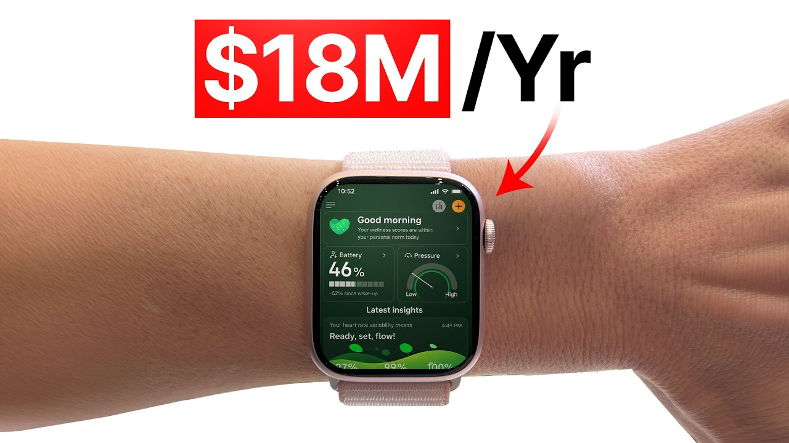

# How to Build an $18M/Year Apple Watch App (FREE MASTERCLASS)

Start building & deploying paywalls in 10 minutes flat: https://superwall.com/

## Table of Contents

* [00:00:00] Inside an 18 Million ARR App: What Drains Your Energy
* [00:05:33] Selling the Invisible: How the Meta Ads Hook Cold Traffic
* [00:17:54] The Six Ingredient Pitch: A Framework for Any Onboarding
* [00:26:48] Screen by Screen: Why the Data Sync Comes First
* [00:34:53] FOMO Over Benefits: What Actually Closes the Sale

## [00:00:00] Inside an 18 Million ARR App: What Drains Your Energy

Our ARR is around 18 million and we have about 17 million downloads. I guess it's closer to 18 million now. >> 18 million in ARR and almost 18 million downloads. Assia Poloni is the Chief Product Officer at Welltory, an app that reads Apple Watch data to show people what's draining their energy. When we got to the app onboarding behind those numbers, she showed me the internal deck she used to lead her team to a successful monetization strategy. [00:00:00 → 00:00:28]

>> I made them for my team as kind of like uh lessons I had to learned when she failed miserably at our onboarding over and over until it succeeded. >> The version that finally worked does something that I assumed would kill conversion. The first real call to action button asks you to sync your health data before you've even seen any other onboarding screen. I asked how many people actually do it. >> Over 90% of users hook up their health data, which I think is remarkable in this day and age. [00:00:25 → 00:00:57]

>> That permission screen allows the app to read the user's Apple Watch data and show them the stress already building in their body to make the rest of the pitch personal. When I asked Assia what builds trust the most, she actually said it was not social proof, the millions of users, five-star reviews, and the research studies. >> I think the most powerful proof that we use actually is that we are showing you your own data. You know it's hyper personalized, it's tailored to you because we pulled it right from your Apple Watch and we showed you in real time what's going on inside your body. >> Now the user has seen the problem in their own body. [00:00:55 → 00:01:28]

At the paywall, you'd expect Welltory to sell the benefits now. More energy, better days, feeling like yourself again. They tested that and it worked way worse. >> We tried the benefits towards the end, like you'll have more energy, you'll feel great, and it worked worse than this. >> Then Assia pulls up the actual onboarding and we go through it screen by screen. [00:01:28 → 00:01:47]

We get into why Welltory asks for notifications before showing much value, the question that pulls users back into their problem, and why most of its conversions happen after day one. If you're working on your apps onboarding, keep your own screens open while you watch this. This is the Superwall podcast. I'm Joseph Choi, founder of Consumer Club, a Discord where top consumer app founders trade alpha and what's working now in growth. I've been talking to members doing a million ARR and they tell me they've been using these two tools. [00:01:47 → 00:02:14]

Superwall has this free AI tool trained on 422 profitable paywall experiments across thousands of successful apps. You upload a screenshot of your paywall and it gives you an experiment idea to make more revenue with the same number of users at paywallexperiments. com. And if your app's doing at least 100K MRR, we host vetted dinners in SF and New York to hang out and network with other top app founders. You can apply with the typeform in the description. [00:02:14 → 00:02:36]

Also, these app founders have been telling me they use Rorke. I met Daniel, the founder of Rorke, at a dinner and I got genuinely really excited when he told me about Rorke Max, which is out now and has honestly changed the game for coding mobile apps. It's AI that one-shots full native iOS apps with Swift code, camera, sensors, haptics, payments, the whole stack. And as you vibe code with Rorke, you can install prototypes directly onto your iPhone with one click and then publish to the App Store in two clicks. If you've been waiting for AI coding that actually does native iOS apps well, this is it. [00:02:36 → 00:03:04]

I got you guys a discount. You can use the code superwall or use the link below. Yeah, tell me about the app and you're the chief product officer and I also noticed that you were a copywriter before, which is cool. You'll be able to give like really good insight into the psychology of such a such a huge app. What's the app? [00:03:04 → 00:03:23]

How does it monetize? How much money does it make? And uh what what's your role at the company? >> Yeah, my name is Asker. I'm the chief product officer at Weltery and Weltery solves a very particular problem for people. [00:03:23 → 00:03:37]

I don't know if this will sound familiar to you. It becomes more and more familiar the older you get, but I think that a lot of people have this experience where as they get older, they leave the house in the morning to go to work or wherever. >> [music] >> And they're like, "Okay, at the end of the day, after I'm done with everything, I'm going to come home and I'm going to do my laundry, cook myself dinner, spend time with my kids, and like maybe work on my creative projects or whatever. " And then they get home and the only energy they have left is to sit on the couch and kind of like scroll through TikTok. And like at some point, when you're doing this, you're like, "Crap, I've done this over and over for the past like 3 weeks. [00:03:37 → 00:04:23]

I have to get out of this rut, but I don't understand where my energy is going, and I don't understand how to get it back so I can get some life back into me for, you know, creativity. " Welltory's mission is to help people get those evenings back. The product does this basically by reading physiological signals from your Apple Watch and then using them to show you at which points in the day that horrible energy drain is happening, and helping you kind of find personalized hacks on how to make it stop and reverse it in real time before destroys your entire evening and you are doom scrolling on the couch again. We've been around for I don't know, 10 years. Yeah, we had our 10-year anniversary this year. [00:04:23 → 00:05:10]

Our ARR is around 18 million, and we have about 17 million downloads. I guess it's closer to 18 million now. >> That was a great overview. You're the Chief Product Officer, so I think there'll be a ton of insights into the product and how you make a product that supports, you know, 16 million ARR, but I am actually going to start screen sharing these ads cuz you guys run a lot of Facebook ads, and it made me curious about the marketing, obviously, but but also like the products because like I'll just show this one, for example. [00:05:10 → 00:05:49]

## [00:05:33] Selling the Invisible: How the Meta Ads Hook Cold Traffic

Like, this Apple Watch app catches high cortisol. And then it's like this picture of the person with the Apple Watch, and then there's this cortisol tracker image, and it says like critical. It's like super red and like kind of scary. This sort of like captures like what you said about the app, which is it helps you manage your stress, and it gives you a bunch of analytics and health data to help you with that. And then all these video ads seem to be like showing various different pain points. [00:05:49 → 00:06:21]

So, I'm curious like what is the psychology of your user? And like why are they coming to the app? >> Value proposition of Welltory is like takes a long time to flesh out. It's like, you know, like you're tired at the end of the day and you don't want to be tired. Those kinds of hooks that promise a long-term value tend to work poorly in like social media on Meta. [00:06:21 → 00:06:43]

Because on Meta, you need to like break through like people's blind spots. They're scrolling a lot. They need to see something really shocking. And so, the way we convey that value proposition in a super concise way is by basically saying, "Hey, here is an app that can show you what's happening inside of your body. Something scary is probably happening in there, and you want to know what it is. [00:06:43 → 00:07:07]

" And that's basically the hook for every one of our apps. It kind of like tries to cling to different physiological processes. Sometimes it's like cortisol. Sometimes we literally, and this is like a scientific thing that we do. We actually try to make clear what's going on inside of your arteries. [00:07:07 → 00:07:24]

And so, a lot of those a lot of those ads are about like things that are happening inside of your body, and the promise is that the app makes those scary things visible to you and manageable. >> That's a really good principle. It's just like like health is just such a important thing, and it adds like products that help your health. Obviously, our may maybe the most valuable thing that can exist [music] and just like as humans, but people don't really care about taking care of their health unless there's some some well like what's in it for me um in the short term like in the psychology. And this is kind of like reflected in your ad. [00:07:24 → 00:08:05]

So, it it the concept is like what is happening inside my body that might be kind of scary. And then maybe they're like connecting it to a symptom that they feel like every now and then and they didn't realize that oh, it's because oh, my stress is at 64% [music] and so, these ads are really well well done. So, I'm curious to to know like as a product person of the company are you making features like thinking about the ads because these ads seem pretty elaborate and it seems like there must be some sort of like scientific huge like testing machine that is informing like here's the pain points that people care about and then downstream of that what should the product look like to like be cohesive with the ads in some way? >> That's a great question. I think that for a long time Weltery's kind of big marketing machine and product lived in silos and that was not great for us because we were missing a lot of the insights that marketing was seeing and marketing was missing a lot of the kind of product value that we were packing into the product. [00:08:05 → 00:09:16]

I think we've spent the past year and a half two years really trying to fix that rift and we've seen uh a big payoff. Like basically when I looked at the ads that our marketing team was making, it would be a mistake to go and make those specific features. A lot of the times you just want to understand what what's the overall promise. And [music] we saw that the overall promise is, hey, people want to make visible the things that are going on inside their bodies. So, that's what we did. [00:09:16 → 00:09:47]

>> It's not really about showing the exact features that are inside the app. Like one of these features might be kind of boring to look at or maybe boring to explain. But, if you able to show it in a more creative, like, visual way in the ad, it's more about the premise. Could you give me some examples of that? Like, what are some of the really useful features in the app that you represent in a more, like, simplified way in the ads? [00:09:44 → 00:10:12]

>> I think the best example is the cortisol ad you were playing earlier. So, obviously, and if anyone tells you they can measure cortisol, they're that that's not true. But, what we do measure at Welltory is a specific process that happens inside of your arteries. And it happens when you are sitting still, so you're not moving, but your heart is beating as if you are taking a walk or something. So, we call this process sedentary stress, and basically what it's doing is it's putting pressure on your arteries. [00:10:09 → 00:10:46]

And that process is like what wears your body out over time, both like by the time the evening rolls around and 10 years down the line as well. You can't explain all of the science behind this in a little ad, but people do have an association like, "Aha, stress, cortisol, bad. This app can, like, tell me what's going on. " So, I think that's that's actually a pretty good example of it. >> Yeah, let me show a quick example of this. [00:10:43 → 00:11:07]

Here's how your Apple Watch signals high cortisol. Yeah, these graphs were just like super visual. Like, the Apple Watch is just scrolling through each of these charts, and they're super colorful. There's a huge number on each slide. And there's like an image in the background. [00:11:07 → 00:11:23]

It shows you the percentage. And then it seemed like the voiceover is also like saying, maybe like the symptoms, like, oh, if you've never tracked this, like, maybe you have like bad sleep, sugar cravings. Do you have these symptoms? Rising stress, low recovery. And then, it's [clears throat] kind of explaining it as, "Oh, it's because it's because of your cortisol. [00:11:23 → 00:11:44]

" And then it's showing the There's like a couple layers, like the the the background the audio is is talking about these symptoms and then connecting it to "Oh, well, here's here's the actual problem. " And then the visual of the ad is actually showing the the solution, which is you should or at least the beginning of the solution, which is you should be looking at these metrics. Like, stress, recovery, heart rate variability is an interesting one. I don't know it like a ton about health analytics and stuff, but could you explain what is heart rate variability and why doesn't like the default Apple Health app show this? >> It doesn't It just doesn't interpret it. [00:11:44 → 00:12:20]

Like, it gives you a number. >> So, is that what most of your features are doing to value as it's like that more about the interpretation of the data or is is it also like you offer certain charts and maybe like derivative data that uh the default apps don't show? >> It's interpretation of data. Basically, we take data from your Apple Watch and then we use it to help you see We do like uh you know, different formulas and there's like a ton of science behind it. But, basically help you see what what that data is saying about the processes that are going on inside of your body. [00:12:20 → 00:12:55]

Heart rate variability is a super interesting metric and I think that it's often really misunderstood, including by a lot of like fitness trackers um that are out now. So, what heart rate variability is is like your heart doesn't beat evenly. There's a variation in the time intervals between your heartbeats. The more variation there is, the more activated the parasympathetic part of your nervous system is. That's the rest and digest part [music] that kind of like helps protect your health. [00:12:52 → 00:13:27]

And then, the less variability there is, the more active the sympathetic part of your nervous system [music] is, which is responsible for kind of mobilizing your body to fight a lion. I think that a lot of people think that like higher heart rate variability is always better and lower heart rate variability is like always worse. That's not always the case because the balance between the two different parts of your nervous system shifts all the time. If you measure it at night when you're not doing anything and like nothing is affecting it except for the things that you did the night before and like how well you're sleeping, if you had alcohol the night before, then basically you can say, "Okay, in general, like if it's like a bit higher, you got deeper rest. Your parasympathetic nervous system that helps you rest and digest [music] was more activated and you probably feel better that day. [00:13:26 → 00:14:21]

" But, individual measurements throughout the day, they might not give you a whole lot of health insight. They basically just show the balance between [music] your parasympathetic and sympathetic nervous system. It can change for any reason. It does [music] kind of like affect how you might perceive the world, and that's also super interesting information that we give people in the app. But, yeah, that's a little crash course about heart rate variability. [00:14:21 → 00:14:47]

>> I can see like the value add now. Like the If Apple Health already shows you HRV, but then it's This is such a nuanced, complex uh metric, and that it means different things in different contexts. Like it makes sense that you would want to add more context to it. It reminds me of like uh like this emerging behavior where people like connect their analytics to ChatGPT and they up They dump like all their data and they say like, "Okay, like tell me what I should do with my health. " And particularly like with medical things cuz like I think there's like people definitely use ChatGPT for very like gray area. [00:14:45 → 00:15:23]

Like they probably should be talking to a doctor or but it's good for advice. And how are you thinking about AI? Are you integrating AI like >> I think AI is incredible. I have some qualms with the idea that you can just shove all of your health data into it and it will like tell you what's wrong. I think that like the key there is actually less data and more meaning. [00:15:23 → 00:15:48]

Not more and more data where it just gets confused that like can't draw correlations between all of these things. It gives kind of like standard almost bad advice. What we're doing with AI is right now we are learning how to basically make our data tell a story about how your body lived through the day. And then if we have like subjective data from people, sometimes people enter subjective data about what they were doing, we kind of layer it on top. So it's the physiological process that was happening in your body told as a story not as numbers. [00:15:46 → 00:16:25]

And then what was happening to you over top of it. And I think if you build something like this, then AI can be super useful because it can read the story of your day, it can see when the drain happened, it can see when recovery was happening. And if you give us objective data, it can also kind of tell you what was triggering one or the other. >> [music] >> And like if you have a lot of longitudinal data like this, you get really great stories about how people's health changed over time and why. >> Makes me think about the valuation of of the app because like when you have so much when you have longitudinal like long-term like historical data on on users, that probably contributes to retention a lot. [00:16:25 → 00:17:05]

Let's just go all the way from like user journey. So like we're we're looking at the ads right now, but then here's your App Store page and it says find out how you're really feeling in 2 minutes. Let's check. It's like a video as the first tab, which is pretty interesting. And then it says all your health in one app, get your energy back, track sleep and recovery, learn ways to reverse stress, monitor blood pressure, turn data into insights, and then a few other slides. [00:17:05 → 00:17:34]

This call to action in the video, like find out how you're really feeling in 2 minutes. Let's check. That seems like it's teeing up the onboarding in a way because when people download the app, that's what they're thinking, like okay, let's find out. I'm super curious to go through the onboarding and see how you Yeah, how you how you onboard a user. Maybe we could do the slides, too. [00:17:34 → 00:17:56]

## [00:17:54] The Six Ingredient Pitch: A Framework for Any Onboarding

>> Okay, so I actually like I didn't make this these slides for you. I made them for my team as kind of like uh lessons uh I have to learned when she failed miserably at our onboarding over and over. After like a round of failures and an eventual success, I decided that I'm never going through the horrors of like putting an onboard together from scratch with no framework at all. I think there is six things that make our onboarding successful in particular. And I think they can make any onboarding successful. [00:17:54 → 00:18:29]

And not just onboarding, I think you can use this framework to pitch just about anything, which I guess is a pretty useful skill for people to have. The formula, I think has to have six key ingredients, especially during the onboarding. You have to understand the human problem. You have to make some sort of product promise that makes people keep going. There needs to be some kind of key, something you know that no other solution knows that makes your product really high value. [00:18:27 → 00:19:01]

A mechanism, you have to show the user, okay, we're going to give you this key. Here's how you're going to use it to get the value you came for. You need some sort of proof that you're not full of Maybe you have a lot of users already. Maybe you'll have publications in scientific journals. Basically, any proof you can give users that you're not and you're not and that you know what you're talking about. [00:18:59 → 00:19:21]

You have the authority to kind of like show them around this product is good. And at the very end, this is where I kept failing spectacularly. You need to tell users >> [music] >> what exactly what bad thing is going to happen if they don't pay for your product right now. Like what they're going to lose out on. Not in the long term, not over the course of several years, but like today. [00:19:21 → 00:19:46]

What's going to happen if they don't subscribe today? So, a lot of times with most onboarding, the human problem you already you already pitched it in the ad. We don't start our onboarding with the human problem. We kind of know why users are coming to us. [music] But I think it's super important to spend a lot of time not just kind of like abstractly describing the human problem, but get very specific. [00:19:46 → 00:20:11]

I spent a lot of time listening to this wonderful podcast called The Dream. At some point, the woman, Jane Marie, who runs this podcast, goes on like this wellness journey. She's super tired. She doesn't know what to do. She feels like her life is slipping away. [00:20:11 → 00:20:28]

And I remember just listening to it over and over and thinking, that is that is our user. This person who has a lot of ambition, probably is like was uh like super high energy all the time when they were younger, and all of a sudden it's just it's just gone. And there you are on the couch at the end of the day doom scrolling through TikTok. And I think that a lot of people when they're creating a pitch, that is the biggest mistake we make is not spending enough time really describing the human problem, figuring out when throughout the course of the day the user really feels at most, and understanding it deeply on a very emotional level. That's not something that like AI can do for you or anyone can do for you. [00:20:28 → 00:21:14]

You have to kind of like sit with it, I think, for many months. The second ingredient is you have to make some kind of product promise. We start very bold on the first screen. Your Apple Watch knows what's make you what makes you tired and stressed. Hook up your data and we'll show you what's going on. [00:21:14 → 00:21:29]

It doesn't make like the full-fledged, you know, and then you will feel better and then you will do this, but it keeps people just curious enough to be like, "Okay, I'm interested. Let's keep going. " Then, uh we give them the heat. The reason you're so tired all the time is super simple. There's this thing called sedentary stress. [00:21:29 → 00:21:46]

It sucks away at your energy while you think [music] you're sitting still and resting. It's making your body work way harder than it has to. It's sapping you by evening. It's making you feel like crap. We looked at your data and today, right now, you already have 192 minutes of it. [00:21:46 → 00:22:03]

That's a lot of stress. This is not By the way, we really do take people's data and analyze it. This is all real. Then, you know, people are kind of scared. They're like, "What is all this stress and what can I do about it? [00:22:03 → 00:22:15]

I'm not just going to be less stressed, obviously. Like, you can't just like not be stressed. " And that's when we introduce the mechanism. Uh we're like, "Look, uh our app is going to show you in real time when the bad stress is happening and it's going to show you in real time when you are succeeding in relieving it and actually reversing the damage that you just did to your body. " In fact, we pull up your data and we show you like right on the timeline of your day, here it is. [00:22:15 → 00:22:43]

Here's evidence that your body knows how to do it and you have it in your power to kind of make this happen. And right now you're only relieving like 20% of the stress you've built up, but don't worry. With us, we'll show you when it's happening, you'll be able to stop it, you'll find your own ways uh to relieve it, and we'll show you when it's happening. All you have to do is [music] keep going with us, and you'll feel better. Then we have some proofs kind of scattered throughout the onboarding. [00:22:43 → 00:23:14]

I think the most powerful proof that we use actually is that we are showing you your own data. You know it's hyper-personalized, it's tailored to you because we pulled it right from your Apple Watch, and we showed you in real time what's going on inside your body. But, we also scatter like other types of proofs I think like everyone does in every onboarding. Uh, we have a lot of five-star reviews, we have millions of users, we've actually been published in scientific journals, we've partnered with a ton of universities for research. So, anything you can do to kind of prove that you know what you're talking about and can be trusted is really great for onboarding. [00:23:11 → 00:23:50]

We finished with FOMO. So, in our case is if you don't buy it right now, you won't know when the bad stress is happening, it'll keep draining you, and you'll feel just as tired tonight, and you won't be able to break the cycle. So, the FOMO is like it's probably building right now unless you pay us, you won't see what's driving it and how to interpret it and interrupt it. So, those are my, I guess, six ingredients for a successful pitch. >> I'm really curious to go through the actual onboarding screens now because and like see all these things in action, and I thought of a whole bunch of questions that I can ask about the onboarding. [00:23:50 → 00:24:27]

But, yeah, a couple things I noticed is like the copywriting is really good and the visuals are really good. Just as an initial question, what do you think matters more in an onboarding cuz you've probably done a lot of testing as well. Like, is it more about just what you say and each screen, or is it like how you present it with like how fancy the animation is, how like slick it looks? >> That's such a complicated question. I don't think that there's one thing that works for everybody. [00:24:27 → 00:24:58]

In our case specifically, we are solving the super hard problem of making the invisible processes in your body kind of like visible. And when we show them to you, we want it to evoke a lot of emotion. Like, oh, it's like this bad stress eating you. There's stuff going on inside of your arteries. And that's why we have so many animations and so many cool visuals that like illustrate that happening. [00:24:58 → 00:25:25]

We are incredibly incredibly lucky. Our design team is fantastic and uniquely capable of kind of deeply understanding the physiological processes that are happening and making designs that do a justice and really make it pop. I honestly think that like as a former copywriter, I think that words matter, but more than words and copy on each screen, the whole story matters more. So, it's the kind of like journey, like this formula matters a lot more than the actual words I'm using. I used to get really fixated on getting like the copy perfect, but it didn't work until you I had like the whole story arc uh down. [00:25:25 → 00:26:08]

>> It's all about the story and the message and then the more specifically the exact words and the exact visuals are also important, but they just support the overall formula. Another thing I noticed is like with Proof, when you sing Proof, a lot of people think of that as scientific studies and stuff like that, which you have, but your most most powerful version of Proof was just showing the actual preview of the product and showing here's your actual analytics that we just looked at with the commentary and the interpretation attached. Um so, it's like that's the best Proof that there can be is just like showing the actual result that you can give them before they even get into the app. Yeah, and there's a bunch of other insights, but let's let's get into the actual onboarding and then maybe you can uh dig into it more. [00:26:06 → 00:26:52]

## [00:26:48] Screen by Screen: Why the Data Sync Comes First

Just the first part, like your Apple Watch knows what makes you tired and stressed. So, that seems like the premise of the story of the onboarding. It's like And it's really interesting. You the very first button is just sync my health data. I feel like a lot of other apps like present one to three slides in the beginning just showing, "Here's what this app is, by the way, like in case you forgot. [00:26:52 → 00:27:13]

" But, this is like super direct. Have you tested that? Like what Is there a reason why you go like straight for the the CTA? >> I'll be honest with you. I think probably we haven't tested it enough, but every time I tried to like do like a little like prelude, it didn't do as well. [00:27:13 → 00:27:29]

Over 90% of users hook up their health data, which I think is uh remarkable in this day and age. >> 90% actually go through with the with the sync. And the messaging is just very tight as well. It's like, "Your Apple Watch knows what makes you tired and stressed. " And so, it it's not even trying to say, "Like, hey, we're going to solve all your health problems. [00:27:29 → 00:27:53]

" CTA and connect it. It's It's It just leads with like the curiosity. I think like pitching the the the full solution and then click health, my intuition says that [music] would not convert as well. Probably not 90%. So, and then you go into like the the problem. [00:27:53 → 00:28:12]

>> So, yeah, uh it actually because we process health data, we don't go right into the problems because there's a lot of uh there's a lot of like agreement screens that has to happen. You know, we don't sell or share users' data ever with anyone. We want to make that super clear. And so, there's like a there's a lot of permissions. We actually make this thing that like most people think is a mistake, [music] which is we ask people to turn on the notifications right away. [00:28:09 → 00:28:35]

I know you're not supposed to do this. Everyone is like, "Yeah, show some value first and then uh but it has worked best for us right there. >> [music] >> And I don't know what to do with it. Like I know it's not best practice, but >> [laughter] >> there's nothing I can do. And uh yeah, we have uh we have a bit more permissions. [00:28:35 → 00:28:53]

So then we start with a teaser. It actually does take a bit of time for us to do all of the analysis. So we have to do like a little warming up first. Uh so we were showing people just how much data we're actually analyzing and making sense of. We asked them some questions. [00:28:53 → 00:29:09]

We want to segment our users super well. We ask them how they usually feel. Uh you'll be surprised about this one. This is just like such a interesting behavioral insight to me. Over half of women, and I think even like closer to 70% of women say they are low on energy or tired and drained. [00:29:09 → 00:29:27]

Men say either sometimes stressed or pretty good, no complaints, even when their data looks worse. >> And it's interesting that they describe it differently. Like for men it's like stress, and for women it's energy and drained. So it's good it's it's good that you like put both options in in these six options so that different people can choose the one that resonates more. >> And then finally we're like, all right, now I swear that with the next 2 minutes you'll see what's actually stealing your energy. [00:29:27 → 00:29:56]

Uh we snuck a trust screen in here because we're about to do uh a lot of woo woo science. And we want people to understand that like it's not it's not Uh we really partnered with some universities. Ever feel tired even when you haven't done much all day? We want people to have like an emotional connection with what they're about to see. We tell them that's that's hidden stress. [00:29:56 → 00:30:18]

It's wearing you down and it's making your heart beat faster than it should and makes your body work harder than it should be. >> Do you ever feel tired even when you haven't done much all day? And then it's like, yes, I know that feeling, or no, it never happens to me. How important is it to get like such a very simple buy-in like yes, [music] no, do you feel this problem? >> I think we're not necessarily even to get up trying to get a buy-in, we're trying to emotionally put people back in a place where they remember what that feels like. [00:30:18 → 00:30:53]

And the buy-in is important, but I think we're trying to actually slow the onboarding down after like, you know, all these agreement screens and all of these like education screens, we want them to come back to an emotional place where they remember why they came here and it's because they feel tired and they don't know why. Then we tell them that's it's it's really simple. It's this thing in your that's happening in your body, it's making it work overtime and it's wearing you down. And in fact, yesterday or the day before or today, depending on which data we grabbed, you had 192 minutes of it. We show them in their data how much stress they experienced on whichever day that we grabbed. [00:30:53 → 00:31:32]

It could have been, you know, yesterday, the day before, depending on like where we get the cleanest like data sample. And we don't want to disappoint them too much because if you just tell people they're stressed, they're like, "I can't do anything about that. My life is stressful. Everything is awful and I'm not going to stop stressing at all. " So, we immediately then shift to an empowerment narrative and we say, "Hey, but even though you had all this stress, you also fought back to reclaim your energy. [00:31:32 → 00:32:04]

And we can show you when this happened. So, here's a timeline of your day. We kind of like drew it on a timeline. And here are the periods where you are recovering or active or stressed [music] and then there's a super cool animation that like zooms in on a blue period [music] and we say, "See this blue section? This is your body. [00:32:02 → 00:32:25]

It was recovering from stress. It was doing a super good job. " We ask them if they remember what they were doing. Most [music] people don't, but they kind of get that in the app there will be this mechanic that like helps you >> [music] >> understand what's helping you. And then we tell them that we'll help you find more ways like this to relieve built-up stress. [00:32:25 → 00:32:46]

And then we kind of what we wanted to do from here is kind of show them that this isn't a one-day occurrence, that [music] uh this stress that is wearing your body out on one day is actually doing a lot of it. There's like a lot of it. We pull up an entire calendar of the past 30 days [music] and we're like, "Hey, um this is like all the built-up stress you've had over the past month. It's a lot. " >> This is an amazing visual, by the way. [00:32:46 → 00:33:16]

Like the calendar days with the red bars on each day. >> It's also animated, so you can kind of like see them the stress tank like [music] filling up in real time. Then we say, "You've only been able to relieve, without our help, about like 20, 30. " Everyone gets a different score. Um 30% of it through recovery. [00:33:13 → 00:33:34]

And that was all the time that your body wasn't available for focus, creativity, and connection. And all of this built-up stress kind of creates an exhaustion cycle. Uh that's what's making you makes you feel like so worn out and [music] tired of life over time. And with us, you can break the cycle. We've already changed the lives of millions of people. [00:33:34 → 00:33:55]

" We show people some reviews. And then we end with a FOMO paywall, "This stress that's [music] eating up all of that energy you could have for connection and creativity and whatever it is you want to do, spend [music] time with your kids, is building up right now. And you want to see what's driving it, don't you? And how to interrupt it. And that's kind of where where the onboarding ends. [00:33:55 → 00:34:22]

>> The most profitable app founders I know have been using Superwall to A/B test their paywalls because yes, they have the basics like building and deploying paywalls super quickly without coding, targeting users with different paywalls based on behavior and demographics. But now, Superwall AI actually predicts who will subscribe before they see a paywall. The AI can do this because Superwall analyzes over 1 billion paywall interactions to score user intent and then recommends optimal pricing in real time. A good way to start is paywallexperiments. com. [00:34:20 → 00:34:49]

It's a free tool that gives you data-backed paywall experiment ideas to increase your app's revenue. [00:34:49 → 00:34:55]

## [00:34:53] FOMO Over Benefits: What Actually Closes the Sale

It's still very curiosity-driven even in the in the paywall. Like you would think that maybe you pitch more of the product and the features or the benefits. Like I feel like worst would be features and then maybe a little bit better is benefits, but it's not even really benefits. It's kind of just like it is like see what's driving it and how to interrupt it, but that was the sub headline. The actual huge headline is stress is building right now. [00:34:55 → 00:35:18]

So, it's still like a little bit problem-focused even on the on the the pre-paywall. >> And you know, we tried the benefits towards the end. Um like you'll have more energy, you'll feel great, and it worked worse than this because I think that benefits are things that actually work better in like brand stories. Um like stories about like the great wonderful future. I think with the onboarding when you want people to buy, I don't want to say this is kind of mean, but scare tactics, like what you're going to lose right here and now works a little bit better. [00:35:18 → 00:35:56]

Like what's going to happen if you don't buy it right now. Yeah, I think uh compared to like the energy story that we had at the end before like uh stay with us and I think it there was like a screen with like your energy bank filling up and you'll feel so much better. Like in a week, you'll feel like this much better. In a month, you'll feel this much better. We have, you know, that chart showing your progress. [00:35:56 → 00:36:18]

And that didn't work as well. >> I wonder if that applies to just the health niche or just even like the stress within the health niche or if it's a broadly persuasion like emotional journey. Cuz it seems like you guys started with diagnosed problem, the user starts to feel what it you know, remember what it feels like in their stress, and then immediately switch to but is is more about hope and empowerment and you know, you can actually change it. It's just you you know, you're not doing it enough. There's there's only 20% of of your potential. [00:36:16 → 00:36:57]

It's about the potential. And then you say, you know, illustrate more of the solution and say here's what you could be doing, here's how we help. >> [music] >> Um and then you show some more testimonials, some more proof, and then you go straight back into the FOMO like at the very end. I feel like that is sort of similar to a uh like a sales call. You know, it's like diagnosed problem, solution, and then to actually close the deal, you have to there needs to be some sort of urgency or like some sort of reason to buy. [00:36:57 → 00:37:25]

I guess people are more are a little bit more fear-driven than desire-driven. >> I think it depends. I don't want to say this is only a health and fitness problem, but like there is there's like different categories of apps like right there apps that like um like help you order food or like help you get somewhere. There's like Uber or like uh Spotify where there is a trigger that happens throughout your day and you're like, all right, this is going to going to pick it up and use it. And that's when it's really easy to sell the benefit when there is like trigger action, trigger action. [00:37:25 → 00:38:01]

You know, play a song anytime you want or like something like this. With these apps, health and fitness, I think also this probably applies to language learning too, where there's no like obvious trigger of like how you're going to use it and when. Um I think in that case specifically, the FOMO and scare tactics might work a little bit better. What terrible thing is going to happen to you right now if you don't sign up? >> That that makes a ton of sense cuz like like yeah like you said Uber is more or DoorDash is more of a like you don't like the pain is already immediate. [00:37:59 → 00:38:37]

Like the user when they pick up DoorDash the pain is already there like I'm hungry. They don't need to be reminded of it. But then with health it's like it's more of a long-term thing like this will kill you over time. Like you don't like you feel stressed in in the worst moments but that worst moment might not be how you feel exactly right now. That's a pretty good like meta principle like depending on your category think about what is the triggering moment that actually causes the deepest pain that your solution solves. [00:38:37 → 00:39:10]

And if it's not an immediate pain point that the user is probably feeling right now during the onboarding then you need to kind of like get them into that to remember that state again. >> And then do you have like paywall screens here too? >> This is the paywall screen. >> It is the paywall screen, yeah. So you don't have other plans it's just 99 a year or 883 a month. [00:39:10 → 00:39:32]

>> Yeah and actually most of the time we just sell the annual plan. >> Do you do like testing at all where you test different pricing options and packaging? >> I wish we could do more of them. I'm sure you're familiar with the problem of churn in mobile apps. Right now we're just not big enough to offer more pricing. [00:39:30 → 00:39:48]

I really want our users to have kind of more options to pay us that makes sense for us but a lot of times it's just the annual plan. >> Oh just annual cuz like it says 99. 99 per year or 8. 83 a month but that's not the actual pricing plan, right? >> Sometimes we also have like a monthly option but a lot of times it is just the annual price. [00:39:48 → 00:40:10]

>> And is it hard paywall or is there like a trial or anything? >> It's a hardish paywall. There's It's a there's not a trial uh but you can just close it. >> Are Are most of the conversions happening right on the onboarding? Cuz I'm guessing there's like other triggering moments where you can um where you reintroduce the paywall. [00:40:09 → 00:40:29]

>> Yeah, we're quite unique in that sense in that most of our conversions don't happen on day one, which is a bit unusual for health and fitness apps. Like there's like a big burst on day one, uh but we actually have a long tail where I think over 60% of our conversions or something like this happen over the course of the next like couple months. >> That's great cuz you don't want to lose You don't want to lose people forever if they don't convert um on day one. 60% That's a lot. I guess it helps that you are a product that can proactively like show people things. [00:40:27 → 00:41:01]

Like here's your stat for this day. Like look at it and then eventually they build up this retention habit and then, you know, get usefulness out of the product and then um convert later on. And then what are you offering that's in the in the paid plan that's not in free? >> All of the like kind of vital health tracking. So, the stuff that tells you you're about to get sick or like something is really wrong, um blood pressure, um that you can just enter and like kind of like get an analysis of it. [00:41:01 → 00:41:31]

All of those things are free and basic kind of health metrics. So, like your, you know, energy battery, how much stress you've built up, your sleep score, which is something that I hate. I hate scoring people on their sleep, but people expect it. How [laughter] much activity you've done. Uh those are all free. [00:41:31 → 00:41:51]

And then behind those there's kind of a deeper analysis um that shows you how your trends have changed over time, that break your day down into a timeline when you can actually see periods where you were drained or recovering or reversing the damage, activity recommendations that help you kind of improve the elasticity of your arteries over time so you become more stress resilient. [music] Like all of those things are paid, and but all of the things that we kind [music] of think are more immediate and could be life-saving in some cases are free. >> I'm curious just from your perspective within the app industry overall, are there any other types of apps that pull data like this? Cuz I feel like the benefits of this dynamic that you have where you there's all this data already on someone's Apple Watch and in someone's like Apple Health data already. And when you pull it, you're able to do all these magical moments like showing them their own analytics like right away during the onboarding that is almost like a magic moment that Gen AI like does for a lot of other apps, but then you guys do it for like such probably a lot lower cost compared to like you know, using using AI tokens doing Gen AI. [00:41:48 → 00:43:08]

And it's like personalized, of course, like with Gen AI you the most you could do is probably take someone's survey answers during an onboarding and then convert it into some story that about you know, that's personalized, but pulling someone's data from their phone is is such a hack for personalization and onboarding. Do you feel like there's any other categories that can do that? >> There are a ton of apps in the space that do the same thing, that take your data and try to give you guidance using it. And these are some some of these apps are incredible. Rise, I'm a huge fan of. [00:43:08 → 00:43:41]

Bevel is an incredible incredible [music] app. I think that there is a lot of room to make people's recommendations in any aspect [music] of life more personalized using health data analytics. I think actually like the next frontier is an AI that knows how your body is feeling at all times. >> How your body is feeling at all times? In in what ways? [00:43:41 → 00:44:07]

>> I don't know if you experience this. I think that I just like because I've been staring at people's health data for 10 years, I kind of know how much what's happening inside of my body informs the way I tend to think and perceive [music] the world. So, I know that like if my stress is climbing and my sympathetic nervous system is in overdrive, I can like I can sometimes I have I have like a rage issue. I can like have an anger outburst. It is not me. [00:44:04 → 00:44:35]

It's like my physiology. I think that the way we communicate with each other, the thoughts that we have, the way we experience the world and other people and the way we connect is super informed actually but what's happening inside of our bodies. And I think that's really helpful information if you want to create an AI chat that like helps people get anything done. It should probably be adapting to what's happening inside of you and changing its tone based on that. >> Yeah, that has so many applications. [00:44:35 → 00:45:08]

It's just like all all of human behavior through the lens of what's happening in your body. >> I think that's actually where we outpace or like where our approach is different from all the apps that I've mentioned because like [music] there's a lot of apps that like will analyze your health and try to give you like recommendations like oh, you like slept bad so your recovery is not that good so like push a little bit less. And but I think we're the only one that actually makes visible what's happening inside of your body. I think that's the big the big difference. >> By visual you you just mean like the the charts and like the way that you present it. [00:45:03 → 00:45:48]

>> When you're sitting and your body is experiencing this kind of state where you're sitting still and your heart rate is beating at like an elevated level that is different for everyone personally. It's literally there's a process that's happening that is like leaving tears, micro tears in your blood vessels, and then there's like all sorts of like bad things that happen that like wear you out over time. When we say stress, we don't mean an abstract metric like your HRV is higher or lower compared to like what you usually are. We are actually measuring that process happening in real time, and it's a huge difference. >> Interesting. [00:45:45 → 00:46:23]

The micro tears. And then what like what chart like shows you that in in the app? >> There's a ton of them. Uh so there is an entire stress category, and if you look inside of it, it like gives you different kinds of views of your stress levels. It can show you your total stress minutes for the day. [00:46:23 → 00:46:42]

It shows you like how much stress you accumulated each day of the week. You can change chart view. And this uh this hilarious um my designer calls this the snot graph, the one that you're looking at right there. Uh yeah. >> [laughter] >> So so like when stress is like building up in your body, you have about a 2-hour window after it starts building up when you can relieve it with the activity or exercise. [00:46:42 → 00:47:08]

And the snot chart shows like how much you built up and how much of that you can relieve. Uh and then it shows you kind of like when you were uh relieving it with activity or exercise or something like that. It's a super neat chart view. >> Do you have any like cool metrics that like how how the product has helped users? >> Over the the last 10 years, we've accumulated so many stories. [00:47:08 → 00:47:35]

But there also really interesting things that kind of you can observe in people's metrics. For example, when people follow our activity recommendations, we can see that over time there their arteries are getting more elastic. They're able to handle more stress. Like the threshold when like an elevated heart rate turns into harmful stress goes up for them. They can like tolerate more [music] pressure. [00:47:32 → 00:47:56]

Also really cool thing when you to observe is when you kind of like follow the sleep guidance, your HRV gradually goes up. A single metric won't tell you anything, but if you see like a trend of people's like average HRV gradually climbing, it's usually a good sign. >> What is that metric you look at like the heart rate response to stress? >> So, it's basically like your the capacity of your arteries to handle [music] like in intense blood flow. And like the more fit you are, the more flexibility your arteries have when you do like high-intensity training, you're increasing the elasticity of your arteries. [00:47:56 → 00:48:33]

>> [music] >> And so, when you sit back down and your arteries have like kind of more elastic capacity, a higher heart rate doesn't harm you as much. And that's really cool. >> And then how do you show that to the user of with the arteries elasticity? >> We're still figuring out how to do this in in a more readable way. We've tried every which way to like explain what stress actually is. [00:48:33 → 00:48:55]

We have like published articles on our site about it. We add like little help things. That's a tough UX challenge. And still I'm still folding it. >> Random niche question, but like for founders who probably have a lot of stress, I feel like founders kind of love stress in a way. [00:48:55 → 00:49:12]

Like we we we want to have that locked in feeling or that like frantic crazy feeling of of like the thrill of entrepreneurship. Is there Is there a difference between good and bad stress? Like should some people not worry too much about having too much stress? Like like if a founder wants to be healthier, but also not just like kill all their motivation and just reduce the stress at all costs. Like what should they do? [00:49:12 → 00:49:46]

>> You should absolutely not. Stress is a great thing. Stress helps you work better. It kind of like mobilizes your body to meet challenges. It helps you get ahead in life. [00:49:44 → 00:49:55]

It's a wonderful thing. It's not bad. What's bad is if there is too much of it and it's left unreleased over long periods of time. So, what we try to teach people how to do is like notice when it's happening. Uh and if it gets to a certain point, have different like hacks in their pattern bank that they can use to relieve it. [00:49:55 → 00:50:18]

And we can physiologically show them what's working and what isn't. So, I think that stress is absolutely not bad. It is really good for us. What's bad is unchecked stress over long periods of time. >> I think some people are like scared that oh, if I relieve all my stress, then I'll just sit around all day and not and not be productive. [00:50:18 → 00:50:37]

But, that's just like not true. Like, there will always be more things that will continuously like pull you to to to get stressed again and be be productive. And then it's just about, like you said, like the recovery and just [music] um how do you respond to it and not let it like damage your body over time. And then you can be more productive and make more money. Well, this is a super super awesome to go through this app and just like the product insights from from building this app. [00:50:37 → 00:51:03]

I learned a ton. Uh so, thanks so much for being on the pod. Are Is there anywhere people can find you or do you have any like uh calls to action? >> I'm very annoying on LinkedIn. You can find me there. [00:51:03 → 00:51:15]

>> We'll link you in the in the description. Thanks so much, Asia. >> Yeah, thanks so much for having me. >> Something you might not know, most of the founders I cover on this podcast are hanging out right now in the Consumer Club Discord sharing with each other what's working now for consumer apps. So, you can apply to join Consumer Club if that sounds interesting to you. [00:51:14 → 00:51:32]

And this is the Superwall podcast. Of course, you got to check out superwall. com. We have more videos on the channel. So, dig into those to learn from app founders who are willing to share super tactical stuff about app growth. [00:51:32 → 00:51:43]
