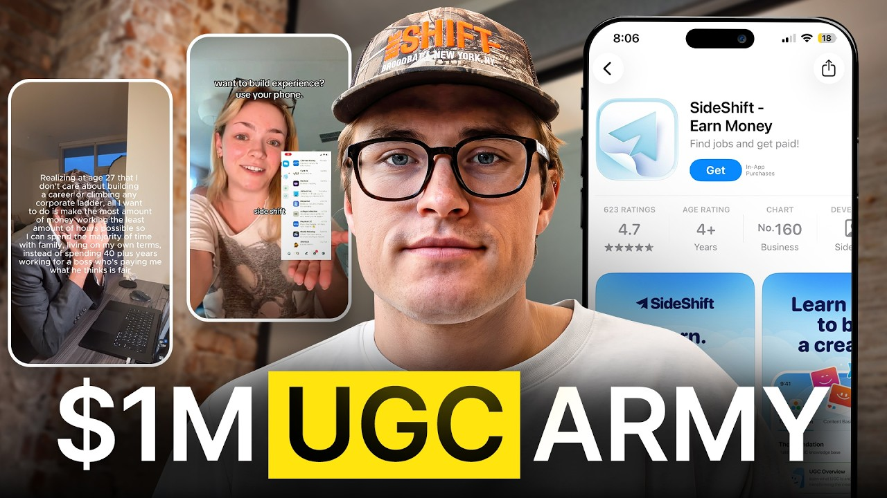

# How To Grow Your App 23x Faster Than The Competition

Start building & deploying paywalls in 10 minutes flat: https://superwall.com/

## Table of Contents

* [00:00:00] Intro and UGC Creator Programs
* [00:02:47] Building a UGC Team
* [00:07:57] The Two Phases of Creator Programs
* [00:10:37] Finding and Evaluating Creators
* [00:15:17] Creating Better Creator Briefs
* [00:19:24] TikTok vs. Instagram for UGC
* [00:21:02] Narrow Niches That Are Working
* [00:23:22] Expanding Into Adjacent Markets
* [00:32:06] Scaling Creator Programs Internationally
* [00:37:37] Turning Organic Winners Into Paid Ads
* [00:41:14] AI for Creator Recruitment and Operations
* [00:43:21] Sideshift V3 and Paid Ads

## [00:00:00] Intro and UGC Creator Programs

Some of the creator programs Canyon Praandandy sees are doing seven, eight, even nine or 10 figure views a month. So I asked him a simple question. If you were trying to grow an app faster than everyone else right now, where would you look for an advantage? His answer was not more creators or bigger audience. It was look for markets that look too small for most people to bother with. [00:00:00 → 00:00:21]

As far as the niches that I'm seeing perform, you know, very, very well. It's these niches that are so narrowly defined that it feels like the target audience is actually just not big enough. >> That sounds limiting, but Kenyon's play is to just own one specific audience first, then expand into adjacent markets around it. In our conversation, he explained how you can take a $10,000 a month app to a $100,000 a month or even a million a month. But finding the market before your competition does is only half of it. [00:00:21 → 00:00:49]

You still need to know which creative is actually worth scaling. You know, I could take this video that already did 11 million views organically and run it directly as an ad. >> 11 million organic views looks like the obvious winner, but Kenya says it's not always that simple. >> And even when you have videos that may not be performing well organically, there's a chance that they perform well on paid. And so, just because a video flopped doesn't mean that that video was for nothing. [00:00:49 → 00:01:13]

So, we went through how Canyon finds an unsaturated niche and expands beyond it without losing the audience that made it work in the first place. He also explains how he decides which organic videos are worth testing as ads, who to hire once the campaign grows, and which markets outside the US still might be underpriced. If you're paying creators and still guessing what to scale, watch this before you spend more. Let's start with where he's seeing attention move right now. This is the Super Wall podcast. [00:01:13 → 00:01:38]

I'm Joseph Choy, founder of Consumer Club, a Discord where top consumer app founders trade alpha and what's working now in growth. I've been talking to members doing a million AR and they tell me they've been using these two tools. Superwall has this free AI tool trained on 422 profitable paywall experiments across thousands of successful apps. You upload a screenshot of your payw wall and it gives you an experiment idea to make more revenue with the same number of users at paywallexperiments. com. [00:01:38 → 00:02:02]

And if your app's doing at least 100K MR, we host vetted dinners in SF and New York to hang out and network with other top app founders. You can apply with the type form in the description. Also, these app founders have been telling me they use ROR. I met Daniel, the founder of Ror, at a dinner, and I got genuinely really excited when he told me about Ror Max, which is out now and has honestly changed the game for coding mobile apps. It's AI that oneshots full native iOS apps with Swift code, camera, sensors, haptics, payments, the whole stack. [00:02:02 → 00:02:29]

And as you vibe code with RORO, you can install prototypes directly onto your iPhone with one click and then publish to the app store in two clicks. If you've been waiting for AI coding that actually does native iOS apps, well, this is it. I got you guys a discount. You can use the code superwall or use the link below. I want to talk to you about teams because I actually I put out a tweet like a long time ago and I was kind of distilling like the three different roles like the brain rot strategist, the like crazy outbound like recruiter and like some other thing like manager or something cuz I feel like people think that UGC is like this one thing like oh you just hire a bunch of creators. [00:02:29 → 00:03:01]

## [00:02:47] Building a UGC Team

If you think about it like a company and you think about like the team structure and everything, there's probably like an optimal way to do it and you've seen like hundreds of the best campaigns that do eight nine figure views a month. So, let's talk about like what is the best way to actually like create a UGC team. I think building out a team is really one of the things that allows you to scale a program from, you know, seven or eight figure monthly views to 9 to 10 figure monthly views and scale up from, you know, single-digit double-digit creators to hundreds of creators. And I think like the actual process and methodology of running a UGC campaign really starts to shift as you have more than 10 creators. And there's just a lot more that is required in order to kind of keep the quality bar high as you bring more creators onto your program. [00:03:01 → 00:03:53]

The first person I usually think about bringing on is just like a general manager, admin ops. The background is usually creator that has gone viral before, understands content strategy. They have worked with creators, have worked on the brand side. And so you're looking for people that have a little bit of experience actually managing these creator programs. They can really lift a lot of the day-to-day time that you spend in actually managing creators. [00:03:53 → 00:04:19]

And so that might mean doing video reviews. That might mean sending out updates to creators on a daily basis. That might mean checking in with creators and pushing out new content formats, doing research on your behalf. And so they're kind of this jack of all trades that can do a little bit of everything with the goal of being able to just buy you back time because running UGC campaigns it's super time inensive. That's like one of the biggest bottlenecks is it does require somebody to be super in the loop, super tapped in, talking to creators every single day, finding new formats every single day because these algorithms are constantly changing and creators are hard to work with and if you're not on top of them they're just going to push out lowquality content. [00:04:19 → 00:04:59]

they're going to drop off and be inconsistent. The way that I think about typically structuring like these initial manager contracts is [music] I usually start them out as like a a one-month pilot where I'll give them a retainer. It typically depends on like the size of the program, but usually in the range of like $2 to $4,000 a month. I think like about on average $150 per creator is a good baseline. And I think another way that we've been able to get really good deals and find great managers is by giving them bonus percentages if the campaign performs well. [00:04:59 → 00:05:32]

And so pretty much how you can configure this is let's say you have a deal structure with your creators where you're paying them a $1,000 retainer and a $1 CPM. You could give that manager f let's call it 5% I think is a pretty good baseline of all bonuses that the creators get on the campaign. They're going to be super incentivized to make sure that when they're doing video reviews, creators are not posting bad content. They're going to be trying to identify the best creators and trying to identify the best winning formats because they're naturally super incentivized. If the campaign goes viral, they're going to make a lot of a lot more money, which is obviously going to be, you know, a net positive for you. [00:05:32 → 00:06:10]

>> Okay, I think you want to hear this. For the past 2 years of my life, I've talked to 743 app founders. This is literally my calendar a lot of weeks because I want to figure out who's actually making money. And for the ones making1 to10 million a year, I dug into their playbooks from ideiation to build to marketing to figure out what actually made them successful and like how much of that is even profit. But what I found is the difference between apps that kind of work out versus the one that seem to like hypers scale effortlessly is actually more of a science than people think. [00:06:09 → 00:06:38]

And running this pot, I get a lot of similar questions around app businesses. So after two years of doing this, I finally sat down drink energy drinks and I just spent the last four days straight combining all of my private notes plus the growth systems I've personally run to add like 6 million er now for the founders of some of these apps. And I created a presentation. I'm going to give this presentation one time on a live Zoom call on Sunday night, October 11th. It will not be recorded. [00:06:38 → 00:07:03]

I'm just giving this to people who are really serious about maximizing this run we have with consumer apps right now. It'll be fun, interactive, the past 2 years of consumer apps. And to be honest, like the past 8 years of me being in internet businesses are just packed into this for you. Also, it's free, of course. Use the link in the description to register. [00:07:03 → 00:07:20]

I'll see you there October 11th. It's like a sales manager. You know, you give a a large percentage of the view bonus to each individual creator, but then you also give a percentage of the managed creator's views, a smaller percentage to the to the manager. Um, so that makes a lot of sense. So, you said that's the first hire that you would do to kind of like buy back your time and like have have them be jack of all trades, but what is the highest leverage person that you can hire, I guess, like creatively or like in order to actually get results to get a bunch of views, to get a bunch of downloads on your app? [00:07:18 → 00:07:53]

What is the most strategically important role that maybe you yourself should do, but also like maybe you could be looking for that trait in the person you hire? [00:07:53 → 00:08:03]

## [00:07:57] The Two Phases of Creator Programs

I think there's like two phases of creator programs. There's like the cold start discovery phase where you haven't really found content market fit. You're not consistently going viral. Performance isn't necessarily that predictable. And then you kind of have the scale up phase [music] which is okay, we have proven formats, we have creators that are like pretty solid and are pushing out quality content. [00:08:03 → 00:08:24]

We just want way more creators. And so I think when you're in, you know, this more so discovery phase, someone that is a strategist and almost like a creator coach to an extent, like those are kind of the the attributes that I'm looking for because the highest alpha that they can drive [music] for you is finding, you know, good winning content formats and teaching creators and coaching creators to push out their vision of what a good video with that format looks like. In the early days, if you don't have a manager, if you don't have a strategist on board, like this is probably the highest use of your time. Find winning formats, find winning hooks for your creators, review every single one of the videos that they make. Give them feedback, coach them on how to make those videos better. [00:08:24 → 00:09:09]

Once you start consistently finding winning formats, your creators are going viral, the program feels like it's going well, you're like, we want to ramp up spend, I think that role shifts to more of a recruiter focus. Onboarding creators is really time intensive. Regardless of if you're reaching out on Instagram, Tik Tok, if you're reaching out on Sideshift, if you want to find good creators, you have to put in the hours. You got to send out messages. You got to filter through applicants. [00:09:09 → 00:09:34]

You have to, in my opinion, get on onboarding calls to actually determine if these creators are a good fit and to get them bought into the program. And so you're really looking for someone that has an eye for finding good creators because obviously anyone can go out and reach to reach out to the creators that have done tens or hundreds of millions of views before. But the highest [snorts] leverage creators that people can bring onto their team in my opinion are creators that are relatively newish to UGC. Maybe they've done a campaign or two. Maybe they've had a little bit of success, but they haven't had worlds of success. [00:09:34 → 00:10:09]

And so, they haven't been exposed to super high UGC retainers and payment structures. And so, you can get them in at a really low rate and build up that relationship, build up that loyalty, and kind of just basically integrate them into your in-house program. And so, I think like yeah, at at the start, like it's super important. You need strategy. You need a good content format and a good content team to be able to actually like win on social, but over time like you just want recruiters that can help you really just scale and just get in front of more talent. [00:10:09 → 00:10:39]

## [00:10:37] Finding and Evaluating Creators

>> Let's dive into each of those roles. So there's the strategist/coach and then there's the recruiters. For recruiters, you want to find that like underpriced talent. Like find someone who's has like maybe one or two case studies, got maybe seven figure views, but hasn't gotten like a crazy amount of views and a crazy amount of campaigns. What are you looking for when you're looking at these creators? [00:10:37 → 00:10:59]

Like even if they don't have a ton of case studies, what makes you believe that they're going to that they have high potential >> at a quick glance? And this is like, you know, just like a a filter to to scan through people if you're, you know, running through hundreds or thousands of different creator options. It may be crappy to say, but like a face card really goes a long way. if someone has a face that can go viral on and it doesn't even need to be like the most attractive person in the world, but like just like a a face that you know people want to to scroll on or people want to watch, you know, people will be retained. It can really just make a mediocre piece of content perform a lot better. [00:10:59 → 00:11:37]

And so I don't think it's a hard requirement, but I think it's like if you see that even though they may not be a great creator, if you can coach them and train them up, like they're going to have a ton of success. I think the other thing that I look for is it's very easy to like look at past performance and think that, you know, it's going to be an indicator of future results. So, oh, you know, this creator's done 5 million views. This creator's done 10 million views. Like, I'm sure they're going to crush on my campaign. [00:11:37 → 00:11:58]

I actually think it's a lot more about the quality of the content. You know, these algorithms are variable. They could have just gotten pulled into a campaign where there was like very clear, easy winning formats. Could have just been text on screen. Could have just been like very loweffort content pieces. [00:11:58 → 00:12:13]

And so I'm looking for creators that are actually just pushing out highquality content [music] even if the past performance hasn't been super high. And so I'm really looking for like talking style storytelling creators. Like if someone can tell a good story to the camera, in my opinion, like I can teach them everything that they need to know about UGC and about going viral if I get them the right content formats. But that's actually like generally a pretty hard skill to teach is like good storytelling content. And I think it's a lot easier if you already have these creators that can just [music] yap to the camera. [00:12:13 → 00:12:46]

When I'm just like naturally scanning through creator profiles that I'm trying to pull out, generally like how they go through our onboarding process, like if they are super responsive, um like asking good questions, like we get on a call and they're interested about what we're building [music] and they're excited to make content for it. like I'm gonna take that creator over the creator that has, you know, the 10 star resume that is unresponsive, misses their meeting, is like hard to get in touch with. The reality is is like those creators just create way more headache for you down the line. They're going to say they want to create content for you. They're going to get onboarded, but they're going to be on five or 10 other campaigns. [00:12:46 → 00:13:23]

You're going to spend a lot more time just like checking in with them, making sure they're posting, etc. And so when you have creators that are like very self-sufficient and are just naturally excited to join and get on your program, there's going to be a lot less handholding that's required. >> What's the maximum amount number of campaigns that a creator should be on at any time? Like what's like a red flag? >> Generally for me, I think anything over five is like really hard. [00:13:23 → 00:13:48]

I'm really looking for creators that like want to build up accounts, treat them as long-term assets, and invest into like a few campaigns at a time instead of trying to just like pick up 10 or 20 campaigns and hope that one or two of those pop off and go viral. I think like what happens when you have creators that are on a lot of these campaigns is if they don't see success in a week or two, they're just going to go rogue. They're going to ghost you. Um maybe they'll be nice enough to say like, "Hey, I don't think this campaign is a good fit. " But the reality is most of them just go completely unresponsive and you're like this guy posted for a week for me. [00:13:48 → 00:14:21]

Like what's happening? People on zero campaigns, I mean, unless they're like relatively new to UGC is a little bit of like a flag for me. And I think like having people that are on different campaigns across different niches can actually be really valuable because they can pull in hooks that are working in one niche, formats that are working in one niche, and figure out how to kind of merge them or morph them into whatever your product is. And so I think there actually is a little bit of value in having creators that are not like only posting about your brand but are also kind of I guess getting a better sense of you know what's working across the entire ecosystem. >> You said you're doing research to find formats and then you're like talking to the basically like giving the creators guidance on how to execute those formats. [00:14:21 → 00:15:04]

What are you actually looking for in the like as you're coaching the creators? uh like if they put out a video gets like 5,000 views, you want more than that. Like what are you supposed to be looking for to give them feedback? [00:15:04 → 00:15:19]

## [00:15:17] Creating Better Creator Briefs

>> I think there's a few things here when you're actually working with creators. Like the way that I think about this is number one, putting together briefs that are super digestible. I think like putting together a really good creator brief is actually like a skill. I think it like can be super challenging to like, hey, I have all of these ideas. Now, how do I put this into like a bite-sized page where creators can easily scan through it, [music] get the value, but not feel like they're being overwhelmed? [00:15:17 → 00:15:45]

When I'm putting together briefs, I actually think like for the most part, you shouldn't be putting together entire scripts. Like, it should be reference videos. It should be hook ideas. It should be, hey, this is kind of where the CTA plugs in and different CTAs that you can use and overall [music] different like messaging themes. Like I think when you put together like word for word scripts, you like restrict a little bit of the creative freedom, which is sometimes where a lot of these, you know, really [music] great formats actually come from. [00:15:45 → 00:16:12]

And then when you're actually working with creators, like I strongly believe in reviewing every single video before it goes live, I think like as you work with creators for longer and you're like, "Okay, this creator is, you know, extremely self-sufficient. They're always pushing out quality content. " like sure lift like the video review for requirement, but I think when you're in the early days, like it's super helpful to be close to the pulse on what these creators are making before that content goes live so we can give them feedback so we're not just burning cash on videos that are not going to convert or not going to perform well. And then a lot of it is just like number one the content basics like are they filming with good lighting? Are they talking with good pace? [00:16:12 → 00:16:50]

Are they cutting out dead space? you know, are is this a video that someone would actually like watch and listen and retain to? Does it have, you know, a strong hook? Does it have a story that like makes sense? Is the product integration somewhat natural and doesn't feel super forced where this is just going to feel like a straight ad? [00:16:50 → 00:17:09]

And so I'm having a lot of my video reviewers now, like historically I've just had them kind of just like give feedback to the creators, but now I'm having just them put together Loom videos dissecting the videos that are actually require feedback. And also having them put together Loom videos walking through like what makes a good video, what makes a bad video. I think being able to see those things side by side is actually really helpful. And it doesn't even need to be on the specific video that the creator makes. So that when we actually are pushing out this content and messaging, we actually have an idea of like, okay, is it just not working cuz it's bad messaging or is it not working because it's actually just a really lowquality piece of content? [00:17:07 → 00:17:48]

In the beginning, when you're just starting out, you want the strategist to be doing video reviews. Also, the thing is it's kind of interesting how you review the video before it even gets posted, which makes it a little bit different from a sales team because you you don't just review your sales calls. You like literally approve the content before it goes out. So, there's a lot more quality control actually cuz I could see people doing the opposite of like just letting them post and then doing the review after. Like it's probably better to have the strategist as a reviewer in the beginning and then as you scale you have a strategist who manages multiple reviewers and then the reviewers probably don't need to be as highlevel strategic but they should have some kind of experience with content and be able to like give feedback. [00:17:48 → 00:18:35]

And then recruiters is like a complete almost like a complete separate thing where they're just people who know how to do outbound systems and and recruiting and people scouting basically. And then managers that we said in the very beginning is kind of just like the all-around. Maybe you add that first uh to just kind of like take over multiple of these roles and then as you get really good at at certain things, you start to add on the specialist roles. Is that is that like a good breakdown of of the roles? I would say like you bring on your generalist to just like buy back your time and be just another point of contact for these creators. [00:18:35 → 00:19:07]

So they're getting more check-ins, more feedback, just overall more attention and care cuz like nobody has 20, 30 hours to spend for the most part on their UGC program every single week. And so getting someone that can spend, you know, 10 to 15 hours like just dedicated to your brand and dedicated to working with your creators is super valuable. [00:19:07 → 00:19:26]

## [00:19:24] TikTok vs. Instagram for UGC

>> Let's talk about trends. What are like platforms you're seeing doing well right now like Facebook, Instagram, Tik Tok, YouTube Shorts? >> I would say over the past like 3 to 6 months, we have seen a really strong shift from Tik Tok to Instagram as far as performance goes. I think overall volume across the two is still relatively consistent, but like as far as like views go across the entire platform, like Instagram is driving probably 10 to 20% more views than Tik Tok [music] in the aggregate. And we've started to see a lot of companies layer in Facebook reels as well. [00:19:24 → 00:20:03]

I think part of the beauty of Facebook is like the way to crossost is actually super seamless for creators. Like they can schedule them all out in advance. they can just click one button, they can copy and paste over captions. Like it's not something that requires as much effort as like moving a video from Tik Tok to Instagram. And so I think if you just have like a good bonus structure in place, like most creators will genuinely be super happy to post to Facebook without any increase in base or like a super nominal increase in base. [00:20:03 → 00:20:31]

And so I think we're starting to see not necessarily people shift away from Tik Tok, but people realizing that Tik Tok is a channel that is hard to crack through. There's a lot of account shadow bands, especially in like the monetization niche. So, think like trading crypto platforms, even platforms like Sideshift, any platform where the main value prop is helping your end user generate income. Like Tik Tok specifically has been super super rigid on those pieces of content that are going out. And so, I think we're starting to see a big a big shift over to uh to Instagram. [00:20:31 → 00:21:04]

## [00:21:02] Narrow Niches That Are Working

>> Okay, let's talk about niches. Like, what are some like good good and bad niches right now? One of the niches that I think historically has always performed well that I would say is in a little bit of like a a pullback, like we're starting to see a lot more account suppression, a lot more shadow bands, just overall a little bit harder to crack is the monetization niche. And so I think this niche is relatively broad. Like you have, you know, UGC companies, you have, you know, side hustle companies, you have, you know, miscellaneous side tasks, you've got the crypto companies, you've got the settlement companies. [00:21:02 → 00:21:36]

I think there's really two things that have happened here. Like number one, like 6 to 12 months ago, people saw the opportunity. People started building products and so the niche itself has gotten extremely saturated and competitive. And what happens is when a good new net form or net new format like comes to light, all of these different companies are trying to find ways to recreate it, clone it, have their creators push it out. And so the actual shelf life on these videos is so much lower because instead of your just, you know, just your 10 creator team that's pushing out this amazing new format that you found, like the reality is is there's going to be dozens of teams that are trying to replicate that success and find a way to bring that format internally. [00:21:36 → 00:22:19]

And so naturally, audiences are just going to pick up on it more quickly and those formats are going to die out. As far as the niches that I'm seeing perform, you know, very very well, it's these niches that are so narrowly defined that it feels like the target audience is actually just not big enough. And so this might be like knitting, this might be ballet, this might be wrestling in MMA. Like it's these niches that are super super narrow where you're speaking to a really specific audience. And not only have I seen and heard from a lot of our customers that those pieces of content convert and per and just drive many more conversions as opposed to like super generic broad niches, but it's actually a lot easier to find those winning formats and have them last a lot longer because you have way less competitors in the space. [00:22:19 → 00:23:14]

And so if you do find a winning format, you're able to get so so much more out of it. And so definitely something that I'm seeing that's pretty interesting across the space right now. [00:23:14 → 00:23:24]

## [00:23:22] Expanding Into Adjacent Markets

>> And then you kind of have that like thousand true fans effect where there's not that many people creating content about it or making an app for it. So you can just own the whole space. But how much money do you think are is like in these types of apps? Like are these good businesses? >> They're good zero to one businesses. [00:23:22 → 00:23:43]

Like I think like most of these niches like you can comfortably scale up to, you know, call it $10,000 a month. Like if you if you can get success quickly, I think where you can turn those like businesses from something that's relatively small with a relatively low ceiling into a much bigger addressable market is if you can find a way to pull in like very adjacent audiences. And so I think like okay, let's say, you know, let's take like the ballet example. you know, there's only so many people that would ever spend money on a ballet product, but like if you can find a way to get into, you know, the entire dancing community and find ways to go after these adjacent markets, I think that's where you can actually grow the product much more quickly. And so I think it's helpful to understand like okay when I'm going after this niche market is there like a bigger I guess sphere of different kind of adjacent areas that I would potentially be able to draw customers from. [00:23:41 → 00:24:43]

My overall like thoughts on this is it's just super helpful to start with a really narrow market. And I think about this in UGC, but I think about this in business more broadly and then it's like what are all of these adjacent areas that I could start to tap into once I figure like I have this niche mastered. And maybe that is partially on building out more product capabilities, but it's also, you know, how do those product capabilities tie into different formats and different target personas that I can actually speak to? Personally, it reminds me of just like my own like with consumer club because originally it was like I would find people that were mostly app builders first and then obsessed with distribution and then I would like get a bunch of those people in Discord and then all those people resonate with like obviously but then there's other people that I found that are in the like info or ecom or like just like other non- tech spaces that now want to get into apps but they're like super cracked at marketing. So then like, oh now I'm going after those people and it actually makes the product better because now you have like both types of people inside thing and then you can have like you're kind of touching multiple spaces that are all solved by one solution. [00:24:43 → 00:25:54]

>> It's the exact same idea. And it's also like how can I grow that market? How can I get more people that don't care about this at all to start caring about it and they're going to care about it because I'm the one that introduced it to them? And so for example, like I think about, you know, the consumer app space and the consumer app community. Like if you look at that a year ago, you know, there's probably only a handful of companies that would ever be a potential fit for a consumer club, you know, type product. [00:25:53 → 00:26:22]

And now you look at this a year later and you think about how much bigger that market has grown. And so it's also like what are you know the headwinds like what what can I actually like lean into here and where do I see this market growing and what can I do from a positioning from a distribution standpoint to also help grow that market to bring people into this market that don't that never would have cared about it before. And so I think those are all like super interesting angles. Like once you master and have figured out how to crack that specific niche, the people that care about this stuff the most, go through the adjacent markets and then figure out how to continue to grow all of those markets simultaneously, which is a hard thing to do. But I think it's like that's where you can really, you know, take a call it a a 10K a month app into an 100K or a million dollar a month app is by really just figuring out how to just push and grow that market. [00:26:20 → 00:27:15]

And I think like a lot of these, you know, like Higsfield, VMAX type companies, like a lot of these areas, like, you know, if you look back a year, there was probably a very very small portion of people that were running this style of, you know, trying to to make money through, call it YouTube automations or just general monetization on these social platforms. And it's just been a massive influx of people. Number one, the tools are a lot better, but number two, the awareness is there and people actually see the opportunity in being able to generate, you know, sizable, meaningful income from working with these tools. So, it's like, how can we do that, but for our product, for our market? >> So, let me show you this. [00:27:15 → 00:27:56]

A lot of app founders I talked to have a feeling their app has viral potential, but don't want to be the person brain scrolling an hour a day hunting for formats, or worse, burning thousands on creators, shooting videos that just flop. [music] Recently, I've been telling every founder I meet about Spy Talk. It's basically an AI Tik Tok viral marketer that I've seen a lot of top app growth teams using. You just paste a link to your app and this agent scrolls hundreds of thousands of Tik Toks for you, finds the outlier videos from competitors who've already cracked the best formats that are driving installs in the niche of your app. And then it remixes the hooks, the angles, and then it makes playbooks so you can pretty much copy paste virality. [00:27:56 → 00:28:31]

And then it alerts you when it detects new breakout formats that would also work for your app. This is the only growth tool I 100% vouch for on this channel because there's a ton of Genai content tools out there, but none of them tell you what to make. Spy Talk makes sure you're never in the dark about what's actually working. Now, I'll put the link in the description. I'm really excited by what you said about like hundreds of niches that you can just build great businesses with because they're just so untapped and unsaturated. [00:28:31 → 00:28:57]

I feel like that is like the the pitch or like the dream for this whole like app like consumer app space because every human being on the planet is a consumer and each of those consumers has different interests and niches that they're into and so there should be, you know, hundreds of niches of apps that you could build profitable businesses for and they definitely have not all been tackled [music] yet. If you were starting an app, uh, a consumer app, what what niche would you be interested in right now? >> This might be a little bit biased. I'm a pretty big sports guy, like grew up, you know, playing hockey, baseball, football, soccer, and so I think like a really interesting niche is you see what a lot of these companies in, you know, the fitness space have done. And I think like I' I've even seen a few apps in like the MMA space that have kind of piqued my interests. [00:28:57 → 00:29:48]

And I think there's a lot of different ways that you can build these products for these specialized sports. Like I think like actually golf is a prime example of you know one of the sports that has some of the best consumer tech built around it. Like there's really really good products that you know help you analyze your swing, help you like track your handicap, help you like find all the different courses. And I think there's like a lot of interesting ways to do that for other [music] sports. Whether that's, you know, I'm a baseball pitcher and, you know, I want to like improve my form or improve my pitch speed. [00:29:48 → 00:30:21]

Whether that's, you know, I'm a hockey player and I want to, you know, incre improve my shot speed or my shot accuracy. Like, I think there's a lot of interesting angles here for different sports. And I think it's like a it's a pretty broad market given that there's literally hundreds of different sports out there. And I think like what's interesting to me too is like the angles and value props for every single sport are so unique. And so like what worked for golf is not going to work for baseball. [00:30:21 → 00:30:51]

What worked for football is not going to work for cricket. And so it's like it's kind of a like an entirely blue ocean and I think there's like a ton of opportunity here. I don't know like exactly what my angle would be, but I'm just naturally like super interested and and like just love sports in general. And so I would definitely like try to go after one of those markets and find out how to build a product that can, you know, actually just generally provide a lot of value in a way that can be kind of baked and packaged into a mobile app. cuz I think that can also be something that's challenging is like what is that like initial starting point where there's actually a use case for an app cuz you know it might be the case that for some of these sports like it just doesn't make sense to have an app because there's not like just a onetoone use case of where it could be plugged in. [00:30:51 → 00:31:37]

I think that could be an interesting space. I think we'll definitely see some more apps in kind of the you know sporty fitness athletic area start to pop up over the next year. I have seen the golf swing analysis apps. I've seen the like the coaching and then there's like the social aspect as well like if it's if the sport is inherently social then there could be a social component to the app of like finding other people that will do the sport with you or just connect. Okay, let's talk about international creator program scaling. [00:31:37 → 00:32:08]

## [00:32:06] Scaling Creator Programs Internationally

What does that mean? One thing that I've started to see over the last couple of months, honestly, it's like been this summer, is the shift from only focusing on USbased creators or even just like tier one based creators to going much more international. I think part of the beauty about this is, okay, the US market might be extremely competitive in certain niches, but for some of those different areas, like that content strategy, those formats, they haven't made it to other areas of the world. And I think also like a lot of these other areas of the world, like at least from a creator lens, they're like a little bit lagging behind as far as like actually understanding what high volume UGC is in canvas UGC. those markets are just starting to kind of pick up with the actual creator access and availability. [00:32:06 → 00:32:58]

And so like LATAM is a super interesting market to me. One of the cool things too about a lot of these markets is it's actually like much much cheaper to bring creators on board. Like let's say, you know, if you're paying $25 a video in the US, if you were to go down to LAM, like you may be able to pick up similar quality creators for $15 a video. And so what I'm starting to see a lot of companies do as well is they'll use a lot of these international markets as testing grounds to try to find new winning formats because they can get a much cheaper cost per video out there and then take a lot of those learnings and fuel it into some of their other markets. And so obviously like this can be you know dependent on your product availability like there might your product just might not be available in certain markets but I think like if you are able to like I highly encourage you to like make your product available internationally it just increases the pool of creators that you can work with. [00:32:55 → 00:33:57]

And so I think some of the markets that I'm seeing companies start to have the most success in right now is like Lata more broadly like bring in those Spanish creators like bring in a manager that like can speak fluent Spanish and can talk and work with these creators and give them feedback. I think Europe as well is a market that is starting to pick up a lot of traction. And then I also think like Southeast Asia. So think like Korea, Japan, Singapore, like all of these markets for the most part they have a lot of purchasing power and so views there are still comparably valuable to a view that you would get in the US. I think there's a way less volume of UGC content that is going into these markets. [00:33:55 → 00:34:37]

And so naturally I think conversion rates will be a little bit higher because a lot of the end user, the end consumer, the audience, they haven't seen some of these videos before. And so, you know, hopefully you'll be able to actually drive them through and they'll feel like it's an organic video. I think the rates are better for the creators that you're actually working with. There's a lot less companies that are going after these international markets and as a byproduct of that, naturally creators are just cheaper to work with over there. So, I think it's a little bit of trial and error and I think it's helpful to start with a small test pool of call it like three to five creators per market that you want to go after. [00:34:37 → 00:35:12]

Um, I think it's also easier to just like start with one market, nail it, and then move on to the next instead of trying to just like get creators from all over the world because I do think like the strategy, the coaching, the way that you work with creators across markets can vary. I think you can build patterns so that as you bring on managers, like they can kind of just, you know, take the playbook that you built out, tweak it, run with it. But overall, like super super bullish on pushing, you know, brands and and and builders to to go more international. I feel like there's al there's a lot of alpha in like finding a good manager as well because if you find creators that also speak English, it just limits your pool a lot. So, if you can find a manager, you can probably find like the really good creators who just don't even speak English at all and it just widens the pool probably. [00:35:12 → 00:35:59]

So, because of that, like do you feel like there's good places to find managers or like would you just find uh like a manager on Sideshift? Our manager network is still like very much so tier one country based. It's like one thing we're making an effort of right now is training up managers in other countries. The playbook that we're running right now is just taking our top creators and turning them into managers. And I actually genuinely like still believe to this day that that is the most effective way to find a really good manager. [00:35:59 → 00:36:27]

I think naturally not everyone has the luxury of like just having a really good creator off RIP. And so it could be helpful to bring in a manager before you have your great creator pool if you just don't have good creators yet. But it's so valuable because they already know the content strategy. You know, they already know how you like to work with creators. They already have an understanding of what's working and they don't need to be handheld as much. [00:36:27 → 00:36:51]

And I think like any time that you can save in having to like work with creators, work with managers, it's just like more time that you can spend on product and other areas of the business. And so I'm a big proponent of like, okay, you know, we have a few creators that are performing really well. Like, let's give them some managerial tasks. Like, let's maybe have them do recruitment. Let's have them do strategy. [00:36:51 → 00:37:09]

Let's have them do creator coaching and video reviews. And just try to figure out like what they're really good at. And then you can kind of start to like build the team around that. >> Can we talk about Sideshift a little bit? like even if people don't use Sideshift, I feel like it would be useful to just know like what you guys are building because you see like kind of the whole market and then you just respond and build the stuff that people want and that the your best customers need. [00:37:09 → 00:37:34]

So I'm curious like what what you guys are working on. [00:37:34 → 00:37:37]

## [00:37:37] Turning Organic Winners Into Paid Ads

So over the past six months, we've basically been rebuilding the product from, you know, this platform that has historically been a high volume creator marketplace with infrastructure to track, manage, and pay your creators to now offering different types of marketing opportunities, including the ability to run organic winners as paid ads, which I think is going to be a massive unlock for brands that are not doing this already. Because the reality is, if you're running a high volume program, [music] you're doing one of the hardest things, which is getting good creative through your pipeline. And the beauty about working with these creators is in most instances, you're going to have perpetual usage to that content, and you'll have full reign to basically run those as partnership ads, as spark ads through your own ads account. And so we're making a massive shift into trying to be also an ads platform where not only can you work with creators from an organic standpoint, you can also work with them from a performance marketing standpoint. And I think one of the biggest unlocks here is when you think about organic, you know, it's always the attribution piece that is so foggy, that is so gray. [00:37:37 → 00:38:48]

You never really know which videos are performing the best or and how well that they actually are performing. Especially if you're running at scale and you're driving in thousands or tens of thousands of installs or web visits or signups every single day and posting hundreds of videos that are all, you know, performing. You definitely feel the impact when you have your bomb, when you have your million view, 2 million view video. But for a lot of those other videos that are still driving value for you, you're not actually fully aware of which of those pieces of content are the most effective. So the idea here is it's essentially, you know, going to be an ads product where you can take your organic winners, run them as paid ads, give creators either a percentage of ad spend, give them a percentage of revenue driven, or set different triggers where, you know, whatever your end goal is, whether that's trial conversions, signups, installs, whatever that might look like to incentivize your creators to not only produce content that can perform well organically, but to produce content that can perform well from a paid standpoint. [00:38:45 → 00:39:47]

This makes so much sense. I'm very excited for this because like I think there's other platforms that kind of do this where they're like performance-based UGC ads, but the difference is Sideshift, you guys started with organic. So all your existing creators are like trained on ALGO. So like they're just going to make better ad creatives. Like I think it's so my opinion it's just so much easier to train someone to make [music] ads if they're already good at organic compared to if they're already good at ads and then figuring out how to go viral like um like your CPMs are going to drop because your hook rate will be better and just like better quality uh ad creatives. [00:39:47 → 00:40:27]

You're you're you're going to win the bids more often. So that's pretty exciting. I like that a I'm I'm super excited. And I think like it's one of these things too is like with UGC creators is they can learn and get better so much quicker because in most cases they're posting, you know, potentially hundreds of videos every single month. And so it's like the amount of repetition that you get in pattern matching that you can start to pick up on as a creator that is posting across a few different campaigns. [00:40:27 → 00:40:54]

you know, you're just going to scale and become a better creator so much more quickly than, you know, if you're doing traditional ads where you're make maybe making a handful of videos every single month. You know, you're just producing 100x the volume that your, you know, your counterparts, your potential other creator competitors are posting. And so, they've skilled to ramp or the time to ramp these creators up in my opinion is so much quicker. [00:40:54 → 00:41:16]

## [00:41:14] AI for Creator Recruitment and Operations

>> And are you guys thinking about like AI and like command lines and stuff like that, too? The way that we're thinking about, you know, AI within the product is at at the end state, the goal should be that you don't need recruiters, you don't need managers, you don't need creative strategists. You can just lean on agents to basically carry out those tasks. I think the reality is is like, you know, these models to an extent and these agents like [music] they're good. They're not good enough to completely abandon all of what is required to run a successful creator program. [00:41:14 → 00:41:50]

In my opinion, the like first areas that you know we're focusing on are recruitment and creator matching. We strongly believe like it can be fully automated away and you can just give ideal creators that you would want to work with. It will go negotiate rates on your behalf, get contracts signed, get creators added to programs. And then the second piece is just like general performance analysis and creator ops. So checking in with your creators if they're not posting. [00:41:50 → 00:42:14]

you know, if you have creators that are underperforming, cutting back those creators, replacing creators when you know, you want to scale up depending on what your budget is. I think the one thing that is going to take a lot of time and in my opinion will never fully be automated or, you know, pushed away by AI is just creative taste and creative content strategy. I think the reality is is if everyone is, you know, using agents to make their, I guess, systems better and be able to handle and work with more creators with a leaner team, like naturally a lot of those people are also going to be leveraging AI for content research, content taste, content strategy. And I think it'll do uh it'll it'll make that process easier and just give you general better formats, better reference videos for what's actually out there. But I think like coming up with a really good creative strategy, like you just need someone that's sharp and that just understands, you know, kind of that brain rot sort of build like someone that can just scroll for a few hours a day and just actually like understand and identify like what is working right now. [00:42:14 → 00:43:16]

>> What what else is new with Sideshift V3? >> I mean, honestly, could be helpful if I if I just give a a quick little run through here. >> Oh, yeah. [00:43:13 → 00:43:22]

## [00:43:21] Sideshift V3 and Paid Ads

Let's look. >> And kind of chat through uh some of what we've been building over the past few months. Okay, cool. So yeah, ear early look. Um, this will be officially launching tomorrow. [00:43:22 → 00:43:33]

So have been building it up for the past six [music] months. So really excited to get it out the door. Overall across the platform, just like general performance improvements, things are going to be a lot faster. Hopefully a little bit nicer UI and and UX that makes the pro the product a little bit easier to navigate. We've added in a bunch of like native integrations for organic attribution. [00:43:33 → 00:43:57]

And again, it's not perfect, but the ability to essentially see overlays with how many app store installs you're getting, um, how that's impacting, you know, if you use Stripe or Revenue Cat to basically track your revenue, you can see when you do have spikes with those different channels, if you're getting those spikes when, you know, you have videos that perform super well to try to get an understanding of how well your content [music] is actually converting across the board. We've rolled out uh our our kind of our sidekick which is our essentially you know pseudo agent within the platform. One of my favorite things here is we have like a little prompt library where you can analyze a lot of your videos that have gone live. You can you know research competitor strategies. It can basically do the scrolling for you and help you at least build out V1s of creator briefs and [music] it can take any action within the platform that you would take by yourself. [00:43:55 → 00:44:49]

So, if you, you know, want to cut all of your creators that are averaging, you know, under 300 views a post, you're like, "Hey, these guys are shadowbanned. [music] Pay them out for the work that they've done or what I owe them and then cut them. " Like a lot of these like mundane tasks that you might have a VA or a manager handling for you right now. You should be able to kind of just oneshot those within Sidekick, which we're we're pretty excited about. We've revamped our affiliate system. [00:44:49 → 00:45:15]

[snorts] have have gotten a ton of of feedback on this, but our goal is to be paying out millions of dollars to affiliates. So, you can now not only refer brands, but also creators and get paid a percentage of earning and subscription revenue. And so, if you are running a creator program and you're doing outreach in other areas, you can actually earn when you pay your creators and when they land opportunities with other brands. So, we're super excited about that. We put a ton of resources, time, and energy into building out a campaign manager course. [00:45:13 → 00:45:49]

And so, I don't know if anybody, you know, has used the creator side of the product. You've probably seen that we have like 4 to 6 hours of creator content in as far as like what does it actually take to go zero to one as a UGC creator. And we basically done the same thing here. So, you know, how to run effective creator programs, how to think about sourcing, how to think about building out content strategy, as well as just general best practices for using the platform. One thing we're excited about is this will be available to brands, but we're also making it available to creators as they reach certain thresholds on Sideshift. [00:45:49 → 00:46:27]

They'll be able to go through our campaign manager course. They will get added directly to the kind of discover [music] database. And so we're going to be scaling up and onboarding, you know, probably dozens, if not hundreds of campaign managers over the coming months. So should be a ton of great people in here. We're going to have specialties, so if they're recruiters or strategists or just general ops to understand like, hey, who are the people that I I should actually be bringing in? [00:46:26 → 00:46:54]

Kind of on that front, we've basically launched like a campaign managers dashboard. We've onboarded probably 30 agencies over the course of this summer that are running campaigns at scale. I think a lot of teams, they don't actually have the bandwidth to run creator programs end to end, nor do they have the the knowhow or want to even learn how to do this. And so, we've onboarded some great partners that can essentially just, you know, take your budget and deploy it on your behalf and also help teach you and so that you can actually understand and learn how to run an effective UGC campaign if you ever wanted to bring it inhouse in the future. And then yeah, my my favorite thing that that we have launched and that we have spent the most amount of time is our ads product. [00:46:52 → 00:47:42]

And so the idea here is you can run your creator videos directly as ads from within the platform. [music] And so if I wanted to build a new ad set, I can take some of my winning pieces of content. Um, you know, if I wanted to like filter down by, you know, let's get the video that has done the most views. You know, I could take this video that already did 11 million views organically and run it directly as an ad. We're going to have the opportunity for you to force OOTH in with your creators. [00:47:42 → 00:48:11]

So, this will work with a few different fronts, which we're pretty excited about. The first is just on overall organic exposure. You're going to be able to see where their followers and people commenting on their videos are actually from geographically to get a better understanding of what percentage of your viewership is coming from what countries. on a creator bycreator basis. So, this will help with, you know, view botting and detection, but also just getting an understanding of when I'm pushing out content, like where is this actually landing. [00:48:11 → 00:48:39]

We're also going to have watch time and retention metrics, which has been a huge request. So, you'll be able to see skip rates. You'll be able to see exactly in the video when there's drop off of your viewers. And so this paired with the MCP, you're like people are going to be able to get super super tactical in understanding how to tinker with and to optimize their content strategy. And so we're super excited about that. [00:48:39 → 00:49:02]

And then yeah, the beauty of kind of the OOTH with Meta and Tik Tok is you will no longer need to collect ad codes. They will have all of their ad codes already available within the platform. So I'll be able to just click the different ads that I want to run. I can set rule-based spend metrics up and I can basically just let my ads run on autopilot. See how the rorowaz is converting downstream and essentially just take my organic winners and get way more value out of them on the paid ad front. [00:49:02 → 00:49:33]

And so I think like my favorite part about this is you know you have your organic video and it performs super well but eventually those views stop coming in. But now the reality is you can test so much creative on Meta and on Tik Tok from a performance marketing landscape that you can get so much more value out of every single video that you post. And even when you have videos that may not be performing well organically, there's a chance that they perform well on paid. And so just because a video flopped doesn't mean that that video was for nothing. And so we're going to be we're going to be spending a lot of time as well kind of fine-tuning our algorithms to give stronger recommendations. [00:49:33 → 00:50:10]

And like a few things that we have started to notice as far as what performs well on paid is like okay if I have a creator that posts a video that gets 5 to 10x the normal number of views that they gets 8 to 10% or more engagement and has strong comment sentiment meaning people asking about the product, people mentioning the product in the comments, those videos will naturally perform much better from a paid ad standpoint. And so as we get more data through here, we're going to be able to give much stronger recommendations on what videos you should actually even think about running as paid ads because obviously I don't want to have to pick out of these 11,000 posts, what are the five or 10 or 20 or 100 videos that I should test from a paid ad standpoint. And so end state here should be, you know, you just set your ad budget and then, you know, [music] our our recommendation system will tell you what ads you should be deploying spend on. And then you can track those ad sets and performance over time to understand what ads should we scale up, what ads should we kill. And you'll also be able to modify the way that you structure contracts with your creators, which is only going to downside and d-risk brands because now not only can we pay them on a retainer or a CPM basis, which for retainer, like they might flop, they might get no views and you might be out a lot of money, on a CPM basis, they might have a video that goes super viral, but it doesn't convert. [00:50:10 → 00:51:34]

But on an ad spend basis, you can pay them a percentage of ad spend or percentage of revenue driven or a combination of the two. And now you're derisked even more because the reality is is if they're driving sales for you, like this will be profitable. You know, there's there's no other way around it. And so I think brands will be super super super excited to just have a new way to basically work with creators, a new sort of structure to be able to leverage and tap into. And so yeah, super excited to to kind of get this out the door. [00:51:34 → 00:52:04]

Yeah, just overall like tons of general platform improvements, lots of little features that you know will be some good Easter eggs as as people get rolling through. But yeah, something that the the team's been working on for about 6 months now. So really excited to get this out to market. >> I love the ads thing. I just I feel like this is going to be a huge run in the next couple years like organic to paid. [00:52:04 → 00:52:26]

Everyone's been talking about organic to paid pipeline, but the way that you guys have built the product also even like the comment sentiment. So like you want to find a video that does pretty good views, 8 to 10% engagement rate, but also like pretty good comment sentiment. Doing the meta ooth off with and like looking at the comments that seems really useful. I feel like that will be that will be pretty huge. And then doing that at scale where you have all the creators, you have all their oaths and you can see the comment sentiment every single video they they post. [00:52:24 → 00:52:55]

Then you can see like the ones that actually convert and are making you money. So this is great. Where where can people find you? People can find us on social, so Instagram, Twitter, I'm just Canyon or Sideshift for the company. Our website is just sideshift. [00:52:55 → 00:53:12]

app. So if you want to check out the product and then I think we got a little discount code for anyone watching um with >> Oh yeah, I'll put that in the YouTube description. >> We'll drop it in the in the description. >> Thank you, Kenya. This is a great pod. [00:53:12 → 00:53:25]

Appreciate you being on. >> Of course. No, this was good. Glad we got to to jam again. We'll we'll have to link up sometime soon in the city. [00:53:24 → 00:53:33]

>> Something you might not know, most of the founders I cover on this podcast are hanging out right now in the Consumer Club Discord sharing with each other what's working now for consumer apps. So, you can apply to join Consumer Club if that sounds interesting to you. And this is the Superwwell podcast. Of course, you got to check out superwwell. com. [00:53:31 → 00:53:47]

We have more videos on the channel. So dig into those to learn from app founders who are willing to share super tactical stuff about app growth. [00:53:47 → 00:53:55]
