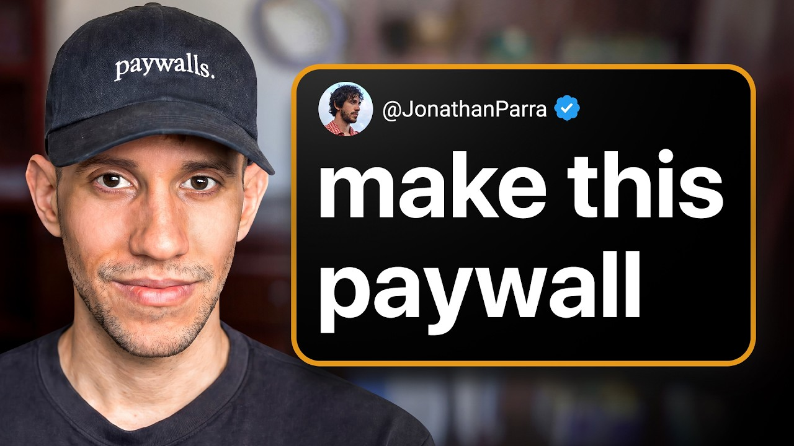

# I made 4,000 app paywalls and learned this

Start building & deploying paywalls in 10 minutes flat: https://superwall.com/

## Table of Contents

* [00:00:00] - Intro
* [00:00:15] - Why there is no "perfect" paywall template
* [00:01:04] - Why design and packaging are the biggest conversion levers
* [00:03:45] - Evolution of the Superwall editor
* [00:05:44] - Why "Continue" buttons often beat descriptive CTAs
* [00:07:56] - The "No commitment, cancel anytime" conversion hack
* [00:10:40] - Fighting decision fatigue by simplifying plan options
* [00:13:34] - Why users pay for "AI Rappers" and custom prompts
* [00:14:55] - Using "Exit Drawers" and discounted offers to save churn
* [00:22:12] - Why custom prompts allow for higher pricing
* [00:26:10] - Why simple bullet points beat complex comparison tables
* [00:31:40] - The "Bullet List" benchmark that works across all categories
* [00:43:55] - Using video paywalls and Rotato to show value
* [00:46:40] - When a native "Swift UI" look outperforms custom design
* [00:54:13] - The best stage of growth to start AB testing paywalls

## [00:00:00] - Intro

Jonathan Parra has designed over 4,500 payw walls, more than anyone on Earth. >> Uhhuh. And that's probably closer to 4,500 now. I really need to start like actually counting. >> He went into this line of work thinking he could find a set of golden payw walls that would work everywhere. [00:00:00 → 00:00:16]

## [00:00:15] - Why there is no "perfect" paywall template

The best payw wall template you could just copy and paste. He was wrong. >> Yeah. I think the most surprising one across the board for everyone was that there is no perfect payw wall. you would expect the performance to be, you know, around the same and it could just flounder completely in one app versus another. [00:00:16 → 00:00:36]

>> But along the way, he found a bunch of counterintuitive wins like how a payw wall with less information and a generic continue button could beat a much more descriptive one by 111%. Or how a simple bulletoint paywall is one of the few designs that performs well across almost every category. >> Bulletless payw walls actually are one of the few payw walls that perform well across the board. just single page bullet list payw wall. That's a benchmark. [00:00:34 → 00:00:59]

>> What he also figured out was that most founders are testing the wrong things. They obsess over pricing when the biggest lever is actually the design and packaging. [00:00:57 → 00:01:07]

## [00:01:04] - Why design and packaging are the biggest conversion levers

>> Price and packaging design is one of the biggest levers that you can pull for payw wall experimentation. And the reason for that is that there's a lot of mistakes that people make when they're creating their price package design. >> And sometimes the most basic native looking design can crush a highly customized one. >> I was like, there's no way this is going to work. there's no way it's going to do good and the surface style actually outperformed everything by quite a long shot. [00:01:05 → 00:01:32]

>> He also uncovered patterns in what makes consumers [music] willing to pay for AI rapper apps that have custom prompt. >> It seems like users are willing to pay for prompts essentially uh to have that custom prompt and have something that is really tailored to that specific problem. You're essentially paying for that as a user. >> In this episode, Jonathan shows us just about everything he knows about making money with apps. From the simple hacks that bump conversion rates like adding no commitment, cancel anytime to the system he uses for designing winning payw [music] walls down to the psychological triggers that make users feel safe hitting that continue button. [00:01:29 → 00:02:05]

This is a master class in paywall design from the person who has seen more tests than [music] anyone else. Let's get into it. This is the Superwall podcast and I'm Joseph Choy, founder of Consumer Club. The members in the consumer club discord and the founders I interview on the pod build apps at a median of 1 millionR. A lot of these apps that make the most money run AB tests on their payw walls to make more revenue with the same number of users. [00:02:03 → 00:02:26]

Superwall has a lot of data on the thousands of apps that use their payw walls. So recently they put together a free AI tool trained on 422 profitable paywall experiments. It lets you upload a screenshot of your own paywall and gives you an experiment idea to increase your revenue. You can use it for free at paywallexperiments. com. [00:02:26 → 00:02:44]

Also, if you're building a mobile app doing at least 100K a month in revenue, Superwall hosts dinners in San Francisco and New York. They keep each gathering small, thoughtful, genuinely useful for everyone. If you meet this criteria of 100K a month in revenue and want an invite, apply using the type form in the description. Let's get into the pod. So, Jonathan, you've designed more than 4,000 payw walls as the lead designer at Superwall. [00:02:42 → 00:03:05]

So, the sponsor of this podcast or like the channel that we're on right now is Superwall. They do the payw wall experimentation, but you are the designer that actually by hand created people's payw walls in Super Wall, like who are customers of Super Wall. So, you probably have an insane amount of knowledge on AB tests and things that work and don't work for payw walls, like what actually converts and makes money. Um, so I want to just dig into actual examples of payw walls that you've designed and just show us like the best ones. So yeah, before we get into that, I just want to hear a little bit from your side like how you think about this and do you have principles for like what makes great payw walls? [00:03:05 → 00:03:46]

## [00:03:45] - Evolution of the Superwall editor

>> Yeah, so I joined Superwall actually when they were pre-revenue and I joined and we were doing payw walls and web flow and at some point we were running so much traffic through web flow that I think we cost web flow I think 12% of their egress costs. So I would uh before they kicked us out. And so uh when I was designing payw walls in web flow, we eventually moved to the editor and then I was designing payw walls in like smelt. So just coding some payw walls. Uh and then we moved into the current iteration of the editor. [00:03:45 → 00:04:22]

And so I've seen it all. I've seen what it's like to work on like pay walls that were working really well 3 years ago and the evolution of the space and everyone copies each other and so I see people trying a lot of new things and new designs and new approaches and uh so now it it's a really interesting kind of creating this system that mixes all of the experience uh that I have seen just with all the payw walls uh out there throughout my time at Superwall. So, I'm excited to dig in here. >> It's crazy. And I I just saw this tweet like this is from September 2024. [00:04:22 → 00:04:59]

So, that was like about a year ago. You said, "In 2 years, I've designed 2,000 mobile app payw walls, more than anyone on Earth. " And then now in your bio, you said 4,000 plus, which is another 2,000 in the past year. Um. >> Uhhuh. [00:04:59 → 00:05:11]

And that's probably closer to 4,500. I really need to start like actually counting, you know, have a have a tracker for every pay wall that I've designed. >> So, you have this entire slide deck on all like the best practices for payw wall. So, I want to get into that, but I actually wanted to start with this slide cuz you have like example slides of like which one won the AB test. So I'm going to like I'm going to try to guess myself and then and then you can tell me the answer and why. [00:05:11 → 00:05:43]

So okay here's like the control and the variant. [00:05:43 → 00:05:47]

## [00:05:44] - Why "Continue" buttons often beat descriptive CTAs

This is like uh on the left you have the weekly annual monthly and then on the right you have annual monthly weekly and the annual is highlighted on top. On the right side you have the check mark that says no commitment cancel anytime. I I'm going to guess the the right side. Oh and then look the button is also different. It says put AI into action on the left and the right you say continue. [00:05:47 → 00:06:11]

So actually it's hard to say like maybe the copy on the button is higher makes it higher converting but then on the right the check mark that says no commitment cancel any time. Yeah, I'll just guess the right one. Why was this 10% better? Yeah. So I want to preface this that uh this is a deck that we presented at a Super Wall office hours actually. [00:06:11 → 00:06:32]

So, if you've never gone to a Superwall's office hours, definitely recommend it. Everything that I've learned at Superwall with AB testing comes directly from Jake and Nick Godwin. So, I worked really closely with Nick and he's just a master at all this, but he's not very publicly active and I think he will be more this year. Uh so he's really great guy to follow in the space and uh he like really led the consumer growth um calls when I was at Superwall and I re uh I supported him on the design side with like all these ideas that we had for customers. So in this particular case this follows one of the principles that I learned from Nick which is that price and packaging design is one of the biggest levers that you can pull for payw wall experimentation. [00:06:32 → 00:07:19]

And the reason for that is that there's a lot of mistakes that people make when they're creating their price package design typically in the footer. So here on the on the left payw wall, you have this verbiage, right? You see AI assistant weekly, AI assistant annual, monthly. So that's just a lot of copy there that you don't really need, right? You're repeating yourself a lot. [00:07:19 → 00:07:40]

Users don't read. And so you want to have visual design um more uh like just show up more than kind of copy because people aren't really going to read. So you just kind of want it to flow a little bit better. And so on the right that blurb no commitment cancel anytime is just like a simple hack that you add to almost every payw wall and it's very granular percentage bump on the conversion rate. [00:07:40 → 00:08:08]

## [00:07:56] - The "No commitment, cancel anytime" conversion hack

So we just have that you simplify the plan naming. So you see annual plan, monthly plan, weekly plan. The right side is the same. You like to have this comparison on the pricing to like the lowest plan usually. Um and then with the badge, you know, you have this limited time 70% off. [00:08:05 → 00:08:24]

You don't need the limited time. Uh so you just uh remove that, add it to the center so it looks more visually appealing. And the continue button typically that put AI into action. Um, you want to have copy that lets the user know, uh, this is like something is happening or you want to reiterate the USP of the product. But in a lot of cases, we like to just have continue because it it kind of like lets the user gently go down that funnel to the conversion stage. [00:08:24 → 00:08:58]

So, uh, in this case, the biggest reason for the conversion rate increase is the products group here. It's just a lot cleaner and having that no commitment cancel anytime, you know, just call out works really well. >> It seems like everything on the right side is simplifying. It's like on the left you have the limited time, you have a little bit urgency, you just eliminate that. You name each thing like AI assistant weekly, you just like eliminate that and just call it weekly. [00:08:58 → 00:09:26]

And then instead of the CTA being descriptive, you just say continue. So I think all of that makes sense to me except for the limited time. you know, this is just a basic marketing principle that like >> urgency >> should improve conversion rates. Is it just too salesy or like why do you think that doesn't help? >> The text size is just too small. [00:09:24 → 00:09:46]

So, if you ever do something like limited time off, uh you want to have it on a heading. So, there's a lot of onetime offer payw walls that will have that in the heading and then it's just really clear what's happening there. Um, in this case, it's just better to have that 70% off for now, unless this is a specific uh one time offer payw wall. Uh, which in this case, it's it's not. So, this is just a regular payw wall. [00:09:46 → 00:10:11]

Already got two gold gems. Simplify things. And then just put this in every time. This little hack, no commitment, cancel any time. Okay, let's go to the next one. [00:10:08 → 00:10:18]

Okay, interesting. So, now it changed a little bit towards eliminating the monthly plan. And so now it's just annual weekly. And then it says, "Start my 3-day trial. " Well, okay. [00:10:18 → 00:10:31]

I'm going to guess the trial uh was better than having no trial. Okay. Yeah. Why Why was this this is a pretty dramatic increase. Why was this one so much better? [00:10:31 → 00:10:41]

>> Right. [00:10:39 → 00:10:40]

## [00:10:40] - Fighting decision fatigue by simplifying plan options

So, in a lot of my experiments lately, what I've been doing is kind of simplifying what the user gets from a payw wall. So, if a user sees all of these options, it's kind of scary, right? you kind of give them some decision fatigue. And a lot of the times now I I won't even have the product group in the main footer here. I'll kind of hide it behind a view all plans button or something like that. [00:10:40 → 00:11:06]

But in this case, you're first of all highlighting that annual plan. And you also kind of want to whenever you do have a product group like on the left with three products, you want to have the order of length [music] for the product subscription go from like the longest uh to the shortest or vice versa, right? Like you don't want to split it up like weekly, annual, monthly. You want to have a cadence that follows, you know, either uh descending or ascending uh order for just the product subscription length. And in this case, like what you're doing here is you are highlighting the 3-day plan. [00:11:06 → 00:11:43]

And so you're increasing that free trial conversion rate and you're showing that yeah, the weekly has no plan. But you looking at this customer, you also know that oh, LTV for yearly is highest and ARPO is highest. So you want to nudge customers to subscribe to the yearly plan. And so you still have that selected, but you give them that that weekly plan offer with the start my 3-day free trial copy. And so it's it's a lot clearer what's happening than put AI into action. [00:11:43 → 00:12:14]

And so the user just has that uh they feel a lot safer about continuing um and and uh subscribing to the offer even if a lot of the times 50% of the time actually like on average they'll just cancel um after subscribing but it still gives you the opportunity to then showcase your product especially if it's a hard payw wall. This payw wall is not. Um and then once you have the user in the funnel you can do you can do more stuff to kind of keep them. Do you have a a take or an explanation on why weekly became a thing? Because I feel like this is like maybe in the past few years like before that I feel like everything was pretty standard like monthly or annual. [00:12:14 → 00:12:57]

Yeah, it's interesting lately and I think it's because of the rise of these AI rapper products that are kind of churn and burn and the you have a high weekly subscription rate that gets the user in and they may not want to commit to annual but then you also have a lot of users that just forget to uh unsubscribe and uh stop paying for these products. So, a lot of the time weekly, you know, our users will pay more in the weekly plan than if they would have just paid for the annual plan. Uh, but it's also a good way to see uh whether a user is willing to pay, you know, x amount of dollars when you're doing price testing uh for a weekly plan and not go into a year-long commitment. [00:12:57 → 00:13:42]

## [00:13:34] - Why users pay for "AI Rappers" and custom prompts

We're seeing uh less of that actually, especially for social apps and uh apps that are kind of multiplayer. Um [music] it seems like weekly and monthly uh have become a lot more popular. So in this case actually I would have probably had another variant that had uh annual and monthly as a test as well. Um and I can't exactly remember what the monthly stats were but yeah this is just an example where sometimes annual and weekly price packaging will win as opposed to annual and monthly. So it's really nice to be able to test even things like that. [00:13:42 → 00:14:16]

So you would actually put it into annual weekly and then a different variant that's annual monthly. But you wouldn't put all three together. >> I would if it's hidden behind some kind of view all plans button. >> M I see. So annual weekly and then you click a small button that says view all plans and then the the monthly is like also there. [00:14:16 → 00:14:36]

But you don't want to put because it's too much information. >> Yep. Uh, I also have another example where this is a little gray hat and lately I've been doing a lot more gray hat type of payw walls um that I can share with you. So, this is a payw wall that I created for a customer. So, this is a clear 30 payw wall that I saw in the Super Wall podcast actually. [00:14:36 → 00:15:00]

## [00:14:55] - Using "Exit Drawers" and discounted offers to save churn

And this is really good for payw walls that are [music] uh they transform the user over the course of a week or a month or you know some other uh timeline. And so it has like really nice steps on kind of how you're going to be in after you're kind of done with this plan. And so it positions the user as the hero in their story which is great. You always want to have a hero's journey funnel if you can have it. So, here we have that no commitment, cancel anytime subtitle here that I add on almost every payw wall. [00:15:00 → 00:15:35]

It just bumps conversions. Uh, sometimes I'll also have a chevron right arrow here on the buttons and that also bumps up conversions. Uh, in this case, I didn't I just don't want to test too many things at a time and I do want to have that variant for a later test. So, I just didn't have that here. But, this is defaulted to the yearly product. [00:15:35 → 00:15:55]

uh yearly is uh usually highest LTV and so we like to promote that first. Um this particular product I have like 30 to $40 per year. It's kind of what's standard now for these AI rapper products especially if the inference costs are mostly uh text. When you start getting into images and videos, your inference costs are a lot higher. So your yearly prices also and prices in general are going to be higher. [00:15:55 → 00:16:20]

But the user might say like, "Okay, yeah, this looks cool. " They may look at this and they see that build, you know, yearly. They're like, "Ah, maybe I'm not ready for the yearly plans. " So, they close the go and close the payw wall. And then a drawer comes up, not ready to commit for a year. [00:16:20 → 00:16:37]

We have plans for everyone. You still have yearly selected because I still like to see if um the user will subscribe to yearly, but if not, I have monthly here. Um, and then what I'm doing here in this instance, um, I might have set this. Yeah. Uh, because originally it might have had a weekly product, but you have yearly and weekly or something here. [00:16:37 → 00:17:01]

And then the weekly PL price for yearly uh, compared to the weekly price for that secondary product. So you can see like, oh, you know, [music] weekly is is going to be a lot more expensive than yearly, but you may convert here. And then that will let me know, okay, you know, they did hit monthly. Um, and I'm seeing in the Super Wall uh charts that we're seeing a lot of monthly customers. And so that then if we see a lot of monthly customers, [music] we may conclude uh or have an assumption that maybe we didn't do a good good enough job in onboarding really showing off the product. [00:17:01 → 00:17:35]

Typically, we see with weekly and monthly subscribers, you know, uh they subscribe to because they're still not sure if this is going to be a good solution for them. Um, and if they hit not now, thanks here, you can see that onetime offer payw wall uh where you give them some kind of deal. Um, and then this yearly price is going to be uh the discounted rate. So instead of uh uh $40 per year, it'll be $30 per year. Um, and you can grab the deal then uh then and then you see that chevron here that um I was talking about earlier. [00:17:34 → 00:18:09]

Uh so this is uh something that I like to do a lot as well, especially for apps that have done a lot of testing and I'm curious to see if you I see something wrong with their conversion rate or it's not as high as what I think it could be or they're just underperforming their in their app category. And so I like to this is one of my go-tos now for apps that have done a lot of testing u because it it just doesn't it's not something that a lot of them do. Yeah, on that second screen that was really interesting. Just the like on the very first screen you just say start and in small text it shows you the full price $39 a year and then once you go into it and X out. Then it's the same exact pricing and it's the same highlight. [00:18:09 → 00:19:00]

It's going to be $39 a year but then on the right you show the per week pricing. So it's 76. So, it's the same price, but it's just frames differently. So, I feel like this intermediate step actually just psychologically it's just like basically saying to the user, "Oh, I I see that you don't you you didn't like when the tray came up and the Apple Pay was like, oh, like $39. By the way, did you know $39 is only 76 cents per week? [00:18:57 → 00:19:29]

" And it's like, yeah. And you're basically just like you have one more try at getting them to see like, oh, this this price is the same price, but it's framed differently. And then if they still say no thanks, then you give the discount. Um, and then so for the 33% discount, is there a reason why it's 33? >> I just like to see something that shows the user value. [00:19:29 → 00:19:52]

Um, so you could go between 25 and 33, I think, in most of your one-time offers because a lot of the times you want to save your really big and juicy sales for something like Black Friday or Cyber Monday and you don't want to, you know, show that you're discounting the product way too much in just a regular test because you do want to save those sales for Friday, Cyber Monday or at a certain point if you if you do too much, you know, you run too many sales and you you have users that open pay walls and they see this and close it for some kind of premium app for example and you know they use the app or you you can have them use the app without uh signing up and they have some kind of rate limit. They get used to seeing that and it kind of cheapens the product a little bit. So um especially for the larger apps I don't like to run large discounts because I don't want to cheapen their brand. So, in this case, 33% is just arbitrary for um well, let's see, you know, $29. 99 is actually like what a lot of these AI rapper apps use as their yearly um and so everyone just started copying each other and uh this is just one of the the prices that the market kind of settled on where you can still be profitable and have good margins um and it's still fairly affordable to the user. [00:19:52 → 00:21:15]

One thing that this pricing like made me think about is chat GBT and Claude benchmarks because those cost $20 a month which is a lot more expensive than [music] this which is like $40 a year. Do you have any insight into why consumers are willing to pay so much less for standalone apps? I mean obviously like you know TGBT and Claude are like huge brands and there's just a lot more you know trust and they have the base model and and all that but like is there anything else that's contributing like have you ever seen apps charge you know chatbt or clawed levels? Yeah, actually I had a discussion with uh someone uh just before the holidays about this because they're billing their product at I think 20 to $22 per month. Uh and it's a chat product, you know, on their phone, but what they've done is they've really nailed down the prompt. [00:21:15 → 00:22:18]

## [00:22:12] - Why custom prompts allow for higher pricing

Uh and it's very personalized for that specific niche. And so it's and it seems like uh users are willing to pay for prompts essentially uh to have that custom prompt and have something that uh is is really tailored to that specific problem. There was another app that I had a sales call with yesterday and they're in the health space and uh they launched two to three years ago, but they're still getting, you know, consistent revenue even though Chatt Claude, you know, essentially all these all these state-of-the-art models have come out and yes, they're very general and they can do a lot, but the big bottleneck is still in the prompt. And so I think if you have an app that solves a very specific issue, you can get away with charging a fraction of what you charge for with SHBT. Um, and if you have a good prompt and you have a good flow, like you're you're essentially paying for that as a user. [00:22:18 → 00:23:19]

You're paying for a custom NAD flow with good prompts so that you don't really have to think about doing all this. You just have it work. So I I I think that's what's happening with a lot of these apps and why they're so successful. >> That's very interesting. How recently have you seen this trend of like custom prompted like kind of high price chat apps? [00:23:15 → 00:23:40]

>> I've seen it probably in the last year. Um and and it works. You know, if you target an insecurity, so some kind of emotional um issue that a user has, probably the higher you can charge for it. you know, the Looks Max apps, um, they they were one of the first, um, I think for into the space where they were charging quite a bit of money, uh, to improve your physical looks, right? That's always a big thing. [00:23:37 → 00:24:05]

Um, and then in the dating aspect, like uh, uh, you scan your text messages, like screenshots or Tinder conversations, and then you get a good reply. So, those are good examples of like custom uh prompted models that they've been fine-tuned to give you actually good results and people are willing to pay for that. Those apps have existed for the last I think 3 years, but in the last year I I saw more of an uptake on this and I think it's because the models are just getting so good now that the custom prompts are uh they're they're doing a lot more. So the value is higher so you can charge a little bit higher too. >> Very interesting. [00:24:05 → 00:24:45]

Yeah, that's pretty bullish on the whole like consumer app space. I feel like it's actually I can see I can see the vision. There's like a lot of vertical AI consumer apps that are actually like really high value and [music] consumers are just not going to put in the effort to like make an NA to end flow and make sure the memory gets routed correctly and make sure like you know the the prompt is like thoroughly done and I I see it that's that's actually a really good observation. Um okay let's go back to the pay walls because we had one more screen that I wanted to look at. So there's this one. [00:24:45 → 00:25:22]

>> Um, and this seems like there it's like a a different lesson that we're trying to figure out. So this is the before and after. The left side is upgrading from free to premium. And then there's like the comparison chart. And then you have 3 months, 6 months, 12 months. [00:25:20 → 00:25:38]

12 is most popular. And then you continue. And then right side is just we want you to try the app for 50% off. And it's just a huge picture of the app on the phone screen. And then it says continue. [00:25:38 → 00:25:54]

And I'm guessing that once you click continue, [music] it just immediately brings up the like the tray that lets you check out. So this feels kind of similar to the last one that you showed. So I'm going to guess the right side, the 111% conversion rate increase. [00:25:54 → 00:26:10]

## [00:26:10] - Why simple bullet points beat complex comparison tables

Why Why is this so much better? Yeah, this one is uh you would think that getting users to compare is a good thing, but in many cases the whenever I have a table component in one of my payw walls, it doesn't do as well as even simple bullets or a video or some kind of visual cue. Um, and this goes back to what I said earlier that users just don't read. And so they look at a payw wall like this and they're just overwhelmed. Um, you know, you have a lot of copy. [00:26:10 → 00:26:41]

Um, even in the product selector group here, you're doing, you know, $49. 99, not $99. 99, this monthly price, build quarterly, you're like, there's so much going on there. And it's like it's very confusing to the user what's kind of happening. And so, um, if you remove that friction then and make that simpler, uh, the user is like, oh, okay, you know, they they just continue. [00:26:41 → 00:27:08]

A lot of the times when I when I look at how like friends and family just use apps and I'm like I'm really proud of this onboarding you know that I create and I really want to show it off and I want to see you know what they've done and I'm like they don't read they just hit continue and so uh that that's it it takes a lot of the psychology from what you're just doing with typical product design and you're creating it on the payw wall. So in in this case actually continue takes you to another screen um and there is uh uh more information it's just not on the on this slide but um uh the the point is that when you simplify the payw wall so in this case that we want you to try app name for 50% off uh I saw Cali doing this quite a bit and I took it from what they were doing and across the board it was just working well. Um, I'm I'm not sure exactly why. I think it's uh or at least like the 50% off portion, but I did like that we want you to try an app name for free is what I typically do if you have a free trial product selected. Uh, and that that just works well. [00:27:08 → 00:28:16]

And then just having either a video or a really nice image of the product in action just works well. And you know, here you have again that no commitment cancelling time. The button is bigger. So, I like to use 65 points uh as the button height at a uh not not at a minimum because I do use 56 points or something sometimes, but you want the call to action to be large, right? And the text and the call to action uh the call to action also to [music] be large. [00:28:16 → 00:28:48]

So Jake had a lot of us in the Super Wall side projects channel um and he just sometimes like just post gems like this and uh you know we just updated on uh pay walls and of course they work. So yeah it's just some of the learnings um you just have on on this. So this is a much simpler payw wall. It works a lot better which you see the significant increase in conversion rates and and our foo. So, in the last one you said 33% off and then this one is 50% off and then you said you can also do it where you said like we want you to try for free and then you present the free trial. [00:28:44 → 00:29:22]

In the payw wall that you screen shared and you showed me it was like you you presented the free trial as the intermediate step. In this case, it it seems like you would present the free trial as like the first offer um as like >> oh you you said you you click the X. Well, we actually want you to try it for free and then you immediately take them down. So, like what are the differences between when you would use like these different options? >> Yeah, a lot of the times um if you don't have a product that costs you a lot of inference, you may want to try giving the user a free trial and see if you have stickiness in your product. [00:29:22 → 00:30:09]

Um, so if you offer a free trial and you have pretty high churn and you know that your onboarding is good, a lot of people are going through it, but you still have a lot of churn, then you know it's a product issue. This lets you know how well of a job did you do in onboarding selling the customer and are they willing to subscribe without trying the app. Um, [music] and there you're testing how how big of a problem is this and are they willing to pay at this price range for either this monthly product, this yearly product, this weekly product. Uh, so there's so much testing that you can do and you know the psychology behind it is you you design the payw wall based on what your assumptions are and what you want to test and you almost never run out of things to test. [music] Uh, I remember when I was at Superwall, I worked you I I was on Slack and I worked with customers that were running tests very consistently for all three years that I was there. [00:30:09 → 00:31:07]

And so they always had something to test. And this is just one example of the many things that you can test for an assumption that also gives you good feedback on your product. So whether you have a good product or not um ties into the performance of the payw wall. Wow. Okay. [00:31:07 → 00:31:24]

Yeah. I'm just like imagining your time at Super Bowl that you just must have like absorbed so much stuff. Is is there anything that was like that sticks out as the most surprising result that you that kind of changed the trajectory of like the payw wall philosophy? [00:31:24 → 00:31:43]

## [00:31:40] - The "Bullet List" benchmark that works across all categories

>> Yeah, I think the most surprising one across the board for everyone was that there is no perfect payw wall. I really thought that we would be able to uh create like like a set number of these are golden pay walls that you can use everywhere and they'll perform about the same. And even across you you you have one payw wall that is in an app in the same app category, you would expect the performance to be, you know, around the same and it could just flounder completely uh in in one app versus another. And so my biggest lesson was was uh there is no standardization for like what you can have in a payw wall and every customer is just going to be different uh for some reason. And uh so the best thing that we ended up doing was just creating a component system uh that you you have things that work across all payw walls and [music] it's just nice to be able to drop them into each payw wall. [00:31:41 → 00:32:47]

And I think some components work better than others, but it's still best to experiment with all of them. So, for example, I like having a heading with a bullets list of the product and a simple, you know, footer for the call to action as kind of like the main payw wall because then I can see that's a benchmark. Bullet list payw walls just uh actually are one of the few payw walls that perform well across the board. Just single page bullet list paywall. And I can share my screen also with like what this looks like. [00:32:47 → 00:33:20]

So this is an example of a payw wall um that I've added onto that. So this um this is what I would usually make something like a the first um payw wall for a customer um because it has a lot of uh things that make it look like a trustworthy payw wall. You have your USP, right, with some kind of subtitle, your bullets, social accolades, and then the subtitle and a continue button. You may also show pricing here, but I don't have pricing here in this example because it's a multi-page payw wall. But then I would take, okay, if this is my main payw wall and I want to see how uh it performs across other variants, I may just add to this payw wall. [00:33:20 → 00:34:03]

Uh so what I like to do is okay, maybe I want to have an image. So this is like very uh fitness AI inspired type of payw wall with an image and then USP continue button. Uh so I would then create a variant like this where I add uh some kind of visual cue of the product or the product in action either as an image or a video and that's the beauty of it. You can have multiple variants that you're testing against and then continue there and you show this and I'm still not done. So you continue more to show even more social proof, especially if it's a larger app that has a lot of uh users. [00:34:03 → 00:34:42]

Social proof works really well. Um and then they just see all these positive reviews. And then you can try 7 days free with that chevron arrow. So you can see also um this is pretty large font on the CTA compared to uh like a lot of the other things and a pretty large button right with that chevron. So just having a big CTA that is very prevalent across the board um works well. [00:34:39 → 00:35:07]

So I wanted to show this as an example of a good payw wall that works really well across the board. So even though I did mention there, you know, no payw wall will ever you can't expect it to perform about the same no matter the app category, this is still kind of a tried and trueue um simple payw wall that gets you started at least and gives you a good baseline to then experiment off of and you can see what your improvements are over time because this will give you a good baseline to start with. >> So is this the very first screen in the in the pay wall? Is there something before this? In this example, it's a second screen, but in what what I'm trying to say is that for most people, this should be your first screen. [00:35:07 → 00:35:51]

And you should have a payw wall that it's only one screen with this and use that as your baseline, especially for newer apps. >> And then, >> but in this case, this is the main screen. Yeah. >> Yeah. So, you started with that second screen and then after you tested things, then you added like the one before it and the two after it. [00:35:51 → 00:36:13]

>> Yeah, multi-page payw walls uh sometimes work well. I like to test them and uh and I like them because you can add different things to the different pages. [music] So, maybe instead of bullets here, I could have tried a table instead of bullet list. Um I could have moved these accolades to this next screen. um you know there's so much that you can do um in your design test. [00:36:11 → 00:36:37]

So design tests really are the bread and butter of any one that wants to improve their KPIs with AB testing for uh payw walls. You know, you'll get more mileage out of design tests and price packaging testing than really anything else. So, I've worked with some apps that they're um they just started AB testing and then they have all of these uh uh pricing that they added um and then they immediately want to start experimenting with pricing. Uh but what that does is it actually creates quite a bit pain in the ass to manage because uh in Superwell at least you have to have all those users um in an audience in a specific cohort. So you have to put them uh use user seeds to kind of manage them and then you have to manage them uh for every time that you want to run an experiment. [00:36:37 → 00:37:27]

And so it it just becomes a little bit more difficult to manage once you start doing price testing. So it's not something that I like to do immediately. It's it's something that I like to do kind of later down the line after we've ran a lot of uh of tests. >> That's really helpful. I mean that's crazy. [00:37:27 → 00:37:44]

I mean, it's interesting that you have like the insight or the the most surprising insight was that there is no one payw wall. Um, but there still sort of is a one starter payw wall that you can kind of use as, you know, it's not going to be, you know, the absolute best like out of any payw wall in the world, but it will be like 80, it sounds like around like 80% there and then you can like optimize it further. Um, and then it seems like maybe maybe the reason why there is no like one best payw wall is because there's so many different types of apps. In the clear 30 payw wall that you tweeted about, you say if your product takes the user on a multi-day or week journey, this Clear 30 inspired payw wall seems to be working across all categories. But it's not just all apps. [00:37:44 → 00:38:36]

all categories if you take the user on a multi-day week journey in this style of like because clear 30 is like addiction recovery app where it's like a you know by the end of week one you'll see how you've progressed so and I could just imagine there's so many different dimensions of types of apps that you could think of like there's multi-day or week journeys there's one where it's like a just a daily action thing there's one where it's like you know a one-time thing like there's just so many different types of apps So, do you feel like these like when you do find these gems that are like, "Oh, this this just seems to be the best one. " Does that does that last forever? Is there also kind of like a consumer psychology culture and trends thing where once everyone starts using the same payw wall, it just doesn't work anywhere? >> That doesn't seem to be the case for what I've done. So, [music] um I thought maybe with a clear 30 inspired payw wall, uh it's it's a good payw wall that works across app categories, but it's very specific to apps that um they have a clear USP and a and a clear hero's journey. [00:38:34 → 00:39:42]

So for payw walls that are, you know, targeting that archetype, yes, there's there are state-of-the-art pay walls that you can test, whereas other payw walls, you may have to get a little bit more creative and and try to test things. But if you're targeting a specific um thing or or or your product follows the road map of like other products um then you can have a similar state-of-the-art pay walls that do work fairly well um without any like halflife really across you know the time that people use those pay walls and they see them and then they start copying them. So, for example, the Blinkist payw wall with the free trial uh timeline, you know, where like today you unlock the app, you know, day five you get a notification, day seven billing starts. That is a payw wall that um people have been using for years and it's still a very high performing payw wall. One thing this makes me think of is is this one of the most popular types of apps that you've seen recently or is there if if you could think of a like a a genre of app um across categories but like a type of app that you know maybe it's a chat rapper or you know something else like is is there a dominant category you see recently? [00:39:42 → 00:40:59]

There's the AI rappers. Whenever a new model comes out, you know, there's a lot of people rushing to use that model as a rapper. Um, and so I I I just see a lot of AI apps, period, right now. Um, but the best apps that I've seen are apps that really put a lot of intention behind creating a closed loop in the app. So, you know, this payw wall works well because uh in apps like this, you have a closed loop where the user can expect something um after they've finished using your app. [00:40:59 → 00:41:35]

There's a clear feedback loop of who you are before you start using the app and who you are after using the app. And so, conversion rates across the board for those apps that have a closed loop system, they just work so well. Uh for apps that have multiplayer, um you know, there's there's more involved, right? Like I see apps also testing um like especially the dating apps or social apps they have two-tier uh systems where you have very much like Chad GPT you have a pro and a plus plan or a pro and a max plan and then those have different um price packaging uh and they're going to be yearly, weekly, monthly or quarterly across two pricing tiers and that's also a pain in the ass to manage. Uh so but I am seeing that the you know more apps coming out with two-tier billing systems especially if they're also AI apps in the image or video space because it just takes um more compute or you have a set subscription price and what then then you're rate limited and then you can buy more credits to be able to use it more. [00:41:35 → 00:42:40]

Um, those apps are not as common. I've seen where you have like credits after you see them. Um, but I think it's also like a good way to then have uh upsell pay walls. So, I haven't been able to see, well, is it because people just aren't paying, you know, for credits and maybe the subscription credit system like is not so popular? But then I'm on X and I see, you know, Claude users just going through their max plan and then have to, you know, either buy more credits or use the API. [00:42:40 → 00:43:10]

So it's success. It works for these LM labs and I'm just surprised I haven't seen more of that in the consumer app space. >> So it seems like for the consumer app space you're seeing like AI rappers but then the ones that make actually make the most money are the ones that have some sort of transformation journey where it's not just hey use this and generate some images or generate some text or videos. It's like do this and what does that mean for you? Well, it means like this will be the transformation. [00:43:08 → 00:43:40]

Here's the benefits in this amount of time, which is kind of like what the guys at Clear 30 talked about like the the whole like hormosy value equation thing. This is like one payw wall that you like to apply for this like journey type of app. [00:43:40 → 00:43:55]

## [00:43:55] - Using video paywalls and Rotato to show value

Is there are there any other like popular pay walls that you're seeing these days? >> Yeah, I like to use video pay walls a lot. So, let me give you another example. This one is a good one that works across the board as well or like at least this type of design. I have rot templates that just kind of show the app in action and you get like a clear value prop by seeing what the app does. [00:43:55 → 00:44:20]

And then if you have other people already using your app, it's nice to have that social proof here and some simple bullets. So this payw wall was the winner in the test. Um, it's it's just simple social proof with a video and bullets so you see what you get and you're comparing the monthly and the yearly here, right? And then you do have that copy to you're starting Michaela, right? So very uh good targeted copy for largely female um demographic for this app. [00:44:20 → 00:44:50]

Uh so this is also one that works well across the board with this type of format. And this actually was inspired by Mojo. But for the most part, like you're you're putting some components down here and then you're swapping out those components and the either the video changes, you add a slider, you add some text in that slider. There's a lot that you can do with also this type of payw wall. But this one works pretty well usually too because it's very visual. [00:44:50 → 00:45:19]

>> That's that's really cool. I I like that a lot actually. It kind of reminds me of like the when you promote the app on Tik Tok and then you showed like the phone in hand demo and it just it's a it's a nice like engaging way to look at the app. Do you use a software to build [music] the video for this? >> Yeah, Rotato is uh the only one that I know of right now that can do something like this and you can control a lot of uh the key frames uh in Rotato to just move around like [music] in the presentation for whatever you're doing. [00:45:18 → 00:45:52]

But typically what I do is I just record uh myself using the phone uh or the app on my phone and then I just drop in that recording and it just creates this [music] uh video pretty pretty seamlessly. >> Yeah, that's really cool. The other thing I noticed about this is those yellow circle check marks on this payw wall look like the iPhone notes app. >> Like was that intentional? Like do you use UI? [00:45:49 → 00:46:16]

No, in this case it's just the uh the the brand assets of the uh of this particular app. >> Uhu. It's just good branding. I guess I I do like when like UIs use like familiar interface elements. It just makes it feel a little bit more trustworthy. [00:46:16 → 00:46:35]

But yeah. Okay, that's cool. Are there any um like really big apps that use this? I think you mentioned one of them. [00:46:35 → 00:46:44]

## [00:46:40] - When a native "Swift UI" look outperforms custom design

>> Mojo uh uses this uh this style a lot. Um, to go back to something you mentioned earlier, I would not discount also creating a Swift UI looking paywall. Um, I actually uh I worked on a couple payw walls for Pyometer Plus+ and uh their design system just follows the typical Swift UI uh designs. So, they they really didn't customize uh the app too much and made it look like a very Appleesque app. And so when designing their payw wall, it had to look very Appleesque. [00:46:40 → 00:47:15]

And I I was like, there's no way this is going to work. There's no way it's going to do good. And I [music] tried to also create other variants that were a little bit more designed and uh just a little bit more custom outside of the Swift UI uh uh style. And it actually the the Surf UI style actually outperformed everything by quite a long shot. So I'm not and that could be because you know the rest of the app was already in that kind of design. [00:47:15 → 00:47:43]

So it it wasn't a big change uh in what the user was kind of expecting in the payw wall. Um but I I have done that twice actually and so I I did try it with another app uh and uh I was surprised by the results that the Swift UI looking app actually does perform fairly well. Uh so I I would recommend also trying something uh with just Apple's Swift design language. >> Yeah. Could you show an example of that? [00:47:43 → 00:48:11]

>> So this is actually a template on Superwall uh that you can customize to make it look very swift UI looking. And the reason for that is, you know, a lot of the times Swift UI will have like the app icon or something up here, you know, SF Pro, you know, text or SF Pro rounded. Uh, and it has these like really swift UI looking type of uh like list items styles. So, you know, Snapchat does, I think, a good uh or a good job in making it custom, but also kind of following Swift UI and design >> guidelines. This looks like it could be like a Swift UI design and app and but still custom, right? [00:48:10 → 00:48:59]

So, still like a nice customizable um uh experience. So, it's not the Swift UI blue, right? they still kind of add uh their own flare to it. So, this is probably another example for this, but you can see in this in this example like it's still a bullet list. So, heading with bullets, right? [00:48:59 → 00:49:22]

But it's multi-page and you don't see the pricing until you're on the next page. And here they're really pushing monthly um as opposed to annual or friends and family. and also friends and family actually if you have an app that it's either multiplayer or you can you know share access with the app with like your friends and or your family members even like through iCloud family. Um that's also another good way to bump your LTV or Arpoo by having a friends and family kind of plan. I don't see this enough actually um because probably it's you know you have to implement more and there's [music] more SDKs from Apple that you have to add to your app but it it does uh give you like another avenue for larger monetization especially because most of the time that is an annual plan and uh a lot of users will skip like the oneperson annual plan and say like yeah I you know my family probably you use this app and uh they'll have the friends and family uh pricing on there too. [00:49:19 → 00:50:31]

>> I have actually never seen a friends and family payw wall on a non-native cuz like I've seen like the iCloud one and maybe the Spotify one I guess too but I don't know if Spotify even does mobile payw walls but that yeah that's an interesting insight that feel people should explore that more. Other thing about this is like it feels like the gold stands out a little bit to me. Like um >> I recently got the Robin Hood credit card and it's like >> oh nice >> gold and then it makes you install another app and then the app is also gold and then like everything on the app is like black and gold. Do you feel like pay walls that make an make an app feel more explicitly premium helps to make it higher converting? cuz I feel like all the like a lot most of the other pales I've seen are standard like white or black with bright colors but then this one is like it looks like MX or it's you know it's like very trying to feel more premium. [00:50:28 → 00:51:30]

>> Yeah. And I I agree and u I actually do that in a lot of my designs. So I want to give you another example for where I do that that you can uh use that type of design to show like oh this is a more premium plan or this is going to be a premium experience especially for those apps that are multi-tier. So let me give you an example. This is a payw wall that I created for one of my customers in the agency equals and they have a pro and plus subscription [music] and pro is their highest um tier one. [00:51:27 → 00:52:07]

So they have uh like weekly, monthly or quarterly and I don't have the products here. So like that's kind of why it's not a number and kind of erroring out. But the point is when you have the pro the app is white and so when you have contrast on the payw wall especially you've been going through onboard and you have a black background and then all of a sudden you have contrast on the payw wall screen you're conditioning the user to think oh something's happening or oh okay like this is different and then uh I want users to subscribe to the higher tier option because they get more um than if they were in just the plus subscription. So, I have the plus subscription with the white background. Um, and then I I have um the pro background once they switch back to that because users will play on on the payw wall. [00:52:07 → 00:52:55]

Um, just go back to that more premium looking design [music] and as a result, yeah, more users subscribe to the ProClan. Um, hinge. This is This payw wall is inspired by Hinge. And I can't remember if Hinge does this fade uh contrast effect, but I knew that I wanted to do it for this payw wall because um I wanted to have some contrast on it and make it look a little bit more premium. >> And then is the actual app interface turned to black also once you finish the payw wall? [00:52:55 → 00:53:32]

>> Uh in this particular case, no. you just kind of pay, subscribe, and then you're you go in the experience. That would be uh uh an interesting product decision. So like once you're subscribed to Pro, then like yeah, you change the interface and it kind of fans you out versus someone that's not subscribed, especially if it's a premium app. So there could be some interesting psychological plays happening there, especially if you're using the app and your friend uses the app and you have, you know, the dark mode type of style and they don't. [00:53:30 → 00:54:06]

So it's it could lead to some interesting social dynamics there. So yeah, all all uh interesting things to to test. What is a typical um stage of growth that you feel like gets the best results out of um like really investing in doing more payw wall experiments? [00:54:04 → 00:54:25]

## [00:54:13] - The best stage of growth to start AB testing paywalls

Yeah, I think you get the most returns when you're a large app and you haven't done a lot of AB testing because uh in the first test that you'll run with us, you're you're you know, we're going to increase your paywalled rate, your KPIs, your ARPO um conversion rate, you know, percentage so much that you you get immediate like value back uh from your investment with us. So apps that are making I would say 100,000 a month and they haven't done a ton of payw wall experimentation because they've been working so much on products, those are I see the best gains for those kinds of apps. Um but a lot of my recent customers actually are newer apps and they're between the $10,000 to $50,000 per month stage. And even with those apps, um, if we can increase their conversion rate from like 8%, which I see is kind of, uh, uh, the the average across the board, to 15 to 20% after a couple iterations working with us, that's a huge lift and you haven't done anything more. Uh, you haven't increased your ad spend, you haven't, you know, invested in product. [00:54:23 → 00:55:35]

Uh, so that also becomes a huge lift for a lot of those companies, too. Great, great insights and yeah, Jonathan, it was really good to have you on the pod. Uh, we've been in touch since the very beginning of consu like you were one of the first members ever of consumer club and we now I'm now I'm like at Super Bowl. So, it's cool that we're like crossing paths continuously and it's like great to full circle just like have you on the pod. Um, but this is I I learned a ton from this and your insights are always evolving too, so I'd love to have you on again in the future. [00:55:35 → 00:56:07]

>> Yeah, of course. So yeah, happy to come on uh later on. And yeah, to anyone watching this too, I'm trying to post more this year. So uh my ex is going to be pretty busy with uh some of the more insights that I get from just working with so many uh people like you. So >> Okay, nice. [00:56:05 → 00:56:25]

>> Excited uh to be on and uh thanks for having me. >> Cool. So yeah, something you might not know, most of the founders I cover on this podcast are hanging out right now in the Consumer Club Discord, sharing with each other what's working now for consumer [music] apps. So you can apply to join Consumer Club if that sounds interesting to you. And this is the SuperWell podcast. [00:56:23 → 00:56:42]

Of course, you got to check out superwwell. com. We have more videos on the channel. So dig into those to learn from app founders who are willing to share super tactical stuff about app growth. [00:56:42 → 00:56:52]
