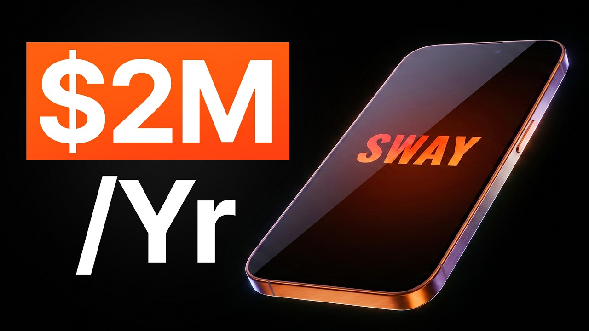

# I speedran a new app from 0 to $2m/year in 6 months (here's how)

Start building & deploying paywalls in 10 minutes flat: https://superwall.com/

## Table of Contents

* [00:00:00] Intro
* [00:01:48] Why Daniel picked the dating niche
* [00:04:45] The pre-launch Instagram playbook
* [00:05:39] Charging $15 for manual profile reviews before the app existed
* [00:06:30] The TikTok slideshow system
* [00:08:10] Unbranded to branded: how to warm up a new account
* [00:09:22] The Christmas Day post that did $5-6K in a single day
* [00:10:30] Scaling past organic with paid ads
* [00:11:05] Working with one influencer to fuel ad creative
* [00:13:14] Why the dating niche is brutal for influencer marketing
* [00:18:51] The photo pack upsell and the whales theory
* [00:19:36] Why he defaults the paywall to annual
* [00:23:02] The psychology behind onboarding screen order
* [00:26:03] Retention features that survive the 3-day trial
* [00:27:42] Groups, streaks, milestones, building network effects
* [00:30:23] What he learned at Cal AI, Robinhood, Snap, and Meta
* [00:35:32] Cal AI's design philosophy: three screens an influencer can show
* [00:37:10] Daniel's framework for picking a new app idea
* [00:40:53] Finding viral content niches before you build
* [00:44:27] The influencer-equity playbook for shipping multiple apps
* [00:46:52] Distribution strategies that are dying vs coming up
* [00:48:57] The Cal AI acquisition by MyFitnessPal
* [00:51:07] Final Thoughts

## [00:00:00] Intro

This is Daniel. He took a dating profile analyzer app from zero to $2 million ARR in 6 months. But here's what's interesting. He built his distribution before he wrote even a single line of code. And by the time he actually shipped the app, he already had thousands of paying customers. [00:00:00 → 00:00:17]

Today, he's running his distribution playbook at Cow AI, one of the fastest growing consumer apps on the planet, which just got acquired by MyFitnessPal. So in this video, I convinced him to show you exactly how he pulled it off. We'll go over the exact pre- launch playbook he ran on Instagram that had strangers paying him $15 before there was even an app. The TikTok system that batches an entire month of viral posts in under 2 hours, and the paywall structure that doubled his revenue per user overnight. Let's get into it. [00:00:17 → 00:00:45]

This is the Superwall podcast. I'm Joseph Choi, founder of Consumer Club, a Discord where top consumer app founders trade alpha on what's working now in growth. I've been talking to members doing a million ARR, and they tell me they've been using these two tools. Superwall has this free AI tool trained on 422 profit- able paywall experiments across thousands of successful apps. You upload a screenshot of your paywall, and it gives you an experiment idea to make more revenue with the same number of users at paywallexperiment. [00:00:45 → 00:01:10]

com. And if your app's doing at least 100K MRR, we host vetted dinners in SF and New York to hang out and network with other top app founders. You can apply with the type form in the description. Also, these app founders have been telling me they use Rorke. I met Daniel, the founder of Rorke, at a dinner, and I got genuinely really excited when he told me about Rorke Max, which is out now and has honestly changed the game for coding mobile apps. [00:01:10 → 00:01:32]

It's AI that one-shots full native iOS apps with Swift code, camera sensors, haptics, payments, the whole stack. And as you vibe code with Rorke, you can install prototypes directly onto your iPhone with one click, and then publish to the App Store in two clicks. If you've been waiting for AI coding that actually does native iOS apps well, this is it. I got you guys a discount. [00:01:29 → 00:01:49]

## [00:01:48] Why Daniel picked the dating niche

You can use the code Superwall or use the link below. Co-founder Sway AI, uh you boosted to $2 million ARR in 6 months. It's pretty insane. Tell me about Sway. >> Yeah, Sway is uh so it was like in summer of 2024, I launched Sway with two co-founders and basically the idea is it's an app that analyzes your dating profile and like gives you feedback. [00:01:49 → 00:02:12]

I think the idea for that was like based off of I guess one like seeing other apps in this niche growing pretty quickly. Like I know that you're probably familiar with like Riz GPT and Umax. I'd say like this idea is kind of a mixture of the two. It's a combination of both ideas where it's in the dating niche but also like gives you an analysis of your like current profile or in your appearance. We were trying out a lot of different ideas like me and one of my co-founders before this idea and one of the ideas that we were exploring was like an AI personal fi- financial advisor but we learned that uh personal finance apps are a little bit hard to monetize and so we were thinking of like what are some apps that do really good at monetization and then we stumbled upon like the dating niche as being like they have like some of the most highest monetizing apps like Tinder and >> That's an interesting point on the niche. [00:02:12 → 00:02:59]

Like yeah, personal finance of course you would you know, it's associated with money so you you know, there's probably a lot of money in the niche itself. But then for dating, yeah, I mean people pay so much for Tinder and Hinge and these like dating apps. And this is interesting cuz with Riz GPT it was sort of like how like what to say on in the conversations. But then this seems like it's like get more matches which is a little bit of a different value prop. >> By the time we had started working on this, there was already so many clones. [00:02:59 → 00:03:31]

I think we didn't want to do something exactly like what they were doing but try and like come up with something novel and like a new unique idea. As far as I know, there wasn't any other apps that were doing like profile analysis. And the idea actually came from I could share my screen. If you just look up like the Hinge Reddit and you see like what people are searching on there, you'll notice that people are just uploading pictures of themselves and their profile and people are like asking for feedback on how that they can improve their profile. Like my co-founders and I like we saw that and we're like, okay, what if we could productize this? [00:03:30 → 00:04:01]

It takes a lot to want to share something publicly online like this. There might be like even a bigger audience that's more willing to get feedback in a more private way through an app. And so yeah, that was the basis of that that idea. >> I also feel like the just like getting matches is like a it's like a different problem that you're solving compared to like you already have the match and then you're trying to figure out what to say to your match. Do you feel like this is a harder problem that people are dealing with on on dating apps? [00:04:01 → 00:04:33]

>> What we've learned is that if you have a great profile, texting is like the secondary part. It's like not as important, but the most important piece is the profile because if you got a pro have a good profile like the texting is it'll flow a lot easier. [00:04:31 → 00:04:48]

## [00:04:45] The pre-launch Instagram playbook

>> At the time you were this was like December 2023. So it's like a couple of years ago. Yeah, and then what what did you do for distribution? >> We tested a few different things. So I think what's interesting is we actually had distribution before we launched the product. [00:04:45 → 00:05:01]

One of my co-founders started like an Instagram account and started posting like these videos. Basically the concept is like how I cook on Hinge and basically it gives you like prompts on things you can say like on your profile. And so it was like very actionable things that people can add to their profile, but some of them were like more kind of funny and humorous. So some of them like did quite well on the algorithm after only like a couple weeks of posting. And so we added like a link on our bio to join the pre-order of our app. [00:05:01 → 00:05:30]

And then the other piece which was I think kind of smart as well, which I recommend doing is we had like proof of willingness to pay from our audience. And so what we did was in the first couple weeks of posting on Instagram, we asked our followers to DM us for a profile review and then we'd ask them like for payment. [00:05:30 → 00:05:51]

## [00:05:39] Charging $15 for manual profile reviews before the app existed

So like I think we was like asking for like $15 and if you send us screenshots of your profile, we'll give you like feedback manually. People were actually paying us before we built the app to get feedback on their profile, um just based off of like the traction we have been getting on our social media and our on our Instagram specifically. And so I think that was like a good way to get like a proof of concept out in terms of like um that this was actually an idea that people are willing to pay for. >> So would you make like dedicated videos just about like hey, does anyone like send send us money and we'll give and you'll like review your profile or is it more of like a small call to action at the end of the normal the normal videos from the page? [00:05:51 → 00:06:32]

## [00:06:30] The TikTok slideshow system

>> Yeah, it was more just like in the caption of the video. But the main video itself was like designed for virality. I actually started posting on like TikTok for the first time ever. It was like my first like month ever posting on TikTok. I saw what was like what people were doing well on other TikTok slideshow apps and thought about like how we can adapt it for our own audience. [00:06:30 → 00:06:50]

So I actually made all these designs in Figma, but all the text I didn't even come up with. The text is like based off of another page that I saw that was doing quite well. I think the TikTok was called TikTok account was called like men's improvement or something like that. >> Mhm. >> And so I took like the most viral videos um and slideshows from that TikTok page and repurposed them for our account. [00:06:50 → 00:07:14]

>> Did you use like some kind of automation to make make all these slides like faster? >> Yeah, we did like a mixture of like Canva as well as um Figma. So we like designed the background in Figma and then we did like an Excel sheet where like it auto populated all the all the slides. So it would take like seconds to create each one. And so like only within like an hour or two you can like batch up a month's worth of content. [00:07:12 → 00:07:37]

And so it made creating these videos uh really easy. >> This these these videos are all getting a lot of views. It's like 18K, like 10 to like 50K views on every video. And they're all It's all simple. It's like, "Oh, five mistakes when flirting over tech. [00:07:37 → 00:07:52]

" Dating advice from Sway AI app. And then you kind of you CTA in every single slide. Which is pretty pretty good. I feel like a lot of these slideshows are like I imagine they're kind of low converting cuz they don't actually plug the app, but yours actually plugs the app in every slide, not just like the last slide or anything. [00:07:52 → 00:08:11]

## [00:08:10] Unbranded to branded: how to warm up a new account

>> I think what's the interesting note though is if you scroll to the bottom of that page, you'll notice that I actually started off with doing the these like aesthetic carousels where it was like more of like these pictures in the background, which were fully unbranded. If you're starting a brand new account and it's like fully branded, I almost feel like it wouldn't have gone as viral initially. I think initially in the first like couple weeks, the whole goal was to get the account warmed up and start getting traction. And then once we started getting traction and a few videos started popping off, then um like I had the idea of like adding the branding to it. >> So in order to like, you know, not appear too spammy and like brand um associated, you just it was mostly uh no CTA except on the last slide. [00:08:10 → 00:08:58]

So you would put the CTA on the last slide, which which is more of a hard sell actually. And and then actually it looks like some of them you you put no call to action at all. >> Yeah, there's it did it like a mixture. I was like testing out like different ideas like whether we should add it, whether we shouldn't. And then once we like started getting traction and it was like guaranteed views, then we just made the whole branding like, you know, the orange theme and all that. [00:08:58 → 00:09:24]

## [00:09:22] The Christmas Day post that did $5-6K in a single day

>> This seems like a really good one. Do Do you remember this like doing well and how many like how how many downloads this got you? Cuz this is like 600,000 views and there was a call to action at the end. And then in the comments people are saying like, "Have you tried this app? What's the link for the app? [00:09:22 → 00:09:40]

" >> Yeah, I think those early ones like they had some traction, but I'd say the downloads weren't like insane. But if you go I still remember the day if you go all the way to the top, the one that's pinned. I remember it was Christmas day actually, and I just put up this post and actually like had logged out of the account and like completely forgot about it. I came back a couple days later and it was already at like um like couple million views, but we had started seeing that I think that was like one of our highest days ever. Um just I guess because people were at home on Christmas Day as well as it just caught the algorithm, but I think that day specifically we did like 5 or 6K in like revenue just off that one day, which is kind of crazy. [00:09:40 → 00:10:21]

I think that was like our biggest day at that point. >> 5 or 6K from one single TikTok. And it was like 4 million views. >> Yeah, I mean it helps that it was heavily branded, too. [00:10:21 → 00:10:31]

## [00:10:30] Scaling past organic with paid ads

So. >> Yeah, no definitely. >> But this is also during the time when we started running ads as well. If you started doing these like UGC tactics, I think it only gets you so far, right? >> What was that like revenue number that you got to before you were able to like scale further with ads? [00:10:31 → 00:10:47]

>> Um I'd say probably like 30 to 40K a month, and then once we started that doing ads, it became a lot a lot easier. >> 30-40K a month. That makes sense. And then when you run ads, were you just like did you just repeat like use the same organic slides or videos and then put those into the ads and just like run them as ads or boost them? [00:10:45 → 00:11:07]

## [00:11:05] Working with one influencer to fuel ad creative

>> We didn't do that. We actually uh what we had what we had did was we got this one influencer, his name was Defunct Sibling. Um we were working with a few different influencers, but he was one that we really enjoyed working with. And um we got him to create some videos and um create some ads for us. And the ads ran on his page, and so it was like running to his audience, and so he has a big following, right? [00:11:05 → 00:11:31]

So all these people that were to see our ads, they are familiar with his content. It worked quite well for them quite well for us. >> You would have him make a video exclusively for an ad creative, not like make an organic video and then boost it later. >> Yeah, I mean, this is before the time when we like really like understood how to like create a video for ads versus creating an ad for organic. And so, he was like really promoting the the app quite hard in his organic videos, which I mean, sometimes they did quite well even on on the organic videos, but when we started repurposing those videos for ads, it worked a lot better. [00:11:31 → 00:12:10]

>> You got to like 30, say like 30, 40k MRR just from organic, from slides, from from him, the influencer, um and then like posting on TikTok and Instagram. And then you got to 2 million ARR. So, that's about like four to five times the just organic revenue. So, you you scaled pretty significantly like from starting paid. >> What what were your like biggest takeaways or learnings from from running paid to 2 mil ARR? [00:12:06 → 00:12:39]

>> Yeah, I think the videos that we had saw that when you post them as an ad, they were they would still get a lot of engagement and people commenting on the ad. And so, there are some videos that were I guess like a bit controversial that we had posted as an ad and then there were people like commenting in the comment section. I think those ads performed quite well for us. And I think the other piece is when we started scaling, we ran into like issues of not having enough creative. So, I think that's another piece is making sure that you have an easy way to scale the number of videos that you create. [00:12:37 → 00:13:08]

Since we're only relying on like one influencer to create videos for us, it was hard to like get a a big variety of creative. [00:13:08 → 00:13:15]

## [00:13:14] Why the dating niche is brutal for influencer marketing

And I think the niche, like the dating niche in general, is a bit tough because I think there's not a lot of like big influencers that are willing to work with apps cuz they're selling their own program, right? >> So, you feel like with dating creators, they're making a lot of money already, like selling dating coaching basically or courses. And then for fitness influencers, they just like I guess you could sell fitness training, but from in your experience, they just the most fitness creators are just not like making that much money. >> Yeah, I'd say it's that, but also it doesn't conflict with their business. So, for CalA I, it's a calorie tracking app where you're like tracking your your meals, whereas what they're selling as a product themselves is the fitness coaching. [00:13:15 → 00:13:57]

And so, it doesn't conflict, right? With our app with Sway, the product kind of conflicts with their offerings because they offer what they offer is like giving feedback on your profile and photos. And that's basically what we provide, but in an AI form. And so, if they're promoting the app, it kind of cannibalizes their own product. >> I see. [00:13:57 → 00:14:16]

Yeah, yeah. That's a good insight. It has to work with the with the creator's existing business model. That is that is a big advantage that CalA I seems to have. So, I want to talk about the the product also. [00:14:16 → 00:14:30]

So, like you are the head of product at CalA I. You co-founded Sway. Did you have a team with you building Sway? You said you had a couple of co-founders. Were you like what was your role in in Sway? [00:14:30 → 00:14:44]

>> Yeah, two co-founders, Luis and Charles. And Charles is more like a iOS engineer, so he built the app. And Luis helped like helped with marketing and more like operations with the app. And so, I was like doing design and like product. >> I feel like there's a lot of teams that kind of have the engineering and then the marketing, but then to actually build like a good product, you need someone It could be a third person or it could be like one one or the other of, you know, the marketing or the coding person, but someone needs to like worry about, okay, what is the user experience actually going to be like? [00:14:42 → 00:15:16]

Like what are the screens? Um how do how do you make it easy for the for people to understand the product? Were there certain decisions that went into Sway that you feel like made a big impact on the monetization, like how much money it made, and also just like the usefulness of the product, and that got people willing to, you know, pay and retain as users? >> Yeah, I'd say that I mean the LTV of this app is very high as opposed to any other app I've worked like I've seen. But yeah, I can walk through that. [00:15:16 → 00:15:47]

I actually like I can share like some like the onboarding flow as well as like the paywall design maybe. Yeah, this is like the onboarding. The way I think about onboarding is like it needs to like the goal of onboarding before paywall is to like raise your motivation and increase like your intention to purchase the app. There's like a lot of visuals explaining what the app does and then questions to personalize the app experience. Started by like clarifying like why the user is there. [00:15:47 → 00:16:11]

It's I feel like it's very similar to like a sales funnel where like you clarify like why they're there, explain and label their problem, and then sell the dream result. Like you'll see like the dream result of like what other members are experiencing. Um personalizing through the questions, and then like as well as explaining why this app is for them. And then we show them the dream result also on the paywall. So this was like the first version of the paywall where you can after you go through that onboarding, you would be able to see your action plan now. [00:16:11 → 00:16:44]

And if you like tap continue, you get to unlock the entire app. And that was like the first version of the paywall, and I just wanted like to convey the feeling that you get a lot of value from the subscription. So you see it's like a carousel of like eight slides of all the things you get as part of your subscription. And so that was one thing that we had did with the paywall. I think the other unique thing that I think is similar to the way like Calia thinks about it is the onboarding is like very sequential and like a one-flow process where the user doesn't really need to think, but they're like guided on this like one-path journey towards the paywall, and then after the paywall, you show them like the aha moment of the app. [00:16:44 → 00:17:23]

And so, like we're just getting the profile rated. And so, they would go through this process of like uploading screenshots of the profile, and then it would analyze it, and then similar to like to like UMAX, it would give you like a rating and feedback on your on the images that are on your profile, as well as feedback on your prompts. Because the prompts were actually something that we were going viral for on Instagram, and so that's the other reason why I wanted to add that here. >> Did you see that uh people actually did the the share actions? Like were your your users using those? [00:17:23 → 00:17:59]

>> I'd say prob- probably not as we had thought, and I think it makes a lot of sense cuz I think it's the type of thing that you would want like private feedback on. And I mean, that was the whole hypothesis of this product was >> Yeah. >> Um the idea is people don't want to ask like their friend or like people that they know, and so like using a product to get feedback in a more private way made more sense. And I think that's actually the reason why we like monetized so heavily or like we focused on monetization as opposed to like keeping the prices lower to fuel growth, which is like the opposite of CaliAI because I think with CaliAI, the prices are intentionally a lot lower as opposed to everyone else on the market. >> Uh so, you do um additional in-app purchases for credits? [00:17:56 → 00:18:41]

>> Yeah. I mean, we started Once we after we launched, we noticed that people were going through this flow like multiple times, more than we had anticipated. And so, we added this as a way to like like further monetize the power users. [00:18:39 → 00:18:53]

## [00:18:51] The photo pack upsell and the whales theory

And I think this paywall itself, I think like contributes to like over 10%. I think like 11% of revenue like comes from like the additional upsell here. The biggest upsell of this app actually is we added these photo packs, which is AI optimized photos where you can like look at these AI photos, and then we'll you upload pictures of your face and then we'll create pictures based off of the look here. We go through this flow, you would purchase these photo packs and then upload pictures of yourself and then we'll email you you in that photo pack if that makes sense. >> And how what were what was the pricing on each of the packs? [00:18:53 → 00:19:28]

>> We did like a 10-pack and then a one-pack and the pricing was like that. It's like $14. 99 and $49. 99 for the 10-photo pack. I think what is unique about this is something that I had saw from other apps is ones that were offering and defaulting to an annual plan are the ones that like had a pretty good like LTV. [00:19:27 → 00:19:45]

## [00:19:36] Why he defaults the paywall to annual

We default to the annual plan in order to like collect more revenue up front to fuel the growth. We also tried out weekly plan, but that's like a lot slower growth, right? >> That's crazy. Yeah, I didn't know that this is one of the most highly monetized niches on the App Store, but it makes sense. I mean, people just want people love looking at their own face and making themselves look better. [00:19:45 → 00:20:08]

And AI is very good at doing that and there's like a wow effect um with that. >> I think the other reason why it does so well is the photo packs for us. Like there's no cap to how much you can spend. And so, I think that's another insight from the App Store is there's this topic of whales on the App Store of people There's like certain people that will download an app and spend like thousands of dollars on an app. And I think that's a a lot of how the big apps like Tinder, Hinge, Bumble make a lot of money is the people that There are a few people that like the top 1% are spending like the majority of they make up the majority of the revenue. [00:20:07 → 00:20:48]

>> Yeah, actually yeah, that makes sense. So, if you give the people opportunity to buy consumables, there you'll naturally have whales, right? That >> Yeah, I mean, the same thing with gaming, right? >> Clash of Clans. I remember I probably spent like $200 as a teenager on this game. [00:20:47 → 00:21:01]

That was like a lot of money for me. But there's people that are spending like tens of thousands of dollars on this. >> That was the insight actually came from one of my co-founders. He built his own game and he noticed that it monetized really well and it's the same sort of insight that like he he had the insight of that there are whales on the App Store. >> I was curious to ask you you you said you would you put the aha moment after the paywall or would you put it before? [00:21:01 → 00:21:28]

Like would you let people upload their pictures and then make them pay or would you like make them pay after the like the question and answer and like the the pictures and then like let them upload the pictures? >> Yeah, it's a good question. We actually explored both. If you let people upload photos before the paywall, you risk them leaving the app and not not never coming back again because they would have to go like to their other app and then upload screenshots. We explored that, but what we had saw was just the simplicity of like going through the onboarding and not asking people to do too much. [00:21:26 → 00:22:01]

So, they don't have to think before they hit the paywall. Like just performed a lot better. But, I think if there's a way to show the insight and like the aha moment or like lead up to the aha moment, I think it would have been better if they could do it before the paywall. >> So, let me show you this. A lot of app founders I talk to you have a feeling their app has viral potential, but don't want to be the person brain rot scrolling an hour a day hunting for formats or worse burning thousands on creators shooting videos that just flop. [00:22:00 → 00:22:26]

Recently, I've been telling every founder I meet about SpyTalk. It's basically an AI TikTok viral marketer that I've seen a lot of top app growth teams using. You just paste a link to your app >> agent scrolls hundreds of thousands of TikToks for you, finds the outlier videos from competitors who've already cracked the best formats that are driving installs in the niche of your app and then it remixes the hooks, the angles and then it makes playbooks so you can pretty much copy-paste virality. And then it alerts you when it detects new breakout formats that would also work for your app. This is the only growth tool I 100% vouch for on this channel because there's a ton of gen AI content tools out there, but none of them tell you what to make. [00:22:25 → 00:23:02]

## [00:23:02] The psychology behind onboarding screen order

SpyTalk makes sure you're never in the dark about what's actually working now. I'll put the link in the description. Can we go through the psychology a little bit again? It was really interesting to hear you kind of describe the journey of like, you know, showing the dream outcome, like explaining what the app is, and that whole sequence of questions. Like, is there some sort of method to the way that you order the screens? [00:23:02 → 00:23:24]

Like, it looks like right here there's like you just describe the app with really clear images. Is there a a method to kind of like the ordering of this? >> Yeah, I think this is a something that I learned a lot when it comes to like we got a lot of feedback in written emails of people. We didn't have this initially, so initially we'd just go straight into the questions. And so I think this is a lot a lot of what I see on other apps doing is they they just look at I think like Calion just go straight into the questions, but I think it misses the whole point. [00:23:24 → 00:23:55]

And what we would get a lot of questions about is like what does this app even do? Like, what am I even subscribing for? These are actually videos, but they're not playing right now, but they're videos that explain the problem as well as explaining how the app solves that problem. And then once people are like have that context, then asking questions makes sense, right? It's like because otherwise you're just you're asking someone questions and they have no context why they're giving you this information. [00:23:55 → 00:24:20]

>> You're you're giving a lot of information and value even before they have to ask answer any questions. And then in between your questions you're also giving continuously giving more value as well. Is there a is there an ordering to the to the types of questions that you ask? Is it basically just problem problem questions and then solution questions? >> I think less about the ordering and more about the simplicity of how easy it is to come up with an answer. [00:24:19 → 00:24:45]

So I think that's why a lot of these companies like will offer a like multiple choice just being that so easy to for the user to like quickly tap one and give an answer. Because I had seen other apps where like they ask us these questions that like are actually like kind of hard for you to come up with an answer for. The whole point of onboarding is they don't want to slow people down. You want to get them ramped up, get them going before the paywall. >> This is really helpful to to see the whole onboarding and everything. [00:24:45 → 00:25:11]

It is I can I can see how a lot of this translates to Calorie Ai too with like making the the onboarding smooth and making it high converting. Um but then I want to like dig into that story now. Like how did you how did you get into Calorie Ai? Like how did you meet the team and um and get started working with them? >> We came across the apps that Blake was working on. [00:25:11 → 00:25:32]

And so and then we had noticed like early on that he was working on this new app and we had saw that um like I had seen that it was growing quite quickly. And so we reached out. Was talking to Zach initially. And yeah, I ended up joining the team last year. Since then, been working on like a number of different things. [00:25:32 → 00:25:49]

When I joined like the app was actually already already in a pretty good state. Like I mean, they were already doing like a couple million a month but when I I by the time I joined. Everything from the onboarding to paywall conversion rate like was quite high. They were like above industry standard. [00:25:49 → 00:26:03]

## [00:26:03] Retention features that survive the 3-day trial

And so a lot of my focus like when I joined the team was focusing on features that would improve retention and get people to stay subscribed through the trial period because they would you know it is a three-day trial period. Ensuring that people have like enough of value that they get throughout that three-day period in order to stay subscribed. >> Yeah, like you said earlier like the the free trials can give people a chance to try out the app and it's probably higher converting than just a pure paywall, but you're going to lose a lot of people to just trial cancellations unless you show them a ton of value. Overall, it like what is the philosophy for that? Like I imagine if you give too much value, then they just cancel cuz they feel like they got they got everything. [00:26:03 → 00:26:44]

But I guess with a app like Calorie Ai, you're supposed to like the the the real value is um you know logging your food every day or you know consistently. >> What what was your like like main, I guess like North Star goal for what to do with the user in those 3 days? >> Yeah, a lot of it was like classic things that other apps think about when it comes to retention. So, like making the app like less buggy is clearly one of them, but I think improving the core logging experience, like we did like a redesign of like the core screens in the app when it comes to like logging a meal, we redesigned like the food database, um the camera, the food detail page, things that people experience like all the time. Was also thinking about We had saw that there was a lot of clones of Calorie Ai, and so I guess the question is like how do you like create features that would work on Calorie Ai that wouldn't work on any other these clones, as well as like over retention feature. [00:26:44 → 00:27:43]

## [00:27:42] Groups, streaks, milestones, building network effects

So, like one of the ideas that we had had, which we had shipped um like earlier on when I was when I joined Calorie Ai was a groups feature, like a community feed, where people can join their friends, and then like stay accountable together, and log foods together. So, that was one. Another one was like streaks. So, making sure that people would come back on a daily basis to log their meals. Things like from the most retentive apps like Duolingo, the insight for groups was like Strava, and trying to build like a network effect within the app. [00:27:43 → 00:28:14]

>> Does Does Calorie Ai have leaderboards? >> Yeah, we have leaderboards on groups. So, you can see like who has the longest streak and things like that. >> Interesting. And do people just get auto added to a group? [00:28:12 → 00:28:24]

Are they just always in a group? Or do you like join specific groups with your friends? >> Yeah, we started off with specific fruit groups for your friends, and then we later added public groups where you can like see others on the community and what they're doing. >> What What are the groups like based on? Is it like for the public ones? [00:28:24 → 00:28:43]

Is it um like around shared interests or demographics or anything? Or is it kind of just the goal is to just get everyone in a group in general so that they have that community feeling? >> Yeah, there's another app like Ladder is another great example of this of an app that has groups. Is we like I had seen that like a lot of people will ask questions related to like specific topics. So, say for example on Calia you can ask questions for with other people who are wanting to lose weight. [00:28:43 → 00:29:11]

And then you can join a group that are people that are wanting to bulk up and gain muscle. There's different groups for that. Also like groups that where you can share recipes and meal prep, things like that. >> So, that that's a you're you're sort of like building a social network a little bit. It's this that seems like a a a big product challenge. [00:29:11 → 00:29:28]

>> Yeah, I think it's a mixture of like trying to get retention working, but also like product led growth. And so, you'll see like in the other screenshot on the right there was like up being up the upload progress photos. Not only do we get people we get people like to take pictures and they can upload it to like Instagram their Instagram story and show off like how many how much weight did they lose or how much weight did they gain. And so, we get a lot of people like uploading that to social media. We also get a lot of people uploading their actual meals and the calories and like showing that they tracked it with Calia. [00:29:27 → 00:29:58]

Another like product led feature for growth was like milestones where you can like get badges for like the number of days you logged in a row. So, say you log like a full year of days every single day, then you can like post that on your story. >> That's cool. So, you're you're you're hoping that people will post that on their Instagram story. >> So, these are like all the all different ideas we've tried. [00:29:58 → 00:30:22]

Yeah. >> What what is it like working with a team? [00:30:22 → 00:30:24]

## [00:30:23] What he learned at Cal AI, Robinhood, Snap, and Meta

Like uh I mean, you've you've done a bunch of different things. Like you've been at your own startup, you've been at pretty large companies, um other entrepreneurial things. What is it like like being at a a scrappy like fast-growing startup like Calia. But I say startup, but it's like I don't even know if you would call it a startup. It's like you know, like it's like a you guys are bootstrapped. [00:30:24 → 00:30:48]

Um but you seems like you kind of operate like a startup. >> I think that that's what probably the biggest takeaway from Cal-I is the co-founders. They they all talk about like moving with speed and being very fast. It's actually like a lesson I've learned from other teams I've been a part of. I think he said something about how human motivation only lasts like about 2 weeks. [00:30:48 → 00:31:11]

So, like if you have like this insight to work on this like new feature, human motivation only lasts for like 2 weeks to work on it and like really full it like finish it. That's another thing I saw like at Robinhood too is like we launched Robinhood Crypto, which like got went really viral when I was there. And that product went from idea to being launched within a matter of a month, which was pretty fast in comparison to like most big companies. And so, I think that's like probably the biggest takeaway is like once you have like a big project where you can get like the whole company to rally behind, I think being able to move fast is a key differentiator. >> I'm curious, what did you do? [00:31:09 → 00:31:47]

What was your role in the crypto rollout? >> Yeah, I worked on like the trade flow experience. But like other designers like worked on like the branding here and things like that. >> I I'm curious about Snap, too, cuz I've I've met some designers from Snap, and they're always it's always interesting to meet a designer from Snap. I feel like the the like design org at various parts of Snap is very interesting. [00:31:47 → 00:32:12]

And it seems like you were at a pretty interesting role, too, where you building like new platforms and like new things. Did you learn a lot about design from Snap? >> Yeah, I'd say Snapchat is the complete opposite from when I uh spent time at Meta. So, Meta is like very data-driven. Um people think about a lot of AB testing. [00:32:12 → 00:32:33]

I mean, I was on the growth team, so it made sense. But at Snap, I'd say it was different being that I think the the company leans a lot more towards like an intuitive feeling on features. So, I mean, they were the team that came up with stories. And so, they think about like the psychology behind features a lot more and like a lot we have like discussions and things like that when working on new features. And the design team at Snap is quite small as well, I think. [00:32:33 → 00:32:58]

Even though there's like thousands of employees, I think the core product design team was like only like like 10 or 15 people. >> I feel like that like when people see a really well-designed app, it's just sort of like a I don't know. It's just like this gut feeling where you just know oh, this is like this is well-designed. It just feels good. And I can't Personally, I can't always pinpoint like exactly like what it is it about the app that makes it like well-designed. [00:32:58 → 00:33:27]

Sway is definitely one of those apps for me personally. Like I just it just feels well-designed. And then Caly AI, of course, is also well-designed. But, I mean, you can see it in your background. Like Snap, Robinhood, like these are all very like very tasteful like mobile experiences. [00:33:27 → 00:33:44]

I want to figure out like what is what's in your brain? Like how do you get like your design taste? Is there And I guess like is there I mean, obviously like it it's just like partly it's like the experience of just spending time with these uh with these companies um and working with them. But, I'm also just curious about like your day-to-day and your like personal philosophy or routines um for spending time with like great design and curating that taste. >> I think trying to have like building like a mood board of things that you think are like great designs. [00:33:44 → 00:34:20]

So, like I have I save like all the apps that I think are like really well-designed and will constantly like go back to them and look at them and think about like what makes them much better. And like see how I can like get inspiration from them, but I think like one lesson I actually got from Robinhood when we're working on the Robinhood crypto feature, which is like so long so long ago, but I think still sits with me is how much the team thought about like branding and I mean, I don't think I'm like the like great at branding, but I think like the idea of like being very intentional with coming up with like lots of different variations and I think it helps with growth a lot if you can have a product that looks unique from anything else that exists on the market. P It'll stand out and people will be more curious to try it out. And I think that's what happened with Robinhood crypto is cuz there was a lot of other crypto apps that had existed at the time but nothing had looked quite like this. They were a lot They looked a lot more like, you know, Coinbase is one example or is more of like a banking product, whereas this looks more like a looks like a video game almost. [00:34:20 → 00:35:26]

I think being able to think of it like that, like what's going to catch people's attention is a good way to >> thinking about it when it comes to branding. >> Do you use that at all with Calorie Ai? [00:35:26 → 00:35:35]

## [00:35:32] Cal AI's design philosophy: three screens an influencer can show

Like There There's some aspects of it where it like doesn't feel like a calorie tracker, you know? It like feels very sleek. The scanner itself you know, is a a a novel feature compared to uh the existing calorie trackers that were out before Calorie Ai existed. But are you are you trying to be like on the edge in in the in the way that you described with Robinhood crypto or are you trying to be more like minimal and not stand out like too much? >> Yeah, I think the way the main thing I'm thinking about like for Calorie Ai is like making sure it's like really simple to understand because the main way that Calorie Ai grows as you know, is like through influencer marketing. [00:35:33 → 00:36:16]

And so, the app needs to be like really clear like what's happening. We every single video that influencers post, they show three core screens, which is like the the camera, the loading screen, and the food detail page. If you look at those videos, it needs to be pretty clear like what is the app doing and like how it works. And I think that's like something that we have worked on a lot as well, which is like how do we make that like those three three screens as like easy to understand as possible. >> So, is this the three screens? [00:36:16 → 00:36:46]

It's like the scan and then the home page where you see all the calories and then the the logging where you adjust the the numbers. >> Yeah, exactly. Yeah. >> Yeah, it is very clear. Is that different than how you approach Sway design? [00:36:46 → 00:36:58]

>> Yeah, I mean Sway was different being that we didn't really try and grow with influencers where of them using the app because it just didn't really make sense. But with Calorie Ai, it was people need to show themselves using using the app. [00:36:57 → 00:37:11]

## [00:37:10] Daniel's framework for picking a new app idea

It's actually like if I were to like work on like a new app idea, it's kind of how I would think about it as well is the app idea needs to be really easy to understand on social media. I know there's like a few things that makes up a good app idea which I've been like trying to like piece together from looking at Calorie Ai, I think from the product side, I think it comes down to being like simple and easy to understand in marketing videos. Then another piece is working on a novel app idea. So, I think like with Calorie Ai, it was taking a picture and counting the calories. It's like very unique and there's no other app at that at that time that was really doing that at a large scale. [00:37:10 → 00:37:43]

And I think that helps with like fast growth is like these novel ideas. And then I think the apps that will sustain and have durable growth over time like, you know, the scale that Calorie Ai is at now is if it's in a big market. And so, calorie tracking's in such a big market now. Like calorie tracking like MyFitnessPal is a massive company and so, I think if you can come up with an idea that has those aspects of being a novel idea, like easy to understand, and in a big market, I think those are like good ways of thinking about it. >> Do you think as like for for new apps, do you think it's better to look in categories that don't have as much innovation or go for categories that already have a bunch of new startups trying to tackle like the same innovation. [00:37:43 → 00:38:29]

Like for example, like you know, calorie tracking was a pretty old space. Like nobody was really in it or like no new people were really in it until Calia. Versus something like AI therapy is like everyone's just like buzzing an app for AI therapy and like trying to tackle that because it's just inherently like a novel experience. Do you have a preference for what types of markets you would want to enter? >> Yeah, that's a good question. [00:38:29 → 00:38:55]

I think the benefit of going with a a market that's already established is you know it's a problem that people want solved. Whereas if you go into AI like AI therapy idea, like you don't know whether people are actually going to want this problem solved. But if you have anecdotal evidence of like another big app, I think that's a helpful indicator that this is something that people will want. And then applying a novel idea in that existing niche that's already really popular, I think that's probably like the better way of testing new ideas as opposed to completely doing like blank slate, like having no idea whether one, the novel solution is correct and two, whether people actually want that problem solved. It's like you're solving too many variables at that point. [00:38:55 → 00:39:35]

>> I mean, I I want to do a thought exercise based on what you just said about or what you would say a little bit earlier about how to think about like your your framework for novelty, which is you look at the biggest apps in a certain category and then you think about what is the thing that people dislike about it the most and then just make that your idea. And let's just use like the therapy example. Like this is I found this recently. They're running a ton of Facebook ads and they're absolutely printing on Sensor Tower, they're making 800k a month plus 200k a month from Android. It's like a mill a month. [00:39:33 → 00:40:15]

I don't know what the margin is, but I mean, they're running a lot of Facebook ads. But, anyway, I think the the kind of like mood tracking / kind of like introspection and therapy self-development space is seems to be growing and there's a a couple of apps and like I don't know, ask any person in your real life, like have you heard of this app? They probably will say no. So, it's not quite it hasn't reached like full mainstream yet, but I feel like it's growing pretty fast. Do you have any intuition around what you think could be like the the problems with the space or like what people would dislike the most about it? [00:40:15 → 00:40:54]

## [00:40:53] Finding viral content niches before you build

>> Yeah, I think I mean, the way I think about it is I feel like it's probably less about the idea here specifically and more about what they're doing with marketing. There actually might like if you think if you look into their marketing, I'd assume there's probably uh a niche on social media that they're tapping into that's like really big. So, say like for Calia, like there's so many fitness influencers that are posting videos. Another popular niche on social media is like motivation niche. So, I could see like apps being built there. [00:40:53 → 00:41:23]

A lot of them like inspirational videos that I see going viral online. I don't know, things like that. I think if you can find like a content niche that's very viral online and you can plug the app into it, I think those are also good ideas that you don't need like an existing apps to validate it, right? As long as it's like a big content niche on social media. >> You suspect that this app is doing really well not because of the app idea, but because there there's a there's like a cultural movement or like a a trend content-wise that they're tapping into and this just happens to be the solution. [00:41:23 → 00:41:56]

>> Another app is Astra that this app kind of reminds me of. If you look on social media, like people talking about their horoscopes is such a popular content niche on at least on TikTok and they tapped into that even though I don't think there's like a ton of apps that do well in this category, but these guys were like doing quite well at least last year. So, I mean the way they did here is like the soulmate idea where you can see like a picture of your soulmate in the background. And that was like their And the soulmate's something that's like gone viral multiple times with different apps before. And so, it's like it's not really a new idea, but they're like framing it as one. [00:41:54 → 00:42:30]

So. >> This doesn't quite apply to Cal AI. I mean, it does apply to Cal AI actually. But the thing is with Cal AI it's just such a broad solution that it can solve a lot of different problems. So, like there might be a a problem that's really popular on social media like a very specific type of strength training or whatever like science-based lifting or whatever. [00:42:30 → 00:42:48]

And then it's going viral on social media and then you can plug Cal AI into that content niche as a solution. And it's not it's not so much that you're like creating a product around the niche, but you're just like if you have a broad enough niche, you can you can tap into different demographics or psychographics, I guess. >> I I think the other way that Cal AI thinks about it is like how many influencers are there in the niche that can promote the video or that can promote the product in their videos. And then how expensive are those influencers? With Cal AI there's just so many fitness influencers and they're also like not super they're like reasonably priced as opposed to like say you go into like the beauty niche where they're getting brand deals from these makeup companies. [00:42:48 → 00:43:29]

I think that's like a tough niche to like come up with like a female looks maxing app and you're trying to promote it through these people who are getting brand deals from like makeup companies because they have such big margins, but yeah, trying to find those niches where you can like distribute on social media where the people are creating the videos like aren't so expensive and there's a lot of them. >> On on the topic of like new you know, new app founders um and ideas, are there any interesting niches in general today that you're that you've been looking at that you feel like are there there could be a some interesting ideas that live within those niches? >> Yeah, I think there's so many it's hard to like just pick one. Before I join Cali AI, I can even show you like some designs of like apps that I was exploring. There's ways you could do it where it's like you do the influencer route where you do what Cali AI did is just find like a big niche and a big product and then try and get all the influencers to promote it. [00:43:29 → 00:44:29]

Or I think what's a more interesting like thought experiment which I haven't seen many other company or many other app founders do is kind of like do the opposite where you build a lot of apps, but then you also like work with like individual influencers who are really big promote their app. [00:44:26 → 00:44:42]

## [00:44:27] The influencer-equity playbook for shipping multiple apps

And so that's something that like I was like working on exploring as well before joining Cali AI is like what if you approach like the biggest YouTubers and the biggest people on Instagram and give them equity in your company. But nowadays with like five coding you can build an app and so quickly now. And so you can just turn out apps and then work with these big influencers who who can promote it themselves and feel like they have ownership in it. And so that's another strategy of doing it. So I can share some like of the apps I was exploring previously. [00:44:42 → 00:45:12]

So this is one I was was exploring recently. It was like a sleep tracking app. Um there's a lot of apps on the App Store that do sleep sounds as well as like sleep alarms and there's apps like Opal that will block your apps at bedtime. There's that I mean this is at the time when I wasn't really thinking about like coming up with a novel idea. I think if you have the right distribution network, I think like any of any of these ideas could work. [00:45:12 → 00:45:39]

Um like language learning where you're like going after Duolingo could be interesting. Like a workout app could be interesting. I was exploring a lot of different app niches before this. Um like the plant identifier app. >> many niches. [00:45:39 → 00:45:53]

Wow. >> Yeah, we're exploring like a lot of them and the idea was if you just turn out a ton of different apps and get influencers to promote it themselves and feel like they have ownership on it. Individually, you can just build so many of these different apps and get people to promote it and you just work on the next app as they're promoting it if that makes sense. >> What would What would your approach be in approaching these influencers? Like the big ones and you want to give them equity. [00:45:53 → 00:46:20]

Is it just like spray and pray or would you just like hunt them down until they respond to you? Like how What would your Would you Would you have a strategy in like trying to close a deal with one of these bigger influencers? >> Well, the guys that I was working with before, they had like a connection with a talent agency and so they had connections with these influencers who could connect us with those like big guys that have like millions of followers. And then that talent agency would get a cut of the equity as well. And another probably just as good option is just do the spray and pray. [00:46:20 → 00:46:53]

>> What do you think about distribution these days? [00:46:51 → 00:46:54]

## [00:46:52] Distribution strategies that are dying vs coming up

I know you're on the product side, but I'm sure you've like you've been like super embedded in these teams. Like do you think that is there certain growth strategies that are dying out? Are there any ones that are that you're paying attention to that are coming up? >> I think influencers is a pretty cool niche. I mean, Cali AI has proven that out. [00:46:54 → 00:47:10]

What you'll notice if you look at other apps on the App Store is all the apps that have done just primarily UGC or primarily done what we did with Sway, which is like the slideshows or the create your own content, it's harder to scale, right? You can only create as much content as you can push out yourself as opposed to doing influencers, you can just keep stacking up influencers to create posting videos and then you're also The key with influencers you have a guaranteed views. As opposed to doing UGC, you're hoping and praying that you get a month where you go viral. And so it's less consistent. I think I mean, paid ads also is when Cali AI took had it like a big inflection point is when we started like really ramping up on paid ads. [00:47:10 → 00:47:51]

The same as the app I was working on before. It's like once we started doing paid ads is when it really started scaling. And so I mean, if you can get paid ads to work, it's the best option, but it's also kind of hard to do, right? >> I get your point about organic. Like, you if you're if you're the one posting your own videos, you're limited by how much you can post and how many accounts you can create. [00:47:51 → 00:48:09]

And that's why people will create like all these other accounts. Um but if your content strategy is is not fresh across every account, then you're you saturate your your own format like pretty quickly compared to like influencers. They have all these built-in audiences. Um so if you're building a a new app today, would you just go straight to influencers? >> I think influencers are a great way of testing the idea really quickly. [00:48:09 → 00:48:35]

Cuz with influencers, you're testing one variable is whether you're getting downloads and whether you can like people are going to pay for it. Whereas with UGC, you're testing whether you can go viral and whether people are going to pay for it. You're testing multiple variables at a time. It also takes more time to go viral, right? You have to keep posting until you start getting views. [00:48:33 → 00:48:51]

I think influencers are a great way of testing out an idea nowadays, but there's only a certain Like, I don't think all ideas work with influencers. [00:48:51 → 00:48:58]

## [00:48:57] The Cal AI acquisition by MyFitnessPal

>> Yeah, last thing I wanted to ask you about is just Cal-A I acquisition. So you guys got acquired by MyFitnessPal in the past week or so. What what was that like internally for you? >> We're we're staying the same pretty much at this point. The teams are um still working as usual. [00:48:57 → 00:49:16]

Um the apps are going to be living as like separate products, and so I don't think much will change. >> Was it like a big moment for you guys like um within the team? I know it's probably been at like a a couple months cuz you were not allowed like able to announce it until a couple months later, right? I think Zach said the the the sale actually closed in December or or so. Um but was that like a milestone feeling for you? [00:49:16 → 00:49:39]

Cuz also like in your career, you've done a lot of like you've worked at a lot of companies, and then you started your own, and then, you know, you join a team. I guess that How did How did it feel to like be be inside Cal-A I as it's getting acquired? >> Yeah, I think it was crazy for the fact that I think we as a team had looked at MyFitnessPal as being like untouchable and like being this app that is so big, there's no way we can get to that point. I think it was cool validation for the co-founders just to like see that what they were able to create in a short period of time. I think they they had they started the company only like 2 years ago or a little bit less than that. [00:49:39 → 00:50:17]

>> It is pretty insane. I remember Zach talking about MyFitnessPal as the big giant beast and Cali's eyes kind of like going up against them and yeah, it's a it is it's a pretty crazy moment for this whole industry seeing that fully bootstrapped team just started by 17-year-old kids getting acquired by this huge app. >> You know, it was only a few months ago when people were dogging on AI rappers. Like I think this is only like a couple months ago, right? Like probably 2025. [00:50:14 → 00:50:46]

People were talking about how AI rappers are there's no value in it. >> That's so funny. Yeah, I feel like the biggest Yeah, like the biggest uh companies and acquisitions right now are are like what you would call AI rappers like us. What's what's next for you? Um I mean, you're still at Cali. [00:50:46 → 00:51:03]

ai. Um but yeah, what's next for you and I guess like where where can people find you? [00:51:03 → 00:51:09]

## [00:51:07] Final Thoughts

>> Yeah, at Cali. ai. Um I think there's a long way to go with Cali. ai in terms of growth. But yeah, also always interested in like new app ideas or new apps. [00:51:07 → 00:51:17]

Down to chat with anyone if they want to reach out. There's LinkedIn or X. >> You want? >> Thanks so much, Daniel. It was great to hear your story. [00:51:17 → 00:51:24]

>> Cool, man. Yeah, I appreciate it. It was awesome. >> Something you might not know, most of the founders I cover on this podcast are hanging out right now in the Consumer Club Discord sharing with each other what's working now for consumer apps. So you can apply to join Consumer Club if that sounds interesting to you. [00:51:22 → 00:51:38]

And this is the Superwall podcast. Of course, you got to check out superwall. com. We have more videos on the channel. So dig into those to learn from app founders who are willing to share super tactical stuff about app growth. [00:51:38 → 00:51:49]
