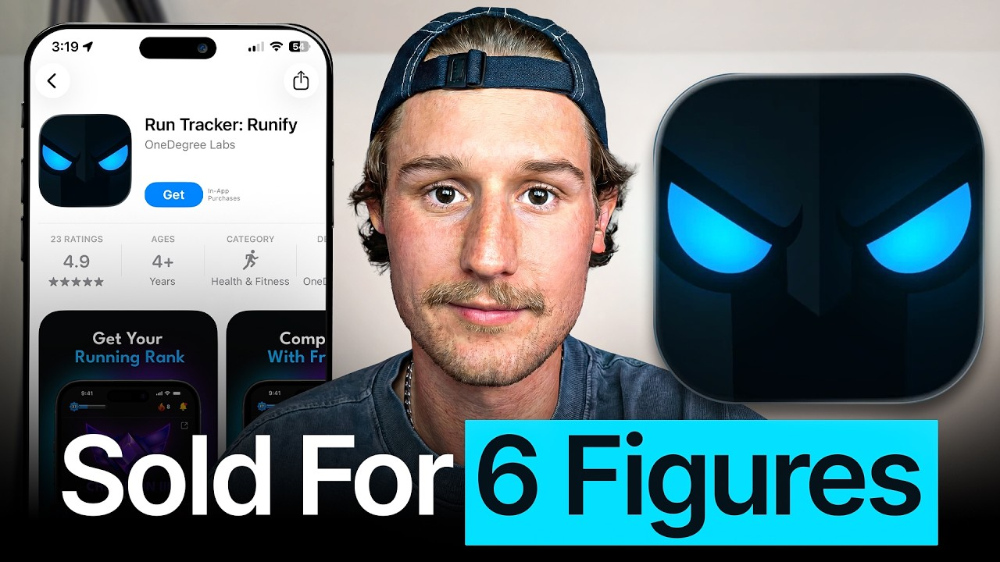

# I speedran an ai app from 0 to $100k exit in 26 days

Start building & deploying paywalls in 10 minutes flat: https://superwall.com/

## Table of Contents

* [00:00:00] – Intro
* [00:00:16] – Estimating valuation with only 26 days of revenue
* [00:01:04] – Validation: Copying the "Liftoff" Instagram reels format
* [00:01:34] – Distribution: Posting 9 reels per day and automating content
* [00:01:57] – The App Store Pre-order strategy for social seeding
* [00:04:10] – The Cold DM: How the acquisition process started on Twitter
* [00:05:41] – Deal Breakdown: 5x ARR multiple and the "App Studio" buyer
* [00:07:10] – Product Development: CTO grind and building with "Social" logic
* [00:08:56] – Technical Deep Dive: How App Store Pre-orders automatically download
* [00:11:41] – Founder Backstory
* [00:13:23] – Learning Intensity: Working under Blake Anderson at 10X
* [00:20:51] – Passion & Product: Connecting running with a gaming "ranked" system
* [00:24:32] – Content Lottery: 2,000 weightlist signups from Chat-GPT generated reels
* [00:31:16] – Rapid Prototyping: Building the full app UI in 3 days
* [00:34:48] – Feedback Loops: Reaching out to Stripe "early adopters" for bug testing
* [00:39:19] – Launch Day Disaster: Accidental release and push-back dates
* [00:47:17] – Retained Equity: Selling the app but keeping 30% for upside
* [00:48:55] – Due Diligence: Fact-checking users
* [00:54:03] – Ideation Checklist: The 100k/month market validation rule

## [00:00:00] – Intro

Caleb Dean sold his app for six figures after 26 days of revenue. Not 26 months, 26 days. The buyer paid 5x ARR based on a revenue number they had to estimate because the app hadn't even been live long enough to generate a full month of revenue. >> We had to kind of look at the trial. [00:00:00 → 00:00:18]

## [00:00:16] – Estimating valuation with only 26 days of revenue

That's one thing we had, I think it was 26 days worth of revenue, and then we had like 20, 37-day trials that were like set to trigger. So, we kind of had to like find this like estimate on the MRR to get a rough valuation. >> And when I asked Caleb why a buyer would pay that multiple on 26 days of estimated revenue, >> Pretty much we calculated it to be 3K MRR, and then we came to a 5x ARR, which traditionally for such a new app is quite large. There was a few characteristics. One of the main things was there was just a few random things that came together that made sense for both the buyers and the sellers being myself. [00:00:16 → 00:00:56]

One of those being that >> He's being a bit humble here. Caleb carefully engineered his app launch months before the app existed. It started when he found this app, Liftoff, a gamified fitness app doing $200,000 a month. [00:00:56 → 00:01:07]

## [00:01:04] – Validation: Copying the "Liftoff" Instagram reels format

He copied their exact Instagram Reels format, posted 50 videos in a week, and pointed all that traffic to a landing page with a Stripe link that he just built with ChatGPT. >> All from such a simple format. The actual content took me 30 minutes to make, and then we just scheduled it on like a scheduling tool. And then used ChatGPT to build a HTML site, which just sent them to a Stripe link. It was so simple. [00:01:07 → 00:01:30]

>> 2,000 waitlist sign-ups, 90 people paid $5 for an app that didn't even exist yet. That was enough signal for him. [00:01:27 → 00:01:35]

## [00:01:34] – Distribution: Posting 9 reels per day and automating content

So, he started building, but also didn't stop doing distribution. >> For a while, we were posting nine times per day cuz Instagram really doesn't punish you for that. >> Nine Reels a day. His CTO built an internal tool that could generate 10,000 variations of a format in under a minute. So, they got 5 million views in the first month. [00:01:35 → 00:01:51]

But the one move that nobody in the space really talks about, the one that actually solved the hardest problem in launching a social app, was what he did just before launch. [00:01:51 → 00:02:01]

## [00:01:57] – The App Store Pre-order strategy for social seeding

>> I have only seen one other app on Twitter ever do and it's not talked about ever really. You can put your app up for pre-order. They'll pre-order the app and when we decide to launch the app, it will automatically download to their device and on top of that, they'll get an email from Apple saying, "Hey, like Runafy's just launched. Go check it out. " So, we had 3,000 downloads. [00:01:58 → 00:02:22]

I think we only had the pre-order up for maybe 2 weeks. >> 3,000 downloads the second it went live. The leaderboard filled to the limit within an hour and an acquisition DM came in from a tweet Caleb posted from an account with 200 followers just yapping about Runafy on Twitter. >> I was definitely tweeting about Runafy saying like we're going to hit 100k a month. I was super bullish about it and they came across me really early but they're like, "It's too early. [00:02:22 → 00:02:45]

" It was like a week or two after launch. "We're going to sit on it for a couple weeks and then we'll reach out and see what happens. " >> In this episode, Caleb breaks down his full playbook, his full product validation process from the organic content to the stripe payments down to the user interviews that let him prove Runafy before building it. Why Instagram doesn't punish you for posting nine times a day and how to build a tool that makes that possible. The app store pre-order strategy that seeds your leaderboard before a single real user downloads and his ideation checklist for finding a niche that's worth entering at all. [00:02:45 → 00:03:14]

This is how you can press the zero to acquisition timeline from years down to weeks. Let's get into it. This is the Superwall podcast and I'm Joseph Choi, founder of Consumer Club. The members in the Consumer Club Discord and the founders I interview on the pod build apps at a median of 1 million ARR. A lot of these apps that make the most money run AB tests on their paywalls to make more revenue with the same number of users. [00:03:14 → 00:03:35]

Superwall has a lot of data on the thousands of apps that use their paywalls. So, recently they put together a free AI tool trained on 422 profitable paywall experiments. It lets you upload a screenshot of your own paywall and gives you an experiment idea to increase your revenue. You can use it for free at paywallexperiments. com. [00:03:35 → 00:03:54]

Also, if you're building a mobile app doing at least 100k a month in revenue, Superwall hosts dinners in San Francisco and New York. They keep each gathering small, thoughtful, genuinely useful for everyone. If you meet this criteria of 100k a month in revenue and want an invite, apply using the type form in the description. Let's get into the pod. Let's go backwards a little bit and talk about the acquisition. [00:03:52 → 00:04:11]

## [00:04:10] – The Cold DM: How the acquisition process started on Twitter

Yeah, how did that happen? >> It was actually completely random. Like, when we were doing the negotiation, we didn't even have a full month of revenue to like base our valuation off. Like, that's how quickly um we had someone reach out to us and it was completely a random cold DM. Someone, Dev Shah, actually reached out to me and he just asked like if I'm looking to sell Runafy. [00:04:11 → 00:04:36]

And I was low-key kind of like pushy, like I pushed back a little bit. I was kind of rude cuz like I I'm sure like you might experience, but you often get like requests of people who aren't like too serious. But then yeah, quickly he asked about like some of the numbers, just some like very basic like download revenue. And then he was able to give me a rough price. I was like, "Okay, cool. [00:04:36 → 00:04:59]

Like, let's jump on a call. " And we kind of went from there. >> How many months of of revenue did you have at that point? >> Not even one. That's what I mean like >> Not even we >> were on the first call. [00:04:57 → 00:05:08]

We had to kind of like look at the trial. That's one thing we had. I think it was 26 days worth of revenue. Um and then we had like at least like 20, 30 like 7-day trials that were like set to trigger. So, we kind of had to like find this like estimate on the the MRR to get like a rough valuation. [00:05:08 → 00:05:26]

>> That's wild. What uh why do you think the valuation was so high like what was the calculation on the valuation? >> So, pretty much we calculated it to be 3K MRR and then we came to a 5X ARR, which traditionally for such a new app is quite large. [00:05:24 → 00:05:43]

## [00:05:41] – Deal Breakdown: 5x ARR multiple and the "App Studio" buyer

There was a few characteristics. One of the like main things was there was like just a few like random things that came together that like made sense for both like the buyers and the sellers being myself. One of those being that like the buyer was his objective was to build an app studio and this is one of the apps he was looking at acquiring, but he has a team of developers, team of people who are focused on distribution. And a lot of these guys who like work on his team are like massive into running, which Runnafire is a running running app and it also fit in within like this niche of like wellness, which he was targeting for his like app studio. And I think just overall posting on Twitter and like posting in public, he kind of saw my confidence in the product. [00:05:43 → 00:06:27]

And the product itself, it's not like your sort of like simple vibe coded app. Like it's nothing like crazy like Strava or like these big apps, but there's lots of moving parts. Like one, it's social based, so there's all the complexities of building with social, but we had a home feed, we have a leaderboard feed, we have the rank logic, we have like multiple like API connections to Garmin, Strava, Apple Watch. So, it's not something that you can just whip up in a matter of like 2 weeks. Like the development on this app took like a lot of effort. [00:06:27 → 00:07:01]

>> Yeah, it seems like it was pretty involved. Did you build this yourself? Were you or did you have any um any partners or employees for this? >> So, in the beginning we had I had two developers who worked with me for 2 3 weeks and we pretty much that didn't work out too well in the end. [00:07:00 → 00:07:19]

## [00:07:10] – Product Development: CTO grind and building with "Social" logic

Um I don't really want to touch on that much, but then I like partnered with a third developer who eventually became the CTO and he just like pretty much took like this foundation that these like developers had and he just grinded like 14 hours a day for like a month and a half straight to get this app out. But I was pretty involved with like I did all the design. Pretty much I I was like the lead sort of decision-maker on everything besides like actually putting the the building blocks together. And a big thing is like we were, which I can touch on a little bit, is like we were actively marketing during um the development of this app, which I think was something that was really valuable for us. >> What was your primary distribution channel? [00:07:19 → 00:08:01]

>> Pretty much 90% of our stuff was organic, being like Instagram and then a little bit of TikTok. And what was also super valuable for us, which I have only seen one other app like on Twitter ever do, and it's not talked about ever really, and I think it was a perfect sort of situation for us. But I'm not sure if you're familiar, but you can put your app up for pre-order. So, when we were in the stage of like I had just finished design, I had got a developer on board, my number one objective was to get like a V1 of the version approved from Apple. So, we had like a two-tab, no onboarding, like the bare-bones of what a running app would have to be to be approved to then actually get on the App Store, and that allowed us to put our app as pre-order. [00:07:59 → 00:08:50]

So, whilst I was actively marketing the app and we were building it, we had people like downloading the app, like pre-ordering it. And to just clear up what that actually means is they'll pre-order the app and when we decide to launch the app, it will automatically download to their device. [00:08:47 → 00:09:05]

## [00:08:56] – Technical Deep Dive: How App Store Pre-orders automatically download

And on top of that, they'll get an email from Apple saying, "Hey, like Runnafi's just launched. Here, go check it out. " So, we had 3,000 downloads, like I think we only had the pre-order up for a couple of maybe 2 weeks, but through that we had 3K downloads. And it also meant we had 3K downloads the second we hit launch, which was really valuable for us because we had a leaderboard in our app. That was one of our biggest concerns, like launching an app having no users at day one, and they go and download this app, they check the leaderboard and there's no one on it, like it just is a big turn-off from the user perspective, but through this like the leaderboard filled up to like a thousand plus, which was our limit, which you could see in like a matter of an hour. [00:09:05 → 00:09:46]

>> That actually is a like not talked about very much, especially for a social, I could see how that would be extremely helpful when there needs to be some sort of like user seeding like social graph where the app becomes more valuable the more people that are on it. So having 3,000 people be on the app all at the same time in the first day, that probably helps long-term retention a lot as well because if you screw up the launch and like 3,000 people log in all at like different times throughout the the course of a week, then like most of those people are probably going like a lot of those people are probably going to churn, but simply like just having everybody log in in the same day probably just massively helps. All the users that you add after those 3,000 are going to have the same experience now because there's other you know 3,000 other like excited people. We're going to get fully into the strategy, but let's go all the way back to the beginning now. Like how did you get into the world of apps? [00:09:44 → 00:10:46]

>> Sure. So my story is kind of random. So I'll give you like the the two-minute recap, but it's kind of like a funny story cuz it's a it's a little bit like embarrassing. I had I was applying for a job just like a regular job as you would, and I had to go and do like a pre employment check, and as part of that I had to do a drug test. And then when I was doing the drug test, I was like unable to use the bathroom cuz someone was watching you was Sorry, someone was watching me. [00:10:43 → 00:11:12]

And then I had to go back to the waiting room, and I was sitting there for like two hours cuz I just wasn't able to go to the toilet. So I was like looking for a solution to this product to this problem. And then I came across like this Reddit community where there was like thousands of people with this like exact problem, and I realized it was like an actual condition. So I was like like this would be a dope way to like build an app for this this problem. So, I yeah, you're right right here. [00:11:12 → 00:11:36]

You pulled it up. It's like the most random sort of product. [00:11:36 → 00:11:41]

## [00:11:41] – Founder Backstory

Um and in hindsight, it's like really niche in the terms quite small. But this was like the the first stepping stone to my app journey. I ended up building this on a on FlutterFlow, which I'm not sure if you're familiar familiar. It's a no-code solution. And yeah, this was pretty much my introduction into the app world. [00:11:41 → 00:12:00]

>> Wow. Did you monetize this? >> Yeah, I did. I probably made nothing nothing crazy to talk home about, but maybe five figures now. But like anywhere from $5,000 to $10,000, I would say. [00:11:58 → 00:12:12]

>> That's still that's still kind of a lot for this. Like did you make content for this or distribute it in any way? >> Pretty much organic. Like I this was like a big learning curve for me. And this product's very difficult for me to market, as you would expect. [00:12:10 → 00:12:29]

>> Right. So, you just you're just making like Tik Toks yourself? >> Yeah, but in the end the majority of like users and revenue came through um like ASO. >> Oh, interesting. Like people were searching What were they searching for? [00:12:26 → 00:12:44]

>> It the condition's called paruresis um or shy bladder. There's like a few popular terms that people search or not popular, but known terms. And this app has like the highest conversion rate I've ever seen. Um I made a tweet about it like a few months ago, but I'm pretty sure it has like a 30 plus percent conversion rate. Just because of how niche it is. [00:12:41 → 00:13:01]

Like for someone who's looking for this and like there's actually a solution, like they're going to jump on board. >> Okay, so you That was your first app. And then >> Yeah. >> Um but you said it was like this the niche was too small and the marketing was hard. So, then what what did that lead you to? [00:13:01 → 00:13:18]

>> So, it wasn't like a matter of like just stopping this and looking for something else. So, I actually came across um a tweet by Blake Anderson. [00:13:16 → 00:13:26]

## [00:13:23] – Learning Intensity: Working under Blake Anderson at 10X

I I pull it up just quickly. Yes, so saw this tweet from Blake and like it piqued my interest. So, I ended up messaging him. Didn't get a response from memory. So, I ended up creating like a sort of portfolio document because he says, "If you're a Jack Skellington that's cracked at everything. [00:13:26 → 00:13:43]

" I think that might be a tweet response to his tweet. >> Take this exam before DMing. >> I did take that exam, but there was another one where it was like you have to be able to bench. Oh, yeah, there we go. Must be able to bench 225, build and deploy a multi-functional app, generate 1 million views in a day. [00:13:43 → 00:14:00]

So, kind of built like a like a little notion document which like ticked all those boxes which is in the document I sent you. So, yeah, I created this to pretty much get it to get his attention and pretty much addressed the three points he had. I couldn't bench 225 at that stage. Now I can, but I swapped it out for being able to run a marathon cuz I did that with a broken leg. So, I thought that was cool. [00:14:00 → 00:14:23]

And then I kind of talked about Nuri Brave and how I built that. And then in the my past, I had like a like a short-form editing agency and like I did content. So, I had like quite a lot of experience in terms of like organic stuff. So, I attached some like results and like pretty crazy shorts that I had posted. You can see some of the views there. [00:14:21 → 00:14:42]

And then at the very bottom, I think I pulled together like 50 influencers which I thought would be a good fit for 10X. And at this stage, I didn't even know what 10X was. I thought it might be a like a block your screen time app which in hindsight like I was actually wrong. But you can see Yeah, I found like 50 influencers which I thought would be interesting and then got the CPMs, RPMs, all that. And then yes, I sent that over to him. [00:14:40 → 00:15:04]

I ended up like just guessing his email address based off his company's like at like Blake at company name. And then he saw one of the emails which then he like checked my DM on Twitter and he sent over that test that you just mentioned. And he said I did well. So, did that, jumped on a call with him and Paddy. I was Yeah, like it says just there, I was more than happy to work for like a a long period of time on like a trial. [00:15:02 → 00:15:26]

And yeah, within 48 hours he pretty much like hired me. I think there's a tweet there which he like did a Yeah, there's an update. We hired a CMO, offered blah blah. Yeah. >> 12-hour days. [00:15:26 → 00:15:36]

>> Jeez. Yeah. Yeah, 10X was definitely a a massive grind. Um but a massive like learning process for me. >> So, how what did you do? [00:15:35 → 00:15:47]

Like you, you know, he says like cross-platform distribution strategy, account set up, hired editors. Had you done this kind of stuff before already? >> So, I was familiar like I had I've done quite a lot of like stuff with my um I had an editing agency in the past. But a lot of this stuff just comes down to like agency at the end of the day. Um and I had like a decent idea like with Yuri Brave, my previous app, I had started consuming like content about influencers and UGC and like I had decent amount of knowledge about it. [00:15:47 → 00:16:19]

But like Yuri Brave was just the worst app to execute on that. Um so, this was kind of like an opportunity for me to do that. But at the end of the day, it was just a matter of like putting in the hours and having high agency. So, to answer your question about like specifically what I did, it was just a matter of like once I knew what 10X was, figuring out like what are our distribution channels which um pretty much will give us the highest leverage. That's what he means by like the multi-content distribution strategy. [00:16:19 → 00:16:47]

And then we kind of like came to a like content sort of style we wanted to start posting. And because I had the editing agent agency in the past, I already had like a portfolio of cracked editors which I could just bring on instantly. And then yeah, from there we pretty much started focusing on influencers and as we're building out the product. And that was like a crazy like one one and a half months. >> What are the biggest things you learned from building your content agency? [00:16:47 → 00:17:12]

Yeah, what lessons about content and distribution did you learn from that? >> Honestly, like it sounds so simple but like quality, like nearly always beats quantity. The sort of like agency which I had was we worked with like a larger creators and pretty much like made the process of creating content like super easy for them. All they had to do was film the content themselves and sometimes we would like handle like the sort of scripts and then everything else would be done. They would just like should be able to check their socials and there's like the sort of like highest converting videos for their niche on their page. [00:17:12 → 00:17:45]

And like some of the videos like you could you could be posting regularly for like two three months, but then they'll have one video that hits like six mil and the right audience and like that will change their business cuz a lot of time these were like not entertainment creators, like business creators. >> Were you doing all of this on YouTube shorts? >> No, so we we I just put these cuz these were like some crazy results and I also thought it was like everyone posts like Instagram and Tik Tok like screenshots. So I thought the YouTube would be the most interesting, but we did it across all platforms. >> So it sounds like the agency was basically like a brand would come to you and pay you a budget and then you would use that budget and go and manage influencers? [00:17:45 → 00:18:28]

>> Not even that. It was like even simpler than that. Like so our main client for example was podcasts. Like this was in during like 2023 when like everyone was doing a podcast. So pretty much like I had a team of editors who there would be a podcast and we'd cut that up into clips. [00:18:26 → 00:18:43]

But at the same time we would work with creators who want to post 60 pieces of content a day and they sit down and have one content filming day per per month and then they don't have to think about it either. And like that was doing really well, but the the reason why I I transitioned from that is like scale was very difficult. Like being a sort of like quantity based um agency. Like I think it was like if you do the math like even 10 creators posting 30 to 60 videos per month, you're looking at 300 to 600 videos per month. And each video on average would have like three to four revisions and you have different editors. [00:18:43 → 00:19:21]

And then like those creators want to make changes and so you like as the founder of that, I was just like spending most of my day just looking at revisions of videos. >> And then at 10X you're basically doing the same doing the same thing. But as as the CMO of just one company rather than like having all these clients to juggle. >> Yeah, pretty much. Yeah, just focusing on distribution, influencers. [00:19:21 → 00:19:42]

I think one of my biggest takeaways from that experience was just like intensity, like seeing Blake's intensity. And I also do think like due to the sort of circumstances that might have been like that scale might have been turned up to another level. That was pretty eye-opening which I feel like has made a massive like positive change for like my entrepreneurial journey if you want to call it that. >> Yeah, with that intensity you probably went into your next app with a lot of intensity. Tell me tell me about how how that transition happened. [00:19:42 → 00:20:13]

>> Pretty much as I as I mentioned, yeah, 10X what was yeah, Blake made the decision to end that. So like left me in this sort of situation where I had Yuri Brave which I knew was like not a viable option to do what I was trying to achieve and then I was left with a lot of time. So I wanted to start working on something that like my own app. Like that was clear to me. I just like obviously gained the skills through building on Yuri Brave, but then like I feel like I fast-tracked my my journey working at 10X. [00:20:10 → 00:20:40]

Like I I got like three, four, five in like yeah, six months worth of experience in that time. But one thing about like myself and like I I stick to this now is like I really wanted to like validate what I'm going to work on before I like commit too much time to it cuz that's like one of my biggest things is like Yuri Brave is I spent months like building a product. [00:20:40 → 00:21:01]

## [00:20:51] – Passion & Product: Connecting running with a gaming "ranked" system

Whereas if I just like started focusing on distribution in the beginning, I maybe would have realized like there's probably better ways to like one, actually like approach this market and two, is is this the market that I actually want to approach altogether. And like one of the things which I really struggled with with my first app was I had like no founder connection to the product to the problem, sorry. Like I wasn't passionate at all about solving, like helping men go to the toilet. Like that was like a bit of a negative. So, I wanted a product that was like tied directly to my passions. [00:20:59 → 00:21:31]

And like one of my passions at the time, probably my like my only hobby, which I was getting into was like running. And I've always like been a gamer at heart like when I was a child. So, I was like the idea of like this like ranked sort of running for an app would be like a really awesome sort of concept. And then so, I started doing some like research into like what would that look like, do people actually want this? Just pull it up and one of like the biggest point of like feedback for this idea was LiftOff, which is pretty much ranked workouts for the gym. [00:21:30 → 00:22:03]

It's like the same concept, but I wanted to pretty much build the LiftOff of running. >> And since we talked here, the the iOS app gets 300k downloads, 700k revenue per month, which is a very good ratio, and obviously just like a very high number. So, the idea is basically to like copy this concept but for running rather than uh gym. >> Exactly. And like running's arguably, I think it's a bigger TAM than it is for the gym. [00:22:03 → 00:22:33]

After like looking into the LiftOff product, one thing that I was like kind of shocked about is the fact that like there was a massive focus around like the competitiveness of like competing with friends and like trying to beat them on like this ranking system. But there was no way to stop people from cheating cuz it's all just like input base. You just put in your reps, you put in your weight, and you get a rank. So, anyone could put in like 1,000 kilos for the bench press. And so, I didn't really like that. [00:22:33 → 00:23:02]

But like due to the nature of running um everything being like GPS, like everything's official and you can have like those official sort of like competitions with friends and strangers, which I thought was awesome. >> And then you were looking at the content, too. So, like I This is interesting validation framework. So, you wanted to see does an existing app that's already made like make a lot of money? Check. [00:23:02 → 00:23:23]

You found that like Lift Off, it's already making 700k a month. And then you also wanted to validate like the distribution strategy. >> Yeah, 100%. So, it goes like even a little bit further. So, with Lift Off, and just to make a note a note at the time of um the validation, they were doing like 200, 300k a month. [00:23:23 → 00:23:45]

So, they've been doing like pretty decent numbers like over 100k a month for I think at least 12 months. So, it's not like this app's been out for a couple months or they've had like a like a few high-performing uh months. But yeah, like a big thing was copying the like distribution just saying, "Okay, cool. They're making this sort of money, but how are they actually acquiring their users? Is this something that we can replicate in our own way? [00:23:44 → 00:24:09]

" And one of their sort of formats, which I'm sure I think you've had uh the founder of Stronger on the podcast. He had one of the formats where it was like the body graph of like a gym workout. And like we weren't really able to replicate that for Runner Five cuz we didn't have like a a graph like that. But then I came across the uh this video right here where it just has their rankings and we're like "Oh, cool. [00:24:09 → 00:24:33]

## [00:24:32] – Content Lottery: 2,000 weightlist signups from Chat-GPT generated reels

Like I can just do this for running. " So, if you like legit look at the other video that we made, I think this one got 2 million views. So, it's pretty much like a copy and like those icons are just like ChatGPT generated. Pretty much like my thought process was let's just make a couple of these and then like post them and then see like how the the audience responds. And we ended up like just posting nine of these videos per day like throughout a week. [00:24:33 → 00:24:58]

And through that, like we had millions of views. But what I think was super valuable is like with that traffic we are we're actually getting, we sent them to a website which I just like used ChatGPT to make, like a I think it was still there, trunify. xyz. And pretty much that was like a Stripe link with a landing page on it. So, it's like we're actually doing something with this traffic. [00:24:58 → 00:25:21]

You can see it's such a website, but gives like an idea of what Runify might look like. And you can become an early adopter and pay $5, or you can join the waitlist. And yeah, put your email in. And we had, I think it was in 2 weeks, posted less than 50 videos of this copied format, and we had like, in the end, 2,000 waitlist sign-ups. And I think it was like 90-plus people buy this like early adopter fee. [00:25:21 → 00:25:48]

And this is like before the app was even live. So, that was like clear validation for actually going and building out this app. There was like So, there was clearly some desire for this product. >> That is very good validation. Several thousand waitlist sign-ups is great just email. [00:25:48 → 00:26:05]

And then 90 people paid the $5. That's kind of insane to think about. Like, because you did like This is the only thing you said about the app. You just said, "Introducing Runify, the only running app where progress earns rank. Compete with friends, claim to visit, unlock elite rewards. [00:26:05 → 00:26:23]

" That was it. Like, there was no pictures of the of the app itself. There was no like, you know, feature list or anything. It's just like one sentence, uh plus like the the the rank images. >> When I had to set up on the Instagram, we did have like app screenshots which I like just pulled together on in Figma before we had an app as like the three pinned post, which I'm sure you've seen in the past. [00:26:23 → 00:26:47]

So, that probably gave them a an idea of the app. But let me share my screen quickly. So, you can see here. Yeah, pretty much in the matter of like a couple weeks, we had over 2,000 people give us their email, which is like super valuable cuz then we can capture these emails and then like approach them once we actually have the app live. >> Did you actually do that? [00:26:44 → 00:27:05]

Like what did you send to these people who sign up the email? >> Yeah, so when we actually launched the app, we sent them Um I actually throughout the the process of building the app Um we were sending kind of updates of where we're at. So I think we sent like kind of two update emails and then we sent like a launch video which then came with like a referral like discount code and when they applied that, they could get the the subscription for like half price. >> Did that work? Did Did people actually go through with the discount codes? [00:27:05 → 00:27:36]

>> Yeah, we had like the majority of our revenue was probably from those discount codes. >> Oh, wow. On launch day, interesting. That first like 3,000 in revenue that you did in that first month, that was mostly from just the waitlist itself. >> Sorry, I should have specified that was majority of income we did on launch day. [00:27:33 → 00:27:54]

>> On launch day? Okay, cool. >> Yeah. That was like significant amount. Um and then you you can see here there's there's I think 80 successful transfers transactions, sorry, which I think is like 400 US dollars and you can see just yeah, trickling trickling in throughout the the days. [00:27:52 → 00:28:12]

Yeah, from such a simple format like the the actual content like it took me 30 minutes to to make and then we just scheduled it on like a scheduling tool and then use ChatGPT to build a HTML site which just sent them to a Stripe link. It was so simple. >> That is crazy. Like 30 minutes to make the the piece of content and then yeah, like with ChatGPT you can literally make a site in like a minute or like 5 minutes if you want to make it a little bit more high quality. And then you just post it like the same piece of content several times a day. [00:28:12 → 00:28:48]

Would you basically make the same exact video and it would go viral every time? >> The same format. It was kind of like a little bit like a lottery ticket. So, the format was um any of those work. So, you see how there's different races um or like different distances. [00:28:48 → 00:29:06]

That was like something that was like really interesting is so some of our videos that went really viral in the beginning like were track and field events. So, that sort of data was like super valuable cuz it was like and it made sense in hindsight like track and field is like inherently more competitive. So, it makes sense that like people uh getting competitive about their 100 m 200 m times. >> This is crazy cuz you're getting like basically on average 3 to 6,000 views every single video and you're posting these quite often. Was this just like one once a day? [00:29:06 → 00:29:40]

>> No, so in the beginning like they these views have definitely dropped off. I think like on average we were ranging between 5 to 10K, but then like one in 10 videos would go like above 500K. And for a while we were posting nine times per day cuz Instagram really doesn't punish you for that. >> So, TikTok kind of like punishes for posting multiple times a day, but you're saying Instagram you can post as many times as you want. >> Yeah, exactly. [00:29:39 → 00:30:05]

We had one video on TikTok that like went viral and got like 700,000 views, but then when when we increased the post quantity all our views went to like five because >> Ah. >> TikTok doesn't like that, but we we kind of made the decision that like we should double down on Instagram. >> I see. That makes sense. >> And so all these ones that you're seeing here that they look slightly different. [00:30:05 → 00:30:31]

We like my um CTO in like one day just like built an internal tool where we can generate like 10,000 of these videos in like 1 minute. >> And like the only changes are like slightly changing the the amount of time uh for each of the metals and then changing the caption. It seems like the caption might have been the hardest part. Like um cuz it has to be like casual copywriting, like kind of like some humor, like emojis, and stuff like that. But you're able to like kind of like GPT this. [00:30:27 → 00:31:03]

>> Yeah, exactly. We we found that there was definitely like a couple captions which continued to perform. But yeah, I think in the first month we would have got like 5 views from this. And what was really interesting, so like pretty much just to go back a couple steps, the very early stages of like posting this, like this was enough validation for for me to be like, "Okay, like let's start working on this. [00:31:01 → 00:31:29]

## [00:31:16] – Rapid Prototyping: Building the full app UI in 3 days

" I posted on my story like, "Hey, just like if you're a designer, developer, like marketer, like hit me up. Like I have this idea. " And I actually surprisingly got like a really strong amount of inbound, and that was like directly from 100x. Like people which I'd never interacted with, but who had watched the stream, put the dots together that I was the CMO, um and one of those guys actually was the guy who became the CTO of Runnafy. And then in three days I spent like three days I think I was working like 15 hours a day, and I just built out the whole app like in Figma. [00:31:29 → 00:32:00]

I built the onboarding, um figured out what the UI would look like, how does the UX work. Pretty much I like to do this with all my apps. Like I want to know what everybody's going to do. And then this allowed me to just like take a step back and then like the developer can come in and just crush it. And then there's like no confusion confusion. [00:32:00 → 00:32:21]

They don't have to like focus on like creative freedom and like figure out like what they're going to do. Um so some of this stuff is like post-launch. Still a little bit messy. But the core of it was built in like three days. >> Three uh 15-hour days though. [00:32:21 → 00:32:39]

>> Yeah. >> Sure. >> Okay. The stuff on the left is post launch. >> I see. [00:32:38 → 00:32:43]

So, this is like making changes and iterations. >> Yeah, to onboarding specifically. >> I see. I see. So, you made variations of your onboarding after you launched. [00:32:43 → 00:32:55]

I see. But, the first flow is just wow. Okay. What was your process for building this onboarding? >> Onboarding was like Again, a lot of this app in like V1 was inspired by like LiftOff. [00:32:55 → 00:33:07]

Like LiftOff at the time had it been out for almost I think over a year. So, I was like, why try and reinvent the wheel? Like, we're not being a copycat. Like, we're like it's a entirely different app, but very much the same. So, it was heavily inspired by that. [00:33:07 → 00:33:21]

But, then just going through other like onboardings. So, if you actually look at the onboarding on the left, like far left, we I looked at apps like Cal AI, Quitter, Life Reset, um I think there's Clean Eights in there, all apps which are like had been performing really well, and built it out based off that. >> Yeah, and then design-wise, like aesthetics, you kind of it was mostly like LiftOff inspired. >> Yeah, LiftOff mainly. So, the what you're looking at now is the old onboarding, and then on the right there's like an updated one. [00:33:21 → 00:33:55]

Yeah, that that's like the split. So, on the right of that line is the new one, and then on the left of that is the old one. So, that was a big thing that we changed immediately was our onboarding did well, but the conversion rate wasn't that high. Um and that's because we weren't really focusing on like the outcome of why someone's downloading this app. Like, in the beginning it was just like this is a cool app that has ranks, but we wanted to change our positioning to be yes, we're a cool app that has ranks, but these ranks will help you achieve this because of this, and really drive that out of the user. [00:33:55 → 00:34:29]

>> So, instead of just like, "Hey, you're going to have fun like ranking up with your friends. " It's like, hey, you're actually going to become a better runner cuz you're appealing to the like competitive runner um in your marketing. Yes. So, in the onboarding, you're you're trying to like align with that same user. >> Exactly. [00:34:27 → 00:34:47]

And something that was super valuable for us is as you know, we had those Stripe payments. [00:34:47 → 00:34:52]

## [00:34:48] – Feedback Loops: Reaching out to Stripe "early adopters" for bug testing

So, we called them early adopters and we had all their emails. So, I personally like I personally reached out to them all saying, like, hey, like, thanks for subscribing. Here, you can follow us on Instagram. Here's my personal email if you have any questions. But then that meant we had like 50 to 80 like STR users who were really excited for our product, which we could ask for feedback. [00:34:52 → 00:35:14]

So, it's another thing that we actually did was we leveraged our Instagram and the fact that we were marketing whilst building the product to kind of help us refine like what's actually important and like where we should put our priorities. So, like, I abused Instagram polls cuz I we had a few videos go viral. We probably had like 2,000 followers, but these followers were super engaged. So, I would create like these stories just asking like, what do you want to see from Runnafy? Like, or I think I asked another one which was like super valuable where like, do you want to track in the app? [00:35:14 → 00:35:48]

Do you want to track using a watch? Do you want to track using Strava? Cuz we didn't know what the best approach was. Do you want to do them all? And getting that feedback was super super valuable. [00:35:48 → 00:35:57]

And that went a stage further with our early adopters because one, they had paid money, so they had already committed to the idea. But I like built connections with probably 20 different users. Like, I got their phone numbers on WhatsApp. I was seeing sending them the test flight links. So, like, they were legit like our bug testers. [00:35:57 → 00:36:15]

That sort of like process was like invaluable. >> Yeah, if someone pays $5 for a landing page that has like two sentences on it, like, they're probably like very interested and they're and pretty bought in. Even if it's only $5, like that's a very strong signal. Those people are going to be willing to give you feedback and be really excited. That sounds like that early iteration process led to like a stronger product, too. [00:36:15 → 00:36:41]

Did you like improve I guess it's hard to know to know retention from just the first 26 days of launching the app, but like you probably just improved a bunch of other things about the the app. >> It was just super valuable to see like what do people actually care about? And then it also helped with decision-making, like like I mentioned um just before, like it's not the most simple app. Like there's lots of moving pieces. Like there was the social element, there was the rank element, there was the actual like running element. [00:36:41 → 00:37:09]

Building a running app in itself isn't that simple. Like you're using GPS data. We had to get like all these integrations. There's like five different watch options. So like to actually be able to speak to the user and be like, "Hey, like what watch does the majority of our users use? [00:37:09 → 00:37:24]

" And like, "Hey, do you actually care about the leaderboard or you just wanting your ranks? " Or yeah. >> Right. What were What were the biggest learnings that you got directly from the users? >> The biggest learning probably like I think the biggest decision for us was like, "What do we want to do with like tracking? [00:37:24 → 00:37:39]

" Because that decision primarily made us either like a layer above Strava, like we're building with Strava, or we're competing against Strava, which is like Strava has like a monopolized product on the running scene. And our data from our users was so evenly split between Garmin, Apple Watch, and Strava, we ended up deciding to just build for all of them. >> Oh, I see. So you would integrate with any of those options. Like if they have Strava or Apple Watch or Garmin, they can track using all those options. [00:37:39 → 00:38:16]

Um but then did you also provide your own tracking as well? >> Yeah, so we did the the the nine yards. We did everything. >> So let me show you this. A lot of app founders I talked to have a feeling their app has viral potential, but don't want to be the person brain rot scrolling an hour a day hunting for formats or worse burning thousands on creators shooting videos that just flop. [00:38:16 → 00:38:35]

Recently, I've been telling every founder I meet about SpyTalk. It's basically an AI TikTok viral marketer that I've seen a lot of top app growth teams using. You just paste a link to your app and this agent scrolls hundreds of thousands of TikToks for you, finds the outlier videos from competitors who've already cracked the best formats that are driving installs in the niche of your app. And then it remakes the hooks, the angles, and then it makes playbooks so you can pretty much copy paste virality. And then it alerts you when it detects new breakout formats that would also work for your app. [00:38:34 → 00:39:04]

This is the only growth tool I 100% vouch for on this channel because there's a ton of GenAI content tools out there, but none of them tell you what to make. SpyTalk makes sure you're never in the dark about what's actually working now. I'll put the link in the description. So, then launch. What happened on launch? [00:39:04 → 00:39:19]

>> Launch, I actually have a funny story about launch. [00:39:17 → 00:39:20]

## [00:39:19] – Launch Day Disaster: Accidental release and push-back dates

So, you made me seem like a genius with the pre-order, but when I first set it up like with um how it works in Apple Store Connect, you can set your release to um like manual or automatic. But, when you actually pre-order, um you have to set it to a date. It's like one of the most stupid features of Apple. And like we kept having to push the date back because you didn't want to put the date like 3 months in the future cuz the users could see that and like they're not going to pre-order an app that's coming out in 3 months and it wasn't coming out in 3 months, but you wanted to put it back like further enough that you wouldn't forget about it and then it launches. And like that's actually what happened. [00:39:20 → 00:39:59]

So, we ended up our very first app which was like filled with bugs, didn't work, had two tabs launch with like 1,000 users. And then the only reason I realized is cuz I woke up to like 20 like um complaint emails saying like this app's terrible. I was like, "Oh, like I didn't mean to launch. " So, then like quickly took it off. You can't like take an app off the App Store, but I put it back to pre-order, and that was like, yeah, a massive complication. [00:39:57 → 00:40:26]

But, >> Oh, so you accidentally released the pre-order because you you weren't able to like push the release date like you wanted? >> I could I could have pushed it back, but it was just a matter of like I the way I was doing it is I was pushing it back like every two or three days, and I just completely forgot. Like, I was just like so focused on building the product, I forgot to push it back one day, and then it launched. So, yeah, I had to deal with that, but in terms of actual launch day, we had a couple strategies. So, like obviously we had Instagram. [00:40:26 → 00:40:55]

We could I think we had probably uh uh almost 2,000 followers on Instagram. So, like we really like leveraged the like the story like Instagram story feature um to build kind of like what you would see in like uh info sort of like approach to how you might offer like a course or something, like really building the scene. And then we we pretty much did everything. We posted it on Reddit. I posted like a launch video on my personal profile, which was like a demo on Rotato, which I made on Rotato, which I actually again got off Blake Anderson. [00:40:55 → 00:41:27]

He did the same for 10X, and that performed quite well. And this was just more for exposure. Like, I knew my core user like probably wouldn't be on X. Like, it might get a a couple like founders who are runners, but at the end of the day like any sort of traffic's good. And then we sent out our email to all our email subscribers. [00:41:27 → 00:41:49]

I personally messaged every single early adopter, cuz that's one thing we had to do is like as part of the early adopter $5 payment that they um gave us is they had a lifetime subscription. So, we had to like make sure they make an account, sign up, and then we actually like give them that lifetime subscription. So, there was a little bit of like support on that end. And yeah, pretty much we clicked release on the app, and we had like 3,000 people just They didn't even download it. Just download to their device. [00:41:49 → 00:42:17]

They got an email and like that's one thing I think is like super valuable. Like why I think waitlists are stupid. Like without waitlists, yeah, we had 2K subscribers, but we had like 32% of our emails go to spam folder. And I think we had like 20% of people open them, which apparently is actually decent like for an email that's not warmed up. >> So, that was launch. [00:42:17 → 00:42:39]

You got some users, you got some revenue from that. But then it sounds like you like your your launch video, it did do very well on Twitter. You got 600,000 views and it wasn't really for users though. But then it sounds like you also got the the DM from the potential acquirer. Um was it like >> So, that video didn't get 600K. [00:42:39 → 00:43:02]

That video got like 50K. The reason it said 600 is cuz I quote tweeted that with me selling my company and that's the one that did well. So, if you go to like just my profile, you'll see my pin. So, you see I have I have like reposted. Yeah, this is the one. [00:43:02 → 00:43:14]

So, that got 586. So, you can do the math on what I think it was like 60 70K we got, which some of that has been like flowing effects through um that post. I think from memory we got like 40 50,000 views from that post in the first couple days. >> I see. I see. [00:43:14 → 00:43:33]

And then did the acquirer reach out because of this post? >> Um so, I actually spoke with him a couple days ago and I think it was like I don't know if it was if it was necessarily this post, but I was definitely like tweeting about like Runner Fire um saying like we're going to hit 100K a month. Like I was super bullish about it and they like came across me really early, but they're like like it's too early. Like it was like a week or two after launch. So, like we're going to sit on it for a couple weeks and then we'll reach out and see what happens. [00:43:33 → 00:44:01]

But yeah, he just they came across me on Twitter through me just yapping about Runner Fire. >> I mean, that's a that's a pretty insane playbook. Like, you you became visible on Twitter. I mean, 50K views is kind of a lot of views, but like it's not impossible to get. Like, your your account has 3,000 followers. [00:44:01 → 00:44:23]

Seems like the Twitter algorithm is actually pretty good at just showing and then like reaching potential acquirers. >> Yeah. I have I think I had like 200 followers when I posted that. But, yeah, this is actually the the message here. Just, "Hey Caleb, really impressed with what you're what you've built with Runafy. [00:44:23 → 00:44:39]

Would you be open to a chat about potentially selling the app? " So, relatively like broad, like nothing crazy sort of message. And you can see here I said, "Honestly, not looking to sell. " Which is kind of interesting. >> Yeah, you said, "I see a very clear path to 100K a month, but open to hear you out. [00:44:39 → 00:44:55]

" >> Said, "I don't want to jump on on any calls. " >> Yeah, he's like he like he tries and you're you're like, "Open to hear you out. " and he's like oh, like, you know, he's like trying to be nice. He's like, "Yeah, I totally respect. Like, maybe we can just hop on a call anyway. [00:44:55 → 00:45:09]

Like, maybe just, you know, get some perspective for the future. " and you're like, "No. " But, you say like, "I'm happy to send over some more details. " >> And so, also like I this is what I mentioned in the beginning. Like, I also this is like a personalized DM. [00:45:09 → 00:45:24]

Like, are you actually interested in Runafy or are you just like copy and pasting this message and changing the company name? Like, that's what I was interested about. >> Uh-huh, yeah. And then he confirmed like, "Yeah, I actually want I was actually interested in Runafy. " >> And then say there's not really much else there, but give like a rough idea of like where we're at. [00:45:24 → 00:45:43]

>> Two to 3K rev, you know, multiple trials that are about to trigger, two to 3K downloads, 50 to 100 downloads a day. And then he's asking about engagement and retention. >> And then you said it was kind of difficult because we'd not been out I think this stage I think we'd been out for less it was like two and a half weeks. Yeah. So, the only thing that was like was interesting from an engagement perspective was like sessions per device. [00:45:41 → 00:46:07]

Someone who downloaded Runify, on average, the user would uh go on it seven times, which I thought was cool. But, I really didn't have much benchmark for that though. Yeah. I ended up jumping on a call with him, which was like super interesting. And at first, it was just like me and Dev, cuz he he wasn't the buyer. [00:46:07 → 00:46:25]

He was like he has like a PE company. Um And he had like a bunch of clients that he was like serving and like one of them Runify made the most sense for. So, then we kind of like talked through like where my head's at, what he's thinking. And he yeah, managed to convince me to get on another call with the buyer. And that's pretty much where everything went down. [00:46:25 → 00:46:44]

One figure out the MRR, like we didn't have enough revenue. In the we didn't have a full month of revenue. So, we yeah, I think it was 27 days. And then we kind of like looked at the current trial um success rate, and then like calculated how many trials we had to get us an estimate. And that was around like 3K MRR. [00:46:44 → 00:47:05]

Um and then yeah, the 5X, 4. 5, 5X, I can't remember exactly, ARR to get the valuation. And so, like that was like step one is like okay, we have like a rough valuation. [00:47:04 → 00:47:18]

## [00:47:17] – Retained Equity: Selling the app but keeping 30% for upside

And then there were like other terms of the deal. So, I actually retained 30% of Runify in in in like equity, which was like super interesting. And there was like 6 months of like an additional like earnout period of like cash on top. And then there was a cash bonus, which wasn't tied to the equity. And another reason why like I thought it was a really interesting offer was one I was retaining equity, meaning I can continue working on the product, but the buyer was bringing in like people for distribution. [00:47:17 → 00:47:47]

And he was also like more than happy to bring like capital to the table to like reinvest. Like whether that's influencers, UGC, paid, like pretty much like the ability to scale the app even faster than like we would from just like using the revenue which we've made. >> That's a great deal. I mean 100k 180k valuation, you still own 30% of it, so you can choose to work on it or choose not to work on it. And then you get additional earn out for the next 6 months plus bonus, probably some contingency there. [00:47:47 → 00:48:17]

And then they bring in devs, distribution, and capital. And I'm curious on the distribution side. Like this is a PE firm, right? Like are they good at TikTok market Like are they better at TikTok marketing than you or do you feel like that element was not as helpful as like the the dev and the capital? >> Sorry, I should have specified. [00:48:17 → 00:48:40]

So the PE firm, their primary objective was like signing off on this deal. The buyer wasn't part of the PE for firm. So the buyer had like an app studio um who had a distribution team which was like independent to the PE firm. >> Gotcha. Gotcha. [00:48:40 → 00:48:54]

Okay. >> Yeah. >> Cool. [00:48:54 → 00:48:55]

## [00:48:55] – Due Diligence: Fact-checking users

So that was the terms of the deal, but then like what happened after LOI? >> Like that's one of the valuable thing about being so such an early app. Like there really wasn't that much due diligence for the PE firm to come in and do. Like sometimes the due diligence phase can take like months, but like it legit took like a couple days. All it was was like one, making sure I'm like not lying about anything I'm saying, and like them just getting access to like my Apple Store Connect and just like fact-checking that like the users aren't just like bought from like Nigeria or Africa or wherever. [00:48:55 → 00:49:28]

And then like once that was checked off, it was like what I like to say like negotiation 2. 0. So it was like the fine print sort of details. So we ended up having like six different contracts with like different things which we kind of like had to negotiate. And so the PE firm like dev, he would write something up. [00:49:28 → 00:49:45]

And like the the contracts were like really fair, but there was like a couple things which like I would want changed and they would want changed. And then once we were happy with those details on both ends, it was just like a matter of signing signing the official contracts, and then we sent those contracts over to escrow, which is how we went through like sending the funds. Eventually, got through that process, and then it was just a matter of like transferring the app and the other assets, and making sure everything's in their name, which was a little bit of a process to make sure we don't break anything in the in the meantime. >> That's awesome. But then the funds hit and >> Yeah, they did. [00:49:44 → 00:50:21]

>> You got you got six figures from, you know, a month of launch and you know, a couple months of validation and research, um which is like pretty awesome payout. But then you also like probably going into this journey, you saw that target, you know, we could scale this. So like like how did you think about the acquisition, I guess like opportunity cost of um >> Yeah. >> Yeah. >> So I actually I wrote down some notes for this cuz like this was like a big thing for me. [00:50:18 → 00:50:47]

Like it wasn't an easy decision because I was so confident about the product, um particularly Runafit. It was like I had my eyes set on 100k a month, so it's like why would you sell for like around six figures if you're so set on 100k a month? I think one of the biggest things for me was the fact that it's like I get to keep like a substantial amount of equity in the company. It's like the saying like you're you're better off having 10% of a watermelon rather than like 80% of a grape. It was like that main factor in combination with one, like you said, it was a really good offer for being 28 days out of launch. [00:50:47 → 00:51:24]

And then I also like calculated, okay, cuz there was like obviously this compensation like throughout the following months. I'm like, okay, if I didn't get any of that, like just this straight-up cash in account, like upfront compensation. And yeah, that that made sense to me. And plus having that capital to then like apply to a a different app, say. And then actually another factor, which I thought would be really valuable, which I've seen slightly play out is being able to leverage the sales like my personal brand and attracting talent. [00:51:24 → 00:51:55]

Like for one, I'm on this podcast. I've worked with new co-founders through like Twitter. I've had a bunch of posts blow up. Like you saw I had the the post that where I actually sold post about selling the company which like got half a million views. So, pretty much those factors and also the fact that it was like a pretty big de-risked play. [00:51:55 → 00:52:16]

So, they were like of the main points which I had in my mind when I decided that this made sense. >> Especially if it it's like it was your first app that was that you could tell had serious potential and but it was still your first. Um so, the the risk like that I just like the execution risk is definitely there. And then having the ca- having the capital for the next play, whatever you do, is is pretty huge, too, cuz now you're like it's almost like getting VC funding. Like it's like when a bootstrap startup is like up against a VC-funded startup and you're like oh, they have you know, they have this like big advantage over me. [00:52:16 → 00:52:54]

And now you're that guy. You're like you have the you have the advantage um for whatever category that you choose next. >> Yeah, exactly. Exactly. >> What So, what are you up to now? [00:52:54 → 00:53:07]

>> At the moment, I'm working on a a new app. We're actually in development stages. I hope to launch it in a week or so. I don't want to say too much, but it's in like a similar It's in the health and fitness like space, but what's interesting about it is we're actually targeting women. >> Was the other app like targeting men mostly? [00:53:04 → 00:53:28]

>> Um not on purpose, but yeah, it was like all our reals and users were like 99% men. >> Okay, interesting. Yeah. Is there a reason why you that why you're switching the demographic? >> I just think for this it's not like a like oof one fits all. [00:53:25 → 00:53:44]

It's like I didn't go into this like I want to find like a women's app. It was just I found an opportunity where I think a women's app like makes the most sense and like that's not available on the market right now and there's like a clear demand. So, I want to capitalize on that. >> Yeah, so what what is your like ideation checklist? When you're evaluating new opportunities, how do you how do you figure out which ideas are worth working on? [00:53:44 → 00:54:08]

## [00:54:03] – Ideation Checklist: The 100k/month market validation rule

>> The checklist that I have right now is like I want to be getting into a space where there's like anywhere from one to three apps that are at least doing 100k a month. And that doesn't mean like directly competing with them. Like say if it's like a calorie tracker, I'm not going to build a calorie tracker. An example of that is exactly what I did with Runnafy is looking at an app like LiftOff who does ranked for gyms, but we're going to do ranked for running. But, like if LiftOff was doing 5k a month, like that's not enough validation for me to build on that. [00:54:06 → 00:54:37]

A lot of the time like those distribution channels can be like mimicked and you can do it to suit your app. And the reason why you should I wouldn't do that with only one app is two things to consider. Like one, there's like cases where it's kind of like this monopoly like one app owns this like little space. And two, um one thing that I think people don't like think about enough is like a lot of apps are VC funded. So, like there's a good example of Reframe. [00:54:37 → 00:55:02]

They're a quit drinking app and I think they do anywhere from 500k to like a million dollars every single month. >> A lot of people do go to Sensor Tower and they see uh revenue numbers to validate and like on first glance it's like, "Oh, 70k downloads, 400k revenue. That's amazing. " But then if you look at this, like, "Okay, well, they raised $24 million. " Like they're probably going to dominate the space and maybe they're maybe this is not even profitable. [00:55:02 → 00:55:29]

Like they probably have like a huge team and probably spend a lot of money on ads. Maybe the ads are profitable, but maybe they're not. You just don't know because they've raised so much money. It's hard to validate the distribution when a company has raised a lot of money. That's really good to look at. [00:55:29 → 00:55:45]

And the two to three point is also pretty interesting. Yeah. >> A lot of these apps like optimize for recurring revenue. So like out of that screenshot there with 70k downloads, from those 70k downloads they might have only added 10k MRR and they might be paying 50k for that. There's like just so many other elements which you can kind of figure out like with Reframe like you said that they are spending a lot of money on ads and just like if you have like a decent idea of ads, a lot of them look like pretty >> This company might be wildly successful in the future, but it's like part of it is possible because of the funding. [00:55:45 → 00:56:23]

Like if they're if they're paying like you said $50,000 for 10k in MRR, most people can't do that. Like they can't just wait you know, five months payback period to hopefully get back their capital. So >> Yeah, exactly. They're just playing a completely different game like this these are like VC apps. Like a lot of time they're not even doing like a five months game. [00:56:23 → 00:56:44]

It's like a 10 year play. >> Yep. Totally. Well, thanks so much Caleb for being on the pod. This is great to hear your story and the story of the acquisition and some of the ways you think about building apps. [00:56:44 → 00:56:56]

>> Well, yeah. Thanks for having me. It's been like actually really enjoyable to jump on here and chat. Especially being that the acquisition was couple months ago. It's been like nice to kind of go over it. [00:56:54 → 00:57:05]

Um but yeah, follow me on Twitter. That'd be awesome. That's pretty much where I'm like primarily active. Yeah, and especially if you're in the app space like feel free to reach out and DM me. I'm always happy to help or just yeah, chat about anything really. [00:57:05 → 00:57:18]

>> That's awesome. Thanks again Caleb. >> All right. Peace. >> Something you might not know, most of the founders I cover on this podcast are hanging out right now in the Consumer Club Discord sharing with each other what's working now for consumer apps. [00:57:16 → 00:57:29]

So you can apply to join Consumer Club if that sounds interesting to you. And this is the Superwall podcast, of course you got to check out superwall. com. We have more videos on the channel, so dig into those to learn from app founders who are willing to share super tactical stuff about app growth. [00:57:29 → 00:57:44]
