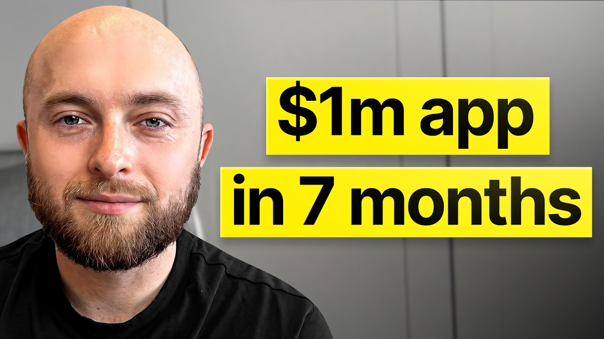

# I speedran an ai app from 0 to $1m/yr in 10 months

Start building & deploying paywalls in 10 minutes flat: https://superwall.com/

## Table of Contents

* [00:00:00] Intro
* [00:01:23] Kobe's App Success
* [00:03:12] Influencer Strategy
* [00:05:53] Hiring Influencers as Employees
* [00:08:39] AI Companion Playbook
* [00:12:52] Building Effective Apps
* [00:17:00] Community and User Engagement
* [00:22:21] Developing Sunflower App
* [00:29:08] UGC and Marketing Tactics
* [00:34:05] Brand Marketing Insights
* [00:38:24] Fundraising and Pitching
* [00:44:34] Subscription and Pricing Strategy
* [00:52:10] Future of App Monetization"

## [00:00:00] Intro

Kobe Conrad built an app that hit a million dollars in annual recurring revenue in 10 months. >> Our app is called Sunflower. We help people quit any type of addiction, anything from alcohol to cannabis to methamphetamines, cocaine, or gambling. And yeah, we went from about zero to a million dollars of annualized run rate in about 10 months. >> But here's what makes Kobe different from most app founders. [00:00:00 → 00:00:23]

He did not spin up 30 micro influencers and track CPMs. He went straight to the top. He hunted down the number one influencer in the sobriety space and hired him as an actual employee of the company. >> His name is Eric. He's Mr. [00:00:23 → 00:00:36]

Impulsive. He does anywhere between 50 to 100 million views a month. And we went and we got him to come and be our VP of Sobriety. >> That one move drives 50 to 100,000 clicks each month to his app. And Kobe spent 10 to 20 million dollars on influencer marketing throughout his career. [00:00:36 → 00:00:52]

His take is that most founders are doing it completely wrong. >> They'll find like the biggest player and you get them on your team and you just do whatever the hell you need to do to get them on board. That's so much more effective than trying to spin up like 30 influencers and tracking all their stuff and having all these complicated deal structures. >> But the growth playbook isn't even the craziest part. Sunflower has an AI sponsor named Sam. [00:00:52 → 00:01:14]

In the last year, it's handled over 4 million messages, more than a human therapist could handle in a lifetime. And Kobe watched it do something nobody expected. >> We can literally talk to a computer. [00:01:14 → 00:01:25]

## [00:01:23] Kobe's App Success

It can convince us to stop doing drugs and to not kill ourselves. People literally about to shoot up or go kill themselves and is able to talk them out of it. >> In this episode, Kobe breaks down how to hire influencers as employees instead of paying per post and why it's 10 times more effective. The paywall experiment that increased revenue by 48% with one change, why he thinks subscription apps are going away entirely and what's replacing them, and the AI companion playbook that's handling 4 million messages a year in behavioral health. This is how you build a mission-driven app that actually makes money. [00:01:25 → 00:01:55]

Let's get into it. This This Superwall podcast and I'm Joseph Choi, founder of Consumer Club. The members in the Consumer Club Discord and the founders I interview on the pod build apps at a median of 1 million ARR. A lot of these apps that make the most money run AB tests on their paywalls to make more revenue with the same number of users. Superwall has a lot of data on the thousands of apps that use a paywall. [00:01:55 → 00:02:16]

So recently they put together a free AI tool trained on 422 profitable paywall experiments. It lets you upload a screenshot of your own paywall and gives you an experiment idea to increase your revenue. You can use it for free at paywallexperiments. com. Also, if you're building a mobile app doing at least 100k a month in revenue, Superwall hosts dinners in San Francisco and New York. [00:02:16 → 00:02:35]

They keep each gathering small, thoughtful, genuinely useful for everyone. If you meet this criteria of 100k a month in revenue and want to invite, apply using the typeform in the description. Let's get into the pod. Kobe, tell me about your app and also your recent revenue milestone. >> Our app is called Sunflower. [00:02:35 → 00:02:54]

We help people quit any type of addiction. Um so anything from alcohol to cannabis to methamphetamines, cocaine, or gambling. And yeah, we went from about zero to a million dollars of annualized run rate in about 10 months. We just passed 10,000 paying subscribers and excited to be here today to talk about it. >> Congrats. [00:02:54 → 00:03:12]

## [00:03:12] Influencer Strategy

Million, you hit you hit the big milestone, seven figures. And then you put out this article on Twitter and it was pretty cool. I feel like you touched on like high level on a bunch of topics that are really interesting that I want to dive into, but the first thing is UGC. I think everyone wants to know like how do you run UGC? So I'm curious how that started. [00:03:12 → 00:03:34]

>> Yeah, I think that this current generation is actually just like completely sleeping on Facebook. You get so much reach on Instagram and Facebook right now. Basically, to make a really long story short, we when we hunted down the number one influencer in sobriety. His name is Eric. He's the Mr. [00:03:32 → 00:03:52]

Impulse. He does by himself anywhere between 50 to 100 million views a month. And um yeah, when our app was basically we didn't even have any revenue, we went and we got him to come and be our VP of sobriety. So, he's like member of our team, you can check out all of his stuff. Uh he creates uh really crazy content um that just goes like mega viral. [00:03:52 → 00:04:13]

His biggest accounts are on Facebook and then TikTok. And uh yeah, so we started with Eric. Um and basically we do a combination of stuff with Eric and then we do um couple other smaller influencers and we run a bunch of ads. But yeah, this is the TLDR of like uh the the GTM strategy. >> That's awesome. [00:04:13 → 00:04:29]

That's really interesting. You say his his biggest platforms are Facebook and TikTok, but not Instagram. Like it looks like he's posting a ton of Facebook Reels and they're like a lot of them are getting a lot a lot of views. >> Eric is a beast, man. He pushes out so much content and then occasionally he has stuff that just goes like mega viral and he links us in all of his stuff, basically. [00:04:29 → 00:04:50]

And then when something like really pops off, we get like I think somewhere between like 50 to 100k link clicks um every single month just from Eric. But yeah, so I've I've spent probably anywhere between like 10 to 20 million dollars in the last 10 years on influencer marketing. The thing that people get wrong is that if you just go to an influencer and you're like trying to negotiate like a dollar per post, you don't get the best deal. People treat influencers like they're not humans for lack of a better word, but they're just humans that care about things that uh job is to like promote your product. And if you're able to like get them onto your team and like give them like salary and equity and get them like hyped about a mission and be like this isn't just like some silly app that's paywall CAC arbitraging its way to like make million dollars, but like this is like actually helping people and like you can feel good about like the work that you put out into the universe. [00:04:50 → 00:05:43]

All of that matters to influencers and if this This the same for influencers anyone, but if you're only paying for like dollar for performance, you're missing out on just a lot of optimization. [00:05:43 → 00:05:55]

## [00:05:53] Hiring Influencers as Employees

>> Yeah, how do you structure these deals with influencers? It sounds like the negotiation and the human-to-human part is really important where you're getting people who are genuinely interested in your product. And then is there like a interesting way you structure these deals? >> So, it's not just me. I've seen We did this at Reddit. [00:05:53 → 00:06:12]

I've seen this been done at Replicate, which is like the API for AI models. Just hire them as employees. Don't go to them and be like, "I'm trying to buy one post. " Go to them and be like, "Hey, I'm trying to change the world and I would love for you to come and do this with me. Um I have this really cool role on our go-to-market team. [00:06:12 → 00:06:28]

I'd love for you to come and join. " And if you do it like that, uh it's just so much more effective. And one of like the best examples of this is like Function Health, right? Um Function Health was building in uh like the functional medicine space. And what did they do? [00:06:28 → 00:06:43]

They went to the guy who literally invented the industry. It's like go to Mark Hyman, who's like the godfather of like functional medicine, and they got him to like be the face of Function Health. And that strategy, uh where you just go find like the biggest player and you get them on your team and you just do whatever the hell you need to do to get them on board, that's so much more effective than like trying to spin up like 30 influencers and tracking all their stuff and having all these complicated deal structures. Um just like go find the person that's going to matter and then like make them get them on board with your mission. >> That's really interesting. [00:06:43 → 00:07:18]

What are the benefits of having someone actually on your team? Cuz like a lot of people think of influencers or creators as, "Oh, you're just accessing their audience. You get the views. " But it sounds like there's a lot more benefits to having them actually like embedded into your team. >> I think there's like a couple benefits. [00:07:18 → 00:07:37]

It's basically purchasing in wholesale, to be really crude. As instead of like buying one-off posts, so like you're buying bulk. The other thing is that it's much more defensible, you know? Like Eric gets hit up by other apps all the time. I'm I'm sorry to probably like the 100 people that are building and I'm trying to quit blank app that are listening to this. [00:07:35 → 00:07:54]

They're they're much less likely to uh go and like switch to a different app. They like understand what's on the product roadmap. They like understand the product much better than just like working with like outside influencers. And I I think you get like working iteration cycles is like he gets really, really good at like learning how to like push us. Like the way that we're driving hit link clicks today is way, way, way different than it was a year ago. [00:07:54 → 00:08:21]

You get the most out of the person, not just white labeling the the Facebook page, basically. >> Yeah, cuz they're like actually bought in. One thing I want to come back to in a bit, but it's relevant right now is like you have venture funding. So, it's a little bit more feasible for you to uh pay salaries, like legit, you know, uh employee salaries to creators. [00:08:21 → 00:08:44]

## [00:08:39] AI Companion Playbook

But, if someone is bootstrapped, do you think that it's possible to do the same thing? And if not, is there like a similar model, but maybe a a more cost-efficient way to do it that's not just, you know, reaching out, paying per post? >> I don't think we could have built what we've built without the venture capital, is like the honest answer. There's this like huge debate, especially with I think in the app community of like, do I take VC capital or do I don't take VC capital? And the truth of the matter is that taking VC capital allows you to ignore reality for a little bit and invest in things that allow you to create a better brand and a better product in a way that wouldn't be possible if you don't take the VC capital. [00:08:44 → 00:09:29]

And that is like that is the pros of like the venture capital, right? So, we started working with Eric before we were even pre-revenue. Like like there wasn't a monetization model built into the product when Eric started promoting us. So I I would be like if you're trying to like make like a positive ROI, like even if you started doing it yourself like at that point, um like that's probably where I would start if I was bootstrapping. I mean that's what I did when I was like launching my first company when I was 19 is like I built up my own Facebook page and we had all this audience and I was like, "Wow, I could make money off of this. [00:09:29 → 00:10:03]

" And then we started making products for that Facebook page. The venture capital allows you to do things like go and hunt down large influencers like Eric or Hyman and be like, "Hey, you should come join us on this like really crazy mission. " Versus going to them and being like, "Hey, I'm an app builder. My app isn't making any money yet, but would you like really like to promote me? " Um that's a much harder pitch and you have to like work your way up. [00:10:03 → 00:10:25]

>> You kind of just have to prove yourself a little bit, make some money to be able to afford to do the things that that you're doing. I guess the other like potential analogous way to do this would be to just give equity to the creator if you can't afford to give them cash. I've been seeing some, you know, bootstrap companies just upfront giving pretty significant amount of equity to creators and incentivizing them that way, which obviously it it kind of caps the amount of like how big you can really try to make your app. >> I've seen that too is like people go straight to a creator. And I think that's honestly more of like a partnership model is you you go to them and like instead of being like, "Hey, I I want to have you promote my app and I'll give you equity. [00:10:22 → 00:11:09]

" The way that I would like probably frame that situation is like, "Hey, you have this giant audience. Wouldn't it be great if someone created an app that you were able to sell for your giant audience? Um maybe we should work together and I could be your developer and I could make you an app for your audience. " And I would like kind of position them as like the hero of the story and then be like, "Yeah, we should like do this 50/50 and like I'll do all the development work and then you handle like promoting it, and I I would like frame it like that rather than like trying to give them like a chunk of equity in exchange for like promoting this idea that I had, if that makes any sense. >> That's a really great point, yeah. [00:11:09 → 00:11:46]

I feel like the common thread through both venture-backed and the bootstrap model is just treat creators well. Like, it's either like, you know, include them in the in the vision building and kind of like the the product vision, or it's just like hey, genuinely show them like hey, this is actually a really cool product. I think that you would be interested in it, like what do you think? Instead of like hey, I have I have money, like please make posts for me. >> All the influencers I talked to, they've been pitched by something that sounds really similar like 20 times. [00:11:46 → 00:12:17]

So, there's something you have to do of like making the product authentically good and something they like feel like happy to like promote and push because ultimately, like influencers know that they need to make money by promoting products. And it's hard being an influencer. It's hard to like people say they'll pay for your posts and then they ghost you on payment for 60 days. So, like just being great to work with around like something they care about with like a good product, uh makes the whole situation way easier. >> Okay, so we're talking about product and like mission and things like that. [00:12:17 → 00:12:48]

So, I want to get into your product. Like it's actually a very interesting, very cool product. [00:12:48 → 00:12:52]

## [00:12:52] Building Effective Apps

Let's talk about the app. >> We can make a computer that people talk to, and it can convince you to stop doing drugs and to stop killing ourselves. >> It actually is a crazy thing to think about. Like I mean, I've used like ChatGPT Claude myself, and it has changed my mindset. Like I use it for like personal, just self-development, analysis, like kind of therapy, kind of stuff. [00:12:52 → 00:13:16]

And even though you know you're talking to AI, you're like it actually can change the way you think about things. And I don't have experience with like explicitly like drug addiction, but I could see how it could also help with that. >> Okay, so this is what I'm saying. We launched this as a chat GPT like wrapper and what we really like quickly realized is we had this one super user, her name is Patty, and Patty's like a 60-year-old grandmother and she had been an alcoholic for 30 years and her kids hate her cuz she's like the alcoholic mom and she'd been like villainized by society and our little stupid chat GPT wrapper was the first entity that Patty had encountered in a decade that made her feel just like validated and worthy of love. And she went thousands of messages deep with our AI sponsor Sam. [00:13:16 → 00:14:08]

Um she's now over 1 year sober and she was the first of hundreds of thousands of super users. And what we realized is humans are just like unimaginably lonely and AI is basically having like a 200 IQ entity in your pocket that's like all of human knowledge like wrapped up into like a single like entity and it is capable literally capable I I I have seen it the conversations like we're HIPAA compliant but our our team is able to like view the conversations. I I have seen it thousands of times people literally like about to shoot up or go kill themselves or like literally end their lives and it's able to talk them out of it. And I think that we're about to experience a wave of AI being applied to behavioral health that is super super powerful. I I don't think people realize just the the size of the market for behavioral health and all the different applications for this. [00:14:08 → 00:15:02]

Um addiction is the smallest segment of this market but despite that we're like one of the largest AI companions here. Depression is massive, uh anxiety is massive. You can do this for like different flavors of like mental health disor- like not just mental health disorders but like GI health disorders and like food addiction and like I'm binge eating and then I puke it up and then I eat too much and then you like feed that in with like courses and community and all that stuff just like segment out the human existence and you can make like an AI companion for like any segment of that and it's way more effective than anyone realizes. The other piece of this is that the AI companion isn't the entire story. If you take our app and you only do the AI companion, the whole thing is horrible. [00:15:02 → 00:15:54]

The engagement is horrible, the retention is horrible, no one is actually going to pay for the thing. The AI companion is just like one piece of the overall like product set and that's the same no matter what you're building this for. Like if you're building it for a like depression, cool. Like having a painting is great but there's like tools and skills and resources and community and content and all this stuff you can bundle up to make a product that's so much better. But yeah, we get this level of feedback just constantly of not just like great out five stars but dude this thing like literally saved my life. [00:15:54 → 00:16:29]

This person at the top left like I don't know how he found our developers like my CTO's email but he's like I wanted to thank you for this app. It spoke to me during the darkest nights of my life and kept me strong. I'm truly grateful. This person is like complaining about us. He's like I've been on this planet for 60 years and I can say for 40 of those I have been dependent on alcohol. [00:16:29 → 00:16:52]

With Sam's help I'm 7 days sober. We see this like over and over again. And then I'll tie this back into UGC. We have Eric in our Slack channel not just like outside and be like hey, here's money thanks for posting about us. [00:16:52 → 00:17:02]

## [00:17:00] Community and User Engagement

He's like in our Slack channel and we're just like constantly dropping this stuff and he can see all this feedback and he can be like woah holy like I'm just out here slinging memes but like these memes that I'm slinging are resulting in people that are like aren't killing themselves anymore and he can feel very good about that, and it's really, really powerful. Not just for the like the influencers, but just team building in general. >> That's awesome. This is so cool. Was there anything surprising to see which features people found the most helpful between like the social things, the AI part, and like some of the other features that you put in? [00:17:02 → 00:17:38]

>> There's two big surprises that I've discovered by building Sunflower. Um it's this. The most important feature isn't the AI sponsor, but it's the timer. It is the core job to be done that 1. 2 billion humans on this planet have, which is if you're trying to stay sober from anything, you need to track how long you've been sober for. [00:17:35 → 00:18:00]

And it's the most basic feature. Uh it's super, super simple. Um but it's kind of like an exercise of like how do you do something super simple, but in the best way? And I think that oftentimes people when they're building products, they're trying to make these big, complicated, grand things that are technically super, super hard, but in reality is like you need to find like what is something that people do every single day, and then how do I like segment my ICP and build an audience out of that, and like put everything around that. But the but the whole freaking thing lives around this really simple thing of just track how long I've been sober for. [00:17:57 → 00:18:35]

Do it in a way that's super, super motivating and makes me feel good about myself, and results in me staying sober for a longer period of time. The second thing is the the the AI sponsor. Uh I'm I'm a skeptical human, man. I like don't believe anything until I see data around it. Like I didn't think it was going to work. [00:18:35 → 00:18:49]

Like I I'm an ex-addict. I've been sober for 7 years. I was like, I don't know if like I would use this thing. And um it like the the usage just like blew me away. So, um I guess the the learning from that is that I'm dumb, and that I should always second-guess my assumptions, and um just build build like I think that's the beauty of AI is um we used to live in a world where there was so much opportunity costs to going down a specific product direction that you could only like really pick one, maybe two. [00:18:49 → 00:19:20]

But now it's like just build everything and then figure out what is going to like work the best and then trim everything else and then like go down what's like actually working. >> So let me show you this. A lot of app founders I talk to have a feeling their app has viral potential, but don't want to be the person brain rot scrolling an hour a day hunting for formats or worse burning thousands on creators shooting videos that just flop. Recently I've been telling every founder I meet about Spytalk. It's basically an AI TikTok viral marketer that I've seen a lot of top app growth teams using. [00:19:20 → 00:19:51]

You just paste a link to your app and this agent scrolls hundreds of thousands of TikToks for you, finds the outlier videos from competitors who've already cracked the best formats that are driving installs in the niche of your app. And then it remakes the hooks, the angles, and then it makes playbooks so you can pretty much copy paste virality. And then it alerts you when it detects new breakout formats that would also work for your app. This is the only growth tool I 100% for on this channel because there's a ton of gen AI content tools out there, but none of them tell you what to make. Spytalk makes sure you're never in the dark about what's actually working. [00:19:51 → 00:20:22]

Now, I'll put the link in the description. I feel like from the bootstrapper 19-year-old kid who's who's trying to make a million dollars perspective, the tracker feels very feasible to build. The AI sponsor feels somewhat feasible to build. The community part is kind of like the part that I feel like people will struggle with. Like it feels almost like consumer social or do you need to seed the network somehow? [00:20:22 → 00:20:48]

Do you like if there's not enough users like a certain day of the week and there just happen to be no posts, like does that cause churn? Like I feel like this like the kind of like social element is something that a lot of new founders shy away from, but it seems like the community aspect of the app is actually pretty active. Is this harder to execute In your perspective? >> Let me not underplay just how amazing our dev team is. We we have like like five truly S-tier software engineers that are like able to go and build that. [00:20:48 → 00:21:22]

That being said, I consider myself non-technical, but like I built the first version of this myself as like a learn-to-code project when I like 2020 2021. Like before AI, okay? Before vibe coding was a thing. Like I went through a boot camp and like I taught myself how to code. And the first version of this was like ugly. [00:21:19 → 00:21:38]

If you can find like the Product Hunt like 1. 0, this was the first version. Okay? There was three features. There was a timer. [00:21:38 → 00:21:47]

There was some sunflower graphics I got off of Fiverr. There was this like journal which is just like a CRUD app and you could like edit the thing. Okay? Um and I think that it like if I was like 19 and I was like, "Oh, I'm thinking about building this feature. " And like like this is so bad compared to what it is, right? [00:21:47 → 00:22:07]

Like if I was 19 and I was just like thinking about like building these features and I wasn't sure, just build the smallest thing you freaking can. It can be ugly as hell and just launch it and put it into the world because you're not playing a game of trying to build what's what like my version of Sunflower is today. [00:22:07 → 00:22:25]

## [00:22:21] Developing Sunflower App

You're playing a game of like how can I make this system just like incrementally better? And like this isn't probably going to be your first app. You're going to keep building and making it better and better and better and better and better. Like you're not in the app building game, you're in the self-improvement game. So I would just like build the smallest version of whatever it is you can build that like your users will like actually use and like get that into the world. [00:22:25 → 00:22:49]

And then just do that and then one day it's going to actually be really really good. >> It's good advice. Going back to the AI part, you said in the beginning it was kind of just a low-quality like chat GPT wrapper, but now it's not. So what what's the difference between like bad implementation of AI and like actually good AI? >> So, first it was just a ChatGPT wrapper, and then we did some like fancy prompt optimizations, and then eventually like we turned it into an AI agent. [00:22:49 → 00:23:20]

So, Sam is now able to do things. Um so, it could like follow up with you when it knows that it's payday, and he can he will show up in the social media, and he will like respond to the posts, and we pull in all the contacts across the whole app. And now he can chat with you, and we can create prompted sessions. Um there's like super in-depth like safety features is we have like a VP of therapy, and anything that's like remotely scary um like gets like funneled up into like our clinical team. Um there's like uh really complicated memory features. [00:23:20 → 00:23:57]

There's like in-depth like data security stuff of like, "Hey, we want to remember stuff, but like also our users have abusive boyfriends, and like how do we like make sure their abusive partner like can't get into the app? " So, we have like biometrics, and you're able to like erase your data. So, there's like a whole system that can like be built out around this like really simple thing of like, "Oh, an AI companion that I can talk to," but then it can also like control the rest of my universe. >> It it sounds like it's sort of a combination of prompt engineering and like fine-tuning, but then also having like a memory system. So, instead of like base model, you know, ChatGPT or Claude, which does have memory, it's like you want to treat the memory in in different ways. [00:23:57 → 00:24:40]

Like, "Oh, this memory you want to follow up on the next day," or "This memory is like you want to follow up the next week. " Seems like AI engineering is not necessarily about "Oh, let's like create a whole new model from scratch," but it's more just like, "How do you use existing models, but design the like memory features and kind of like the how the agent behaves in a way that creates a good user experience for a very specific type of user. >> There's different ways you can like optimize your system. So, you can train new base models, you can fine-tune models, you can do prompt optimization, but I think that especially for like app builders, um one of the most powerful places to build is within like the tooling and like function call optimization. It's the productization of the companion and everything else that it attaches to, which is so important. [00:24:40 → 00:25:34]

It's not literally just the companion, but it's like everything else that it can do and the whole system and ecosystem that it's like working in. Just to like extend this a little bit, like we're launching a teletherapy clinic right now, and we're like building out like, "Cool, how does your sponsor work in collaboration with your like therapist? " And like can it tell your therapist like, "Hey, I think this person relapsed and like here's a score and you should like go reach out to them. " And then can your therapist like assign homework assignments and can your sponsor like be like, "Hey, I saw you were supposed to do this. Did you like do it? [00:25:32 → 00:26:00]

Do you need any help? Can I like walk you through it? " Um so, this like universe of like just building like the whole ecosystem, like what the AI agent is like interacting with is really really important. And then the second thing is that there's this whole spaces that ChatGPT and Anthropic aren't able to build in right now because they don't know what to optimize for. Like one of the cool things about being in YC is like we got a talk with Sam and like the people at OpenAI, and they were talking about like why they're not building in behavioral health. [00:26:00 → 00:26:32]

And there's basically like two answers. Uh one is like absolutely the legal liability. The second one is that they don't know what to optimize for. Like if they're training their models, they don't know if the users are becoming less depressed or if they're actually staying sober. So, the fact that Sunflower is able actually to like track relapse data and like understand are users feeling less lonely, and are they happier, and they're not craving things, and they're like actually staying sober from their drugs, and like how many days sober are they being staying, and do they go back into the like hospital systems, and like all all of these things we can use to optimize like the aggregate system, and that aggregate system doesn't just have to be the base model of like I'm training like a whole new model. [00:26:32 → 00:27:13]

It can be like everything else that we're putting together to try to hit this goal of how do I accomplish this goal, which is for us is like how do I keep this person from staying sober and not relapsing. >> That is so true. I feel like that's something that a lot of people miss, that wrapper is basically like prompt engineering and fine-tuning. But, if you were going to build a startup around a specific thing where the outputs need to be really good for a specific type of user, OpenAI will never I mean, by default, they don't really get that data. Like, on the consumer side, there's ChatGPT, it'll give you like a therapy response, and then like, you know, what data do they get on that? [00:27:13 → 00:27:49]

They don't They don't collect like "Oh, like, do you feel better this this week compared to last week when you didn't, you know, after using ChatGPT? " They don't They don't collect that. And then, on the API side, you put in an input, you call the API, it gives you an output, and then you don't tell it back like, "Oh, that output was great," or "That output was bad. " They don't collect that data. So, you as a startup who uses the model actually have that data, so you can like do things that actually the model companies can't do. [00:27:49 → 00:28:16]

That's actually really good way to frame AI companies. That's awesome. >> Yeah, there's a whole universe of stuff. Any space where the model company doesn't actually have the data when they're like training it, and then any space where the AI agent isn't the whole solution. Like, that's like actually the best place to build, because then it's like you're you're connecting things together, and if you rip out the agents, like, or if you rip out the rest of the thing, like, the agent isn't as good. [00:28:16 → 00:28:46]

Um Like, I I think that's honestly one of the reasons why like uh the Claude bot was like so crazy is like for the first time it like had access like freaking everything. Like that's kind of what you want to build in like other spaces is like you you want to build AI agents that just have access to everything you need them to have to accomplish their goals. And I and I think when you do that you you build really cool things. >> That's awesome. [00:28:45 → 00:29:09]

## [00:29:08] UGC and Marketing Tactics

So we we got in we got more into the product. Um so let's switch back over to UGC. So you can't you describe like this model for working with influencers. You want to actually have them embedded into your team uh really bought into the culture. Are you doing the whole like multiple account thing and in-house UGC machine or are you just focusing more on like influencers that have an existing audience? [00:29:09 → 00:29:35]

>> Well, what we're actually doing is we're just focusing on influencers that have an audience. This strategy of make multiple accounts that are like new accounts and then you like blow them up um and just like post the whole time and I have like 100 TikTok accounts on like a farm that like all pushing out content. I imagine that it works right now for some people. I also think that this is arbitrage and I've just been like screwed enough times by platforms that I try not to like actually touch like growth hacky stuff like that. There's a big difference between making a million dollars of revenue and making a hundred million dollars of revenue. [00:29:34 → 00:30:12]

And I think that when you're trying to make a million dollars of revenue, there's a bunch of like small hacky that you can do. But if you're trying to make like a hundred million dollars of revenue, there's only like a handful of things that will like actually take you to that scale. And um that's what I try to specialize in is like what what are like the different channels that will like actually take a product like a hundred million of revenue. And I I don't think that you're going to get there by having like a hundred UGC like accounts. They're just like without any following and spin up like you you need to go build 10, 20, 30 million followers if you want to do it in the consumer side. [00:30:12 → 00:30:47]

And like, you need to figure out how ads work because like ads will like allow you to scale to that size. Um you need to figure out how to build your own community because like that's like another model to like get there, to like build like like retail partnerships. But at the end of the day, there's like four to five different ways to do this in the consumer world and you got to kind of like pick one and figure out like what is that going to be that'll take you there. >> Your costs though are like they appear to be arbitrage level costs. Like you you have 10 cent CPM, which is kind of insane. [00:30:46 → 00:31:18]

>> If you're looking for arbitrage in the universe, um this is where I've most reliably found arbitrage and I I've found this in a bunch of different places is you never want to be the smallest sponsor. Like you want to be the biggest sponsor this person has. And that's not the same it's consistent across UGC. It's the same with like sponsor like with conferences. When I was at Ruper, we would spend like half a million a year like going to conferences and I the way that you like sponsor conferences and like I want a tiny booth to test this out and like five grand. [00:31:17 → 00:31:55]

You go to the you go to the conference and you're like, "Hey, what is your biggest package? " And they're like, "Oh, we have like the the gold executive package for like $100,000. " And I'm like, "Cool. What will you give me for $200,000? " And they're like, "Wait, what? [00:31:55 → 00:32:08]

" Like like I don't what what's even on the menu for $200,000? Exactly. Like, "Will you give me like private dinners with people? Will you let me have speakers on the stage? Will you give me like direct email to access to like email list? [00:32:08 → 00:32:20]

Like will you make everyone wear my logo in their like lanyards? " And you I will I've seen this like in so many so many spaces is you never want to be like the smallest person someone's working with. Then they'll actually care about you. Like I I've just consistently seen that play out way better. >> It's like a people problem. [00:32:20 → 00:32:40]

>> Is it the same effect with um like I can see how that works with from the influencer side? Does it work the same way with the conferences? Like when you get that 200k booth, is it better mostly because the conference organizer treats you better and puts a lot of effort into like making you stand out? Or is it just like the the the perks themselves? And it's like, "Oh, you you stand out to the audience better. [00:32:37 → 00:33:05]

" >> There's overlapping effects. So, there's brand effects, right? So, if you come in and you're like obviously the number one sponsor, like everyone is like, "Who is this? " Like Like Who's this like no-name thing I've never heard of before? They're like the headliner at this thing that I care about. [00:33:05 → 00:33:19]

Like they got the biggest booth versus all these like old people. It's like the same with influencers, right? Like you're this like no-name app, but all of a sudden the number one influencer in the space is posting you on every single thing that they do. They're like, "Who is this app? " They're like, "I've never heard of it before. [00:33:19 → 00:33:32]

" But then yeah, uh they treat you better because like all of a sudden like a significant chunk of the revenue goes away. Like if you start losing like if you're an influencer, like you lose like 50 to 75% of your revenue because like your main sponsor like decided to like peace. You're like, "Oh. " Um same thing with conferences. Like they they don't want to lose their the number one line item on their P&L. [00:33:32 → 00:33:54]

Um So yeah, they they treat you better and they like make sure that you're really taken care of. Um and then for like the people that are like consuming the content in whatever form that comes, the strength of impressions matter. [00:33:54 → 00:34:06]

## [00:34:05] Brand Marketing Insights

It's not enough to just simply put yourself in front of someone's eyes. You need to do it in a way that's like really, really powerful for them. And uh I think people often miss that so when they're like purchasing inventory. Is that it's it's not just enough to like get eyeballs, but it's like what do they think when they see you? And like what is the situation the context around them seeing you? [00:34:06 → 00:34:28]

Um all of that super, super, super important. >> That's a great mindset shift. A lot of people would just only see the CPM, but they don't see like, you know, what does the consumer feel when they see you? And like the biggest brands in the world, like the multi-billion dollar companies, they do full funnel marketing. They do brand advertising. [00:34:28 → 00:34:49]

They buy Super Bowl commercials. No conversions from that. It's pure brand. And then they do engagement, and then they do conversion, and they do retention. But they're doing marketing all throughout, and that's how you build like generational company. [00:34:49 → 00:35:03]

Um but then if you compress that, like, oh, maybe you want to make a 10-50 year company you know that makes like 1 billion dollars, you you you have to do the same thing. Like you have to think deeply about like, how will people actually feel when they see my brand? And then if you're seeing a brand for the first time and it's coming from a 100 follower Tik Tok account with like AI generated UGC, you need to do direct response on that because you're probably not going to like do another uh follow-up ad that's like brand, and then you know, conversion. Like you just you're just not thinking at that level. So, influencers feel to me like almost like a shortcut to like full stack marketing. [00:35:03 → 00:35:43]

Cuz it's like the influencer has already done the brand marketing for you. Where they've like accrued this kind of like loyalty and audience to themselves. And then you're just kind of like cashing out a little bit where it's like you're now doing the like the the conversion, and like kind of borrowing their clout in a way. It Does it Does this feel like consistent with how you think about it? >> Yeah, couple things. [00:35:41 → 00:36:05]

Please, for the love of God, never ever ever do like pure brand marketing. This is my spiciest take. I'm not sure brand marketers should exist. The way that I've seen companies very successfully build generational brands is like this. Is all marketing is brand marketing. [00:36:05 → 00:36:24]

Every time someone sees your company, they they will remember you. It's it's like space repetition learning. Um so like you want to like keep showing up in front of them in powerful ways. It is possible to show up in negative ways. Like that's negative brand equity, right? [00:36:21 → 00:36:37]

So uh if you're showing up in a way that like makes them have a good association with your brand, cool. Positive brand equity. Most influencers are good for that. Not all. Some of them are like bad for your brand. [00:36:37 → 00:36:49]

But like most influencers when it's done the right way, you're like you're latching on to their like superstar status. And then what you want to do is you want to figure out how to get in front of people in a way that's directly profitable. I I think that people eventually get marketing budgets that are too big and then they put in like brand marketing. The way I've seen work way way way better is that invest in ways that are directly profitable or are building an audience. Like if you I actually really want to run a Super Bowl ad, that's completely aside. [00:36:49 → 00:37:17]

But um like if you actually have the most people that are running Super Bowl ads, you should just take that like 5 to 10 million dollars and go build yourself 30 40 million followers. And like that will have a better brand impact than your Super Bowl ads and then you'll have 30 40 million followers. But you should either be building your audience or you should be investing in something that's like directly profitable. And then you should space that out across like a whole bunch of different channels. So when I was at Rupee, we we went from like 5 million to 75 million in 3 and 1/2 years. [00:37:17 → 00:37:45]

If that makes sense. >> It sounds like the take is like don't don't do brand marketing, but at the same time everything is brand marketing. So when you're doing marketing that optimizes for conversions, just make it you know, be a good representative of your brand. In the conference example, it's like pay 200K for the best booth that's better than everyone else, but collect the emails. Like build actually build an audience. [00:37:45 → 00:38:10]

Like build relationships with people. Like actually get ROI out of it. Don't just spend the money to spend the money. You're talking a lot about like this like pretty important nuances in go-to-market strategy. I'm curious when you were fundraising. [00:38:10 → 00:38:23]

So, like let's talk about your investors a little bit. [00:38:23 → 00:38:27]

## [00:38:24] Fundraising and Pitching

So, you Yeah, who who have you raised money from? >> Yeah, so we are part of YC. So, we work directly with Garry as our general partner. We have a bunch of really cool angels on our cap table. So, Jacob who's the CEO of Reven Capital, we have Tyler who's the CEO of Beehive, we have Jason who's the CEO of Saastr. [00:38:27 → 00:38:46]

We're in A16Z speed run and we work directly with Josh. We have Flybridge who led our seed round. So, we work with Jesse over at Flybridge who's absolutely amazing. Total we've raised about 6 and 1/2 million dollars. >> And when you're raising money from investors as a semi-non-technical founder, how deeply do you go into like your background as a marketer in the pitch? [00:38:44 → 00:39:07]

Cuz that's that's the like one of the big takeaways that I'm getting from you is like, oh this person knows a lot of nuances of marketing and they're probably going to take this company farther than someone who wouldn't. >> My answer like I don't think it's going to make people happy, but like it was really freaking hard. Like I first taught myself to code to build this thing because I couldn't get anyone to build the first version of it. So, like I I literally did like have to like build V0 myself. And then I couldn't get it funded for like another like three or four years. [00:39:07 → 00:39:42]

So, I was like at Rupa working and like doing that. And I so I I I led growth at Rupa. I I took us from 5 million to 75 million. I still couldn't get this funded afterwards. Rupa then got sold like after I had left. [00:39:39 → 00:39:56]

Like I didn't think we were going to sell for like 10 years, but we had like a really nice nine-figure exits like 3 months after I left. And then I still couldn't get funded. So, I took $100,000 of my own money and I basically went to all of these people that I just made really really rich and I was like, hey please invest in my company. I I swear to God it's going to be great. I realized that I'm like, "Hey, I'm going to make this like silly consumer app to like help people stay sober, but just like close your eyes and believe in me. [00:39:56 → 00:40:27]

" Um and like I was able to put together like a small uh like 350k at the start. >> I'm curious like a really random like specific question on on pitch decks. Like in your initial pitch, were like half your slides like, "Hey, look at my background as a marketer. I know I'm not technical, but look how good I am at bringing things to market. " Like was that like a significant part of your pitch? [00:40:27 → 00:40:50]

>> Ooh, do you want to see the first pitch deck? >> Yeah, that'd be cool. >> I think this was the first deck. And then yeah, basically like that was the next slide is like, "Hello, my name is Kobe. I took Rupa from 5 to 75. [00:40:49 → 00:41:04]

Um I scaled user acquisition by 4,000%. Please give me money for Sunflower because I'm going to go do the same thing for Sunflower. And here is our app that like is a little bit better than that that version you saw on Product Hunt. " Um this was what Sam used to look like. This was just like little AI generated B, um our ChatGPT wrapper. [00:41:04 → 00:41:24]

At this time, um I think that our monthly actives was at like 22,000. Let's skip around just a little bit. We had 762 reviews at this time, but like I still found that one review of this person's like this thing like saved my life. And then we ended it with like we want a really big dream. It's like we're going to go drive a million downloads a month. [00:41:24 → 00:41:43]

We're going to do performance marketing. We're going to make like a PLG key factor and we're going to go do media. We have this big influencer on board. Um if you can just believe that my name is Kobe and that I will take us to a million dollars a month, then this will be a really big thing. Um please give us money. [00:41:43 → 00:41:58]

And that was the pitch. That was not the pitch that raised us a lot of money, by the way. Like this like actually kind of failed. We went back and we like this was the pitch that like actually raised a bunch of money post YC is we figured out how to talk about the future rather than the past. And I I think that's super important if you're like trying to raise money and you're like have an app is you can't you can't raise funds based off of a playbook that came out of 2025. [00:41:58 → 00:42:25]

You need to figure out like where the future is going and be like, I'm going to go build for this like absolutely massive market. This is what the future looks like. Here's proof that we have like product market fit and like users actually freaking like this thing. Here's proof that it like actually freaking works and we're like actually helping people stay sober. Um here is me talking about like where we fit in the the universe of AI is like figuring out how to like position ourselves within like a universe. [00:42:25 → 00:42:53]

Here is revenue that goes up, not usage that goes up because we tried to raise off of usage the first time, but like here here's like actually we we we hadn't actually hit it. So we like filled in the month when we were raising. Um but here's here's revenue that goes up and says that we we went to a million really fast. Here is uh like a a letter of intense to pilots to like prove that like our market is bigger than just being like a silly little app. And then here's a big slide at the end that says we're hoping to make a lot of money in the But yeah. [00:42:53 → 00:43:23]

Anyways, that that that is the deck that um was much more successful raising than than the first one. >> The other thing I noticed was like the revenue growth. You grew like pretty fast in revenue. How did you do that? Let's talk about like paywalls maybe and subscriptions. [00:43:23 → 00:43:38]

You have a $9 a month subscription or like $35 a year. How do you increase your revenue? >> So we started off as a free product. Um like I take a ton of inspiration from like Duolingo and I was like Duolingo's really cool. They I think they spent like six or seven years before they started charging money. [00:43:38 → 00:43:53]

I was like, I'm going to do that. Like I'm just going to go get like tons of users on my platform and then um we'll figure out revenue later. Um turns out uh investors want to see money. That just having usage isn't good enough in this environment. Also turns out AI token costs for us were just like scaling just like hundreds of thousands of dollars and we're like this is not going to be sustainable. [00:43:53 → 00:44:16]

So, we introduced our first paywall and our first paywall was just like a monthly subscription and that's where we started was just like please pay us like a set dollar per month and then we very quickly realized like the the next iteration of our paywall journey, put the thing you want them to do as the default option. [00:44:16 → 00:44:34]

## [00:44:34] Subscription and Pricing Strategy

So, if you're selling a consumer app, the most important thing the best thing they could possibly do is to pay an annual subscription not a monthly, pay an annual subscription immediately. No trial, like no no nothing just like upfront like pay us money right now for an annual subscription, make that your default option and you will start to capture so much more revenue cuz there's a percentage of your people that are going to be willing to do that, but if you like make them do something else they're not going to go and do that. So, we went from having a subscription for monthly to we added in the annual and like oh cool there's some annual revenue, then we made the annual the default select and it was like oh wow there's a lot more annual revenue and then we went into the like tollens like toggle of like cool pay us first but you can like toggle it off and like that made more money and then the other like major learning is that you want to have an enough variety of uh subscription options. So, like there's some people that want weekly and there's some people that want monthly and there's some people that want annual. So, it's kind of like an optimization game of how do you like provide those options in a way that like doesn't hurt anyone but like allows everyone to like self select into like the thing that they want the most. [00:44:34 → 00:45:49]

The next thing is that you need to understand how price sensitive your users are. Um our people are very price sensitive, they're people struggling with addiction and that means that often they don't have a ton of money. Our users uh we we made a lot of gains by actually lowering our price than like increasing our price, which is like really cool. It felt good to be able to reduce our price and make more money. And then the final like major learning I think that we've had most recently is there's trial anxiety. [00:45:49 → 00:46:16]

And trial anxiety is like way more of a factor than you probably think it is. And by giving people like, "Hey, we're going to remind you about your trial. Like it's going to be great. " That actually is like really really impactful. We had like a plus 56% like revenue bump by adding in trial reminders. [00:46:16 → 00:46:32]

It was it was insane. >> That's really cool. Are you able to show your trial reminder UI? >> This is the data for this experiment. But yeah, so we had a 48% increase in our revenue by adding in trial reminders. [00:46:32 → 00:46:45]

But what was crazy too is that the the mix between monthly's and annuals was also much more massive. So we had a plus 70% increase in the annual revenue. And yeah, that's the that's the results. >> Big lift. Trial Okay, so trial conversions. [00:46:45 → 00:47:04]

Yeah, 46% increase in trial conversions and 30% increase in trials. So putting the trial reminder probably helps with the trial starts. Would you say that's the biggest metric that it moves? >> So there there's a couple things. It moved trial starts. [00:47:04 → 00:47:18]

More people started the trial. More people converted from the trial. And then the mix between annual revenue, there was way more people that were more comfortable selecting an annual sub. So people were much happier to do an annual sub and then increase the conversion rate of the annual subs as well. >> Can we see the design of the onboarding screen that kind of gets them to like reduce that trial anxiety? [00:47:18 → 00:47:43]

>> So we're like AB testing like a couple different versions of it. And then this is like the priming. So we're like, "We want you to try Sonarwhal for free. " Or remind you before your trial ends. And then boom, we hit you with the paywall. [00:47:41 → 00:47:54]

>> I like how there's like a cute little bee with cartoon eyes. I feel like that just reduces my anxiety when I go into a paywall. Like just seeing a paywall with no like cartoon character, I'm just like, "Ah, these guys are just trying to get money out of me. " But then it's like, "Oh, this this cute little bee is like wants to offer the app for free to me. " It's like, it feels a lot nicer. [00:47:52 → 00:48:15]

>> Like our whole app is like how do we trigger dopamine in you to like try to get you to like start associating like sobriety with reward. And we like do that from like the design level, too. It's like it should be delightful and fun and like you should like enjoy every screen and you should be like, "Oh my god, this little bee and a little sun pops up and holy [ __ ] I got a flower. " And all that stuff helps when you're asking people to pay them money, too. >> I heard from paywall experts also that this no commitment, cancel anytime increases conversions quite a bit. [00:48:14 → 00:48:47]

And then I also notice you say this green check mark offer applied. Does that Was that also like an experiment that you ran? >> We haven't tested that. That was just part of the ship. It is something we want to test though, yeah. [00:48:47 → 00:49:00]

>> Yeah, that's that's interesting one. In your article on Twitter, it was interesting cuz you said in the future like people won't even pay for apps at all and your vision is that apps are a basically like a lead magnet, I guess, for like the real monetization, which is like deeper into the funnel. This seems like a sort of like a hot take. What's your take on this? >> Look, I think that the amount of competitors that we have that are trying to like spin up a sunflower or like a quit something app is like insane. [00:48:58 → 00:49:33]

I wasn't the first one to do it. Like I cloned someone, you know? It's like there there was like another app that was like quit something and I was like this product like I could build something better than it. At the time I couldn't, but um eventually I could. I think that with that just like the the cost of software is like decreasing, you know? [00:49:33 → 00:49:50]

Like even if it's not a full solution, even. Like, for for us is like we started like vibe coding a lot of our internal tooling and like that allowed us to like replace like some things. It needs to be more than the software. I I think that like tech cargo culting, whatever, like it looks at the past and people 99% of people look at the past as the future's playbook, but that's not true. It's becoming less and less true faster and faster and faster. [00:49:50 → 00:50:19]

We're like at the the the slope of like like how the world is changing is becoming steeper and we're we're caught at this like really interesting intersection. But anyways, what what I think this means is that like it is going to become so easy to create software. Like it's all this year like developers aren't going to have to like literally code. Like you we're literally just like talking to the computer. Next year it's going to be like the computer is just like talking to itself and like spitting out software. [00:50:19 → 00:50:45]

It it is becoming ridiculously easy to push out software. So, in that universe, I I think great software is going to become basically like having a really great article or a really great podcast episode. Like this is useful. Like people are consuming this, but like the point of this podcast episode is for you guys to be able to like go off and like sell your core product, right? Like there's either the sale of attention or there is the sale of like a the real product on top of that. [00:50:45 → 00:51:09]

And I think that that that's going to become more more more of how the market evolves. So, I think physical goods are still a thing and I think that um services are still a thing and I think that advertising is still going to be a thing. So, if I'm building apps, I would think through my monetization layer and if I was Superwall or I was RevenueCat or I was any of these companies that focus on app monetization, what Beehiiv is doing with their like digital products of like being able to sell things into your newsletters is like really freaking smart. Um is like you you want to be able to figure out like cool, if the future no longer is subscription monetization, what type of monetization is it going to be? And then I would figure out how to like build products and services around that. [00:51:09 → 00:51:54]

So, sunflower, even today, the bulk of the revenue in this market isn't coming in from subscription revenue, it's coming in from like therapy. Like we spend like billions of dollars trying to treat addiction, but it's not people spending money on like app subscriptions. I think there's like little like AA coins or like like little tokens that people have that buy. [00:51:54 → 00:52:14]

## [00:52:10] Future of App Monetization"

And I And I think there's like little tokens like that that make over a million dollars a year. Not Not that that's stupid, but it's like if we made like little pins that were like celebrating like your milestones and we made them like really cute and like congratulations, you're 1-day, 7-day, 1-month, 1-year sober. And we're like, "Do you want Do you want to buy this like cute little pin associated with it? " Like I bet you like that would probably do more revenue than like our subscription revenue. And VCs don't like that answer. [00:52:14 → 00:52:36]

No VCs listen to this. Close your ears. The world is changing and we should all take a really like cold hard look of like what are what are the physical products and services we can use to build here. The next layer is like AI has like changed the game. Every day we track over 109 years worth of sobriety on Sunflower. [00:52:36 → 00:52:57]

So, we're now powering more than a lifetime of sobriety with our app every single day. We've handled over 4 million messages dealing with the worst problems of people's lives in the last year. That's more messages than a human provider could handle in their entire lifetime. If we make the Sunflower app really really good and we're able to make a free version of it that's like a Duolingo-esque and we take that and we put that in the hands of a hundred million or a billion people, that will have a larger impact than all of the human therapists in the world like put together. And 90% of people struggling with addiction never get access to any type of care. [00:52:57 → 00:53:35]

They never see a therapist, they never go to AA, they never get on medications, they never go to rehab, nothing gets done about this problem. And the bulk of our users live in the 90% of people that aren't accessing in anything else. Go to like Venezuela. You know how many like addiction therapists are in Venezuela that like specialize in addiction? It's like literally none. [00:53:35 → 00:53:56]

Our app, we speak in Spanish, we're in Japanese, we're in Portuguese, we're in Korean. We're able to create an infinitely scalable solution that can talk in all languages that is like the bulk of human knowledge wrapped up into a single entity. And we can put that in the hands of like hundreds of millions of like billions of people. I think that we will be able to like change the GDP of countries. Like being able to like do that will have a massive impact on the universe. [00:53:56 → 00:54:23]

But that doesn't solve like the root cause of addiction. Like give me infinite amount of money and just like let me go crazy. Like we go, we build the number one product for addiction for this like absolute massive market. But then I think that the answer is like we have to then like get involved at like a legislative legislative level. It's It's one of the reasons why we're like very active on like we should go build our own media and influencers. [00:54:23 → 00:54:47]

And cool. We We're working with Eric. He has 3 and 1/2 million followers. Like let's go get Eric to like 30 million followers. Like let's go build our own brand social as well. [00:54:47 → 00:54:55]

You know, like let's go raise the venture capital and take in 40, 50 million dollars at the Series A and 100, 200 million dollars at the Series B. And then you know the type of I can do with 100 million dollars, Joseph? I will build so many goddamn followers. I will have half of this country like following some kind of like sunflower social. And then we have so much more pull at like the state and like government level that we can be like, "Hey, this is the policy agenda that like we're pushing and we can do some type of like Grow SF thing and be like, these are the things we think that are going to reduce addiction. [00:54:55 → 00:55:27]

Um if you support these things, great. We will support you. If you don't support these things, great. You have 150 million followers um that are going to be like these guys are bad. " So I I think like that is like the really beautiful thing about like having massive drains and like tech companies is that what happens at scale is like really really freaking cool. [00:55:27 → 00:55:47]

So, the first part of that article I wrote is that a million dollars a year is boring and I I truly believe that. Like that isn't me like trying to like humble brag. It's like I think that what we'll be able to accomplish if we can make Sunflower like hundreds of millions or like billions of dollars of revenue is like we can literally go and attack one of like the most painful problems in human existence. So anyways, that's what we're working on. Um and it's all starts with paywalls and being able to monetize and have a business that makes any money in the first place. [00:55:47 → 00:56:17]

>> I love it. The full circle. This is so awesome to to hear more about Sunflower. Um thanks so much for being on the pod, Kobe. >> Always a pleasure. [00:56:15 → 00:56:27]

Thanks so much for having me, man. >> Something you might not know, most of the founders I cover on this podcast are hanging out right now in the Consumer Club Discord, sharing with each other what's working now for consumer apps. So, you can apply to join Consumer Club if that sounds interesting to you. And this is the Superwall podcast, of course you got to check out superwall. com. [00:56:27 → 00:56:45]

We have more videos on the channel, so dig into those to learn from app founders who are willing to share super tactical stuff about app growth. [00:56:45 → 00:56:52]
