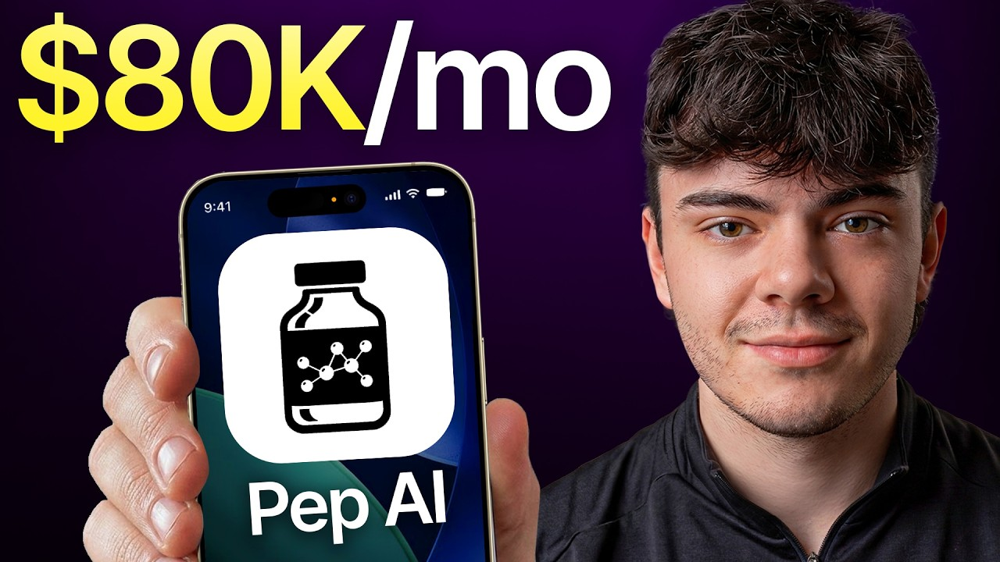

# I speedran an ai app to $100k in 70 days.

Start building & deploying paywalls in 10 minutes flat: https://superwall.com/

## Table of Contents

* [00:00:00] - The $100K Strategy: Achieving Six-Figure App Revenue in 70 Days
* [00:01:12] - Growth Engine Alpha: Inside the Consumer Club and Developer Tech Stack
* [00:02:25] - Market Positioning: Solving the Tracking Gap in the Exploding Peptide Space
* [00:03:57] - Pioneering a Trend: Navigating Early Concept Phase to Product Launch
* [00:05:30] - Organic Amplification: Building a High-Engagement Influencer Retainer System
* [00:06:35] - Performance Optimization: Transitioning Organic TikTok Winners into Paid Meta Ads
* [00:07:55] - Tracking Metrics: Acquisition Costs and Analyzing Dashboard Conversion Rates
* [00:09:33] - High-Converting Formats: Analyzing Organic Slideshows vs. Traditional Talking Head UGC
* [00:11:31] - User Journey Architecture: Mapping the Flow from For You Page to App Store Downloads
* [00:13:38] - Residual Traffic Networks: Monetizing Link-in-Bio Real Estate via Private Creator Communities
* [00:15:08] - Influencer Deal Frameworks: Retainers, Contract Logistics, and Milestone Bonuses
* [00:18:11] - Low-Risk Testing: Getting 20,000 Total Views for $200 Monthly Retainers
* [00:18:36] - Creative Freedom Guide: Structuring Asset Briefs Without Restricting Creators
* [00:20:04] - Operations Architecture: Standardizing Outreach Playbooks for Rapid Team Delegation
* [00:21:31] - Affiliate Incentive Systems: Boosting Content Output with Strategic Revenue Splits
* [00:22:58] - Interface UX Audit: High-Converting Paywalls, AI Insights, and Onboarding Flows
* [00:26:33] - Finding the Pain Point: Understanding Why Users Will Pay for Convenience and Safety
* [00:28:36] - Age-Gated Conversion: Customizing User Journeys for Gen Z vs. Mature Audiences
* [00:31:16] - Listening to the Market: Rapid Iteration of Syringe Calculators and Core Tracker Features
* [00:32:22] - Product Pruning: Knowing Which Underutilized Features to Remove
* [00:33:48] - Automated Feedback Loops: Collecting Multi-Channel User Insights Weekly
* [00:34:59] - Structuring the Company: Scaling Outreach Hires and Marketing Manager Positions
* [00:36:29] - Quality Control Framework: Vetting Creator Content Before It Goes Live
* [00:36:50] - Founder's Background: Translating High School Esports Management into App Growth
* [00:38:42] - Bootstrapping & Equity: Securing Angel Investment and Insane Tech Talent
* [00:41:17] - Scaling Up Spend: Static Creative Strategies, Meta Compliance, and Breaking Top 100 Rankings
* [00:44:33] - Fraud & View Bot Auditing: Vetting Real Engagement Against Fake Metrics
* [00:46:50] - Paid Ad Deep Dive: Why a Cluttered Static Graphic is Beating Clean Video Ads
* [00:50:06] - Platform Constraints: Why TikTok Rejects Peptide Ads While Meta Succeeds
* [00:51:29] - Outro: Post-Launch Plans, Future Hiring, and Final Growth Alpha Breakdown

## [00:00:00] - The $100K Strategy: Achieving Six-Figure App Revenue in 70 Days

Yeah, in 70 days we're able to hit 100,000 in revenue. >> This is Cedric. His app, Pep AI, hit $100,000 in revenue in 70 days. The way he pulled it off is he looked at every successful GLP and peptide app already in the market and then did the exact opposite. >> at all these successful GLP apps. [00:00:00 → 00:00:17]

None of them are doing influencer marketing. They're only running ads. So, I went and found pretty much every peptide creator in the space. And so, I went and got every single one of them to post about Pep AI. First month we did $30,000 in revenue. [00:00:17 → 00:00:28]

Second month we did 50,000. And this month we're on pace for 80. >> But while the system was running, Cedric noticed something interesting happening across all his UGC creators. So, he decided to test something out and the results were pretty surprising. >> I even tested it by having one of our creators where we had him put the link in the bio and we didn't have him post for 2 weeks and we still had a ton of downloads and he didn't even make a single post. [00:00:28 → 00:00:50]

>> So, in this episode, Cedric breaks down his exact playbook from the video format that outperforms talking head UGC videos across all of his creators to a flash sale tactic he borrowed from e-commerce that gave him his single biggest revenue day on record and the onboarding mistake that was killing a meaningful share of his sign-ups before they ever hit the paywall. By the end, you'll have the same exact playbook he used to build a six-figure revenue app in 70 days as a college student. [00:00:48 → 00:01:13]

## [00:01:12] - Growth Engine Alpha: Inside the Consumer Club and Developer Tech Stack

This is the Superwall podcast. I'm Joseph Choi, founder of Consumer Club, a Discord where top consumer app founders trade alpha and what's working now in growth. I've been talking to members doing a million AR and they tell me they've been using these two tools. Superwall has this free AI tool trained on 422 profitable paywall experiments across thousands of successful apps. You upload a screenshot of your paywall and it gives you an experiment idea to make more revenue with the same number of users at paywallexperiments. [00:01:13 → 00:01:38]

com. And if your app's doing at least 100K MRR, we host vetted dinners in SF and New York to hang out and network with other top app founders. You can apply with the typeform in the description. Also, these app founders have been telling me they use Rorke. I met Daniel, the founder of Rorke, at a dinner and I got genuinely really excited when he told me about Rorke Max, which is out now and has honestly changed the game for coding mobile apps. [00:01:38 → 00:01:58]

It's AI that one shots full native iOS apps with Swift code, camera, sensors, haptics, payments, the whole stack. And as you vibe code with Rorke, you can install prototypes directly onto your iPhone with one click and then publish to the App Store in two clicks. If you've been waiting for AI coding that actually does native iOS apps well, this is it. I got you guys a discount. You can use the code superwall or use the link below. [00:01:58 → 00:02:19]

We're going to start with the tweet. 100K revenue in the last 70 days. This is a super fresh start. [00:02:19 → 00:02:26]

## [00:02:25] - Market Positioning: Solving the Tracking Gap in the Exploding Peptide Space

Right, so I want to just like dive into this whole machine. Like how did you make this work? What's the app? If you don't know, it's a peptide tracking app and GLP-1 tracking app, which pretty much is like peptides become a really big thing on social media recently. If you don't know what a GLP or peptide is, it can be injectable, it can be oral. [00:02:25 → 00:02:44]

It's like a a drug that you're taking that helps with many different things. For GLPs, it's weight loss. For a lot of them, it can be for, you know, tanning, uh skin care, recovery. And so what our app does is it pretty much just like serves as a a tracking tool for users where they can go in and put in all their data and track when they're taking their stuff, when they're supposed to, tracking their nutrition, sleep, all these important things that are, you know, people need to be tracking while taking these uh GLPs and peptides. A couple months ago, I just realized there was a gap in the market and no one was really marketing an app very well for this. [00:02:42 → 00:03:13]

So I made mine and then we just started doing a bunch of influencer marketing, running ads, and, you know, a little bit of word of mouth, too, because there was nothing out there like this where it just spread really fast. And yeah, in 70 days we were able to hit 100,000 in uh revenue. I feel like this whole category has been kind of exploding. I've been talking to some of the marketing people in the space that work across different apps, and they say that peptide trackers and like GLPs in general is just a huge trend, and with any trends like there's apps that ride that wave. So, were you aware of the trend itself? [00:03:13 → 00:03:50]

And then like how how did you come up with the idea to make an app specifically around like these features and solutions? [00:03:50 → 00:03:59]

## [00:03:57] - Pioneering a Trend: Navigating Early Concept Phase to Product Launch

>> Not to give myself too much credit, I would say our app was a big influence on this trend cuz we started building this in January and there was like a couple peptide calculator apps that had been out for years, but they really didn't have they weren't doing anything for marketing them. They had a only a couple reviews. So, there really was nothing in the space. There was a couple GLP apps that had been doing actually, you know, very well, but for peptides there was nothing. So, I started building mine late January. [00:03:57 → 00:04:25]

It launched end of February kind of and then we just started marketing and every creator in the space for peptides we got all of them to promote our app and so now it's become a huge trend, but yeah, I would say we just got on it really, really early. I feel like there's a difference between the GLPs because I think last year maybe there was some GLP tracker apps that were doing really well like basically like Ozempic trackers, but then peptides is like if people don't know like GLP-1 is a peptide, but then there's all these other peptides like Reda and just like all these other peptides that are starting to become like this huge trend, the apps always seem to be kind of lagging behind e-commerce and and health and just like the supplement D2C space. What was your approach to making your app better than the the stuff in the market cuz I noticed this as well. I went on the App Store and I was searching like peptides and all the apps back in January or December like you said were not very good or that none of them had like had high revenue. So, what what was the difference? [00:04:25 → 00:05:26]

Like how did you make 100k when everyone else wasn't really doing very well? >> Yeah, and to kind of just expand on what you said at the beginning as well. [00:05:26 → 00:05:35]

## [00:05:30] - Organic Amplification: Building a High-Engagement Influencer Retainer System

So, like GLPs are just weight loss drugs and peptides can be for recovery and serve a ton of different purposes, which gives us more to market if that makes sense, you know. What I did was I looked at all these successful GLP apps. None of them are doing influencer marketing. They're only running ads. And so I didn't want to start running ads until we had winners. [00:05:35 → 00:05:51]

So what I did is I did a lot of research on a lot of successful apps that came out this year like CaliAI, Quitter, and all of them really focus on their influencer marketing. So I went and found pretty much every peptide creator in the space. I mean, there's not pretty much everyone who's making like consistent videos about peptides works for Peptide or works with us. And so I went and got every single one of them to post about Peptide. And then that just blew up. [00:05:51 → 00:06:17]

First month we did $30,000 in revenue. Second month we did 50,000. And this month we're on pace for 80. The influencer marketing has been key. And we just started running our ads this month. [00:06:17 → 00:06:27]

And all I've done is taken our winners, so that all the ones that performed really well on TikTok and Instagram, put it on Meta ads, and now that's skyrocketing as well. [00:06:27 → 00:06:37]

## [00:06:35] - Performance Optimization: Transitioning Organic TikTok Winners into Paid Meta Ads

>> How profitable are ads that you just like copy-paste over from organic? >> You know, there was some trial and error at the beginning. Some of them we tried like giving scripts to people, trying to kind of copy what worked for some of these GLP apps, and those ones failed. So what we did is you know, we lost some money on that, but then once we took our winners, those ones performed really well. From what I've heard is if your cost per download is under $5, you're usually doing pretty good. [00:06:35 → 00:07:01]

And ours is around $2. 50. We just keep increasing our budget every week and pushing those ones that are winners, and it's been paying off. >> $2. 50 per download. [00:07:01 → 00:07:11]

That Yeah, that does sound really good. And then what is the like spend per day on that? >> In total, probably right now we're probably spending 400 in total a day right now. And that's not even including Apple search ads. We probably spend another 150 with Apple search ads. [00:07:11 → 00:07:27]

For Meta though, I mean, we want up the budget. You know, we've got a ton of more creatives being made right now and that we're getting set up for Meta. We've also just started testing with like AI like generated pictures of our app, and those have been performing really well also. So our goal is to have about anywhere from 50 to 100 campaigns running by sometime next month. Just have a a decent budget on all of them because I mean, it's proven to work and as long as it stays under that like $5 per download. [00:07:27 → 00:07:53]

We'll see how it goes, but it is fairly new for us. [00:07:53 → 00:07:58]

## [00:07:55] - Tracking Metrics: Acquisition Costs and Analyzing Dashboard Conversion Rates

>> So, the $2. 50 per download, is that profitable for you guys? Like do you have um like the numbers on conversion rates and stuff? Maybe we can start showing some of these like dashboards and stuff, too. >> I know it is profitable, though. [00:07:55 → 00:08:08]

You can see it like on our dashboard and how it's profitable, but even from simple math, it is I'm able to just calculate for how much based off our conversion rate and how much uh we charge for the app with the subscription, based off those downloads, it is profitable. But also, I would say that it's not our number one marketing channel. Influencer marketing is by far been number one. I try and repost as many as I can. You know, we have about 100 creators posting videos for us. [00:08:08 → 00:08:33]

So, there's multiple posts going out every single day. What it looks like is, you know, it's just a bunch of uh people that are taking peptides and GLPs, and they'll usually talk about their journey or things that are important like I'm, you know, eating this amount of food and drinking this much water and I use Peptide to help track it. >> So, that video got like 7,000 views, but that's was that's a repost on your brand account, right? So, do you know how many like how much engagement that got originally? >> What we do is we we track everything through like these creator codes. [00:08:33 → 00:09:04]

So, when people are signing up, they can say that a creator referred you. Uh we also have one links for all of our creators uh in their bio. If you don't know what that is, it pretty much tracks if someone is downloading the app through their link. So, that way we can look through all their statistics and see like who's converting the best and then keep working with the creators that are doing well. And the ones that aren't performing as well, you know, that's where we can be like, you know, based on our our deal wasn't a super profitable, so we're willing to keep working with you but at this lower price. [00:09:04 → 00:09:31]

And that's kind of how we track everything and make sure everything stays profitable. [00:09:31 → 00:09:35]

## [00:09:33] - High-Converting Formats: Analyzing Organic Slideshows vs. Traditional Talking Head UGC

>> This woman is just like walking down the street talking to the camera. Is that the main format that you guys are doing uh or there other like cuz talking head seems like it's very like high trust I imagine but then the I don't think she really showed the app did she? >> Uh she does at the end but you know that's not really even what performs the best. What what I've noticed performs really well is videos like this which I'll show you it's a slideshow but these slideshows they like go through and talk about these important things while taking peptides and GLP's and then how the app you can you know use the app to track all of that together. And this is Ethan who's Ethan's probably our top performer. [00:09:33 → 00:10:12]

You know he's his videos all get tons of views. I don't even know if he really talks about Peptides in it but he just puts like Peptides Apple plus Android crazy. >> think the fifth slide there was like apps that I used to track. Could you go to that fifth slide again? So the first slide is just most important things to do on Reddit and then it's like prioritize protein water and electrolytes and then work out three to five times a week low intensity cardio is the fourth slide and then here's the CTA tracking your progress Peptides makes it easier to track. [00:10:12 → 00:10:46]

That's like super simple. But this is an influencer right? Like he's a actually like fitness creator. >> Yeah he's got a ton of followers. He's very known in the peptide like community very trusted. [00:10:46 → 00:10:55]

He converts really well and then we also do some like videos that are kind of funny. Like this this guy's name is Moose. He's his videos are mostly jokes where he talks about like his friends taking too much of a of a peptide and not feeling the best or or or getting too not as much not the best results. He'll talk about how it's important to use our app to track it and so I'll show you one of his videos like this one got 400,000 views. >> Okay so it's a 19 second long video which is doable. [00:10:55 → 00:11:23]

It's like not too complex I guess. >> So like all his videos get hundreds of thousands of views. They're supposed to just be funny and And he'll just talk about the app at the end. [00:11:23 → 00:11:33]

## [00:11:31] - User Journey Architecture: Mapping the Flow from For You Page to App Store Downloads

>> Interesting. Can we see the flow? Like the the user journey flow from you find this video on your for you page or like because you're following the person, and then in the description of the video it says code moose for Pep AI, right? And then you click on the bio and then there's another link there. >> So what they do is like um if we click on Moose's account right there. [00:11:31 → 00:11:55]

>> So then in his bio it says, "Oh, these are all these other other things that he's promoting. " But then in his like link in bio it has the tracked link, I see. Okay. >> And this link automatically tracks it. So when someone clicks this, we can see someone clicked his link, then we can see if they downloaded, and then we can also see if they bought a subscription. [00:11:52 → 00:12:12]

So then from here it just takes you straight to the app store. Or it also tracks if you're on, you know, um Android. So then if not, it'll bring you to the Google Play Store. >> Interesting. What software do you use to track? [00:12:11 → 00:12:24]

>> Uh AppsFlyer. And then AppsFlyer makes these one links for us, which pretty much does that. >> That's really interesting cuz I feel like a lot of the UGC space lately has been all about like very subtle CTAs, no links in bio, and people are just like closing the TikTok app, opening App Store, manually searching the name of the app, and then downloading. And then there's like zero attribution. But it seems like with your influencer marketing strategy, there's like people who actually have an audience with trust, and then they have enough trust to be able to say in their videos like, "Hey, use my code, get a discount. [00:12:22 → 00:12:57]

" And then people are actually clicking the link in the bio, which is really interesting. >> So you find that that's much higher converting, you said, than the like uh scrappy UGC. >> Yeah, and another reason for that as well is I mean this could work for other apps, but it works specifically well for this one. People are going to click these guys' links from if they see another video of theirs that doesn't have anything to do with Pep AI, they still want to click the link because they want to find something that's going to teach them about peptides or GLPs. Or if they have a link where they can go, you know, like a lot of these guys will be like, "You can book a call with me or read about my whole experience while taking them. [00:12:57 → 00:13:29]

So, a lot of these people will see a different video that has nothing to do with Peptide I, then they'll click their link, and then then they'll see the Peptide I app there, and a lot of people convert from that without even seeing any video. [00:13:29 → 00:13:40]

## [00:13:38] - Residual Traffic Networks: Monetizing Link-in-Bio Real Estate via Private Creator Communities

>> I didn't even think about that, but that makes so much sense. Cuz if they're a influencer, they're creator, they're making multiple videos per week. They're probably posting every day in some cases, and you're just getting all those all that traffic cuz they're promoting other stuff. Like, what are the other things that they promote? >> They just do like, you know, videos talking about peptides, like informational videos, and they're not even necessarily promoting stuff. [00:13:39 → 00:14:04]

It's just more like informational, and they'll be like, "If you want to learn more, like, you can go to link in bio. " You know, TikTok can be kind of like strict about some of the stuff you talk about on there, but they'll have like their own like school communities or Discord, where then they can talk about it more, and that's where they're trying to get people to go to, I think, so that they can like teach them more about their journey on peptides and GLPs, and stuff like that. But, because of that traffic, we get a lot to the app. And I even tested it by having one of our creators, where we had him put the link in the bio, and we didn't have him post for 2 weeks, and we still had a ton of downloads, and he didn't even make a single post. >> Yeah, that makes a lot of sense. [00:14:04 → 00:14:38]

So, basically, they're promoting like their own paid communities because the peptide space is sort of There's just a lot of information out there, and you don't really know who to trust. So, then people are probably paying 10, 20, 50 dollars a month to get access to like curated expert information from people that are like have experience with peptides. And then, they're probably doing call to actions on their other videos saying, "Hey, go to my link in bio. " And then you're getting all that residual just clicks from all the people that are following their other CCAs. [00:14:38 → 00:15:09]

## [00:15:08] - Influencer Deal Frameworks: Retainers, Contract Logistics, and Milestone Bonuses

That's really That's really good. So, how do you do deal structures with influencers like these? >> You know, it's different for everyone. A lot of times we'll start with like a trial month, where we'll be like, one post a week for the month, four posts in total, four story posts, and then, of course, always link in bio. And then it kind of goes off of their views and engagement. [00:15:08 → 00:15:26]

So, we don't really care about how many followers they have. It's all about engagement. If they were getting like 5,000 views per video, we'd probably give them $200 or something. You know, it's not a lot. From there, it's like if they perform really well that month based off all their sign-ups and stuff, we'll increase it. [00:15:26 → 00:15:42]

Or if it's not going as well, we you know, it was okay, we'll keep it the same or decrease it. But usually we start off with a 1-month deal. And then after that, if it goes very well, we instantly go into like a 3-month deal. It really varies for everyone. But some of our like bigger creators, it can be up to $4,000 a month. [00:15:42 → 00:15:57]

We even just signed this month, which I can't say who it is yet, but we signed it a really really big fitness influencer that's only worked with one app before. Um and he was their number one channel for marketing. So, we just signed him and we had to pay over 20,000. So, he's going to be posting starting next month, but this is going to be huge. And so, it's kind of a risk we're taking, but we we've been taking risks since we started, you know. [00:15:57 → 00:16:22]

First month, we probably spent anywhere from 20 to 30,000 in marketing just the first month cuz >> Well, that was pretty a pretty good month, right? What was the revenue for the first month? >> I take that back. We didn't spend 30 the first month, but we spent around 10 to 15, and then we made 30. And then the next month, we probably spent 25, 20-ish, and then we made 50. [00:16:21 → 00:16:44]

And this month, we probably spent actually less this month somehow. I think we spent anywhere from 15 to 20, but we've done 70 so far. >> So, you're actually like about 2x profitable for each month um even though you're spending like up front for a lot of these influencers, you just like looking at how many views they get, and then estimating, okay, here's the monthly retainer, and then in the in that example, like you start small, like if they have 5,000 views per video, then you would pay something like $200 for the whole month. And then how many videos would they be responsible for posting? >> Four videos, four story posts, and then the link in bio. [00:16:43 → 00:17:23]

>> Four videos, four story posts, and link in bio. Okay. And the link in bio stays there for the whole month. And then is there like a cadence for that? Is like one one video, one story per week? [00:17:20 → 00:17:33]

>> Yeah, exactly. And then that's for a TikTok, too? Like I didn't even know TikTok stories got engagement. >> Some of them do. If they have a lot of followers, and especially in this space, people want to know as much information as they can. [00:17:31 → 00:17:42]

So, they'll really watch everything. You know, I've never even taken any peptides or GLPs, but there was a period before I built the app and I was interested. Some of these guys I work with now, everything they posted I would watch because I trusted them since they were taking all them. And I'd be like, all right, if I watch these guys and and hear what they have to say, I can at least learn from them. So, I would watch everything and if they were like, "Download this app," I would have done it in a heartbeat. [00:17:42 → 00:18:05]

And that's what kind of justified where I was like, "Oh, this this would work if someone actually knew how to market this, right? [00:18:05 → 00:18:11]

## [00:18:11] - Low-Risk Testing: Getting 20,000 Total Views for $200 Monthly Retainers

" >> I feel like that's a pretty good deal. Like $200 for four posts, and they're getting about 5,000 views per post, which is not a lot of views, but if the video if the video format is like the ones that you were showing me earlier, where it's like they're actually talking about the app through some pain point or through some story, that's probably like a pretty high converting video. So, like how specific are you with the with the brief or like telling them how to make the videos? [00:18:11 → 00:18:38]

## [00:18:36] - Creative Freedom Guide: Structuring Asset Briefs Without Restricting Creators

>> One thing I've tried really hard to do is have really really good relationships with all of our creators. You know, I think every creator we've worked with has said we're like the best company they've ever worked with. We're always, you know, working with them and we give them a ton of creative freedom. We have like a guide and we're like, "Hey, this is what has worked well for others, and these apps or these videos have performed well, but you know your audience the best. We trust you guys and we want you to come up with what you think is best. [00:18:36 → 00:19:00]

" So, we just really let them do what they want. It works because um they understand what works for their accounts. >> I mean, I guess that this there's like a snowball effect. Like once you have winning videos, then you can just show those as the brief to your new creators. But in the very beginning, did you did you just come up with the formats yourself? [00:19:00 → 00:19:18]

>> Yes and no. I had made a couple of my own videos. Um I had watched some interviews from other apps and just kind of got ideas. And they did all right. I mean, they didn't really do much. [00:19:16 → 00:19:26]

So then I just started, you know, once you start working with these influencers, like they already know what works well for them. So they were like, "Oh, this would be easy to promote cuz people want something like this. So we'll just throw it in at the end of the videos. " So some of the videos are like specifically about the app. Some of them are about a GLP-1 peptide and then they mention the app at the end for tracking. [00:19:26 → 00:19:43]

Yeah, we just kind of let them do their thing and it works. >> Is that like how do you do that? Is that like on a brainstorming call where you're like, "Here's here's the challenge. Like we need to get downloads on this app, but you can't just like hard shill it in a video. So like tell me some ideas. [00:19:43 → 00:19:57]

" Like are you like live coming up with these ideas like with them? Or are they just are you just like "Oh, just do whatever you want. " and then they come up with stuff? [00:19:57 → 00:20:06]

## [00:20:04] - Operations Architecture: Standardizing Outreach Playbooks for Rapid Team Delegation

>> So how how we do it is like well, when we get them on get their number, we like we have a big outreach team. So we are sending over 100 DMs every single day to creators. Um we would do over 1,000 messages for outreach every week. We're always hopping on calls with these guys. So we get their number, we get them on WhatsApp, and then we'll call them. [00:20:04 → 00:20:24]

Um and then usually we'll, you know, we'll come up with a deal that works for everyone. And then after that, we, you know, we get up their code active and their links so we can track everything. And then after that, it's when we explain like, "Hey, here's a marketing guide. " It's like a it's just a Google Doc with our best performing videos. And we're like, "Feel free to look through these. [00:20:24 → 00:20:41]

You know, these videos have performed really well for us. If you want to recreate something like this. If not, you know, creative freedom. Do what you want because you know your audience the best. " And that that's pretty much how it goes. [00:20:41 → 00:20:54]

>> That's super unrestrictive. But I guess like if you have the human touch, you kind of like you're preventing the just the laziness, I guess. Is that what people are I think are afraid of sometimes when they're like working with creators where they're going to tell them, "Okay, here's your structure. I'll give you this many this much CPM, like this much performance bonus. Just make whatever you want. [00:20:51 → 00:21:15]

" And then they're just going to end up like going viral with some random videos that don't actually promote the app. But if you get on a call with every single creator, you're like they're they're going to be bought in. Like they they actually trust you, you trust them, and they understand that okay, we're at we're we're actually trying to drive down those. [00:21:15 → 00:21:31]

## [00:21:31] - Affiliate Incentive Systems: Boosting Content Output with Strategic Revenue Splits

Plus, they have the link in bio. So you give them a percentage of the revenue that they generate, right? Or is it just for tracking? >> It's different for everyone. You know, we do do affiliate deals with some of them where they can make a percentage of subscription sales. [00:21:31 → 00:21:45]

And since we can see all that, which this has worked really well because they care a lot more. Almost every creator, I would say, has a deal like that. And the percentage is kind of vary for everyone. But it's usually 20% commission. And it's just one time. [00:21:45 → 00:21:58]

It's not like reoccurring every month. It's just like a one-time thing. But it gives them a little extra and something to work for. So a lot of these guys will post more than we are even asking them to. And they put more effort into the videos because they're getting something out of it. [00:21:58 → 00:22:12]

>> That's great. I feel like attribution is always kind of hard in these UGC campaigns. And so you it's like hard to do affiliate revenue. And that's the strength the huge strength of of TikTok Shop cuz you just it's like built into the platform. People just sell physical products through TikTok on on pure commission. [00:22:10 → 00:22:29]

And for apps, it's like kind of hard to do that. But like the AppsFlyer thing seems like a great I think with like pure fresh account organic UGC, it's a little bit harder cuz the there's less trust to put like link in bio and stuff. But for influencer, it it makes sense that you could still do like sort of TikTok Shop style strategies where you're like really incentivizing people to to to do revenue or to drive revenue. Yeah. Can we look at the the actual app now? [00:22:29 → 00:22:58]

## [00:22:58] - Interface UX Audit: High-Converting Paywalls, AI Insights, and Onboarding Flows

So let's look at the like Yeah, how how do you do your onboarding paywall? >> So this is our paywall. You know, it's very simple. Um you can kind of users are able to scroll through here and see all the features we offer. So, there's the yearly option or the monthly option. [00:22:58 → 00:23:13]

For the yearly, they get a 3-day free trial. So, we have a couple slides before where we're like, we want you to try Peptide for free so that there's not this big commitment that they feel like they're going at. And And we're also always testing with different prices, as well. So, like right now we're doing 40 for the year, 10 a month, but I'm working on making our prices even cheaper, if possible. This is our main home screen right here. [00:23:11 → 00:23:32]

Very simple. We have like whatever your last dose was, when your next dose is, uh medication level, application site, um there's like AI insights where it can just be like, "Hey, like we've noticed, you know, you haven't been tracking a lot of water. " Or something like that. Or like, "You're not tracking a lot of food. " You know, "Make sure you're keeping up-to-date on that. [00:23:32 → 00:23:52]

" Uh one thing that we're really, really big about, and I didn't clarify, I guess, good enough on my video with Starter Story, was that all of this information is user-inputted and it's just like a tracking tool. And there's no medical advice or telling people what to do and stuff. So, a lot of people were scared that it was like, "Oh, this sounds like a lawsuit. " It is It's a really nice tool tool because it's just for users to track their own information and that everything they put in themselves. And then here we have our tracker screen, where they can add their bottles or, you know, vials of what they're taking. [00:23:52 → 00:24:24]

And then they can come up with, you know, schedules if they want to take it once a week, or if they're doing cycles where they're going to be on it for a week, for a week. Um so, then this little calendar just shows when when they set their schedule for. And then it also shows like when your vial's going to be running out, so you know when to reorder more. And yeah, so that's that's the tracker screen. And then the lifestyle screen has been very popular. [00:24:24 → 00:24:46]

It's pretty much just like a calorie counting app. The big thing is getting your protein in, your calories, your water. And so, they're able to track all that here. If they click it, they can can all their macros, fiber, carbs, fats as well. And then we of course have a meal scan where they can just take a picture of the food and track it. [00:24:46 → 00:25:04]

Then there's weight tracking which users can manually input or, you know, they can use Apple Health. Uh we have that connected as well, so it can just track all that and in uh manually put it in for you. Then yeah, there's a workout tracker as well where users can like track their workouts, track their runs. So there's a lot of features in here. And then lastly, our little button in the middle opens to this where they can, you know, add their vial, create schedules, log a dose, log weight. [00:25:04 → 00:25:31]

Then there's like daily check-ins and side effects. And then, you know, calculators for nutrition and vials and then meal scanning. So kind of a lot, but that is what sums up the app. I guess one last thing, this little uh button up here, which is uh like an AI chat box where they can go in there and like ask questions like, "Oh, can I travel with my GLP? " It can't give medical advice, but it can answer like simple questions like that. [00:25:31 → 00:25:58]

>> The most profitable app founders I know have been using Superwall to AB test their paywalls because yes, they have the basics like building and deploying paywalls super quickly without coding, targeting users with different paywalls based on behavior and demographics. But now, Superwall AI actually predicts who will subscribe before they see a paywall. The AI can do this because Superwall analyzes over 1 billion paywall interactions to score user intent and then recommends optimal pricing in real time. A good way to start is paywallexperiments. com. [00:25:56 → 00:26:25]

It's a free tool that gives you data-backed paywall experiment ideas to increase your app's revenue. Like what do you think is getting people to pay for the app? [00:26:25 → 00:26:33]

## [00:26:33] - Finding the Pain Point: Understanding Why Users Will Pay for Convenience and Safety

Like why are people willing to pay from a, I guess like pain point and solution pers- perspective? Like are they is it just pure convenience out of like, "Oh, tracking my stuff is is it's overwhelming or it's a headache and there's just a lot to track so I just need something or is there like some kind of emotional aspect that you think people are, you know, willing to pay to solve some sort of like painkiller problem? >> I think it could be a little bit of both but here's what I do know. I've had friends that have taken GLP's, peptides and a big thing is tracking what you took and when. And the reasoning is um you want to remember what your last dose was. [00:26:33 → 00:27:16]

You know, sometimes you only take them once a week and having a little reminder where it's like, oh it's Friday morning I need to take my shot. Um having that's really nice. On top of it, the injection site history is really important. I you know, I've read that like you don't want to inject the same spot over and over and over again. Knowing where you did it last time without having to put in your notes, it's just a much cleaner look and I think you know, if you were if these people are really going to be injecting these these drugs into their body and spending a bunch of money on them, going and spending 30 to 40 dollars to have something for the year that just is going to make it cleaner and easier for them, it's a no-brainer. [00:27:16 → 00:27:54]

>> That makes sense. It's so it's kind of like safety. Like if you're going to be doing this stuff, you want to know when you're doing it, how how much are the doses, uh the injection sites. You don't want to repeat injection sites too much and it seems like the problem sort of sells itself in a way. Like people know it's there could be potential issues if they don't track these things properly which the creators probably are talking about on TikTok. [00:27:52 → 00:28:19]

Um and you don't really need to resell that to them. Like in your onboarding are you like kind of digging into some of these pain points to like make people aware of, oh yeah I do I do need like this thing. Or is it like a pretty easy sell? Do you feel like there's not like a ton of like persuasion or like convincing? [00:28:19 → 00:28:38]

## [00:28:36] - Age-Gated Conversion: Customizing User Journeys for Gen Z vs. Mature Audiences

>> It's a pretty easy sell. But also the the thing that is really interesting is I would say like for onboarding it it varies for for the ages. So over 50% of our users more like 60% are over the age of 25. What we have noticed is that people under the age of 25 are less likely to purchase and they're more more likely to stop the onboarding if it's really long cuz they're just bored of it and they just want to get through it all. So, what we've done is set up our onboarding specifically where like if you're under the age of 25, the onboarding is really short. [00:28:36 → 00:29:05]

We just show you the key points of the app, quick things you need to know, you know, disclaimers, things you need to accept, and then gets you in there as fast as we can. For the people older, we give them a longer onboarding and really talk about nutrition and tracking, you know, your food and your water and your sleep and things like that that are really important. And we've noticed that works really well for people over the age of 25. And so, it's kind of it's different for for everyone. But, I think there is that point where like people know when they're taking them like, "Oh, nutrition and stuff is important. [00:29:05 → 00:29:35]

" But, then when we're in their face kind of like, "This is really important. We're going to make you a full nutrition plan where you put in your like, you know, your height, your weight, all this stuff, and then this is our recommended recommended, you know, calories you should be eating, protein, and all this. " And it I think it kind of makes them think like, "Oh, this is really important and I really do need to be tracking this if I'm, you know, taking this drug. " And so, I think there's a little bit of convincing them into needing this app. So, it's not even about the features necessarily. [00:29:35 → 00:30:04]

It's more about all of their behaviors surrounding the core value of the app, which is the peptide tracking, but it's just all the other stuff like your diet, like more about you, and um your you're not It sounds like you're not really promising the the tracker as the outcome. You're kind of promising these other things like, "Oh, we'll build you like a a diet plan and like these some of these other features. That's not just like the tracker. " Is that Is that accurate? >> Yeah, definitely. [00:30:04 → 00:30:33]

I mean, we started our app, it was a lot simpler and just like tracking your your dose or whatever. And then cuz a a of apps I feel like they say like you want to keep it really simple and not overwhelm the user with a ton of stuff. But for for something as uh something like this that is like pretty serious, you know, your your people are taking these drugs for extended periods of times and there's a lot of stuff that needs to be tracked. And so, we've done a lot of user feedback and we just keep adding stuff every time they really want something. Of course though, like I was saying earlier, we have to be really really careful with what we add because it is that that fine line where we don't want to give medical advice. [00:30:33 → 00:31:09]

We we don't recommend anything to them. It's just like, "Hey, here's a feature. You can put this in if you want, but it's it's all user input. [00:31:09 → 00:31:17]

## [00:31:16] - Listening to the Market: Rapid Iteration of Syringe Calculators and Core Tracker Features

" >> I'm really curious, like what are some of those insights? Like initially you launched it as simple as possible, but then through the feedback it seems like people resonate with certain things, which gives you clues to what people are more willing to pay for. So, you can like reshape the onboarding and paywall through those insights. Like what what were some of those like bigger insights for you guys? >> Yeah, a lot of it I would say one of the big ones that we got a lot of like people recommending for us to add was cycles. [00:31:17 → 00:31:42]

Instead of just having a schedule of like, "Oh, you take this once a week. " cycling where they can be on it for a week, off it for a week, back on it. That was a really big one. The calculator was a really big one. I was scared to add this at first because it it almost seems like medical advice, but after we did a ton of research and talked to attorneys and stuff, it's not. [00:31:42 → 00:32:00]

But it's a calculator where they can put in their vial amount, how much backwater they added, and then how much of their doses they're taking, and then it shows like on like a syringe the units to pull to. That was a feature I didn't want to add for a long time cuz I was like, "This just sounds really scary. " But it is something people really really wanted and that drove a ton of traffic once we were able to add that. Um but we definitely had to just had to justify that it was safe for us to do. [00:31:59 → 00:32:24]

## [00:32:22] - Product Pruning: Knowing Which Underutilized Features to Remove

>> Can you tell me those features that you removed? >> First one was a body scan. It was like an AI body scan that just kind of tracked like it it it just gave you insights and stuff on like your body and then like as you like take more pictures down the line, but like no one was using it. Okay, we have achievements, but no one uses them. So, I didn't actually remove this, but I made it way less advanced. [00:32:22 → 00:32:42]

It was just much simpler, just like, "Oh, you have a one-day streak now. " Changed that a little bit. And then, another thing we removed was we did have like a a bloodwork thing where users could put their bloodwork in there if they wanted, but no one used it. So, we just were like, "All right, we'll get rid of it. " We're We're constantly removing stuff and adding things and just testing what works best. [00:32:42 → 00:33:01]

>> That's really cool. That is It sounds very iterative, and you're actually It seems like it helps the marketing, too. It's not just like providing a more useful product. It's like Like with the example where you would uh input the amounts and then give the the dose amounts uh feature like that. Would Did that help the marketing by you basically like tell your creators, like, "Hey, we're launching this feature. [00:32:59 → 00:33:22]

We We know that people resonate with it because we just listened to them, and that's why we built it. " And then, they like talk about it in the videos. >> If we add a new feature or something like that that's like really cool, um you know, people will like, we just kind of tell everyone and we're like, "Hey, this is going to be We'll just This is how we say it. This is going to be really really um big for the app. People are going to really like it, and if you promote it, you're going to get more sales for your code, which is going to be more money for them with the affiliate deals. [00:33:22 → 00:33:46]

" So, whenever there's something like this, they all want to post about it. [00:33:46 → 00:33:50]

## [00:33:48] - Automated Feedback Loops: Collecting Multi-Channel User Insights Weekly

>> This is a very thorough operation. Are you doing like Is there like some kind of process for collecting user feedback? Like are Is it just like an automated thing inside the app? Are you like literally talking to your customers? >> Both and more. [00:33:48 → 00:34:01]

Uh there's a thing in the app, you know, where they can do that. We get emails. We go through all our reviews. We get Instagram messages, TikTok DMs. Um we talk to all our creators. [00:34:01 → 00:34:14]

I mean, they know a ton about peptides and GLPs. So, we'll be like, "Hey, can you hop on a quick call? " We'll walk through the app with them, see what they like, what they don't like, what they think could be better, and then we'll take that feedback and, you know, add to the app. I would say we have to be doing of all peptide and GLP apps, there's no one releasing more updates than us. We're Like every single week, we probably drop two to three updates a week. [00:34:14 → 00:34:36]

We have a big team though. I have two developers who literally just wake up and do this until they go to sleep. It's their life. For me, you know, I'm I'm the CEO so I'm running all this and so I'm doing a little bit of everything all day, but it's the same same thing for me wake up and work. But we have a big team. [00:34:36 → 00:34:53]

We got two marketing managers, CFO, we've got a product guy, a bunch of people that help with outreach. So it it's a big operation. [00:34:53 → 00:35:01]

## [00:34:59] - Structuring the Company: Scaling Outreach Hires and Marketing Manager Positions

>> Okay, I want to ask about the marketing managers. So where did you find the marketing managers and like what do they what's their role? Everyone we work with is has been a friend of mine that I taught how to do it. So my marketing managers are just my friends and I was like, this is what I've been doing, but it's a lot of work for me to run all this by myself. So here's what you're going to do and then I would just teach them. [00:34:59 → 00:35:21]

Uh for them what they're doing is just like responding to these messages on TikTok when we after they get a response from our outreach, then they get their number, bring them to WhatsApp, they get on a call with them, come up with a deal, get a contract signed, pay them, and then that's when we show them the video ideas, get their code set up, and then that's when everything starts rolling. And so they're just doing that all day. >> So they're they're managing basically the the influencer marketing end to end. Like outreach to negotiation to onboarding them, telling them what videos to make. And then are they also like iterating on like telling people like kind of evaluating the video performance and like which creators are driving results? [00:35:21 → 00:36:02]

>> Yeah, and and I'm in those like up with all these group shots as well. So it's like all three of us at the same time. And then yeah, like when we sign a creator we'll be like for your first video, send it in the in the group chat before you post it so we can like make sure it's good. So like for the most part every video has been great, but there has been some where we're like yeah, you know, this doesn't really show any value to the app. This is just about your transformation. [00:36:01 → 00:36:23]

Like there's nothing about this that like talks about the app. So like there's been a couple where we're like, we need you to redo it. " and then they'll redo it and it's great. [00:36:23 → 00:36:31]

## [00:36:29] - Quality Control Framework: Vetting Creator Content Before It Goes Live

>> Okay, so the the key thing that I heard from that is like you are the one who came up with all the marketing process and you just you're just outsourcing individual parts of it to people and they're not like inventing the process. Like, you did it all before you hired them and then you just teach them, "Okay, here's the standard procedure for uh these like operations. " So, then Okay, so then that like leaves the open question, what is your background? [00:36:29 → 00:36:53]

## [00:36:50] - Founder's Background: Translating High School Esports Management into App Growth

How did you learn how to do this marketing stuff? >> I mean, I'm self-taught. I mean, it's this is really my first app that I've really taken seriously, but I really started learning about marketing in high school. I uh ran a e-sports Fortnite team with a bunch of buddies back in the day and we had hundreds of thousands of followers on all platforms. I really under started to understand marketing there and we had all these guys on our e-sports team that were posting about us every week. [00:36:53 → 00:37:17]

And so, I really understood the structure of like, get these guys to post and talk about our team here. When I started working on the app, I noticed how it could translate really, really easily. I did a ton of research into like Zach King, Lele Pons, King Bach, all these other apps and just watched what they were doing for their influencer marketing and once I had this idea for the app, it just kind of redid that same system and it it worked from day one. >> Yeah, wow. So, it's just like self-taught and then you but you also like have pretty good experience with like the e-sports management and like there's a lot of gaming influencers involved with that. [00:37:17 → 00:37:50]

So, you know how to like talk to creators. Um so, when you're watching these like app marketing videos and like learning the process of how people do marketing specifically for apps, were there any points where you decided like, "Okay, when I do it, I'm going to do it slightly different um from like these big case studies? " >> Yes and no. Um a lot of this for this app, it's been like learning as I go. I never planned on doing like an affiliate deal thing and then it just kind of came to me and I was like, "Oh, this would work. [00:37:50 → 00:38:18]

" I'm always coming up with ideas how how can market, but I'm always trying to think of ways and things like that that I can like do that's different than other apps. But when I was watching those interviews, I tried to watch as many as I can. I was watching interviews on Superwall, everywhere I could, and just like got as much information as I could and saw what worked and what didn't. And then when it came to my app, I just tested a lot of things at the beginning, but it pretty quickly figured out just the influencer marketing affiliate deals worked really well. [00:38:18 → 00:38:44]

## [00:38:42] - Bootstrapping & Equity: Securing Angel Investment and Insane Tech Talent

>> And the team seems like it grew really fast. Like if this is only the third month, 100k in revenue around you said 80k in revenue for this past month or still around 2x. Um and then you're starting to get into ads. So in the beginning, how did you bootstrap this? Was it just you or did you have like people helping from the very beginning? [00:38:42 → 00:39:01]

>> I knew that we needed money to grow fast and succeed fast. So I knew how I was going to do it. I had no money though. Like enough to live, but nothing to like put a ton of money into it. Um and so one of my best friends lives right next to me in this fraternity. [00:38:59 → 00:39:14]

And one of the guys in there has been doing like drop shipping for years. And I knew he had a lot of money. I didn't really know him, but I was just like, I wonder if he'd be interested in investing into this. So I got him on a call and we just like talked for a while and I was like, this is my idea. I know it's going to work. [00:39:14 → 00:39:30]

Whether it's you or someone else, I'm I'm going to find someone to invest in this cuz I know how I'm going to do this. And he was like, I'm down. He put money into it. That's how we started and then slowly the team grew. >> So that initial investment, what did you use that for? [00:39:28 → 00:39:41]

Was it just influencer salaries or did you also like hire developers or anything like that? >> All marketing. >> All marketing. So you just built the app yourself then? >> I did it first and then I was in this like founders club at the university for like people building things. [00:39:41 → 00:39:56]

And there's these two just developers that are just insane insane in what they do. And I was like, do you guys want to come work on this project? We're already at like This was like we're once we were we were like a month in. If you guys want to come work on this and run the development side, you know, I've got to focus on marketing. And I was like, we'll give you guys like you know, give you some of the like percentage of the company and stuff. [00:39:56 → 00:40:13]

And so they they're a part of this now, too. But they just run the full development side so that I can focus on, you know, marketing, product, pricing, ads, all that stuff. >> This is just like such a classic background though. I feel like a lot of people who finds like on the surface it looks like a complete overnight success on apps, they usually come from some sort of like internet marketing background, whether it's like just making content or media or newsletters or being a YouTuber or something like that. Like I feel like you just kind of like train, even if you make zero money, like you just kind of understand how algorithms work and how you know, the whole creator economy works. [00:40:13 → 00:40:50]

I think that's like a key part that people don't always see. What what What do you think are the biggest lessons you learned from your like e-sports management days? >> Probably like 30 30 to 50 guys, hop on Discord with all of them all the time, come up with video ideas. Then we I would always go through and like collect all their like best clips that they had from Fortnite, send them to our editor, get these like really nice videos made, we post them on YouTube and get hundreds of thousands of views. And so, I was just really in the mark really running all of our video marketing side. [00:40:50 → 00:41:19]

## [00:41:17] - Scaling Up Spend: Static Creative Strategies, Meta Compliance, and Breaking Top 100 Rankings

>> Okay, so one thing that I that I keep thinking about is like the outreach part cuz it seems like a big part of this is just the volume and like the volume that you do with everything. Like how many creators you reach out to and then just like doing calls with all of them and just like all these It seems that at every touch point you don't like half-ass it. You're like actually like thousand like more than a thousand or up to a thousand creator outreaches per week is a lot. Is there like an automated system for a lot of these processes that you're that you're doing week to week? >> Yeah, we've got I mean, myself, everyone on the team, we've got we have people we hired specifically just for outreach. [00:41:17 → 00:42:05]

So, we have so many people and it's the same message we send everyone. Our first sentence in it is very important where it's like paid promo {slash} affiliate deal, question mark. Cuz they see that first message and then people are more interested to open it and see what we're saying. Then we explain the app and like how it's it's this peptide GLP tracking app. It's It really aligns well with the content they make, blah blah blah. [00:42:03 → 00:42:24]

We get their number, get them on a call. But because we have so many of us sending this message out on TikTok DMs, Instagram, we're literally looking at every platform we can and sending as much outreach as possible. And with the size of our team and how much we're able to send, it's just we're able to get so many creators every single week. >> That's great. So it's just like people on the team are all doing it manually? [00:42:24 → 00:42:47]

Like reaching out on all channels, I guess, like email, Instagram DMs, TikTok DMs, YouTube DMs. Or are do you have like specialized roles that is just like for outreach? >> Yeah, we have people that are hired literally just for outreach. And then we do it ourselves, but you know, I'm really I'm really picky with who we reach out to. I mean, I don't want to reach out to someone with like 200 followers and gets no views. [00:42:45 → 00:43:07]

And their content if it's like they've only made like a couple GLP or peptide videos, you know, we don't want to work with them that bad. So I'm really picky about it, but like we have this system where they know these the people that do this for us, they know exactly what I'm looking for and they just they find them. I mean, that's what they do. They wake up and just do it. They having a team of them, which there's four of them, it has made it way easier for us. [00:43:07 → 00:43:28]

>> So you have four dedicated people just for outreach, is what you said. And then you have the two marketing managers. So it sounds like the first message is super broad and general, where it's just like if they reply back, then the marketing manager can go in and then like actually pay attention to it. But in the first message, it's just like super broad, like paid promo, here's about the app, we're open to paying you retainer, but also these bonus structures, it just depends on what we figure out. Is that the gist of it? [00:43:26 → 00:43:56]

Like you're like super general in the first one and then you just evaluate like once you get the reply back. >> Once they respond, it's like, "Yeah, I'm interested. Can I hear more? " And it's like, "Amazing. Send over your number and we'll connect you with our marketing team on WhatsApp. [00:43:56 → 00:44:07]

" And then boom, get them on a call instantly. It's one message, then it's get them on WhatsApp or iMessage, and then just go straight to call, and then the marketing manager handles the call. Yeah, marketing managers or myself, you know, depends who it is. If if it's someone bigger, I'm hopping on that call. If it's anyone else, you know, one of the two marketing guys can hop on the call. [00:44:07 → 00:44:30]

>> Interesting. Wow. What what's the range of like engagement that you're willing to pay for? [00:44:28 → 00:44:36]

## [00:44:33] - Fraud & View Bot Auditing: Vetting Real Engagement Against Fake Metrics

>> Views and engagement. I look a lot at comments and views. There's been some people that we've signed where I didn't really pay close attention enough to like comments and stuff. Come to find out they just like paid for views, and it's like we got no sign-ups. And I'm thinking, how the hell did this person get 120,000 views in in an hour and no sign-ups and no comments. [00:44:33 → 00:44:54]

So, like I'm really picky and like have to like look into all these things cuz there's some people that do that. But, yeah, I'd say the biggest thing is looking for real engagement, um especially comments. >> Are you doing like a view bonuses? >> There's nothing like specifically says they'll get a view bonus, but if they do perform really well, we we make sure to take care of them. Having good relationships with these guys is really really important to me. [00:44:54 → 00:45:15]

You know, I will call them, see how they're doing, constantly text them. We text every single one of our creators almost every day. We're always talking to them, whether if it's about the app or just checking up on them, letting them know how they're doing for sign-ups. We just try to have a really really good relationships with them because they at the end of the day, like they're the backbone to our success. >> That's a lot of thought and attention and care to the to creators. [00:45:15 → 00:45:39]

It sounds like you're not skipping any any of those like human elements cuz that's rare to see apps these days not doing view bonuses. But, I feel like the whole point of view bonuses is to just to get people motivated to make the videos. But, if they're already motivated because they're just they feel like they have a relationship and they're a part of the team and they like they're actually embedded into the culture and they like they like the app, they want the app to succeed, then you don't uh need to rely as much on like the financial in- incentive, I guess, of like few bonuses. >> And like I said, I mean, we still do it if they do perform well, but yeah, you know, and they and we really want them to like the app. Like, we get on a call with them and come up with a deal, but sometimes we're like even before that, we'll be like, "Download our app first. [00:45:39 → 00:46:22]

Let us know what email you use. We'll give you lifetime access. " Like, make sure you like this and it aligns well with what you do. Like, we really really try and have just have really good relationships with them. They care a lot more. [00:46:22 → 00:46:33]

Like, we've had creators that like they go out of their way to respond to all of their messages when people ask them about peptides or GLPs and be like, "This is uh all this information. " They'll go on like TikTok live and promote about it. Like, they'll go above and beyond because, you know, we just have these good relationships with them and I I think it's really really important. >> So, we talked a lot about about the influencer program. [00:46:33 → 00:46:52]

## [00:46:50] - Paid Ad Deep Dive: Why a Cluttered Static Graphic is Beating Clean Video Ads

You're You're saying that now you're spending a few hundred dollars a day on Meta ads. And in the beginning, you just like put the most successful influencer videos onto Meta and you just like boost them basically. And those were already like ROI positive, but then did you say you're also making ad creative specifically like for like to be paid ads? >> This one right here, specifically, has a under a $2 uh what's it called download cost or whatever. We just cooked this up on ChatGPT in like 2 minutes and it's performing super super well. [00:46:52 → 00:47:28]

We also have this one, which is just like the first one's more catered to men. This one's more catered to women. >> This is a crazy ad. So, this is like uh a square static ad and there's like I feel like there's like eight different pieces of key information on this graphic. What like what is the logic behind this static ad? [00:47:26 → 00:47:47]

>> I don't know because this is the only one I didn't make. Like, when our ads guy made this and just was like, "Hey, I'm going to try this. " And I was like, "Yeah, go for it. " And now it's our best performing ad. I It It It makes no sense to me. [00:47:45 → 00:47:58]

I don't understand why. I think it's way too cluttered and it's overwhelming, but it's performing extremely well. >> Wow. Wait, so what is your average a or what's the what's the age range of your paid paid users? >> Uh it's mostly over the age of 25. [00:47:58 → 00:48:15]

I think it's like 25. >> It's like young like, you know, over 25 with some disposable income who um are like biohacking basically. Like people are like I I guess there's not like as many older people doing uh peptides like this. That's more on the like GLP-1 side, I would assume. >> Yeah, exactly. [00:48:15 → 00:48:35]

>> Interesting. Cuz I I don't know. That was my first instinct when I saw the ad. I was like, okay, maybe it's like older audience that likes that style of uh ad, but it seems like it is like just like a pretty young audience. >> It is, yeah. [00:48:34 → 00:48:47]

It's it's interesting. I mean, we do have people We really do have people of all ages, but I would say those are our That's like our really good numbers. Anywhere from 25 to like 40 is where we get the most traffic. >> Mhm. >> And then these are These are some other ads I just like made this morning. [00:48:47 → 00:49:01]

We're going to test out today and tomorrow and just kind of see how these ones do. They're like a little different. I personally think these ones are a little nicer, but that's where we'll find out if they're if they're good. >> This one is more like speaking to the to the users. Like if you started a GLP-1 and your doctor gave you zero instructions, you're not alone. [00:49:01 → 00:49:20]

And then there's like three small paragraphs. That seems like more of a like sales pitch rather than the the first one, which was just like straight up showing the features and like listing them out. >> Yeah, I made these ones uh like I said this morning. I think they're going to perform better. They're much much cleaner, much simpler. [00:49:20 → 00:49:39]

Um and we also have a bunch of like ads from like our creators as well that are I think are way better. But for some reason these static ones are uh they're doing pretty well. So we're about to about to try out a bunch more and see how these do. But yeah, it's super interesting. Like I would never expect this to be our number one ad creative. [00:49:37 → 00:49:57]

>> $2 per install. That's That's And that's like less than the than the than the 250 that you're going for earlier. Are you just doing static ads or are you doing like video ads, too? [00:49:54 → 00:50:08]

## [00:50:06] - Platform Constraints: Why TikTok Rejects Peptide Ads While Meta Succeeds

>> We do a lot of video ads, too. Like I said, we take our top-performing videos and and and do those video ads. Yeah, we just want to try static ad and so like I said, our ads guy, it wasn't even my idea. He He was just like, "I want to try this. " And I was like, "All right, cool. [00:50:06 → 00:50:18]

" And now that it worked, I was like, "Oh my god. All right, I'm going to make a bunch of these. " So >> So when you do the video ads, is it Is it like partnership ads through the influencer's account? >> Uh no. We just We just take them and and then just post them. [00:50:18 → 00:50:33]

>> Oh, okay. Interesting. Same with TikTok, you don't do like Spark ads? >> So Spark ads we're setting up. The thing about Spark ads that's really tricky is TikTok keeps rejecting them because it is like peptides, you know, like some of those videos get taken down. [00:50:31 → 00:50:46]

It comes off as too much like giving people medical advice or or influencing the use of something like that. So like it is really like a gray area. And so we've tried like doing that with some of those videos and TikTok just doesn't like it. So at this point, I'm just doing Meta cuz Meta is I don't It It seems to be performing better and they don't they don't care as much. And it's it's performing really well for these other GLP apps that are doing really, really well. [00:50:46 → 00:51:08]

Like there's a couple that are ranked in like the top 100 top 100 like rankings for health and fitness category on the App Store. And all they do is Meta ads. And once we got ours kind of going and then top of our influencer marketing, we're ranked at like 250 right now. But I think once we get all these going, I think we can push up into the top 100 as well. [00:51:08 → 00:51:31]

## [00:51:29] - Outro: Post-Launch Plans, Future Hiring, and Final Growth Alpha Breakdown

>> This is awesome. Thanks so much for giving me the rundown of this whole app. I I learned a ton. And yeah, and is there anything that you want to plug on the pod? There's like people watching who are founders, there's probably developers, there's marketers. [00:51:29 → 00:51:43]

Maybe you're hiring. >> I started posting on X and I've gotten so many DMs and messages of people asking these type of questions, and I just can't respond to everyone. So, I'm really hoping that this video I can just share to everyone. But yeah, no jobs being hired quite yet. I do want to bring on some more marketing uh managers and another developer within the next month or two. [00:51:43 → 00:52:03]

So, if people follow me on my X, they will see when I post about that. >> Awesome. Thanks for being on the pod. >> Yeah, thanks for having me. Hopefully, we can do it again sometime. [00:52:03 → 00:52:11]

>> Something you might not know, most of the founders I cover on this podcast are hanging out right now in the Consumer Club Discord, sharing with each other what's working now for consumer apps. So, you can apply to join Consumer Club if that sounds interesting to you. And this is the Superwall podcast. Of course, you got to check out superwall. com. [00:52:10 → 00:52:25]

We have more videos on the channel, so dig into those to learn from app founders who are willing to share super tactical stuff about app growth. [00:52:25 → 00:52:34]
