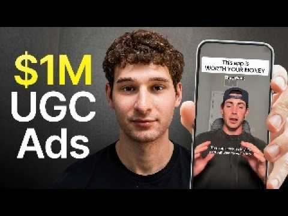

# I Studied 1,000,000 UGC Ads, This Is What Will Grow  Your App

Start building & deploying paywalls in 10 minutes flat: https://superwall.com/

## Table of Contents

* [00:00:00] - Sourcing UGC from apps driving 500M+ views
* [00:00:15] - Engineering virality and leveraging AI controversy
* [00:03:59] - The shift from massive influencer campaigns to authentic UGC
* [00:04:38] - New format strategy: 10-minute long-form story videos
* [00:05:57] - Using rage bait and health trends to capture watch time
* [00:08:40] - Scaling UGC programs with campaign managers and content coaches
* [00:09:29] - Creator Managers (logistics) vs. Content Coaches (creative feedback)
* [00:10:41] - The winning manager-to-creator scaling ratio
* [00:13:00] - Finding golden formats and frictionless creator onboarding
* [00:16:40] - Format Deconstruction: A 9.6M-view talking head case study
* [00:18:21] - Using engagement rate as a predictive virality indicator
* [00:24:44] - The "Duolingo-style" training program to mint new talent
* [00:29:00] - Case Study: Reaching #1 on the App Store via Spark Ads
* [00:29:44] - Protecting budgets: Isolating paid spend from creator bonuses
* [00:32:28] - Algorithmic and UI differences: Meta Partnership vs. TikTok Spark Ads
* [00:34:21] - The infinite growth glitch: Traffic quality of organic-boosted spend
* [00:35:45] - The 3-5x rule: Using paid spend to lift organic shadowbans
* [00:42:38] - Creator compensation: Retainer base vs. stacked milestone structures
* [00:44:06] - Payout optimization: Capitalizing on the "free view" framework
* [00:45:45] - What to expect: Realistic CPM progression over the first 90 days

## [00:00:00] - Sourcing UGC from apps driving 500M+ views

This is Drew Levin. He helped build SideShift, a marketplace running UGC for some of the most viral consumer apps on the internet, which means he can see exactly what type of content is pulling hundreds of millions of views and downloads right now. >> People are actually building features [music] into their products to inherently go viral. [00:00:00 → 00:00:18]

## [00:00:15] - Engineering virality and leveraging AI controversy

People who build apps where you can earn money or get something in return do really, really well with organic. If you have an AI product, you should actually lean into the fact that people hate AI. Suno has done this well. If you look at their comment section on their TikTok videos, people are like, "I hate this AI music. Like this is so unfair to artists. [00:00:18 → 00:00:34]

" You want to get under people's skin a little bit, but also show value. That's like the easiest way to go viral. >> So, I asked Drew to walk me through step by step how the most profitable apps generate millions of dollars by actually engineering their content to go viral. From the content formats and angles that are generating millions of dollars right now every single week on his platform to a new strategy the smartest brands have just started using to reduce their UGC costs by up to 80% and how to take a single organic video and turn it into a flood of cheap, high-converting traffic to your app. By the end, you will have the exact playbook behind the apps doing 500 million plus views and hitting number one on the App Store and the specific steps you can copy to blow up your own app. [00:00:34 → 00:01:13]

This is the Superwall Podcast. I'm Joseph Choi, founder of Consumer Club, a Discord where top consumer app founders trade alpha and what's working now in growth. I've been talking to members doing a million ARR and they tell me they've been using these two tools. Superwall has this free AI tool trained on 422 profitable paywall experiments across thousands of successful apps. You upload a screenshot of your paywall and it gives you an experiment idea to make more revenue with the same number of users at paywallexperiments. [00:01:13 → 00:01:37]

com. And if your app's doing at least 100K MRR, we host vetted dinners in SF and New York to hang out and network with other top app founders. You can apply with the type form in the description. Also, these app founders have been telling me they use Roark. I met Daniel, the founder of Roark, at a dinner and I got genuinely really excited when he told me about Roark Max, which is out now and has honestly changed the game for coding mobile apps. [00:01:37 → 00:01:58]

It's AI that one shots full native iOS apps with Swift code, camera, sensors, haptics, payments, the whole stack. And as you vibe code with Rorke, you can install prototypes directly onto your iPhone with one click and then publish to the App Store in two clicks. If you've been waiting for AI coding that actually does native iOS apps well, this is it. I got you guys a discount. You can use the code Superwall or use the link below. [00:01:58 → 00:02:19]

I'm very excited to talk to you as the co-founder of Sideshift. People have been following me for a little bit, you might recognize this doc I made. This is like a year and a half ago, and I made this doc and it went viral on Twitter. And I was like, I tried all the methods for sourcing higher creators, and the premise is basically you want to find scrappy creators instead of influencers. And like, here's what to look for. [00:02:19 → 00:02:41]

And I didn't have Sideshift on this because Sideshift like didn't really exist yet. I said specifically that marketplaces kind of suck because like none of them care about talent quality, and they just like scrape TikTok and then find people, cold email them, and then put them in their marketplace. But they're all like e-commerce creators and like gifted campaign like beauty and fashion creators. And then Sideshift came around and this whole doc is basically like obsolete now because Sideshift is kind of just like the only marketplace that is good in my in my eyes. You helped found Sideshift. [00:02:41 → 00:03:15]

So I just want to like dig into your brain because a lot of really interesting super viral apps are using Sideshift to get their creators. So I think you have a really interesting view into like how these campaigns run internally. Yeah, tell me a little about about yourself and Sideshift and then also just like who are the biggest apps running on Sideshift right now? >> It's been an interesting like past year and a half since we really pivoted into this market. The way people do things is a lot different now than they did a year ago. [00:03:15 → 00:03:42]

Yeah, so I'm one of the co-founders of Sideshift from Drew. I'm more on the tech side, but I'm I do everything in the business as well from customer support to customer success to uh sales as well even from time to time, not as much anymore, but I used to do it a lot. What we've seen is that this space has grown so much. [00:03:42 → 00:03:59]

## [00:03:59] - The shift from massive influencer campaigns to authentic UGC

So, when Joseph put out that article a year ago, it was only like the small indie hackers that were doing UGC. Everyone was still doing major influencer stuff, lots of paid ad spend, but every week we see like one of the biggest apps or one of the biggest consumer brands in the world switch to doing UGC or at least testing it. I I think that's something that we'll continue to see. We're still very, very, very early, but over the next 4 years, I'm certain that like almost every big brand in the world will pivot into doing UGC, and I'll talk about today like how I think brands can stay ahead of the curve when it comes to this stuff, because the Fortune 500s and the big brands are always like 2 years, a year and a half behind. >> What are some of the most successful UGC campaigns you're seeing right now? [00:03:59 → 00:04:39]

## [00:04:38] - New format strategy: 10-minute long-form story videos

>> So, people are actually building features into their products to inherently go viral. We saw this with like the class action space where where there was like Settlemate. You know, like I saw an app recently called Snag where they were like people who build apps where you can earn money or get something in return do really, really well with organic. That's just like the highest performing market, but you can actually turn anything into a viral piece of content. We just had a creator come to the office yesterday, one of our top creators on the platform, and he switched to telling 10-minute stories. [00:04:38 → 00:05:07]

And these he's generated He has one account that he posts videos on every single day for various different brands. This is a completely new strategy. I'm I'm new to this as well, where it's like instead of having a creator with create a brand new account for your brand and post once or twice a day about your brand, which is what Sash of Creators inherently do and we're known for, he created a new account. He started posting for one brand. He grew that account to 10,000 followers, and then he started using the same account for a new brand, and it's all 10-minute videos. [00:05:06 → 00:05:34]

And the average watch time of one of his videos is 16%, and he drops the CTA at the 9th minute, and somehow this is working now. >> We need to have a whole section in this interview just about like emerging formats, cuz I think like a lot of people are sort of getting used to the hook and demo and like text on screen and all that stuff. Like 10-minute-long yapping videos is kind of insane. So, I want to dig into more of that, too. [00:05:33 → 00:05:58]

## [00:05:57] - Using rage bait and health trends to capture watch time

But, so you said snag is like the getting free stuff, basically. That sounds inherently viral. Are there any other like interesting examples of like features that inherently go viral that make UGC easier? >> Yeah, so things that like rage bait. So, like for example, like AI stuff. [00:05:58 → 00:06:14]

If you If you have an AI product, you should actually lean into the fact that people hate AI. So, like Suno has done this well. If you look at their comment section on their TikTok videos, it's all people are like, "I hate this like AI music. Like this is so unfair to artists. " You want to get under people's skin a little bit, but also show value. [00:06:14 → 00:06:30]

That's like the easiest way to go viral. If you look at like You don't want to put other brands down, but you want but you want to make it obvious that, you know, like that there that there's something ne- like peptide companies are doing this, too, where it's like, >> [music] >> you know, like this is so bad for you, but like You want to make people feel something. >> The peptide example is interesting cuz that's like an emerging What are they like rallying against? Is it just like food industry and like stuff like that? >> Food industry. [00:06:29 → 00:06:51]

I mean, you see all the scanning apps, like whether that's, you know, like Olive or like just any food scanning apps, supplement scanning apps. There's a thousand of them. You look them up on the App Store. They're all just doing so well. They're leaning into trends. [00:06:51 → 00:07:03]

All We see so many GLP-1 companies on Side Shift now. It's like the new biggest Probably the most common sign-ups we see is GLP-1 companies. And they're all [music] just doing the same thing, just leaning into like I mean, the younger generations now are just obsessed with health. >> I'm just going to Google like you don't have to out anyone, but I'm just going to Google GLP-1 apps and click on the first one just as an example. So, the Shot See. [00:07:03 → 00:07:25]

Uh basically, like it seems like a lot of them are doing trackers, where it's like, "Oh, today it's time to take your shot. " And then you track your results over time. It's like a companion app for like if you're doing GLP-1s. But, I guess some of them also do the like affiliate like help you actually get prescribed. >> That's where it is now cuz we're early in the market, but like as products are built around the market, it'll become more like recommendations, like things that do well typically in consumer, right? [00:07:23 → 00:07:51]

>> So, Suno, you said it was like a it's like a controversy-driven building features that will get controversy is kind of like the principle. >> For AI products, you're optimizing on TikTok for two for two things. It's engagement rate and watch time. The higher the engagement rate, the easier it is to like that video will do better as a paid ad, that video will do better on Spark, etc. and then you can run from there, but that's all the algorithm really cares about. [00:07:49 → 00:08:14]

>> So, just to stick with this, imagine you're running a GLP-1 app and you want to like win in this market. It's like a growing market. What do you think is the biggest mistake you see people make when they're first starting, okay, I want to do organic social marketing? Like what are their biggest mistakes in terms of finding creators, like the types of videos they make? >> There's two big things. [00:08:12 → 00:08:33]

It depends on like initial but if you're like an indie hacker, like you should really like be patient. Like this stuff doesn't happen overnight just like all advertising, like it takes iteration. [00:08:33 → 00:08:43]

## [00:08:40] - Scaling UGC programs with campaign managers and content coaches

All successful UGC programs in the long run have two things in common. They have a lot of campaign managers and they're iterating on content a lot. And a lot of them even have content coaches. So, you don't need that off the bat, but if you don't know what you're doing, like people just join SideShift. We have 5,000 new brands create accounts on SideShift a month. [00:08:43 → 00:09:01]

They literally expect that they're going to go viral week one. You can, I see it happen, but that's that's not like the norm. You you need to copy if you see videos that are already going viral on your niche, you can give those to creators and you'll do well really quickly. And if you can afford to, I would recommend getting a campaign manager as quickly as possible to start overseeing your creators. Those are the two things that'll allow you to win is like building systems cuz as a founder, you're probably very busy. [00:09:00 → 00:09:23]

Creators are hard to manage. They're not easy to manage and that's like one of the most like untold things about UGC. >> So, you mentioned something interesting. [00:09:23 → 00:09:31]

## [00:09:29] - Creator Managers (logistics) vs. Content Coaches (creative feedback)

It's like creator managers versus coaches. Is there a difference? Yeah, what's the difference between those two roles? Creator managers are making sure the creators are posting on time. They're not posting anything that You do You don't want to burn money. [00:09:29 → 00:09:42]

I think people we see on UGC is like if you don't have a hand in a control on what's going on, like making sure that the the video's going out actually have a chance of going viral, that they're not that they have good CTA, that they have all these things, like that's what a manager is there for. Content coaches strictly just make sure that you're improving day-to-day on the content. So we had a creator in here yesterday, the same one that was doing the 10-minute yapping videos. He's a coach to a lot of creators. He'll sit there and he'll be like, "Your tone's too slow. [00:09:42 → 00:10:08]

You need to talk faster. Raise your voice here. You need to make sure that you look at the camera at the 3-minute mark. " Like stuff like that. >> So the manager is really just like logistics, like making sure you're getting the actual output. [00:10:08 → 00:10:20]

And then the coach is like how to actually make the videos better and iterate. Is Suno doing the structure, too? I I put out this tweet cuz I noticed like Suno hit number one App Store for the music category, and they're heavy using SideShift and like tons of creators. They got like hundreds of millions of views. Are Are do they have like a complex structure, like creator managers and coaches and stuff? [00:10:20 → 00:10:44]

## [00:10:41] - The winning manager-to-creator scaling ratio

>> have eight creator managers, I would assume, um around there. And then they have They don't have coaches. They have Their managers function as coaches as well. And their Some of their managers also create content, but most of them don't. They're They're strictly managing the campaign, overseeing it, recruiting new creators. [00:10:42 → 00:10:59]

Campaign managers essentially, not only do they manage your campaign, but they also bring new creators in. They get rid of the bad ones. That's like You're never going to win in this game. You're paying such a low ticket for these videos. What that means is inherently there's going to be high churn, and you're going to go through a lot of creators, and you got to get rid of the bad ones quickly to stay profitable and drive your CPMs down. [00:10:59 → 00:11:19]

>> What's the ratio of like managers to creators? >> One to 10 is the winning ratio. They can go up to 15. If you have less than five, you're wasting money cuz they could be managing more. And even more than more than 15, and and going to get lost. [00:11:17 → 00:11:33]

>> So this was Suno. They have managers and their managers kind of act as coaches, too. If someone was starting out with like you just want to have 10 creators, one manager, you would recommend like not having a coach, but finding a a creator manager who kind of doesn't just check in if they're posting or not, but also like are you actually like giving the creators feedback on what like how to go more viral and stuff like that? >> Your job as a founder or an operator is to get your program off the ground. You don't want to be in it on the day-to-day, but you want to be able to step in when like the camp the program doesn't is going but poorly. [00:11:30 → 00:12:08]

So, like this isn't like a linear exponential game. Like things go up and down and when they go up, your ROI is insane, but when they go down, you can burn money quickly. You have to step in quickly when your CPM start to rise. And in the beginning, there's going to be a lot of hand-holding, but after you start generating like sub $4 CPMs like pretty consistently, it's time for you to like do higher leverage stuff because these campaign managers can do it. All the top programs on Sash if kid you not like the top 50 programs, the founders aren't that involved. [00:12:08 → 00:12:37]

They do payouts and they do check-ins at the end of every month. >> They're not that involved. Interesting, but they were in the beginning. >> They were really involved in the beginning. Getting it off the ground is really hard. [00:12:37 → 00:12:46]

They're like well-oiled machines. Like you you build them up over time and then they're like it's literally like a cash-flowing like side income is the way I think about it. It's like it's hard to like get it off the ground, but once it's kicking you $5,000 of cash, it it just does it forever. >> Do you think the front-loaded nature of UGC is because you're basically hunting for these like golden formats? [00:12:46 → 00:13:08]

## [00:13:00] - Finding golden formats and frictionless creator onboarding

Because like once you find a great format, you can just spam it until it reaches its full time. >> Yes, that's definitely part of it, but formats come and go, but if you have the systems to constantly find new formats, you're unstoppable. So, it's like how can I get two to three like golden the best creators I can who are going to be the backbone of this program. So, even when I know things aren't going well or I have creators turning out, it still won't get that bad. So, you like hedge yourself the same way you do when you're betting or anything else. [00:13:08 → 00:13:36]

And then you also have to find like just good systems to keep getting new creators in the door. >> In the first 30 days, like to build a proper system, what are your actual goals? Are you trying to get real ass positive in the first month or are you just trying to find like two to three formats and break even or are you just trying to find two three formats and like not even care about? >> It's all situation based. But, what I would say is if I were starting a product today, a new app, and based off everything I've seen over the past year and a half, I would first of all figure out where I'm going to consistently get creators from. [00:13:36 → 00:14:07]

You don't want to be trying like there's a few you can do it from TikTok outreach, you can do it on SideShift, etc. But, once you have like systems, certain apps will hire a full-time guy to just do UGC interviews all day long. Um, not that you need that in the beginning. Reality is it's like, "Okay, so I'm going to send a message to this creator with what I need them to do. I'm going to let them book a call with me. [00:14:07 → 00:14:27]

The call is going to be 5 minutes. Then after they do the call, they're going to get sent this notion where they can then join the campaign, submit their handles. " Like everything from A to Z needs to be dialed in. Like it needs to be extremely consistent cuz these creators, like transparently, they're not always the smartest tools in the shed. And if it's not easy for them, you'll create so much friction to the point where you can't even get this program off the ground. [00:14:25 → 00:14:47]

So, I would set up like very clear objectives. Like, "I'm going to hire 10 creators. They're all going to go through the exact same process. After they go through that process, I'm going to spend once a week I'm going to sit on the phone with them, walk through their videos with them. I'm going to the first 3 days of a campaign, the best managers or the best founders, what they'll do is they'll do video reviews before the creators post their videos and give a lot of feedback in the beginning. [00:14:47 → 00:15:09]

By giving this feedback, they're also they're learning a lot, but they're also, you know, like they're they know what they're looking for. Also at SideShift, before we started going viral, like Nick, my co-founder, was posting. It you have to understand from the ground up what's actually going to make this thing successful over time. It's not like a short-term thing. >> Instead of just spamming 10 ad creatives, you first think of, okay, who are What are my five top five pain points that I'm talking about? [00:15:09 → 00:15:36]

Let me make two ad creatives for each of those, and then when I put that creatives out, and then I kill the losers, boost the winners, I'm actually I have data on like which of those are actually working, and then I can make more ad creatives based on that. So, is there is there an analogy to QGC where you're like you see like a standard playbook among your best like the best campaigns you see in terms of just like initial setup and how you approach the beginning. >> 100%. And like what we're seeing is that it's actually like how you start UGC program is like a positioning thing. It's how you're positioning yourself to prospective users with the videos. [00:15:36 → 00:16:10]

It's how you're positioning yourself to your creators who you need to be extremely loyal to you. And it's how you position like how you want your app to grow long-term. Some people start UGC programs with like oh like worst-case scenario is I'm paying for like 600 unique videos I could run as paid ads, and they're like but like if you position yourself as like I'm going to really kill like the format and really like invest time in understanding this stuff, you'll get more buy-in from your creators. They'll stay more loyal to you. They they they they won't work with your competitors, etc. [00:16:10 → 00:16:38]

[music] >> Do you have any examples you could show of like early strategy versus now for a campaign? [00:16:38 → 00:16:44]

## [00:16:40] - Format Deconstruction: A 9.6M-view talking head case study

It'd be interesting to see kind of like how the content evolves from like testing to scaling. >> So, when we first started UGC for like we used SideShift to promote SideShift on the creator side and get more supply. And so, this was posted April 19th, 2026. My co-founder Nick posted a video on TikTok by himself last April, so a a full year away. It was him. [00:16:44 → 00:17:05]

It wasn't a talking video, but it was him going like this like this over a screen, and it was saying like I got a master's degree, and I couldn't find a job essentially, but it wasn't talking head. And now a year later, we gave that to one of our campaign managers and they turned that into a talking head style video with like the same underlying principle that like the job market is cooked and I can't find a job. And pretty much talked about how it's hurting the economy and it's bad and then at the end but like I'm making money with Side Shift. And so like this is like this is like an evolution of a format over the course of a year where it's like early on we were trying one thing and you can like evolve like once you find one thing that's working like there's ways to like make sure it never dies. >> Can you play the video again? [00:17:05 → 00:17:50]

Cuz like denied from a cashier's job I have a master's degree and then she's just like talking about her story for like 1 minute. 9 million 9. 6 million views. >> And you can see the engagement rate's 16%. Like this is extremely high. [00:17:50 → 00:18:06]

If we saw a video like this I I don't know if we ran this as paid but like for any app I would recommend they run this as a spark ad until it goes down to like almost 5% and like if you're getting a good return on it. Um this is like what we're optimizing for generally at Side Shift like and this is what we tell our customers to optimize for. [00:18:06 → 00:18:23]

## [00:18:21] - Using engagement rate as a predictive virality indicator

>> What's a what's a good percentage for engagement rate? >> Anything above 7 and 1/2 to 8 but if you get it above 12 it'll start to go very very viral generally. And you can see patterns like this this video could have been posted slightly different could have gotten 5,000 views but it could have had like a solid engagement rate that was like you could tell that there's like something behind it. Like it's a good indicator. Like if I was building a machine learning algorithm that had to pick what was going to go viral I would use this. [00:18:21 → 00:18:48]

>> And what is that even measuring? It's measuring any engagement divided by the number of views? >> It's essentially likes, comments, saves, and shares all divided by the number of views. >> Okay, so all of it's kind of like all of them combined but I guess likes will always be the biggest one. So initially when Nick posted this video your co-founder posted this video style what was the initial strategy? [00:18:47 → 00:19:10]

Was it like let's focus on these three formats? Um or was it kind of just like post anything and then see what works? >> We saw that videos about the job market were doing extremely well at the time. You know, like there's a lot of stuff going on with Trump and the president all this stuff and everyone was talking about the job market. And so we were just trying to relate what's going on in the world to our platform and product. [00:19:10 → 00:19:33]

That was like the initial strategy. It's like we see people getting very upset about certain things. We can this is very very relatable. Job hunting is making me stressed out. Like that is, you know, like many people in the world feel the same way, which will make them comment. [00:19:33 → 00:19:49]

The more comments, like obviously that'll just increase engagement. People respond, like I experienced the same thing. And so we just kept playing around Nick kept playing around with that idea. Once he cracked it himself, he gave it to all of our creators. Kid you not, six or seven videos out of like 15 after generated more than 150 to 300,000 views. [00:19:49 → 00:20:08]

>> What were the guidelines for that video? >> We had like I have a master's degree. So that was like you have to put that or like a PhD, I have a PhD with like a big piece of text. At the time it was at the bottom. It was at the bottom and then it was just like it wasn't even it was hooking demo. [00:20:06 → 00:20:20]

It wasn't even like a talking style video. That's all they had to do and then they would go like this or something. They would do like weird facial expressions. And then this evolved into another style format we had which was like I graduated from Yale and I can't even get an interview. >> Is this common across most of the successful UGC campaigns you see? [00:20:20 → 00:20:40]

>> Yeah, 100%. So it all starts like this, but it can be a campaign manager or a founder. Like >> Yeah. >> it depends on company budget and size. But you need to be this hands-on in the beginning, whoever it is. [00:20:38 → 00:20:48]

So if as a founder or as like a marketing person, if you don't have time to like invest to try this stuff out or like see what's going on, you need someone to do it for you. And if you have time, you should do it yourself. >> How involved do you think the founder really should be? Like is it joining a weekly call with your 10 creators and giving them feedback before they post or is it going on TikTok and like finding formats to like tell people cuz like I I can't imagine a founder would like know to just oh like I'm running a, you know, job searching app. I found this format. [00:20:48 → 00:21:22]

I'm going to tell them to make this specific format. Like in your head as a founder, you you know the pain points, you know the solution, but you don't really know like the TikTok version of the pain points and the solution, you know what I'm saying? >> It's actually tricky. That's why this is changing, but 6 months ago all the best UGC programs were being run by founders who were under the age of 25. At the very least as a founder, you want buying from your creators. [00:21:20 → 00:21:44]

There's low loyalty in this game, and so if you can get some buying from these people, make them believe in what you're doing, and make them think that your product is like a net positive for the world, it'll go a long way. All the best programs I know like the founders like are texting their top creators, like sending them stuff, just like it's more of like a personal relationship. At the end of the day these people like if they generate a million view video like these videos will generate so much revenue that like having them bought in like actually matters. >> So the creativity is sort in the beginning. It's like sourced from if you don't have a coach, right? [00:21:44 → 00:22:15]

You it's kind of like sourced from the creators. It's just building relationships with creators that do this. They probably do this for other apps. If you find them on SideShift or if they're like in the UGC talent pool, and just sourcing ideas from them. Like you tell them your company and like what it does and like what your product does, who it's for, and then they should be able to come up loosely like with ideas, and then you just iterate. [00:22:15 → 00:22:39]

>> If I was looking at like a creator like this, and I noticed like look, he he's generated views before, like he he he's posted a thousand times on TikTok. Like Like the if you hire someone with some experience, like they'll know how to get you off the ground a little bit. You can't rely on them completely. Like they're just a creator at the end of the day, but like these people know how to go viral. They generate a lot of views. [00:22:37 → 00:23:01]

They work with big brands, etc. So even like there's a lot there's so many creators out there on Side Shift or not where they can help you get a program off the ground. But, the the less experienced the creator you can't rely on them. I guess it's like the TLDR. You need to build something that you can scale. [00:22:59 → 00:23:14]

Three-person creator team that's doing well is worthless if you can't scale it scale to 100 creators. You need to make it easy for creators to to get paid out to you need to build trust with them. You need to make sure that they don't feel like, you know, like you're trying to take advantage of them. We see this a lot, actually. Creators are like very sensitive, you know, it's like they'll generate 10 million views and you put like some sort of like cap on them because you were trying to save 50 bucks now, but that might cost you thousands of dollars down the line. [00:23:14 → 00:23:42]

>> Like that guy that you just clicked into before with all those like other apps that he's worked with. Like that's kind of insane. This did not This literally did not exist like 1 to 2 years ago. Like all the creators that you would reach out to would have like maybe they posted like a story because they got sent like a PR campaign and they'll charge you like $2,000 for a video. Now, it's like they understand UGC. [00:23:40 → 00:24:07]

They've actually worked for multiple apps. And it seems like this market is just like I feel like you guys are actually kind of creating the market like the talent side. Because these people definitely didn't know about UGC as a concept before like a couple years ago, right? What does it take to actually build a talent market like this? Cuz I you have to get people bought into the idea like, oh, you can make money with this. [00:24:07 → 00:24:28]

Here's what you do. Here's how to actually And like you you can you have to train the people cuz like college kids, yeah, they're probably good at making TikToks, but getting them to make high converting TikToks and know how to work with apps, you know, it's like this whole emerging talent market. >> So, the most unique part about Side Shift as a marketplace, besides the fact that we operate on a marketplace plus model, is the fact that we mint our own supply. [00:24:28 → 00:24:50]

## [00:24:44] - The "Duolingo-style" training program to mint new talent

So, unlike traditional creator marketplaces where they're going out and acquiring existing creators, we built a way where anyone in the world can earn money from their phone making content. Whether they're old, young, have grandkids, are in Brazil, or in Africa, or or in Australia, the United States. And the way we did this was it took a lot of time. So, if you ask people who use SideShift a year ago, they'll probably tell you our creators sucked. They couldn't find good ones. [00:24:50 → 00:25:14]

This was because at first we were just a mom-and-pop marketplace helping restaurants and bars hire college students across America. And so, these creators didn't know how to make content. And so, we built out a Duolingo-style training course that's like 6 hours long. We actually spent more money and time on that course than we did our actual building our product. And now it's like the basis for making millions of dollars every week for for these creators on our platform. [00:25:14 → 00:25:39]

And they they start as like just everyday people who are working part-time jobs or full-time jobs or whatever it is. After a month or two on SideShift, we see that they're earning like 10, 12, 15,000 dollars. And then they they there's actually an interesting life cycle that these creators go through. They actually start as creators, of course, then they turn into campaign managers after they get become really good creators. And a lot of times now we see these campaign managers starting their own UGC agencies and they actually run it all on SideShift as well. [00:25:39 → 00:26:05]

And then we're able to support them and give them deal flow and and help refer them businesses. And and it's it's really cool evolution. So, let me show you this. A lot of app founders I talk to have a feeling their app has viral potential, but don't want to be the person brain rot scrolling an hour a day hunting for formats. Or worse, burning thousands on creators shooting videos that just flop. [00:26:05 → 00:26:24]

Recently, I've been telling every founder I meet about SpyTalk. It's basically an AI TikTok viral marketer that I've seen a lot of top app growth teams using. You just paste a link to your app and this agent scrolls hundreds of thousands of TikToks for you, finds the outlier videos from competitors who've already cracked the best formats that are driving installs in the niche of your app, and then it remixes the hooks, the angles, and then it makes playbooks so you can pretty much copy-paste virality. And then it alerts you when it detects new breakout formats that would also work for your app. This is the growth tool I 100% vouch for on this channel because there's a ton of GenAI content tools out there, but none of them tell you what to make. [00:26:23 → 00:27:00]

Spytalk makes sure you're never in the dark about what's actually working now. I'll put the link in the description. This knowledge and like this way of like the course you mentioned, like the 6-hour course, that is basically the sauce. Like nobody does that like internally. Like only a few people, like a a couple of years ago the best, most viral UGC app campaigns in the world were doing that. [00:27:00 → 00:27:21]

They would give their creators 6-hour courses and like really train and vet people, but then they wouldn't share that talent in in in a marketplace, you know? But you guys are basically doing that. App founders just use the talent, which is kind of insane. And because of how hard that is, it's why I've hesitated to recommend any marketplaces for the past couple years because I know that building and actually maintaining like a really good talent supply is just so hard. It seemed like you're doing a you guys are doing a great job about of it at SideShift. [00:27:21 → 00:27:52]

But like how do you do you have a theory or just like a plan on how do you actually continue to get more talent and invest in the talent side because as you talk about SideShift on this podcast and just like the word gets out with founders, like eventually, you know, everyone is kind of like taking from the same pool. So how do you like balance the the supply demand? >> I think what drives good supply side is building really good tooling and infrastructure and reliability for creators. It we have it all the time on SideShift where a brand may not pay out a creator the money that they're owed. We will front that for them. [00:27:52 → 00:28:30]

We will eat that cost. We spend thousands and thousands of dollars, if not multiple, almost six figures a month on this, paying creators what they're owed and it creates extreme loyalty to our platform and to us and they prefer to get paid through us and they and they prefer to know they prefer to take jobs through us cuz they know if they take them they get reached out to on TikTok or whatever. I think what it comes down to is when you create this infrastructure for creators, they end up preferring all their friends and their friends teach them how to be creators. >> I want to get into dashboards and stuff. Like, do you have any interesting campaigns that you can that we can like get an inside look into? [00:28:30 → 00:29:02]

## [00:29:00] - Case Study: Reaching #1 on the App Store via Spark Ads

>> This program is old. And as you can see like like I said earlier, this is a game of like building a well-oiled machine and you can see like it takes it takes time and there's ups and downs to make this thing just run on autopilot. They they've generated as you posted on Twitter but over 10,000 posts they've generated 500 million views with 14 million engagements. This brought them number one on the app store. This has brought in it has generated more downloads than than one could think possible. [00:29:00 → 00:29:27]

So, the strategy today UGC has changed a lot. The strategy is let's make really good organic content and then run these as partnership ads and run them as spark ads. Spark ads are incredibly cracked. They're like a cheat code. Anytime a video gets above a 10% engagement rate, you should test putting a little bit of spark money behind it. [00:29:27 → 00:29:45]

## [00:29:44] - Protecting budgets: Isolating paid spend from creator bonuses

You have to be careful about a few things, too. One one of the things I really want to talk about is the fact that make sure you're not paying view bonuses when you spark a video because that happens sometimes. Let's say this has like 800,000 views, you spark it to 200,000, the creator will feel like they're owed that a $1,000 view bonus. On Sideshift we built a way to to differentiate what views are sparked and what views aren't but in case you don't have a system, be careful about that. Anytime a video gets above I'd call it like 7 1/2 8% engagement, you should test putting $20 behind it if the CPMs are low enough to where you feel comfortable. [00:29:44 → 00:30:17]

If you have high engagement, we generally see like way below dollar CPMs on Spark. There was an app called GoWish that you know, Seen Marketing one of the agencies on Sideshift was running a campaign behind and they they went to number one on the app store. That was almost entirely from Spark [music] and it was so cheap and it was the cheapest way to gain users. I feel like this is going to be like the new big thing is like how can I optimize these videos to do well on Spark and how can I optimize them to do well on paid? If you think about it from a platform standpoint, it's like UGC is extremely effective, but TikTok, Instagram, and YouTube aren't making money because the creator's getting paid not through them, obviously. [00:30:17 → 00:30:52]

That allows them to make money off Spark and inherently like a Spark and partnership ads and like really like lean into UGC. So, I think it'll continue to be huge cuz it just benefits the platforms and they make more money. >> So, what are you actually looking for? You said like your CPM should be good enough. Like what is a good enough? [00:30:52 → 00:31:08]

I guess it just depends on the niche. Like there will it'll be like a higher CPM for like a higher value niche, but are you just looking at Because you can also put the anchor, right? Like the app install anchor in the Spark ad. So, you can actually just track cost per install as well, right? >> a recommendation engine that recommends which videos you should Spark based on the engagement rate, based on how well the CTA CTA is, and and we do that by by scraping the the comments and also scraping the call to action in the video. [00:31:08 → 00:31:37]

And so, we run Spark and then we run ads ourselves. We usually put a $20 budget into it at first. If we see a below a dollar CPM and it's not growing, so like on this account it doesn't have it, but usually like if we filter by just paid views, and you can like look at the daily metrics, you can see like if the CPMs aren't going up over time on the Spark, you just keep running it literally until they do. And what happens over time? Let's say you run a a Spark video that starts at 15% organic and the CPMs usually will not start raising until the video engagement rate drops to like 5%. [00:31:37 → 00:32:14]

And you also have like direct inversion numbers on that generally. But I think what's actually interesting is Spark is not very common because big brands generally don't have their own creatives to run like videos behind. It doesn't do as well on influencer accounts as it does like UGC accounts. [00:32:14 → 00:32:30]

## [00:32:28] - Algorithmic and UI differences: Meta Partnership vs. TikTok Spark Ads

And so, there's like a huge moat here. And generally, there's really There's There's a correlation between the ROAS you're getting on Like obviously everyone knows like UGC attributions are a hard thing to come by, but there's a direct correlation between the ROAS you're getting and the revenue made off Spark videos as there are on organic. So, if you're seeing like for every $5 I spend, I make $10 on Spark, generally it's a little actually a little bit better than that on organic. Call it like 15-20% better. >> I mean, like financially, like numbers-wise, it completely makes sense. [00:32:30 → 00:33:01]

If you're paying your creators view bonuses anyway, and let's say you pay them $20 or whatever initially just to post the video, and then you're basically paying like let's say $2 per thousand views, you may as well put Spark behind it and try to continue to get $2 CPM or whatever your target is without having to make additional videos. But, you can still make the additional videos, but you're just like getting you're just juicing the like the stuff you already posted. >> Everyone's looking for different things in UGC. Some people are looking for direct revenue, some people are looking for app installs, some people are looking for K-factor network effects, some people are just straight-up looking for like reach and just like more eyeballs on their brand. And if you want like eyeballs, Spark is just like the most obvious way to to do it. [00:32:59 → 00:33:43]

Generally, I I don't think your audience is probably first more about revenue and installs, but you can select your audience of like who's going to see this. So, like for B2B UGC is on the come up. Um we Brax has used SideShift and has had really, really good results and driven really cheap CPMs acquiring customers using credit cards. And I think it's on the come up and I think Spark is the reason why it's going to be huge because you can target You can retarget your videos to the right audience [music] as well. >> Like initially, you posted an organic video, it just went viral and you have no control, but then if you Spark it, you can target it towards specific audiences. [00:33:43 → 00:34:17]

>> Exactly. You can Spark towards countries, English speaking like age groups, like you can do whatever whatever you want. [00:34:15 → 00:34:24]

## [00:34:21] - The infinite growth glitch: Traffic quality of organic-boosted spend

>> Zooming out a little bit, what is the value of posting it organically first and then getting it to go viral and then Sparking versus just putting it into the ads manager to begin with. >> UGC is the fastest testing engine for positioning in general for both like your brand like I was saying earlier but also for paid. There's no better way to find winners and losers faster. So you have like an infinite like growth glitch where you have a bunch of videos you're testing thousands of creative the same way brands do that are only doing paid but you're also getting organic upside and then you're also getting like the fact that these look so natural on the platform already and they're coming from an account that's not yours. So like partnership ads and spark ads generally just do better than white listed ads on your branded account. [00:34:21 → 00:35:08]

>> Yeah and I guess like if you're posting a video organically and it gets a bunch of views and then you put money behind it you know that the video resonated with real humans. Do you see that at all too like difference in user quality between like organic boosted versus just pure paid? >> I I I would say that organic probably has higher definitely has higher quality users like there's kind of no question about it because they're so bought in. Like you're organic's interesting cuz what you're actually asking is for a user to stop scrolling on TikTok, search you up on the app store, download your app, buy it and then come back to TikTok and leave a comment about how interesting this is. So like that's the level of buying you don't get from paid with the anchor etc. [00:35:07 → 00:35:45]

## [00:35:45] - The 3-5x rule: Using paid spend to lift organic shadowbans

I asked my team before coming on here like what are the things that you see when it comes to like spark from our top customers that that we should let the audience know about. I'm just going to read off a few bullets here. In general when a video performs three to five times better than the average viewer show up on account you should spark it. Usually that gets the account going. So separate from like just like this will drive ROI it actually makes the account perform better on organic. [00:35:45 → 00:36:08]

>> If you see a video that's going three to five x compared to the like views three three to five x views compared to the normal for that account, you spark it and then the future videos will like do better organically. >> Yes, exactly. >> That is interesting. I've never heard of that but that makes sense. Is it basically like you're sending a signal to TikTok that hey this account performs well. [00:36:06 → 00:36:30]

>> It It helps you get out of shadow ban. It help cuz like it It shows that you're real. >> Even though it's like, oh, you're a real brand, but, you know, it's like a it's a legit account that's spending money because it's a good account. >> Another point is like when you see comments like, what is that app? It's generally will do really well on spark or conversion wise. [00:36:28 → 00:36:47]

Like comment sentient is like very important. Sentiment, I mean. >> Would you spark in a video that doesn't even have that many views, but it just has like comments? >> Our ranking when it comes to like spark is we prioritize content or comments sentiment like I was saying, then engagement rate, then average views. So, that's like that's the order we care about. [00:36:47 → 00:37:03]

We usually start with $50 to $100 a day on a video. We let the spark run for a week at a time. If the engagement rate drops below 5%, we kill the spark. Like that's the that's the rule of thumb we follow. It's a little more complex than that, but that's the high level. [00:37:03 → 00:37:16]

I mean, we use the we let the organic climb for as long as possible for sparking. You should not preemptively spark a video. If organic is ripping, hold off as long as possible. Give it like a day or two, so like that say it climbs up to a million, it's still getting a 100,000 a day. Give it like a day or two before you start to apply it. [00:37:16 → 00:37:31]

>> So, what is what is a partnership ad? What's the difference? >> Partnership is Meta's version of spark. So, you pay a creator for a video. It's becoming very big in influencer marketing, and then the creator gives you a code, and you can put that code in your ads manager and run it as a paid ad. [00:37:29 → 00:37:43]

Essentially it does the same thing as spark, but unlike Tik Tok, the algorithm is slightly different, and Meta favors a little bit different things. >> Interesting. What are What are those differences? >> So, Meta cares a little bit more about audience. On Meta, for example, I probably wouldn't optimize for reach. [00:37:43 → 00:38:00]

I I think targeting is more important. Sometimes on spark, too, the video doesn't say it's paid ad, where on partnership ads it generally does. >> There's no anchor, but there's still like the CTA, right? Like you can still click. >> Yes. [00:38:00 → 00:38:10]

And you can also put links in your Instagram profile unlike accounts, you know, on Tik Tok which a lot of times they don't have enough followers to do so. >> Okay. And then that doesn't show up for Tik Tok. You said that there's there's a difference in like the like meta cares about audiences. >> Everyone knows this, but meta is like favors, you know, like follower count for example more than TikTok. [00:38:10 → 00:38:29]

So like let's say on TikTok your video with 10,000 views, it'll push that video to people similar to the people who watched that video who watched it for a while. Where Instagram will say like look, I'm going to show this to people more similar to people that follow you regardless of who's liking this video up front. So the first like few thousand viewers will always be audience based. >> Right, for organic. But for paid is it the same thing or is that just >> it's more similar. [00:38:29 → 00:38:53]

Like I'm talking about more about targeting. So like when you when you start a campaign on TikTok, I say optimize for reach. Where on Instagram I would do targeting early on. Like I would try to hone in on like the people you want to hit. We've seen we get higher conversion rates on partnership, I mean on partnership ads than we do uh spark generally. [00:38:53 → 00:39:13]

>> And you're doing those with Instagram influencers with bigger follower counts. >> No, no, no, on UGC accounts. >> Oh, UGC accounts. >> bigger followers. >> But even on the the small UGC accounts, you're still get like with less than like a few thousand followers, you're still getting >> Exactly. [00:39:11 → 00:39:28]

>> like good conversion rates on those partnership ads. >> Better than spark generally. >> Another thing in general for IG versus TikTok, are there like demographic differences? Cuz I feel like there's a perception that TikTok skews younger, and I know it does, but you also mentioned that like B2B is starting to get into short-form organic. Would you like just stay away from TikTok if you're targeting a larger like a older audience? [00:39:26 → 00:39:53]

>> We we recommend that you have your creators cross-post. It's It's much more upside for little benefit. So I'll drop like something here that the new payment structure that's going like super viral. I I think it's fitting. This is what Clueless running, a lot of other companies are running. [00:39:51 → 00:40:06]

They'll have a video posted to three or four platforms. So they'll have a posted to TikTok, Snapchat, YouTube, Instagram. Let's call it those four. We have this built into SideShift now where it'll automatically recognize which of those four videos did the best, and it'll only pay for the one that performed the best. So, you hedge yourself essentially where it's like, "I'm not taking on any of the Like, let's say all four videos do super well, I'm only paying for the best of those four. [00:40:06 → 00:40:28]

" >> On the topic of payment structure, so that's organic. You're paying per thousand views just on the best performing platform. But then, for Spark, are you giving a percentage of ad spend for for Meta or Spark? >> Really good creators, they might demand it, but generally like you just bake it into your contract. What we're doing now on SideShift to make sure that like you get this is like we have the creators OAuth their accounts in, and all the Spark codes are directly delivered to your [music] account. [00:40:28 → 00:40:54]

So, like you you're guaranteed them. >> Have you ever seen people do pure performance-based just ad creatives? Like, from the beginning you just say, "Just make ad creatives for me, and then I'll give you a percentage of spend. " >> The issue with it, it's hard to build creator loyalty. A creator I talked to a creator yesterday who was doing this for an e-com brand. [00:40:54 → 00:41:14]

He said he made 35 different unique videos before he made a dollar because they didn't get run as paid or they like got run as paid for like five minutes. Like, you know what I mean? Like, it was clearly like not a winner quickly. So, this gives the brands essentially infinite upside with all the risk being put on the creator. So, if you are a brand and can find creators to do this, definitely do it. [00:41:14 → 00:41:33]

And if you're a creator, I would never do this. >> I guess with ad creatives, like you don't need to spend as much time like iterating on stuff. You kind of just like follow directions on a brief instead of like, "Oh, I need to go viral cuz I'm getting paid for views. " >> Yeah, I do think that ad creative videos take longer to make, and I do think with the brands, it's similar to what you usually see, like the more creatives the better. The more you're testing the better. [00:41:32 → 00:41:56]

>> So, the ask from the brand to the creator is like, "Make me 10 videos, and I'll pay you nothing up front, and then if they do well, then I'll pay you a percentage. " >> Some of them are not even doing percentage of spend, they're doing percentage of sales cuz you cuz you can track sales with, you know, Meta Ads. That's like even crazier. It's like, "Okay, you can build a great ad that's like it should be a great ad like it's pushing people to their website, etc. , but they're not selling anything cuz their product sucks. [00:41:54 → 00:42:19]

" Now, not only does your ad not matter, but you're actually betting on the company's product. >> it's like really hard to convince a creator that in like playing the long game, especially if they don't know your brand that well, cuz they have no idea. Like the upside is is definitely a lot bigger, but people just want to be compensated for their work like up front. [00:42:19 → 00:42:38]

## [00:42:38] - Creator compensation: Retainer base vs. stacked milestone structures

So, like you have to do [music] work. You're saying like it's better to just do retainers and then do view bonuses and then maybe do like profit share later, but like most people just want us like get compensated. >> I mean, creators are inherently usually coming from a positions where they're not the most financially secure and then on top of that, this is changing. We are seeing a lot of like high IQ creators, but historically, there's always smart creators, but they're like if you had to like if there was like a bell curve, it wouldn't be great. It They They're always coming from more of like a position of like I want this as soon as possible. [00:42:38 → 00:43:10]

>> So, the What What are the most common retainer plus bonus structures? Is it like per video and then you know I know you mentioned like the bonus for the highest performing platform. Is it like if you hit 100k, you get this chunk amount and then if you hit like 500k, you get this next level. Um and then retainer is like anywhere between 10 to 20 30 dollars per video. Is that about right? [00:43:08 → 00:43:32]

>> People are always looking for new payment structures. For example, 4 months ago it was the $400 base $2 CPM. It was like the biggest alpha ever. It's like this is like so amazing. Everyone was just ripping and like creators are incentivized, but the best UGC programs on SideShift are paying $800 a month for 60 videos plus not stacked view bonuses. [00:43:31 → 00:43:50]

Meaning stacked is like if a creator hits 100k and then a million, you're paying out 100 plus 1,000. So, like that'd be 1,100 bucks. But where it's like if they hit a million, the 100k bonus goes away and then it's just 1,000 bucks. We built this feature in SideShift where like one of our like the top program on SideShift if it. You're trying to get as many free views as possible without screwing the creator. [00:43:50 → 00:44:09]

## [00:44:06] - Payout optimization: Capitalizing on the "free view" framework

So, a free view is what happens after a video gets a million views, call it, and then their view window ends, or whatever it is, right? And then once their view window ends, any views after that point are free. The more free views you get, the better your program. Like that like we have UGC programs on SideShift, the biggest ones who are purely optimizing for free views. Cuz at like at anything above 30 to 50k a month in spend, you feel those free views. [00:44:09 → 00:44:34]

Like you feel them in a way of huge money. And I'm sure for those founders it feels really good. >> it at 1 million views um for the CPM bonuses. Um you pay out whatever it is, 500, 800 dollars for that. And then you just you don't even need to time cap it, right? [00:44:34 → 00:44:52]

You just say like at 1,000 or at sorry at 1 million views, that's when you get the last bonus. And then after that, there's no more bonuses. >> Brands are sneaky. So, like they're trying to like they'll time cap it but not view cap it, for example. That way it makes the creator feel like You want the creators to feel like they're winning. [00:44:49 → 00:45:07]

We had a creator for one of our custo- I can't say the customer's name cuz the situation wasn't great, but I kid you not, this guy got like one one account one Instagram account like 180 million views in like 2 weeks. Like he had like a 45 million view video, but his like monthly like thing his monthly CPM was capped I kid you not like 4k. He was owned. Like if there was no cap, he would have made like $75,000 in a month, okay? >> [laughter] >> And he made like 4k. [00:45:07 → 00:45:31]

He was so upset. He's like marching into the startup's office. Like the startup like they didn't want to pay it, but like they didn't technically have to pay it, but they lost the creator. There's ways where payment structure could have saved them. When you're running a big UGC program, payment structure is like the alpha. [00:45:31 → 00:45:44]

It is like the way you get ahead. [00:45:44 → 00:45:48]

## [00:45:45] - What to expect: Realistic CPM progression over the first 90 days

>> You said 4 months ago, 800 a month for 60 videos. That's two videos per day. But that's just two videos per day. >> No, they're cross-posted on four platforms, sorry. >> So, it's it's so it essentially it's like eight videos per day. [00:45:46 → 00:45:59]

Uh eight posts per day, I guess, and like two unique videos per day. >> These are for creators that have done at least one to two campaigns in the past. For a new creator, a lot of times we'll start with like just a CPM or like call like two to $300 for that same package. >> And then for the CPMs you're targeting like under it seems like under a dollar in most cases CPM. >> All the top brands running UGC have a sub 90 cent CPM. [00:45:59 → 00:46:23]

Um if you're but I want to like really like emphasize like it takes time to get there. Like it it takes time, it takes iteration. If you should be expecting anywhere from five to eight dollars your first month, but then by month three it should drop into the sub to sub three and then after like there it's just like pretty much go sub one as long as your product is good and it has viral potential. >> So in what way is it higher in the beginning? Is it you just set a higher CPM in order to get creators in the door? [00:46:21 → 00:46:53]

>> No, you're not setting a higher CPM. It's just like the cost for like when you're paying retainers, right? If they underperform your CPMs higher. So you're getting your first batch. It takes a month or two sometimes just to get your initial set of like three solid rocks that you can rely on long term. [00:46:51 → 00:47:08]

Sometimes it happens quicker, but you need to be ready like just like meta ads like when you start running paid on meta it takes time. Like the all marketing takes time. Like there's no such thing as instant marketing. SEO, they pitch SEO as like when we sign up with an SEO agency for the first time they pitched it as as like an 18th month investment before we saw anything. >> So in the beginning in order to just get creators in the door you're are you basically just doing volume? [00:47:06 → 00:47:32]

You're not really like paying each creator more or doing bigger CPMs or incentives. It's more just about finding the good creators and setting it setting a low CPM from the very beginning. And then overall you're saying that sub 90 cent CPMs are coming from the best campaigns overall. It's not even CPM from bonuses. It's like overall retainers plus bonuses all in 90 cent CPMs. [00:47:32 → 00:47:58]

>> The biggest spenders on SideShift all program spending more than $100,000 a month. We have a lot of them and they're all driving sub dollar CPMs. Typically sub 80 to 80 to 90 cents. It just depends on the product. So, the harder it is to make the UGC, the more trust you have to build, bigger retainers up front, but you wouldn't pay bigger retainers just to get your foot in the door even if your expected CPM is going to be under a dollar, right? [00:47:56 → 00:48:21]

It's just about iterating, hire, fire, get the right group manager. >> You never outprice the market, so I would never come in higher than you need to. If I started a company today and I saw a creator that literally has sub $2 CPM on every campaign, like they're like a goat creator. Like there's like a few There's some creators in this world that are just like generate They're literally the Kobe and LeBron of creating UGC content. I would pay $10,000 retainer to them month one. [00:48:21 → 00:48:46]

>> I have seen people do that and it works out great. Like definitely worth it. The example that keeps sticking out in my mind is a study tool about It's like 3 years ago at this point. They paid one TikTok creator, I think she had like 100k followers, uh but she made a brand new account, made one video and it was like 20k MRR from the one video. Like for that person, yeah, of course you got to pay like 10k a month. [00:48:45 → 00:49:10]

Like if you find that person. But, okay, let's wrap up. This is a really great deep dive. I loved having you on the podcast. How many creators do do you have on SideShift right now? [00:49:10 → 00:49:22]

>> So, we have 850,000 creators which like We have We're about 150,000 of them monthly active and our subset of like really, really good creators is growing rapidly and we also what I'm super excited about is we're the only platform now in the world or place where you can actually find campaign managers for your products. And all the campaign managers on there are completely vetted and hand chosen by our team. We have about 100 right now who are actively being hired and every one of them has gone through an interview process. Every single one of them has talked to our team and has gone viral before. We We want to make sure that every brand that works with one of them is likely to have success. [00:49:19 → 00:49:54]

We're also building the Sparks the Sparks stuff. You can now run Spark through Side Shift. We're the only place where and we'll have partnership ads shortly. And we're the only place that can separate like which views are coming from where. Soon it'll all operate autonomously where you'll just have these all being done for you. [00:49:53 → 00:50:12]

>> Thanks again, Drew. Where can people find you? >> On X drew. levin. I'm going to be more active on X. [00:50:10 → 00:50:16]

I'm going to be talking about our customers soon. Yeah, it's drew11 with two ends. >> Looking forward to it. Thanks again, Drew. >> Yeah, thanks Joseph. [00:50:16 → 00:50:22]

It was a great time being on. >> Something you might not know, most of the founders I cover on this podcast are hanging out right now in the Consumer Club Discord sharing with each other what's working now for consumer apps. So you can apply to join Consumer Club if that sounds interesting to you. And this is the Superwall podcast, of course you got to check out superwall. com. [00:50:22 → 00:50:39]

We have more videos on the channel, so dig into those to learn from app founders who are willing to share super tactical stuff about app growth. [00:50:39 → 00:50:47]
