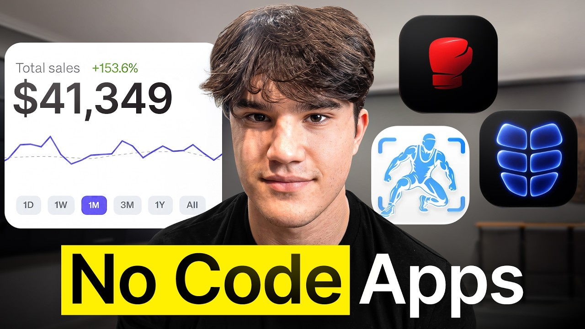

# Meet the ex-wrestler making $41k/mo with AI apps

Start building & deploying paywalls in 10 minutes flat: https://superwall.com/

## Table of Contents

* [00:00:00] Growing Three AI-Powered Fitness Apps
* [00:03:33] Building Fight AI and Finding a Wrestling Niche
* [00:04:21] Partnering With Wrestling Creator Kaden Henshaw
* [00:06:33] Structuring Influencer Partnerships
* [00:08:23] Reaching 100K Downloads Through Influencer Marketing
* [00:09:03] Turning Reaction Videos Into Profitable Ads
* [00:10:48] Creating Clear Ads That Explain the Product
* [00:13:08] Why Raw Ads Can Beat Polished Creatives
* [00:14:43] Measuring Ad Performance and Customer Acquisition Costs
* [00:17:22] Expanding Into Boxing With Brawler
* [00:19:49] Designing Onboarding and Paywalls
* [00:26:37] Balancing Paid Ads and Influencer Marketing
* [00:30:27] Scaling Ad Spend Through Creative Variations
* [00:37:18] Building a Social Feed to Improve Retention
* [00:43:36] Why Clarity Matters in Marketing and Product Design

## [00:00:00] Growing Three AI-Powered Fitness Apps

Our MR is almost 41K, but our total revenue in the last 28 days is 84K. That's George. And it's actually across three apps. A wrestling app, a boxing app, and a fitness app. He's not technical. [00:00:00 → 00:00:13]

And a year ago, he saw an ad for an AI app builder. Thought it was BS, but he built a martial arts app for himself anyway. But then people kept asking him if he did wrestling. So George had a sponsorship call lined up for the first app, and right before the call, he opened up the guy's profile. So, it said followed by Kaden Henshaw because I followed Kaden. [00:00:13 → 00:00:30]

And I was like, whoa. I was like, "What if I could get Kaden to build a wrestling app? " And then I was like I was like, "Yo, scratch the call. I need you to send this DM to Kaden. " Kaden became a 50/50 partner in Wrestle AI. [00:00:30 → 00:00:41]

Up until the week before we recorded this call, the app grew on creators alone, about 10 creators and all, Kaden included, and it passed 100,000 downloads. George thinks it worked because they're the only wrestling app out there, so wrestling fans hadn't really been hit with app sponsorships the way fitness fans have. The boxing and fitness apps grow mostly on paid ads, and George says the polished ones haven't really paid off. Ads that are very high quality suck. At least in our experience, every time we've like went all out to make like a really sick looking visual, right, we've gotten zero like revenue off that. [00:00:41 → 00:01:15]

It would be like super high CPA. The ad that's making the money right now is a pretty raw screen recording of just their boxing app that shows how it works. When George had me pull it up, it had been running for one day. That ad, we added it yesterday and it's at a like $10 CPA right now, which $40 is break even. So, we're doing like 3 to 4x rorowaz on this ad. [00:01:15 → 00:01:35]

So, each sale from that ad was costing them about $10 and they stay profitable all the way up to $40. When I asked if 10 is what they usually aim for, George said 10 is insane, out of the norm. He still pays creators on the boxing app, too. One of them got $4,500 for three videos. And George's goal was to get back just a quarter to a half of that back. [00:01:35 → 00:01:54]

He wanted boxers to see someone they trust using the app before his ads reach those same people. In the end, he actually got back 75%. This is the Super Wall podcast. I'm Joseph Choy, founder of Consumer Club, a Discord where top consumer app founders trade alpha and what's working now in growth. I've been talking to members doing a million AR, and they tell me they've been using these two tools. [00:01:54 → 00:02:15]

Superwall has this free AI tool trained on 422 profitable paywall experiments across thousands of successful apps. You upload a screenshot of your payw wall and it gives you an experiment idea to make more revenue with the same number of users at paywallexperiments. com. And if your app's doing at least 100k MR, we host vetted dinners in SF and New York to hang out and network with other top app founders. You can apply with the type form in the description. [00:02:15 → 00:02:36]

Also, these app founders have been telling me they use ROR. I met Daniel, the founder of Ror, at a dinner, and I got genuinely really excited when he told me about Ror Max, which is out now and has honestly changed the game for coding mobile apps. It's AI that oneshots full native iOS apps with Swift code, camera, sensors, haptics, payments, the whole stack. And as you vibe code with Ror, you can install prototypes directly onto your iPhone with one click and then publish to the app store in two clicks. If you've been waiting for AI coding that actually does native iOS apps, well, this is it. [00:02:36 → 00:03:04]

I got you guys a discount. You can use the code superwall or use the link below. Okay. So, all your apps right now, what are your what's your MR at in the last 28 days? Our MR is almost 41K, but our total revenue in the last 28 days is 84K. [00:03:04 → 00:03:22]

Okay, nice. And what what are those apps? We [music] have three apps. We have I have a wrestling app called Wrestle AI, a boxing app called Brawler, and then a uh like a fitness related app. [00:03:22 → 00:03:33]

## [00:03:33] Building Fight AI and Finding a Wrestling Niche

Okay. So, why why these three apps? Like how did you get the idea for these? So, originally I created an app called Fight AI, and that was essentially an MMA app that did any martial arts. You could upload a video of your training, and it would tell you what you did right and what you did wrong in the training. [00:03:33 → 00:03:48]

I built it originally as like an internal tool for myself, like just cuz I was like I saw an ad for uh ROR and I thought like it was this was a year ago today, so I thought it was BS. Like I I didn't believe you could create an app with AI. So, I was like, "All right, let me try making this like app idea I had for a while. " cuz I always wanted like I would always like hit the bag, but I would always want feedback on what I was doing and what what I was doing right and what I was doing wrong. So, I created that app. [00:03:48 → 00:04:11]

We we just posted about it, me and my friends, and we made like a,000 bucks [music] and it was pure margin. So, that was that's what kind of taught me that there's validity to this idea. [00:04:11 → 00:04:21]

## [00:04:21] Partnering With Wrestling Creator Kaden Henshaw

And Wrestle AI was a byproduct of niching down because people kept asking, "Does it do wrestling? Does it do wrestling? " And there was this wrestling influencer, Kaden Kaden Henshaw, who's the best wrestling influencer on the planet. I used to watch him all the time in high school. And I got the I got the opportunity to partner with him and create this wrestling app together because we had some validity. [00:04:21 → 00:04:43]

He had the audience. We kind of combined. And then from there, we just started sponsoring other influencers and that's how it grew to like over 100,000 downloads. Were you kind of aware of the influencer of Kaden like before you pivoted to the wrestling too? I wrestled all through high school and he was lit literally my favorite creator. [00:04:43 → 00:05:00]

So working with him was like one of the greatest like privileges I could have. He's awesome. He's a great dude. That's so cool to like be able to work with someone that you've been following for a while. This is him, right? [00:05:00 → 00:05:12]

This is him. Yeah. Uh owner Wrestle AI. Wow. This that's crazy. [00:05:12 → 00:05:16]

So how did you like how did you structure that deal? Uh me and him are partners 50/50. Oh, that's great. And how like how did that go? like how did you like find like reach out and so I had a VA that was running that was my first ever expense. [00:05:16 → 00:05:31]

I think it should be everyone's first expense. You should like that should be the first like hire you have is getting someone to run your DMs through your Instagram. So I had someone doing that for SAI. They DM'd someone that knew him and I got them to DM Kaden and then Kaden responded to them and then they responded that back to me and then me I ended up Kaden ended up responding to my email and then I got his phone number and then the rest was history. That's actually a good tactic. [00:05:31 → 00:05:58]

Like don't go direct to them all the time. How did you know that the person knew that you just like went through his following and like DM these people when I clicked on his cuz we were about to hop on a call to cuz I was going to sponsor him. So, we were about to hop on a call for Fight AI and I saw like, you know how right under it? You see how it says like followed by? So, it said followed by Kaden Henshaw because I followed Kaden and I was like, whoa. [00:05:58 → 00:06:20]

I was like, what if I could get Kaden to build a wrestling app? I was like, "Yo, scratch the call. I need you to send this DM to Kaden. " Okay. So, then like after you partnered with him, like what was the agreement? [00:06:20 → 00:06:33]

## [00:06:33] Structuring Influencer Partnerships

like is he posting a certain number of times per week or like how does he do the marketing for anyone who wants to embark on a relationship like that with an influencer? I recommend that you like kind of set up structure, set up minimum posts, set up vesting and stuff like that. I got extremely lucky because like [music] I got blessed with like on my first go around that the literally one of the best influencers in this space. [music] So we we had no for we had no structure set up. It was literally just 50/50 partnership and uh that's what we did and it's been going great. [00:06:33 → 00:07:04]

Are there any posts that he's doing that have gotten most of the results for the downloads? So the first week it did really like we Okay, I think you want to hear this. For the past 2 years of my life, I've talked to 743 app founders. This is literally my calendar a lot of weeks because I want to figure out who's actually making money. And for the ones making1 to10 million a year, I dug into their playbooks from ideiation to build to marketing to figure out what actually made them successful and like how much of that is even profit. [00:07:04 → 00:07:33]

But what I found is the difference between apps that kind of work out versus the one that seem to like hypers scale effortlessly is actually more of a science than people think. And running this pod, I get a lot of similar questions around appes. So after 2 years of doing this, I finally sat down, drank wiped, energy drinks, and I just spent the last [music] four days straight combining all of my private notes plus the growth systems I've personally run to add like 6 million AR now for the founders of some of these apps. And I created a presentation. I'm going to give this presentation one time on a live Zoom call on Sunday night, October 11th. [00:07:33 → 00:08:04]

It will not be recorded. I'm just giving this to people who are really serious about maximizing this run we have with consumer apps right now. It'll be fun, interactive, the past 2 years of consumer apps. And to be honest, like the past 8 years of me being in internet businesses are just packed into this for you. Also, it's free, of course. [00:08:04 → 00:08:19]

Use the link in the description to register. I'll see you there October 11th. [00:08:19 → 00:08:23]

## [00:08:23] Reaching 100K Downloads Through Influencer Marketing

We had a crazy influx from just him cuz we set up a pre-order. This was a year ago almost. Uh our year anniversary is September 26th, so it's within the next two weeks. So, the first week we did 8K and that all came from him like hyping up a pre-order. We had everyone pre-order the app and then on launch day we we uh hit number 19 in sports. [00:08:23 → 00:08:46]

We were like beating out the NFL for a little bit. It was pretty sick. So he would make posts kind of like this where he just like just talks he just straight up talks about the app things like that. If you click there that's a really good video, right? That that's announcing that we rebuilt the whole product. [00:08:46 → 00:08:59]

We also have he made another ad that I'm going to show you. [00:08:59 → 00:09:03]

## [00:09:03] Turning Reaction Videos Into Profitable Ads

This his next video did really well as a paid ad. these videos, if you're running paid ads, which we just started. So, wrestle I completely scaled with only influencers up until last week when we just started running paid ads. Reaction videos cook as paid ads. This video, he showed a coach calling out combos for his wrestler to do shoot, sprawl, etc. [00:09:03 → 00:09:24]

And then Kaden made a video stitching it and going, "We built like inside this app. This app will call out the moves you have to do for you, so you don't need a coach. " That's like a great integration. Uh for the fitness app, we would have this really convoluted workout and that would be the hook and then it would cut and and the guy would be like, "This is just ridiculous. If you just download this app, it'll give you the exact workouts you need to do XYZ. [00:09:24 → 00:09:47]

" So, Stitch videos and like reaction style videos where you're calling out the first video do really well as ads. And also like the product just seems like useful as well. It's like you're using the voice AI. It's not even a voice AI. It's his voice we put in the app. [00:09:47 → 00:10:03]

So, he we had him record We had him record all the combos and then it randomly mashes the combos up. Yeah. I've always I've always thought that like with the whole consumer app space, a coach in any type of thing like a wrestling coach or a tennis coach or like with with like voice AI and like there's some vision stuff that you that you could use. You could just build like one of these coach type things in every every vertical. Is this your the biggest app right now? [00:10:03 → 00:10:32]

Wrestle AI in total revenue because it's been out the longest. Yes. But not in uh not this month because right now we're out of we're out of wrestling season. So you just started an ad you just started ads like last week and like what are you what's the strategy there with ads? [00:10:32 → 00:10:48]

## [00:10:48] Creating Clear Ads That Explain the Product

It's basically you just get our we get our best like not only not always organic videos cuz sometimes a video do really good organically but the CTA will take too long. So, we get a video that clearly explain like the biggest focus we have is clarity in our ads. If we could clearly explain what the product does, the assumption is that it's cool enough that it'll sell itself, right? [music] So, people uploading a video of their wrestling match and figuring out exactly what they did wrong is a sick selling angle. So, we just have to show that and that's pretty much it. [00:10:48 → 00:11:19]

And we need to show it in a way where it's not boring. That's like our whole [laughter] ad strategy boiled down. just uh a few really strong creatives and then uh just scaling spend. You're doing like the influencer videos and then running these as ads, but you're also doing your own separate ad creatives as well. Yeah. [00:11:19 → 00:11:39]

So Kaden, if I get like like he'll have an idea for an ad, I'll have an idea for an ad that we know probably wouldn't work as organic, right? Like if Kaden right now makes a video ranking the best wrestling apps, people like underestimate the power of the notes app. I journal every day after my wrestling practices to make sure I'm improving. Right? Or uh My Fitness Pal. [00:11:39 → 00:12:00]

You as a wrestler, you need to be fueling right now. If you want all of these, I would use Wrestle AI. And that's my like favorite wrestling app, right? That video would do absolutely disgustingly bad organically. But that video as a paid ad would print. [00:12:00 → 00:12:14]

People love ranking on paid for some reason. They love like ranking style ads because it, you know, kind of builds it builds a little bit of trust where it's not just showing the one app. Um, and it's like very educational content, but because it's so educational, you know, that's why it probably doesn't do well as organic. But if you're forcing the person to watch the ad, then you could just make it, you know, all value. If you go to um, Brawler, I'll show you this ad we just added that started like printing. [00:12:14 → 00:12:41]

We just added this ad yesterday. This whole ad is just showing how the product works. That ad, we added it yesterday and it's at a like $10 uh CPA right now, which $40 is break even. So, we're doing like three to fourx rorowaz on this ad. For like the CTA thing, was was there like much thought put into that and the way that you edited? [00:12:41 → 00:13:01]

No, there was no [laughter] there's no it's just like a screen recording like pretty raw adding like cap cut animation. [00:13:01 → 00:13:08]

## [00:13:08] Why Raw Ads Can Beat Polished Creatives

That's that's another thing. Ads that are very high quality suck. At least in our experience. Every time we've like went all out to make like a really sick looking visual, we've gotten zero like revenue off that. It would be like super high CPA. [00:13:08 → 00:13:23]

But when we build like when it's like talking head, like him just talking to the camera. When you go to AdMax, Admax has a lot of good ads. If you go to Admax, it's all talking head videos. That one's a montage. That one's like an edit. [00:13:23 → 00:13:34]

This is like the Stitch style I was talking about. We've spent probably over 20K on that video and have probably made back like close to 60 over like the lifetime. It's been running for like three months and it's still getting the most spend. Wow. 3x rorowaz on this for three months. [00:13:34 → 00:13:48]

That's pretty insane. That's a great example of of the stitch. It like starts with this AI thing which grabs the attention for you, but then um but then the guy is like criticizing it. So that's just this is just ridiculous. So then he goes into like 5 7 8 9. [00:13:48 → 00:14:04]

Wow. It lasts nine nine seconds and then he starts talking. As long as you could get the CTA in the first 15, I think you're good. in the first 15 seconds. Okay. [00:14:04 → 00:14:15]

This video we've also spent some time on. This is this is pretty surprising, too. It's like you're you're promoting Cali in your Yeah. your ad. And how do you how do you like make these ad creatives? [00:14:15 → 00:14:26]

Are are these like random like UGC ad makers? No. So, this guy this guy's our only creator. How How did you find him? There's Lo, who runs kind of admax. [00:14:26 → 00:14:35]

He's like the main guy. Then there's uh Calvin, and Calvin's Lo's friend. So, Calvin makes the ads. me and Lo kind of run them. [00:14:35 → 00:14:43]

## [00:14:43] Measuring Ad Performance and Customer Acquisition Costs

Are you doing any like attribution tricks or anything on the tech side to make sure the ads perform well? I actually just hired the um Cali ads like guy. Backends and ads, dude, as a contractor to help fix our attribution setup because our attribution is kind of cooked. But for ad for AdMax, it's super easy because all we do is we only run ads. We don't run anything else. [00:14:43 → 00:15:08]

We just started a clipping campaign. So that's when it's going to start getting muddy. It's it's just only ads. And we just look at what the base like we look at our CPAs. We know if the CPA goes up, like we calculate what CPA would be our break even. [00:15:08 → 00:15:18]

And then when it goes up, we know we're doing worse. When it goes down, we know we're doing better. We just go off that. And you're going for like a roughly like a $10 CPA. So no, 10 is insane. [00:15:18 → 00:15:28]

So 10 is like out out of norm. Each one's different. So, for some reason on Meta, a $24 CPA on Meta would be a close to a 2x rorowaz. And on Tik Tok, on Tik Tok say it's roughly the same thing, but our CPAs on Tik Tok are super cheap for AppMax. It's like 15 bucks on average. [00:15:28 → 00:15:46]

$15 to $20 $25 for is that cost per trial start? No, that's cost per purchase. Per purchase. Okay. Okay. [00:15:46 → 00:15:54]

So, you don't do trial. He's just uh straight to The only app we did trial for was Russi, but we're experimenting taking it out. and seeing how it works, how it [music] converts. Wrestle AI had some sort of K factor. So, we would notice that like our revenue was going up even though our our views were going like weren't going up. [00:15:54 → 00:16:13]

They were like this, but our revenue was like this. And the reason for that was cuz during wrestling season, all the kids are in the same room. So, if a kid just goes and wrestles, finishes his match, and wants to throw it inside of Wrestle AI, his friends on his team are going to see that he's throwing his match in Wrestle AI. And then that's what like sparked that kind of word of mouth growth. In January, I would attribute probably a quarter to a half of our revenue to word of mouth growth. [00:16:13 → 00:16:39]

But then after wrestling season, it subsides. So it's a seasonal app. And how long is wrestling season? Like a like a one semester. Preseason starts now. [00:16:39 → 00:16:46]

It will heat up a little bit in October a lot. So I would consider it September to March. Okay, that's not too bad. Yeah, you're just trying to get mind share because you know if you if you acquire one customer on Admax, it's actually more like 1. 2 [music] 1. [00:16:46 → 00:17:03]

3 maybe for Wrestle AI. For wrestle AI, not Admax. Sorry. Yeah, for for Wrestle AI. Yeah, that's cool. [00:17:03 → 00:17:09]

So, what kind of mind share stuff are you doing? Like just like more influencers or more videos? Yeah, we just try to get as many influencers as we can. There's not too many, so it's kind of easy to have everyone. Okay, so tell me about about Brawler. [00:17:09 → 00:17:22]

## [00:17:22] Expanding Into Boxing With Brawler

Why why did you start this one? So, we did it for wrestling and the thought was, let's just do it for boxing. I wrestled, then I boxed, and then I did MMA. So, I dropped the wrestling app, dropped the boxing app, and now I'm working on putting a deal together for the MMA app with some big uh UFC names. I'm very excited about it. [00:17:22 → 00:17:38]

We'll see if it goes through, though. I don't know. I don't want to put it out there and it completely flops. Tell me more about the app. What What does it do? [00:17:38 → 00:17:45]

So, it's the exact same philosophy. You take your shadow boxing, you take your sparring, you take your real fight, throw it inside of the app, select what type of session it is. It then uses our like AI analysis system, breaks down each frame, gives you the results, and then tells you what you did right, what you did wrong, and then gives you drills to improve. And we also paired that with some more live coaching features. So, you could actually like, as you saw in that ad, when the pads come at you, you have to hit the pads as they're like coming at you. [00:17:45 → 00:18:15]

And there's like a mode where you could turn on a song. It's like arcade. There's two modes. There's coach mode where it like there's a live AI call streaming to like a like real time basically. And what that does is while you're punching, it's like you're not snapping your jab back as fast. [00:18:15 → 00:18:32]

You're you're like your your hands dropping as you're pulling back, right? So it's sick. It's like live coaching. If your hands drop, it stops and it goes put your hands back up and it won't start back until you put your hands back up. But then there's also arcade mode where if you're just trying to have fun and like you're just trying to get a workout in, it plays music and the music gets faster as you keep going and like it starts getting like fast and then things start coming at you start you have to weave as they come at you. [00:18:32 → 00:18:57]

It's sick. That was probably the most fun I've ever had building something was building that feature cuz I kept having to test it and I kept like I got like freaky good at it. That actually does sound super fun. I want to try. It's like a It's like Beat Saber kind of. [00:18:57 → 00:19:12]

That was the exact thing I told I I like I called my friend. I'm like, "Dude, I'm building Beat Saber for boxing. " [laughter] That's so cool. And did you use Ror to like Do you still use Ror to build your stuff? I I use Ror to build everything. [00:19:12 → 00:19:26]

They're the They're the goats. And you also work at ROR as like a engineer, right? I'm completely not technical. So, I was on the growth team. Oh, you're on the growth side of RO. [00:19:26 → 00:19:35]

Okay, I see. And it was just because I was able to scale my apps. Yeah. Yeah. Yeah. [00:19:35 → 00:19:40]

They're like, "All right, you're able to do it for yourself. if you want to help us. I was like, yo, hell yeah. So, what what do your pay walls and onboarding stuff look like for these apps? Do you have um maybe you could screen share that? [00:19:40 → 00:19:49]

## [00:19:49] Designing Onboarding and Paywalls

So, our usual framework is we just show the main feature, right? So, this is the film analysis feature. You upload upload a video, select who you are, and then it breaks down what you did right, what you did wrong, and then during your wrestling match, it'll like circle exactly what you're doing wrong, and tell you how to improve. Then you continue. Then it shows our drills. [00:19:49 → 00:20:09]

So, it's drill like a champion. It shows our stance in motion mode and then it says fuel your weight class. So wrestlers care about their weight a lot. So we made sure that we did like we made a really solid calorie tracker inside the app as well. That actually helped our retention a ton. [00:20:09 → 00:20:22]

Uh because we had people like using this feature every day. It was like this it was like the percentage of people that would use it would use it all [music] the time. So then it's like this the most advanced wrestling analysis we've ever built, right? This is basically hyping up like the update we did. join over a 100,000 wrestlers. [00:20:22 → 00:20:38]

And this is showing some of like the content people have posted. Basically just social proof. How did you hear about WrestleI? This is just for us to help us track attribution. Tik Tok. [00:20:38 → 00:20:48]

I'm going to go somewhere else. Now it builds us out like I like then building out a profile for your person. So build them out a training program. So continue. What style do you compete in? [00:20:48 → 00:20:58]

Folk style. What's your go-to attack? Double leg. Um where do you dominate? The basically what's your best position? [00:20:58 → 00:21:05]

Let's say on top. Um, describe you. Um, defensive. Uh, what's costing you most the matches? So, this is like a painoint question. [00:21:05 → 00:21:13]

Um, I get scored on, I can't finish. Um, what happens after you lose? Nothing. What's the hardest part about making weight? And this is another kind of painoint question. [00:21:13 → 00:21:23]

How often do you train? This is to build out their program. Now, it's building out their like wrestling program. How tall are you? Whatever. [00:21:23 → 00:21:30]

You just put in anything. Uh, how active are you? What's the plan for your weight? Hold my weight. Now, basically just setting up the nutrition tracker. [00:21:30 → 00:21:38]

And then this is like, do you know, did you know that 90% are less likely to miss weight if they use wrestling as calorie tracker? Then you could also like upload your match schedule. So if you have match if like like in the beginning of the season, everyone gets a match schedule. If you upload it in here, it'll then begin to remind you, hey, your match is in four days and you're like over by five pounds. Here's like what you need to do to make weight by your match. [00:21:38 → 00:22:03]

Continue. um building out your game plan. Here's that like graph that every app has just projected growth if you use it every day. Then you upload like you could you have the option to upload your match and it'll begin to like analyze it and then from there builds you out your program. You hit get started and then you get hit with the payw wall and it shows you like an example breakdown like here's the type of feedback you'd be getting. [00:22:03 → 00:22:24]

That's pretty much it. Whoa. This is really Oh, so what does it what do you say here? you say breakdown of kind of just like all all the stats, but you kind of reflect back like basically what they said in their multiple choice questions. Um to be honest, no, this is just an example breakdown. [00:22:24 → 00:22:39]

It just shows you like this is just to show them how it would look like. Okay. So, you don't customize it too much. Like it doesn't take um a bunch of AI work to kind of like create a a person anything like too personalized. So, this is the payw wall screen. [00:22:39 → 00:22:54]

It's just uh 59 per year or uh $9. 99 per month. And you're going for like how many people do you want to do annual versus monthly? We have around 50/50. So 50% of people do yearly and 50% of people do monthly. [00:22:54 → 00:23:11]

That seems pretty good. Is that what you want it to be? The LTV is high. Like the retention on the yearly is I think going to be higher. We haven't seen it yet, but it looks like the yearly retention, like the odds are that they'll renew the 60 a year more than one person would renew 12 times, but our LTV for the month, like our 12 month LTV for the monthly is around $40. [00:23:11 → 00:23:33]

This this was a really good onboarding. It's very very specific like all of the goals and the pain points and [music] even like the match schedule thing. Like obviously if you're if you're not a high school wrestler like you just would not know like that that's a thing at all. Is this mostly for high schoolers or like any like any other types of reps wrestlers? It's mostly for high schoolers and college kids but 90% high schoolers. [00:23:33 → 00:24:02]

It's like our target. It's It's interesting cuz like you'd think high schoolers like don't have money, but people that are into sports are really it's like their whole life, you know, like they spend hours and hours a week dedicated to this sport. So, like if you really deeply understand them and you create something that's that's really helpful, then I mean they'll either put it put in their parents credit card or, you know, they're willing to to put to buy the thing that's really, you know, that helps them with the main thing that they're interested in in life at that point. Yeah. I want to experiment with gift cards this year, but I want to know how to do it without violating Apple's uh rules. [00:24:02 → 00:24:41]

So, that's what we've been kind of balancing. Like offer codes, Apple like will ban you. So, I don't know. I just have to look into it more. I think gift cards like for Christmas season, we're going to be like running hella ads for parents to buy for their kids. [00:24:41 → 00:24:53]

The most profitable app founders I know have been using Superwall to AB test their payw walls because yes, they have the basics like building and deploying payw walls super quickly without coding, targeting users with different payw walls based on behavior and demographics. But now, Superwall AI actually predicts who will subscribe before they see a payw wall. The AI can do this because Superwal analyzes over 1 billion paywall interactions to score user intent and then recommends optimal pricing in real time. A good way to start is paywallexperiments. com. [00:24:53 → 00:25:21]

It's a free tool that gives you databacked paywall experiment ideas to increase your app's revenue. Is that a is that a thing through Apple where you you can buy a subscription to an app for someone else? So you could give out offer codes, but you can't sell offer codes. But I feel like there like there's got to be some way you could sell subs like like subscriptions to your app or prepaid access to your app for other people to buy. I just have to figure out how Apple wants you to do that. [00:25:21 → 00:25:48]

I see. Like you could resell an Apple gift card or something like that and then like Yeah, we could potentially do that and then tell them to go buy Wrestle AI with the Apple gift card, but then there's like some risk there that we'll just lose them and then we're just advertising like we won't see the we won't see that payback time until the kid actually uses it. There's got to be a way though. I think I wonder if there's like other apps that are in the high school market that have figured out the the whole cuz there's there's all these like other edte kind of um educational products as well where I'm sure the parents are paying. So your other two onboardings are they like pretty similar to this the exact same the same format educate personalize the program in the personalization include a few painoint questions uh build out their program hit them with the payw wall and give them like a taste of like the magic mode which is like the video analysis. [00:25:48 → 00:26:34]

these three different apps, you do different marketing strategies. [00:26:34 → 00:26:38]

## [00:26:37] Balancing Paid Ads and Influencer Marketing

For Abmax, you're doing only paid ads. For Wrestle AI, you have influencer and you aren't you're trying to get more influencers, but you're also doing some ads. And then for Brawler, is it only ads? 75% ads, 25% influencers in terms of like revenue. Are is that going well? [00:26:38 → 00:26:55]

The influencer side on Brawler, it's doing real it's it does really good when we get the right people. We only lost money on one influencer deal, but that was like a mind share play. He was a big name, so we just wanted to spend like I wanted to burn the money just to get the name. And we're probably profitable on on ad spend. And what does that do for you? [00:26:55 → 00:27:12]

What is the name? It's a number that's kind of impossible to calculate, but from the gut feeling I have is when you take the bigger like the bet and you're like, "Okay, we're going to put away 4 1/2K. " That's how much we spent on this guy. It wasn't like a crazy He wasn't that He has like a million followers. We took four and a halfk for three videos. [00:27:12 → 00:27:31]

We're like, look, we'll probably like we have the potential to let's say maybe we'll recruit se 75% of the four and a halfk or maybe we recruit even 50%. I think we recruited we recurred we got back 75% of that 4 and a halfk. But let's say like we were thinking maybe we'd get up to 25% to 50%. That was like our goal. So like the fact that we did 75% we were pretty happy with the idea is that someone will see that and then they'll get hit with our ads. [00:27:31 → 00:27:57]

the fact that they saw someone trustworthy repping the product just added like trust to the circle of boxers so then it would just make all of our metrics like perform better. I mean that's basically what Calai does. They do a ton of influencers but also a ton of paid ads and [music] it it all feeds each other. I mean I mean that's what the biggest companies uh like consumer oriented companies do. They run influencer marketing kind of at a loss, especially like beauty, you know, lifestyle, fashion type things. [00:27:57 → 00:28:24]

And then when you get hit with an ad, you're just there's so much more trust there because you've seen a lot of people that admire using the product. You've basically run most of the marketing strategies that people in the app space like to do. Organic influencer um and paid ads. I guess you haven't done like mass UGC, but out of the two like influencers versus ads, is there one that you're more excited about or one that you would recommend to other people to start out? It it depends on how much budget they have to start with. [00:28:24 → 00:28:58]

So, Wrestle AI was really profitable just from influencers. The thing about influencers is one, when you start scaling hard, it becomes really hard to manage. We never scaled crazy hard on Wrestle AI. We never had 100 creators. We always had roughly 10. [00:28:58 → 00:29:13]

And that number got smaller. As we started doing better, we started trimming and like doubling down on the really like the ones we really liked. And that's why it was really profitable. However, it depends on your niche. So like my Cali had has an infinite amount of influencers they could get. [00:29:13 → 00:29:27]

Now the thing is is the fact that Cali has done it already now makes it kind of worse for every other fitness app because they've kind of fatigued that strategy of the really subtle integrations. For wrestle, it wasn't fatigued at all because no one's no one has a wrestling app. We're the only wrestling app out there. But if you have a smaller budget, you could 10x your money with influencers. On paid ads, your pixel needs to learn. [00:29:27 → 00:29:51]

You know what I mean? So, the first two weeks, you may have to burn like 2K before you actually start seeing like good rorowaz. But paid ads is the much more scalable one. Every major brand doing like millions of dollars a month are running heavy paid ads. at least like the majority of them that I've seen. [00:29:51 → 00:30:10]

So, at your scale with like 30, 20, 10K a monthish apps, are you scaling ads? That one ad you showed me that had like two 2. 5x rorowaz for 3 months straight, did you ever try to, you know, multiply that ad and like increase spend? [00:30:10 → 00:30:27]

## [00:30:27] Scaling Ad Spend Through Creative Variations

Yeah, we just that's like anytime we see a good ad, we just create a bunch of variations. So, we've tried scaling spend really fast. One thing we notice is when we go too fast, like we just see like a rise in CAC and then like we just equal out and then we're like, dude, why do we even scale spend? The thing we haven't cracked yet is how do we basically massroduce creatives to the point where we could just increase our spend like exponentially? That's like what we're trying to figure out. [00:30:27 → 00:30:52]

Like how do we get the flywheel? We could slowly increase spend and that's why our numbers are going like this, right? I mean, don't get me wrong, we were at like 25k a month like 2 months ago. So like we've grown a lot. We we have grown pretty quick, but I think to grow really fast, like like to have that like really hockey stick growth, we need to just produce like 10 times the amount of creatives we have right now to make sure that we could just keep increasing spend. [00:30:52 → 00:31:16]

Have you tried that at all? Like reaching out to a bunch of UGC ad creators and stuff like that. That's that's been what we've been doing like trying to focus on now is just basically like having everyone copy what the main guy is doing and then just running their videos. To recap, you're saying like in the beginning, influencers, you could 10x your ROI because if the niche is not that saturated yet, then it'll be the first time that audience has ever heard of the app and you can like get a huge plus the influencer probably hasn't ever gotten a brand deal. So, you get great within this specific apps. [00:31:16 → 00:31:51]

Yeah. So, it's a great deal plus the audience will really love it. So you can get huge uh return on investment and then in order to scale that you kind of proved it and then you scale with ads. Is there a reason why you didn't do influencers for brawler and admax? Well, we do we do influencers for brawler. [00:31:51 → 00:32:09]

There's not that many good boxing creators. A lot of them are just they're posting like boxing highlights or like like they're posting once a month. They're posting whenever they get to it, right? There's a demand. So, when you see that people could post crappy content and it's still getting views, there's clearly a demand for good boxing influencers, there's just not enough boxing people that know how to box really well and can also articulate themselves really well, right? [00:32:09 → 00:32:36]

And can also tell a story, have a narrative, you know what I mean? There's not that many people that could do that. You need to find people that are making content for people that want to get good at boxing and also but not making content for people that like to watch boxing. And there's a difference there. And then what about Abax? [00:32:36 → 00:32:52]

Why why no influencers for Abs? Aren't there a lot of guys that have good abs that you could use? Because it's the fitness niche. So the fitness niche has some big companies. So there some people there's people paying in the fitness niche. [00:32:52 → 00:33:05]

You can still find good deals. You could still find good deals because the niches there's so many people making like it's the opposite effect. There's so many people making good content that sometimes don't even get views, but there's still so much supply that you could find good deals somewhere. We tried it. Our c like like the creator for Admax is just really good at selling. [00:33:05 → 00:33:25]

So organically they don't do crazy because they're very salesy videos. This is exactly how it works and it's exactly how it gets you abs and that's why people really like it. But that doesn't translate as well organically. We're going to have to figure it out cuz like obviously we want to keep scaling. But we're going to have we're also running clipping for AppMax. [00:33:25 → 00:33:44]

What's the thought with that? Why why clipping? There's formats that already exist that are easy to integrate ADM Max into. Basically slideshows that educate the user on how to get abs. If you and it basically goes you have to do this, you have to do this and you have to do that. [00:33:44 → 00:33:57]

If you don't want to do all of this and you want it all in one place, you got to get Admax. It's an easy format and we could like replicate that a million times. And it's kind of it should be evergreen because people should always want to learn how to get abs because there's like 70% obesity. And the the thought process also is if we could get 10 million like if we could just get 10 million views, all of our numbers, all of like like our like customer acquisition costs or whatever should just decrease. Like one thing we noticed is if you go viral, all of your paid ads metrics just do amazing. [00:33:57 → 00:34:27]

That actually happened with the with the ROK Max launch. The Ror Max launch kind of went got like 10 million views on Twitter and our paid ads on Facebook. Our CAC I think like dropped by like a quarter like 75% dropped for like a month just because we went viral on Twitter which is a completely different platform one like one time. It made all of our paid paid metrics just do exponentially better. So the idea is if we're getting a 30 cent CPM on clipping, even if it's losing money, right? [00:34:27 → 00:34:56]

Like even if we're not even breaking even, like let's say our RPM on the clippings 15 cents, we're losing half the amount of money we're spending, our paid metrics are hopefully going to do so much better because so many people have seen the app that it'll just like it'll be like abundantly profitable. But a lot of like marketers and founders, they just are so shortsighted with like, oh, what's my rorowaz? Like, right, you know, as soon as I pay the influencer, as soon as I do the organic video, but you're just you're doing classic brand marketing, which is you spend the money to get mind share, to get impressions, build a little bit of trust, name recognition, [music] and then it should decrease your CAC for all of your more conversion-based marketing. Where did you learn marketing? Did you were you doing stuff before app like app marketing? [00:34:56 → 00:35:45]

I just I just learned it on the go. I think [laughter] that's pretty much it. I I like studied other other apps. So like I would spend time like especially onboardings. I probably spend like six hours just going through other people's apps. [00:35:45 → 00:35:57]

Anytime I hear about an app, I download their app, go through the onboarding, buy it, see what's good about it. Like we've been in we've been trying to invest a lot of money into getting videos into the app solely because of ladder. So, like the boxing app, we paid a coach who coaches a bunch of pro fighters. He recorded a bunch of instructionals. You go through the instructions. [00:35:57 → 00:36:16]

It teaches you how to do a proper boxing stance. And then using our live uh like vision model, you have to actually get into a proper boxing stance to get to the next lesson. So, we're we're investing a lot into content, too. On Wrestle Ai, we actually rolled out a social feature because I think that like real retention is in are they watching a bunch of stuff on your like you know what I mean? like the best apps, there's a lot of content in them. [00:36:16 → 00:36:40]

I don't know. We're gonna see if it works. But So, you think that's the reason why Ladder has good retention is the videos or the they have good conversion rates? Because I know they use videos in both, I think. So, theirs is completely free for 7 days. [00:36:40 → 00:36:50]

Like, they don't even show you a payw wall for the first seven days. So, if they're not getting you to come back to the app multiple times, they they have like no way of making money, which is like an insane. It's like such a weird strategy that um I don't know of anyone else that runs that. Just hiding the payw wall for seven days. That was one thing I did notice about the wrestle AI onboarding. [00:36:50 → 00:37:08]

You do you use a lot of like pretty high quality videos like the like the footage of the wrestling matches and stuff. The social proof. How did you get that just like from users? [00:37:08 → 00:37:18]

## [00:37:18] Building a Social Feed to Improve Retention

Those are the influencers we worked with. But if you go to our social inside of wrestle now that we've kind of gotten the downloads, we decided to roll out kind of like a Tik Tok style like like it's like Twitter style but then if you click on the video it becomes like Tik Tok style uh for you page. I want it to be like if you're going into a wrestling match, you click on wrestling eye, watch a bunch of videos getting like sauce about wrestling, and then you go into your wrestling match fueled with like the videos because that's exactly what I would do with my Tik Tok page. I would go on Tik Tok, look for t like wrestling hacks to try in my wrestling match. The the concept of putting content inside of a paid app is just so it's like sort of counterintuitive because it's like, oh, you could just you could just go on Tik Tok or Instagram for that. [00:37:18 → 00:38:01]

But like why what makes you think that that is a good strategy for retention besides like uh the fact that ladder is doing it? It's also kind of come for the tool state for the community aspect. So, you get into Wrestle AI, the first thing anyone does is they click this, they click here, then they analyze their first match. The go the wow moment happens. They're like, "Wow. [00:38:01 → 00:38:23]

" But if you download the app, you analyze your first match. Let's say you have another match in your camera roll that you analyze, right? Okay. You're only the next time you analyze your wrestling match is going to be your next wrestling match. And who knows when that's going to be. [00:38:23 → 00:38:37]

So, that's when they're like, "All right, I've already paid for this app. Let me like let's say the calorie tracker. let me start tracking my calories. Or like maybe they already track their calories on another app, but they're like, I paid for this one for this month, so I'll spend this month tracking my calories. Then they'll start using it more. [00:38:37 → 00:38:51]

They'll start using it more and then they'll see their favorite influencer that like we've signed. Oh, like here's one of the videos. And then maybe they spend 20 minutes scrolling, right? Because it's only it's now like super catered to what they're looking for. And another thing is wrestlers are always looking for wrestling tips. [00:38:51 → 00:39:07]

So, if we have a for you page of just wrestling tips, that's kind of the idea. It's just like once they've paid, you may as well just give them as much value as possible um before uh before their renewal comes up. And if they get any kind of value, even if it's just scrolling for a couple minutes a day on content, then they're going to be more likely to to want to stay um on the subscription. Like, what's the tech side of the of the feed? Are you like building your own Tik Tok algorithm or are you just like uploading a few videos? [00:39:07 → 00:39:42]

We have some sort of algorithm in it, but it's very we like it's very low level. It's not like like we just basically have like a like point system. If you get like if you get a comment, it a value like assigns a point value. But it's it's very heavily favored towards new content because it's a paid app. So there's just not that many people. [00:39:42 → 00:40:03]

You [music] know what I We're not going to be like Tik Tok where we're having millions of posts per day. So, you have to heavily value like newer content over older content. And is it mostly user generated or do you upload your your own stuff, too? All of our creators that we work with also have to post inside of the page. Like anytime they post on social media, they're also posting inside that. [00:40:03 → 00:40:21]

Yeah, that was our hack to like solve the cold star problem. Yeah, there's not that many people in the app space thinking about retention, you know, like it's all just like, oh, get downloads, get conversion, get the money, and then what about the renewal? Like if you don't think about retention, then you're not there's no exit there. You're never exiting if you don't care about retention. Like I I don't understand it. [00:40:21 → 00:40:40]

It's do you want to do you want to like if everyone's talks about like exiting an app and scaling an app, but it's like if you don't crack retention, if you don't build a cool product, how how are first off, if you don't build a cool product, most people won't be interested in your marketing in general. If you don't have retention, who's going to want to buy your product? Are there any other things you're doing for retention besides the content feed stuff? We we do a lot of notifications. We're constantly hitting them like, "Hey, you didn't track your calories. [00:40:40 → 00:41:05]

What's go like like what's going on? [laughter] Lock in. " We're very creative. We like ripped like Duolingo's notifications. I don't know if you've Have you ever downloaded Duelingo? [00:41:05 → 00:41:14]

Yeah. You see their notifications? It's insane. But they have one of the best retentions in the game. So, we just like reverse engineered their best like their best notifications and just applied them to wrestling. [00:41:14 → 00:41:25]

Do you use a like a provider for that to do the notifications? No, we just use I think regular notifications. I don't know. Inapp purch like inapp notifications. Yeah, that's crazy. [00:41:25 → 00:41:34]

Do you send like notifications only to people that bought or do you try to win back like the people that fell off? No, we Yeah, we have like a win back thing where it's like, "Hey, don't give like uh don't give up on yourself like hey uh we have a few ones like different We just have like different copy. We don't have any stats though. That actually would be interesting to see. Like we don't track which notification actually gets them to click. [00:41:34 → 00:41:56]

" Sorry, I think winback might have been the wrong word. Win back is refers to like when they're when they're cancelling and you try to get them back. But I also mean like the the onboarding like if they go through the whole onboarding and don't pay. No, we would say like don't we would say don't get like either like either way. Right. [00:41:56 → 00:42:12]

Right. Right. Okay. Okay. Okay. [00:42:12 → 00:42:14]

So, lots of notifications like after onboarding. Lots of notifications after [music] they purchase as well. What is it like one like at least one per day or something like that? And it also is tied to like interactions. So, if they tracked their calories yesterday, hey, track your calories again. [00:42:14 → 00:42:30]

If they haven't if they haven't went on a run, hey, go on a run. If they have went on a run, hey, go on a [laughter] run. But like like yeah, beat beat beat beat beat beat beat beat beat beat beat beat beat beat beat beat beat beat beat beat beat beat beat beat beat your record in brawler we have the option where on the third time they open the app like a popup comes up and it's like do you want to talk to one of the founders and then they enter their number and we just call them up. Wow you do that? That's great. [00:42:30 → 00:42:52]

How many users do you have on Brawler? 3,000 2,000. Okay. So, how many calls have you done with with people? We've done probably all right around 2500 on Brawler active subscriptions. [00:42:52 → 00:43:03]

We've done over like 10 calls, 15 calls. I don't know. It's a long list, but we just pick whichever. We just pick random numbers and call them. We try setting up like [music] an hour a week to do it. [00:43:03 → 00:43:13]

That's dedication. I mean, that's what you got to do. Do things that don't scale. Learn about your users. Do have you learned like good good stuff from those uh user interviews? [00:43:13 → 00:43:21]

Yeah. some people there was like features that we spent probably weeks adding that uh they just never knew about. So we would be like okay [laughter] that we got to fix that. This is like one of the best feedback I think you could get. We had one of our influencers we sent him a script to follow which we don't always do but like this guy kind of needed a script. [00:43:21 → 00:43:40]

## [00:43:36] Why Clarity Matters in Marketing and Product Design

So we sent him a script. He filmed the video using the wrong feature. And we go, "Okay, so that must be like that's a UI problem. " Like our or it's not clear. Clarity is like the most important thing I think that no one talks about. [00:43:40 → 00:43:54]

It's everything is clarity. UI should be clar like UI the only focus should be like clarity. Um your ads your biggest focus should be clarity. Like does the user know like you have to think the users are dumb. So you have to be very clear with what you're putting in front of them. [00:43:54 → 00:44:09]

Like we have a button that says padwork, right? But that button isn't clearly visual. Like the problem now is how do we make that clear enough so someone goes and tries it. So he didn't see the button. He just knew about the other feature that he always uses. [00:44:09 → 00:44:24]

[music] So he just used the feature that he always used and connected the script to that feature like in his head. Yeah. Clarity is super important. Like what's the most important thing in clarity? Just like copywriting, you think? [00:44:24 → 00:44:35]

And just like big text and like stuff like that. copywriting. We we sometimes depending like if the feature is complicated, we'll show a video demonstrating the feature the first time they click on it and then we'll never show it again. We do a lot of that stuff trying to like figure out basically and our our benchmarks like post hog analytics. You make little like 3se secondond screen recordings of like using the feature. [00:44:35 → 00:44:58]

Yeah. Get one of the creators to like like have them literally sit down and explain how it works and people love being in your app. So like they're always down like they'll do it for free. And you do that during like a tutorial section of the app or you show those you show those videos. We'll either show it in the onboarding. [00:44:58 → 00:45:13]

The onboarding will be a screen recording. So if I hit compete um let me see if it comes up. So here it like this is like for the punch counter, right? So you could compete to be the fastest puncher on brawler. Here's like a video showcasing how it works. [00:45:13 → 00:45:28]

And then it's like got it, let's go. And then it brings you to the challenge. That's good. That's good. Does does uh ladder do stuff similar to that or like shows you a video right before you're doing a feature? [00:45:28 → 00:45:40]

No, I don't think so. We didn't get that from We just got it because we were like, "Okay, people don't know what the hell this feature does. We need something that shows them what it does. " Yeah. The guy told you. [00:45:40 → 00:45:48]

[laughter] Yeah, that's cool. Well, I think this is this is good place to to stop that. I learned so much from from you and just hearing about the way you're building and marketing all these. It's definitely like really helpful to hear about the retention um all the marketing stuff too and just like the niche selection like finding finding like niches that have like really passionate people um and like just being super specific and and clear with your onboarding like every part of the app. Yeah, thanks George. [00:45:48 → 00:46:19]

This is this is great. Thank you. I'm like a huge fan of the podcast. It's awesome being on here. [laughter] I love to hear it. [00:46:19 → 00:46:26]

Where where can people find you? On Twitter? Uh yeah, on Twitter. All right, thanks George. [laughter] See you. [00:46:26 → 00:46:32]

Awesome. Thanks so much for having me. Yeah, peace. Something you might not know, most of the founders I cover on this podcast are hanging out right now in the Consumer Club Discord, sharing with each other what's working now for consumer apps. So, you can apply to join Consumer Club if that sounds interesting to you. [00:46:32 → 00:46:47]

And this is the Superwwell podcast. Of course, you got to check out superwwell. com. We have more videos on the channel. So dig into those to learn from app founders who are willing to share super tactical stuff about app growth. [00:46:47 → 00:46:58]
