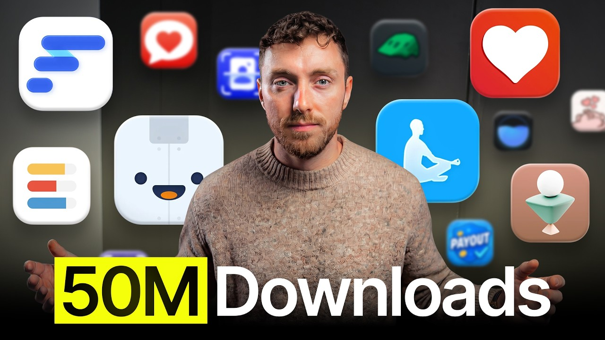

# Meet The Guy Dominating The App Store

Start building & deploying paywalls in 10 minutes flat: https://superwall.com/

## Table of Contents

* [00:00:00] – Intro
* [00:00:28] – Unpredictable virality
* [00:00:53] – Origin & early scaling
* [00:04:46] – Revenue + ads story
* [00:06:00] – Acquisition & portfolio model
* [00:09:38] – Viral video detection + scaling
* [00:12:01] – Creative + UGC ad framework
* [00:14:31] – Briefing creators properly
* [00:18:00] – Creator compensation & filtering
* [00:21:50] – B2B wellness shift
* [00:23:00] – App acquisition story
* [00:25:52] – Future of consumer apps (AI + distribution)
* [00:32:00] – App evaluation & retention frameworks
* [00:38:00] – AI agents & creator-led distribution
* [00:42:00] – Flow app corporate wellness model
* [00:49:41] – Flow app today + Next Steps

## [00:00:00] – Intro

How do you build a portfolio of 30 apps with over 50 million downloads? >> Yeah, probably more to be honest. I haven't really kept count. >> You build a factory. Ryan's team built a system so effective it turned one of their apps into the number one most downloaded app in the US beating Tik Tok and Google. [00:00:00 → 00:00:17]

>> We heard of like Tik Tok at that time, you know, Google, Chrome, all the other apps that everyone downloads every day. But seeing the number one downloaded app on that day was just insane. But the crazy part, even with the factory, they still couldn't explain [music] their biggest hit, a creator who repeatedly got tens of millions of views for reasons they still don't quite understand. [00:00:15 → 00:00:34]

## [00:00:28] – Unpredictable virality

Top left one, 66. 9 million. It just went super viral. We tried to replicate the same video across 20, 30, 40 different content creators. Didn't work. [00:00:34 → 00:00:42]

She did another video back to back, hit again. I don't know why. It's just makes no sense to me. >> So, how do they build a predictable system around unpredictable results? First, they built an in-house university to train an army of 250 content [music] creators and turn them from amateurs into professionals who understand all the relevant metrics. [00:00:42 → 00:01:02]

## [00:00:53] – Origin & early scaling

>> We had a really large content creator army that we built inhouse, effectively created our own kind of university teaching them how to make good ads, good content [music] for us. >> Second, they created a three tier ad scaling system. Every video gets a $20 test. Winners graduate to a level two campaign with a bigger budget. And the top 1% of those become level three evergreens that get 90% of the [music] ad spend. [00:01:01 → 00:01:24]

>> You might get to a point where you just have the same video running at level one, level two, and level three, just at different scale spends. That was effectively the model. >> Third, they mastered seasonal ad buying arbitrage, spending 75% of their entire annual ad budget in January when the cost to acquire a user is 50% cheaper. The first week of January is effectively the Super Bowl, the Black Friday of results where you just have so many market tailwind wins with you. We would spend effectively like 75% of our ad budget within the first month of the year. [00:01:23 → 00:01:52]

>> Ryan's whole approach was not based around trying to find [music] a viral trend or just ride waves of hype. It was to build a machine that could test thousands of videos, identify winners, and scale [music] them systematically. we could allocate certain amount of content, maybe thousands of videos across [music] the portfolio in as profitable a way as we could based off of the metrics that was coming off the back of the the [music] ads that were being created. And in this episode, Ryan opens up the entire playbook. How to build a creator army from scratch, his [music] three tier system for scaling ads from $20 to millions of dollars and how he's now building an AI employees to run his entire playbook for him. [00:01:50 → 00:02:26]

We are creating AI employees for your mobile app and then in the background while you sleep, it's just going to grow your app. It's going to find problems. It's going to make sure that they're fixed. This is a masterass in building an industrial app growth factory. Let's get into it. [00:02:26 → 00:02:39]

This is the Superall podcast and I'm Joseph Choy, founder of Consumer Club. The members in the Consumer Club Discord and the founders I interview on the pod build apps at a median of about a million dollars ARR. In my conversations with dozens of these founders every week, one thing I've noticed is most of them AB test their payw walls to increase their conversion rates and make more money. Now, most people know that one of the best ways to AB test payw walls is Superwall. But one thing you might not know is Superwall has a lot of data on the thousands of apps that use their payw walls. [00:02:37 → 00:03:06]

So recently, they actually put together a tool that takes 422 profitable paywall experiments and put those into a paywall experiment generator where you can upload a screenshot of your own paywall and it'll give you an experiment idea to increase your revenue. You can use it for free at paywallexperiments. com. All right, let's get into the pod. So you have 30 apps in your portfolio and a few of them have 7 figure AR. [00:03:06 → 00:03:29]

It was Reflectly your first app in the portfolio? >> Yes. So, Reflectly was the original app that was built back in 2017 and then at the time it was the AI journaling app before AI was a thing. It was kind of just a combination of machine learning and then from 2017 to 2020 uh we scaled that relatively large. Um mainly we had just a really good arbitrage with Facebook ads. [00:03:29 → 00:03:52]

Um we were doing micro influencers at the time. So finding UGC before it was a hot topic uh is one way of doing it. Um, so we had influencers, usually content creators in local countries speaking like the local dialect and getting them to convert really well on Facebook ads. >> Interesting. So you'd find micro influencers, but you wouldn't have them actually post their content organically. [00:03:52 → 00:04:18]

You would just pay them to read a script and then you'd use that as an ad. >> Yeah, exactly. So um and and it became got to the point where it was so uh we couldn't predict the videos that were going to win. Um, it was just a combination of trust that they are going to come up with, you know, how influencers are, they come up with the wildest videos of like babies crying in the background, bad uh lighting, and those were always the videos that seem to catch and work. >> How much revenue was Reflectly making at its peak? [00:04:16 → 00:04:46]

>> Uh, app its peak was probably doing three 34 million AR. [00:04:44 → 00:04:49]

## [00:04:46] – Revenue + ads story

>> Okay. Wow. >> We were spending the exact same effectively. >> So, net net we were we weren't making massive progress. Um the charts look great but we were spending a lot of money to maintain that level. [00:04:48 → 00:05:03]

>> Interesting. Were you going for an exit because you sold the company eventually? Like were you okay with the kind of like the break even profitability or did you want to get to like profit eventually? >> Yeah. Well, it's a it's a really good question. [00:05:01 → 00:05:14]

It opens up a whole whole line of discussion. Um so it was around 2020. We were hitting these numbers. as we were growing really fast and we had all these uh different investors who are curious and interested in kind of scaling that and focusing on becoming like the next calm or the next headsp space. Um but to be honest we didn't quite believe it ourselves. [00:05:14 → 00:05:34]

I think co was about to start was happening was sort of around that time. Um and we didn't know how reliable Facebook ads were going to be. iOS 14 just came in so the tracking got worse. So the ability to just scale it to 10 20 30 40 50 million AR just didn't seem realistic. And I think that's kind of a case study of how we've been over the years trying to do what we think is realistically the best idea. [00:05:34 → 00:05:55]

And what that led to was we had another option. So we were able to acquire a habit app called Done. [00:05:55 → 00:06:02]

## [00:06:00] – Acquisition & portfolio model

It's now called Do Habit. And we acquired that and it came with a portfolio of extra apps as well. Yeah. So we we acquire we acquired this one. It came with another five or six apps kind of like as a bundle. [00:06:02 → 00:06:13]

And what was really great about this is we paid uh a pretty good price for it, but it was quite undermonetized. Um there was room for growth. We knew that there was improvement in like pay walls and inapp subscriptions that we could make. And so we we acquired the app and then within sort of 12 to 18 months we made our money back. And then we thought, well, if we were going to spend the same amount of money on adverts, it's less reliable that we're going to make that same amount of money back. [00:06:13 → 00:06:41]

and we still own the habit tracker or the mobile app asset and we own all the user base and the tech as well that we can sell on afterwards if we want to. So we kind of thought maybe there's an opportunity here to build a portfolio to build a a roll up of apps and to be honest that's what we did. So for the next 5 years 2020 to 2025 roughly we just went at it. We we acquired another 30 35 apps in total and we built that portfolio. Wow, that's a lot of apps. [00:06:41 → 00:07:09]

And you had around like 50 million downloads total for all the apps combined. >> Yeah, probably more to be honest. I haven't really kept count. Um, but yeah, we we were big in driving a lot of downloads specifically through Tik Tok over the years. We had a, you know, really large content creator army that we housed, built inhouse, effectively created our own kind of university teaching them how to make good ads, good content for us. [00:07:09 → 00:07:36]

Mhm. >> Um and then we were able to get crazy amount of downloads during our peak seasons, peak periods for our portfolio of apps in you know January, February time. Um and that the amount of downloads we're able to get from these Tik Tok based videos were was quite crazy at the time. >> Okay. So you said the magic were at Tik Tok. [00:07:36 → 00:07:54]

So we're going to get into that. But right before that, I was curious about the Facebook ad arbitrage you were mentioning because it sounds like at the time, what year was that? You said 2018. >> Between 2018 and 2020. Yeah. [00:07:54 → 00:08:09]

>> Yeah. So 2018 to 2020, it seems like there was still sort of like a ad arbitrage with micro influencers and like UGC in paid ads because I guess like brands just weren't really doing that yet with um putting micro influencer UGC and like authentic feeling testimonials in Facebook ads. So were you getting like underpriced clicks and things like that? And you said it got to like 2 or 3 million AR and then it was break even. But were you profitable leading up to that like before you got to that like bigger revenue? [00:08:06 → 00:08:39]

I remember. >> Yeah. So we were profitable um before we started fully scaling and then through 2018 to 2020. Darius, who's the CMO at the time, he really uh drove the I guess the the UGC playbook in the really early days when Facebook was kind of like Tik Tok where there was such an arbitrage of no one's making these oddlooking, not so great UGC videos. Um, but they were converting like crazy because all the other big companies and advertisers were doing polished graphic ads at the time. [00:08:39 → 00:09:15]

Then that became the strategy that kind of really rose reflectly to the fame that it that it got to in the industry. >> So it seems like over time like you know and now you got into Tik Tok you know organic UGC. So it seems like the authenticity level of advertising and marketing just keeps going up and up over the years and you you guys like continue to stay ahead of it. So yeah talk to me about the the Tik Tok marketing. [00:09:12 → 00:09:39]

## [00:09:38] – Viral video detection + scaling

What was the strategy? Yeah. So it was it was basically an evolution of the Facebook strategy from 2018 to 2020 2021. Tik Tok was new. It was um you know open season. [00:09:39 → 00:09:52]

There wasn't much competition. Tik Tok ad platform was also kind of really driving you to use their ads platform tools and products. So they were incentivizing uh your ad spend to go even further. So we just dove on that and just kept building up a real creator army in house because we worked for like a lot of agencies over the years but no one then no one could really crack it internally uh for us. So we just thought why don't we just do it ourselves. [00:09:52 → 00:10:17]

So we reached out to hundreds of content creators built an in-house uh automated system that basically took a content creator from knowing about us right the way through to being able to make a video for us that converted. And we taught them every step of the way. And we automated every step of the way from interview to concept or brief that we sent to them right the way up to video that they would make, editing, going back and forth, invoicing, payments. We did the whole thing in house. And that allowed us to get to a point where, you know, let's say we had 20 apps that we were spending ads on, we could allocate certain amount of content, maybe thousands of videos um across the portfolio in a in as profitable a way as we could based off of the metrics that was coming off the back of the the ads that were being created. [00:10:17 → 00:11:02]

Do you have any of the like videos or posts still up on Tik Tok? >> Yeah. So, if you go to Tik Tok account, so uh type in do. habits and it'll be that one. And then we have another one which is growth bundle. [00:11:02 → 00:11:16]

They're all relatively the same, but if you scroll down here, it's basically goes on forever. Um it's just constant videos. Um all the same style, all the same concept with dozens of different content creators. And are you just posting all these organically or are these uh like becoming [music] ads? >> Yeah, so it was a combination. [00:11:16 → 00:11:36]

So we would post uh all of the videos organically on our own channels. Um and then if they picked up any organic traction, then we would boost them a bit more with our ad spends. And then if they really took off, we would spark ad the video to the actual content creators account. So we were effectively using four or five different ways to push the same video if it caught traction. I see. [00:11:36 → 00:12:01]

So, first you would post it organically on your own brand account and then if it started to pick up, you would start boosting it with ads. [00:11:58 → 00:12:10]

## [00:12:01] – Creative + UGC ad framework

Like how much engagement does it need to have before you start boosting >> anything? You know, even if it's got like sort of 10K views. Um because obviously you're in that sort of jail period of 0 to 300 views and then once it starts breaking out into like 5,000 to 10,000 views, you see you think I've got I've got something here. there's a little bit of something special that this might be able to scale. And so you you push it a little bit and it works even more and you push it a little bit more and it hits your, you know, your CPI metrics or your your subscription metrics, whatever you're targeting. [00:12:10 → 00:12:42]

Um, >> and then you you figured out a concept and then you roll that same idea into your content creators and you ask them to make more of those variations of that style of video >> to to compound the learnings of that one viral video. So, at what point do you decide like, okay, this is a winner. I'm going to replicate this style, figure out how to like write a brief around it, and then give it to a bunch of creators to make it uh make variations. Like, what's that like really? Well, >> yeah. [00:12:42 → 00:13:09]

I think I think if we're able to spend a few hundred a day initially on it with with hitting our metrics, then we think that is a good case to replicate because most of them, you know, they they run out of steam after $100 because they're just you, you know, the metrics early. Your pixel is strong enough to pick up whether it's going to work or not. >> Yeah. Yeah. >> So, after a couple hundred dollars are spent on it, you kind of know from that point on. [00:13:09 → 00:13:33]

>> Yeah, that's interesting. It's kind of like a looking at a viral video. Like you can kind of tell if a video is going to perform well uh after a certain while. Like it's hits 10,000 views and it kind of plateaus at 20,000. It's probably not going to keep going. [00:13:32 → 00:13:48]

Uh it's like not worth like pursuing that format anymore. You kind of get a taste for it, right? It's like um if you've made hundreds or thousands of videos when you've posted them, you can just tell. Um, one one thing that really catches is like um if if the comments start going off, if you start getting 10 100 kind of comments on the video, even if it doesn't have tons of views, you just know that there's some hook on that that is going to make it go viral even more. One example that we had was um one of our content creators without knowing put like a motivational speech of Emma Chamberlain in the background who's like a famous YouTuber in in the space and um everyone started commenting like Emma Chamberlain Emma Chamberlain oh my god we love her la I don't I didn't really know who it was but that video just absolutely blew off like 50 60 million views until we then obviously got like a cease and desist letter from their law firm saying you're using her likeness to effectively promote your your app, your product, which in part is true. [00:13:48 → 00:14:48]

## [00:14:31] – Briefing creators properly

But we then kind of took that idea and we took so many other famous people voice. I this was very early days of like AI voice kind of coming out like Ariana Grand Ariana Grande, Beyonce, uh Adele and we just took their voices and we did the same script and some of them took off but we knew that we couldn't push it always too hard otherwise you know the the law firms would probably come after us. But it's but but it's enough. It's enough to hook the the average Tik Tok scroller to be like, "Oh, this sounds familiar. I'm just going to [music] stop. [00:14:48 → 00:15:17]

" And then that's what Tik Tok needs in order to push the video to the next level. >> It reminds me of those like Joe Rogan podcast clips cuz he talks about health and supplements all the time. So people take like a clip, an audio clip of that and overlay it over their whatever other supplement they're selling and then it kind of adds the trust of like a familiar voice to the thing that you're selling. >> Yeah. It's just like you're just trying to find a hook. [00:15:17 → 00:15:41]

Um, you know, attention is just so hard to grab these days. Um, so anything crazy that you can do in the first second, you know, you take it to to drive downloads. >> So, going back to the ad scaling strategy, so you would first, you know, post organically, then you would increase the spend until you get a winner, then you would replicate the winner across creators. So, when you're increasing spend, do you start it off with a certain amount and then increase it um every day or how do you actually increase the spend on on the ad? >> Yeah, so it depends on the season and for the category of apps. [00:15:41 → 00:16:15]

So, let's talk about, you know, our biggest season, which is usually the runup to New Year's Eve or around sort of this time. Uh, you know, all the everyone trying to have like new resolutions and everything. Um, so how we would operate it, we we would do a very basic sort of campaign scaling structure. We would have a level one campaign. Basically, every video would go in as like a separate ad set and we would test each video with, you know, $10 to $20. [00:16:15 → 00:16:39]

Every video effectively gets a fair whack at hitting the target metrics at that level one level. if we see after one or two days, so maybe 20 to $40 of spend on that one video has shown promise or we just shut it off really early after $5 or $10 spend because we know where it's going. Um, if it then qualifies, it effectively graduates into a level two campaign. And in that level two campaign, it's adets again or or a CBO campaign. You can kind of run both both from parallel. [00:16:39 → 00:17:07]

Um, and this is less amount of videos but higher amount of spend. So you might be just having an ad set with four or five videos and 100 to 200 maybe even $500 um in that level two campaign. And again, Tik Tok is testing these videos now at a new level at new scale of spend trying to hit your same lower down the funnel metrics that you're targeting or top ofunnel like downloads. Eventually one or two, you know, rise to the top. Um and these become like your your level three campaigns or almost like your evergreen videos that just will take 90% of your ad spend. [00:17:07 → 00:17:38]

But you don't you don't turn off your level twos or your level ones if they're still working. >> So because once the campaign is moving and you know Tik Tok has learned that this video works well with this audience and you keep getting the results, there's no point turning it off. >> So you might get to a point where you just have the same video running at level one, level two, and level three just at different scale spans. That was effectively the model. Very simple. [00:17:38 → 00:18:00]

Again, we were a really small team. [00:17:58 → 00:18:02]

## [00:18:00] – Creator compensation & filtering

There was basically me, a media buyer, and a head of content to manage all the creators. So the simpler the better. That sounds like a lot of creators though because you you say that you would put all the ads in in one ad set and spend $20 each and then only the ones that work you would graduate to level two and then only the ones that work there you graduate to level three. So you must start with a lot of ads to begin with. But in order for it to even reach level one, you said it has to get 10,000 views organically, right? [00:18:00 → 00:18:35]

>> Yes. Well, it depends. So, when you're running uh ads in peak season, peak periods for like hour apps, that period is just so good that the videos are going to get lots of views anyway. When you're pushing them kind of in without knowing if they're going to work or not, you can just push them organically first. There's two ways you can go to it. [00:18:33 → 00:18:50]

You can go launch them all straight into level one, run them that way, or you can just do bit of both, where you can push them organically first if you don't have as much money in lower, quieter periods of the year, and then if they do work, then you boost them that way. So you you wanna you want to just put a ton of ad creatives in with you know 10 $20 $30 a day and [music] we know which which costs a little bit of money you're like wasting $20 if the ad doesn't work out. So if you want to save on the ad budget in the testing phase you can just post all those organically first and then see if they they hit >> exactly. So that's like the the safer way to not spend as much money. Um but if you are time constraint and just need to scale and get answers very quickly, you go down all into level one and just boost. [00:18:50 → 00:19:39]

Um because with the health and fitness category and the productivity category of mobile apps, like the first week of January is effectively the Super Bowl, the blurber back Friday of results where you just have so many market tailwind wins with you that effectively your average price to acquire a download, let's say, is half for than what it is throughout the rest of the year, maybe more. So, we would spend effectively like 75% of our ad budget within the first month of the year. Um, the rest of the time we were just testing and seeing what creatives we could learn over the years to then run again back in January. >> Interesting. Cuz January is the cheapest month, you're saying. [00:19:39 → 00:20:18]

>> Yeah, exactly. And being that we had an app portfolio, our big mindset was always like, where do we allocate capital the most efficiently? Do we buy more apps or do we run ad spend? Most of the time buying more apps was a better way to grow. But at periods of of the year like January, ad spend was was king because that created a new baseline for the whole company every year of MR AR kind of numbers. [00:20:16 → 00:20:41]

>> Yeah, super like systematic. I love it. And this is like we've been going down like the scientific just the step by step for scaling, but let's look into these actual ads. So, do any of these like stick out to you immediately that could be interesting? >> Yeah. [00:20:38 → 00:20:55]

So, um, top left one, 66. 9 million. Um, the girl that we worked with on this, you know, it was it was early days when we were just starting this sort of scaling trend and we were trying to find like a a content creator that could just go viral. Um, and for some reason, I don't know what it was, but whenever this person made video, it just hit. It just went super viral. [00:20:55 → 00:21:18]

And we tried to replicate the same video across 20, 30, 40 different content creators. Didn't work. She did another video like back to back hit again and I don't know why it's just makes no sense to me but she was one of the like you know the the best content creators we were able to work with to create content with. Um >> that's crazy. Let me let me unmute and listen to what this video is. [00:21:18 → 00:21:42]

[music] >> So it's just music the whole time. [00:21:44 → 00:21:52]

## [00:21:50] – B2B wellness shift

There's no like >> just music, barely any talking. Um, she does she does another video. You might be able to see in a second, but um like it's it was just it was just madness. Um, and we like to think we're very scientific with trying to work out what virality means. And I know it's like it's up in up in the clouds as to what truly makes something viral. [00:21:52 → 00:22:14]

U, but we went as deep as um working out how many frames were in a video because that's what we tried to break down as like an attention grabber. So >> we it's like 10 to 15 seconds long. It needs to be 25 to 27 frames, you know, chops in the video. And we we had so many content pieces, we were able to kind of, you know, aggregate all the data points across all of the videos to make an idea of what made that video viral. And that's the kind of then playbook and concept presentation, you know, pitches, pitch decks, and drafts and things we would give to content creators afterwards to try to replicate it. [00:22:14 → 00:22:51]

>> That's crazy. And you still to this day have not figured out why this ad did so well. 66 billion views. >> No, no, no. It worked. [00:22:49 → 00:22:58]

It worked back toback for more more than one year as well. [00:22:58 → 00:23:00]

## [00:23:00] – App acquisition story

But it could be, you know, I think it was like uh a you know early year uh early time in in Tik Tok's sort of period. You can see this was like 2022 2023 sort of time >> and it just hit so well. It got for example the DN app that you saw there. It made number one across all apps on the app store in the US in that on like the second and third of January cuz we put so much money behind it obviously. Um >> this is the top earning app on the app store for a month. [00:23:00 → 00:23:32]

>> Like the top free app in the app store on the second and third of January two years in a row. [laughter] >> The second and third of January because you put like a ton of ad spend in those. >> Yeah. Because the because the conversion rates to what our goals that we were targeting were just incredible. Yeah. [00:23:29 → 00:23:49]

Wow. [laughter] That's so interesting. >> Like we were ahead of we ahead of like Tik Tok at that time, you know, Google, Chrome, you know, all the other apps everyone downloads every day. But seeing done as like the number one downloaded app on that day was just insane. >> Do you feel like there's a certain range within January like towards end of the year or beginning of the of the year where there's like a window where you can really do marketing for like New Year's type of uh products? [00:23:47 → 00:24:17]

Yeah. Yeah. Well, I actually um another another few guys I know who are scaling up their wellness, you know, fitness apps at the moment. Um I walk them through kind of uh our sort of ad account. Um and you can see almost day by day. [00:24:17 → 00:24:34]

So, you know, 25th of December, dead. 26th to 28th of December, you could you start testing. You know, you probably start, let's say you're spending 5 10 grand a day around that sort of time just getting the early ideas of how your ads are going to perform. You got to remember there's a there's a multiplier of they're going to perform twice as good on the first or second, but you're trying to find the best 10 from your your collection in this time period. And then 28 of December to 30th, it jumps again the conversion rate quality. [00:24:34 → 00:25:01]

So you might boost your your daily ad spend again across all your all your videos. And then depending on the day that New Year's Day falls on. So if you fall on if it's the 1st of January and it's a Thursday or a Friday, don't expect a huge multiple jump in your performance. Uh because even if it's a just cuz it's the 1st of January, but it's a Thursday or Friday, mentally people aren't really clocked into wanting to start the year yet. M >> um the best is where like January 1st falls on like a Sunday because it's like we have yearly cycles. [00:25:01 → 00:25:37]

There's also individual season weekly cycles of health and fitness productivity apps. So Sunday, Monday, Tuesday are like peak periods to run ads and you know Wednesday, Thursday, Friday. No one really cares about trying to improve theirelves as much. They're just looking forward to the weekends. >> Yeah. [00:25:37 → 00:25:51]

Unfortunately, 2026 has a has a Thursday as our new year. [00:25:51 → 00:25:58]

## [00:25:52] – Future of consumer apps (AI + distribution)

>> Yes. So word word of advice for that is I would say probably that Sunday which will be like the 3rd or the 4th of January. >> That will probably be your peak push period. Um because people everyone's going back to work on that Monday, let's say, for example. And they'll want to feel like now is the time I'm going to start. [00:25:55 → 00:26:14]

So yeah, that's that Saturday night into Sunday morning is where you just, you know, 10x the spend if your metrics are showing good good signals early. Yeah, that's that's really interesting. I feel like Facebook would never do that for you because they want you to spend and bid throughout the week, too. [laughter] And then, you know, probably gets I I feel like a lot of media buyers probably don't optimize for Sundays like this in the health and like self-improvement space. No, cuz the thing is when you're doing it, you are kind of playing around sometimes with the average spend level that's going on. [00:26:14 → 00:26:50]

Now, in these peak periods, you know, you're spending such a vast range of money that it's it's it's okay and the the market trends are in your favor, but throughout the the year, it's a bit harder to do that. Um, but if you are like launching a new product or a new feature like with that in mind that more people are going to be interested in it on that sort of Sunday, Monday, Tuesday period for this category is is always quite important. um and beginning of the months, you know, first, second, third of every month is better conversion rate for your subscriptions for health and fitness and productivity. >> When you reach out to creators and you're about to invest into organic social and maybe boosting those videos with paid ads, you don't want to just let the creators do whatever they want. Most of the app founders I talked to on this channel basically have the same content philosophy. [00:26:49 → 00:27:33]

The videos need to go viral, but also convert and promote an app and ideally are like also repeatable. And those formats are like gems and really hard to find. That's why Tik Tok can sometimes feel like a lottery system. So what a lot of consumer club members do is they use this tool called spy talk which brain rot scrolls hundreds of thousands of Tik Toks and just finds the most viral ones that promote apps. So here I search for fitness, gym, workouts. [00:27:33 → 00:27:59]

Let's say you like run a fitness app. I'm going to sort by most viral. And here's this 106x outlier video that promotes a fitness app. and it shows a text hook. It shows the image in the background. [00:27:59 → 00:28:12]

And then on the second slide, it has this CTA in a really creative way. And spy talk has been the secret weapon for growth strategy for 11 Labs and Ammo and Voodoo, which is the app studio that owns Bereal. So, I recommend Spy Talk. It really is the only other tool I explicitly recommend on this channel other than Super Wall. Let's look at a couple more ads. [00:28:12 → 00:28:31]

So, this this one it looks like it's the it's that same creator. 15 seconds. >> Same go. Same go. Yeah, this did really well. [00:28:31 → 00:28:38]

It's basically the same formula. This one looks a little bit different. This is like face hook reaction. >> Yeah. So, this is uh this this one also evolved uh off of all the learnings that we had. [00:28:38 → 00:28:51]

Um we just saw a few other videos that were kind of structured like this and just seemed to go viral. I think again I can't put a a finger on why it went v it went viral. It just >> Mhm. >> it just it just works. >> Yeah. [00:28:51 → 00:29:05]

But but it would be it would be at a lower level though. We rather than spend maybe 100k on this one ad, we might spend you know 25k on this ad because we couldn't push it any higher. >> I see 25k total like spend over the lifetime of the ad. >> Uh just maybe in that like January period for example. But yeah, we would we would put a lot of money behind these kind of ads like this. [00:29:05 → 00:29:27]

>> Interesting. Yeah. So that was like hook and reaction. This one's I guess this is the same one, right? >> Yeah. [00:29:25 → 00:29:33]

Same woman as well. the that's the third third video she hit. [laughter] >> Uh, okay. Here's a also like a hook. Okay, but this one's more of a like morning routine video and then they she probably shows the the app screen. [00:29:33 → 00:29:50]

Yeah, there we go. Cool. Yeah. And so the common thread through all of these is basically it uses an existing Tik Tok trend that people a certain editing style or like story line that exists on Tik Tok organically and then you show the app interface in the person's hand uh for a couple seconds throughout the video. Um kind of like showing how people cross off their habits. [00:29:50 → 00:30:21]

>> Exactly. Exactly. um probably something I can share with you here. So you don't have to go through every single one of them. You can kind of just show like one of the slides because it gives a concept of like how we would work with content creators. [00:30:18 → 00:30:31]

So this would be like an example where we break down all these different concepts into lifestyle or educational testimonial videos like this. Yeah. Lifestyle, trend, educational, testimonial. And then each one would break down into the kind of video that we would want. So if you go one more slide over um the lifestyle video would be we would send this to concept content creator is the whole concept sort of style presentation uh where you would have the trending sound the hooks how fast we want the video um and then video requirements. [00:30:31 → 00:31:00]

So what I mentioned before the amount of frames per video how many shots of the app we need to see uh in that video and all the videos all the clips of that phone needs to be POV shot down looking at it. So, we really get really granular on the video that we're looking for. You know, super strict on this has to be within this range because creators aren't like that, but they have guard rails to follow. Uh, and then they know the expectations of what we expect. >> Yeah. [00:31:00 → 00:31:26]

Yeah. These are very clear creator briefs. And then it shows you the angles, too. So, first you show, make sure you do trending sounds with, you know, these metrics. Make sure you do a type of hook. [00:31:26 → 00:31:38]

make it, you know, 10 to 15 seconds, two or more shots per second. >> Yeah. >> Um, and then you go into the angles. So, like you can make this video about a morning routine, an evening routine, wellness, mindset, vlogs, and then you kind of like give the whole like package too like Yeah. for like a morning evening routine angle. [00:31:38 → 00:31:58]

You'd start with a hook, then do the habits, and then kind of show. [00:31:58 → 00:32:01]

## [00:32:00] – App evaluation & retention frameworks

So, this is an example, right? >> Exactly. And and even we had we had um we even paid someone to um basically scroll through Tik Tok and give us a list of all the trending songs at the beginning of every week >> and all of these were just regularly updated. So the likelihood of the trend or the thing catching would just >> you know catch more and more. >> Ah and then here's your >> Yeah. [00:32:01 → 00:32:24]

So we would have like creative hooks and captions and things like this. And this is just you know teaching the content creator like what it is because some of them are oblivious to it. Well, they were back then. Everything now is just way more dialed in. Everyone knows a lot of the tricks and the secrets, I would say, now. [00:32:24 → 00:32:41]

Um, so it's hard to come up with a lot of unique ideas that haven't already been ran. >> Yeah. Curiosity based hooks, empathetic hooks, reflective hooks. Yeah. I feel like you're right. [00:32:41 → 00:32:53]

Like a lot of creators just kind of they don't really break it down into this framework, but they just kind of know in their head like you've done so many hooks so many times that you kind of just start to figure out >> Yes. >> how to do that. >> Yeah. Exactly. And like part of the in-house university that that we had with the content creators was like you come to us, you learn how to make content ads that go viral and then you can work with kind of any other company you want and price way higher, guarantee better return on investment. [00:32:53 → 00:33:24]

Cuz a lot of the things a lot of content creators they come to you with, they're pretty oblivious to the metrics that the business are targeting. They just kind of want to make a video and then just let it be done. But if they truly get their the numbers and the understanding of what makes a video good under their skin, then when they work with bigger brands and bigger content uh bigger like companies, they can charge more money and they actually deliver genuine ROI that the bigger companies are willing to pay a lot more money for. >> Uh and and you kind of have to go through this graduation. This is with every kind of, you know, job or work that you do. [00:33:24 → 00:33:56]

But, um, I don't think there's not enough people really talk about that transition phase from being like an early content creator with maybe a thousand 2,000 followers to, um, being a content creator that can convert really well on ads or organic posts. >> Interesting. I want to talk about the the creator strategy, too. So, you had like how many creators did you have? probably about 250 250 total. [00:33:56 → 00:34:22]

>> Okay. >> We probably cycled through maybe like five, six, 700 total, but we ended up, you know, the the ones that would almost regularly work with us was about a 250 batch. >> Is there a certain type of creator in terms of demographics or follower accounts or things that they say in the interview, anything like that? >> Yeah. Yeah. [00:34:22 → 00:34:42]

thought accounts was never a priority really for us. If anything, it was the lower follower counts the better. Um because the big thing we we we kind of coined here was we don't want to work with influencers. Uh we want to work with content creators. We hire you to make an ad for us or a video for us. [00:34:42 → 00:35:01]

We're not paying for your, you know, influence uh that you have in terms of follow account. And that really helped with positioning this as like a a business relationship to make content and videos for us. Yeah. Interesting. What what range of like follower count is would you would you look at? [00:34:59 → 00:35:18]

>> Yeah. Optimal was like 2,000 followers to like 15 20,000 followers. Um because that's where they've showed enough, you know, craft uh skill for their trade that they have made a following or they know how the Tik Tok algorithm works in some capacity or they've just been disciplined and committed to making content over a longer period of time. Um and seeing that is is like a great green flag. Um the next layers is just once you early work with them, you give them a effectively like a test task, a probational task to make you, you know, a basic day in the life of video and can you follow these guidelines. [00:35:15 → 00:35:50]

And then the third stage is like can they deliver it on time? And if you find someone who does all three of those, you found someone you could probably work with for a couple of months at least. Um maybe years, some some content creators we worked with for years and eventually they end up getting full-time jobs at the company and everything. So, it really can be like a great gateway to to to doing a lot more with with the company just by showing up and following the instructions. >> Yeah, that's really that's really cool. [00:35:50 → 00:36:15]

A lot of it is like somewhat common sense stuff, but just the way that you were so hyper intentional with every single step. Like I feel like not everyone puts this much effort into a creative brief and giving all the examples, giving the frameworks, all the step by step. And if they follow this like to the tea, then it'll, you know, they'll make good videos. Um, but then it's a kind of up to them and you're still going to get some variability. Uh, but like the fact that you have this brief, it kind of like sets the standard. [00:36:13 → 00:36:46]

>> Yeah. And I think we were quite open and forward with that when we first were bringing on content creators. We were like, look, this is this is not just a a one-off uh video. This is a long-term relationship we want to work with you on, and we're so committed to doing that. we're going to teach you our secret sources of how we're making these viral videos at that time period, right? [00:36:44 → 00:37:04]

And and they were really appreciative of that. And also because they were then working with us on a regular basis, they had regular income. And content creators find it hard to constantly do the sales part to constantly get new work. And it would be great if they just had a regular partner that they could get a guarantee x amount of uh you know, revenue sales from by making x amount of number of videos per month. and and we wanted to give them that to basically train them up and make us videos so that we could then uh run more ads. [00:37:03 → 00:37:32]

>> So when you initially reach out to them, are you reaching out with email or are you just sending a DM? >> Uh combination. Yeah, we just do uh DM or email if they've got access to it. Um just a very simple message, you know, here's all the videos that we've made. We would love you to help us make more of these videos. [00:37:30 → 00:37:49]

Here's all the testimonials. We even had like our own landing page dedicated for content creators. So um kind of like you have a landing page to sell someone you know a B2B product or you know whatever. [00:37:49 → 00:38:00]

## [00:38:00] – AI agents & creator-led distribution

We had our own landing page for content creators. So >> we had our own content creators give testimonials of what it was like working with us. Um >> right >> everything along those lines. Um because you're also trying to pitch to them to come work for you and do some work for you. So if they see from the beginning everything looks professional and organized, they're also going to be professional and organized with you. [00:38:00 → 00:38:19]

You would hope >> that makes sense. So you you worked with 500 creators and two of 250 of them were, you know, a little bit more long-term, but you must so you must have reached out to thousands of creators. Like how how how many did you have to reach out to? >> Yeah. Yeah. [00:38:19 → 00:38:35]

Yeah. Probably probably thousands of creators. Um, I'd say maybe let's say if we put an actual number on it, we probably had like 2,000 just over 2,000 creators on the books and then let's say 10% of those become like people that you regularly work with. But then I would say maybe one to five 1 to 2% of those are like the viral sensations that uh you're going to want to always work with every single video. Content creators now are getting more savvy. [00:38:35 → 00:39:04]

Um, they are getting better at it. So the conversion rate from reaching out to someone to get them to make a viral video for you is probably going up as people get better at making content and understand the algorithm a bit better. >> Yeah. So like what is the deal structure in the beginning? Like I I like if they're if they're really viral and you're spark adding that is probably changes the deal structure, but in the beginning are you just like paying per video? [00:39:04 → 00:39:30]

>> Yes. So we had a flat rate per video. um that flat rate per video went up uh depending on how many viral videos or good videos they made for us. So, the more reliable they were at making viral content, the more we would pay them. At the time, we did have some bonus uh additional prices that we added on, but I know the game has changed a little bit now where people are now just only paying for performance-based only like CPM models. [00:39:27 → 00:39:53]

Uh which I I do understand. Um, I think content creators just it can take an hour or two sometimes for these content creators to make the videos. So, sometimes giving them the money to make the video upfront, you know, they made the video than you pay them, but you pay them a fixed fee for that video. And then you incentivize them to make better videos by giving them a bonus or or a raise, let's call it, the more better videos they make for you. kept more loyalty and kept people with us long term uh because they feel like they're getting paid for their their work as [snorts] opposed to hoping they get paid if the video works. [00:39:53 → 00:40:25]

And you know, if they're not super qualified, they're not the best content creators in the world, they don't get the highest fee for their single video. But if they're way more qualified and they have experience, they've been doing it for a while, they get a higher cost per video because we can guarantee that it's more likely to create a return for us as well. >> Makes sense. What's the like baseline starting out per video fee that you'd recommend? >> So, I think it's somewhere in the range of like $30 to $40 uh for like the lower tier and then it can go upwards to 80, 90, $100 for like more reliable uh content videos that being made. [00:40:25 → 00:40:59]

>> Mhm. And then would you give bonuses based on uh the ad performance or like the initial organic performance? >> A bit of both. I think we would give like a, you know, a flat fee. If it get hits a certain amount of views, like 50k or 100k views or more, they would just get like a flat rate. [00:40:57 → 00:41:14]

And then if the video really took off with ads, we kind of already know how much money that video made for us. So, we would throw them, you know, couple hundred extra dollars, $500, $1,000 maybe if like it really started working because you want to keep the content creator on your side. You want to keep them energized to work with you. and you know they've created an amazing video for you so you should do that for them as well. >> Yeah, totally. [00:41:14 → 00:41:38]

We were talking about Reflectly and the habits app mostly. Were were there any other like really standout apps within the portfolio that had some interesting results? >> Yeah. So, um one of the largest apps that we acquired is called the mindfulness app. The mindfulness app is the largest uh meditation app in Scandinavia in the Nordics. [00:41:38 → 00:42:00]

## [00:42:00] – Flow app corporate wellness model

I think it was actually the oldest mindfulness app on the market. I think it was started in I want to say 2010 2012 something along those lines. And this was like another pillar of health and fitness that we wanted to add to the portfolio. We had journaling, we had habit tracking, we had fasting, uh we had uh money tracking, um calendar apps, productivity, and we were missing like mindfulness app um to kind of round off the portfolio. And this is the one that we acquired. [00:42:00 → 00:42:26]

And the engagement on this is insane. the average revenue per user is is really really high as it's just like such a loyal fan base of users over such a long period of time. And now yeah the next phase of growth for this is is expanding into a B2B model uh and seeing if we can kind of work a lot more with with uh corporations on on mindfulness in the workspace. >> Is that kind of a a big goal for a lot of health and wellness apps where you're trying to get those like big B2B enterprise contracts? >> Yeah. [00:42:26 → 00:42:55]

So there's a very uh sim similar road map that a lot of these uh health and fitness and mindfulness and these kind of apps kind of move along which is you effectively hit you go as far as you can where you eventually sort of hit a ceiling or the bite point of where ads make sense and your growth makes sense against like organic performance and you can either a try and raise a bunch of money and just try squeeze it harder but not as profitably or you try to create a whole new revenue line which is moving to B2B cuz if you a B2B contract. Uh, you know, it could be a couple of hundred,000. Um, and then that could be over a three, four, five year time horizon because a lot of these B2B corporation contracts are like once you you're past the KYC and, you know, accounting and you they they've approved you and you've got through the all the stakeholders, uh, you're it you're locked in and then that can be a 5year contract, which is a lot more than trying to get one person in for like an annual subscription all the time. >> Um, it is a longer lead time. It can take six to 12 months to get one contract, but one contract could be, you know, a quarter of your revenue uh in the year if played well. [00:42:55 → 00:44:02]

And you do have to build a bit more technology to make it more relatable and custom for these larger could be insurance companies, health companies, accounting firms, like whoever needs these these sort of services. But then eventually you realize like if if I can if I have a consistent model of converting these B2B leads longterm, it's probably less stressful and I make more money and I deal with less people. You know, you're just kind of dealing with like the the main stakeholders of of of the B2B customer, but it is a there is a windup time of like maybe 12 to 18 months to get going. >> It's a whole different game, but it's pretty wild. Like six figure, fiveyear contracts is like pretty crazy. [00:44:02 → 00:44:43]

Yeah. What do the companies look for in apps? >> A lot of them are trying to make sure that there is a uh a clear sort of ROI on you know if we provide this amount of subscriptions. So if you're a company of you know 10,000 employees and you have a prepackaged subscription for the mindfulness app uh you know there's a huge discount on the yearly subscription that you're giving everybody. But if you can then track the performance of let's so for example in the mindfulness app we have like a stress test and people do a stress test before and then they do a stress test at different periods throughout the year and if the overall company can see that they have paid x amount of money to create a 10 20 30% decrease in the average stress levels of people in the company that you can manifest itself into um healthier company a more positive looking company that creates more revenue as well. [00:44:43 → 00:45:36]

They're really looking for can we really see the the data from when we first start it to a year two years down the line and where is our company mindset at for example with this product in that time frame and that's hopefully our app's job to to solve that problem for them. >> Yeah, I remember when I was working in corporate they would give like a stipen like a yearly stipen and they would give you like 60% off or something like that to anything that was health related. So it seems like these companies just want their employees to be healthy and not get burnt out. >> Yeah. And you know I think with us now working from home after co like all these different layers. [00:45:33 → 00:46:14]

Um people you know with AI and everything like that as well like people's level of stress is is is evolving. It's changing not maybe what they used to be. So companies are trying to adapt more digital solutions as well to provide that to their employees. Speaking of B2B, you are now like you sold your company um and you're starting a B2B company now, which is pretty interesting. Could you walk me through the story of like the acquisition a little bit and then also talk about what you're what you're up to now? [00:46:14 → 00:46:42]

>> Running a portfolio of mobile apps. Um my day-to-day was just consumed by looking across all these different data platforms. Let's say I was going to App Store Connect, Google Play, Revenue Cat, Ads Managers, Facebook, Tik Tok, all these different platforms. And I was taking all that information, putting it into maybe like a spreadsheet or into a database. And I trying to figure out like what is the next steps here? [00:46:39 → 00:47:03]

Uh what should I do? There's so much so much data. Oh, so much so much noise. Where is the signal? And so we decided to build float. [00:47:03 → 00:47:10]

So flo 1. 0 takes all that data, puts it into one location. Um and then you ask any question and you get insights and opport growth opportunities on what to do next. And what's great about that is flow 2. 0 O will take all of those opportunities and we are creating AI employees for your mobile app. [00:47:10 → 00:47:27]

So think ASO agent, ASA agent, monitoring agent, forecasting agent. We will create these different employees that will do the operational load that it takes to run your mobile app. >> I like this phrasing here. It's like like chat GBT, but for apps, you're just kind of like yeah, anything you could think of to improve uh or analyze. You're just you can you can use a chat interface and just it'll you know it's like connected to all your tools. [00:47:27 → 00:47:54]

So you can just kind of like ask it like what's wrong and then you go and like tell it to like fix it or like improve. >> Yeah. Because because I think the future is we don't think there's not a world where AI agents are not in your mobile app doing work for you. I think if you just look at the way the market is going, way AI is going, it's going to be like connecting Google Analytics to your website. You're going to connect Flo to your mobile app and then in the background while you sleep, it's just going to grow your app. [00:47:54 → 00:48:23]

It's going to find problems. It's going to make sure that they're fixed. It's going to price perfectly in 180 countries. It's going to adapt all of your custom product pages instantly. It's going to do your ASO across all these places. [00:48:23 → 00:48:35]

You know, it's just going to operate the whole thing. And I think this is the next evolution of mobile apps. We've seen, you know, 2015 to 2020 era with apps and maybe some no code stuff and Facebook ads. And then 2020 to 2025 it was like we were buying loads of apps. We were running a lot of portfolios. [00:48:35 → 00:48:51]

We were doing Tik Tok ads. we were using. Then AI started coming in and now 2025 to 2030 I think is going to be the years of AI agents in mobile apps. >> M yeah makes sense to me. Yeah, like agents Yeah, I feel like agents are taking over like a lot of different functions. [00:48:51 → 00:49:06]

Um but yeah, that this this is really interesting. Can you tell me about the acquisition story too? Like you you sold your portfolio. >> Yeah. Yeah. [00:49:06 → 00:49:15]

So we we we got rid of uh about 80 90% of the mobile apps. Um part of that was just uh loads you know uh I was focusing a lot on on float. com and couldn't also operate you know 20 30 mobile apps as well. Uh so it made sense to centralize all the focus and build uh like a B2B platform for mobile apps because we are mobile app operators ourselves and we faced all of these pains of growing scaling operating buying and selling. [00:49:15 → 00:49:45]

## [00:49:41] – Flow app today + Next Steps

So we wanted to build the the solution for all mobile apps for the next sort of five to 10 years. So the the story is um the company actually you were briefly you were briefly already on their app store account before um because Kodon is the um is our is the buyer of our of our apps here but they bought a majority of our apps and I think the story is which I I'll I'll resay this but I think the story is they used to work in gaming and a lot of people from gaming are moving over to consumer and applying all of their skills of growing gaming products into consumer. like being way more data driven um operationally more efficient and I think they saw a really good opportunity with the bundle approach and all of the performance previous past performance of Reflectly and Darn and uh we fast and health view as products um that they could be a better steward of scaling these apps to the next level. >> Yeah, that makes sense. Like gaming is uh adjacent. [00:49:45 → 00:50:44]

It's like kind of similar. Is it like mobile gaming? Yeah. So, yeah, I think they were in I think it was mobile gaming or was it was a form of gaming for sure. They were very successful in that, but now obviously consumerbased apps are sort of taking over uh from from gaming now. [00:50:44 → 00:51:02]

Um it's it's just so hard to keep people's attention on games these days like how many games are coming to market and how many games last very long period of time. At least with consumer apps, they're solving generally a gen a problem especially if it's like health and fitness or productivity. it's like a time thing or a life improvement thing that people were happy to come back to year after year. Uh which is also a lot more reliable and trackable revenue over a longer period of time. Uh so I think that that's why a lot of games prefer to come over and take the subscription model here than rely on you know AdSense or the other revenue streams that games rely on more so over there. [00:51:02 → 00:51:38]

>> That's really interesting cuz I feel like a lot of mobile founders look at games and they're like wow that's a cash cow. like I want to be Clash of Clans or I want to be like >> match three, but >> th those are kind of like at the top. Like it seems like >> Yeah, as a whole people are probably bombarded with a lot of mobile games and maybe the opportunity is in like just other like regular consumer apps now. >> Yeah, exactly. Um and I think consumer apps still have a ways to go. [00:51:37 → 00:52:08]

It's definitely a different world than it was 5 years ago. I think the way that AI is coming to play to actually launch grow apps and you know use flow to to scale apps, it's really kind of entering a new era. Um and and I think that means that you know there's going to be a whole lot more competition for keywords. There almost needs to be like a new app store release like with Chad GBT or something um to give new apps a fair whack at trying to compete cuz it's going to be so hard now to knock, you know, the top apps in a in a category off the top spot now. you're not going to come in and just move calm or uh move uh Google or Tik Tok like or any kind of habit tracker that's been there for sort of 10 10 years already. [00:52:08 → 00:52:48]

Um and that's what's really hard. It's like the distribution game is now becoming more more important. So, how do you capture an audience effectively before you even launch your mobile app? And I think I saw one of your videos recently on how how how they're doing that now of like prototyping uh mobile apps before they go to market and run some ads to test if the the value proposition is strong enough. >> Yeah. [00:52:48 → 00:53:11]

Yeah. I think that was the Roger uh Roger Chen video. People should check that out. But yeah, and you gave a great distribution playbook as well with the um with the with the ads and organic combines with creators. It's really interesting. [00:53:11 → 00:53:26]

But yeah, Ryan, thanks. Thanks. so much for being on the pod. I learned a ton today. And um yeah, I'll put your links in the description. [00:53:26 → 00:53:36]

People can find you on Twitter. >> Yes, Twitter. Hello, Ryan J. Or LinkedIn. LinkedIn you can find me, Ryan Thorp on LinkedIn. [00:53:33 → 00:53:43]

>> Cool. Great talking to you. >> Amazing. Thanks for being >> Joseph. Byebye. [00:53:41 → 00:53:47]

>> Something you might not know, most of the founders I cover on this podcast are hanging out right now in the Consumer Club Discord, sharing with each other what's working now for consumer apps. So you can apply to join consumer club if that sounds interesting to you. And this is the Superwwell podcast. Of course, you got to check out superwwell. com. [00:53:46 → 00:54:03]

We have more videos on the channel. So dig into those to learn from app founders who are willing to share super tactical stuff about app growth. [00:54:03 → 00:54:10]
