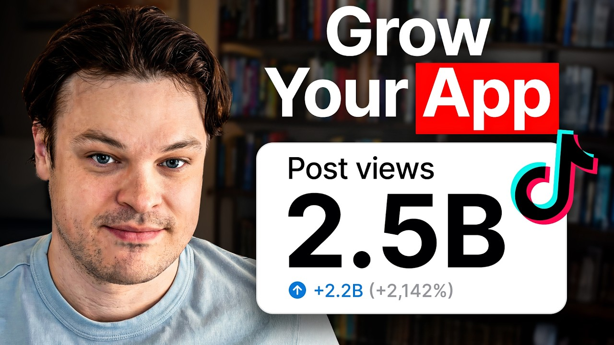

# Meet The Guy Who Solved App Growth on TikTok

Get Noise (pay-as-you-go UGC): https://platform.getnoise.com/auth/sign-up?ref=superwallpod

## Table of Contents

* [00:00:00] – Intro
* [00:02:16] – Science of virality explained
* [00:03:24] – Noise platform growth engine
* [00:05:17] – Eggs theory & viral hooks
* [00:07:43] – Replacing Meta ads with TikTok
* [00:10:16] – CPM model & creator system
* [00:11:20] – Viral format examples
* [00:14:16] – Caption psychology & conversion
* [00:18:20] – Comment seeding strategy
* [00:20:13] – SpyTok & finding winning formats
* [00:23:00] – Dashboard & scaling system
* [00:27:13] – Two-pronged UGC + slideshow strategy
* [00:31:19] – Hot takes on low-view conversions
* [00:32:21] – TikTok views budget theory
* [00:36:44] – Anyone can learn to go viral
* [00:38:46] – Next Steps

## [00:00:00] – Intro

In the last year, the founders on Nick Weber's platform generated over 2. 5 billion with a B views. >> 2. 5 billion views seems like a crazy number. We were super surprised by the number, too. [00:00:00 → 00:00:12]

>> But even though they were surprised, this had nothing to do with luck. They're actually one of the few teams I've seen truly get viral Tik Tok growth down to a science. And it started with this weird discovery he calls the eggs theory. We noticed that the ones that were doing higher views always had some form of eggs on them. It's relatable. [00:00:11 → 00:00:29]

It's healthy. It's easily understood. it seems achievable because it's cheap. >> He realized that tiny, seemingly random details could be the difference between a thousand views and 10 million. So, he built a system to test all these details at a massive scale. [00:00:27 → 00:00:40]

Instead of hiring a few creators, he built a platform that allows 50,000 people to post content all at the same time. A lot of the other folks out there are taking, you know, five people, 10 people, and saying, "Hey, post this kind of content for us twice a day. " And what we're saying instead is, "Hey, 50,000 people post this content. " and he calls it the shots on goal effect. And he uses it to run two distinct playbooks at the same time. [00:00:40 → 00:01:05]

First, higheffort UGC videos designed to go viral with a soft call to action. And second, thousands of simple slideshows with a hard call to action that act as a retargeting campaign for anyone who saw the first viral video. Maybe the million view video is like a little bit of a softer CTA that like barely mentioned Noise app. And then all the like small view videos are a little bit harder CTA, which is probably why they didn't get as many views, but it's functioning sort of like as a retargeting ad. He doesn't guess what works. [00:01:02 → 00:01:31]

He just lets the data tell him. They found that a video starting with don't get a second job went viral, while the same video starting with everybody needs a side hustle flopped. You would be shocked at what is the thing that sets it off, right? Originally, we weren't using the don't get a second job as the start to this whole like paragraph text here. I think it was like everybody needs a side hustle. [00:01:31 → 00:01:51]

Don't get a second job is what ended up making it go viral. >> And what he's learning is that going viral has a lot less to do with being creative and much more to do with thinking like a scientist. You don't have to be super creative. You just have to be creative in showing how your app fits [music] or product or whatever it is fits into an existing viral format. I like to say I think Pablo Picasso is the one that said that great artists steal. [00:01:51 → 00:02:16]

In this episode, Nick Weber breaks down the science of virality. [00:02:14 → 00:02:19]

## [00:02:16] – Science of virality explained

How to find winning formats by copying what already works. How to use a two-pronged content strategy to drive both awareness and conversion. And how to build a distribution machine that gives you an unfair advantage over everyone else. This is a master class in growth not as an art, but as a science. Let's get into it. [00:02:19 → 00:02:33]

This is the Superall podcast and I'm Joseph Choy, founder of Consumer Club. The members in the Consumer Club Discord and the founders I interview on the pod build apps at a median of about a million dollars ARR. In my conversations with dozens of these founders every week, one thing I've noticed is most of them AB test their payw walls to increase their conversion rates and make more money. Now, most people know that one of the best ways to AB test payw walls is Superwwell. But one thing you might not know is Superwwell has a lot of data on the thousands of apps that use their payw walls. [00:02:33 → 00:03:02]

So recently they actually put together a tool that takes 422 profitable paywall experiments and put those into a paywall experiment generator where you can upload a screenshot of your own payw wall and it'll give you an experiment idea to increase your revenue. You can use it for free at paywallexperiments. com. All right, let's get into the pod. Okay, so 1 year into noise and the founders on your platform have gotten more than two billion views which is pretty insane. [00:03:02 → 00:03:27]

## [00:03:24] – Noise platform growth engine

first of all, how this was achieved, how those 2. 5 billion views happened, and then also like how you guys got started. >> I mean, 2. 5 billion views seems like a crazy number. [laughter] We were actually not really keeping track. [00:03:25 → 00:03:40]

We looked at it here at the end of the year to kind of like milestone what we've done in the last year. And we were super surprised by the number, too. We knew it was high, but we didn't know it was this high. It's just the accumulation of a bunch of stuff, right? Tons of super viral videos. [00:03:40 → 00:03:51]

We've got another one going out right now that's 22 million views in 4 days. It's those kinds of big ones and then what we call just like this massive ground game of hundreds of thousands of posts going out there that do 500 to a,000 2,000 views a pop and it really just starts to add up. >> So there's a bunch of like videos on your platform that are getting a bunch of views. What's the secret? How are they getting so many views? [00:03:51 → 00:04:15]

>> It's a distribution problem, right? And so a lot of the other folks out there are taking, you know, five people, 10 people and saying, "Hey, post this kind of content for us twice a day. " And what we're saying instead is, hey, 50,000 people post this content and here's exactly what you need to post and here's all the assets for it and here's what you say and here's your description and it just goes absolutely crazy from there. We call it sort of like a shots on goal effect where just by naturally having a 100,000 pieces of content out there a day at least, you're going to get something that hits. And if it doesn't hit, it's going to quickly tell you why through, you know, analytics or just general viewership. [00:04:13 → 00:04:51]

And you can use that information to slightly tweak stuff to then make it just go crazy. [music] And I want to underscore how crazy it is that just changing the text or changing the picture or the first couple seconds of your video can be the difference between 1,000 views and 10 million views. Like it really just boils down as stuff that's that simple. >> Yeah. I want to get into kind of the science of that and all the little >> I'll talk to you about uh eggs theory. [00:04:51 → 00:05:15]

It'll blow your mind. >> Oh, just tell me that right now. [00:05:14 → 00:05:18]

## [00:05:17] – Eggs theory & viral hooks

In the early days when we were doing slideshows for a brand that we were working with, we noticed that the ones that were doing higher views always had some form of eggs on them. I can actually pull up an example here for you too. Yeah. So, this is just from one account and there were many of them doing this and you'll notice on all of these that aesthetically they're sort of similar, but they all have some version of egg in them. And so we started calling it the eggs theory and it really helped us solidify what hooks meant because we thought that the eggs here were making it go viral because it was about clean eating. [00:05:18 → 00:05:47]

It was about healthy eating. And eggs [music] are one instantly visually understandable. Not only are they a whole food and healthy, but they're also super affordable, right? Everybody knows what an egg is. The last election was based on the prices of egg cost, which is crazy that this little piece of food makes that much of a difference. [00:05:47 → 00:06:05]

You see over and over and over again that putting hard-boiled eggs, putting scrambled eggs in these first hook images just absolutely was a rocket ship in terms of viewership. >> I don't really get it, but like if it works, it works. Tik Tok is very mysterious. Sometimes >> it's all just about relevancy and then how it relates to the person that's watching it, right? You know, if you've ever tried to eat healthy before, you're probably eating scrambled eggs. [00:06:05 → 00:06:28]

You're probably eating hard-boiled eggs. This is aesthetically what you would call like, you know, Pinterest sort of design style. They're all AI generated and they just sort of hit whatever that nerve is for people that are trying to eat healthy. And that visual language and that visual relatability just instantly send them to the next slide. And that's huge signals to Tik Tok to push it into like, you know, crazy viral view ranges. [00:06:28 → 00:06:51]

So, I also want to give a disclaimer. Like, the reason why I invited you on the pod was because I had someone else on the pod, Kyle, and he just randomly brought up noise and he was just like, "This is basically how we do our mass slideshows. " And he just promoted you guys for like 10 minutes straight. Yeah. I normally don't cover like platforms. [00:06:49 → 00:07:10]

I like to talk to founders mostly on Super Bowl channel, but I feel like you have a ton of insight. So, I'm excited to get into the all the Tik Toks. >> I mean, shout out Kyle. We're not here to charge somebody $15, $20,000 ahead of time to go make content for you. We're just building the tool and we want the tool for founders to access in a way that people have been able to access, you know, meta [music] ads, but meta ads just they don't work the way that people think that they should work and they're super expensive. [00:07:10 → 00:07:34]

So, we're just building the alternative to that, an absolute perfect case study of it. They're getting crazy views, good installs, and you know, we love to see that. >> So, you're trying to replace meta ads or be an alternative to meta ads. [00:07:34 → 00:07:45]

## [00:07:43] – Replacing Meta ads with TikTok

How does that actually work? >> I mean, we come from a background of, you know, performance marketing. That's where myself and the other founders really cut our teeth. And when we really started, we've been app founders for a long time. And when we first started, it was always, all right, well, yeah, performance marketing, that's the way to go get people. [00:07:45 → 00:08:02]

We did a bunch of really crazy growth hacks in the early days, too, that worked. But scale was a little bit different for those. I could tell some crazy stories about how we scaled up really really cheap traffic on our last app, but some of those are are definitely gatekept secrets that we want to hold close to the pocket, but really what we found out was that Tik Tok [music] was the best distribution system at cost. And when you see how Tik Tok works to serve people content and how Meta or even YouTube or Google or whoever else you want to compare it to works to serve content to people who are interested in, you know, whatever ad they're showing, the short form media content works exactly the same way, right? If you're interested in cats, you're going to get cat content on your short form feed. [00:08:02 → 00:08:43]

All you have to do is make your product relevant to that cat content and then boom, there you go. feels like completely organic discovery even if it's super super implicit and it just converts like absolute gang busters. So for us the aha moment was we started trying this for ourselves in July of 2024 and we just started handing some of our internal players slideshows that pseudo promoted our app at the time and when we had one slideshow do 20,000 views in a week. maybe this is the secret sauce and we just started asking other folks that we knew that were in the same space like building apps if they wanted to try it as well and it just kind of took off from there. This is our Discord chat right now. [00:08:43 → 00:09:21]

I'm very excited to get into all these cuz you just sent me all of these like Tik Toks that got tons of views and then also were like actually promoting a brand, but I feel like you have a ton of insight. So, I'm excited to get into the all the Tik Toks. So on the noise platform, the way that you have the all these slideshows go out is you basically upload a bunch of your own content, like the slideshows onto the platform and then hundreds of people come in and post those slideshows on their actual phones. Like the content is going out organically, but the creators on the platform aren't really creating the content themselves. So we have two different variations where we have people that just post, you know, shotgun slideshows where you're aiming for just total mass distribution. [00:09:21 → 00:10:03]

And then we also have a higher class of user who we've, you know, upskilled or graduated through our app into posting that kind of traditional UGC content that you're used to. And what we found is both running together at the same time works great. And the secret for us has always been don't make your creators think about how to create this content. [00:10:03 → 00:10:21]

## [00:10:16] – CPM model & creator system

Right? If you go into the noise app right now, we just give you everything. So all you need to do is worry about curating your account and posting that content on a regular schedule and then you're instantly getting feedback of I'm getting paid for every single view that I get. Creators on noise are not meant to really invent their own formats. You should just come with the format and then create the content and then they'll post it hundreds of times for you. [00:10:21 → 00:10:42]

And you pay CPM, right? So you don't pay creators like retainers or anything like that. You just pay like per how many views that they get. >> That's right. Yeah. [00:10:42 → 00:10:49]

And importantly on those CPMs too, you set them. So the brands that come in, we say, "All right, generally what are you trying to target for a download? What's your cost per install? " And that's usually what we set the CPMs at. So depending on their product, depending on how many views you get, there's a lot of different levers that you can pull, but just I mean for ourselves, we're averaging like 30 cent installs using our own platform. [00:10:49 → 00:11:11]

So the cost is just you can't compare it to anything else. It's insane when you get the machine up and running. >> Okay, so now we have the mechanisms. Can you just walk through some of these examples of successful Tik Toks that have been posted on the platform? [00:11:11 → 00:11:23]

## [00:11:20] – Viral format examples

>> Yeah, I mean just uh opening these Lingo Pingo examples. This is probably what people are most familiar with. This is the result of us basically handing our creators the idea that we think goes viral. An example for them to kind of look at of one that was similar. I think that the originator of this trend was some random woman who just made something she thought was funny of her like crying to pronounce some word on Google. [00:11:21 → 00:11:46]

When you're on Google Translate on the search engine results page, it tells you, you know, how to say this word correctly and she's just fumbling over it and crying, right? And then this concept can be applied to any language. And so these examples were shown to the creators. We give them the exact instructions on what to do, how to prompt the app, why it specifically works, why it's funny, using, you know, an innuendo, and having the app roast you. And we went to sleep and woke up the next day, and this already had like 20 million views on it. [00:11:46 → 00:12:14]

This format just absolutely ripped all through October and November of people crying to the app, the app roasting them, or 15 different variations of it. The concept of AI being mean to you, I feel like that is very applicable across different niches, too. And then if your app is about AI itself, maybe it's like a GBT rapper in some vertical, like the video will be about the app itself. So you're probably going to get these comments that say, "What's the app? " And then that's like very high converting. [00:12:14 → 00:12:41]

I'm sure everyone is familiar with the whole Craigslist analogy of every different form on Craigslist ended up being some unicorn company. What's interesting is there's a lot of similarities to popular subreddits in the content space as well. If you've been making content, this has been this way for years and years and years, but roast me is a super popular subreddit. And this is just roast me content from an AI, right? You can do sort of the same thing if you go through Reddit of really popular subreddits and say, "Oh, roast me is here. [00:12:41 → 00:13:10]

How can I make content that resonates with that crowd? " Because it's already been confirmed popular based on how people are interacting with the Reddit. That's a good like place to find the source of ideas, Reddit. Do you do that right now like to find new content formats? >> If I'm not familiar with the space, I will definitely look at Reddit just to understand how people talk about it. [00:13:10 → 00:13:32]

There is for sure nuance in how you talk about things, right? If you play a certain popular video game, the way you talk about that video game, it's pretty instantly clear if you know what you're talking about or if you don't. And these sort of online communities behave similarly. So Reddit is definitely a place where we take some inspiration, but ultimately the best inspiration is on whatever social media app you're posting on. I like to say we don't have to be super creative. [00:13:29 → 00:13:54]

We just have to have a good eye for what's already gone viral and how we can apply it to ourselves. And that's how we've hit number five in our category, number seven in our category twice in a row. Every time we've tried to hit top 10, we've done it by just copying what's already done well and slotting noise into those scenarios. >> Yeah, it's kind of meta. I'm curious to see how you actually do it with the Noise app. [00:13:54 → 00:14:13]

Let's look at a couple of these examples. Don't get a second job. [00:14:13 → 00:14:18]

## [00:14:16] – Caption psychology & conversion

Instead, download the Noise app. I make noise posts every night for $20. It doesn't sound like a lot, but it adds up. It's additional $500 a month, which helps with groceries. Why did this go viral? [00:14:16 → 00:14:28]

>> There was a woman who had posted this very similarly, and it was talking about her cleaning up Airbnbs after church, and that's how her and her husband like make some extra spending cash, right? So, I'm like, okay, clearly this resonated. So now I just have to take that similar concept and we put it into playbooks and noise give it to our noise users and they post it. And this one since we use our own platform this was doing 8 cent installs for about 3 days and this hit us to number seven in our category. Really the conversion is what is the noise app? [00:14:25 → 00:14:57]

I haven't heard of this thing before. How does it work? And you can see people in the comments here like asking what is the noise app? How does it work? To be clear this was not the only one. [00:14:57 → 00:15:05]

We had like four, five, six, one of a similar post that all did over a million views and uh it was always washing the dishes. We tried vacuuming. We tried pouring coffee into a cup, but none of it worked the same way that washing the dishes did. >> So there's like a bunch of different people like all doing the same thing, but in each of their houses, just like washing dishes with basically the same caption on top, or was it like variations of the caption, too? >> Subtle variations. [00:15:05 → 00:15:29]

Like I had mentioned, you would be shocked at what is the thing that sets it off, right? Originally, we weren't using the don't get a second job as the start to this whole like paragraph text here. Don't get a second job is what ended up making it go viral. And so, if you start breaking those down, no one really likes being told what to do. Saying you need a side hustle is making a bunch of assumptions that the viewer might be uncomfortable with or whatever else, right? [00:15:29 → 00:15:52]

There's like a lot of nuanced psychology there. However, don't get a second job is still saying the same thing, but it is provides like a totally different like sentiment to the same concept. And little changes like that are again that difference between 10,000 views and a million views. >> There's like some kind of novelty effect of this too where it's like you can really make $20 a day by making posts like with an app. It just seems like almost not too good to be true, but it's like crazy concept. [00:15:52 → 00:16:19]

People probably immediately go to the comments and looking for like people that are calling it out as a scam or something. But you just you kind of like organically have people like saying like, "Hey, I actually have it. Like it worked. " And then some people like asking genuinely, oh, how do you actually do this? So, it seems like people were by default not that skeptical. [00:16:19 → 00:16:37]

I think people were just like, oh, how do you do it? Like, how does this actually work? >> We've tried, I've made $7,000 and whatever. And the crazy thing is like we have users that have made $7,000 in a week on our platform. But as soon as they say that, everyone's like, "Oh, no. [00:16:37 → 00:16:51]

This is a scam. I don't believe it at all. " So, that's where it's like we take $20 seems super achievable, right? Anyone can imagine a $20 bill in their hand, but then they're bad at math. So you say, "Oh, it's actually an extra $500 a month. [00:16:50 → 00:17:02]

" And then that $500 is what they anchor on of, "Oh, my car payment is like $498 a month. " Like that would be my car payment. That would be incredible. >> There's a little bit of a a like get-richqu guru inflation going on where there's like all these wild claims like 10,000 a month. I mean, I'm guilty of on this channel, too. [00:17:02 → 00:17:19]

I cover people who actually make that much money, but like people in the are always in the comments being like, "Oh, that's inconceivable. How could you actually make that much money? " But then like when you say, "Oh, this guy's making an extra 15k a month. " And it's like, "Oh, actually like that's, you know, similar to my tech job. " Like I could see myself making that. [00:17:19 → 00:17:35]

>> We figured this out way in the old days when we were doing our last app. It doesn't even matter if you show people receipts. Like if I show you my bank stub of how much I made posting on noise, everyone would be like, "Nope, that's fake. There's no way that's real. " And so for us, it was a lot of just recentering people. [00:17:33 → 00:17:51]

And there's still a lot of skepticism, right? Because the internet's full of that. But this whole concept really did serious numbers for us. And you can see it kind of again here in this next one. >> Yeah. [00:17:51 → 00:18:00]

So you actually repeated the same concept for a client. >> Uh no, this is us again. This is the one that we hit number five in our app category doing this. >> My job has a mandatory secret Santa and the requirement is $60. That's nearly a full day of work just so Josh from finance can regift in 3 weeks. [00:18:00 → 00:18:19]

What are we doing for extra funds this year? [00:18:19 → 00:18:21]

## [00:18:20] – Comment seeding strategy

Oh, so it's fishing for comments. >> Bingo. And I want to be like super explicit here that we use our own platform. And the reason why noise exists is because we initially built it as an internal growth hack tool. This is a growth hack tool that we used as app founders that we just built for ourselves and has turned into I want to use it as well. [00:18:21 → 00:18:42]

One of the things that we do all the time is how do we take new ideas and new concepts, use our platform to prove them true so that we can bring them to the rest of the people on noise. And this was us trying what we called a super implicit version where we don't even mention like the app at all. We don't noise isn't mentioned here at all except for in the description. And then we have our users do comment seating. I know people have talked about comment seating before and that's really really hard to do. [00:18:42 → 00:19:07]

Again, like it's a distribution and scale thing. And so we have the distribution and scale problem figured out by having our users be super plugged in and they're in here making comments about how the noise app worked for them to do whatever this video is about. Oh, I needed an extra $60 to buy this stupid thing. I did it on the noise app. >> So for my comment, I'll go this showed up first. [00:19:07 → 00:19:28]

My work has this too. I use the noise app to make extra money and that got a,000 likes. So that's good. I see 1,686 likes and for me that's at least a thousand people came and downloaded Noise just from that comment or they went and searched about us on Tik Tok where there's billion pieces of content about us and they're also using that to make their decision to go download the app. It's all a scale and distribution thing. [00:19:28 → 00:19:50]

>> So when you reach out to creators and you're about to invest into organic social and maybe boosting those videos with paid ads, you don't want to just let the creators do whatever they want. Most of the founders I talk to on this channel basically have the same content philosophy. The videos need to go viral but also convert and promote an app and ideally are also repeatable. And those formats are like gems and really hard to find. That's why Tik Tok can sometimes feel like a lottery system. [00:19:49 → 00:20:14]

## [00:20:13] – SpyTok & finding winning formats

So what a lot of consumer club members do is they use this tool called spy talk which brain rot scrolls hundreds of thousands of Tik Toks and just finds the most viral ones that promote apps. So here I search for fitness, gym, workouts. Let's say you like run a fitness app. I'm going to sort by most viral. And here's this 106x outlier video that promotes a fitness app. [00:20:14 → 00:20:36]

And it shows a text hook. It shows the image in the background. And then on the second slide, it has this CTA in a really creative way. And Spy Talk has been the secret weapon for growth strategy for 11 Labs and Ammo and Voodoo, which is the app studio that owns Bereal. So, I recommend Spy Talk. [00:20:36 → 00:20:54]

It really is the only other tool I explicitly recommend on this channel other than Superwall. Okay. I was just looking at Discord again and I saw where you said where it all started template links on Canva. I'm very curious about this. So, is this how you actually prompt your creators and you just let the creators kind of like mix and match the slides and like change up the the text? [00:20:52 → 00:21:16]

>> This was an internal tool for us where we like to do things that don't scale and then when we prove that they work, we scale them up. Our version of don't scale here was taking 30 of our most engaged users from our last app that were active in our community and saying, "Hey guys, we want to pay you to just post content on TikTok and we're going to give you all that content. " And we had no other distribution method besides just handing them canvas slideshows. And so in the early days, like I would sit here and I make canvas slideshows myself. I know nothing about Brawl Stars. [00:21:14 → 00:21:42]

never played it before, but we knew there was massive demand capture in our player base at the time because we had a lot of people coming to the the app that we had at the time that played Brawl Stars. And so we knew that if we just made Brawl Stars content and at the end had a very explicit call to action here, Playbite's the fastest way to get gems if you know, you know, and have 35 people post it. We thought, you know, people will check it out and probably download Playbite. And we were just not prepared for how successful that would be. We went from just handing people canvas slideshows where they can edit things slightly or add their own pictures if they wanted to to having it all be served through the noise app and they don't even have to do this editing anymore. [00:21:42 → 00:22:20]

We just automatically do all the variations for them, give them to them in different orders, different texts, randomize all of it so it's all unique content that goes out. >> That's an interesting way of doing creative production that I think is like somewhat unique. This itself makes a good slideshow, but you can't have a 100 people post the same exact thing. you need to make variations in the text or the images and you're saying that the noise platform actually helps you do that. >> To be completely transparent, I've never posted on TikTok until July of 2024. [00:22:20 → 00:22:51]

This was just a a growth hack for us that turned into absolute obsession and necessity where it's now a game to figure out how do you make stuff go viral? How do you learn all of it? [00:22:49 → 00:23:00]

## [00:23:00] – Dashboard & scaling system

And we got to where we are by doing it ourselves. Really, all of this was learned through a lot of trial and error on our side, right? where we were trying to figure out what worked and what didn't and why and then build that into a product for ourselves to use that others could utilize. Personally, this is my account experimenting on what works. And you can see here like I haven't removed any videos. [00:23:00 → 00:23:23]

Like this is just 1 2 3 4 5 six posts that just absolutely ripped right out of the gate using a lot of the principles that we understood like 887K views on the first post experimenting with different hooks and whatever else. And these images, this hook image here specifically, I think this did like over 5 million views just being posted a few times. And this was back during the canvas slideshow days, right? We weren't actually serving any of this in the platform at the time. All of these learnings are just transcribed into what eventually became this, which is where everything is sort of run. [00:23:23 → 00:23:53]

And this is our noise dashboard. So this is us running our own content through the platform. And you can see in the last 30 days we've done almost well we've done 54 million views on both Instagram and Tik Tok and in YouTube as well. But importantly inside of the slideshows here we have this super basic one. You know I changed my life in 10 days. [00:23:53 → 00:24:13]

Slide 1 2 3 4 5. And we're setting exactly what all the captions are that come up. Everything that you see here you know this text that comes with the image. We've found that having the user actually paste that text on it inside of Tik Tok is better than just baking the text right on it. It sends a better signal to Tik Tok that it's, you know, a a real user doing the thing or could go into all sorts of my theories of how Tik Tok looks at information, whatever else. [00:24:13 → 00:24:40]

But all of these captions are set and then are randomized based on one all the images that you also set. So these would be the hook images. These would be the secondary option which is day one I found a girl on Tik Tok. So this is using that listical format that we talked about, right? And then the outcome is just a billion different variations of these slideshows that have different text, different hook images, different descriptions, different hashtags that all get sent to our users to then go post. [00:24:38 → 00:25:07]

What's really important here is I'm not looking for these to go viral, right? You can see there's 2 million views on them in the last 30 days as well, which is a small piece of that pie compared to everything else that's going out. But these serve as just total shotgun effect where if you've done programmatic marketing before, you're familiar with how Facebook does retargeting campaigns. We view these slideshows for us when we run both the the UGC side and the slideshow side. These function very similar to retargeting campaigns. [00:25:07 → 00:25:40]

And the cool thing is like if you have something viral for noise, you're going to see more noise content. And so we try and serve it up to people in a similar format and very explicit call to action here on what you can expect, right? Where I open this up and it's how I completely changed my life day one, day whatever. And there's just hundreds and hundreds and hundreds and hundreds of these going out that drive that bottom ofunnel action, especially once you've seen something that's very viral. So there's kind of like a power law distribution here where the top videos are getting millions of views and then all the rest of videos are getting like a few thousand views, but the videos that get a few thousand views are getting shown on the feeds of those same people who watch that like viral million view. [00:25:40 → 00:26:19]

Maybe the million view video is like a little bit of a softer CTA that like barely mentioned noise app and then all the small view videos are a little bit harder CTA which is probably why they didn't get as many views but it's functioning sort of like as a retargeting ad. We've only really noticed this because we unlocked the scale and distribution part. That's the hardest part to do is to just get everybody posting all the same thing that you want and subtle variations of it to find your winners. We could spend time to try and make a slideshow go viral, but that's just not how we are using it for ourselves. We're very much more hunting for the viral hits more like UGC side where we have big ones like this go out like 3. [00:26:19 → 00:26:57]

8 million views, 5 million views, 2 million, 2 million, 1. 6. Like these are the ones that are driving a lot of that discussion, a lot of that commenting, a lot of that curiosity that then those slideshows just come in with their explicit call to actions to then drive the user to actually go download noise. >> So you put in like a bunch of effort into UGC like UGC inherently is like a lot more effort. [00:26:57 → 00:27:18]

## [00:27:13] – Two-pronged UGC + slideshow strategy

you need the human to like act like with their face and it's a little bit more manual versus the slideshows like you don't put as much effort in. You like put tons of combinations in just to like flood the feed. So, it's kind of like a two-pronged approach. You have the the UGC which is high effort. You're aiming for like a million views on those and then you do the slideshows as like a separate campaign. [00:27:18 → 00:27:36]

But do you do them at the same time? >> Yeah, running them at the same time is the best way to do it. We have this section here where you manage your different campaigns and you can see for us specifically we're running what we call like our premium content which is that UC and then we also run our basic slideshows and the basic slideshows are down there just scooping up everything. >> Can you give the sauce on the system prompt like how does it give like good copy cuz I feel like some of the examples that you showed with the Tik Toks the copywriting and the captions was really good. Really, the way that it works best is if you know generally what you want. [00:27:36 → 00:28:08]

And I can show you, you know, two versions of this where the AI is kind of giving you its best recommendation, but the best ones that we found so far are the ones where you're very curated with it and you're editing these captions yourselves. And simplicity is really what does it here. So, if you look at organic content, the ones that you spend the least amount of time on for some reason are the ones that always go viral. >> Interesting. And then what about the body slides? [00:28:08 → 00:28:34]

Like do you like have an idea of the caption and then use AI to generate variations on that too? >> Definitely. We used like chatbt and stuff in the past to help create variations of it. Personally, I think that the AI tools that exist out there right now aren't quite good enough to like feel that organic. A lot of times what we do is just take whatever that is. [00:28:34 → 00:28:57]

You can definitely achieve this kind of stuff by prompting. And we've had AI prompts do 1 plus million views, 2 million views as well. Just coming in here and saying like, "Okay, day one, found a girl on TikTok who made 5K last week just from posting on noise. My friend said she's been making free rent money from faceless posts on noise. " Like just changing it up a little bit and making it feel super organic is a good place to start. [00:28:57 → 00:29:19]

>> Is the platform doing that for you or are you doing that in Chad PT? >> We are doing that currently. You can have the platform do it, but it's not where we've spent a lot of our time focusing on it. All that's coming later to help that become easier. Yeah, there's for sure like a learning curve here, right? [00:29:17 → 00:29:32]

And we are trying to provide as many resources as possible for the founders or whoever the product owner is that's coming in and making this content of, hey, here are really good examples for you to use. Don't overthink it. Just put something out there. It's very similar to you're better off starting with something than nothing because you'll at least learn what doesn't work or you might just absolutely hit gold right off the rip. >> Cuz the normal way of doing this is you find creators to make slideshows. [00:29:32 → 00:29:58]

you pay them maybe $200 to $500 a month to post 20 slideshows a month and maybe they'll hit, maybe they won't. One thing that I really want to highlight here when I go into our playbooks and and if you're familiar with like how meta ads work, we sort of do it in a similar fashion where we have the campaigns the same way that they do. We have playbooks the same way that they serve adets and then the posts are underneath each of those playbooks for us. And you can see all these ones down here that I paused, which is us just hunting for what is going to be that thing. And it's so much faster to say like, okay, 446 posts went out on this one in 2 weeks. [00:29:58 → 00:30:32]

So, or a week. Clearly, this one didn't hit. I could remove that one and try something else. >> So, it got posted 400 times and it got 200,000 views total for the campaign. Is that like a not good result in your book? [00:30:32 → 00:30:45]

>> Yeah. So, in this one, not good result, right? I'm sure that there was conversion here, but it wasn't that I'm looking for 1 2 3 weeks range of something to go viral after tweaking and iterating on the prompts that we're giving those creators. We see none of this really popped off. We're just going to pause this playbook for now, maybe revisit it later, but ultimately it's how do I slot a new one in to take that place. [00:30:42 → 00:31:06]

And so us shifting those out and then putting in how are we making money by Christmas playbook which you know you can see here at 9 million views. Clearly this is one that hit different. >> Okay. I want to go into like hot takes. So you have a lot of interesting hot takes and I want to just like get you to explain some of these. [00:31:06 → 00:31:23]

## [00:31:19] – Hot takes on low-view conversions

Hot take number one. Videos with less than 500 views still convert. Why do you believe this? >> The Tik Tok algorithm is incredible. That's really what unlocks all of this is they understand when you post something who should see it and why they should see it and why it's relevant to them, right? [00:31:23 → 00:31:37]

It all goes back to relatability and relevance. Tik Tok is doing its absolute best every single video, every single view to show that to the right audience. If you have something like, let's just say a noise slideshow for example, and it gets seen by 500 people, Tik Tok is doing its best to send it to the right 500 people as fast as it possibly can. And it's pretty good at it. And so we see over and over again that if you post a thousand videos and they get a,000 views a pop and you're doing a million views on it, you will get downloads. [00:31:37 → 00:32:06]

You might not see the kind of like viral explosive I'm now number one in my category from massive amounts of content that are getting 500 views a pop, but it absolutely still does convert. And we've got plenty of math to prove that's true. >> Okay, so you have another theory. [00:32:06 → 00:32:23]

## [00:32:21] – TikTok views budget theory

Tik Tok has a daily views budget. What does that mean? Let's just say the growth hack space inside of Tik Tok, right? If you're making growth hack content on Tik Tok for other founders to watch, Tik Tok knows that generally this many founders that are interested in this content are going to be on Tik Tok today. They're only going to watch X amount of content. [00:32:23 → 00:32:42]

It's not like Tik Tok can't really take 50 million more videos and just plop it into the platform because they can't just suddenly generate the interest or the swipes to accumulate for all those 50 million views in the same way. Right? Right? So that's when people say like, "Oh, the algorithm hates me because my content isn't being shown to anybody. " Part of that might just be your content is not good enough to be shown to anybody, right? [00:32:40 → 00:33:02]

And Tik Tok is pitting you against other content that's out there in similar formats. But if you're making content in the growth hack space for founders, if [music] you just add 5,000 extra videos in that space a day, they're just going to take that budgeted amount of general views they think that that content gets each day and just spread it out more. And we've seen this like over and over and over again where if you make let's just say content in the book space, [music] you post viral book slideshows like this one and these are getting a million views a pop, 2 million views a pop on some of the other accounts and then you have 10,000 people run it and post the same similar kind of content. You're not going to see those big pops anymore. You're going to see them more spread out because Tik [music] Tok can't allocate the same viral views to all of that content because they just can't generate more people's interest during the day. [00:33:02 → 00:33:48]

So they're like budgeting out how [music] people are actually interacting with that content based on how good it is. >> Do you feel like it's because of competition? When you think of an individual users perspective, they don't want to watch a thousand videos in a row about the same exact thing. >> If you open your Tik Tok or Instagram right now, you'll swipe past 50 million John Ham Dancing in the Club memes. That that happens regardless, right? [00:33:48 → 00:34:14]

All these platforms are absolutely starved for content. It definitely gets shown multiple times and you know if I was designing the Tik Tok algorithm I wouldn't want to show you the same thing over and over and over again. That variability is what makes it so addicting just by nature of pumping these platforms full of similar content. You will get surfaced in the same way and Tik Tok understands that it's similar to what's already out there. So either reserve or they give new ones a shot and then recognize that they're similar and then those peter out until they get a new one in there. [00:34:14 → 00:34:41]

They give that one a shot and etc etc etc. I might not mind if I see like a hundred John Ham memes in a row today. Maybe my my personal budget for that many memes is maybe 50 tomorrow and then maybe the next day it's like 10 and then after that I probably don't want to see it ever again. Maybe once every week. I think that what I just described is like the concept of a trend. [00:34:41 → 00:35:01]

It's like Tik Tok is allocating probably like a pretty huge TAM for certain trends. If it's an engaging format like people will watch it over and over again, but then eventually like kind of gets old and then you find something new. But within that trend, it doesn't really matter if you get a,000 videos that get 1,000 views each or one video that gets a million views each. You're still getting shown to people because the size of that like the TAM of that trend is a certain amount 100%. And that's again why we're on this hottake of like 500 views on a video for sure converts. [00:35:01 → 00:35:29]

I could pull up screenshots of people asking what app is that on videos with 200 views because Tik Tok is incentivized to try and show you the most relevant content as fast as possible. >> That makes sense. Yeah, I think Kyle showed a couple of those examples as well from his Canamon stuff. You said something really important that I want to hit on. You said the word trends and that's what's so cool about this space is you can talk about the same thing just in different ways and ride those trends. [00:35:29 → 00:35:54]

And it's a neverending supply of fresh ideas and new ways to talk about your stuff. I don't know if you saw this, but Dualingo had an article out there where they said that their numbers were falling because they weren't doing unhinged content. anymore. If you remember like the Dualingo owl died and you know did all this crazy and their unhinged content was just riding or creating their own trends. Everybody knows Dualingo, but if you get shown Duolingo again in a format that is trending or familiar to you or whatever else, it's another impression that Dualingo has to convert you or bring you back to their app. [00:35:54 → 00:36:30]

just like they do their viral marketing, we're just riding those exact same waves and giving you the ability to like [music] see how it's working way faster. >> Final hot take which I think will be relevant to anyone watching is you say that anyone can learn to go viral. [00:36:30 → 00:36:48]

## [00:36:44] – Anyone can learn to go viral

>> Absolutely anybody. If you sat next to the kid in art class and you know his painting looks incredible and yours like looks like crap, that's just because he had some sort of inherent ability to see color or shape different or is more familiar with using a paintbrush or whatever else. But if I sit down and I grind to become a better painter, I will either get as good as him or surpass him. Right? Natural talent can only take you so far. [00:36:46 → 00:37:10]

If you're interested in learning how to do it, absolutely anybody can do it. And we have like proof through myself, our other team members. Like I'd never gone viral before. I'd never even posted in short form content before. And I've done it over and over and over again. [00:37:10 → 00:37:26]

We've shown all of our creators how to do it. And it's never a surprise to me when somebody who comes to the platform is like, "Oh, I posted and I've never had more views than this in my life. Thanks. This is incredible. " >> I think I agree. [00:37:26 → 00:37:37]

It makes a lot of sense to me. This was really this is a very unique interview. Um, I learned we like we learned so much about like specific formats and the tactics. Um, like the science behind Tik Tok. Yeah, there's a lot in your brain that I think people will learn a lot from. [00:37:37 → 00:37:51]

So, thanks for being on the pod. >> Yeah. No, of course. Uh, happy to crack it open a little bit. Uh, you know, there's there's a million things that that we like to talk about and we just want to arm our users with all this information because that's how they go viral and we want to be the distribution platform for them to do it. [00:37:51 → 00:38:10]

And my inbox is open. I have 200 followers on Twitter or whatever. So, my hot takes are being seen by very few people. But if you want to shout me out on on Twitter, come come shoot me a DM or email me at, you know, nickgetnoise. com and happy to have a conversation about how anyone can go viral and how we could possibly work with you. [00:38:10 → 00:38:29]

>> Cool. Awesome. If anyone like reaches out and talks to Nick, talk to me after and tell me how it went. I'm I'm just curious to learn about learnings always. So, yeah. [00:38:27 → 00:38:36]

Thanks, Nick. >> Yeah. No, of course. is uh always happy to share the the Tik Tok secrets. Uh I've got a million more. [00:38:36 → 00:38:43]

So if you ever want to chat again, let me know. >> Yeah. Yeah, let's do it. [00:38:43 → 00:38:47]

## [00:38:46] – Next Steps

Something you might not know, most of the founders I cover on this podcast are hanging out right now in the Consumer Club Discord sharing with each other what's working now for consumer apps. So you can apply to join Consumer Club if that sounds interesting to you. And this is the SuperWell podcast. Of course, you got to check out superwwell. com. [00:38:47 → 00:39:02]

We have more videos on the channel. So dig into those to learn from app founders who are willing to share super tactical stuff about app growth. [00:39:02 → 00:39:10]
