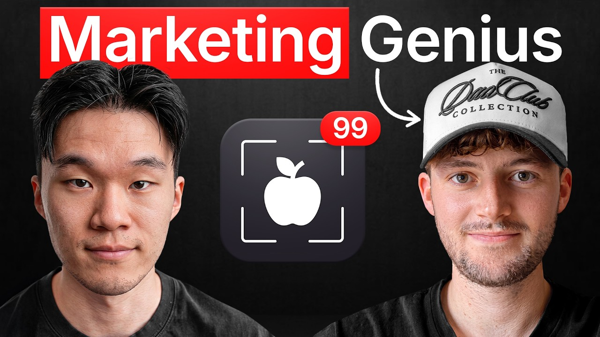

# Meet The Marketing Genius Behind Cal AI

Start building & deploying paywalls in 10 minutes flat: https://superwall.com/

## Table of Contents

* [00:00:00] Fixing Chairs to 60 Million: The Cal AI Story
* [00:09:35] The Minimum View Clause: Negotiating Against Creator Egos
* [00:12:19] Why Our CPMs Got Cheaper: Saturation and the Seven Touch Rule
* [00:17:28] Niches That Converted: Gym Bros, Moms, and Mukbangs
* [00:20:44] The 15 Second Rule: Why Seamless Beats Ads
* [00:34:35] Two Thousand Emails a Day: Inside the Outreach Machine

## [00:00:00] Fixing Chairs to 60 Million: The Cal AI Story

This is my first ever job. I was a stadium ops guy just kind of like fixing chairs. Two years before this conversation, this guy was fixing chairs at a soccer stadium in Minnesota. His name is Alfie Dickens. He reached out to the founder of Cali near the very beginning. [00:00:00 → 00:00:15]

So, at the time, it was an app nobody had really heard of yet. And he talked his way into a two-week trial helping with their marketing. And over the next 2 years ended up building the entire influencer machine behind Cal AI, which at its peak was doing $60 million a year. We reached out to about 220,000 influencers. >> The strategy behind that was an insane amount of brute force. [00:00:15 → 00:00:36]

25 assistants on their team, each sending around a 100 cold emails a day. So roughly 2,000 a day. And over time, more than 200,000 creators reached out to just to sign a couple thousand of them. Alfie says that if you reach out to a thousand influencers, you might sign 10, sometimes one. So what really matters is what you do with the creators who actually do say yes. [00:00:36 → 00:00:57]

And the deal he'd put in front of them was pretty genius. >> Let's maybe just put a minimum view clause on it of 800,000 because you can easily get a million. Every creator swears they can get you a million views. So instead of pushing back, he just agree with them and then just set a paid floor a couple hundred,000 views below the number they just bragged about. If they hit it, great. [00:00:57 → 00:01:17]

It was a good deal the whole time. If they don't, then he's still covered. And that's just one piece of how the whole Cali influencer media machine actually ran in this episode. a few things he gets into that I haven't heard him say anywhere else. Why his best converting videos barely mention the app, plus the 15-second rule behind them, why Cali's influencer videos got more profitable over time, not less, which is the opposite of what you'd expect with saturation, and the one kind of creator he'd tell you to stop paying for, even though on paper it looks like the perfect fit. [00:01:17 → 00:01:48]

This is probably the most honest breakdown of how an influencer marketing powerhouse for an app at the scale of Calai actually runs. This is the Superwall podcast. I'm Joseph Choy, founder of Consumer Club, a Discord where top consumer app founders trade alpha and what's working now in growth. I've been talking to members doing a million ARR and they tell me they've been using these two tools. Superwall has this free AI tool trained on 422 profitable paywall experiments across thousands of successful apps. [00:01:48 → 00:02:14]

You upload a screenshot of your payw wall and it gives you an experiment idea to make more revenue with the same number of users at paywallexperiments. com. And if your app's doing at least 100k MR, we host vetted dinners in SF and New York to hang out and network with other top app founders. You can apply with the type form in the description. Also, these app founders have been telling me they use ROR. [00:02:14 → 00:02:32]

I met Daniel, the founder of ROR, at a dinner, and I got genuinely really excited when he told me about Ror Max, which is out now and has honestly changed the game for coding mobile apps. It's AI that oneshots all native iOS apps with Swift code, camera, sensors, haptics, payments, the whole stack. And as you vibe code with Ror, you can install prototypes directly onto your iPhone with one click and then publish to the app store in two clicks. If you've been waiting for AI coding that actually does native iOS apps, well, this is it. I got you guys a discount. [00:02:32 → 00:03:00]

You can use the code superwall or use the link below. I think in this conversation, I'm just looking forward to learning more about the inner workings of Cali and how you guys did growth. What what was your role in at Cali? >> I actually joined probably a month or two into uh when they got started and I joined on the marketing team. I think when I joined we had about 20 to 20 to 30 creators and then we grew and signed well over I mean we were working with 200 plus at one time once posting you know four videos a month. [00:02:58 → 00:03:32]

So a lot of posts each day and I helped [music] grow the influencer marketing program up from scratch basically. It's pretty pretty wild. I feel like Cali is just the the growth story is just legendary these days. Like people talk a lot about it. So it's it'll be very interesting to see from the mind of the guy that actually did it. [00:03:32 → 00:03:52]

So you joined like a month in. So I think like when Zach has talked about the stuff on podcast a little bit like he's kind of described how he like spun it up and like initially did some of the outreach to influencers and stuff. I mean for two years basically you scaled it from like the initial 20 creators to like hundreds and what was the revenue of Cali at the at the end? >> At the peak it was like 60 million a year. >> 60 million a year. [00:03:52 → 00:04:20]

Yeah. And then you guys got acquired. So what did you do before joining Cali? >> This is my first ever job. So my first ever job or full-time job was working at Cali. [00:04:20 → 00:04:30]

I was doing part-time work at Minnesota United Stadium. I was a stadium ops guy. Um, just kind of like fixing chairs. And then part-time as well, I was working for a couple of influencers trying to get them brand deals. So, just working on commission. [00:04:30 → 00:04:49]

I didn't really have like a full full-time income or anything like that. And one of the influencers that I worked for, um Jake, the founder of Cali, reached out to and was like, you know, we want to work with your influencer. And then we just got chatting and he he loved soccer or football as I call it, but um and we were talking about that and we got along really well. And I was kind of asking about Cali and it was very new at this time. I had never heard of it and most people hadn't really heard of it, I don't think, at this time. [00:04:49 → 00:05:14]

And so I was like, "Oh, are you guys hiring? You know, I know it's a growing thing. " And they were like, "No, we're not really hiring. " And I said, "Okay, well maybe you will eventually. I'll send you my, you know, resume or CV. [00:05:14 → 00:05:25]

Like just keep me in mind for future because I've got some experience working with influencers. " I luckily landed a twoe trial and from then on got the job. So yeah, before Cali, I I'd finished school and was doing part-time work as a stadium ops guy and just working on commission with a couple of influencers. It's kind of like the case study in our space and like you would think you know the the person who's able to scale the creator program. Uh maybe they've done some like crazy marketing agency before scaled a bunch of other creators but like you kind of just started from scratch. [00:05:25 → 00:05:59]

So like did you just have your own theories for how to scale it or were you just go with your gut like along the different stages of scale? like how did you um actually like where did you get the the knowledge I guess? >> Yeah, I mean it's a good question. I think what helped was working with Jake and Zach. Jake and Zach had like a game plan and uh we really just tried to stick to it. [00:05:59 → 00:06:24]

You know, we had Cali's golden moment [music] which was the picture taking feature. So you take a picture, show the app that way and we just tried to find influencers that could seamlessly get that into their videos. And if they could do that, that meant that they could showcase the app without really pushing it. So that was kind of like our goal. But starting from scratch, we just reached out to a lot of influencers. [00:06:24 → 00:06:45]

We had some marketing assistants that did it and then they would basically book a call with me once it got handed off. And I wrote like a script that I would kind of say on every single call. Um I just would try and get to know the creator because it's all about building relationships really. So, I'd get to know them and then talk to them about a deal and kind of, you know, say, "We don't really want this to be like a super heavy ad. We just want you to seamlessly get the app in. [00:06:45 → 00:07:10]

" And creators love the sound of that cuz the worst thing they can do is be handed a script and and you be like, "All right, you have to say this word for word. " Um, none of them want that. So, we kind of sold it on the on the sense of, "Look, you guys keep doing what you're doing and just try and sneak our app in there. " And and that's kind of how we grew. Would you say that the relationships with creators are like basically the secret sauce of Cali's influencer marketing success or I mean it sounds like there's also like the essential ingredients like which were you have the the cap like the scan feature and naturally that will just look good on camera on on UGC. [00:07:10 → 00:07:50]

So, it makes for good hooks. And then like if you get creators to make videos that at least have that, then there there's sort of like a baseline level of virality potential. But then on top of that, was there anything else? Like I'm curious what you think the secret sauce was. Uh it seems like relationships might be one of them. [00:07:50 → 00:08:07]

I'd say kind of everything you've mentioned really. Um the seamless integrations, the the golden moment of Cali, which was just that you can now track calories with a picture. we were we were the first app to do that and I think that's like a viral moment in itself and then yeah building the relationships with the influencers um is super important because they're you know if they're bought into the program they're willing to promote it in many different ways if you ask them to um you know some months we would try different things like having a dedicated video and the creators that you have good relationships would try that with you there's still creators that we worked with two years ago that I speak to every day or every so often and and we're like basically friends at this point which is great and I think it does make a big difference. It seems like to scale with influencer marketing as much as you guys did, you need to be very conscious of ROI and a lot of influencers kind of have a lot of optionality like they could promote supplement especially in the fitness niche. They they could pro promote supplements or clothing brands or their own workout programs or you know whatever like other products and services they could promote. [00:08:07 → 00:09:20]

So like the minimum view clause is like a thing that you know some of you guys have talked about and like making sure that you actually get certain number of views in order for the creator to get paid. Was that like a unusual thing for most of the creators that you talked to? [00:09:20 → 00:09:36]

## [00:09:35] The Minimum View Clause: Negotiating Against Creator Egos

Like it was kind of a new concept as you brought it up. Honestly, I think it's become normalized now. Like a lot of people talk about minimum view clauses. Before we did it, I didn't really hear anyone talk about them. And I think Zach on all of his podcasts and and stuff like that has talked about it a lot. [00:09:36 → 00:09:53]

And um he's kind of shown the world what a minimum view clause is and how it works. But really, it was just like minimizing risk for us. Creators always would say, "Oh, I can easily get a million views. Oh, I can easily get 2 million views. " and we can look at their, you know, the numbers that they get and it's like, uh, it's actually only if the videos perform really, really well that you're going to get this amount of views. [00:09:53 → 00:10:15]

What we would love to do, let's maybe just put a minimum view clause on it of 800,000 because you can easily get a million. We just add that for our safety really. Um, [music] we wouldn't say that necessarily, but we would just be like, "Oh, all right, perfect. We'll just add a minimum view clause and you'll hit a million views easily, so you don't even need to worry about the minimum view clause. " And it was like a safety net for us that we knew the deal was going to be really good and at a profitable CPM. [00:10:15 → 00:10:39]

And then the influencers told us themselves that they could hit more than those views. So they can't really back down. Then we would make the minimum view clauses realistic. Like I would look at their pages and if they said they could hit a million views, I'd probably be like, uh, you know, I'd rather put the minimum view clause at 700,000 just so we know you're you're going to hit it every month without [music] fail and it's not stressful for you. And then usually people are like, "Oh yeah, that's a good idea. [00:10:39 → 00:11:06]

Let's let's make it make sure we can do it every month consistently. " >> That's very good negotiation. But it just makes sense because I feel like creators have big egos. Like when your face is on camera all all day and like everyone's, you know, glazing you all the time. Like when you hit a viral video, like you just kind of feel like, you know, I deserve I deserve to get paid. [00:11:06 → 00:11:25]

You just ask them like how like how many views can you get? And then it becomes like a oh I'm proud to tell you like oh this is this is what I could this is what I could do but then you kind of undersshoot it actually where you're like it still feels like a good deal to both sides because ideally the minimum view clubs would be a million but if you guys internally know your numbers are you know 700 800k would be profitable as well then you can kind of undersshoot. I'm curious also like did the did the ROI calculation change over time like as you scaled to more creators cuz I feel like one of the biggest barriers to getting in into influencer marketing is people have this perception that it's going to be really expensive and then they're also worried about like if I invest a lot into this will it scale as I as I get more and more influencers. [00:11:25 → 00:12:19]

## [00:12:19] Why Our CPMs Got Cheaper: Saturation and the Seven Touch Rule

I do think that influencer marketing has changed over the two years or nearly yeah two and a half years that that we've been doing it because it's become a lot more popular and everyone has agents now. So agents drive up the prices a little bit. Going back to your question about ROI, I would say at the start because Calai wasn't really too known, we would probably shoot for like a lower CPM and and we need a lot more views to get conversions because people hadn't heard about it. And and you know, the rule of marketing is you usually see it seven times before you actually buy it or or spend money on it. We kind of took that into the into the case where we were like, "Okay, we we need to keep the CPM really low because we just want to show as many people as we can the app and if they're seeing it for the first time, they're probably not going to buy it. [00:12:19 → 00:13:06]

" But over time, everyone kind of started to hear about Cali and that meant that we [music] probably could spend a little bit more on deals because people had heard about it and when they see it, they're like, "Oh, that's Cali. This person's also using it because they've seen it before. I'll go and get it now. " And so I think over time it became a little bit more profitable and so [music] we could spend a little bit more as well. >> It's a little bit counterintuitive because I like you'd expect that if you do one influencer and then they make a few videos they do well you've now reached a certain percentage of the people and if they didn't buy the first time then they're not going to buy again. [00:13:06 → 00:13:44]

and if they get spammed like another creator who's promoting the same app. But then what you are alluding to is like the seven the seven times principle like there's just like marketing theory that a person needs to see a thing multiple times in order to actually be convinced to buy it which is just like standard like marketing knowledge like it makes sense but I think people have this fear that like if you if you spam someone and tell them a about a product like twice then it'll make them mad or something. [laughter] But like clearly that's just not true in your guy's case. like you you you got more profitable over time by owning the whole market. Was that the goal to just like get every single fitness creator to be talking about KI? [00:13:44 → 00:14:27]

[music] >> I think the goal was just to get as many influences as we could and then we realized like oh we are kind of taking over the you know fitness space in terms of calorie tracking. you know, we had competitors, but they weren't doing as much influencer marketing as we were. And so, yeah, we were trying to take over for sure, and and we ended up doing so, but I don't think it was like our necessary goal to take over the the [music] fitness space, but because we were profitable and we could get good CPMs with these types of influences, we ended up doing so. I feel like the the long-term business strategy that Zach sometimes talks about still like kind of blows me away to this day like about cuz it's not just I feel like a lot of app founders are very short-term ROI focused and it's it's really hard to think about the second order effects of marketing like like you guys did [music] like you you do a video and it might not even be profitable or maybe it's break even or barely profitable and then but then once you doubled your creators you actually have better ROI in the future and it kind of reminds me of also like Zach talking about just choosing markets like you need a market that's very high that's just extremely high TAM like just huge markets and it's like everybody eats food and like [music] Cali therefore just has like a gigantic TAM but then it seems like that mindset also kind of carried over into the marketing as well where you're like you're not just thinking about okay how do I make money on this specific video you're like thinking big picture strategically that's cool like was it did it feel like that like working with with the team like did you feel like you were learning and like applying business strategy I think we had like the strategy from the start and it was just to sign as many influences as we could and everyone kind of knew that was the case like we would have goals to sign 50 influencers plus per month [music] I I think a goal for a long time was like sign 100 influencers in a month which like some I think on a few months we did sign 100 influencers so it's uh it's like three a day which is which is pretty cool more than but we did have like normal business strategy an example was like we worked with a creator did like a 100,000 in profit for us basically we paid them like 20,000 for the month and they did 120,000 of signups um just in that month and then we tried to sign another [music] creator data that was in the same niche as them and they didn't do well at all. [music] And so like diving into that and seeing why it didn't work well. [00:14:27 → 00:17:02]

And it kind of goes back to what you were saying before in you know sometimes doing more in a niche means that your ROI goes down because people have already seen it. [music] Um, I think thankfully the fitness niche is big enough to be able to go at different different spaces whereas some of the niches we found, you know, didn't we weren't able to do that and having one influencer in that niche was enough. We we didn't need to expand on that much more. [00:17:02 → 00:17:30]

## [00:17:28] Niches That Converted: Gym Bros, Moms, and Mukbangs

>> What were the other niches? Like you guys definitely were huge in fitness, but then were there other content niches that Calop Cali like applies to that you also did influencer marketing? Yeah. So, obviously we had fitness. We would kind of break that down into a couple of different niches. [00:17:28 → 00:17:46]

So, it would be like bodybuilders, uh, kind of like the gym bro niche. Uh, then we would have like women's fitness, and then we would have weight loss creators. [music] Um, so that was kind of like four subniches within that fitness niche. And then later on, we realized like mom influencers are big. So, we kind of tried to narrow down on on what m mom influencers would work well, but they were super hard to get. [00:17:46 → 00:18:11]

Mum influencers are very expensive because they know [music] how well they convert. Um, so they were really difficult to keep at a good CPM. We tested a lot of mum influencers. Some of them did incredible and were profitable at like a $10 CPM and some influencers didn't do so well. And so, that was a really hard niche for us to kind of break down. [00:18:10 → 00:18:29]

We also tried like comedy niches as well. One that comes to mind is I don't know if you ever saw that video of this guy going through the drive-thru and saying like no door no problem and just climbing through the drive-thru at McDonald's. He was like blowing up and so we signed him and made him go into McDonald's and scan scan some fries with Cali as he was doing the [music] video. We we honestly tried like a lot of different niches. Some of them did really well. [00:18:29 → 00:18:56]

Some of them would do well for like one video. Some of them would do amazing. Some of them wouldn't do so well. And it could be that one video was was good enough and we should just do one video with the person and call it good there. But it's a little bit like what like Jake Paul's doing now with with um his his spray. [00:18:56 → 00:19:14]

It's like get W or something. The brand. >> Oh yeah. Like the deodorant or something like that. >> Yeah. [00:19:14 → 00:19:20]

Yeah. He does like loads of random videos and different niches and it's kind of like we tried that as well. >> Was it like low margin for that? because you're getting like so many views that are like lower intent. >> Yeah. [00:19:20 → 00:19:32]

Like the CPM would be great uh because like some of the videos would blow up, but it's just not a hyperfocused niche. You know, people that watch those videos aren't necessarily thinking about um tracking their calories. One really interesting thing for us that we realized like quite early on but maybe a bit too late is that the you know like the recipe videos that people make um like cool recipes or just normal cooking videos they really didn't do well for us. And to me that was super interesting because you'd think like calorie tracking would be great. You know food videos like everyone watching food videos is probably also thinking about calories. [00:19:32 → 00:20:15]

A lot of them like mukbangs or anything to do with just normal meals really didn't do well. And and we kind of realized that, you know, they might not be doing well cuz people just want to sit there on the couch watching these really good good-looking food videos and not have to worry about what how many calories are in that mac and cheese or something. And so we we kind of cut cut that off pretty early. Now, some of the some of like the the healthy meal videos did okay, but still didn't convert like incredibly well. Um, which was yeah, to me that was super interesting. [00:20:15 → 00:20:46]

## [00:20:44] The 15 Second Rule: Why Seamless Beats Ads

>> What was the most profitable content angle >> to this day? Probably like big creators that do kind of like day in the life um vlog style content where we could just seamlessly get the app into their video. Like for example, they show their day and they have their breakfast and they just quickly scan using the app. they don't necessarily mention, you know, Cali. They just show themselves using it. [00:20:44 → 00:21:07]

And I honestly that worked very well, especially later on where everyone kind of knew what Cali was and then the big creators started using it. Um, for example, we had one of the Mormon wives, Jesse. She she posted for us and she she converts really really well. >> Wow. Okay. [00:21:07 → 00:21:26]

So just like the big influencers that show the app in their daily routine that seems like it's not immediately obvious like why that would be the highest converting. Do you do you have an idea of why that was like so I I think just like them being big influencers people copy them anyway. Um, so if they kind of naturally show the app in their videos, and we tried to get them to do four videos per month. So if people see it four times in a month that they're using this this app, then, you know, ideally it performs pretty well for us. Yeah, this is just Jesse using it. [00:21:26 → 00:22:02]

And we sometimes would have, you know, just from like a video like this, we would sometimes get a couple of hundred promo code uses just from from this video. Sometimes thousands. It's Yeah, she she was really good. And that was kind of all she did. She didn't show the app again. [00:22:02 → 00:22:19]

>> Yeah, it was just like in the first 2 seconds just >> Yeah, I suppose that's one thing I should mention as well is like we always try to get the app inside the first 15 seconds. Probably one of the biggest rules for us. >> So you think it's like it's mostly about the trust like the reason to do influencers rather than like mass organic UGC for example or even like paid ads. It's like these big influencers already have trust with their audience. People are following them sort of aspirationally. [00:22:16 → 00:22:51]

It's not it's not really about the utility of like hey here's what Cali does. Here's the benefits [music] of it. It's more just like oh I like this person. I have a affinity towards them and I want to do what they do. I want to have a life that's similar to theirs, which is I mean that's what that's what an influencer is, I guess. [00:22:51 → 00:23:13]

>> Yeah, I I think so. Like the trust is a big word for you that you use there. Like having that trust from the big face and the big name is huge. And I suppose it's like any trend really, you know, like for example, high rocks is huge at the moment and you see all of these big influencers that are already in the fitness space going to do a high rocks and then everyone wants to do it. I suppose that a goal for us at Cali was to turn Cali into a trend. [00:23:11 → 00:23:41]

It it wasn't necessarily like, oh, this is the app um that fitness people use. We wanted it to be this is the app that everyone uses and it's like a trend to do so. So, I'd say that's probably the one of the main goals that we had. That's when you start getting the higher ROI on each on each thing because then at that point it's not like uh like when a viewer watches that video, they're not thinking, "Oh, what is that? " And they're initially curious. [00:23:41 → 00:24:07]

Maybe they look it up on the app store, but they don't they still don't really know what it is versus like like, "Oh, I wonder if this creator is going to finally use Cali. " and then they use it and then it's like the final kind of like go ahead to like okay if they're using it I guess I'll try uh downloading the app. It's it's interesting though too like some people were very against Cali from the get- go. Everyone complaining about AI and Cali not being super accurate because it's just a picture taking feature. Now we never promised that it was like 100% accurate. [00:24:07 → 00:24:39]

That's not the reason that that we made the app. It's more like we want it to be accessible for everyone. You know, not everyone wants to log their food manually every single day. I think that's why most people give up calorie tracking. So the goal of Cali was to provide that other option where you know everyone takes pictures throughout the day. [00:24:39 → 00:25:00]

If they can just take a picture of their food and that and call it good there, that's a lot better than you know having to track ma like manually each day. And if people get into the habit of just even taking a picture and kind of just knowing a little bit more about what they're putting in their body and what their food is, then that that's like beneficial. It's really a good app. I feel like people people see like the the scan feature and it's like, oh, it's a viral it's a viral feature. It just looks good on social media. [00:25:00 → 00:25:28]

But it actually had a an actual purpose. like it does solve the problem of calorie tracking is really tedious and you know most of the existing apps out there before Cali just didn't didn't have that user experience. So it was not just a viral feature it was actually like a useful feature and it went viral because the idea of it was like actually useful. >> Yeah. Yeah. [00:25:28 → 00:25:53]

I' I'd like to think so. Yeah. >> Um you said Hierrox so I'm kind of curious to think about this for a little bit. Like do you see like an opportunity here? Cuz I' i've definitely seen this as well just on Instagram and and Tik Tok and everywhere just like people talking about Hierrox. [00:25:53 → 00:26:09]

Like do you think there's a business opportunity here? Like to make a Hyrox app or to make some other kind of app like adjacent to it. Yeah. It it's crazy how quickly Hyrox like took off. I've always tried to think like why why it took off and maybe that's just like the marketing brain inside of me and it's more like I feel the aspect of you know the men and women's hierros is good for couples that want to try and get fit like for example if I were to say to my wife oh let's go and do a hierox because you can work together and like it's kind of like fun that way so like they're trying to make men and women work together which doesn't really happen in too many sports and then like the branding of it in general seems kind of like clean and aesthetic and viral and then yeah just getting a couple of big influencers to start doing it. [00:26:09 → 00:26:56]

Like I wonder if Hierrox ever paid big influencers to start doing them so that it like took off more cuz every I'm sure like everyone in the space that for example like you know it used to be cool to be like a um a dual athlete one when you run and also go to the gym at the same time and I think they tried to kind of bring that into this. So everyone that does that usually would then try and do a high rocks because they've got the got the skill set to do so. So, I wonder if yeah, people have been paid in the past to go and do a hy rock so that it goes onto everyone's for you page for a while. Have there's been any businesses that get created off of the back of a trend like this? Cuz I it didn't really ride a an existing trend. [00:26:56 → 00:27:44]

you guys kind of like created the trend in a way, but this one that's like when when a founder sees a trend like this, like how how should they be thinking about if if they can capitalize on it or or how? I think it's always always like even if you're in business right now or if you're trying to start a business, looking at trends is always such a big thing. Like for example, I'm sure there's been a lot of like products that have been made to help people with high rocks. Whether it's like to help them train for a high rocks or to help them compete better when they're doing a high rocks, it could be like gloves or something, you know? I don't know. [00:27:44 → 00:28:22]

But it's always super vital in business to look at what's trending right now. I think that's probably one thing that Cali did so well throughout is like always trying to hit the trends. For example, I I go back to the Mormon wife, Jesse, that we worked with. We tried to time her posts so that a couple of them came out just before the new season and then a couple of them came out just after the new season was released. And I think it was like season 3. [00:28:22 → 00:28:47]

Um, and it was huge at the time. Everyone was talking about it. So, everyone would go on their pages and like you'd expect her to be like a super expensive brand deal cuz she's so famous. But because we timed it so right, the CPM was actually really really low because everyone was going on her page anyway. I was thinking about that with like Love Island cuz like you know how like the they you know how they always do the reunion like multiple weeks later with Love Island or like uh Love is Blind or any of like the dating shows and because they want to give it a chance for like drama to to stir up on social media and then by the time they do the reunion there's been like eight weeks of drama that they can like blow up the show again like on social media for like round And like but I feel like a lot of these people like the talent on the shows are they're like going insanely viral from nothing basically cuz they just they usually find people that are like maybe small influencers or like not influencers at all and then they cast them and then they blow up because of the show. [00:28:47 → 00:29:51]

But then they're not really um they're not really that monetized. Like like I feel like a lot of them do get brand deals but they're pretty fresh. like this seems like a a pretty good opportunity to like find influencers. >> Yeah, Love Island is always one that we've spoken about. The hard part is as soon as someone goes on Love Island, every single brand will be in their DMs. [00:29:51 → 00:30:15]

Um like as soon as they're out. Um, we did a couple of videos last year with one of some of the people from the UK Love Island, Harry Kxley, and like he did day in the life videos, so we thought they were going to do really well and they did do pretty well at the start. Um, which was good, but it didn't do as well as we thought it would. And sometimes it's like it's it's finding that balance between people just watching them because they were on Love Island or people watching them because they actually want to know what they do in their life. Yeah, I guess it depends on like the depth of the the trust that the person has with the audience. [00:30:12 → 00:30:47]

like like are you just watching this for entertainment and then you like kind of casually follow them in Instagram or do you like really resonate with them on the show so you like actually want to follow them for their lifestyle and and stuff like and one interesting thing with Harry was he was with a girl called Shakira and she was like really really popular and all of the girls that watch Love Island >> [music] >> um were kind of like mostly interested in Shakira I think and so when we posted videos. A lot of the comments on the videos were about Shakira. So, that also made me think that's that's probably why the the videos didn't perform as well as we thought is because people are actually just watching Harry's content to to see Shakira rather than to see his, which is maybe not it's like half true, but because Love Island's um demographic probably is mostly women, that's why it maybe didn't perform so well. And maybe if we partnered with Shakira instead, we would have done a lot better. But if she's the one that everyone loves, then she's probably more in demand as well and harder to sign. [00:30:47 → 00:31:51]

>> Yeah, because we tried to partner with her through Harry. Um, but yeah, it never ended up happening. >> What about Jesse then? How the heck did you guys get Cuz this was a pretty big show, >> honestly. So, one of my assistants at the time or one of the workers at Cali, Jackson, he was I think he got looped in with with a an influencer manager for the Mormon Wives. [00:31:49 → 00:32:12]

Um and he again made a really good relationship with her um which helped us land a couple of brand deals with Jesse. So creating that relationship again with the agent or manager or influencer manager is the main reason that we were able to sign these. And then we usually actually try and get the influencer added to the group chats that we that we have. A lot of the time agents are like no we don't add the influencer. It's just we manage everything as the middleman. [00:32:12 → 00:32:39]

But a lot of the times we try and get the influencer added so that we can create that um relationship with the influencer rather than just with the manager because I think that really really helps. So let me show you this. A lot of app founders I talk to have a feeling their app has viral potential but don't want to be the person brain rot scrolling an hour a day hunting for formats or worse burning thousands on creators shooting videos that just flop. Recently I've been telling every founder I meet about Spy Talk. It's basically an AI Tik Tok viral marketer that I've seen a lot of top app growth teams using. [00:32:39 → 00:33:12]

You just paste a link to your app and this agent scrolls hundreds of thousands of Tik Toks for you, finds the outlier videos from competitors who've already cracked the best formats that are driving installs in the niche of your app. And then it remixes the hooks, the angles, and then it makes playbooks so you can pretty much copy paste virality. And then it alerts you when it detects new breakout formats that would also work for your app. This is the only growth tool I 100% vouch for on this channel because there's a ton of Genai content tools out there, but none of them tell you what to make. Spy Talk makes sure you're never in the dark about what's actually working. [00:33:12 → 00:33:43]

Now, I'll put the link in the description. I I'm I'm really interested now in like the tactics of the volume because I feel like with with all w with like relationshipbased games like you know influencer marketing in order to get those really high quality relationships and like invest in the in the calls and like it all kind of depends on how much volume are you able to do cuz if you if you only reach out to a hundred influencers and you have amazing conversations with each one, you're still only going to get a certain percentage. But if you have like a 100,000, you know, then you're going to and then you treat each one really really well, that's where you get like the huge results. So, do you guys have a huge like outreach team that's just like spamming every person on earth or like like how do how do you operationalize like a team? [00:33:43 → 00:34:37]

## [00:34:35] Two Thousand Emails a Day: Inside the Outreach Machine

>> So, at the start we had a couple of marketing assistants that did outreach. So we would maybe have like five marketing assistants that did outreach and they tried to reach out to 100 people each a day. And then as we grew that number of marketing assistants grew and then now we have about 25 marketing assistants doing outreach for us each day. And they we push them to try and reach out to 100 influencers a day each. So that's 2,000 influencers every single day um that we try and reach out to. [00:34:35 → 00:35:04]

So I think over the last over and obviously they don't always reach a hundred a day. it's sometimes they can get stuck and only get like 60, 70 or sometimes even like 50 or 40 just depending on [music] how well they can do that day. And obviously when you reach out to a lot you end up finding similar creators that you can't reach out to again. But overall, since we've made something that tracks it, I I think the numbers are like we've reached out to about 220,000 influencers. And then we've onboarded and slashsigned probably I think our list is probably around 2 to 3,000 [music] influencers that we've onboarded or signed. [00:35:04 → 00:35:40]

So, it really is a numbers game. And what we kind of expect is, you know, we reach out to, let's just say 100 influencers. We'll probably only get like 10 replies. From those 10 replies, we'll probably only get two people that book a call. [music] And from the two people that book a call, we might sign one of them. [00:35:40 → 00:35:58]

But it's more like, let's say you have a thousand, 100 people will reply. So 10%, 50 people will book a call who will probably only sign 10 of those 50. So we've signed 10 people from a thousand. And that's probably pretty good numbers. I'm probably making them sound better than they are. [00:35:58 → 00:36:16]

It's probably more like one from every thousand. But >> but if you've reached out to more than 200,000 and then you've you've signed about 2,000, it's about like 1%. So it's like the numbers seem right. [music] And but I didn't even know that there was 200,000 influencers, fitness influence. Like I thought there was maybe 10,000 total in the world, but there's like it's kind of shocking that there's that many. [00:36:16 → 00:36:42]

And I I think that's where it comes into like the like Zach always talks about the TAM and most app founders and most business founders would talk about the TAM of the market. The fitness market is so big that there's just an endless amount. And don't forget like we also are reaching out to people from France, from Germany, from Spain, from the UK, from the US, like all different countries as well. And compared to most brands, we were, you know, less picky with who we worked with. As long as they could kind of get the app into their video and it and it be like a decent CPM, we usually said yes. [00:36:42 → 00:37:18]

You're doing like 200,000 outreach, but then if only 10% of those people reply, then you're getting Yeah. like 20,000 people replying to you. But then you you you said like another 10 maybe 10% of those actually book a call. So what's the reason for like not booking a call? >> A lot of the time like agents don't like to book calls because they have brands reach out to them all the time and they want to hear a lot of information before they do jump on a call cuz otherwise it's just a waste of time. [00:37:18 → 00:37:52]

Some influencers just don't want to call you. They just want to negotiate on on the phone or like on text or on on email. But I would say like it it's probably like it probably 10xes your chances of signing someone on a good deal if you do call them rather than just messaging them because you can create that relationship. I feel like we keep going back to this but that is the main thing you know creating that relationship and trust is what helps you sign them for sure. >> So if if you message a creator and you're like hey I love your content like I want to do a deal with you. [00:37:52 → 00:38:25]

Um let's do a call. and then they're like, "Yeah, I'm like somewhat interested in the deal, but uh I don't I don't really want to do a call. " Like, would you still continue to talk to them and try to work something out? Yeah. So, we have a system where the initial outreach goes out. [00:38:25 → 00:38:39]

Most people usually would just reply saying, "What's your budget? " Cuz they want to get straight to the facts. So, then we would but then we would kind of try and explain, you know, this is what we want to do. We want it to be seamless videos. we want it to be a long-term partnership, stuff like that, which kind of persuades them a little bit more like, oh, it does sound good. [00:38:39 → 00:39:01]

Um, we can definitely make something work. And so, we had those messages before and then we would be like, you know, we'd love to jump on a call and finalize this deal with you. So, we had, you know, it was kind of like classic persuas persuasive, you know, like, oh, this is what we want to do. This is why it suits you. And then once they kind of seem interested in that, then we say, you know, we'd love to jump on a call and finalize this. [00:38:59 → 00:39:24]

Um, and then the call you that's when you would then talk about the rates in inside of the call. That's that's good. I feel like a lot of people try to go straight for the kill like on on message one, right? Just like, hey, let's do a brand deal. Can we hop on a call? [00:39:24 → 00:39:40]

And obviously the you're just you're going to get a lower call percentage with that. >> Yeah, it would be nice if you could do it in one message. you know, save a lot of time for everyone, but I don't know if it's possible. >> Yeah, it really is all about relationships. Just like even in the business world, like if you think about as a founder, you get a DM from like some random person you don't know and maybe there could be like a business partnership or maybe it's a hiring thing or or [music] whatever it is. [00:39:40 → 00:40:10]

Like if someone asks you to jump on a call in the very first message, most of the time I ignore the message. Like it's like you you kind of want to get a little bit more background cuz like especially for influencers where their schedule like they probably became an influencer because they want a certain lifestyle of like I I want to just do whatever the heck I want like throughout my day and booking calls is like the opposite of that. [laughter] Like most of them have never even touched a calendarly unless they're like very businessminded or whatever. But yeah, the the DM back and forth seems like really important actually. >> Yeah, you make a good point. [00:40:10 → 00:40:50]

It usually is the business-minded people and influencers that did jump on the call cuz they're kind of used to that world, whereas like the other people that don't necessarily think in a business way probably didn't. And then on the call, what are the reasons for people saying no ultimately to the deal? Is it just about the math? Usually, >> it's usually just whether we can pay them what they want. That was it. [00:40:50 → 00:41:16]

Um cuz most of the time, you know, we won them over by saying the classic of um you know, these videos are going to be seamless. We want this to be a long-term partnership. Uh you guys can post your normal videos. We don't want to change the ideas that you have. We just want to sneak the app in there. [00:41:16 → 00:41:31]

That usually won them over to bring the price down a little bit. And sometimes it brought it down enough to where it could be profitable for for us and a good deal in the long run. Sometimes people didn't really budge, didn't really, you know, they just still went with the same prices and was still too high or Yeah. And then we just knew the deals weren't going to be profitable for us. So it just kind of stops there. [00:41:31 → 00:41:55]

And there's not much you can do at that point because if they're not willing to make a video at a price you want, then it's not worth it. So, I guess it comes down to the patience again where it's so hard. You when you first start a business, you want to just get posts out. You want to just start hitting the road hard and and having [music] like videos go out and all of that, but I think one important thing is making sure it's the right video, the right niche, the right audience because otherwise like it's just not going to work. And yes, you might get a couple of videos out early, but they're not going to be right. [00:41:55 → 00:42:29]

Do you also incentivize your your marketing assistants like per call or per closed deal or anything like that? >> We did sometimes run like competitions. So we would have like whoever reaches out to the most influencers in the month um gets a prize. Whoever whoever onboards the most influencers in a month. So like the flow would be that the marketing assistants would send like a calendarly link of the manager and the manager would close the deal. [00:42:29 → 00:42:55]

But we would have like a referred by someone. Um, so whoever like we we signed the most of from that referral um won like a prize whether it's like a cash prize or like a voucher or something like that. incentivizing the marketing assistants was such a huge thing because fundamentally [music] they might not think that they have the most important job but realistically I wouldn't be sat here with you right now if they if they you know didn't do any outreach cuz we wouldn't have got anywhere. So they're they're really what start the coils turning and if you don't incentivize them and keep them motivated then everything kind of just shuts down. >> Wow. [00:42:55 → 00:43:35]

You have like more than 200 marketing assistants now, right? On the team. >> Um, more than Yeah, we have 25. Sorry. Yeah, >> 25. [00:43:35 → 00:43:43]

Sorry. Yeah, 25 and then 100 like 100 messages each per day. That's Yeah, that's a lot. And then are you are you finding these people as like virtual assistant job sites or like how like what is the profile of a person that you cuz they need to they're like doing the outreach but then once the person once the influencer replies the marketing assistant has to do some like do the like the relationship building kind of like starting to do some of the like negotiation slash persuasion um on on the on the DMs. >> We actually built a system that did that for us. [00:43:43 → 00:44:21]

To answer the first question, we went through a company that hired marketing assistants. So, we we've kind of been with the same company that hired them from the start and they would just provide us people [music] and then when it comes to the relationship building, it was actually AI that did most of the like initial negotiating to get them to the managers or to get them handed off. So, as soon as it the first outreach message was sent, the marketing assistance job was done. >> Wow. Okay, that's pretty wild. [00:44:21 → 00:44:54]

Is that like um can you do that in many chat like set up replies? >> I don't know. I This was all to do with email. >> Oh, email. >> Yeah, most of our outreach is actually email. [00:44:54 → 00:45:04]

[music] DMs do work, but not really as well. I don't think it depends though. If you have like a huge personal brand um and you send DMs, it's going to work. You know, like if Mr. Beast sends you a DM, you're going to reply. [00:45:04 → 00:45:17]

But if other people send DMs, and we could only send a certain amount of DMs from our account each day because it like stops you after a while and stuff like that. So, emails was much better. >> Did you ever think about like using your existing influencers to do the outreach like logging into their account or stuff like that? >> We didn't log into their account. You'd have to have like an extremely good relationship with them for that. [00:45:17 → 00:45:41]

But we we did have a referral system. Yeah. So, we we we'd send messages like each month saying like, "Hey, do any of your friends or any of your friends looking for brand deals? " And we would actually pay the influencer if we ended up signing one of their friends or one of their referrals. We would pay them [music] um a certain like $100 or something uh if we signed one of their friends. [00:45:41 → 00:46:01]

And for some of the smaller creators, you know, an extra hundred or $200 if they just [music] sent their friend's number over was great. Um so, that really did help us actually. And again, it also kind of helped us get around the agencies because they would just send us their personal number and we would call the influencer directly. And even if they had management, sometimes we would be able to [music] go around the management and just get a deal with the influencer direct. >> And the the agency markup is what like 20 to 50% maybe. [00:46:01 → 00:46:33]

>> It's tough because something that I could think was a good deal, like say for example, I'm a creator. I could be [music] like that's a good deal. I would like that money. the agent will see so many different other deals and so many different other companies paying so much more that they'll be like, "Nah, this is a terrible deal. " Even if the influencer was like, "Oh, I'd like to do that. [00:46:31 → 00:46:54]

" You know, it didn't even get to them. So, that was the hard part. And luckily, at the start, a lot less a lot of creators didn't have agents, but now even creators that get like 5,000 views every video or 10,000 views every video already have an agent. So just getting them on boarded is is so much more expensive. >> Have you guys thought about starting a talent agency? [00:46:54 → 00:47:15]

Cuz you guys are really good at reaching out to a lot of creators. I've definitely thought about it because like we had so many creators on on our system that maybe I could have but we were just kind of so locked in for the last 2 years [music] that it wasn't necessarily it was on our mind but it it would take a lot of time away from Cali and no one had any other time to to do anything else. So maybe in the future, but >> all the stuff we've talked about so far, do you feel like a lot of it has changed from when you did it to now? Like what how how you see the game currently? [music] And is that because like is it within the niche? [00:47:15 → 00:47:59]

Like is it because like the fitness and like the calorie tracking niche has changed and saturated over time or is like influencer marketing overall like also different? Yeah, I think overall influencer marketing is just different. It's just more expensive. And so that that means now if you are making an app, if you're a founder, people look at the likes of Cali and and they see podcasts from Zach or any of the founders [music] and Zach talks about them just doing influencer marketing. I'm not sure how possible it is now just to do influencer marketing to get off get off and started. [00:47:59 → 00:48:35]

And that's probably why you see the rise of UGC. I I think UGC content has grown so much in the last probably just the last 6 months really um because you can kind of get those CPMs down again and that and that's kind of the you know the aim of the game as many people seeing it for as little. Um, and you used to be able to do that with influencers, but now because of the agencies, because of because influencers know how valuable they are, prices have just skyrocketed and trying to find those $2, $1 CPM deals just became a lot harder over the last 6 months for sure. >> Do you guys do organic UGC now at Cali? >> Yeah, we're starting to. [00:48:35 → 00:49:19]

Um, we haven't. We we tried it and we did do some at the start. We had a guy called Dawson do a lot of UGC at the start for us. He already had a good personal brand and he would just post on our page as well. But like after we had a lot of influencers, we kind of stopped. [00:49:19 → 00:49:34]

And because we got such good CPM deals with our influencers, it wasn't really worth doing UGC at the time. But now we're sort of transitioning and we are starting to do we actually like in the last few weeks have been looking into doing some more UGC. Yeah. So, if you were starting a brand new app today, you would you would choose UGC over influencers? I >> I wouldn't necessarily choose it over influencers. [00:49:34 → 00:49:56]

I would just run both at the same time. And I think you would probably see, you know, more Well, I wouldn't say more. I'd say you'd see cheaper views from [music] UGC now, for sure. >> Cheaper views, but lower converting >> potentially. Yeah, I would say so because they don't have that trust of that well-known influencer that people follow, you know? [00:49:56 → 00:50:16]

>> Yeah, it's a lot. It's probably a lot cheaper views because then you're because you're not paying for the person's audience and you're is you're kind of just like start finding a random person and then having them copy a format, right? Or or do a format that you think will go viral. Exactly. Yeah. [00:50:14 → 00:50:30]

And some of these UGC creators are really good. Like they probably should just make their own page and start like ripping on there, but some of them are are like just trying to get into it. Um so yeah, it's just copying formats and seeing what works and then doubling down on that format. anyone can kind of do it. I've always wanted my wife to try and start UGC or try to start content or something. [00:50:28 → 00:50:51]

But >> this is a great conversation, Alfie. Thanks so much for sharing sharing the sauce on on the channel. Um, yeah. Any last like parting words or like where people can find you? >> I've been posting a lot on uh LinkedIn and Twitter rec or X recently, so I guess you can find me there. [00:50:51 → 00:51:08]

I don't know if you'll tag me or anything like that. Um, but >> Okay, nice. Yeah, we'll put your your profile in the description. Well, thanks so much. >> Thank you. [00:51:08 → 00:51:15]

Yeah, it was good good chatting with you. Hopefully I shared some source, but not too much. >> Yeah. Yeah. Awesome. [00:51:15 → 00:51:22]

>> Something you might not know, most of the founders I cover on this podcast are hanging out right now in the Consumer Club Discord sharing with each other what's working now for consumer apps. So, you can apply to join Consumer Club if that sounds interesting to you. And this is the SuperWell podcast. Of course, you got to check out superwwell. com. [00:51:20 → 00:51:36]

We have more videos on the channel. So dig into those to learn from app founders who are willing to share super tactical stuff about app growth. [00:51:36 → 00:51:44]
