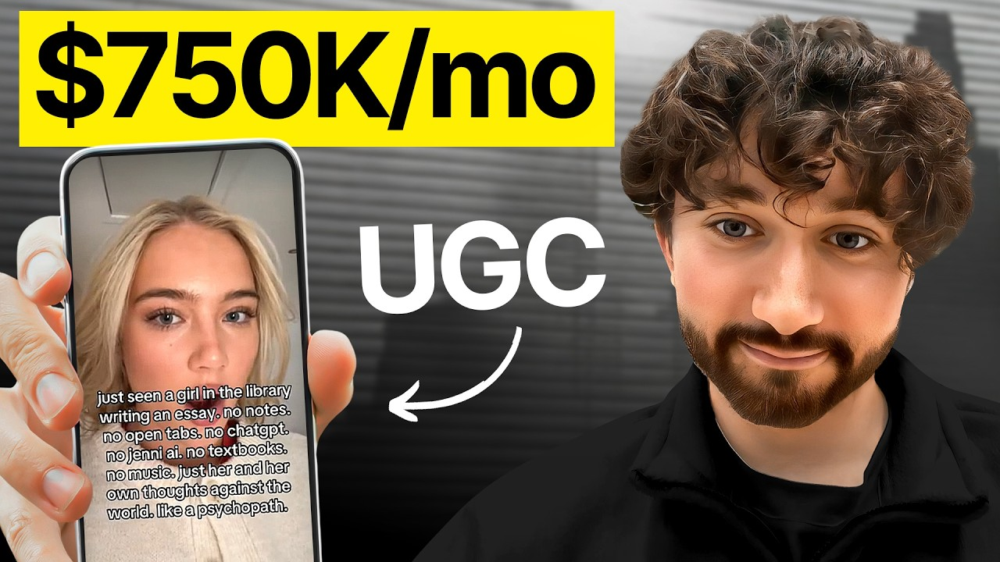

# Our app makes $750k/mo thanks to this UGC strategy

Start building & deploying paywalls in 10 minutes flat: https://superwall.com/

## Table of Contents

* [00:00:00] - Intro
* [00:00:26] - Who Matt is & how Jenni AI found him
* [00:03:05] - What makes Jenni’s product-led growth different
* [00:05:04] - 75M views, 150 creators & how the program works
* [00:07:03] - “Camera charisma” and Matt’s 3-part creator checklist
* [00:11:00] - Breaking down simple but highly effective UGC formats
* [00:18:33] - Matt’s first viral TikTok and why founders should be on camera
* [00:22:32] - Developing “viral sense” and researching winning formats
* [00:30:03] - Ruby’s 30M-view clip: engagement bait vs rage bait
* [00:36:05] - Writing high-intent CTAs that actually drive usage
* [00:40:32] - Learning from ecom & TikTok Shop creators
* [00:43:02] - Building products backwards from TikTok formats
* [00:48:02] - Why Jenni aqua-hires young founders
* [00:55:02] - How the acquisition process felt for Matt
* [00:56:36] - Next Steps

## [00:00:00] - Intro

On the pod today, we have Matt, who vibe coded a startup in 11 months and had never posted a Tik Tok before, but got his first video to go viral. Fast forward five months, and that startup got acquired by Jenny AI through an Instagram DM. 3 months later, Matt's now running Jenny's UGC [music] program. He's racked up 75 million views, managed 150 creators, and their program is getting under $2 per thousand views. And Matt is a huge reason why Jenny Aai is going to grow past 775,000 monthly recurring revenue and why it currently has five to six million users. [00:00:00 → 00:00:34]

## [00:00:26] - Who Matt is & how Jenni AI found him

Here's what makes Matt different. He doesn't hire influencers with big follower counts. He finds creators in completely unrelated niches, beauty, lifestyle, whatever, and spots something he calls camera charisma. >> I'm not looking at stats or anything on Mod Dash. I'm just going to their page, looking at their Tik Toks in a completely different niche and thinking we can work with that. [00:00:32 → 00:00:54]

When you build and foster those long-term deeper relationships, you're always going to do more and do better than if you're transactional. So, I think our ability to kind of trust our coaching and me trust my ability to kind of spot what makes a good creator, what I call camera charisma. >> Then he trains them from scratch to make content for AI apps. He checks for three things. how emotive they are, whether the first frame looks aesthetic, and if they're naturally extroverted yappers who can tell a story. [00:00:54 → 00:01:18]

One of his best creators had never done UGC [music] before. She was in the beauty niche, and it took her 25 videos before she got above 10,000 views. But last month, she made over $5,000. So, because of the other elements that are in there, you have some people essentially kind of agreeing with her rather than it being pure rage bait, I call it engagement bait. It's something that does divide opinion a bit, and you get something on both sides. [00:01:18 → 00:01:39]

And I think that is the sweet spot. And that's exactly how we got 30 million X views. >> In this pod, we break down Matt's framework for finding high potential creators that everyone else overlooks, how he reverse engineers viral formats from completely different niches and adapts them, and why he believes the future of consumer apps is starting with the Tik Tok format and building the product backwards from there. Let's dive in. This is the Superall podcast and I'm Joseph Choy, founder of Consumer Club. [00:01:39 → 00:02:04]

The members in the Consumer Club Discord and the founders I interview on the pod build apps at a median of about a million dollars ARR. In my conversations with dozens of these founders every week, one thing I've noticed is most of them AB test their pay walls to increase their conversion rates and make more money. Now, most people know that one of the best ways to AB test payw walls is Superwall. But one thing you might not know is Superwall has a lot of data on the thousands of apps that use their payw walls. So recently they actually put together a tool that takes 422 profitable paywall experiments and put those into a paywall experiment generator where you can upload a screenshot of your own payw wall and it'll give you an experiment idea to increase your revenue. [00:02:03 → 00:02:41]

You can use it for free at paywallexperiments. com. All right, let's get into the pod. So Jenny is at 775K Mr. It's pretty huge. [00:02:41 → 00:02:50]

One of the biggest kind of like AI rapper type of startups that I've seen. Do you think that Jenny does anything different or what do you think Jenny does different in growth from what you've seen? >> I think one of the interesting things about Jenny and and its growth is that it's actually quite productled in lots of ways. [00:02:50 → 00:03:08]

## [00:03:05] - What makes Jenni’s product-led growth different

So on the growth side, I'm kind of distinct from the product team, but they're they're deeply technical. It's a team of ML engineers that the head of product is incredibly talented. I've met him. So the product kind of goes really deep and that allows the kind of growth to be really sticky in that when you kind of acquire a customer they they stick around and I think short form has really always been at the heart of Jenny. So David um kind of CEO founder, incredible guy. [00:03:08 → 00:03:37]

Um him and Tabs Chocolate were two of the very first kind of companies to actually kind of pioneer short form before all of the the UGC and for you pages getting clocked. And so then kind of coming into it a couple years later with a very different short form landscape, it it's it's been really cool because it really is at the kind of heart I think of of Jenny's DNA is that short form social media growth. >> Do you think that Jenny does short form differently from other startups? Certainly in the past they were early. They were really early and innovative and I think that has carried over now. [00:03:37 → 00:04:10]

So one of the things we always try and live by philosophically with content is not just to mimic. And I think that's really not a bad strategy if you're trying to grow to 10K MR, 50K MR, 100K MR. But [music] if you want genuinely sustainable growth and you want to do that at hundreds of thousands of MR and hopefully in the future millions of MR, you need to be novel and you need to be innovative. And then you need the ability to distribute that through your network of creators and really amplify it. So there's always this emphasis on doing something novel, doing something new rather than just kind of finding best practice and executing that really well. [00:04:07 → 00:04:46]

We always want to try and go above that and be innovative. Do something new. >> Could you give some stats on how's the growth been in the past 3 months that you've since you've joined Jenny? >> It's been really awesome. We've gone from the program specifically where I started 0 to 75 million views at a less than $2 CPN. [00:04:46 → 00:05:06]

## [00:05:04] - 75M views, 150 creators & how the program works

We have gone from zero to in different forms, 150 different creators, and that's been incredibly fast-paced. It's been incredibly exciting. >> How did you get 75 million views under $2 CPM with 150 creators? >> A violent amount of effort is really the first thing I would say. Um, you know, we work 7 days a week, kind of at least 16 hours during during the workday. [00:05:06 → 00:05:32]

And I think that's that's something you kind of can't skip. There's always things you can kind of look past and and look beyond, but that's kind of the flaw. I think you're always going to be able to do more in 16 hours than in 8 hours. Then I think the thing that's been really important for us is how closely we've worked with the creators. One of our strongest creators had never done any UGC before. [00:05:32 → 00:05:50]

She was in the beauty niche. So I think our ability to kind of trust our coaching and me trust my ability to kind of spot what makes a good creator, what I call camera charisma. So I'm not looking at stats or anything on Mod Dash. I'm just going to their page looking at their Tik Toks in a completely different niche and thinking we can work with that and then kind of having the closeness with the creator, building rapport, building a relationship and genuinely committing to try and help them improve. When you build and foster those long-term deeper relationships, you're always going to do more and do better than if you're transactional. [00:05:50 → 00:06:24]

>> Yeah. You mentioned Mod Dash. There's like other creator marketplaces or influencer databases like that. and you're kind of talking about more of the art of the creator relationships and what can you see in the intangibles that the stats or the follower counts don't tell you what what what are those things that you look for in a creator that's high potential but you probably get better deals with that too, right? Cuz you're not going after the creator with the huge follower counts. [00:06:22 → 00:06:47]

You're going after the intangibles that you don't see on the surface. >> Definitely true that you get better deals. That's 100% true. um completely distinct to influencer in that way and also completely true that we almost don't look at stats at all. Um I think if you are going to look at stats there are ways of doing it but the thing that I always will call it and it is pretty intangible is camera charisma. [00:06:47 → 00:07:08]

## [00:07:03] - “Camera charisma” and Matt’s 3-part creator checklist

If they make a Tik Tok and it can be about anything, [music] how much do you want to watch it? How much do you want to listen to it? How much do you want to watch it again? And if you do, can you kind of answer why? Why did I enjoy that? [00:07:08 → 00:07:17]

Why do I want to watch that? Actually, I think if you can't answer that question, it's quite a good sign. if it was like a, you know, just a pretty random Tik Tok, some sort of trend that you're not that interested in and yet it still kind of piqu your interest, something's going on with that creator specifically. So, the less you can put your finger on it sometimes, the better that kind of camera charisma is. If you had to try to put like three traits like a checklist, someone's scrolling through Instagram or Tik Tok and they see a small creator and they kind of have a feeling ah this might be a good person to hire. [00:07:17 → 00:07:53]

What are what's like a a very small checklist that you would look for? >> I think the first thing is how emotive they are. You know, different people are naturally different levels, exhibit different levels of emotion, and you want someone that kind of naturally not monotonous, kind of up and down, super engaged with genuinely when they're telling a story, you're kind of engaged with it. I think second of all, if you pause the video on the first second, this this can be an interesting thing is is it kind of aesthetic? Is it appealing? [00:07:53 → 00:08:20]

Now, what this kind of proxies for is what is their natural viral sense? Often you can ask two creators film kind of a video and one of them just naturally is positioned nicely. They've got an aesthetic backdrop. The lighting is kind of right and you can really you can break down what what that means and go super granular but they just kind of know and they've got what I would call that viral sense. Whereas on another it's kind of dark, it's dingy, it's unappealing and creators often will do that naturally. [00:08:20 → 00:08:47]

I think if you particularly college students, uni students, they're not thinking too much about that very detailed setup. They're just picking up and doing what feels right. And I think probably just someone that is extroverted and a bit of a yapper. Maybe that's just who I enjoy working with as well. And I'm confirmation biing myself. [00:08:47 → 00:09:05]

But if someone sits down and is doing a story time and it's something crazy, I think that can proxy quite well. That was a really great checklist. I'm going to pull up Instagram right now and just like do a test. So >> the pressure. >> So okay, let's watch this random like first video that shows up. [00:09:03 → 00:09:20]

It's like a pet creator. Mhm. >> But even even just this, it's like what I'm noticing is this is a pretty aesthetic freeze frame. It's like it's framed pretty well. Both pets are in there's kind of like a foreground and a background. [00:09:20 → 00:09:34]

The background looks like very clean. The furniture is nice. >> It's super light as well. Like I really that is something you pick up a lot is >> how light is the overall shot and it's the colors. It's maybe they've used a ring light with the dog. [00:09:34 → 00:09:47]

I mean this is I think more the Facebook mom niche including my mom. Shout out absolutely loves this type of content. Um, but you you're absolutely right. You can see the principles translate around how aesthetic the shot is. You can see that there's kind of it's well cut, etc. [00:09:47 → 00:10:02]

Similar here, I think if you pause that first second, which I said before I even I mean, no one can check this before I looked at the number of likes. Look how light it is. She's well positioned. It's an interesting background. The other thing she does well is the size of the text on screen. [00:10:01 → 00:10:17]

This sounds really sort of small and if it doesn't matter, but the proportions are nice. The spacing is kind of right and often [music] you don't pick up on it, but if you see videos that don't get views, which obviously you naturally see less, the text is way too big or too small or it just doesn't feel right. So, actually, even the text contributes to the aesthetic and and that's her natural viral sense. >> That's so true. That's interesting. [00:10:17 → 00:10:42]

The sound is off for this one, but you can tell like this guy is emotive, you know? He kind of does the natural little chuckle at the beginning. The text again, like you said, is like right above his head and then his whole body is like framed in the center. Obviously, that's >> aesthetic. >> Yeah, different style of content, but kind of similar printing. [00:10:42 → 00:11:00]

>> The thing that stands out to me is like anyone can actually make this. [00:10:59 → 00:11:04]

## [00:11:00] - Breaking down simple but highly effective UGC formats

Even this video, right? anyone can make it cuz it's just a laptop, a table, and then he's just sitting there in his room >> and then he's just like acting, you know, touches his credit card. Like that's it. Anyone can do that, but he does it well. So, do you feel like um when you're going for these creators, you're going for someone who already knows how to make a video and acts well and frames things well and does look like good lighting, or are you like teaching them how to do it? [00:11:04 → 00:11:33]

>> It's often a bit of both. So, for example, the creator that you showed a couple of Instagrams ago, the kind of one that did the laugh, I would actually say if you kind of look at his first shot, it wasn't super aesthetic. Probably are things you could kind of improve that we discussed around the lighting, although he is decently lit. But the thing that really stands out about him, as you kind of touched on, is his ability to talk, how extroverted, his charisma. So, the more elements a creator has, the easier they are to work with. [00:11:31 → 00:11:58]

But what you often get and the kind of hidden gems are where a creator has one really exceptional skill and like you touched on the rest can be taught and learned really really quickly. And it's part of the thing about building creator relationships is I think if you run a program expecting in the first week a creator is going to get a million views, you're probably thinking about it the wrong way. Our best creator last month, it took her 25 videos before she got above 10k and she ripped. I think she made over five grand last month of something absolutely incredible based on bonuses we offer, etc. So, it was a two-way thing. [00:11:58 → 00:12:35]

She trusted in the coaching that I was giving her and I trusted in the natural charisma. She was and is super extroverted, really charismatic, and then [music] we tweaked the learnable things. Took a little bit of time and then it was pretty cool from there. This feels like the real alpha in influencer marketing or in like UGC creator UGC cuz everyone else is spam, you know, reaching out to thousands of influencers. At this point, anyone can do that. [00:12:35 → 00:13:02]

Like you can hire a VA or you can go on a database and just cold email everyone. But what not everyone is willing to do is find the high potential low follower account, maybe low engagement, but or maybe even someone from a different niche but who has the raw potential and then training them up like that. That's a huge advantage. You got 150 creators in the program [music] in 3 months. That's kind of insane. [00:13:02 → 00:13:27]

How how many creators did you have to reach out and negotiate to get to that point? >> A lot. is the is the short answer. Um we had 80 within the first month. I think I I [music] joined not even on the first day of August into August and my target was 80 in the first month which part of that is testament to you know the amazing culture that David and Jenny had have is that culture of genuine excellence because I would have told you up to half an hour before that deadline absolutely no way am I hitting 80 creators and then we did. [00:13:27 → 00:13:59]

It ties back to that amount of brute force involving effort. There's no way you can speedrun really reaching out to lots of creators. You can maybe send the DMs via an automated tool or a VA, etc. But the kind of thing about finding hidden gems is it's not a case of you go on to Tik Tok and everyone's a hidden gem. That would be very paradoxical. [00:13:59 → 00:14:18]

So, you have to be willing to spend the time doom scrolling and really kind of crawling through before you kind of do get to them. And I think that's true even of sourcing platforms. I think Nick at at Sideshift spoken a lot about it that they have a huge number of creators and even when people apply and you have applicants, it's still on the content team to go through them to pick out the hidden gems within those. [music] So, it's really a skill that there is no shortcut to or from. I feel like some people when they mass reach out to Instagram or Tik Tok influencers or creators, they're hoping for maybe a 10 20% response rate and then from there maybe a you know 20 to 50% people actually start negotiating or get on a call. [00:14:18 → 00:15:03]

Is that similar numbers or I have a sense that your numbers are maybe higher because you're selective with who you reach out to. I'd say our numbers may be lower actually in some ways and I think that may be because these creators are not influencers. They're not regularly checking their DMs. When they do get DMs, it's often from, you know, those jewelry brands, etc. on Tik Tok that aren't kind of real and they sponsor you, but you pay for shipping and they're basically, I won't say scams, but they're not proper kind of outreach. [00:15:03 → 00:15:33]

So, a they don't check as often and b they're kind of much more skeptical. They may have never had a brand deal before. So I would say our rates were lower. I think generally when when I got [music] on call with them, the closing rate was quite high, but initial response rate and kind of response rate to getting on call rate probably lower than that. >> It's like the product is really good. [00:15:33 → 00:15:54]

It's like the trust is completely there. But in order for them to even open the DM or get on the call, a huge amount of skepticism has to be overcome. So how do you do that? Do you just write like a really fire like first cold DM? You're always trying to kind of drop as much social proof as you can. [00:15:52 → 00:16:09]

You know, Jenny's got five, six million users, our creators have done XY Z, but you also kind of again because we particularly work with unique college A students, you know, you're trying to do it all in lowercase because that's kind of what they respond to and you're trying to be super casual. So, it's a combination, I think, of social proof and genuinely just being reasonably personable and relaxed. I think people are genuine generally intuitive enough to be able to tell whether someone is genuine [music] um or whether you know it's a pretty icky DM. >> Uh it kind of reminds me of um I mean look at look at my cold DM to you. >> Uh I just pulled up >> this is all I said. [00:16:09 → 00:16:50]

Would love to have you come this profile. Like no no no links nothing all lowercase. I feel like there's so many cold DMs these days, especially like even if you just look at I mean, let's look at my message requests. [music] It's like, well, some people do that. >> That's annoying. [00:16:50 → 00:17:06]

>> And then some people do that or it's like too much. Here's an exact a perfect example. It's like, hi, we just helped a Forbes executive 11 figureure stock exchange in the largest protein brand make more money here. I just looked at your account. I think we could have insane impacts and revenue. [00:17:03 → 00:17:23]

It's like vague. They put a bunch of social proof, but the social proof is also vague. It's like I think very very specific social proof is helpful and keep it very short and casual. Actually, your cold DM is a good example of is part of the I mean if if I didn't know kind of who you were and I clicked on your profile and you had 10 followers, I'm not replying. And I think there's an element of how you kind of frame everything and you pitch everything and how good the message is. [00:17:23 → 00:17:50]

Part of it is having a genuine track record and doing cool things before you do this. It is easier now to reach out to creators that we have 75 million views and I can link creator accounts than it was getting the first 10. Well, we don't really have any UGC. I can't point at anything. So, go out and build something cool and do something cool and get a genuine track record you can point out to creators or to whoever you're called reaching out to and things will be easier. [00:17:47 → 00:18:14]

For a lot of people that might be founder-ledd content because otherwise you have the chicken egg problem of you can't reach out to creators if you don't have the social proof of already having some traction on social. So would you recommend people start with founder just pick up the phone like make a Tik Tok >> 100%. So I when I grew my own startup I didn't work with any creators. [00:18:14 → 00:18:36]

## [00:18:33] - Matt’s first viral TikTok and why founders should be on camera

I made all the content myself. Some of that was me some of that was kind of utilizing clips from friends and family. But the very first video for my old startup, which was Sideshore, went semi viral, couple hundredk views, it was me talking at my phone, and I'd never made a Tik Tok before that, and it was the most one of the hardest things I've had to do. It was horrifically cringe filming it. I can barely watch it even now. [00:18:36 → 00:18:58]

But you got to do it because if you're not willing to do it, it's it's also hard, I think, to expect others to do it. And I think I would not be anywhere near as good at my role now if I hadn't done it myself. It's very difficult to tell creators, this is what works, this is what doesn't work. and judge what works and what doesn't work if I hadn't done it myself. So, it's a huge skill, not just for that initial phase, but also as you go on and on and on, it really compounds and it becomes an immensely helpful superpower. [00:18:58 → 00:19:23]

>> Could we could we look at that video? Is it on Instagram or Tik Tok? >> It's Tik Tok. If you Tik Tok and then just search site, ci the pinned one on the right. So, 245. [00:19:21 → 00:19:37]

6K. 9th of December 2024. 8th of December. Wow. Okay. [00:19:37 → 00:19:43]

So, yeah, December 2024, this was your first ever video that you posted to Tik Tok >> ever. We had I'd posted five memes before then, which were terrible. And I was like, I've got to make my first video. And And this was it. >> And it got 240k views. [00:19:43 → 00:19:59]

>> Yeah. And it >> that's really that's a lot. >> Incredible. I remember where I was when it hit 100K. It is just the most amazing feeling, which is another reason people should do it. [00:19:58 → 00:20:09]

I think >> I think that kind of shows like it's kind of all in the hook and the subject matter. It's like if it's a good you're speaking to the painoint and it's a good hook, you can get a lot of views on the very first video. Okay, let's just watch a video. I want to let's see like what we can learn. [laughter] >> A website called I have an essay due at midnight and chat GPT won't stop giving me fake citations. [00:20:09 → 00:20:34]

com. And this website is for when you have an essay due at midnight, but chat GPT won't stop giving you completely madeup citations. Basically, you just upload all of the citations that Chat GPT has given you, and in seconds, it tells you which of them are real and which of them it's completely made up. What it also does is it uses AI to suggest real replacements for the fake papers. And this is also super helpful for passing AI detectors like Turn It In. [00:20:34 → 00:20:58]

But if that sounds like it might be useful or maybe you have an essay due at midnight, go to I have an essay due at midnight and chatgpt won't stop giving me fake citations. com. Put a shorter link in the comments. >> I'll put a shorter link in the comments. Interesting. [00:20:58 → 00:21:14]

Wow, that's actually a really good video. It's like I've seen this format a couple of times where it's like the really long like comically like long URL. >> What was your thought process in in making this video? I think when you are just first starting out and if you're like me, you've never made a video before, you know, you've got a MVP that's completely vibe coded. You do not need to reinvent the wheel with content at this stage. [00:21:14 → 00:21:39]

You don't need go from zero to 1kmr by inventing a completely new format. Find what works kind of have the ability to introspect on your own strengths and kind of imitate/ adapt. So it was this I didn't pioneer this format like you say it was out there but you know I was able to adapt it to my own to my own tool and adapted a little bit with it was wasn't completely ripped word for word. It was taken as a format and adapted and yeah I think don't watch it back a year later. That's also the advice I properly got because it's it's a tough watch. [00:21:39 → 00:22:11]

But um yeah you don't need to reinvent the wheel but get yourself on camera. I know a lot of people try to start with things like carousels etc. you're just in, at least in my opinion, doing something like this is going to bring you massively more beneficial results in the short term and in the long term. So, pick up a phone, get in front of it, no matter how terrible it feels. >> How do you recommend people find those winning formats if you are just getting started and you don't want to reinvent the wheel? [00:22:11 → 00:22:37]

## [00:22:32] - Developing “viral sense” and researching winning formats

you probably were kind of in the space cuz you were researching uh stuff in that like AI student tools niche, but if someone's in a different niche, um how would you go about like doing the research? So, I think you want to develop what I call viral sense and it's links to some of the stuff we talked earlier where you can look at a video and kind of think has this gone viral or has it not and judge that reasonably well. And I think you want to essentially doom scroll almost prescribe doom scrolling. And I think half of that should be in your niche. So for me it was study and I spent half an hour a day scrolling on a phone specifically for studying. [00:22:37 → 00:23:15]

And then I think you should spend half an hour a day explicitly scrolling outside of your niche because you're always going to become a little bit blinkered if you are only looking at the same formats that exist within a very narrow scope. look at things that go viral elsewhere and learn how to adapt those and kind of adopt them into your niche. So, I think half and half is actually really important right from the start. That's good advice. As you're scrolling, just thinking about what made this viral. [00:23:15 → 00:23:41]

There is a shortcut that I I've been showing people spy talk. Have you seen this this website? >> I haven't seen it. >> It's basically like you can search the the content by like keywords. So it's like I don't know you're making a app about anxiety and then it finds you like outliers. [00:23:41 → 00:23:57]

This is kind of like the shortcut where you like find the best formats that you know this is like 5. 7x is like 7. 4x and some of these are by brands. Some of these are by like hidden you know like hidden brands that like looks like a person but then it's like a it's like kind of clearly a brand account. But yeah, this this is useful tool as well. [00:23:57 → 00:24:17]

But if you only use spy talk, you're also not 100% developing viral sense because you're not looking at the ones that don't work. It's like it's important to see like to actually scroll TikTok yourself as well and see like which ones are, you know, how to separate like what makes this viral versus this one didn't go viral. >> I think it's also a risky game to just look at outcomes, particularly with Tik Tok. You know, you're at the mercy of an algorithm which is notoriously based on serendipity. And of course the outcome of a video matters and getting views matters. [00:24:17 → 00:24:46]

But if you only and strictly look at the outcome, you will be quite surface level in your understanding. We I was looking at a video two videos the other day that I can pull up if helpful, but they were almost identical. Same script, same creator, 3 days apart. One of them got 2,000 times more views than the other. And you can you could spend hours trying to say what was the causal factor? [00:24:46 → 00:25:07]

What was the 1%? The answer is it was luck. and everyone has to benefit from that luck. And you your aim is to optimize your surface area for luck. But >> strictly looking at the outcome, I think is a >> bit of a fool's game. [00:25:07 → 00:25:23]

>> Those small nuances are pretty interesting cuz a lot of people like they might go through this whole process. They'll find some creators that are high potential but not super viral yet, but they have good, you know, camera presence. They're emotive. They have good aesthetics. But then when it actually comes time to telling them, okay, now use this viral format and copy it. [00:25:20 → 00:25:44]

A lot of people don't know exactly how to copy a video frame for frame, second for second, pixel by pixel. There's very very small differences that contribute to luck. So are you trying are you giving people free reign to basically say like make a hundred variations of this one video and one of them will go viral? I think probably it would, but I don't think that would be down to whatever change was made in that video. I think assigning causality to that would not likely be accurate. [00:25:44 → 00:26:14]

I also personally don't think that trying to copy it frame frame for frame is the right thing to do. We've had people actually copy some of our creators videos down to them going out purchasing outfits that look as identical as possible and filming in front of the most identical background you can imagine. I've got still images that I I won't share to because I don't want to sort of call the brand out, but it was somewhat creepy. I will say it was it was really really quite odd and they didn't go viral and you cannot get closer to frame by frame than than [music] that. I think what I would say is understand the principles, understand the concept, but also try and iterate. [00:26:14 → 00:26:50]

This video was really good, but why can't I make it better? What's the one thing that I would change to make it better? So rather than thinking what's one kind of tiny element I can copy even more closely, think what's one element I can do better than that person did. And if you do that a hund times, you're more likely for one of those variations to go viral than if you were just purely copying. >> I feel like your brain is like the final boss of AI jobs being replaced. [00:26:48 → 00:27:18]

like it's so hard to fi to to replace this kind of um tweaking like mechanism with AI because you basically have to find dimensions within a video and [music] isolate those dimensions and then decide which one you want to tweak. It's like do I want to make the lighting a little bit different? Do I want to make the tonality of the hook a little bit different? And there's infinite dimensions that you can switch around, but it's about choosing the right ones and then choosing like how much you want to shift them. Would you say that's like an accurate way of putting it? [00:27:18 → 00:27:50]

I think that's a really good way of putting it actually. I think talking about it in terms of dimensions is a really useful way because it because it is incredibly multi-dimensional. I'm essentially just repeating what you said here. So, I'll kind of cut myself off and just say I think that's a really salient way of putting it. >> Can we go to some of the Jenny videos now and see? [00:27:50 → 00:28:07]

Um yes. Do you is it mostly Tik Tok or Instagram? >> So we have creators cross post but most of our success has been Tik Tok. I think we had one creator that if you search is Ruby Ruby. st study corner. [00:28:07 → 00:28:22]

The thing that was amazing about this creator actually it might be better if you go on latest um rather than popular and scroll all the way down because this creator's first two videos um you made stuff for social as well. Those were the first two videos on a brand new account and particularly the second one got the second one got 30 million completely organic views on Twitter. Someone screenshotted it and sparked a whole debate. Literally just this a 5-second clip. But one of the interesting lessons of this because these this sty of video has been they've tried to people have tried to imitate it a lot is there's actually quite a lot in the clip even what seems to be a super casual clip that makes this creator incredibly talented and has contributed and I think you can assign some degree of causality too because we've seen it repeated in future viral videos that really makes a difference. [00:28:22 → 00:29:11]

>> Interesting. What are the elements you feel like went into this? So some things that we know for example are that she's very emotive with her eyes which sounds incredibly small and niche but is a pattern as I said we've seen repeated and one of the advantages of working at the scale we we do is that we can really test these hypotheses really directly and we have enough data to kind of almost run hypothesis tests and we've absolutely seen that that the more emotive you can kind of be with your eyes the better these videos tend to do and some of it I can't tell you 100% Why, you know, Ruby has consistently been an amazing creator for Sideshaw, for for Jenny. She has a knack is maybe the best way of putting it or her aesthetic is kind of geared for Tik Tok. Some of it I can tell you I think I know and some of it like I said is factor so small we don't understand or serendipity. [00:29:09 → 00:30:03]

>> So this is a 5-second video. [00:30:01 → 00:30:05]

## [00:30:03] - Ruby’s 30M-view clip: engagement bait vs rage bait

It's the the format is basically hook reaction like the surprised face but with instead of going straight to a product demo which some of the other videos do, it's just text on screen. So it's a block of text that's kind of long. So it probably takes you like at least 15 seconds to like read the whole thing. So you get like three repetitions on the video like the 5-second video, right? And then it includes the word Jenny Aai in the text. [00:30:05 → 00:30:33]

So, you know, certain percentage of people are going to go and then look up what's Jenny Aai. And then the premise of the video seems to be okay. So, she says just seen a girl. So, she's like has a surprise face and she says just seen a girl in the library writing an essay. No notes, no open tabs, no chatg, no Jenny Aai, no textbooks, no music, just her her and her own thoughts against the world like a psychopath. [00:30:30 → 00:30:55]

So, it's interesting. So, she's saying basically the premise is like it's almost like um rage bait. Like people in the comments, there's like 3,000 comments and people are just roasting her in the comments. Like that's >> the thing is I actually think it's a little bit we're very deliberate about this because this was I kind of essentially wrote the overlay entirely. It's not quite rage bait. [00:30:55 → 00:31:18]

It's engagement bait. And and the the somewhat difference is that I don't know if if these are Tik Tok comments often show up in different orders, but >> you got a lot of comments that say like, "What do you mean psychopath? This is completely normal. There you go. That's how I got a hold of K. [00:31:18 → 00:31:30]

Are you okay? Are you American by any chance? " But there were quite a lot saying, >> "Yeah, just there from Marissa, the no tabs and music are what make this crazy. " >> So, because of the other elements that are in there, you have some people essentially kind of agreeing with her. Maybe not with the fact the Jenny Aai point, but just the fact that wait, she's kind of right. [00:31:30 → 00:31:48]

like why is everyone focusing on this the AI part she was had no textbook and no open tabs that is really weird which she's right and there you go almost 100,000 likes on that sort of almost supportive comment and >> right interesting I see >> rather than it being pure rage bait it is this I call it engagement bait but you know it's something that does divide opinion a bit and you get something on both sides and I think that is the sweet spot and that's exactly how we got 30 million X views The initial screenshot and tweet was saying, "This is ridiculous. I can't believe what's happened to kids these days. " And then the quote tweet that got 15 million views was saying, "You guys are ignoring the fact that the girl wasn't using any open tabs or music. Like, why are you flaming her? " And >> it's a it was just the most perfect example of why if you can hit that sweet spot, it's better than just pure rage bait. [00:31:48 → 00:32:41]

>> Right. That's that's a great point. It's It's about polarization. It's better to divide people into somewhere around half and half. Like some people that are going to take the bait and say, "Wow, this is ridiculous. [00:32:39 → 00:32:53]

Why? Like your point is invalid. " And then the other half are saying are siding with the creator, but also kind of fighting against the people that took the bait. Like it's almost like rushing to the defense of the creator and saying, "Why is everyone uh roasting the creator? This is having no tabs in music while you're studying. [00:32:53 → 00:33:12]

That is crazy. " And that that's the one that got the most likes actually on this on in this comment section. 95,000 likes, no tabs and no music. So what makes us crazy? That's interesting. [00:33:11 → 00:33:24]

How do you think about making a polarizing concept? A lot of it, I think, is actually emotional intelligence. You just got to have the ability to kind of sit and come up with, you know, what is salient and at the moment, what are people talking about and how can I make sure it's adapted to my niche is another point. And I think one thing we took away from this is we could maybe plug Jenny better, which I think we did in in future future viral ones in terms of conversion because that's the other thing you got to keep in mind is views are great. Sure, but you don't want to be getting vanity views. [00:33:24 → 00:33:54]

A viral study talk that didn't mention Jenny is completely useless. Completely useless for us. So, you're always trying to balance that. Um but yeah, I think it is just the emotional intelligence to kind of land as closely in the middle of as many angry people as you possibly can. Um obviously keeping up with kind of current topics is important, but from there it's just I think emotional intelligence >> that is kind of encouraging actually to a lot of people I think because I think a lot of people are pretty good marketers and they know how to do other channels though. [00:33:54 → 00:34:27]

So they've figured out like Facebook ads or ASO, you know, like with any form of marketing, you do need to have a sense of what people want and like the psychology of how people go throughout their lives and make choices and, you know, their thoughts and feelings. I feel like people get tripped up on TikTok specifically because they think that it's Gen Z or it's too young and they they just don't understand the trends. To some extent, that's kind of true. Even with this video, it's like the fact that I mean a a 40-year-old, I don't know, maybe not like a 30-year-old even might be out of touch with like college culture nowadays, right? They'll look at this and they'll be like, "Oh, I didn't know people don't know how to focus like without headphones. [00:34:27 → 00:35:08]

" Like, I don't know. I didn't know people have like a million tabs open in the library. So, do you think that you kind of have to be your niche in order to come up with good concepts? >> It helps. Of course, if you go into it with an understanding, it can't be harmful. [00:35:08 → 00:35:21]

But I really do believe it can be learned. I was at a very niche UK university. I was at Oxford where a lot of these things do not apply. And you obviously I was in Union college culture, but still a lot of things I've written since are about American college culture and >> things that I didn't experience firsthand. And I just believe you can learn it. [00:35:21 → 00:35:43]

I think if you immerse yourself in it and like you say psychology incredibly it's incredibly important and it's also underlying it's more of a principle and if you can observe and understand and be thoughtful about it I really believe you can learn it >> that's great let's look at the most viral video on her account >> the second one the 1. [00:35:43 → 00:36:05]

## [00:36:05] - Writing high-intent CTAs that actually drive usage

5 million is another really good example of what we just spoke about huge amounts of what we just spoke about you can kind of see in in this Our professor just said, "If I even think Chat GPT wrote your essay, you get a zero. Whole class goes silent. If I see a single Oxford comma or fake citation, it's a zero. " Chat, I am begging you to please use a humanizer for the grammar and Jenny for the fake citations. Do not risk your whole degree for Chat GPT. [00:36:05 → 00:36:33]

It doesn't love you back like that. Wow. That is a That's good. That's good copywriting. This is this is packed with with every single line has like like something emotional in it, you know? [00:36:33 → 00:36:45]

It's like the fact that she says chat is like pretty funny. >> I feel like people >> and this is these are written verbatim by me. >> Yeah. >> So, this is I know Ruby in real life and um >> she kind of >> How would you recommend finding someone like you to write things like this? whether it's writing for the same text on screen format or it's like scripting UGC talking head concepts or other things like is there an archetype of a marketer or writer who knows how to come up with these types of concepts. [00:36:45 → 00:37:19]

I think I'm biased because of my own experience, but I think if you're a company large enough, I really believe in aqua hiring young founders because I think if you go for a pure creator, which I'm not, and you know, David took a massive sort of show of faith in me, not just being a pure marketer, all of this fundamentally, everything we're speaking about is the purpose of it is to drive revenue. And if you get someone that just understands being creative and that's all that they kind of know, I think it can be hard to teach that element of conversion. Whereas if you get a young founder that has had to do this for their own app, been super scrappy. A, they understand that whole flow, but B, there's no kind of survival pressure like having to do it for your own startup. It's sink or swim. [00:37:19 → 00:38:02]

You either write good copy and your startup grows or you don't and you don't get any views or or revenue. So, I really believe in that as a method. >> That's so true. People have this misconception that viral sense is all you need. And the people who have the most viral sense are just random college students who are in the culture. [00:38:02 → 00:38:22]

And that's true cuz they'll know how to write stuff, but they won't know how to get the revenue like optimize for conversion because you don't want to just get a bunch of views. You want to get views that actually convert. And I'm very sure that this video converted at least a few people. This one is is an even better CTA actually in my opinion than than the the most viral one. Like it got less than half the number of views, but I would predict that it probably got more conversions because it's saying that she says, "I am begging you to please use a humanizer for the grammar and Jenny AI for the fake fake citations. [00:38:22 → 00:38:55]

" The one that got more views is just saying it's insane that I just s saw this girl who doesn't use any of these normal things including genai is a much higher intent on the on the lower viewed video. Actually, >> 100%. And when I said before that I think we got better with how we plugged it. This is a good example. Not every viral video you're going to make is going to be perfectly in the sweet spot between verality and how hard you plug your your product. [00:38:55 → 00:39:19]

And all you got to do is learn from that. If you fall too far one side or the other, you just got to adjust. And you can see the comments. They're not raging at the creator. They are talking and really having a kind of debate about what do you mean an Oxford comma is seen as a as a signal someone's used AI. [00:39:19 → 00:39:34]

I've been using an Oxford comma since XY Z. You know, you get a little bit of write your own paper. But that's part of the course. And yeah, >> that's another good example of engagement bait rather than rage bait. >> That's really interesting to go back to what you your advice before. [00:39:34 → 00:39:49]

You said how to find good talent is to just acquire young founders because you know they're like fighting for survival and they don't just have like creative instincts. Kind of reminds me of what I've been telling people which is go on Tik Tok shop and like hire Tik Tok shop creators >> because they're fighting for their lives too. They're getting commission on the views that they get. So they can't just go viral. They have to >> they get affiliate revenue based on how well the videos convert. [00:39:49 → 00:40:15]

So, it's a little bit different because I think Tik Tok gives like a boost to Tik Tok shop videos. There's a little bit of like artificial like boosting there, but still like you want to find people that are that have a business basically business sense, not just like creative sense. >> Agree. And I think another lesson that is that you can learn from everyone. [00:40:15 → 00:40:38]

## [00:40:32] - Learning from ecom & TikTok Shop creators

I think maybe it's easy to be pious if you're in SAS about people that are in apps and if you're in apps you could be bi you know pious about people that are in drop shipping or are in Tik Tok shop but there's a huge amount you can learn from them from everyone and it and the more you kind of open yourself up to that there are tactics from Tik Tok shop and from you know black hat ecom affiliate a world that I don't know really I don't really know how it all works but we can all learn enormous amounts from them and a huge ability to innovate is taking something from a different context and applying it in a completely new one. Um, so I think that's something I really believe in philosophically as well. >> This is basically why I created Consumer Club. Like I spent a lot of time in SF and I was like working at Google and I had these startup friends and they're doing ventureback startups and for some reason I was always into like drop shipping [laughter] and like these like internet money like tactical stuff and that was my whole world and I would talk about that stuff with my friends and they just wouldn't get it at all and I was like this is weird like I feel like the worlds need to combine a little bit more. It was just like perfect timing. [00:40:38 → 00:41:49]

It was so weird. Like last year, consumer apps kind of started to blow up. Well, Jenny Aai was before that, but kind of people saw Jenny AI and then they started piling on and getting into the consumer app space. And now some of the best consumer founders are the ones that learned from e-commerce or they like literally directly came from e-commerce and started app businesses after you know finishing like exiting an e-commerce business or having some success there. So that's my goal with consumer club is to kind of combine those two archetypes of people. [00:41:47 → 00:42:22]

So we have like half ventureback people but then half bootstrap. So there's like these MR stacker type mentality of like let's just make a bunch of money right now. It's all focused on conversion. And there's some people who are like thinking about the big picture and like thinking about the tech. I think like to make a successful consumer startup, you kind of need both and [music] combine those two worlds. [00:42:22 → 00:42:41]

I think again links to a point you said earlier about psychology. If you know how to sell to people and you know how to resonate with people, it doesn't matter if it's through meta ads, if it's through Tik Tok shop, if it's through apps or anything else. What a what an immensely valuable skill that is. >> Another concept I wanted to explore was you got acquired by Jenny AI and when we looked at your original viral video, it was it was almost like destined to get acquired by Jenny AI. [00:42:41 → 00:43:12]

## [00:43:02] - Building products backwards from TikTok formats

When you look at like, hey, I made a website called I have a essay due at midnight and chatb2 won't stop giving me fake citations. Like Jenny Aai is an AI essay writer and you were basically solving even more niche problem than Jenny is which a Jennyai is a AI essay writer but your product was specifically with citations. It helps you make better citations also using AI. You agree it was like almost like destined to be to be acquired by Jenny A. And also would you recommend this path for beginner entrepreneurs like people who want to get their first win almost to like like choose a really cool startup that you that you see and then almost like niche down further and then just copy it but then just almost like make a feature for that startup but as your own startup. [00:43:12 → 00:44:03]

>> I think it does feel a bit like fate and I think part of that though was how I was acquired. It was completely it was through Instagram DM. They didn't DM about acquiring. It was about something completely different and it was the most unserious way an acquisition conversation has ever started. Um, so that made it feel a bit like fate. [00:44:01 → 00:44:20]

I think the interesting thing is Jenny's product. So it's AI that writes essays with you rather than it writing the essay for you. [music] And they'd already solved fake citations. So they didn't acquire this really in any way based for product. It was essentially in the end an aqua hire. [00:44:20 → 00:44:36]

But it definitely resonated. It's a problem that they understand. I've drilled down exactly say on a really specific element of it that they a problem they really understand a solution they understand and it makes it much easier to have that conversation. Um would I recommend it? 100%. [00:44:36 → 00:44:49]

I I'm sure I'm biased by my opinion and I think the most important thing is the culture of the startup that would be buying you. So it's kind of weird that I almost in some ways became an entrepreneur and a founder so that I wouldn't have to work as an employee and then really soon after that became an employee again. It really is just testament both to the Jenny team and product but for me a massive part of it was David and it's the amount I've developed because of him personally is extraordinary and I'm a big believer in people really really big believer in the people in your close circle and the people you go and chose choose to work for. So pick a cool product and drill down on a niche but when it comes to that decision about do I want to do this? Do I think this is a place for me to learn? [00:44:49 → 00:45:31]

What's way more important than the product of the startup is the person you're going to be working most commonly with. The person that's going to be kind of the one you're learning from, the culture that they set. That is the most important thing when you should be deciding, do I want to kind of learn in this environment or keep being a founder over this time? I feel like I've heard that from other entrepreneurs like screw corporate, I'm not not going to work on a at a job. [music] and then they build a business and they end up working at a startup, but it's not quite what they it almost feels like they're going back on what they said, but it's not quite going back on what they said cuz like I feel like as a founder, you're figuring out everything on your own and you're the domain expert. [00:45:31 → 00:46:11]

You're the one who has to know everything. And [music] then when you transition from that to working with a founder that you really respect, then it's like now you're learning from someone who's ahead of you. It's a similar feeling because you get you get to do similar stuff. You're no longer like the smartest in the room. Like you're you're now like learning from other people and that's like also like a cool feeling. [00:46:11 → 00:46:33]

Are you hiring right now or or like what types of people do you >> uh >> talented UGC creators? Always hiring talented UGC creators. Anyone we'll we'll talk to you. We'll train you. We're great. [00:46:33 → 00:46:47]

I promise. >> Great. Yes. Work with Penny. I I mean if I was UGC I would I mean I would work I would work for Jenny. [00:46:47 → 00:46:54]

I mean this is interesting cuz a lot of times I interview founders and then I go like deeper into the product side or a little bit into the product side and like the monetization and stuff just as the growth person I guess do you touch the revenue side or the product side at all? when I was a solo founder obviously and they're very intricately linked which I think is a really good experience as a growth person again that end funnel of how does because product and growth are completely tied in [music] and so understanding that that end to end is really valuable I don't really touch the Jenny product again because it is so deeply technical it's actually incredible and far beyond my understanding what I will say is over the next few months we're doing an experiment where we are taking a study tool more from scratch where I'm able have input directly on product where we're starting with the concept. So I'm looking at formats on on Tik Tok and social media and I'm saying this hasn't really been done in study at all but if we had a feature that did this we maybe could and I think that's really exciting and will be a very fun experiment to keep an eye on because it's almost working backwards from what you expect. You expect that product drives growth and verality but flipping that on its head I think will be very fun. [00:46:54 → 00:48:08]

## [00:48:02] - Why Jenni aqua-hires young founders

>> That's really interesting. Are you optimizing it for Tik Tok? Like almost reverse engineering what's going to get views and convert on on short form. Starting with something as specific as a format. There's a format that I saw that's being used in a completely different niche. [00:48:06 → 00:48:23]

And I said, there's got to be a way we can adapt this. There's got to be a way. It's such a good format. Um, and I spent some time thinking and I said, I think this is a product that would work or a feature that would work. I said, can we build it? [00:48:23 → 00:48:35]

They said, "Yes, we're building it. " And so, not not even just starting with verality, starting with something as specific as a format, um, and working backwards from there. That's so cool. I think this is the first time in history that you've been able to almost spy on product market fit. It's like you can see other people's video stats. [00:48:35 → 00:48:58]

Like, that's insane. Like, you can't you couldn't do that in the past, right? There's no medium that allowed you to just publicly view other people's marketing performance like daytoday. But now you have like these like almost hints of product market fit all over the internet. Like every time you see a viral video, it's like a hint of product market fit. [00:48:58 → 00:49:17]

It's like content market fit. And it proves that there's people in that niche that have that painoint that seem to want some kind of solution. And it it's also like content market fit. It's a It's proof that this type of video will get a ton of attention. And if there's a lot of comments and it's high engagement, then maybe like high intent attention. [00:49:17 → 00:49:39]

>> And do you have does the person watching have the viral sense to say this plugs it really hard? It's got a demo in, but >> the demo feels really natural because it's >> tied into the verality of the format. >> So that viral sense that you develop lets you be a better spy on the content than if you're just looking purely at how many likes it has. Cuz as we said earlier, it can be misleading. But if you can understand why and you can really get deep into it because of your viral sense, you're a pretty good spy. [00:49:37 → 00:50:08]

That's actually a really good way to think about content in general cuz this video is almost like it feels like marketing. And it's like obviously like at some point you could potentially believe that this was completely organic where this is literally just a random college student who made a random website you know on because they just felt like it which to some extent it kind of is like but it was like slightly manufactured as opposed to like the Ruby videos. Those videos at one point I think were completely organic like the face like reaction with the long text. It's a real organic format. Like regular people who don't do organic UGC or work on apps, like they just make content that's like this because I think a lot of people on the service, they'll watch this video and they'll be like, "Okay, this is the text on screen with face reaction in the back um format. [00:50:06 → 00:51:01]

" But this is a format that marketers studied from real people who make real content on Tik Tok [music] and then are copying it to make it look organic. But in order to find and be the pioneer of that format, you have to go out and find these real organic. It sounds like you've found that. I I'll let you gateep it cuz you don't want to put it out there yet. But there's organic videos out there that probably kind of plug a product in a really subtle way that is completely organic and you can take that format and then just turn it into a marketing format. [00:51:01 → 00:51:38]

Wow, this is such a great breakdown of marketing. I feel like a lot of people copy formats. It's not that easy of a skill actually. copying like like stealing like an artist and like getting the sense of what should you be copying is actually like very very valuable skill but then the step beyond that is like what is marketing at its core how do you get better as a marketer this conversation was like super helpful just diving into your mind and and learning those insights I think another thing as well as it's just look touching I guess to end on on Ruby is the importance I think of being personable so she's been broken found quite a lot on on Twitter and as a result quite a lot of people it's fetting quite a lot of brands have messaged her asking if she would make content for them instead and she said yes to none because one of the principles that I lead with and I think every good marketer should lead with is with your team with your colleagues with everyone build rapport don't you know treat the people that you're working with as team members not as these kind of discardable numbers and it will all just be so much better cuz people get confused like I found a great creator if you worked for a month or whatever and then she just left. There's so much competition at the moment. [00:51:35 → 00:52:50]

You have to emphasize whether it's the marketing side or the people side, retention side, people be people led. I I believe that really strongly. >> That's awesome. And just it's probably just more fun too. Like you you want to work with good people. [00:52:50 → 00:53:03]

>> Yeah. >> 100%. >> Nice. Is there anything else that I that I forgot to ask or that you wanted to share? I don't think so at the moment unless you want to see the the actual DMs from the acquisition which are quite funny. [00:53:02 → 00:53:16]

>> Oh yeah, let's look at it with the Yeah, show me that. >> So, this was on an account that kind of I was running but had the clips of a friend and family. So, Jenny thought it was a creator reached out and this is literally you can see it took it took four months from or 5 months from February to to when it actually happened. I I challenge anyone to find a less serious start, cold start to an acquisition conversation than one that uses the eyes emoji. [laughter] That's so funny. [00:53:14 → 00:53:46]

Hey, hi. Hi, Becca. That's the name of the creator. I saw you create Oh, this is from the Jenny account. Jenny account messaged you and says, "Hey, saw you create content for Sitechure. [00:53:46 → 00:53:54]

Happy to partner with you. " So, they're trying to poach your creator. And then you say, "Hey, I can actually [laughter] do do you one better if you're looking for an acquisition. " Eyes emoji. Tell me what you have in mind. [00:53:54 → 00:54:07]

Another eyes emoji. [laughter] And then you kind of say, "Hey, I like we're we're a big fan of what you do. You've been a big inspiration. Love to talk about partnerships or even being acquired. " Oh, wow. [00:54:07 → 00:54:20]

And then Jenny AI says, "Is he free right now? " Our CEO says he's free for the next hour. And then did you actually get on a call with David? It was the next day, but it was um I got on just straight on a call with David. Um yeah, and it all went from there. [00:54:20 → 00:54:33]

He's >> That's awesome. >> He's incredibly skilled in so many ways, but he does this a lot where he says, "Are you free right now? " And I think it's a great trade. Um but no one knows who from Jenny's side wrote those DMs. No one's claimed it. [00:54:33 → 00:54:46]

David says he doesn't think it was him, but it's possible that essentially me and him were having this conversation entirely in third person, which is also a very funny way of uh of it all going down. >> I love it. That's awesome. That is so cool. What was the acquisition like? [00:54:46 → 00:55:05]

## [00:55:02] - How the acquisition process felt for Matt

>> Challenging, I think, in in in some ways. It's um as kind of a young reasonably up to that point scrappy founder, you've suddenly got to go through this process that you just have to respect timelines of you. It's you really want to move as fast as you can, but there are just you have to go through lawyers and you have to make sure everything is in place. You have to go through the UK tax system in in my case. Um, and it takes up a reasonable amount of time. [00:55:02 → 00:55:33]

Um, so it wasn't the easiest process, but incredibly worth it. >> Yeah. Yeah. And yeah, it was on on that very first call when we spoke, David kind of made the first offer, which was different in February, but um it's another good thing about being actionoriented is I got on that I got off that call and I was like, I want to work with this guy. I just could just great founders and great people. [00:55:33 → 00:55:57]

You don't need 10 rounds of calls to know if you want to work with them or if they're inspirational or motivating. You can just tell. Um, and it was it was really obvious. >> Yeah, that's good advice for founders that are trying to acquire or acquire as well. Just like build rapport like just be a be a normal person and talk to talk to the human and start with that and then kind of you know >> that that'll tell you like do you actually want to work together in the future and then after that you know you can figure out this strategy side of stuff. [00:55:57 → 00:56:28]

But yeah, that's that's a really cool story. I love that. Thanks so much Matt. This was awesome. I learned a ton. [00:56:28 → 00:56:36]

>> I'm glad. It was It was really pleasure. [00:56:34 → 00:56:38]

## [00:56:36] - Next Steps

My first podcast as well. So, >> really awesome. Nice. All right. Have a good one. [00:56:36 → 00:56:42]

See you. >> Something you might not know, most of the founders I cover on this podcast are hanging out right now in the Consumer Club Discord sharing with each other what's working now for consumer apps. So, you can apply to join Consumer Club if that sounds interesting to you. And this is the Superwwell podcast. Of course, you got to check out superwwell. [00:56:42 → 00:56:58]

com. We have more videos on the channel. So dig into those to learn from app founders who are willing to share super tactical stuff about app growth. [00:56:58 → 00:57:06]
