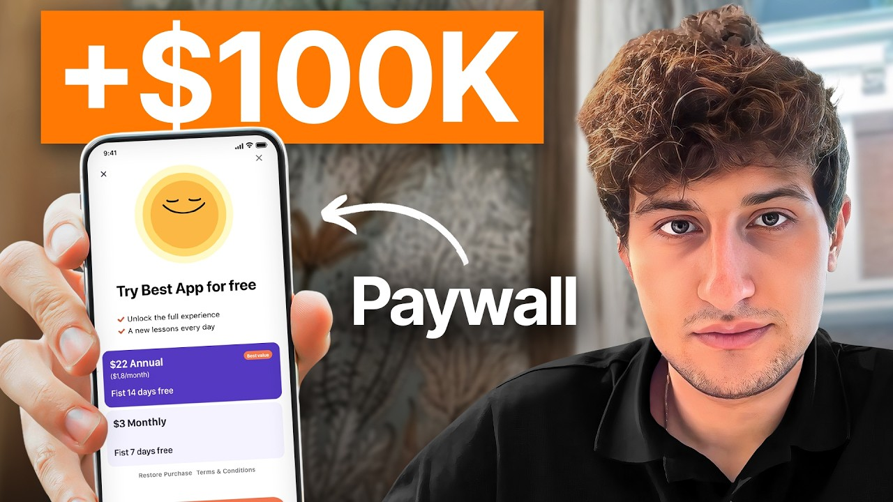

# Our No-Code Apps Made $50M Using THIS Paywall

Start building & deploying paywalls in 10 minutes flat: https://superwall.com/

## Table of Contents

* [00:00:00] - Intro
* [00:00:46] - The big "money left on the table" paywall mistake
* [00:01:24] - Case study: boosting install-to-paid from 1.1% to ~4%
* [00:02:08] - What this episode covers (playbook, tactics, placements)
* [00:02:55] - Superwall & paywallexperiments.com
* [00:03:34] - Why paywalls and onboarding matter more than growth hacks
* [00:04:51] - Common founder mistake: copying other apps' paywalls
* [00:05:36] - Key benchmarks for trials and install-to-paid rates
* [00:06:55] - Adding $100K+ without new users (just paywall experiments)
* [00:07:46] - High-leverage paywall placements inside your app
* [00:09:43] - Claim app: multi-step free trial paywall breakdown
* [00:14:44] - Multi-step vs single-screen paywalls (20-40% uplift)
* [00:16:24] - When to remove free trials and charge upfront
* [00:18:25] - Discount psychology & spin-the-wheel offers (Cal AI example)
* [00:22:08] - Trial toggles and capturing different user intents (Riz & Cal AI)
* [00:27:02] - Quitter app: 3-step, no-trial paywall & social proof
* [00:32:38] - How to think about pricing your app (costs, competitors, ROAS)
* [00:38:06] - Transaction abandonment paywalls & advanced discounting
* [00:40:46] - Must-have paywall placements and quick wins for new apps
* [00:42:29] - Outro - Next Steps

## [00:00:00] - Intro

Today we're sitting down with Vah Bagdasarian, a man who has run over 10,000 payw wall experiments and helped apps add over $50 million in revenue. He's been behind the scenes on dozens of apps including Calai, Quitter, and Claim. And he knows all the common mistakes founders usually make with payw walls. But the biggest mistake that keeps most apps revenue stuck comes from a common but surprising oversight. You see, his superpower is to look at an app that seems healthy and then tell you exactly how much money they're leaving on the table. [00:00:00 → 00:00:28]

There are many examples of apps that are operating with like 811% trust star rate and they're healthy but then they're missing out a lot of stuff that 81% easy in like 90% cases if you have 81% it can easily become like a that number he was about to say is the difference between a good app and a great one. [00:00:28 → 00:00:50]

## [00:00:46] - The big "money left on the table" paywall mistake

Vi's entire business is built on the idea that you can increase your revenue by $100,000 in a few months without spending a single extra dollar on user acquisition. He's challenging what most people know about building a profitable app. At the end of the day, your goal shouldn't be just to get more users. We all love viral growth hacks, but you also need to fix the leaks [music] in your existing system. And he has some examples that kind of surprised me. [00:00:50 → 00:01:14]

We started to work together in April. They had like a 1. 1% install to paid rate. So basically from April to September, we got it from 1. 1% to close to [music] 4%. [00:01:14 → 00:01:24]

## [00:01:24] - Case study: boosting install-to-paid from 1.1% to ~4%

In this episode, Vah breaks down his entire playbook for turning a leaky payw wall into a predictable revenue machine. We go deep into the mechanics of multi-step payw walls, highest leverage placements, and advanced tactics that can squeeze max [music] value from the app that you've already built. And he reveals the exact psychological tricks he uses to maximize conversions on a single screen. To maximize the impact of your transaction abandonment payable, offer a free trial, but let users to decide if they want to buy without free trial or without a free trial. [music] If they buy with a free trial, make the price more expensive. [00:01:24 → 00:01:58]

If they buy without a trial, make it a bit cheaper. For example, if they were to buy with a trial, make the discount offer like 80%, and if they were to buy without a trial, make the offer 90%. [00:01:58 → 00:02:08]

## [00:02:08] - What this episode covers (playbook, tactics, placements)

If you're an app founder Focus on Growth, this is the episode that will change how you think about monetization forever. This is the Superall podcast and I'm Joseph Choy, founder of Consumer Club. The members in the Consumer Club Discord and the founders I interview on the pod build apps at a median of about a million dollars ARR. In my conversations with dozens of these founders every week, one thing I've noticed is most of them AB test their pay walls to increase their conversion rates and make more money. Now, most people know that one of the best ways to AB test payw walls is Superwall. [00:02:08 → 00:02:35]

But one thing you might not know is Superwwell has a lot of data on the thousands of apps that use their payw walls. So recently they actually put together a tool that takes 422 profitable paywall experiments and put those into a paywall experiment generator where you can upload a screenshot of your own payw wall and it'll give you an experiment idea to increase your revenue. [00:02:35 → 00:02:56]

## [00:02:55] - Superwall & paywallexperiments.com

You can use it for free at paywallexperiments. com. All right, let's get into the pod. People are interested in growth strategies on this channel and we talk about a lot of growth hacks and viral Tik Toks and stuff, but behind a lot of these viral Tik Toks is the payw wall. And like a lot of, you know, big app founders have said that 80% of the effort that you put into building your app should go to onboarding and payw wall because that's where the revenue actually comes from. [00:02:56 → 00:03:24]

>> And you've designed the pay walls for a lot of these big apps. Can you zoom out and kind of show us at a high level before we go into each one what are some of the apps that you've designed payw walls for? We work with a very big apps and companies like resume kaii claim revival twitter and many many more. [00:03:22 → 00:03:44]

## [00:03:34] - Why paywalls and onboarding matter more than growth hacks

And for today, I just decided to take some of the best practices and the best pay walls we ever created for some of these apps and then show you and explain why these pay walls are the best converting payw walls and what was the thought process and the strategy behind all of these pay walls that we designed for this app. >> I'm curious, what's one thing most app founders today you're seeing are getting wrong with their payw walls? Well, I think the biggest thing that I'm noticing is that kind of u take one concept they see their competitors are using, not even competitors, but other apps are using and they copy the pay wall and it doesn't work for them or it works for a certain to the certain point and then they don't try to improve it. Like I speak with a lot of founders like oh my friend has this pay wall it crashes it. We copy the payroll that their friend have test it and it fails like happens like many many times every week. [00:03:44 → 00:04:36]

What's a good benchmark these days for good payw wall conversion rates? And I know there's a few different types of conversion rates that are kind of in the payw wall space. >> I think it really depends on the industry, etc. , etc. [00:04:36 → 00:04:51]

## [00:04:51] - Common founder mistake: copying other apps' paywalls

, but like if we talk about trial star rate, I think everything above 15% is good. If you have below 15% trial star rate, you have a lot of work to do. Trial to paid conversion rate, everything above like a 30% is good. If it's below 30% again you have a lot of work to do. That being said there are many examples of apps they're operating with like 81% trust rate with and they're healthy but then they're missing out a lot of stuff that 8 11% easy in like 90% cases if you have 81% it can easily become like a 15%. [00:04:51 → 00:05:29]

>> Those two metrics are both for free trials model. So do you also have any uh benchmarks for nontrial >> apps? [00:05:27 → 00:05:39]

## [00:05:36] - Key benchmarks for trials and install-to-paid rates

>> Ideally if you have a lot of users coming from the US if you have like a 10% and above installed to paid rate that's really good. If you have anything less than 4% that's not good. There is a lot of work we can do. Like between like four to 10% it's kind of you are not terrible but you're not great right? you know and if it's like less than 4% then you got to you have problem most probably we got to work to improve that >> you've seen a lot of apps increase revenue 100k in 3 months without getting any new users like just payw wall experiments which a lot of people is counterintuitive like most people think about growth as I need to do better ads or I need to do more organic Tik Toks go viral but if you just fix the conversion rate on your payw walls then that's also revenue growth. [00:05:37 → 00:06:29]

So >> yeah, >> um curious like what's the best before and after you've seen in terms of uh fixing up pay walls and increasing revenue? >> We work with this app. It's an enter in entertainment category. They have steady not steady but like the very stable user growth. They're adding like couple probably like a 40 50,000 installs per month. [00:06:29 → 00:06:52]

That's like organically. That's the kind of the average. [00:06:52 → 00:06:56]

## [00:06:55] - Adding $100K+ without new users (just paywall experiments)

We started to work together in April. They had like a 1. 1% install to paid rate. We got it up to 4% in September. So basically from April to September, we got it from 1. [00:06:56 → 00:07:12]

1% to close to 4%. And they didn't get new users coming. They didn't invest any paid way. They were they were having the same kind of stable users growth where we're adding like a 40,000ish users per month. And four percent is kind of like the bare minimum that you want for >> Yeah, you you you want to have at least four percent. [00:07:12 → 00:07:30]

I mean, maybe a lot of people would say it's fine if it's less or four is not much, etc. , etc. , but like I I I believe like if you have four and above, you're fine. It's not great, but it's not terrible. >> What are the variables that go into better conversion rates on pay walls? [00:07:30 → 00:07:48]

## [00:07:46] - High-leverage paywall placements inside your app

>> If the app offers free trial, there are like two things that you can do here. First you optimize your onboarding payroll where you get like probably most of your conversions and then you think about okay what other placements we can add in the app where we can make the payroll available for the users and convince them to take a trial or convince them that the product is worthy and we have like several placements there. It can be on transaction abandonment like we talked about it a lot. Everybody talks about transaction abandonment but people just just they put one pay wall discount on transaction and say oh this is it but like we did like we did like tons of experiments on transaction abandonment right and try to kind of find what is the best payable for it and what offer should be there. Another placement is a payable on a session start to payable on after doing like a certain actions in the app. [00:07:46 → 00:08:42]

If your app have something to do users kind of consuming something for example you have a coin identifier app you scan coins and you see what is the value of it etc. You can present payw wall after each scan or after each certain number of scans etc etc. You can come up with extra offers like somebody takes a trial, cancel trial, they see an offer, somebody cancel subscription, they see another offer. And here it's not just about adding the placements. Adding placement is just bare minimum. [00:08:42 → 00:09:11]

Like if we when we take a new customer and we audit and say hey you're missing all of these very important placements we firstly go and add the placements which is the bare minimum and then we start implementing more and more stuff uh to kind of improve uh conversion rate and then we do the experimentation because most of kind of the apps that come to us they lack a lot of like fundamental stuff that is concerned to placements we add those and then we start experimentation process. Let's start with claim. >> We did a lot of work on optimizing their pay walls and coming up with a new payroll strategies to just try to maximize revenue. [00:09:11 → 00:09:50]

## [00:09:43] - Claim app: multi-step free trial paywall breakdown

I just tried to put a few of the pay walls that we did for them that were the most effective and just go through and explaining like what worked the best for these pay walls and why they were the best ones. The first one was in the days initially when a claim was started there were a free trial then we removed it but initially there were a free trial and we had this pay wall there a standard multi-page pay wall we saw you probably saw it like in many places but there's like a lot of tiny details that we got it right about this multi-step pay wall that it works them more effective than in any other kind of a multi-step pay wall. Not mostly like here here where you see oh we want you to try claim for free and we show visually all of the potential settlements that you could possible like losses you could claim a settlement from and to say oh we'll send you notification when your trial is about to end but the real deal is here on a main screen the way you present your offer obviously we have your timeline this is the most common ways but then there are like two very important things here that it works very very well. Firstly, when apps offer a free trial, they don't talk about it a lot in a payw wall. You see apps offering free trial and only in a button in the CTA they say start free trial on only on headline they headline they say start your free trial and believe me just mentioning your product has a free trial one or two times is not enough. [00:09:50 → 00:11:19]

You should get into user's head that this product is free. you don't have anything to lose if you just take it right now. And the way you do it, you just mention it as many times as you can or just emphasize that it's like very risk- free. There's nothing to lose. We'll remind you, etc. [00:11:19 → 00:11:36]

, etc. Like in this example specifically on the first screen, we say, "Okay, try it for free. We are giving it out for free. " In a second screen, we say, "We're going to send you a reminder before your trial ends. " Right? [00:11:36 → 00:11:48]

There's like you will if you forget about it, we'll remind you. And again the button says try for $0. Here we again mention we will send you a reminder when your trial ends. We again we just talk about the same thing. And we have the pay wall here the timeline here that we show to users and explain how their free trial works. [00:11:48 → 00:12:10]

Here again we have a free trial as a page on a pay on like a payment card. Another thing we did here this is an annual plan right? This is a yearly plan. We didn't call it a yearly plan. We say try it free and then here we show you actually how your build like $59. [00:12:10 → 00:12:26]

99 per year I know it's only $1 per week something like this but we don't tell you it's an annual plan we say it's I mean we explain you this an annual but we don't call it an annual plan we say try it free because it's free and on a CTA again we say try for free just a matter of okay let's convince users and we explain very very simply and detailed this they they have nothing to lose here if they just take the free trial And you probably saw like we mentioned free trial probably like five, seven times throughout all of these three screens. And this is kind of a what you should do if you have an app that offers a free trial. Just mentioning it once or two times in your pay is not enough. Users don't get it. >> I've also seen that people put the length of the trial where you have that rectangle, >> but in this payw wall, it doesn't even say how long the trial is. [00:12:26 → 00:13:19]

It just says it above in the three-step process thing. >> Yes. >> And it says it's a 3-day free trial. Yes. >> But in the actual like product selection menu, it just says try it free. [00:13:19 → 00:13:31]

59. 99 a year, right? So, you're not even saying really how long the trial is. I think there's something interesting about that psychology because I feel like some people when they see how long the free trial is, the immediate thought in their mind is, okay, I got to can I got to remember to cancel it in 3 days, right? >> Yeah. [00:13:31 → 00:13:46]

Exactly. That's a very very valid and important point. Yes. If you if you just mention, oh, it's three day free trial, 7 day free trial. You kind of a lot of people might think, oh, it's too short. [00:13:46 → 00:13:56]

What if I forget to cancel? What if like it's not enough for me to experience the product like I'm busy or something like this. Just removing the time constraint from here and be like, don't worry about the time, just focus on the fact this is free. >> So, it's very obvious that it's going to start, but you're just kind of removing that language. I think the language is what people are afraid of. [00:13:56 → 00:14:18]

They're not really scared that, you know, they're going to forget. I mean, they're they are scared they're going to forget it, but instead you're just outlining this process of what exactly will happen, which is >> today you're going to start it. In two days, we'll send you a reminder so that you don't forget to cancel if you want to cancel >> and then in 3 days it'll start. >> Yep. Yeah. [00:14:18 → 00:14:38]

Exactly. Exactly. >> Interesting. What's the percent increase in the conversion rate when you do this style of payw wall versus just immediately doing one screen payw wall where it just says start the free trial now easy from 20 to even 40% uplift like I see many cases happen like 40% but the average is going to go between 20 to 40% uplift >> if we think about the trial start conversion rates. [00:14:38 → 00:15:10]

## [00:14:44] - Multi-step vs single-screen paywalls (20-40% uplift)

You said like a good conversion rate was 15%. So if someone has like a 10% conversion rate, then they might be able to get up to that 15% u by implementing like a three-step pay wall like this. >> And again, it's not only about the three-step pay wall and how many steps you have. It's also about the nailing the right way of doing this. And like you can go to an app store, download a lot of app, you'll see some of them offers and they have the multi-step pay like we have here right now. [00:15:10 → 00:15:41]

But they don't do it right. They might see some sort of uplift or might not see. But the actual uplift you see when you do it right and this is kind of an example of how you do it right when you have a retrial product. >> Okay. You said you could share data for this app, right? [00:15:41 → 00:15:56]

So what was the data that you wanted to share? Yeah, we had like a 34% trial start rate. >> 34% Yeah. >> trial start rate for the claim app. That's really good. [00:15:56 → 00:16:07]

That's like more than double the the benchmark. Did you do any experiments with that where you were able to see 34% versus some other percent for a different design paywall? >> We moved from free trial to paid app only after doing this test. It was it become we removed the free trial. [00:16:07 → 00:16:25]

## [00:16:24] - When to remove free trials and charge upfront

So it says okay we're going to be completely paid and then we started to do experiments around the paid. >> Interesting. So it was it was already 34% trial start which is really good but then you just removed the trial altogether. >> Yes. >> Yeah. [00:16:25 → 00:16:39]

Why did you remove it? >> Because we we started to get like a more revenue without having a trial. We see there is a strong trial to paid conversion rate like what if we just get rid of the trial and try to optimize everything for the purchase. M what was the trial to paid for that? >> Yeah, 50 55%. [00:16:39 → 00:17:00]

>> Yeah. So, you moved from a free trial model to just a no trial model and having people pay immediately. What was the I guess what do you look for in an app to make that decision? Is it if you have a really good trial start rate, you should consider uh removing the trial completely because it just shows high intent or are there other things that you look for? There there are few things you need to have a lot of volume of users coming in. [00:16:57 → 00:17:32]

This is like a prerequisite like if you don't have a high volume coming in, you will not be able to make a lot of money if you remove your free trial. You should have strong trial start rate but you also need to have very strong trial to paid conversion rate. So everything kind of should be perfect on this like around this three matrix and you could consider oh what if we just remove free trial and see how we can uh work without a free trial and be like a paid only app. Usually you also need to solve very specific problem very pressing thing. Users should be very motivated about it. [00:17:32 → 00:18:11]

Like claim app or there's a chance you could claim settlement and make money. Even if you pay the annual subscription if you are eligible for several like settlements and you get paid the app is free because you get your a lot of money that you're entitled to. >> Cool. [00:18:08 → 00:18:25]

## [00:18:25] - Discount psychology & spin-the-wheel offers (Cal AI example)

Show us Kali. >> So we have a few things here like very interesting. I want to talk about another thing which is the discount offers again which the discount offers you can present as an additional placement and it can be when also on transaction abandonment. It can be on opening the app the second time. It can be when you start a free trial you cancel the free trial and next time you open the app you see a discount. [00:18:25 → 00:18:55]

But the way the most apps they do it uh is just show some payroll to user that say hey this is 80% off and you just go with it or this is like a 60% off you immediately just discount. So we AB tested like how to present the discount offer the best users and based on the testing the best some of the best ways to do it is to have a the spin wheel logic and the way it works is like you open the app we show you the spin wheel and this there's an animation here it spins and it's going to stop on a discount percentage and then when you stop on a discount percent it says hey you got like 80% off top to get it you click on this button button and this continue button and the next page is going to be your discount. The idea of this is let's try to add some sort of excitement before wanting a money from users and second making it like you did something and you won it, you earned it, now you should claim it. That's really interesting. Yeah, this reminds me of the popups on the desktop websites as well where you go to e-commerce website and then it's a spin the wheel to get your discount. [00:18:55 → 00:20:04]

is kind of using I I feel like a lot of app founders don't really use a lot of these tactics that you can just take from other industries. Yeah. >> Because these things just exist all over the place, right? >> Drop shipping, e-commerce just like nailed a lot of kind of how to present discount the best way, how to do the winag, how to encourage user to buy more. There's a lot of stuff we can kind of copy or learn from e-commerce. [00:20:04 → 00:20:31]

And that's what I do too. like when we come what's the next thing we're going to test how to optimize this like in many many times I go to Kimu or Shane or something like what what they're trying to do how they're convincing user to buy more and you >> is a great source yeah of uh >> conversion tactics that app is full of >> Yeah that's yeah yeah >> and you see something okay you take okay how can I repurpose this tactic for my app I think you'll get a lot a a great success in doing so. >> That's interesting. I guess to go back to one of the first things you said, which was one of the biggest mistakes that people make when doing their payw walls is they just copy a famous payw wall onetoone and they don't make any other changes. One way to make some other changes is look at successful e-commerce apps like look at Teimu or just look at >> apps in general and take the pieces of it that you like. [00:20:31 → 00:21:31]

You like something just don't copy it blindly. I feel like think like okay how this might work for me because like if you see something cool in a utility app and you are a health and fitness app if you just copy it it's not going to work. like people's intentions and like the way they perceive the product and its value are so different between health and fitness products and like a utility products. >> What was the conversion rate increase for this AB test when you do the spin versus just giving them the the discount outright? >> Yeah, I can't mention the exact percentage, but we got like a double digit increase. [00:21:31 → 00:22:05]

>> Cool. Nice. You want to go to uh RZ app >> here? We kind of combined a multi-step pay wall compared to something uh the we discussed earlier which is the trial toggle when you change your product or discount or price based on condition if user wants to buy with a free trial or not. [00:22:02 → 00:22:26]

## [00:22:08] - Trial toggles and capturing different user intents (Riz & Cal AI)

So here we have our multi-step payable. The first screen again says we want you to try risk for free just emphasizing the product is free and has a free trial. In the second screen, we try to remove the trial anxiety and we say, "Oh, you would get a reminder two days before your trial ends. " Again, trying to work on the trial anxiety. And here we present them the offer. [00:22:26 → 00:22:46]

We have some sort of like a visual that explains how the app works. We have some text here showing uh explaining about a product, the features, a value, etc. But the most important part is here. By default, the free trial is enabled. Users buy with a free trial. [00:22:46 → 00:23:03]

We have here say 7-day free trial $9. 99 per week and users can by default go with it. But what they also can do is turn off the free trial says skip free trial and the price becomes $6. 99 per week. They get like $3 off per week by just buying it immediately. [00:23:03 → 00:23:24]

you are encouraging more direct purchases like you're trying to capture more demand because everyone is different you know like user you cannot just think about it like everybody is going to be able to pay the same price or going to be interested in the same offer people are different and there's a lot of stuff that influence their like buying decisions or buying power so you need to kind of be a bit creative on your pay walls on okay how can I do this in the best way to capture as much demand as possible And this is like example one of the examples of how you do it where you just do two things smart here. The first you make it feel like the user is in decision of how they want to buy and you encourage them to buy without trial if they go with $6. 99. Like if you are not able to afford or you don't want to afford a $10, oh we have like a $7 option too. But the difference with it is not going to come with a trial. [00:23:24 → 00:24:20]

You're going to just like straight away purchase it. And the math actually works out perfectly here because you said that a good trial to paid conversion rate is 30%. And here you basically discount >> $3. >> Yeah. >> So you're basically just getting the same amount of revenue per user. [00:24:18 → 00:24:38]

You're just changing the way that they >> Yeah. >> uh choose their pricing. So, can you go to the Cal AI transaction abandonment payw wall? Because this one is interesting where you do the same thing as you did with Riz where you toggle the free trial. You can choose whether to get the free trial or not, but for this one, >> there's no discount >> for the free trial. [00:24:38 → 00:25:02]

It's just >> the same exact pricing. So, when do you decide to do a toggle that doesn't give you a discount versus a toggle that does give you a discount? >> You got to test this both and see which one works the best for you. So, it it's going to depend on your audience, what kind of users you're attracting to and depends the user intent, etc. , etc. [00:25:02 → 00:25:27]

Like KAI is it's more a high intent app. Users, they want to kind of uh lose the weight. They're more kind of convinced that they need a product and they want it because many reason. Usually most of the health and fitness products are like this. They the users when they come they have a strong intent to buy. [00:25:27 → 00:25:45]

But other for like utility type of apps usually user intent is not super high and you need to further incentivize them to make a purchase or to take a discount. So, Riz app is like you get dating app matches and then it uses AI to give you lines for what to say to your match. You would say that's not as high intent as like losing weight or Yes. Usually like the health and it comes from the industry too like the health and fitness it has a strong kind of intent of user they want to purchase. But another different is not just the intent but also what kind of user demographics you're kind of getting to. [00:25:45 → 00:26:30]

Like for the ree app, if you're getting more young people like less than 18 where the like a purching power is not super great, you might kind of find more luck in kind of a discounting based on the trials or >> that makes sense. But >> yeah, >> for Calai like people of all ages want to go to the gym, get fit. So versus Riz app, there's like younger people usually using it. >> My general advice is you test both, see which one works for you the best. Like this are two best practices. [00:26:30 → 00:27:01]

Test, see which one works you the best. [00:27:01 → 00:27:04]

## [00:27:02] - Quitter app: 3-step, no-trial paywall & social proof

>> Nice. We have Quitter. >> This is a multi-step pay wall for Quitter. No free trial, just purchase. We have like three page payroll before hitting the prices. [00:27:02 → 00:27:14]

And the way it works, we have visual in the first screen that shows the app, how it works, the v some sort of like what they can uh expect after the pay wall and says to break the cycle today. just kind of encouraging users and we show in the second page we showed them more visuals and more stuff from the app what they can see uh or they might see some podcast leaderboard articles some briefing exercise just give users more clue about what they can expect from the app and here this is the last page of the payw wall we put some reviews top apps some real app store reviews but we don't present any prices Here when user click on start my journey today that's when we show them prices and we have annual and monthly options we have some conversion optimization tactic here it says 60% off sale and limited spots remaining this again think about where you saw where you see something like this in e-commer >> yeah e-commerce yeah >> yeah this is another tactic borrowed from e-commerce and then this 60% off is again calculated against the mouth product how much you going to win or save if you go with annual instead of monthly and you have and to further incentivize people. you have oh this like limited this might change and this might change actually like you might offer like a like increase the prices or offer them this different offer etc etc like many ways you can do it like um so kind of a encourages users to kind of more like nudges users towards making a purchase and we have a price anchoring here both presented as monthly like annual is only three uh 333 per month is only like $12. 99 per month But here of course we have the full prices and when users so we we show the price anchoring here and then the full price here when user kind of selects a product and then when they click on start my journey today we trigger kind of the purchase. I think the biggest thing that worked for this payw wall is not presenting any prices, any payment option on the main pay wall and make user to click start my journey today to see them. [00:27:14 → 00:29:30]

And again like uh and this kind of a has kind of more reasons. One of them is just get user to spend more time on this pay wall on this page before like because when you hit here you expect oh where are the prices or where like where are my options to choose from and then you only see them when you click on start my journey from and then what other thing you can do you just like close this you're still on this pay wall you can look at the reviews and open it up again and when you open this there's no other distracting things for you like the half of the screen is covered now you need to make the is everything is clear. This is annual monthly. This is a the discount off you get nine spots available. Do you want to buy or you don't want to buy? [00:29:30 → 00:30:12]

Because like sometimes when you have like a two crowded offer, two crowded pay wall, you have the reviews, it's long form, you have the timeline and below you have the prices, it's kind of hard to focus where to focus like okay this is the prices but there's this thing here this there is thing here. Here we kind of trying to split it. So you perceive all the parts of it like differently. you consume the social proof part of things and then you click on start my journey today to see the prices and everything. One random thing that I've noticed right here is 333 is a very weird number. [00:30:10 → 00:30:47]

Like a lot of people do either flat pricing like you know $5 a month or they do like 99 pricing you know $4. 99 or 95 or whatever 97 but 333 like what's the reason for is there some weird like consumer pricing psychology that goes into this 333? Not really to be honest. There is like some sort of stuff that like people are you know the 0. 99 prices everybody knows that it's like tricky but like it's useful. [00:30:47 → 00:31:18]

I I I guarantee in some of in most of the cases if your product says $15 and if you test it against like $14. 99 the $1499 results in higher conversion. But what happens is like people have some sort of develop consumer develop some sort of defensibility and know and they know oh they want to kind of trick me for you make the product like a 1499 and if it's a random number it just feels more authentic. >> It does feel more authentic. It's like a real number versus 14. [00:31:18 → 00:31:50]

99 it's like it's not even a real number that's just like a price that shows up on commercials and ads. >> Yeah. Exactly. Yeah. Yeah. [00:31:50 → 00:31:58]

That's the whole point. And I like 333 as well because it feels like obviously like the first number is what you see. So it's three. So it feels like $3, but it's actually $3. 33. [00:31:58 → 00:32:09]

When you multiply that by 12, it's like $39. 96 a year. >> Yeah. >> So >> it's actually a pretty good annual price. Like you're getting um >> $40 a year per user, but 3. [00:32:09 → 00:32:26]

33 per month, it feels like $3, right? Like if you if you made it $3 per month and you made it$2. 99 per month, >> then that would be three times 12 is 36. You get $36. >> But then you're padding it just a little bit with like four extra dollars on the annual, >> which actually makes a big difference, especially if you're doing paid acquisition. [00:32:26 → 00:32:43]

## [00:32:38] - How to think about pricing your app (costs, competitors, ROAS)

Like that $4 gives you a buffer to spend $4 more on every ad. I think you had another payw wall that you wanted to show that's not quite in the meta yet. That's like a little bit interesting. Can we look at that one? I think we discussed this in a claim payroll case when you present your payment option not as a an annual plan or monthly plan but if it has a free trial just call it free and then here you mention the price just again the same way the idea here is to make sure user knows this is free and it's good to explain users and frame it as much as possible around the idea of it being free to make it feel like very effortless to take the the free trial on almost all the other payw walls that you showed, they were they showed the weekly or the monthly or the annual price and it said free trial, but it says the price on it. [00:32:43 → 00:33:37]

For this one, you don't even show the price on the product card. >> So that that's like the main difference you would say for this one. >> Yes. >> So could you show what is transaction abandonment and how do you optimize that? Here you see this payroll on the left side which is your main payroll. [00:33:37 → 00:33:55]

We have two options like yearly and monthly. Transaction abandonment happens when user clicks on the discontinue button to buy to try to buy the product. Then they cancel out the transaction confirmation dialogue and they don't buy it. What you do immediately after that you hit them with another offer which you can see on your right side. This is a discounted offer. [00:33:55 → 00:34:17]

this discounted offer, you usually should only have like annual. You should discount only an annual product. Don't discount weekly. Don't discount monthly. It doesn't work. [00:34:17 → 00:34:27]

We tested like a dozens of time. It doesn't work. Have annual discounted. So to maximize the impact of your transaction abandonment payable, offer a free trial, but let users decide if they want to buy without free trial or without a free trial. If they buy with a free trial, make the price more expensive. [00:34:25 → 00:34:44]

If they buy without a trial, make it a bit cheaper. For example, if they were to buy with a trial, make the discount offer like 80%. And if they were to buy without a trial, make the offer 90%. Just to incentivize some users to go without trial and get direct purchases. From my experience, like around 10% of users, they will choose to buy without a trial and they will get some direct purchases there. [00:34:44 → 00:35:11]

Another option to maximize the impact of this of the transaction abandonment pay walls that we don't have it here but would be to add another product below yearly plan which is monthly or weekly and you don't discount it. Never discount it just to have it there as a secondary or third option for users who don't want to go with any of this discounted annual choices. Just leave it there. very tiny percentage of users might choose to go there. But that would also influence on their decision to buy annual because when they compare the price of the the monthly or weekly to this annual price, they'll see, oh, annual is a great deal. [00:35:11 → 00:35:51]

Let's go with annual and they might influence your decision to buy the discounted product. >> Interesting. So on the original payw wall you said so right now without the toggle on it's you're saving 30% off of the monthly plan by doing the yearly but then if you offer a free trial what would the discount be [music] in that case >> on on original paywall nothing you just let users go you can experiment with it it uh it's a it's an also an option we do that in this specific paywall example the price doesn't change if there are some users who just want to buy without a trial, you just let them do it. But like in this particular example that I have on the left hand side, the main pay wall, the price doesn't change. It just allowing users to if you want to buy without it, you are on a controller on how you want to make your payment decision. [00:35:49 → 00:36:41]

People want to be in a control of how they want to spend their money or how they want to buy things, right? And we're giving you a choice. Do you want to do you want with a free trial or you don't want like you you decide and you will see kind of a some users who go without a trial but you can the same way as in transaction abandonment you can experiment by trying to change the price based on users will go with a free trial or they will not go with a free trial. >> How do you decide the pricing for these things? Like you know this is 35 a year and $10. [00:36:41 → 00:37:11]

99 a month. Is that standard or do you do any >> No, like >> probably depends on the app and the industry, but what's the like range usually? >> Well, there's no right or wrong way. I mean, no, there are like many wrong ways to do it, but there are no single right away to do this. The common way is just to look at your competitors. [00:37:11 → 00:37:32]

One of the most common ways you look what are your competitors are charging and you put the same price. There's this is how like a lot of apps are doing it. Another thing if you're like for example doing a lot of UA paid UA stuff and you already have some sort of data on what your C look like what's your row etc etc you can come up with a price point where you are rowas positive like if you keep your kind of a conversion rate stable and this is the price you need to sell your product to be able to be row positive or get a payback period within a month or so. That's one way to do it. [00:37:32 → 00:38:08]

## [00:38:06] - Transaction abandonment paywalls & advanced discounting

Another way is just uh if you have um a product that has like a lot of AI related costs like on scanning etc etc you need to kind of estimate how much it cost you to operate this product for a single user and try to add an additional kind of price to it that you believe this is a perceived value of my product for example my cost per user is let's say it's like $20 per year and I believe there's another like a 20% of perceived value. You add it to that and okay my product is going to be like a $40 per year. You can do all sort of price sensitivity analysis. There are way many one of them is called the price sensitivity matter when you ask user bunch of questions and their price preferences and you do some sort of analysis to understand what is the right place or what is the right price etc. If you're just getting started that's I don't you don't really need to do that. [00:38:08 → 00:39:06]

The best way is to just get some sense, right? Just see what your competitors are pricing. What are your costs? What is your UA costs? Just take everything into account. [00:39:04 → 00:39:14]

Try to come up with a price that like works the best. That's going to help you to make money. You are able to pay your bills. You are positive on your kind of ads campaigns. When you get the point, then you can start doing price tests. [00:39:14 → 00:39:29]

>> Do you see any drawbacks to this? Like do you get more transaction abandons? Like once people hit that, you know, redeem 3 days for zero, the Apple native card comes up and then it says, you know, free trial for 3 days, then $29. 99 a year. Are people like, "Oh, shoot. [00:39:27 → 00:39:48]

I didn't realize that it was going to be an actual subscription after. " And then you're getting a higher transaction abandon. you might get some like a 10% more transaction abandonment but again it's a chance to convert more users on transaction abandonment because uh transaction abandonment payables usually also have a good kind of conversion rate. So the only drawback is like if you have a low trial to paid conversion rate product you might see an increase of refunds or overall drop in your install to paid conversion rate. So in anyways you got to test it. [00:39:48 → 00:40:21]

But if you have a strong trial to paid conversion rate let's say above like a 30% I don't think it is going to harm you very significantly you'll see kind of good improvement by kind of renaming your payment cards like this or using this strategy. >> So all all of these you're mentioning like AB test and experiments are all these payw walls and super wall. >> Yeah all of this is just so are built on super wall and are living on super wall. [00:40:21 → 00:40:49]

## [00:40:46] - Must-have paywall placements and quick wins for new apps

You also mentioned payw wall placements. So most people think of payw wall as something that you put right after the onboarding, but you're saying that you can offer it after each scan or after each like certain user action. What's the best practice on that? Are you just supposed to put it like basically everywhere? >> There are like a few very important placements. [00:40:46 → 00:41:09]

Uh I mean transaction abandonment itself is a placement but then there are some other things that like a very important and a high impact. The one is on session start like showing a payable on every session start at least like once per day. If users use your app to do some sort of action like take notes scan products you can show them once every x times they do an action. If you have a premium version of the app and you give away like let's say five scans for free, you can remind them, hey, you're almost out of your scans on your payroll. Hey, subscribe to keep unlimited scans. [00:41:09 → 00:41:48]

>> What are some of like quick wins that people can get um if they've just launched and they're getting traction and they just want to do a couple of first experiments? >> Definitely AB tests around like multi-step payables. That's kind of a very good kind of leverage you could have. If you don't have transaction abandonment payable in place, put it there. If you don't have a session start payable, put a session start payable. [00:41:46 → 00:42:12]

You don't need to experiment. You just need to build your foundation that you can experiment later. Make sure you cover every possible placement. You don't leave any kind of a money in the table by not having some sort of like a placement. You cover all of this and then think about experimentation. [00:42:10 → 00:42:30]

## [00:42:29] - Outro - Next Steps

Great. This This was really educational. I learned I learned a ton about payw walls. Um, is there anything else that you wanted to cover here? >> No, I think I think we're good. [00:42:30 → 00:42:40]

>> Cool. Nice. Something you might not know. Most of the founders I cover on this podcast are hanging out right now in the Consumer Club Discord sharing with each other what's working now for consumer apps. So, you can apply to join consumer club if that sounds interesting to you. [00:42:38 → 00:42:52]

And this is the Superwwell podcast. Of course, you got to check out superwwell. com. We have more videos on the channel, so dig into those to learn from app founders who are willing to share super tactical stuff about app growth. [00:42:52 → 00:43:04]
