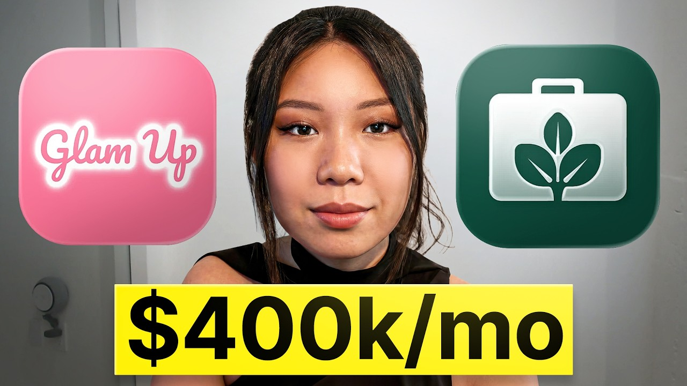

# she makes $400k/mo from ai apps (while in college)

Start building & deploying paywalls in 10 minutes flat: https://superwall.com/

## Table of Contents

* [00:00:00] Nicole's App Portfolio and Numbers
* [00:02:14] How GlamUp Was Born in a 10-Minute Phone Call
* [00:05:29] The Copycat App That Made Them $100K in a Week
* [00:09:49] The Viral TikTok Formula They Ran Across 40 Creators
* [00:17:16] The Referral System That Took Over TikTok Comments
* [00:22:43] What Happened When They Tripled the Price
* [00:24:50] The Discounted Paywall Strategy and Upgrade Triggers
* [00:30:28] Scaling Sprout to 250K MRR and 100M Monthly Views
* [00:31:42] Inside the Creator Course That Gets People Viral in 2 Weeks
* [00:44:42] The Paywall Test That Showed a 50% Conversion Increase
* [00:53:16] Advice Most App Founders Never Hear

## [00:00:00] Nicole's App Portfolio and Numbers

My first app, it's called Glam Up. We got a million users in the first 6 months of launching. I think at peak we were at around 150k MRR. Sprawl, I was growing up for the first 8 months and we did 250k MRR. When I was handling all of the UGCs, we were doing 100 million monthly views. [00:00:00 → 00:00:19]

>> That's Nicole. She built four apps before turning 25 and the last two apps did over 400 grand a month between them. Now, the interesting part about Nicole is that she started Glam Up out of her bedroom while she was still in school without any engineering background. So, in this video I'm going to sit down with her to figure out the exact playbook she used to blow up four different apps and what she'd do differently if she was starting from zero today. This is the Superwall Podcast. [00:00:16 → 00:00:41]

I'm Joseph Choi, founder of Consumer Club, a Discord where top consumer app founders trade alpha and what's working now in growth. I've been talking to members doing a million AR and they tell me they've been using these two tools. Superwall has this free AI tool trained on 422 profitable paywall experiments across thousands of successful apps. You upload a screenshot of your paywall and it gives you an experiment idea to make more revenue with the same number of users at paywallexperiments. com. [00:00:41 → 00:01:05]

And if your app's doing at least 100k MRR, we host vetted dinners in SF and New York to hang out and network with other top app founders. You can apply with the typeform in the description. Also, these app founders have been telling me they use R0K. I met Daniel, the founder of R0K, at a dinner and I got genuinely really excited when he told me about R0K Max, which is out now and has honestly changed the game for coding mobile apps. It's AI that one-shots full native iOS apps with Swift code, camera, sensors, haptics, payments, the whole stack. [00:01:05 → 00:01:32]

And as you vibe code with R0K, you can install prototypes directly onto your iPhone with one click and then publish to the App Store in two clicks. If you've been waiting for AI coding that actually does native iOS apps well, this is it. I got you guys a discount. You can use the code superwall or use the link below. Okay, I'm going to start with these tweets. [00:01:32 → 00:01:48]

Um you've been putting out some crazy tweets with flexing your MRR and your users and uh your views on TikTok and everything. It seems like you have multiple apps. So, I want to dig into some of the apps you're building, the playbooks, and then I think it's also pretty wild that you're you're a senior in college, right? And you're writing your you like wrote this report on how you built these companies, which is also like kind of crazy. So, yeah, so what's going on? [00:01:48 → 00:02:13]

What are What are your apps? >> Yeah, yeah, yeah. [00:02:12 → 00:02:15]

## [00:02:14] How GlamUp Was Born in a 10-Minute Phone Call

So, I've been building apps for the past 2 years. I have four apps right now. Uh my first two apps, I built them in college, hence why I wrote my senior college thesis on it. Uh but my first app, it's called Glam Up. We got a million users in the first 6 months of launching. [00:02:15 → 00:02:33]

Um I think at peak we were at around 150k MRR. It's a glow-up app for for women and makeup and skincare, all that stuff. My second app is called Prep AI. Uh we renamed it to Sprout now, but it's basically Tinder for jobs. So, you can download the app, upload your resume, and whenever you swipe right on a job, we just automatically apply for you with a tailored resume and cover letter. [00:02:31 → 00:02:56]

Yes, we also have a web app now. Uh but I'm currently stepping down as an advisor for them while working on the new apps uh that are currently in stealth. >> So, you have four apps total, and then Glam Up and Sprout, you know, with Glam Up you scaled to, you know, 150k MRR, million users. Um is this the one that you're going to uh share the most about cuz it seems like you really got very specific into all the details in the playbook of how you how you built and grew this. >> The good part about this is that whatever I did for Glam Up, I basically did it, but but did it better for Sprout. [00:02:56 → 00:03:33]

Um and I have the most info on Glam Up because that's when I was in college, I was like preparing for my O Y, so I I was like gathering a lot of evidences for it. Uh so, that's why I have the most resources there, but basically everything is the same when it comes to Glam Up and Sprout. I would say Sprout is a bit more matured, you know, when it comes to a lot of the systems that we're building, but Glam Up is the version one of like what we have now. >> Cuz I think Glam Up is like a it's a really good case study story for like people that are either just starting out with their first app cuz, you know, similar to how it was your first app, but also just all the growth hacks and some of the referral mechanisms and like a lot of the just had a lot have a lot of interesting stuff. I read through this and there's there's a lot of interesting stuff that I want to just to start out, like what what was the app idea and like what what does it do? [00:03:33 → 00:04:27]

>> The app idea, we were loosely inspired by Umax cuz my co-founder Aaron for for Glam Up, he was in H0 with some founders working on consumer apps. Umax was one of it and we just decided to build something you know, kind of in that space, but it's a glow up app before women and makeup or for guys and makeup. And we were like 2 years ago, it wasn't like that big of a thing, you know, when it comes to AI consumer apps yet. Not not that many like invite coders coming in at that point, so we just went on App Store. We didn't really find that many apps doing that and we just decided to make one and it was funny. [00:04:24 → 00:05:08]

It was my co-founder for for Glam Up Aaron, he just called me. We just had a 10-minute conversation and in that 10 minutes we decided to start an app together. We decided on the app name and the app concept and how it's going to work and that became Glam Up. >> In your article you said it was it was like a copycat app, right? Is this your is this your like what you're referring to or is this different one? [00:05:08 → 00:05:31]

## [00:05:29] The Copycat App That Made Them $100K in a Week

>> No, no, no. So this is interesting. We were growing Glam Up and then we got kind of exposed on Twitter. So so some people started posting about Glam Up and how how much money it's making and this and that and someone copied our app, but it was a brand new app and they weren't ranking on on App Store and they chose a very similar name. So, when they started going viral, all the all the traffic went to us. [00:05:29 → 00:05:56]

So, like I see. That's crazy. Yeah. And then they just made us, you know, 100K in a week. >> So, that was like a crazy ASO thing. [00:05:56 → 00:06:05]

Well, we'll get into that a little bit later, but is it Is this the the page for the app? >> Yes, this is the page for the app. Um as you can see, we haven't worked on it for a year now. >> This was This is your first ever app with your co-founder? Like how long did it take to build it? [00:06:04 → 00:06:21]

>> Um let me think. I think we built the first MVP out in maybe 3 weeks to a month. Like that that was like our both of our first time building an app, so it took us a bit longer. It was all brown. The app barely worked and it was just a concept. [00:06:18 → 00:06:38]

Like it was genuinely an MVP that we just launched, but we didn't really care, you know, we were working on distribution at the same time. And Glam Up, like the current pink version is our version two and this one took us maybe a month to really improve and and optimize. >> So, you mentioned UMAX. Like um I think some people know about it, but for people who don't, like how did you come to the idea for Glam Up? You like you positioned it as like UMAX for women basically. [00:06:38 → 00:07:08]

But what what does that mean? Like why why did you come to this idea? >> Yeah, so my my co-founder Aaron, he was in H 0 with UMAX's founder. Um and they were killing it, you know, they were doing really good. It was basically like jawlines and all that stuff, like scores for your facial structures, but we wanted to do something that's like a little less toxic in that way. [00:07:08 → 00:07:32]

Like we don't want to rate women on their facial features. I think there's a difference between men and women when it comes to this. Um and obviously for for men to glow up, you know, they do the mewing and the looks maxing, but for women a lot of the times it's about skin care and makeup and and the products that they use. So, it's loosely inspired definitely by them, but you know, with with Glamhub we wanted to do something where it's more about makeup and and the actual products. >> And do you feel like you were the first ones to notice this trend? [00:07:32 → 00:08:06]

You're basically copying the the Umax value prop, but for a different audience. Like were you the first ones to kind of notice the the gap? >> I believe so. I think it's also because we have an advantage just because the Umax founder and my and my co-founder, they were in the same cohort together building together and so, you know, my co-founder was really familiar with Umax very early on doing their growth. So, you know, we kind of have a competitive advantage versus, you know, just discovering that on Twitter. [00:08:06 → 00:08:39]

And I I hope to believe that, you know, we're the first one to start this as well. >> How like how are people finding out about this app? >> I was like super happy about this. I remember I was like I couldn't sleep for for like an entire night when this happened and I had to call my mentor at like 6:00 a. m. [00:08:39 → 00:08:53]

and I didn't sleep for the whole night whole whole night, but that was the time when Glamhub reached number three on the App Store. We beat Tinder and Hinge luckily for like a a couple of days, but here are some screenshots from Super Wa. This is iOS. This is Android. I think well, now I think we have around like 2 million downloads, but we kind of stopped working on the app when we hit a million users. [00:08:53 → 00:09:20]

So, these are just from like the leftover distributions that that rent up. And we have we used to use one link for attribution links and for referral codes. So, as you can tell we have, you know, around 1. 6 million total requests of people sharing the app, getting their codes, stuff like that. Um and when it comes to distribution, I just went on TikTok and I searched Glam Up app, and you can see I'll show you one of the videos. [00:09:20 → 00:09:55]

## [00:09:49] The Viral TikTok Formula They Ran Across 40 Creators

Um this doesn't have the audio, but I'll show you. So, it's a girl without makeup, and then it's a girl with makeup, and it has the Glam Up branding. And then we do the the like a screenshot about what the app is about. So, we did this for across, I think, 20 different UGC creators. We did faceless content. [00:09:53 → 00:10:17]

This is from years ago, but when we were killing it, we were getting millions of views like every single day from it. Um and it was pretty sick. And I remember the first faceless content that we posted, uh it was a slideshow, basically very similar um idea, and that one got like 10 million views. This one, like, our very first post got like 10 million views, which is insane. But, as you can see, all of it is before makeup, after makeup, Glam Up branding, and then a screenshot of it. [00:10:17 → 00:10:51]

And you want to know something really funny? How we did this is actually we went on Pinterest, we found a bunch of like pretty girls. We downloaded another app that can remove their makeup. So, we would go to the app, and we would remove their makeup like 10 times to make them like just like really plain, you know, something like this, and then we will enhance their makeup. So, we have this huge contrast, and then we post on social media, and it goes viral. [00:10:51 → 00:11:23]

So, these are actually just like demo demos of our app, but these are not like actual users. Um cuz we don't want to post their, you know, private information. >> Right. Right. Okay, so the slides like the content format is like very simple. [00:11:23 → 00:11:39]

It seems like it's like basically before and after with a slow sliding screen transition. And then the name of the app is just like right there, Glam Up. Um and then it shows the demo of the app that shows like the personalized makeup routine. But then on the first couple of frames of the video, do you have like a caption or something that kind of acts as a hook? >> It's also very funny because we did this for every single like we probably had hundreds, maybe almost maybe even thousands of these posts out and we used the same caption on the video and the same caption below the video and the same hashtags. [00:11:36 → 00:12:16]

And for some reason this combo just worked. And the same audio. >> Really? Interesting. Wait, so what what is the caption? [00:12:16 → 00:12:23]

Wait, so yeah, walk me through the caption and then the like the on-screen video caption. >> It's Okay, so it's literally either two or three lines. It's never saw myself with the next line, right makeup routine, crying face crying face. And we've tested this actually with different different um hooks and different you know, lines, how many lines you can have. We were like very intricate with it, almost scientific and we realized this is the best one. [00:12:23 → 00:12:54]

And then when it comes to the caption, it's usually almost I will be unstoppable with the exhausted emoji and we do like um the hashtags for it. And then we use like there's maybe like 10 different audios that we use. Uh we've tried other audios, it just doesn't work. It doesn't go viral. But with those audios with the same hook with the same caption, it works every time. [00:12:54 → 00:13:19]

>> That's so it's so weird. Like I don't understand. Like the the TikTok algorithm is so mysterious sometimes. Like it says says never saw myself with the right makeup routine, but then there's a a new line after the word the and then the emojis on the third line. So, give me an example of like caption variation that was that looked very similar, but just didn't perform as well. [00:13:17 → 00:13:43]

>> We tested out the size of the lines as well. It can't be like super big on the screen. It has to be something like that's very like like Gen Z Insta girly posting like something. So, it has to be like small and it had it like we would prefer not on the center, but somewhere by the side. Yeah, I think we might have deleted the ones that didn't work that well, but >> Sure. [00:13:39 → 00:14:04]

In the search results, they're all the same. >> They're all the same. They're all the same. And um we can dive into it a little later as well, but if you take a look at the comments, everyone's asking for code for code, uh which is the referral code that we build within the app. You can see a bunch of people are doing the templates that you know, we have. [00:14:04 → 00:14:27]

>> And that is that is the crazy probably one of the craziest things about this app. I want to get into that um in a minute, but first like how did you come up with this before after slideshow format in the first place? Like is it uh were you like paying influencers or did you just make it yourself? Like how did you come up with this? >> So, we have tested a bunch. [00:14:25 → 00:14:47]

Latina makeup slideshows, all that stuff didn't really work. We tested color theories, celebrities, all that stuff didn't really work. Uh we also tested these like tutorials, makeup tutorials, didn't really work. We just kept testing different formats and I'm not exactly sure how we ended up with a before and after. I think our competitor app actually helped as well, like a copycat app that was copying everything that Glamour was doing. [00:14:47 → 00:15:17]

They came up with a bunch of viral strategies that like, you know, we honestly got really lucky with it and we just scaled and made it better. Um and then it just blew up for us. >> So, you said you had 20 creators. Like were you Did you hire all those people from the beginning and just have them create these these videos? >> So, across all four of my apps, I'm the first one to go viral on on all of them. [00:15:17 → 00:15:45]

With Glam Mom, I remember I had like three accounts. My co-founder, he had like three accounts. We would warm it up and try posting. And once we found a viral strategy, that's when we just scaled immediately. So, that's when we went to, you know, hire like, I believe at one point we had like 30, 40 creators. [00:15:43 → 00:16:03]

This for Glam Mom, like during that time it's my first app. It's like a it's a huge scale for me during that time. Obviously, with Sprout now, we have probably over a thousand creators now. But, during that time it was a lot for me. Um but yeah, we just started hiring. [00:16:03 → 00:16:21]

We did a training course for all of them. Similar to what uh I can show later for Sprout as well. It's kind of like a course. We teach them how to create the account, how to warm it up, uh how to warm up a brand new account for like the algorithm, what exactly to do for the content. So, for example, all the details I just told you about, like make the size a bit small, don't make a center, make it on like, you know, all that little details we would tell them. [00:16:21 → 00:16:45]

We'll come up with the tutorials for them on how to, you know, pose and and stuff like that. >> There's so many people talking about UGC and creator marketing these days, and like from the outside it can seem kind of almost random and like very almost like a lottery. But, the way they talk about it is such a system. It's like the training, like thinking about it as a talent acquisition game, and then coaching and training them through the through the program, um scientifically testing all this stuff with a thousand creators. [00:16:45 → 00:17:16]

## [00:17:16] The Referral System That Took Over TikTok Comments

So, I want to dive into that entire thing, but first let's let's get into the the viral system. So, like you have this referral system where people like refer out to their friends. So, yeah, how does that work? >> So, this is our entire app design that I can find from from Face Ma so far. We have the welcoming screen, we have the onboarding screen. [00:17:16 → 00:17:41]

A lot of people confuse onboarding and the actual purpose of it. I think a lot of people think onboarding is for data analytics and that's like the the biggest purpose of it. I completely disagree. Obviously, it's good for tailoring your plans and all that stuff, but a lot of it is about priming creators to increase conversion. So, we will do a lot of like for example, beauty goals, skin concerns so that they think, you know, wow, I really need this app, you know, and then we'll tailor like a plan for them and whatever. [00:17:39 → 00:18:12]

So, that will make them, you know, want to use the app a little bit more. Afterwards, you will see, you know, different scans that you can do and after you choose it, you either pay or you can refer friends. I don't know why the code isn't showing up here, but basically in order to view your results, you can scan your face. Afterwards, we hide everything behind a paywall so we blur everything. You can either do view results or invite three friends. [00:18:12 → 00:18:46]

If you click view results, then we paywall you, but if you click invite three friends, we'll bring you to this like share your invite code and you can redeem you can redeem it. But basically, if you invite three friends to unlock your results, you can get it for free. You don't have to pay. And obviously, for the target customers for Glam Up, a lot of them are like younger kids so anywhere between like, you know, 13 to like 25 year olds. And you know, they don't want to pay for the app, so they would copy and paste this code and share it with their friends. [00:18:44 → 00:19:18]

But, a lot of people they actually share it on TikTok, which is why you will see, you know, the entire comment section with the referral codes. Um, and when we do the copy and paste, we don't just give them the code. We give them a template that has Glam Up inside. So, it will be download Glam Up and use my referral code. Um, so that Glam Up, that keyword is ranking pretty high on TikTok. [00:19:18 → 00:19:42]

Um, so whenever people search Glam Up, our our app pops up as well. >> Wow, that's insane. I didn't even think about that. Like, I like we're Yeah, you have all these users like commenting uh, you know, use my code. And of course, that'll boost your videos. [00:19:42 → 00:19:59]

But, then it also like gets your keyword to to rank. So, So, like when you tap the search bar on on TikTok, you see all these like suggested keywords. Did you Do you feel like you showed up in those in those trending >> If you search Glam Up right now, it's all our apps. And this is like a random account I'm using right now. >> I see. [00:19:59 → 00:20:18]

Oh, so you So, you're kind of doing it for um, like branded keyword search. So, like if if people are searching for your actual name of your app, all the people that commented on these videos, like those videos will rank at the top. >> But, obviously, I feel like Glam Up is also like Glam Up look, like it's a it's a hot phrase even for people not using Glam Up. >> Right. Right. [00:20:18 → 00:20:41]

>> You know, that also helped. But, like that's kind of like a hindsight bias. >> So, it seems like most people ended up trying to get the three referrals instead of paying. Do you feel like that hurt your conversion rate? Obviously, it makes up for it a lot because you're getting tons of people like sharing and you get the viral K factor loop. [00:20:39 → 00:21:00]

But, you did hit a lot of revenue. You got like more than $600,000 total on this app. So, do do you have an idea of your conversion rates? >> Um, our conversion rate during that time is low. I I don't think this is the best app I've built, but this is the first one. [00:21:00 → 00:21:12]

This is the first one I've built and and I'm like happy about it. Conversion, I don't think it changed much because in order to get three of your friends to download the app, go through the welcoming and onboarding pages, and then to do your referral code, that to be honest, takes a long time. Even for me to convince, you know, one of my friends to do it in school or like, you know, if I'm just calling them for them to do it, you you still get impatient with it. So, a lot of the people that ended up sharing the code actually also ended up converting. >> So, you're getting the virality without sacrificing too much conversion rate cuz people just like it it is kind of hard to get someone to download an app and use your code. [00:21:12 → 00:21:57]

Did you give any benefit to the receiver of the code or are they just inputting the code because their friend sent it? >> Because their friend sent it. And for like the friend who wants to use it for free, they have to, you know, share their code with like three other people. So. >> And then okay, then what was your um pricing? [00:21:57 → 00:22:16]

In the playbook, you said like $3 a week and then you I think you increased it like $9 a week. I assume you had an annual plan as well. >> I don't think we had an annual plan. I think it was only weekly and monthly. >> Oh, I see. [00:22:16 → 00:22:29]

Okay, weekly and monthly. And then it yeah, it's very it's a very like low price point, $3 a week and then $9 a week. Yeah, one of the things that stuck out in the in the playbook doc was like when you raised your price from three to nine, like you tripled your price, it somehow increased your conversion rate. [00:22:29 → 00:22:48]

## [00:22:43] What Happened When They Tripled the Price

Like how does that work? >> I have no idea, but you know what's something really crazy? The new app that I built that I launched three months ago, we just raised the pricing by 20% and the conversion also increased. And I I it's because it depends on the demand. Maybe like I'm like I'm kind of just like talking out of my ass right now, but like I feel like when you find an app that you really want to use, your demand for it is relatively inelastic. [00:22:46 → 00:23:17]

Seeing that like maybe seeing the price higher will bring the perceived value of the app more cuz maybe they're like oh this is so cheap there's no way you know they can do this or do that. Maybe that's one way of thinking about it, but I see it not just from Glam up. I see it from like the the current app that I'm building as well. >> So let me show you this. A lot of app founders I talked to have a feeling their app has viral potential, but don't want to be the person brain rot scrolling an hour a day hunting for formats or worse burning thousands on creators shooting videos that just flop. [00:23:13 → 00:23:49]

Recently I've been telling every founder I meet about Spy Talk. It's basically an AI TikTok viral marketer that I've seen a lot of top app growth teams using. You just paste a link to your app and this agent scrolls hundreds of thousands of TikToks for you, finds the outlier videos from competitors who've already cracked the best formats that are driving installs in the niche of your app and then it remixes the hooks, the angles, and then it makes playbooks so you can pretty much copy paste virality. And then it alerts you when it detects new breakout formats that would also work for your app. This is the only growth tool I 100% vouch for on this channel because there's a ton of gen AI content tools out there, but none of them tell you what to make. [00:23:48 → 00:24:25]

Spy Talk makes sure you're never in the dark about what's actually working now. I'll put the link in the description. And do you do that price increase for the weekly as well for your new app? >> Well, for my new app we are actually doing only monthly and annual. >> And you increased both by 20%? [00:24:25 → 00:24:43]

>> Increased both by 20% and the conversion went up. Our revenue per download, you know, obviously also went up. So we are actually testing another 20% increase now. [00:24:40 → 00:24:51]

## [00:24:50] The Discounted Paywall Strategy and Upgrade Triggers

>> And then you had a second paywall, right? Like there there's the first paywall that has the referrals and then did Do a second paywall on Glam up? >> Um yeah, so we have the the hard paywall and then we have the discounted paywall. So, once we show them the hard paywall, they click out, we immediately hit them with a 50% discounted paywall. So, we have the usual paywall right here. [00:24:50 → 00:25:13]

You know, it starts from $8. 99, $10. 99, $12. 99. Uh, we only have weekly for for Glamour. [00:25:13 → 00:25:19]

And then we have the discounted one. So, once they click out, we hit them with the 50% discount. This one is, you know, $4. 49, $5. 49, $6. [00:25:19 → 00:25:32]

49. Then we have an upgrade paywall where, you know, you can add to like a higher tier. >> So, it's like kind of usage triggered. So, they get they do scans and then uh, they try to do another scan and then you that requires a a higher plan. >> Yeah. [00:25:32 → 00:25:46]

So, let's say like if you run out of scans weekly, right? Cuz like we have the two scans weekly, four scans weekly, whatever. You want to scan more. Um, and the reason why you scan more why you want to scan more is because we have different scans, right? We have the color analysis, we have glow up guide, and we have I believe another scan as well. [00:25:46 → 00:26:05]

And within the glow up guide, we have six different makeup guides that you can scan your face on. So, there's a lot of scans that you can try out. Um, but you know, we we do kind of like a limited scan per week. So, that triggers them to want to do the upgrade paywall. >> Another thing that I noticed is like the results were blurred. [00:26:05 → 00:26:27]

Was that ever a decision whether to blur the results or not? Because like the scan itself is the value and you want people to pay to see the results. >> Yeah, that's a great question. The scan is completely fake. It's a fake scan. [00:26:27 → 00:26:43]

So, we don't actually get the results at all. We only run the API after they pay because we don't want to waste, you know, the API cost. >> So, yeah, the the referral system is very um, it's very interesting. Did you get inspiration from anywhere for that? Cuz I feel like a lot of people think of referral systems as K factor, where they're trying to get multiple downloads from each download that they get. [00:26:41 → 00:27:06]

But it seems like the main benefit was it just made your contest so much more viral. Have you seen anyone else do that in the app space? >> I think a lot of apps actually did it. Or at least when I was building it, I was seeing some apps do that. Uh, we did that for for my app Sprout and my current app as well. [00:27:06 → 00:27:25]

>> So it does seem like somewhat repeatable. Like you've done it, you did it with, um, Glam Up and then you did it again with Sprout. Are you doing the same mechanic for your new apps? >> Yeah. Also, some some people have found my Twitter and and read the play blog and a lot of them actually reached out about the rating thing, the rating page. [00:27:23 → 00:27:44]

I think it's pretty common, a lot of apps do it now, but they were telling me that it helped them a lot when it comes to the ratings on the App Store. >> The rating, can you show that screen, too? >> Onboarding, we ask a bunch of questions, and then we do leave a rating, um, and then we don't have the I rate it. Like, that does not exist when you click leave a rating, the pop-up will show up for you to do that. And then you can, you know, either rate it or cancel it, but in order to move on to the next page, uh, like, something called I rate it will pop up and you have to click that in order to to move on. [00:27:42 → 00:28:20]

So we're kind of forcing people to lie if they didn't rate. >> That is insane. That's crazy. So So you're not you're not forcing people to rate you five stars, but you are making the call to action copywriting like, "Yes, I rated it. " And you people are going to be kind of uncomfortable tapping a button that says like, "Yes, I rated it. [00:28:20 → 00:28:42]

" when they didn't. So So if they cancel, if if the if the star rating pop-up comes up and then they decide to not do the rating, does it basically just stay on the screen and then they can trigger the the rating again by clicking the the big pink button? >> I'm not sure. I don't I don't think so, though. I don't think it pops up. [00:28:42 → 00:29:03]

Yeah. Uh but like I get your concern. My like my current co-founder, he's actually uncomfortable with it. So like for my newest app right now, we don't have this. Like we just have leave a rating and then you can just continue. [00:29:03 → 00:29:15]

Uh but it still works, you know. I think it's it's the fact that you put it out there, call call to action for them to rate and you know, you have a very simple pop-up for them to to go up. >> It's really No, it's really smart, though. I mean, I feel like people don't put this much thought into onboardings. Um like there's just so many like small nuances in this whole like onboarding paywall sequence that I think people could learn a lot from. [00:29:15 → 00:29:42]

>> Um same thing for, you know, notification page as well. Um you can do something very similar with it. >> Let's go to the the marketing. So can you show the stats again for the um I guess the views cuz I think you got like a crazy amount of views. >> That's for Sprout. [00:29:40 → 00:29:55]

Um so I can I can low-key just like transition into Sprout. That's the same onboarding if you want. >> Um for Glam Up, did you have any like um did you have like a a huge marketing system or is the 100 creators you started that with like uh Sprout? >> with Sprout. Like the the really big scaling ones, I I did it all with Sprout. [00:29:55 → 00:30:14]

Yeah, but for for Glam Up, we we also had a course. I don't even think I can find that course anymore, but it's like same thing like modules, video tutorials, all that stuff. Um but Sprout, we did it way better. [00:30:14 → 00:30:30]

## [00:30:28] Scaling Sprout to 250K MRR and 100M Monthly Views

>> Let's anchor Sprout a little bit. So how much how much money did Sprout make? >> I was growing up for the first 8 months and we did 250k MRR. So by October 2nd, we were doing 250k MRR. I think now they have steadily been growing at around 200 K MRR. [00:30:28 → 00:30:44]

Like during the time when I was like growing it a lot cuz right now I'm just an advisor, but when I was handling, you know, all of the UGCs, we were doing 100 million monthly views. I just talked to, you know, the Sprout team and they had a crazy number. Last 7 days they did >> Wow. >> 400 million views. Yeah, so monthly I think they're doing around 400 to 500 average monthly. [00:30:44 → 00:31:09]

>> You're talking about YouTube Shorts. >> Wow, that's insane. So you So yeah, so you were While you were with them, you're you're getting like 100 million of you views per month. Recently they they're now getting 400 million views in just 1 week, which is crazy. But you built the system that allowed this to happen, right? [00:31:07 → 00:31:27]

Like it's 100 creators. >> When when we were scaling a lot, I remember we have maybe over 200 active creators at the same time. But we've already gone through, you know, probably a thousand or more than that creators at that point. And I I created this course for them. [00:31:27 → 00:31:47]

## [00:31:42] Inside the Creator Course That Gets People Viral in 2 Weeks

I do like consulting for some startups as well. So like I will, you know, make a course similar to those. But basically, it's like a creator course. We have onboarded, I would say over a thousand creators onto this course without any training whatsoever. And I would say over 50% of the creators finished this course with no previous experiences. [00:31:44 → 00:32:07]

They go viral within the first 2 weeks of starting a brand new account with us. So, that's great. We do, you know, we have a Typeform. We link this to our CRM system. And then afterwards, we have, you know, getting started, warm-up playbook, creating content, content bank example. [00:32:07 → 00:32:25]

I can go into that more in detail later. And then we have content policies, account management, next steps, resources, bonuses, all that stuff. An example of the modules I created is it's just me talking and I edit it in a I try to edit it in a very engaging way for for creators to learn and like show them examples of what we mean by the content bank, how to edit, how to introduce the app in the video so that it can convert better. Um and we always have a quiz at the end of the module as well for all the creators to take uh just to quality check on the creators and make sure that you know they're actually finishing the the courses. >> How many creators like this is very thorough um and it's it's pretty it's pretty cool that there's like within 2 weeks people are going viral just by taking the course. [00:32:25 → 00:33:16]

Do you have an idea of the funnel for that? Are most people actually completing the whole course? >> Yeah, most of them cuz we also interview them. So like before we onboard them onto you know our UGC system, we do inbound and outbound uh on our creators and then we always interview them beforehand. It can be a basically like a 15-minute interview. [00:33:16 → 00:33:37]

We want to vibe check them. We want to know if they can do well with their with our content and we want to know that they're serious about our campaign. And then we'll explain you know you have to take this course, take it seriously. We have quizzes after every module. Afterwards you'll you'll do really great and we we have you know we have a lot of credibility because hundreds of our creators have gotten viral. [00:33:37 → 00:34:01]

So this is one of our creator. She has a over 100k followers right now and this is a sprout dedicated one. So we taught her how to create a new account, all that stuff. Um when she just started she was killing it for us. So let me just show you some of the views. [00:34:01 → 00:34:15]

Okay, this is when she just started. This is literally her first video. And then as you can tell it's millions and millions and millions of views uh for every single one of her videos. And she does like one of our skit content. >> This is a crazy track record. [00:34:15 → 00:34:34]

Every single video is like almost every video is over 100k. Like most of them are like multiple 100k to a million views. >> And so she is really good with our recruiter call, like fake recruiter call content. This girl, she's another one of our creators. She has like 60, 70k followers now on this account. [00:34:34 → 00:34:52]

She does a lot of recruiter calls, but she also goes viral with like talking videos, like talking heads as well. And we put all of these content in a content bank. So we do a lot of these we do these like wars over videos. That's completely faceless. 6. [00:34:52 → 00:35:08]

7 seconds long. We tested the length of that video between 5 seconds to 6 seconds to 7 seconds and we found uh 6. 7 seconds worked the best for this video. Um same thing as Glamob. Like remember Glamob? [00:35:08 → 00:35:26]

I told you we're very scientific when it comes to like the details of >> Jen, yeah. >> We did the same thing with this war is over video as well. >> That's a really simple video. So that's a 6. 7 second video. [00:35:26 → 00:35:38]

It just says war is over I finally landed my first full-time job. And then it's just like a spreadsheet with the drop down and you just like switch to like oh accepted, like I got the job. >> I don't think I can show you that whole tutorial, but I made a whole tutorial video on exactly how to film this one cuz this one probably brought in like hundreds of millions of views for us and a lot of conversions. We make all of these Google sheet templates for them. We put them in like a Google sheet like link and then with different templates that they can use. [00:35:38 → 00:36:08]

We teach them how to position the the angle. It can't be completely like 90° angle. It has to be something tilted. And then you have to like like you need to zoom in as as like certain seconds of the entire video. You have to zoom in at a certain pace. [00:36:08 → 00:36:27]

You have to It's like super specific little things. I'm very OCD about content like this. >> I can sort of see why. Like the Like why do you think the angle matters? Like my guess is that it makes it harder to read. [00:36:27 → 00:36:37]

So it makes you kind of like pause and look at the video longer. >> I think so and I think it's more organic. And then we always do something that's like first few seconds we're just showing this. Afterwards we zoom in. After that we click and we try to do it a little slow so we so the users can see but not clearly see all of the options and then you click accepted. [00:36:37 → 00:37:01]

You zoom in again. You can see it zoom in again and then it it zooms back out. So we we test it, you know, a bunch of the details for this one content format. >> And then how is the how is the conversion happening from this type of video? >> We are not sure. [00:37:01 → 00:37:16]

Um it's always hard to track attribution when it comes to certain content formats but it's been working well for us. >> We never fully went into the products. Like what is what is Prepped AI? >> Let me show you Sprout. This is our onboarding but basically it's Tinder for jobs. [00:37:16 → 00:37:31]

You're going to see a bunch of like jobs that you can get. You can filter what jobs you want and whenever you swipe right we just automatically apply for you. You can also tap in to see more like info about the job. We also have AI tailored resume and cover letter that you can you can do directly from our app as well. And the onboarding is completely almost exactly the same but better version of Glamma. [00:37:31 → 00:38:02]

So we have the welcome pages. We added the sign in for Sprout. And then we have, you know, all these questions that prime the users into thinking that they really need this. This is also a nice little thing that that I learned later on is you should have these fun fact pages that aren't questions but it shows how valuable the app is. For example, they ask um we will ask, "Have you tried other job search apps? [00:38:02 → 00:38:31]

" And right afterwards, we will compare Sprout with other job search apps. Does that make sense? Um >> Yeah. >> Yeah, same thing here. What is your goal? [00:38:31 → 00:38:41]

Whatever, whatever. And then the next page is, "Oh, like you can reach that goal with Sprout way more than without Sprout. " So, we designed these all together so that, you know, it it's the most impactful. >> And then you have another one here that says, "You have great potential to crush your goal. " That's right after "What do you want to accomplish? [00:38:41 → 00:39:04]

" Make more money, support family, find a job. >> Take a look, leave a rating, you know, and then enable notification, referral code. It's the same thing from from Glamour. >> So, the Tinder for jobs thing is the is the value prop. I'm noticing like sort of a pattern. [00:39:04 → 00:39:17]

It's kind of like a there's there's sort of like an end result that people want for like both of these apps. Like for Glamour, it's like figure out how to, you know, adjust your makeup to have a glow up or to, you know, to glamour up. And then for Sprout, it's like get a job. And the onboarding is walking you through basically problem and then solution. And then the improvement that you made with with Sprout is like instead of just asking questions about, "Oh, what are your problems? [00:39:17 → 00:39:45]

You know, what other things have you tried? " You're you're just like kind of pitching the app like while they're uh answering the questions. >> Basically, yeah. That's a great way to put it. Yeah, I'm I'm pitching the app in the onboarding. [00:39:45 → 00:39:57]

>> And then for the paywall for this one, did you make any changes from how you approached it with Glamour? >> We didn't put a discounted paywall, but we do weekly/monthly. We didn't do annual because we don't think it makes sense for a job searching app to charge an annual subscription. That means you you you will need a year to find a job. You know what I mean? [00:39:56 → 00:40:21]

So, we have this weekly monthly and then we do stripe instead of, you know, the the native App Store. >> Your stripe thing looks pretty good though. Like it doesn't seem like it opens the browser. It like it's like interstitial. It's like still within the app. [00:40:18 → 00:40:35]

>> I'm pretty sure it's within the app. >> And then is there any kind of scan before the paywall where they're like kind of anticipating some kind of result? >> I don't think so. I think we did beforehand but we switched to a hard paywall afterwards. I would actually recommend a lot of users, well, a lot of founders to just completely hard paywall right after the onboarding screens cuz for some reason the conversion is better. [00:40:33 → 00:40:55]

For for Sprout and for my newest app. >> For Sprout did you have are there any screens before this paywall? >> So, we have the onboarding. We have the referral code. Afterwards you can upload your resume and this is just an example resume that I used that I I did with like, you know, like ChatGPT. [00:40:55 → 00:41:13]

And then you can upload and continue. Afterwards you will get into this. So, this is like the first page. And because of your onboarding questions we know what type of jobs you're looking for and then what countries or if it's remote, what location it is. So, we already have it preset for you and then you'll see jobs that, you know, maybe you'll want. [00:41:13 → 00:41:37]

If you want to you can click here for the filter and you can search, you know, your role, you can change the locations, whatever it is. If you apply, if you swipe right, then we start paywalling you. And then this is our paywall. So, it's like you swipe right and then we have kind of this welcome screen as well and then we we show you the paywall. >> Wow, okay. [00:41:37 → 00:42:02]

So, this is a pretty different flow. It's still hard paywall but you're allowing the user to kind of navigate through the app as if it's free free to use and then as soon as they hit the point of actual valuable feature, that's when you paywall um instead of like paywalling without letting them kind of like navigate the app. >> For Glam Up, it's the same thing. So, like for Glam Up, um after finishing up the onboarding and everything, you can get started, and we actually bring you to the home page. And you can swipe to see what scan you want. [00:42:02 → 00:42:40]

And then you can actually click the scan, and we will show you what to do and not to do for your picture. You can take a selfie or upload a video. We will actually scan for you. It will say analyzing, and then we'll go through this. Like everything is blurred, and then we paywall you. [00:42:40 → 00:43:01]

>> It's the same um flow from for these two apps, but I guess it's different from some of the onboarding flows that I've seen where the hard paywall just comes right after the onboarding without letting the user navigate through the app. But I feel like this one feels a little bit better because when there's a hard paywall and you can't navigate through the app, as a user, I feel like what the heck? Like I can't even like open the app itself. I have to pay. Like I don't even know what's going to be inside. [00:42:57 → 00:43:25]

But with this, you see exactly what's inside. You can flip through, and it also kind of targets um what they actually want. Like with the hard like it you know, they're able to for for Sprout, you they actually search for the for the job that they want, whatever that is, like software engineering. With Glam Up, it's like there's different types of scans, and they do the scan that they want the most, and then get paywalled. Um so, you're kind of just like letting people increase their own intent level before they get to the paywall. [00:43:25 → 00:44:00]

Did you do you see like a a conversion rate increase when you do this? Like did you ever have uh just hard paywall without letting the user kind of poke around. >> I totally get like like thank you for for understanding this perspective. I I agree and disagree with you because I think from a user psychology, like I think this is the proper way of doing it and I did this for my newest app. For So for the stealth app that I'm currently working on, we also let them, you know, go into the homepage and we and you know, they can they can try kind of some sort of feature of the app before we hard before we hard paywall them. [00:43:58 → 00:44:35]

But then we ran a test um of complete hard paywall after the onboarding. They don't even go into this to the app. [00:44:35 → 00:44:42]

## [00:44:42] The Paywall Test That Showed a 50% Conversion Increase

Unfortunately, we see a 50% increase in conversion. >> Oh, wow. Okay, so I was just everything I said just completely ignore that. It's the opposite It's quite the opposite. That is a very interesting insight though. [00:44:42 → 00:44:56]

Like a So you you 50% increase if you don't allow them to kind of poke around. Okay, that that was a very That was like an onboarding paywall masterclass. I think um I learned a lot from that. So we kind of got a little bit sidetracked. So you you were talking about like the you know, you have hundreds of creators. [00:44:56 → 00:45:14]

You've cycled through people as they kind of show how um how well they can perform. And then you have this course where, you know, a lot of them just start going viral after 2 weeks of just, you know, learning from the course. Is there any other element of this creator mission that is you think is contributing to its success? >> I feel like the course itself pretty standard. You you know, like if anyone's is experiencing UGC, they know what to do. [00:45:11 → 00:45:39]

I think one thing that I feel really proud of is our content bank. I can't I can't show the content bank in this call. Um but I come from like a entertainment background growing up. My brother's a director. I have a lot of friends in film school. [00:45:39 → 00:45:55]

So when it comes to the content bank, I I approach it from a production perspective. For every viral format that we have, I have the content idea, I have the content details, I have the example videos, I have maybe audios for it, and then I have a script. And that script is line by line what you're supposed to say, and for each line, I give the emotions that you're supposed to portray and the shots that you're supposed to do. Emotions, for example, oh, do a sarcastic tone here. Or oh, roll your eyes here. [00:45:55 → 00:46:28]

Or like, you know, like a lot of these like emotional triggers. And I have shots. So like, maybe there's a long shot, a medium shot, a close-up shot, to switch things around. So I go really in detail when it comes to the content strategies to make sure that, you know, coupled with the UGC course that we give them, they know exactly what to do when it comes to content. >> In a way, you kind of are like the playing the role of a director and a screenwriter a little bit, where you're it's not just the lines, it's like the stage directions. [00:46:28 → 00:46:59]

Like, what what should your face look like? What's the tone? What's the pacing? And being really specific. >> I'm not that camera-shy, so I will film example videos to show them exactly what I mean by like the different shots, the different emotions, so so they can copy off of me. [00:46:59 → 00:47:16]

>> So when you're finding people who you want to be creators for your app, you you said when you do the interview, you're doing like vibe check, and then you're doing like you want you want to see like seriousness. Are they are they actually serious about this? Is there anything else? Like, are you looking for past experience or people who have made, you know, viral TikToks before? >> They're definitely a bonus, but I feel like with the course, it doesn't really matter. [00:47:14 → 00:47:38]

Like, a lot of our viral creators, they come from no experiences at all. They're just looking for like an internship. >> For an internship. So you're are you positioning this as a internship rather than like a hey, I'll pay you money to make >> No, so we do inbound and outbound. For inbound, we we actually work with some big influencers and their Discord chats. [00:47:38 → 00:48:00]

Um so, you know, we'll post an application form in the Discord chats or sometimes we will actually just put it on Handshake. And a lot of people, students on Handshake, they don't really know much about UGC. They might just want like a social media internship. They see our program and they apply and um we tell them all about it. >> The influencer Discord thing seems smart, kind of weird. [00:47:58 → 00:48:24]

Like, why influencer Discords? >> There are some influencers that train other creators to go viral and they host courses and community calls in their Discord chats, which is why this is the perfect place, you know, to get UGC creators because these are students or whatever it is that are like already interested in making content that have been semi-trained by like an influencer or something like that. >> How do you incentivize the the creators? How do you pay? >> We pay based on every other UGC program out there. [00:48:24 → 00:48:55]

Like, we use the same structure. So, it's flat rate plus bonuses. Flat rate, we usually do You can do anywhere between $10 to $30 per post. Um and bonuses, you can do view thresholds with a bonus. And usually it can be like a flat CPM or a decreasing CPM. [00:48:55 → 00:49:13]

A flat CPM would be something 10K views $10, 100K views $100, a million views $1,000, or you can do a decreasing CPM, which is what we do. So, 10K views maybe $40, 50K views $50, 100K views $80, a million views $800. Something like that. Usually that works the best. >> Okay, so another thing you mentioned is like Charli D'Amelio. [00:49:13 → 00:49:39]

Like, what will happen with her? >> Yeah, well, so I got connected to some big influencer agencies and I was, you know, looking for Glam Up later on to go into B2B. So, like, you know, working with like Sephora or like other beauty brands out there and makeup brands and like I was thinking this huge vision of like, you know, like what if in 10 years I go into Sephora and like instead of people coming up to you to help you out, it's like an iPad and it's Glam up scanning your face, you know? Like I had that as a little dream when I was in college. And then I realized I don't want to do Glam up for like 10 years of my life. [00:49:39 → 00:50:21]

Um I just unfortunately don't have the patience for it. Um and I think the whole reason why I love consumer apps so much is because how fast you can iterate and how fast you can grow. Um and I really want to I feel like when I do find an app where I can sit down for a couple years and really grow it, I will I will know it. >> hit 150 150k a month with Glam up and then like 250k a month with Sprout. And then you're you're building two more apps after that, right? [00:50:21 → 00:50:52]

I'm interested to to see the progression in how you thought about each one. Like with Glam up, it was your first and you kind of copy-pasted an app into a different market. But that was like the innovation is basically like market arbitrage kind of. And then with the second app, you're doing a another problem-solving app, but it seems like the LTV and like the monetization potential is higher because if you think about like what are people willing to pay for? Imagine your pricing was higher for Sprout. [00:50:52 → 00:51:22]

>> Pricing is way higher. We have I think up to $80 a month. >> $80 a month. Wow, okay. >> I think that's a really good question um because I think about why I leave apps or like why I move on to a new app and and the reasons for it. [00:51:20 → 00:51:36]

I think for for my first app Glam up, I was just done with it, you know? Like I was still in college. I want to build another app. I'm not that into makeup or like beauty anyways, so like it was whatever. Uh I really wanted to experiment with UGC. [00:51:36 → 00:51:52]

So I wanted an app to really do well with the the talking UGCs. So that's when Sprout came in. But Sprout right now, we have a team of 10 full-time people including the co-founders. And I think at one point I just really wanted to build from a much leaner team. Um and I wanted to do something fun like I've never gotten I've never applied to a job out of like college. [00:51:52 → 00:52:18]

You know, I don't really relate to that. I don't I think that's a pretty boring and painful like thing to do. And and like hopefully I never need to go through that. Um but I just want to build more fun apps that get me really excited. And like I just want to learn, you know, about all of these these stuff. [00:52:18 → 00:52:38]

But with the new the newest apps I'm building, I want to build it larger than anything I've I've seen in the consumer app space. I'm very ambitious when it comes to it where, you know, 3 months in, we're almost at 200k MRR. I want to eventually make it to bigger and better and more optimized and just more fun to to build with as well. >> 200k in your most recent app already? That's pretty recent, right? [00:52:38 → 00:53:00]

Like how long have you been working on that one? >> We launched it in January. >> January, so it's been like 3 months or so. Yeah. Is that the fastest timeline so far? [00:53:00 → 00:53:09]

>> Well, we're almost at 200k. We're not there yet. My goal for for this one is 500k by the end of this month. >> Is there is there anything that you would want to tell an app founder that you feel like most people don't get as advice very often? [00:53:08 → 00:53:26]

## [00:53:16] Advice Most App Founders Never Hear

>> Yeah, I think um first principles, very important. I do some consulting calls sometimes. A lot of the people will come and be like, "Oh yeah, I saw this on Twitter. I saw this on Twitter. " Uh this and that. [00:53:22 → 00:53:35]

And I'm like, "Okay, but have you downloaded the apps? " And they haven't. And the thing is like I I haven't like I've been building apps for 2 years. I never posted anything on Twitter until, you know, earlier this year. Um all of my learnings, Twitter or X, it's it's only like maybe 10% of it. [00:53:35 → 00:53:56]

Like 90% is actually you downloading the actual app, like learning from the onboarding flow, by doing it yourself, and testing it on your actual app, instead of just reading about it on X. So, I think that's something that a lot of people forget to do because I I do think X sometimes is like it is a bubble, you know, everyone's posting crazy numbers, and you just want to listen to them, but but you have to, you know, be hands-on with it and be crafty with it. Another thing, um is don't be too harsh on yourself. I think a lot of the times, like, I know some people who are just building consumer apps just because of the hype around it, but actually think about what you want to do and and what you value and what you find meaningful, because a lot of the times what you find meaningful, playing volleyball or painting a painting, is the same thing that you find meaningful building an app. And I think if you can find that little abstract idea that defines who you are, you can succeed in whatever industry you you plan to do. [00:53:56 → 00:54:59]

>> I think that's such good advice. Like, don't just follow Twitter. Like, see the results that people are flexing on Twitter, and then actually download the app and study it yourself, instead of blindly believing it or blindly like saying, "Oh, that's fake. " Just like actually download the app and see how it study it. Um but then would you also apply that to marketing? [00:54:57 → 00:55:18]

Like, do you scroll TikToks and just like look at people's marketing? >> Hours. Hours of it. Yeah, usually the ones are doing the best are not they're not posting anything on Twitter, you know? Like, they're they're keeping it to themselves. [00:55:18 → 00:55:28]

So, you have to find it. Yeah. >> This was a great interview. Thank you for being on the pod. >> Thank you, Joseph. [00:55:28 → 00:55:35]

I'm super excited for this, and thank you for for for interviewing me. >> Where where can people find you? >> Uh they can find me on X at made by Cole and I might do some other stuff later on. We'll see. And if they're interested uh in the playbook, maybe like you can put it as a link in bio or something like that. [00:55:35 → 00:55:54]

It's completely free if you guys want to read the whole thing, you know, hopefully it's helpful for you guys. >> Sounds great. Thanks, Nicole. >> Bye. >> All right. [00:55:54 → 00:56:02]

Something you might not know, most of the founders I cover on this podcast are hanging out right now in the Consumer Club Discord sharing with each other what's working now for consumer apps. So you can apply to join Consumer Club if that sounds interesting to you. And this is the Superwall podcast. Of course, you got to check out superwall. com. [00:56:02 → 00:56:18]

We have more videos on the channel. So dig into those to learn from app founders who are willing to share super tactical stuff about app growth. [00:56:18 → 00:56:26]
