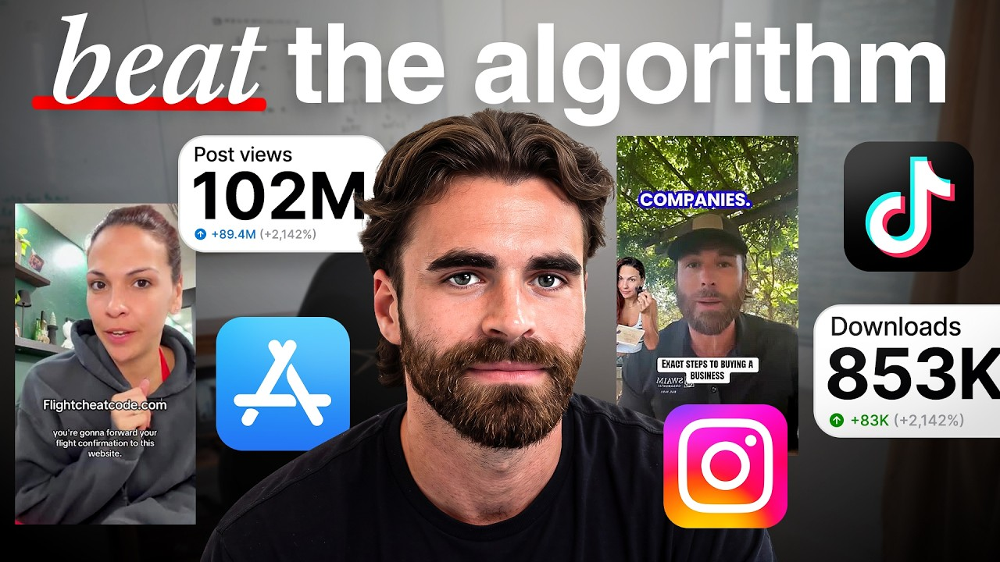

# The 1 Billion Views Content Strategy Every App Should Steal in 2026

Start building & deploying paywalls in 10 minutes flat: https://superwall.com/

## Table of Contents

* [00:00:00] Dawson's UGC Background and Content Experience
* [00:05:13] Matching Creator ICPs to the Product
* [00:08:44] Credibility vs. Relatability
* [00:09:04] Jetpack and the Flight Attendant Creator Strategy
* [00:12:16] Tracking Organic Campaign Attribution
* [00:15:49] SMB Market and Changing the Creator ICP
* [00:17:36] Using Older Creators to Improve Audience Fit
* [00:21:01] Why Views and Signups Aren't Enough
* [00:22:43] Travel, Settlement, and Older-Audience Apps
* [00:24:00] Using the Product in Viral Content
* [00:28:50] Content Approval and Visual Hooks
* [00:31:01] Building Creator Pages and Calls to Action
* [00:32:41] Using Instagram Stories for Higher-Intent Audiences
* [00:38:37] Green Screen Formats and Creator Volume
* [00:43:16] Reposting and Doubling Down on Winning Videos

## [00:00:00] Dawson's UGC Background and Content Experience

Dawson Gibbs has helped apps and brands generate billions of views, but it took him six years and nearly 2,000 videos to figure out how to make one take off. He later helped Calai generate roughly 200 million views. But the content strategy he uses now isn't just about chasing views. He uses broad content to find what earns attention, then rebuilds the winning idea around the kind of creator that the customer will actually trust. One of his campaigns generated 40 million views and $1. [00:00:00 → 00:00:28]

2 $2 million for a business buying marketplace. A couple of months later, the client came back with a problem. >> But what we found out is internally with that company is that we would get a lot of signups, but the churn was like 45%. >> The content was doing its job. It was just attracting people who wanted to get rich quick to a product that was supposed to be built for people ready to buy a business. [00:00:28 → 00:00:48]

If you're judging creators by just views and signups alone, that's an easy problem to miss. So, we pulled up the actual creator accounts Dawson has worked on and looked at why some of them earn attention without attracting the right customer. The same format can work across completely different apps, but the person delivering it and the idea inside it have to fit the buyer. And when a video starts getting traction, he doesn't need it to go viral before he tries it again. Whenever a video gets like 10,000 to 20,000 views and it has an engagement rate of like at least 3%, we will then tell those creators to double down and repost that same video. [00:00:48 → 00:01:25]

>> We get into how he turns a promising idea into content that can convert, including what he changes before reposting it. If you're hiring creators and wondering why the views aren't turning into customers who stick around, this is the system to pay attention to. Let's get into it. This is the Superwall podcast. I'm Joseph Choy, founder of Consumer Club, a Discord where top consumer app founders trade alpha and what's working now in growth. [00:01:23 → 00:01:45]

I've been talking to members doing a millionaire ARR, and they tell me they've been using these two tools. Superwall has this free AI tool trained on 422 profitable paywall experiments across thousands of successful apps. You upload a screenshot of your payw wall, and it gives you an experiment idea to make more revenue with the same number of users at paywallexperiments. com. And if your app's doing at least 100K MR, we host vetted dinners in SF and New York to hang out and network with other top app founders. [00:01:45 → 00:02:08]

You can apply with the type form in the description. Also, these app founders have been telling me they use ROR. I met Daniel, the founder of RORO, at a dinner, and I got genuinely really excited when he told me about Ror Max, which is out now, and has honestly changed the game for coding mobile apps. It's AI that oneshots full native iOS apps with Swift code, camera, sensors, haptics, payments, the whole stack. And as you vibe code with Ror, you can install prototypes directly onto your iPhone with one click and then publish to the app store in two clicks. [00:02:08 → 00:02:36]

If you've been waiting for AI coding that actually does native iOS apps, well, this is it. I got you guys a discount. You can use the code superw wall or use the link below. All right, it's awesome. We met like two more than two years ago, I think, now, but yeah, introduce yourself to the people and what we're going to be talking about today. [00:02:36 → 00:02:52]

>> Yeah, man. We're going to be talking about just everything UGC marketing and and uh UGC content and how to go viral but also convert at the same time. Uh but a little bit more about myself, funded EVO marketing around two years ago. Worked with Cali pretty closely in the first 6 months of them launching. um helped them scale up with their content and then one of the owners shouted me out and then I started Evo off of that and over the last two years we've been able to generate billions and billions of views for apps and brands and uh yeah it's been going it's been going well >> and you started as a fitness influencer right so that's how you got good at content >> dude the yeah my story is um I I pretty much posted for six years straight every single day had like 1,500 videos with only 2,000 followers for like 5 to 6 years straight no success, no viral videos and then I you know learned a lot of things through that journey and then in like two weeks I started gaining thousands of followers because videos started getting viral and then got hundreds of thousands of followers in like a 4 month span and then that's when Cali reached out to me and we partnered up as their kind of their first influencer almost. [00:02:50 → 00:04:04]

>> How many views did you get with Cali? I would say probably myself personally on my influencer page and then I was kind of the face of the brand for the first five months on their own social media page on their main page, Tik Tok and Instagram. Well, I would say around 200 million >> and that was Yeah. So that was like the brand page, your own your own page and then like because you were in the fitness niche, you just knew a lot of fitness creators. So like you would help them create like sub accounts and stuff, right? [00:04:01 → 00:04:33]

>> Yeah. So, so yeah, creator pages and then also, you know, because I had 200,000 followers in the fitness niche, I could reach out to the people that I knew and they joined in. I think I got them around 100 creators and influencers internally and they would pay me like a referral fee for every single person. So, I was cashing out at the same time working with their marketing team, which was awesome. And uh yeah, it was a good time. [00:04:31 → 00:04:56]

It was a really nice time and I learned a lot. and Jake and Alfie and Zach was uh they taught me a lot and hopefully I taught them some stuff. >> This conversation we're going to get super tactical and you have some really good uh campaigns that you've done recently that I really want to get into. [00:04:56 → 00:05:16]

## [00:05:13] Matching Creator ICPs to the Product

So maybe we can go into like you said you have this um travel app. the the travel app, you know, if we go really in depth with just the content uh of what you know actually worked and and what did not work, it really comes down to the niche and the product, right? So if the if the product is more coming from an expertise um level or a knowledge level and and not really coming from a um I would say a relatability secrets and hook like here are some secrets and hacks on the travel app. It's like putting in creator ICPs that were experts and have a credible source inside of the travel app. So, we would take like ex flatted tenants um as a ICP in the hook and also the messaging of that video. [00:05:13 → 00:06:07]

It's all about, hey, I know something cuz I'm an expert. I am credible because I'm an ex flat attendant. Here are tips that you need to know to get what you want. Now, now if you switch it to uh I know I know we're going to talk about a shopping platform or or a faith app or something like that on their side, right? The hook and the messaging of that video is I am relatable to you. [00:06:07 → 00:06:32]

I am the same person as you or you are the same person as me. I am relatable. I'm not credible. Right? Because the product's not that vir viral, right? [00:06:32 → 00:06:39]

You're not going to go book a flight and use that travel app that second. Now, if you're looking at like a faith app that helps you like read the Bible better or a shopping app that wants you to buy like a $40 purchase at this very moment, that is you have to position the travel app type of stuff that's not so viral as I'm an expert. I'm credible. Listen to me. This is how you can help. [00:06:39 → 00:07:01]

I can help you on the on the uh app and the faith app type of stuff. It is I am the same person as you. I am relatable. I'm talking to you face to face. I'm having this big pain point. [00:07:01 → 00:07:11]

you should do this at the same time. You know, you should do the same thing because you can relate to me, right? And this is how and this is a secret on how you can save money. This is a secret on how you can read the Bible better or whatever it might be on that end. So, it's like credible credible versus like relatable, I would say, in that sense. [00:07:11 → 00:07:32]

>> Okay, I think you want to hear this. For the past two years of my life, I've talked to 743 app founders. This is literally my calendar a lot of weeks because I want to figure out who's actually making money. And for the ones making1 to10 million a year, I dug into their playbooks from ideiation to build to marketing to figure out what actually made them successful and like how much of that is even profit. But what I found is the difference between apps that kind of work out versus the one that seem to like hypers scale effortlessly is actually more of a science than people think. [00:07:31 → 00:08:00]

And running this pot, I get a lot of similar questions around app businesses. So after 2 years of doing this, I finally sat down, drink energy drinks, and I just spent the last 4 days straight combining all of my private notes plus the growth systems I've personally run to add like 6 million AR now for the founders of some of these apps. And I created a presentation. I'm going to give this presentation one time on a live Zoom call on Sunday night, October 11th. It will not be recorded. [00:08:00 → 00:08:25]

I'm just giving this to people who are really serious about maximizing this run we have with consumer apps right now. It'll be fun, interactive, the past two years of consumer apps. And to be honest, like the past 8 years of me being in internet businesses are just packed into this for you. Also, it's free of course. Use the link in the description to register. [00:08:24 → 00:08:41]

I'll see you there October 11th. That's a really solid framework for just starting out with any type of niche um of content just like credible versus relatable. [00:08:41 → 00:08:52]

## [00:08:44] Credibility vs. Relatability

So, by the way, when you're when we're talking about these apps, are we naming the app or are we not going to name the app? I mean, my thing is is like if they don't know who Jetpack is, then they might not know that it's a travel app. [00:08:52 → 00:09:05]

## [00:09:04] Jetpack and the Flight Attendant Creator Strategy

So, I rather it be more of a niche thing. Now, we can name it for sure. So, it's up to you. >> Yeah. So, let's talk about Jetack first. [00:09:04 → 00:09:11]

What's the um is it was it Instagram or Tik Toker? >> Let's just do Instagram for Jetack. >> Okay. So, this is Jetack. Wow. [00:09:09 → 00:09:17]

This is a big page. 185. >> Dude, that's one that's legit one. So, from ground zero, by the way, this is where it comes down to I am an expert. I know more than you. [00:09:17 → 00:09:27]

you should probably cuz when it comes to being credible, people are going to follow this because they want to they want to use it like two weeks later down the line or eight weeks down the line. So, they're going to follow a page so they can see another five videos to whenever they do go to Hawaii and they do want to, you know, book a a a flight. They then have it inside of their Instagram algorithms already and it's reminding them right now. If it's more of an impulse decision, like a a dupe. com, like a shopping platform, it's like a $40 furniture saving or like a $40 saving on on some clothes. [00:09:27 → 00:09:59]

Like, you really don't need to follow someone on that, right? Because it's more relatability. It's an impulse decision. You're not going to follow an expert off of saving $30 or a couple hundred bucks off of, you know, a chair or something like that. >> Yeah. [00:09:59 → 00:10:12]

But on a flight is like, you know, you're going to spend hundreds of dollars on a flight. So it's a higher it requires a little bit more trust. So that's why you do the flight attendant >> angle. Okay. So this creator >> had a few of these hits. [00:10:12 → 00:10:26]

So look at these pinned >> videos. So this is the the one that seems like you're talking about like >> uh I've been a flight attendant for 3 years now. >> And then the caption is number one flight hack. >> Y >> and then it's just her talking. Why did this video do so well? [00:10:26 → 00:10:42]

Uh, first of all, the the hook when when that the visual hook right there, her like putting her ponytail back was very popular. It still is very popular right now because we we post hundreds of thousands of videos still per month. You have to get something going to the visual audience that like they need to stop and like watch something. So, that just helps with like movement and the hands are moving or usually we like use grapes or like cutting a cucumber or something in that sense just to keep people going. Um, and then it kind of goes into also the saying hook. [00:10:42 → 00:11:13]

It's like, hey, I'm a flight ex, you know, I'm a flight um a flight attendant. Here's my number one travel hack. Here you go. So, if you are I mean, everyone travels. Everyone wants to save money on flights. [00:11:13 → 00:11:25]

And if you just like start right away with like credibility on that end, uh people are just going to listen because if they can save 300 bucks on a flight, you know, people would want to just listen on that just for, you know, 30 seconds to figure out how to save $300, you know, >> and this is like a listical format. So she she gets straight into the value like right right off the bat. She does like the credibility of like, yep, >> I'm a flight attendant for three years. >> Tip number one, make sure you book on Tuesday, Wednesday, or Saturday because they're cheaper. And then like the third or the second one would be, hey, use Jetpack, right? [00:11:25 → 00:11:55]

Like use the app. This is how you do it. Here's the step-by-step process. Um, now let me tell you the the the cool thing about flightchecco. com. [00:11:55 → 00:12:06]

This is something I guess I'm just throwing the sauces out, the just all the sauce real quick. We use flightcheatcode. com. Right now, you're on the website right now, so it's going to have a QR code for you to, you know, do with your phone. [00:12:04 → 00:12:19]

## [00:12:16] Tracking Organic Campaign Attribution

But majority, 90% of the people, 95% of the people are going to be scrolling through Tik Tok or Instagram. Whenever you go to flightchecode. com, um, it directly goes to the Jetack app. Now, that helps us with our organic campaign to actually understand what is converting and what's not converting. Because Jetack might be doing paid ads, they might be using other agencies, they might be using in-house creators as well. [00:12:16 → 00:12:41]

If we have a two million viewed video that sparks up one 24 hours and then other people, you know, they have a great paid ads day, they might have another agency running at the same time, we can't get exactly the type of attribution that we're getting them. So that's the type of stuff that we do on that end. >> So you create a new domain so you so you know exactly where the traffic's coming from. >> Also jetpack like go to Jetack. Okay, cool. [00:12:41 → 00:13:04]

Like who I don't know I don't know who Jetack is, right? Like if I'm I just want to save money on flights. I don't really care too much about the jetpack. But if we go like, hey, we're going to create a more viral URL, flightcheatcode. com or flighttravelhacks. [00:13:04 → 00:13:22]

com, a little bit, it rolls off the tongue a little bit more. It it sparks to the people a little bit better. Um, so that's kind of our our approach. We don't do this with every single brand, but we do this with with with brands that don't have maybe a viral name or more of like a like if we were doing like Poly Market or stuff, everyone knows who Poly Market is, right? So, you don't really have to do that. [00:13:22 → 00:13:44]

>> That was different than Cali, right? Cuz you would just show the you just show the app demo on screen and you you didn't really name it anything else, right? >> Because because the app itself was viral. >> Mhm. >> Like a travel a travel app is not that it's not that viral. [00:13:41 → 00:13:58]

the what it does for you is viral. Like what it solves is viral, but not the actual app is viral. Like if we we had the demo of Jetpack in every single video, it would be like going through some like boring travel flight stuff and like sending an email like it's it's not that, you know, intriguing to the eyes, you know. >> Right. Right. [00:13:58 → 00:14:18]

Right. That's this is really good cuz I feel like common knowledge at this point is like, oh, you're you have to make your app for virality, like design it for virality. you with the UI and stuff, but not every app can do that. You know, if it's a flight savings app, there's just not that many UI screens that are going to look super attractive on a video. >> So, this is a really good way just like a URL. [00:14:18 → 00:14:40]

Um, make it really obvious what it's what the value is. It's like, okay, it's cheat code for flights. We do the uh smbmarket. com is another I know we're going to go through it [music] later on, but it's a you go through you you uh buy a subscription to then scroll and buy businesses that are already recurring in revenue. SBMarket. [00:14:40 → 00:15:02]

com is not like no one knows who SM SMBarket. com is, right? So what we do is like buy a business. com, right? So it's or buy the business you want. [00:15:02 → 00:15:12]

com. Now, we just now set up that domain um for SPM Market like a couple weeks ago. So, there's not a lot of videos going out with that new domain because this is a pretty new thing that we've been doing and we've been only trying it with a couple apps. Um but it's been working very well for us to know exactly what's you know the attribution from us um to the >> Can we just look at that one right now? >> This is her second or third account with SBM Market because her other accounts I think got banned or something which is weird. [00:15:12 → 00:15:40]

I think she has maybe 100,000 followers on her Tik Tok, but this is a pretty cool understanding of how she's kind of marketing inside of the videos as well. Now, there's there's two things when it comes down to the content formats of these is at first this when it comes down to like the relatability standpoint in the beginning of the message compared to the credibility of the message, right? [00:15:40 → 00:16:04]

## [00:15:49] SMB Market and Changing the Creator ICP

So like number one, if it's only if it's only relatable and just doing a painoint [music] and like get rich quick, which the type of formats that we were doing with this type of brand at first, the people that want to get rich quick are not 35 40 year, you know, plus old people that can actually buy a business that's already recurring at 20K per month, right? So, a boring product, more boring product, but more of a higher ICP, but more of a a very niche ICP. We actually like working with Yeah. Like, so, you know, you find a business, you go in there, you you buy it, you get a loan and stuff like that. Now, when it comes to what we did at first, and this is the thing that we learned, right, is we only got like 40 million views for for this this company and like generated like $1. [00:16:04 → 00:16:52]

2 million for them. And at first we were doing more like we're using like 20 year olds right of like the ICP and more of like a relatability type of understanding at the beginning of the hook where it's like hey uh get rich quick or like make your next 10,000 20,000 recurring revenue tomorrow. Right. Right. And then go buy this business. [00:16:52 → 00:17:12]

Boom boom. But what we found out is internally with that company is that we would get a lot of signups but the churn was like 45%. So, we were getting a lot of volume there and potentially making them a lot of money at first, but like two to three months down the line, they would say, "Oh, well, our churn has increased. " So, we're like, "Okay, let's go back to the drawing board here and say, okay, instead of us speaking to the Gen Z market and get rich quick and the crypto guys, right, we need to get 35 40 year old type of creators, right, from like a like a Jazelle instead of having like a a 20 plus year old. [00:17:12 → 00:17:49]

## [00:17:36] Using Older Creators to Improve Audience Fit

uh let's get like a Jazelle and another more mature type of audience that are doing the on the creator roster and let's go away from the relatability like hey I'm broke I want to make I want to get out of my 9 to5 go get go get a business right now instead of now we're kind of doing a green screen type of format and green screening what the founder videos that he's doing and saying this guy right here is the founder right his name is Josh he he's on he's on our creator roster by the way so he's like one of our creators and we kind of teach him how to do things and so like she can green screen this and say hey this guy's the founder of this brand he's credible this is what he's done and I've you know he's helped me in this situation you should go check him out so that's the type of stuff that we did and how we changed we we changed the creator ICP and then we kind of changed the type of format so we can have a little bit more credibility >> I I don't think I've seen something like this before this is really interesting cuz that was their original account I looked at it was founder SMB market so there's this guy >> y and he's making like the credibility y >> videos where he's probably saying stuff like >> I bought a business and I made I made this [music] much >> versus like >> this woman is saying it's still a little bit of credibility but it's borrowed credibility. She's hey look at this look at this guy here's what he's and she's like kind of hyping him up. Y >> um so it adds credibility but >> it's like right in between credibility and the relatability thing. It's like a in between both where like, you know, she's using the borrow credibility, but also she's kind of like being relatable at the same time because like she just caught this secret and like, you know, he's a genius. Take a look at it. [00:17:49 → 00:19:28]

And it's like pretty pretty simple type of format to do. Like you don't have to have the best creator of all time doing these type of videos. You know what I mean? Like now Dazelle is the best creator probably in the UGC game at this very moment. I'm we're more than happy to have her inside of EVO and she can do any type of format you can pretty much give to her. [00:19:28 → 00:19:44]

But, uh, you know, this is not a format that you have to [music] spend two hours every single day training up a creator to do, you know. >> Yeah. Yeah. Yeah. It's actually pretty simple. [00:19:44 → 00:19:54]

This this video has 214,000 views and it's just it's a hook. Like the text hook is just he's living in 2099 and then it's her just saying like, "Oh, just watch this. " for the last two months. This is probably the most viral green like the green screen format like this where you take um kind of another viral video that's done pretty well in the market. You just stitch it and make a green screen. [00:19:54 → 00:20:18]

It's probably like one of the most viral content piece right now over the last couple months. And of course, we're going to use it on every single brand if if it works. You know, if you look at I bought a boomer's business and got rich, that was the type of videos we were doing at the beginning of this, right? And you can see it's February February 10th, so five well no um 7 months ago. This is the type of format we were doing at the beginning where it's um calling out a Gen Z type of population. [00:20:18 → 00:20:47]

Um she has like the glasses on so it makes her look younger. It's it's kind of going towards you know 20 year olds and they're going in there. We might we might get a lot of users from it but the intent of that buyer because we could care less about views. It's all about at the end of it, right? [00:20:47 → 00:21:03]

## [00:21:01] Why Views and Signups Aren't Enough

like are they paying you guys money, right? Is the churn low? Um, and we just found out that this type of content, right? Especially the saying hook, the text hook and the type of creator ICP sitting in a car as well is all about Gen Z stuff, right? So, we had to back it up a little bit and get more credible, get a little bit more older people to do the type of content. [00:21:01 → 00:21:23]

There's so many young people making like oh how to get rich, how to make money content that it's almost like harder maybe even though it's a more competitive like harder to go viral and then even when you get the users it's like they're younger people so they can't afford the products as much. Do you feel like in general like among the clients you have there's um still a lack of like apps serving older markets? >> I definitely think so. I think people are in kind of the vibe coding era right now where it's all about how much getrichqu in a sense is like you know let me just make crazy um UIUX pages that I can just use inside of every single video and it's you know directed towards 20 year olds and it's more Gen Z talking um sim similar to like kind of the faith app bubble bff that we've done the Bible BFF app it's all about the Gen Z stuff now whenever you kind of back it up a little bit and say, "Okay, well, maybe I [music] don't want to make just a viral video. I mean, a viral app only. [00:21:21 → 00:22:24]

I want to actually make an app that actually solves pain points and actually helps our customers. " [music] Uh, you just have to take a little bit of a different approach when it comes to content, which we which we kind of do on a lot of stuff. >> On that topic, do you are there any niches that that are really interesting to you right now that are serving older audiences of of apps? [00:22:24 → 00:22:45]

## [00:22:43] Travel, Settlement, and Older-Audience Apps

Honestly, it comes down to the travel industry right now. Jetpack, you know, is probably the most uh pioneer app inside of the travel uh industry right now where you can see other chop of travel apps coming out. Um, also the kind of like the settlemate um type of apps where you get like the uh the lawsuit money or something like that or settlement money. So those are the two things that are really popping off at this very moment that are kind of like 30 40 year old type of stuff where that's when then you kind of bring in Facebook posting right then you bring in YouTube sto you know YouTube stories which still is not as much as like Facebook and Instagram like Facebook and Instagram are the two platforms where if you have a little bit more of older audience those are really going to connect on those two platforms Tik Tok YouTube stories sometimes Snapchat uh Snapchat that we do um that's like 18 year olds to 25 where you know you can throw a Bible BFF Gen Z app in there or a shopping app that's all about girls inside of Tik Tok and it'll blow up. >> Yeah, the platform seems to matter so much like Facebook, Instagram and it's nice cuz you can just cross post on both. [00:22:45 → 00:23:51]

Um so to reach older audiences and then yeah Snapchat and Tik Tok for younger ones. What was the other one that you're about to tell me? The Bible one. [00:23:51 → 00:24:02]

## [00:24:00] Using the Product in Viral Content

>> Yeah, Bible BFF and then goop. com. I know we don't want to talk about frameworks, but just about content, but like they then take those uh performing content that we do on their creator pages and they repost it on their main page and it still goes viral at the same time, which is awesome. So, it's kind of like a double double-edged sword there. But, if you take a look, these are a couple hund couple months uh old type of videos where it's kind of just like them in their car um traveling listening to the product. [00:24:00 → 00:24:28]

Right? Now this is different from the travel app or jetpack and then the buy the business type of product called SBM market. This is Bible BFF. They are all about a viral product. So whenever you have a viral product that is more Gen Z, you want to actually use the product more in your videos, right? [00:24:28 → 00:24:47]

So in these videos, we don't actually s show the demo um in some of these formats. Now, we do in some other formats as well, but um in this in this demo or in this video here, this content is legit legit very organic. She's just driving home from work, right? And listening to the Bible stories being told on Bible BFF with the voice narrators doing it in a jinzy way, right? So, like it's all about virality there. [00:24:47 → 00:25:13]

So, we're going to use the product more as the actual viral standpoint where it's relatable, right? Everyone can relate to being in your car listening to a podcast, listening to a sermon. This is the same scenario you would be in. So you can put yourself in her shoes. You can everyone can relate to the Bible probably is pretty boring to read to a certain extent, right? [00:25:13 → 00:25:35]

You can then relate it to a Gen Z person reading it and it's more of a, you know, a little bit more understanding there. That's different from sending an email to a travel agent to get money off. >> Yeah. Yeah. you know, it's actually a viral product, which is also always great to work with, right? [00:25:35 → 00:25:51]

Like, you know, it's a much easier type of strategy that we have to put together to crack the code. That last video there, this content here, it's still ripping my This is video from like December 11th, but it's still ripping like legit today. Couple people in the car, relatable, listening to the product cuz of our product again, reaction voices, a little bit more editing because you're kind of going in back and forth through the with the videos. Um, and it's just it's all about the product, right? Like you can't do this with any other type of like boring product in a sense. [00:25:51 → 00:26:21]

But the text hook right there, POV, we just found out a girl recorded the entire Bible and made it sound like tea, right? Like so that's talking strictly to a woman, right? Like I don't know what a te what T is, but to a woman, you know what I mean? You know, like but to a woman tea usually means like gossip, right? So it's like, you know, kind of relating in that sense. [00:26:21 → 00:26:40]

Another thing that's interesting is like multiple people in the video. Is it is that an important part where it's like multiple people's reactions? >> I I would say it's all about keeping the people there for the first 5 seconds. So if you have three to four faces or two faces to look at, after 5 seconds, you're still watching the video, right? So you just got you just have more things going on for the visual hook >> and more reactions to look at. [00:26:40 → 00:27:09]

>> Right. Right. It's like subway surfers. Yeah. You know what I mean? [00:27:07 → 00:27:11]

So, you got to play you got to play into that a little bit. But, yeah, that's kind of the the meaning behind that. And look, I don't probably know exact like >> we probably got the same amount of views and conversions with it would just being one person in the car driving, right? Except for like four people or three people in the car. But, of course, you know, if a certain format doesn't perform after a couple weeks, we just kind of let it go and kind of enhance it of some sort. [00:27:11 → 00:27:38]

And so the other format kind of went away because it probably got too old in the algorithm or something. So we just had to spice it up and make it a little bit more original. >> So let me show you this. A lot of app founders I talk to have a feeling their app has viral potential but don't want to be the person brain rock scrolling an hour a day hunting for formats or worse burning thousands on creators shooting videos that just flop. Recently I've been telling every founder I meet about Spy Talk. [00:27:38 → 00:28:01]

It's basically an AI Tik Tok viral marketer that I've seen a lot of top app growth teams using. You just paste a link to your app and this agent scrolls hundreds of thousands of Tik Toks for you, finds the outlier videos from competitors who've already cracked the best formats that are driving installs in the niche of your app and then it remixes the hooks, the angles, and then it makes playbooks so you can pretty much copy paste virality. And then it alerts you when it detects new breakout formats that would also work for your app. This is the only growth tool I 100% vouch for on this channel because there's a ton of Genai content tools out there, but none of them tell you what to make. Spy Talk makes sure you're never in the dark about what's actually working. [00:28:01 → 00:28:37]

Now, I'll put the link in the description. >> Did you also like in the brief, do you know if they're supposed to be doing these things with their hands? Like these two girls are eating like a Cheeto and then this girl is like playing with the squishy ball thing. [00:28:37 → 00:28:52]

## [00:28:50] Content Approval and Visual Hooks

>> 100%. It bro it. So, we content approved every single video that goes out before it is ever posted with every creator. Like if they're not doing something with their hands, like look, she has like a little like thing in the background like squeezing it, right? And then they're eating Takis. [00:28:50 → 00:29:05]

Like if you look at every single video, she's doing something with her hands, >> right? Like >> it's like what in the world is in her hands? Why why is she eating a rice cake that way? >> Like why why is she eating Takis at 2 p. m. [00:29:05 → 00:29:16]

in the morning? Like, you know what I mean? Like just like simple stuff like that. >> Yeah. >> You know, like why is she squeezing that? [00:29:16 → 00:29:22]

Why is she eating pretzels? You know, it's just it's just stuff that's happening. I see I see this like framework emerging a little bit of like it's like naturally viral product to like naturally not very v viral product and those ones tend to be like the more boring but maybe more lucrative ones as well at least like per user. Do you have different ways of running campaigns that are, you know, naturally viral product versus maybe like higher trust products in terms of how many creators like the types of like the type of creative freedom you give people? Like what are the biggest differences? [00:29:22 → 00:29:56]

The Bible one is probably like the most viral and then Cali I would say is like also pretty viral but a little bit of trust like there like I remember there was like some daily routine videos of fitness influencers and stuff and then the travel is like more credibility and then the business marketplace is like even more credibility. >> Yeah, I would say we don't give more leniency when it comes to the creators posting. Uh we're very strict when it comes to the content approvals. I would say it really just it doesn't really come down to the amount of creators or anything in that sense. It's more on the side of like how can we build the actual page. [00:29:56 → 00:30:31]

It comes down to page the page building. Now you can see here that she probably has 10 times more views on this page but probably 10 times less followers. And then if you go back to like the uh Jazelle Travel Hacks that has 200,000 followers, by the way, that's not even like the the the most ever. Like we have one that hit like a million a million followers and then it got banned, which sucked. But anyways, on the travel app side of things, we we want to make sure that the creators is talking from credibility, that they're the expert almost like kind of like a influencer in the way of like them. [00:30:31 → 00:31:11]

## [00:31:01] Building Creator Pages and Calls to Action

they're they're the top like type of talking person in that industry. You're you're going to follow them in order for you to get something back from you, you know, in six weeks or six months from now. So, we want to really hit hard on them like call that like the call to actions, right, is in the in the in the captions on some of these videos are share this with three friends that want to sh save uh on on on flights or something or two is uh comment this word to get something inside of your DMs, right? And then we we send it something over with like mini chat automations. We're not really doing that when it comes to uh the Bible BFF side of things. [00:31:10 → 00:31:47]

Now, we we sometimes do, but we just want to do a little bit more call to actions inside of the more boring apps or boring marketplaces just because it's a little bit more higher intent people and we got to push them to a sell a little bit more than just like the impulse like it's more impulse buying when it comes to like a dupe. com or bubble bff because it's all Gen Z. It's funny. It's it's make you laugh. We had some type of emotion come from it. [00:31:47 → 00:32:14]

From that emotion, you're going to slide out of TikTok and go buy it, right? Um, so we got to we got to hit harder a little bit more when it comes to a travel app or you know a a finance app or something like that. >> So then the page becomes more important because people will actually follow and they might not download the app um from the first uh from the very first video. They might have to watch a couple more to build up the trust and see >> this person talking multiple times >> and that's where the that's where the Instagram stories come into play. [00:32:14 → 00:32:46]

## [00:32:41] Using Instagram Stories for Higher-Intent Audiences

Then we then we start stories, right? Then we we like if we have 200,000 followers, you can probably generate probably 10,000 viewers from those stories every single time you do something. So like we'll work in tandem with the brand to say, "Hey, is there a giveaway that you can do with us this month, a $1,000 giveaway, right? So we'll we'll go in here and Jazelle will be like, "Hey, I partnered up with Jetpack. " Boom. [00:32:46 → 00:33:09]

And boom. If you enter this and and share it with three friends or yada yada, then you are entered, you know, entered into a $1,000 giveaway, right? So, it's like we stopped we we started at topfunnel presence, right? For get people to get here and then middle middle bottomfunnel type of formats like the um you know the credibility thing of her like pointing back to the um the owner or her as an uh ex-flight attendant or whatever it might be. That kind of gets people to stay and follow. [00:33:09 → 00:33:37]

And then we do like really really bottom up uh funnel content inside of the stories because if you're watching the stories and it's free money and a giveaway, you're going to really really go after it. >> That's really good. I because I've heard from like personal brand creators on Instagram that stories are really high converting. Like once you build up followers, they're going to start viewing your stories. And if you um that's the way to kind of like nurture um and also call to action. [00:33:36 → 00:34:05]

Yeah. I didn't realize that there is um that much stories in UGC, but it makes sense cuz this is almost like a micro influencer because they're they're basically becoming a credibility in this niche. And then okay, let's let's look at Dup. >> Yeah. So, I mean, a bunch of those videos are pretty much some from our creators, some from their in-house creators and stuff. [00:34:05 → 00:34:27]

Now, those are pretty much the last two months. We did some in-house consulting for them with their in-house campaigns and then also we done we've been working with them for like a year now almost which is awesome. They're they're great people. We've been ripping this green screen format right here probably for the last two to three months. Every single video that's being posted is doing the green screen. [00:34:27 → 00:34:50]

So she's pretty it's like she's pretty much reacting if you go back to that last video which is funny. She's reacting to her own video, right? So you get comments like, "Is that is that just not you? " Like like why are you reacting to this and saying this girl is is you know an expert? You better listen to her right now, right? [00:34:50 → 00:35:08]

Like stuff like that. Now also also in these green screens is we get very very um out of pocket with the saying hooks, right? So, like it's the first three seconds of the video. Her saying hooks might be like, "I hope she has, I hope she, you know, wins a million dollars in the next 24 hours because of what she just did for me, right? " It was just like something like that. [00:35:08 → 00:35:30]

The only thing they have to do is just say something for three word, you know, three, you know, three seconds. So, you want to get as much as you possibly can. A lot of a lot of this, right? A lot of hand motion, a lot of going back and forth on the camera just to get you some some attention. you know, if your creators are not using their hands and just doing this right here and just talking to the camera, you know, that's just not going to get get it to that next level. [00:35:30 → 00:35:54]

>> And these are all collab posts it looks like on the on the original dupe. com Instagram account, but then all these creators are collab posting it. So then it's like, >> yeah, if if a video gets around 20,000 um follow I mean 20,000 views, then they will just like repost it on their main page. So you have uh you know standard UGC campaign and then you just repost it on the on the brand page and then does it get like additional views? >> Oh 100%. [00:35:52 → 00:36:23]

Sometimes you can you can collab also you know you can also just download it and then repost it as well but it's a little bit easier just to do collabing and it doesn't really affect the views. If you go to uh you know if we put the travel the travel industry and the buy in the market you know buying a business industry you know that's kind of going back to that framework of credibility. I'm an expert. You should listen to me. Here's how you save money or here's how you do this. [00:36:23 → 00:36:49]

Now, with dupe. com and a and a, you know, the Bible app and all these other ones like crypto, like you, you know, you want to just talk strictly, I am you, you are me. We are relatable. Here's a painoint that I'm having. I'm not rich now. [00:36:47 → 00:37:01]

You should get rich now. You know, um, [music] here's how you save money on furniture. Here's how you save money on on clothes in the next couple days. You should go buy it at this very moment. Um, just like stuff like that where you know it's all about the relatability versus the credibility. [00:37:01 → 00:37:17]

>> Do you think that this react the green screen reaction works as like cold UGC on brand new accounts or does this work because like people recognize her face and they want to see her her reaction specifically? >> I definitely don't think it's because they recognize her face. Um, I do want to go over another format that we created probably at the beginning and kind of the understanding of that format. It's definitely not because her face and stuff. I would say it's more on the side of it really just comes down to I am a creator like everyone else is. [00:37:15 → 00:37:51]

I've found this secret and this hack. You should do you know you here it is. I'm putting this on a golden platter for you. Do the same thing and that's it. Because like you can have 20,000 followers. [00:37:51 → 00:38:00]

It doesn't mean that like you know the world knows about you. like when I had like 200,000 followers on Instagram, you know, I don't think I don't think that it was the reason that uh Cali when I would put videos of Cali inside of my videos of why that would be the number one reason why they would buy Cali. Um I think I think videos on Cali, you wouldn't like be talking about it as like, oh, as someone who's really great at fitness, I think that Cali is the best product. You were just you were just kind of like showing it, flashing it for a moment, right? >> 100%. [00:38:00 → 00:38:34]

>> This seems like it could almost be like the new clipping like >> Yeah. [00:38:33 → 00:38:38]

## [00:38:37] Green Screen Formats and Creator Volume

Yeah. >> Green screen format. Like if you have a format that works already, you can just get dozens of creators to just react to it. Basically, >> the green screen formats, it's a little bit different from the long text formats and the face reaction formats to where it's very simple to do, right? Like you you can just like record a 5-second video on a long text format and put a lot of you know a lot of words on a video and like have a lot of views come in because it's on repeat because it's only 5 seconds but it's very low effort but you can get a lot of volume out but the conversions are very bad right? [00:38:38 → 00:39:15]

That's where like you have or the face reaction like oh my god like covering your mouth like this for 5 seconds and then it goes into a demo. The conversions of actually talking for at least like 3 seconds or 5 seconds actually talking to the camera face to face is always always to a certain extent always going to do better than them like thinking you're an AI bot or thinking like this is like a weird video that you're not even talking. Talking videos are just like that, you know, it's it's the top pinnacle. So this is like an in between like loweffort talking video that still like shows credibility and irrelability at the same time. >> Bullish on humans then, right? [00:39:13 → 00:39:56]

[laughter] Cuz like it's easier and easier to automate the face hook react. Like I've seen tools where you can just like fully AI generate like a a hook reaction, but it's like it's still not quite there for for talking, at least for like a long talking video. Maybe it's getting there for like a short short talking, but these hooks are very like with all the motion that's happening in the video. It it it looks very authentic and human and it does build like a tiny bit more trust cuz it's like, okay, this is an actual person. They're like they have a voice. [00:39:54 → 00:40:27]

[music] They're talking. >> Definitely. I'm I'm trying to I'm trying to find you a format that we did at the beginning of Duke. We don't do it as much as of right now. Right there. [00:40:26 → 00:40:35]

Uh the 2004,000. >> Interesting. So, the hook was like, "My mom's an interior designer. " >> Number one, it's right off the bat is I have a credible source that's telling me something. You should listen, right? [00:40:35 → 00:40:47]

My mom's an interior designer. She just showed me something, right? Then it then it goes into the demo. Um, the demo is if you can listen to what she's saying. [music] Yep. [00:40:47 → 00:40:57]

So, I I'm a college broke student or I'm just broke. I'm trying to buy a bed. I cannot afford it because I'm broke. And so that's the pain point. Everyone can relate to it. [00:40:57 → 00:41:09]

You know, you can relate to not having money. And then of course the product is very easy. I'm ve very happy that dupe. com understands how to put their product inside of videos and make it very easy to make it inside of content. As in like as easy as going to the URL and putting dup, you know, dupe. [00:41:09 → 00:41:29]

com. Instead of saying dupe. com, you might as well just spell it out, >> right? So they can know, right? So it's not just dup. [00:41:29 → 00:41:37]

com. It's like dup. com, right? So they know exact like they're looking at this. Like imagine if we only did this for like half a second. [00:41:37 → 00:41:47]

We say dupe. com and then we went to the other one. >> Yeah. >> But if now it's like 5 seconds of like doing it dup that's the call to action there, you know? >> Right. [00:41:47 → 00:41:56]

Right. It's a very slow easy to understand call to action. >> Yeah. Yep. Yep. [00:41:56 → 00:42:02]

So, and then like everything else is just them going through the product and looking at the the results and stuff. So, you know, starts with credibility source. I'm showing you a hack from this credibility source. I'm showing you a hack. Here's the pain point that I'm a college student or I'm broke at the same time. [00:42:02 → 00:42:19]

I can't do this. And then this the solution is the product and the call to action is with inside of the solution. >> We we've gone over some really interesting frameworks for uh credibility. So there's like you know there's like the natural viral there's no credibility there. There's I am the credibility like I am a flight attendant so here's my tips and then there's like reacting to the the source credibility. [00:42:19 → 00:42:44]

And then there's like oh my family member or my friend is the credibility. Hey by the way look at them. They're right there like in my video. And then just saying oh they showed me this. That's very interesting. [00:42:42 → 00:42:54]

Yeah. There's a lot of different ways to show credibility. >> Yeah 100%. When you get a video that does really well like this, what do you do with this? Like is the creator able to multiply it like multiple like do a bunch of variations of this too? [00:42:54 → 00:43:09]

>> So you can see like she pretty much did the same format like back to back right there. Now this is this is on dupes. com pages. This is not on her actual actual page page. [00:43:08 → 00:43:17]

## [00:43:16] Reposting and Doubling Down on Winning Videos

Whenever a video gets like 10,000 to 20,000 views and it has an engagement rate of like at least 3%, we will then tell those creators to double down and repost that same video or repost that same video with a different text hook or same hook, but do the exact same thing. Like legit go back to the same kitchen with your same same person, do the same script, just change up the same hook, change up the text hook a little bit and do the same thing. Or we'd actually just tell them to also repost the same exact video a couple more times. And if those videos keep getting at least 10,000 views over the next four to five days, we'll get usually a 500,000 to a million view video, right? Because all of these vid like all of these videos, if you watch them, are all capable of getting two million views early at at the bare minimum. [00:43:17 → 00:44:08]

The only reason why they're not is just they just haven't hit the market at the at the right time. Right? These are great videos, awesome creators. It does, you know, it goes through the same process of of, you know, if you look at this video and compare it to a 10 million viewed video, it's like the same thing, right? So, you just got to keep going and and put the volume out like that. [00:44:08 → 00:44:29]

That's one of our creators right there. That's Marilyn. Awesome. 170,000 likes, 6. 9 million views. [00:44:29 → 00:44:36]

Not as a good, she's not even better of a creator than Molly was, the other girl, right? But like, it's the same framework. It's the same type of structure. It's the same type of script. It's the same type of format. [00:44:36 → 00:44:48]

It just didn't hit the market. It hit the market better or the right time or whatever it might be. I can't control the algorithm gods, right? But she's definitely not better than Molly or this other creator, right? So, it's just all about just getting it at the same time and the volume. [00:44:48 → 00:45:03]

>> It's like Yeah, it's so similar. It's like almost the same text hook. Maybe it was the fact that it was the kid or the son or whatever instead of the mom. Or maybe it was just random. Like you said, >> there's two things. [00:45:01 → 00:45:16]

So the blonde head girl versus the motherly figure, right? So she's still relatable, but she has a credible source behind her. The other one is she's the credible because she's a mother in a certain extent, like a little bit older of a ICP, more like a motherly figure that's talking to you. Her her son showed her an hack, right? So it's like it's kind of kind of flipping it a little bit like more credible because she's a little bit older, a little bit higher ICP. [00:45:16 → 00:45:44]

She's a motherly figure than her like her son kind of showed her something, right? Like a hack and she just wants to share and like kind of speaking from like a mother like understanding to to these people. >> It is also credibility in a different way cuz older people often uh like find technology things from younger people. So that's like kind of like a credibility thing of like, oh, my son showed me this cool thing, but then she is older, so she's speaking to an older audience probably of, you know, relate to their kids telling them things. So, >> and if you also think about it, you're not going to believe that a 40, 50year-old creator, it it seems more reasonable that like she's actually trying to show a secret and a hack because she's not just like posting every single day trying to be an influencer. [00:45:44 → 00:46:33]

Right. So like a little bit more odor audience that is not that is connecting to an older audience that doesn't really understand this influencer Gen Z era, right? And it's kind of just like talking like in like a Facebook group to each other on FaceTime. You know what I mean? So like that's type of the conception there because mom's own own like mom apps or mom creators or older women creators when I say older I don't mean like 80 year olds but I mean like you know 30 plus year olds they they always they convert the highest. [00:46:33 → 00:47:07]

I mean, even in the influencer marketing era, which I ran for like a year straight, if you get a mom, a mom influencer with a couple kids in the video, right? Or a family influencer, like a family type of influencer page, you can you can put anything inside of those pages and any product that relates to family and it will convert at crazy numbers. >> But you can't run it with any product, right? like the SMB buying a business thing doesn't there's no family angle to that, right? Or is there do you like you think that any product can be like you can use moms as creators? [00:47:07 → 00:47:43]

I think you can use I don't think probably every product. Um, but if you do need a I guess if you need to hit a a certain ICP or if you need to hit maybe a little bit more higher intent buying audience, I would use definitely older, you know, older generation people or, you know, older people in general because, you know, an 18-year-old doesn't have as much money as a 38-year-old in the in [music] this world to a certain extent, right? So if you need to, you know, um get an older audience, I mean an older creator to connect to an older audience because it's all, you know, relatability there, um it's it's kind of what we want to do on that end. >> This is this is so much sauce. A lot of good a lot of good stuff in this in this uh talk. [00:47:43 → 00:48:30]

Any closing thoughts? like I guess just like what would you just like broad advice for people um or anything that you would want to tell people like starting out with trying to get into into UGC? >> Yeah, I got a couple things. >> I would say the the right the right 40 million views is always more worth than 200 million wrong views. So for like SPM market, very niche, calling out the exact ICP that we need for higher intent. [00:48:30 → 00:49:00]

Might might not get as much as many views, but we're calling out exactly who we want them to to hear this from. Less views, more high intent conversions instead of us just trying to go viral like we did at the beginning of that business and get rich quick. Get rich quick. But those people like okay your the churn is so much higher because you don't actually people that want to get rich quick are not the people that can actually buy a business that's going to get them recurring revenue right so just switching up that where it's not all about the views right now at the beginning of it this is another thing is at the beginning of you doing I would say your campaign definitely start focusing on views first in the first couple weeks in order for you to be a little bit more broad in the type of creator ICP that you use, in the hooks that you try out, in the formats that you try out, right? Like you can take a long text format or reaction video or let's just say a long text format, a long text format and have a story that is a scenario that people can relate to. [00:49:00 → 00:50:05]

And if that video gets t 20 million views but converts very low, you can just turn that long text format in that script into a talking head video with a credible source and talk to in a talking head video and it converts way more but gets way less views because it's not a long text format that just gets a loop a loop of views every single time. Definitely go after like top offunnel content, right? Top of funnel content is like not really any call to actions, not really even mentioning any anything about the app or the brand or the product or anything inside of it in the long text format, but you're using it so that you know, okay, how can I, you know, what hooks can I use? What what what scenarios can I use? Does this relate? [00:50:02 → 00:50:42]

Does this work? Does, you know, does this get any type of traction inside the comments? And then you just take the topfunnel type of content and then move it into like a middlefunnel content and say, "Okay, now I'm going to go to more converting formats like talking head formats or um like the my mom's a genius format, have some type of credibility in there, and then kind of like take that the learnings that you did in the first two weeks and then have it implemented in the last two weeks. " There there's a whole spectrum of how high converting certain formats are and I I feel like we laid out a bunch of frameworks like and examples in this just like with varying amounts of credibility, varying amounts of human element and trust. So reusing formats uh reusing concepts within multiple different formats that are going to convert differently. [00:50:42 → 00:51:32]

Great advice. Thanks. Thank you, Dawson. This is great uh great episode. >> 100%. [00:51:32 → 00:51:36]

And the last thing is the format is the vehicle. The variables inside of it is actually what makes it works. So if you have if the for the format and and how you do the video and and the and the switching of the camera and the the the handwaving at the beginning of it, you can use almost probably every every single format over every single industry, but it's about the actual strategy that's inside of it, right? Do I hold a rice cake or do I hold a marker? Right? [00:51:36 → 00:52:05]

Do I hold a pin? Like me holding a pin looks more professional than me, you know, doing this and drinking it and something like that, right? Or, you know, have a credibility source at the beginning of the video compared to having someone jumping in the background in your car doing a, you know, holding this up and like waving it, having a good time. So, the format's the vehicle. Everything inside of the format are the variables that you can control depending on your industry. [00:52:05 → 00:52:31]

>> Even as you're holding that pen, I was like, "Oh, wow. I trust him more. " >> Do you tr you trust me more? right? That you trust me more if I put these if you put if I put these on, I look like a Gen Z guy because of this like kind of, you know what I mean? [00:52:29 → 00:52:41]

So, it's uh it's all about how you portray yourself. >> Awesome. Where where can people find you? >> So, you can find me personally um at Evo Dawson on X evo Dawson on Instagram and then the company is evomarketing. co. [00:52:41 → 00:52:54]

So, evomarketing. co. And uh yeah, come uh come check us out. >> Thanks so much, Dawson. >> Dude, Joseph, have a good one, man. [00:52:54 → 00:53:00]

>> Have a good one. >> Peace. Yeah, something you might not know, most of the founders I cover on this podcast are hanging out right now in the Consumer Club Discord, sharing with each other what's working now for consumer apps. So, you can apply to join Consumer Club if that sounds interesting to you. And this is the Superwwell podcast. [00:53:00 → 00:53:15]

Of course, you got to check out superwall. com. We have more videos on the channel, so dig into those to learn from app founders who are willing to share super tactical stuff about app growth. [00:53:15 → 00:53:25]
