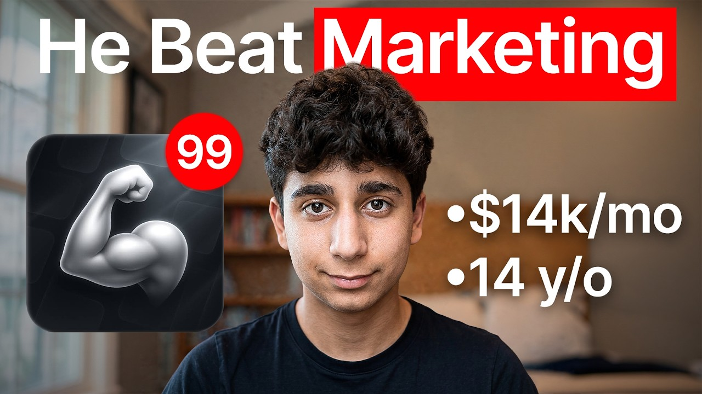

# The 14-Year-Old Who Built a $14k/Month AI App

Start building & deploying paywalls in 10 minutes flat: https://superwall.com/

## Table of Contents

* [00:00:00] - Introduction: The 14-Year-Old Founder Making $14K/Month
* [00:02:20] - The Yadegari Backstory: From Roblox Games to Gaming Sites (Totally Science)
* [00:03:53] - The Genesis of Locked: Turning Gen Z Self-Improvement Into a Video Game
* [00:05:14] - Vibe Coding Prototypes: Building in Figma & Scripting via Claude
* [00:06:07] - Why Influencer Marketing Crushed Paid Ads, Reddit, and X
* [00:07:22] - The "Day in the Life" Format Fit: Reaching Gen Z Audiences Automatically
* [00:08:06] - Video Deconstruction: A $3,000 Single-Post Case Study
* [00:09:08] - Breaking Down App Economics: Conversion Rates & Ad RPM Metrics
* [00:09:47] - Vanity vs. Reality: Identifying Engaged Audiences via Content Comments
* [00:11:20] - Outreaching at Scale: Managing Manual DMs, Account Limits, and Verification
* [00:12:55] - The Hooked DM Template: Forcing Creators From DMs to Negotiation Calls
* [00:13:37] - 4 Influencer Deal Structures (Standard, CPM, Minimum View Clause, Bonus)
* [00:14:46] - AI Growth Hack: Sourcing High-Leverage Outlier Formats with Spy Talk
* [00:15:50] - Constructing Minimum View Clauses & Campaign Creative Freedom
* [00:17:44] - Attribution Strategy: Monitoring App Store Download Spikes
* [00:18:23] - The Risk Mindset: Lessons Learned From Chasing Empty Vanity Metrics
* [00:20:04] - Evolving Creative Channels: Unblocked Gaming to Productivity Software
* [00:21:28] - What’s Next: Scaling 10X (The Shopify for Apps Engine)
* [00:22:38] - High School Entrepreneurship & Normanizing Gen Z Side Hustles
* [00:24:27] - 2026 Consumer App Trend Predictions: AI Model Arbitrage & Viral Party Formats
* [00:25:57] - The Speedrun Playbook: How to Launch to $10K/Month From Scratch

## [00:00:00] - Introduction: The 14-Year-Old Founder Making $14K/Month

My app is Locked and I was able to scale up to over $14,000 a month. I'm in ninth grade, freshman in high school. >> This is Evan Yatagari and at 14 years old he had already scaled a consumer app to over $14,000 a month. After that he built 10X, a Shopify for apps platform that hit 30K ARR in its first 30 days. He's the younger brother of Zach Yatagari, the founder of Cal AI, but Evan didn't just copy his brother blindly. [00:00:00 → 00:00:24]

Instead he personally tested every marketing channel he could get his hands on until he found the one that actually generated the most >> downloads. When I got started with Locked I tested out a bunch of different acquisition channels. I tested out Reddit marketing, X marketing, influence marketing, and even paid ads. Quickly I realized that Reddit the most effective channel and after we had our first $1,000 day. >> In this episode Evan walks through what actually worked to get Locked to 14K with almost no budget. [00:00:24 → 00:00:51]

He's going to share the single acquisition channel that outperformed everything else he tested, the framework he's using right now to find his next consumer app idea before anyone else catches on, and how he'd speed run an app to 10K a month if he had to start over. >> If you want to speed run to $10,000 a month once that's done I go straight into >> By the end you'll have the exact playbook he used to make his first 14K at 14 years old. Let's get into it. This is the Superwall podcast. I'm Joseph Choi, founder of Consumer Club, a Discord where top consumer app founders trade alpha and what's working now in growth. [00:00:51 → 00:01:24]

I've been talking to members doing a million ARR and they tell me they've been using these two tools. Superwall has this free AI tool trained on 422 profitable paywall experiments across thousands of successful apps. You upload a screenshot of your paywall and it gives you an experiment idea to make more revenue with the same number of users at paywallexperiments. com. And if your app's doing at least 100K MRR we host vetted dinners in SF and New York to hang out and network with other top app founders. [00:01:24 → 00:01:49]

You can apply with the typeform in the description. Also these app founders have been telling me they use Roark. I met Daniel, the founder of Roark, at a dinner and I got genuinely really excited when he told me about Rorke Max, which is out now and has honestly changed the game for coding mobile apps. It's AI that one-shots full native iOS apps with Swift code, camera, sensors, haptics, payments, the whole stack. And as you vibe code with Rorke, you can install prototypes directly onto your iPhone with one click and then publish to the App Store in two clicks. [00:01:49 → 00:02:16]

If you've been waiting for AI coding that actually does native iOS apps well, this is it. I got you guys a discount. [00:02:15 → 00:02:22]

## [00:02:20] - The Yadegari Backstory: From Roblox Games to Gaming Sites (Totally Science)

You can use the code superwall or use the link below. We got Evan today. What is your app and how much money is it making? >> My app is Locked, and I was able to scale it to over $14,000 a month. >> And you are Evan Yadegari, brother of Zack Yadegari, who built CalAI and recently exited to MyFitnessPal in a really great exit story. [00:02:20 → 00:02:45]

Have you been working with Zack this whole time, and is that how you got into entrepreneurship? Or have have you always kind of had your own projects as well? >> I I've always been into entrepreneurship. At the age of nine, I developed two Roblox games. After that, I tested out all kinds of business models, shoe card selling, sports card selling, whatever you can think of. [00:02:45 → 00:03:04]

Eventually, I started creating content for a gaming website called Totally Science. It was actually Zack's gaming website that he sold to the owner of FreezeNova. The owner of FreezeNova then hired me to create content for his because I was able to take the Totally Science account from about 30K followers to almost 100K followers, and the videos would be super simple, and my first month I made $1,000 doing that. Second month, $2,000. At the time, I was >> [music] >> 12 years old, just turned 13, and shortly after that, I realized I can just create the website myself. [00:03:02 → 00:03:35]

So, that's exactly what I did. I created a website called EvanClub, and in doing so, I was able to make a lot more money. Then, after seeing Zack's success with CalAI, I decided why not give it a try in the app space. I launched Problem Pal, one of the apps I launched, scaled to $2,000 a month, then Locked, which of course we're talking about in this video, that was the one that really did well. [00:03:35 → 00:03:57]

## [00:03:53] - The Genesis of Locked: Turning Gen Z Self-Improvement Into a Video Game

>> So, Problem Pal and then you had so then you had a couple of apps that did okay, but you weren't able to scale those and then Locked was the one that you got to over 14k a month in revenue. What was the difference with Locked? How like where did you first of all, where did you get the idea for it and then how did it get started? >> Yeah, so first uh in terms of ideation, I identified that tons of people are struggling to stay motivated, stay focused, specifically Gen Z with all of the brain rot being advertised towards them. Everyone you're surrounding yourself with. [00:03:55 → 00:04:29]

Like the the average teen, I believe the metric that they spend hours and hours on social media daily. So, I figured why not create a gamified app to help people stay on task. I played video games before, they're very addictive, so I figured why not apply the same principles to Locked to turn self-improvement into a game. >> Self-improvement definitely feels like a pretty Gen Z like niche and you probably just like did you have like a personal connection to that? Like you probably see a lot of the content in your own feed and like you talk to your friends about self-improvement and stuff like that. [00:04:29 → 00:05:02]

>> Yeah, I mean actually [music] it was my friend who inspired this idea. He told me that he was always struggling to stay focused and how his apps are super addictive and knowing that I was in the app space, he gave me the idea to create uh some kind of gamified app that would help people. [00:05:00 → 00:05:15]

## [00:05:14] - Vibe Coding Prototypes: Building in Figma & Scripting via Claude

So. >> And then so, did you just build this all yourself? Like coding it, doing the marketing and everything? >> We started in Figma. Uh by we, I mean Alex and Monge my old co-founder and I, we scoped out the onboarding, the main screens and then once we had everything finalized, we plugged it into Claude, we built out a prototype and from there it was just constant iteration, plugging in the keys, fixing the bugs, improving the UX, UI, whatever it was. [00:05:15 → 00:05:41]

>> So, you were not like technical necessarily before this. So, you didn't like learn to code or anything like that? >> No, not really. Yeah, it was basically it was basically just locked. >> But you came from like content space cuz you were building you were making the TikTok account for um for Totally Science and then the person who acquired it. [00:05:40 → 00:05:58]

So, it seems like this was like a very marketing-led app. So, I want to just walk through step-by-step like how did you actually figure out what marketing to do and then how did you execute it? [00:05:58 → 00:06:09]

## [00:06:07] - Why Influencer Marketing Crushed Paid Ads, Reddit, and X

>> When I got started with Locked, I text I tested out a bunch of different acquisition channels. I tested out Reddit marketing, X marketing, influence marketing, and even paid ads. Quickly, I realized that influencers were the most effective channel. So, let's uh we can we can break down that one. First, you want to send DMs to your influencers. [00:06:07 → 00:06:28]

You go on Instagram or TikTok, search something related to your niche like gym or self-improvement or day in the life if that applies to your app. Then, you scroll through the creator's profiles, click message, paste, send, and then you just keep scrolling, repeat, repeat, repeat. >> Your is primarily influencer marketing-driven. Yeah, can you talk a little about the outreach process? Like how many people do you need to reach out to? [00:06:26 → 00:06:49]

What what kind of influencers are you looking for? >> For Locked, we reached out to a few different categories of influencers, of course, within the health fitness niche. Mainly, the three main influencers we worked with were self-improvement influencers, gym influencers, and day in the life influencers. >> That's interesting cuz like at first glance, you see the app and it's like um it's clearly about self-improvement, but then the people that you actually reach out to are three somewhat overlapping, but pretty different types of influencers. Gym, self-improvement, and then day in the life. [00:06:49 → 00:07:24]

## [00:07:22] - The "Day in the Life" Format Fit: Reaching Gen Z Audiences Automatically

Out of all all those types, were you Was there a reason why you why you decided that those would be the the best fit influencers for the app? >> Yeah, I mean, I tested out a bunch of different niches. I found that day in the life influencers were the most effective because people show different tasks that they're performing throughout the day. They go to the gym, they do this, they do that. And when you can just quickly check off the task with Locked and users mainly their their audience is Gen Z in fact. [00:07:24 → 00:07:51]

So when the Gen Z audience sees them checking off tasks on a gamified app, getting XP, competing with others, they're intrigued to go and check out that for themselves. >> Yeah, it's like a natural format fit I guess with the with the content to the app. Yeah, so it's like a natural plug. Yeah, could we see some examples of some of the the videos that that you did with the sponsors? [00:07:51 → 00:08:13]

## [00:08:06] - Video Deconstruction: A $3,000 Single-Post Case Study

>> Here is an influencer video we did with Jeremiah Jones. >> And the hook was just like this schedule will keep you locked in for 2026. >> So he basically walked you through what a great day would look like. And then once he was done mentioning all the tasks individually, he'd go by he'd go to the app, he'd click add task, then he'd write out whatever he was doing. Then once that Gen Z audience sees this gamified experience, like I said, they're intrigued to go and check. [00:08:10 → 00:08:37]

So yeah, he just went through and he showed Locked after every single task he mentioned. This video pulled around a million views across Instagram, Facebook, and TikTok. And this video in total generated at least $3,000. >> $3,000 just from this one video. Okay. [00:08:37 → 00:08:53]

How many downloads and like revenue did this convert to? >> So after this video went out and of course we got the million views across the three platforms, this video helped us hit our first $1,000 day and also our first $1,000 download day. >> So about how many downloads do you need to actually get like a subscription out of like the what what's that conversion rate look like? [00:08:51 → 00:09:15]

## [00:09:08] - Breaking Down App Economics: Conversion Rates & Ad RPM Metrics

>> Yeah, our conversion rate is a bit over 10% so about 10 downloads that we're looking at. >> Okay, so 10 downloads for one subscription and then one subscription is you have like a like a weekly and a annual it seems like. >> Our main plan is $30 $30 a year or $7 a week. >> Does that factor into your like RPM CPM calculations? [clears throat] Is that how you kind of like assess if a influencer video is worth it? [00:09:13 → 00:09:40]

>> Yeah, exactly. On average, our RPM is around 3 to 4 dollars. So, I like to keep the CPM under that typically. [00:09:38 → 00:09:47]

## [00:09:47] - Vanity vs. Reality: Identifying Engaged Audiences via Content Comments

Our CPMs range from around 1 to 2 dollars. >> So, let's go all the way back to what we were talking about with the influencers. When you're outreaching to these influencers, what kinds of influencers are you looking for within those three categories? Is it like larger people with bigger follower accounts? Is it about the engagement rates? [00:09:47 → 00:10:04]

What are you looking for? >> Yeah, to be honest, from my experience, followers don't matter at all. It's mainly just engagement rates and also the amount of views the creators pull. So, on average, it's they're creators pulling anywhere from 5,000 to millions of views. >> 5,000 to millions of views. [00:10:03 → 00:10:20]

So, like per video, you want to have at least like a few thousand views. Like you don't want people basically who have like sub [music] 5,000 per video. >> Yeah, exactly. >> And then the the actual promotion of the app in this video is there's there's actually like link or like a tag in in the description of the video or the caption of the video. But other than that, there isn't like a call to action of like download this app explicitly. [00:10:20 → 00:10:48]

Do you think people are mostly clicking the the the link in the caption to to find the app? >> Yeah, I mean, if you if you see in Jeremiah's video, when he opened up the first task, the name is big and bold in the top left corner, so people see that. And then also in the comments, we like to have people comment from a personal account then Jeremiah will pin that comment and reply with the app's name. If you see that right there, what's the app called? >> I see. [00:10:46 → 00:11:11]

Yeah, I see. >> Yeah, it looks like the comment >> I need this. What's the app called? And then you reply. So, you're trying to find people that are basically have a decent engagement rate, 5,000 to millions of views. [00:11:11 → 00:11:22]

## [00:11:20] - Outreaching at Scale: Managing Manual DMs, Account Limits, and Verification

And then how many influencers do you need to reach out to to actually get replies and then close deals? >> Yeah, I would say on average, I see around a 3 to 4% response rate on Instagram. And that's if you have at least 1,000 followers and a verified account. Then with TikTok, it's closer to 2%. >> That's like a lower response rate than I think a lot of people realize cuz people might write reach out to like a couple dozen accounts and then they're getting no responses back or maybe one or two responses back, but it sounds like at the scale that like to get to 15 like 14,000 MRR, you need to reach out to a lot of influencers. [00:11:22 → 00:11:59]

How many influencers do you think you've reached out to? >> I would say definitely at least 5 to 10,000 influencers at at the very least. >> 5 to 10,000 influencers. Wow, and you're just doing all this like manual DMs? >> Exactly. [00:11:59 → 00:12:11]

We just go through, click on their profiles, DMs. At the peak of Locked when the full team was locked in, we were sending over 500 DMs a day. >> 500 DMs a day. And then are there like rate limits on each account where you can't DM too many times? >> I typically see that we get hit with the rate limit around 100 DMs a day. [00:12:11 → 00:12:28]

And then of course they reset the next day. That's why we create multiple accounts. >> You basically have to create Right, you have to create multiple accounts. And then do you get those with followers and like verified like how like the accounts probably look kind of >> [snorts] >> I don't know, sus if they're if they're like brand new, right? >> Yeah, yeah, we always bought over 1,000 followers to the account then of course we get it verified. [00:12:28 → 00:12:51]

>> Okay, so verified and 1,000 followers and then you're reaching out to 100 accounts per day per account. [00:12:48 → 00:12:56]

## [00:12:55] - The Hooked DM Template: Forcing Creators From DMs to Negotiation Calls

Okay, yeah. And then what's the next in the process? What do you actually say in your in your message? >> Yeah, I keep it very simple, direct, and concise. The first thing you should start with is paid promo? [00:12:56 → 00:13:05]

Question mark. So then they're scrolling through their DMs, they get hundreds of them, then they stop on yours cuz it says promo. Then once uh they click on it, it says something like, "Hey, I'm the founder of Locked. We're looking to partner with a select group of day in the life or self-improvement creators. Would you be down to hop on a call and discuss a deal? [00:13:05 → 00:13:22]

" Then after that, they'll usually respond with something like, "Let's discuss over DMs. " I always push for a call. I would almost never negotiate over DMs unless I absolutely have to. >> And then you that allows you to kind of like build a relationship with the creator and then negotiate your deal structures. [00:13:22 → 00:13:37]

## [00:13:37] - 4 Influencer Deal Structures (Standard, CPM, Minimum View Clause, Bonus)

Like what are what are your deal structures typically? >> Yeah, so there are four deal structures I pitch. The first is a standard deal where I offer something like $500 for one video or $1,200 for four videos. I only use this deal structure when working with creators who consistently pull crazy views. The second is a CPM deal where I pay something like one to two dollars per thousand views and I always had a cap that way if they get an insane amount of views if they get capped out at $500 or whatever we set from the start. [00:13:37 → 00:14:10]

Then what with CPM deals you also want to always make sure that your CPM is under your RPM, your revenue per thousand views. Next, the third deal is a minimum view clause deal, my personal favorite, where we pay the influencer something like a thousand dollars per post with a 500,000 minimum view clause. So if their first video doesn't hit 500,000 views they have to keep posting until the videos collectively add up to that 500,000 view benchmark. Then the fourth deal is a bonus deal where we pay something like $250 and if the video gets 250,000 views we'll pay an additional $250. And you can even mix up the bonus deal with any of the other three. [00:14:10 → 00:14:48]

## [00:14:46] - AI Growth Hack: Sourcing High-Leverage Outlier Formats with Spy Talk

>> So let me show you this. A lot of app founders I talk to have a feeling their app has viral potential but don't want to be the person brain rot scrolling an hour a day hunting for formats or worse burning thousands on creators shooting videos that just flop. Recently I've been telling every founder I meet about SpyTalk. It's basically an AI TikTok viral marketer that I've seen a lot of top app growth teams using. You just paste a link to your app and this agent scrolls hundreds of thousands of TikToks for you, finds the outlier videos from competitors who've already cracked the best formats that are driving installs in the niche of your app and then it remakes the hooks, the angles and then it makes playbooks so you can pretty much copy-paste virality. [00:14:46 → 00:15:24]

And then it alerts you when it detects new breakout formats, so it also works for your app. This is the only growth tool I 100% vouch for on this channel, because there's a ton of GenAI content tools out there, but none of them tell you what to make. Spytalk makes sure you're never in the dark about what's actually working now. I'll put the link in the description. >> Is there any one of these deal structures that was the most successful for Locked? [00:15:24 → 00:15:46]

>> Definitely the minimum view clause deal structure. >> And what what what type of like minimum view amount would you set? [00:15:44 → 00:15:53]

## [00:15:50] - Constructing Minimum View Clauses & Campaign Creative Freedom

>> It usually ranges uh from a $1 to $2 CPM. So, in proportion, if we were to pay $800, then we'd set the minimum view clause at 400 to 800,000 views. >> And then if they don't hit that 400 to 800,000 views, then what happens? Do they just like keep posting until they It adds up to that amount? >> Yeah. [00:15:51 → 00:16:08]

Yeah, until they collectively hit that view benchmark. Another option I usually give them is to be paid out proportionally as well. So, if if I'm paying them $400 with a 400,000 minimum view clause, they get 50,000 views on the first video, and they want to stop, I'd still pay them out $50. >> And I guess like the the point of that is just to kind of anchor the the amount, like the full amount as the thing that they're motivated to hit. Like if you say $800, but you have to hit these number of views, it's okay if they hit, you know, half the amount, and you just pay them half. [00:16:08 → 00:16:43]

But, I think if you start with a higher one, it kind of like Do you see that that incentivizes like more motivation from the creators? >> Yeah, 100%. Definitely. >> Um okay, so then what's next? What after you like close the deal, how do you like tell the creator what to make, and is there anything else involved with that? [00:16:41 → 00:16:59]

>> So, after that with the video, uh I usually require a few things. The first is to incorporate the app within the first 15 seconds. If you do it before that, then it will uh obviously seem like an ad. If you do it after, the retention will be too low. The second requirement is to have the influencer or tab yourself comment something like, "What's this app? [00:16:58 → 00:17:19]

I need this. The influencer will reply with the app name, then they'll also pin that comment. So, if users are curious, they'll just go ahead, check the comment section, and they'll see your comment picked there. Exactly like that. I need this. [00:17:19 → 00:17:28]

What's the app called? Uh then, of course, uh you have to send them the contract. You have to send them whatever else you want them to incorporate. But, usually I give the influencer a fair amount of freedom. Uh then, they have to send their post over to be approved. [00:17:28 → 00:17:41]

If the influencer is profitable, then you should keep scaling with them. [00:17:41 → 00:17:46]

## [00:17:44] - Attribution Strategy: Monitoring App Store Download Spikes

>> Like, if you start making revenue from a certain influencer, is there a way to know like which one it came from? >> I usually identify it through spikes. Uh attribution is very difficult because you can't directly uh attribute it to a link. Instagram doesn't allow that. So, instead, yeah, I I base I base it off spikes that I see. [00:17:44 → 00:18:04]

>> And then, what would your next step be? Like, if you if you see that hey, this video just really popped off, and then it correlated with some downloads and some revenue, what would be the next step? Is it just like run the same deal like over and over again with the same influencer? >> If they're good with it, we'll just renew the same deal over and over again. But, usually after that, we'd renegotiate for a bigger and better deal. [00:18:03 → 00:18:24]

>> Great. [00:18:22 → 00:18:23]

## [00:18:23] - The Risk Mindset: Lessons Learned From Chasing Empty Vanity Metrics

Is there anything else that like that you feel like are are the most common mistakes when people start doing influencer marketing? Is there any like part of this that you think made it successful and allowed you to scale to 14k a month? >> One thing I would advise to the audience is don't be afraid to take risks. Zach, my older brother, actually taught me this lesson. Either you win or you learn. [00:18:23 → 00:18:43]

If you pay an influencer $500, maybe you're profitable, and if you're not, then you'll still learn. >> What are some of those like L's that you took in the beginning when you're testing with influencers? And like, what are the the lessons you learned from that? >> Yeah, I took all kinds of L's. I'd say the biggest one was just not uh not caring about engagement early on. [00:18:43 → 00:19:03]

I would just care about followers and views, but in reality, that's a huge mistake. You should uh you should always look at the influencer's comment sections. You want to make sure that people are commenting. Not only that, but also interacting with each other in the comment section. And if there are a ton of emojis, then they're most likely not a great influencer. [00:19:03 → 00:19:20]

So, I used to work with influencers that would have poor comments. And yeah, like as you can see with Jeremiah, all of his comments are solid. There aren't many emojis. They're all commenting about things in the video. And many of them are even asking questions, which is which is an amazing sign. [00:19:20 → 00:19:34]

Then you can see comments have a ton of likes. People are replying to each other's comments. And that's a very positive sign. >> Yeah, this is like engagement rate. And then also like the the comments and like how real are the comments. [00:19:34 → 00:19:46]

You can get a sense of Is this Is this person just have views, vanity metrics versus is this actually going to convert because the audience is loyal and engaged? Um yeah, those are good good pointers. Cool. Is there anything else that you wanted to cover with with influencer marketing? >> Don't be afraid to take risks, guys. [00:19:46 → 00:20:06]

## [00:20:04] - Evolving Creative Channels: Unblocked Gaming to Productivity Software

Once you identify the influencers that work, keep scaling with them. >> I want to go back to like the the origin story cuz you said like you created content for the [music] website that Zach was doing with the like the video games unblocked on on school computers. Is this like your your Locked account on TikTok is originally the account for the games, right? >> This account started for my unblock gaming website, Evan Club. This was the OG account for that after creating tons of content for Totally Science. [00:20:04 → 00:20:38]

Then it shifted to an account for my app, Problem Pal, the homework helper. And then finally it was an account for Locked, which it currently is. So, it evolved from a gaming website to now a a productivity app. >> Oh, look at this. This is 200k views. [00:20:38 → 00:20:52]

What was this video? >> It was It was how to finish your homework very quickly. >> In 10 seconds. Use AI Problem Pal. Oh, wow. [00:20:52 → 00:21:01]

Wait, this video did super well. This is for Problem Pal? >> Yeah, yeah, it was. That uh Dude, that video drove a ton of traction. Like I think the reason that we were able to scale to $2,000 a month is because of this video. [00:21:00 → 00:21:13]

>> $2,000 a month Yeah, a lot of it seems like it came from this one. Like, 200,000 views. And you're literally like pitching the app in the in the whole video. It's like, here is the thing that you should use. >> Exactly. [00:21:11 → 00:21:25]

>> And then people would go and like download it. You've tried a bunch of apps and then you scaled Locked to over 14K a month in revenue. [00:21:24 → 00:21:34]

## [00:21:28] - What’s Next: Scaling 10X (The Shopify for Apps Engine)

And then Yeah, what are you up to now? Are you still working on Locked or you do you have other projects? >> Most recently, I launched a platform called 10X, >> [music] >> which is basically the Shopify for apps. You go into it, you enter your prompt, and then it builds out it builds you out a fully functional app. And not only that, it also helps you scale your app with marketing features such as Instagram posts, AI slideshows, uh and it also gives you the metrics of your competitors to take inspo from and then of course just analyze the market. [00:21:34 → 00:22:04]

>> How is 10X doing traction-wise? >> So, we launched Actually, today is 1 month from launch. So far, we're at over 30,000 in ARR. We just hit that today. And to me, the most important thing honestly is just helping people build great apps. [00:22:03 → 00:22:18]

Like, the the feedback has been unreal. People are able to launch apps We had one guy launch launch a fully functional app to the App Store in 2 hours, which is genuinely insane. My goal with 10X is to help people scale an app to $10,000 a month without leaving the platform once. I want to give users all of the resources necessary to scale an app. [00:22:18 → 00:22:39]

## [00:22:38] - High School Entrepreneurship & Normanizing Gen Z Side Hustles

>> I know we were talking about this earlier, but I want to just dig into your personal story a little bit. Like, you're 15 years old. Are you in What grade is that? Like, ninth grade? >> Yeah, I'm in ninth grade, freshman in high school. [00:22:38 → 00:22:51]

>> Okay, ninth grade. Like, your friends in in high school, are they like also into entrepreneurship or content creation or any of these like online side hustles? >> Not really, but after some of my friends saw my success with Locked and after seeing 10X as well, seeing how accessible building an app is like anyone can do it now. My my 9-year-old brother could do it, so they're they're starting to get into the app space now. >> No way. [00:22:49 → 00:23:14]

There's a third Combinator. Wow, this is going to be You guys are going to be like in the in the history books. It's really interesting. Like I feel like there's like entrepreneurship seems to be trending younger and younger as as it goes on. Like when I was building side projects in college and then I would talk to like 30-year-olds, they would be like, "Oh, that's crazy. [00:23:14 → 00:23:37]

Oh, you're doing entrepreneurship already? " Like and I was doing stuff like I was doing actual Shopify drop shipping. Um and people were like kind of so surprised that like younger people were doing it, but now it's like 15-year-olds, that's shocking to like I feel like a boomer now saying that like oh, 15-year-old doing entrepreneurship is is crazy. In your perspective, is it just like completely normal? It's like, "Oh yeah, like there's other entrepreneurs on my even if, you know, my friends in high school aren't doing entrepreneurship, like does it feel like a like a normal thing? [00:23:37 → 00:24:07]

" Or do you feel like you're kind of like within a niche and you feel kind of like different from your peers? >> For me, entrepreneurship has always been ordinary. I've been I've been into it since I was 9 years old. Like I said, I developed two Roblox games back then and yeah, since then I've worked on tons of different projects and I live and breathe entrepreneurship. [00:24:07 → 00:24:28]

## [00:24:27] - 2026 Consumer App Trend Predictions: AI Model Arbitrage & Viral Party Formats

I love it. >> I'm curious about other stuff. I think like you have a very unique perspective as a 15-year-old entrepreneur. As just like a Gen Z, kind of almost bordering on Gen Alpha, like I think you you probably see a lot of these like upcoming trends, like these the way that people talk about self-improvement and the way that people like consume and produce content online. Are there any other things that you feel like are trends that you feel like are going to be bigger in the future? [00:24:28 → 00:24:57]

Any predictions? Because I feel like you were pretty ahead of the curve with Locked, you know, like this is like self-improvement has always been a trend, but you're it was very like in the know of like what's going on with Gen Z. Any other things that you feel like could be good niches in general and then of course like they could probably become app app niches as well. >> I would say big one is just staying on top of AI models. Whenever a new one is released, there's always a ton of opportunity there. [00:24:57 → 00:25:24]

Uh another one I'd say are definitely trends on social media. For example, that imposter app where someone would be the imposter and they'd have to say things similar to the word. That's a trend. So I would say yeah, just stay on top of trends, stay on top of AI models launching and that's how you can really jump on jump on a goldmine. >> That's interesting. [00:25:22 → 00:25:42]

The imposter I actually haven't seen ton of backstory behind this. Is this like cuz I I think I've seen this on my feed a little bit. Is this is this the one like the imposter game party game? I haven't actually seen this on my feed that much, but it seems like it's super viral. [00:25:42 → 00:25:57]

## [00:25:57] - The Speedrun Playbook: How to Launch to $10K/Month From Scratch

How would you go about ideation and figuring out app ideas if you're starting from scratch? >> For ideation, the first thing I do is think about problems I have or others face that are similar to myself and [music] if the TAM is high enough, the total addressable market, then I'd move forward with it. >> So problem solution apps. This one is like more of a game though or are you into kind of like these viral trends that don't necessarily solve a problem or do you think it's better to like stick with problems and pain points and and stuff like that? >> I would say it's best to stick to problems or pain points, but if if you can hop on a trend, that's also great. [00:25:57 → 00:26:36]

>> And I guess you maybe you're optimizing for revenue with that, right? Cuz people are willing to pay to solve problems, whereas something like this where it's like a game, it's not really solving a problem necessarily. Um I imagine that this probably has a lower conversion rate. You know, they charge looks like they charge like two or nine dollars. Um, so yeah, just for like getting started. [00:26:35 → 00:27:00]

Like if you want to get to 10k a month as fast as possible, it seems like the the problem solution stuff is is good to start out in. >> If you want to speed run to $10,000 a month, think of a problem that you or others face. Once that's done, I I'd go straight into 10x. Prompt write down on a doc exactly what you want to solve, exactly the features you want included. Then once that's done, once your app is generated, you can use the market tabs in 10x and you should also utilize this whole influencer playbook. [00:27:00 → 00:27:32]

>> Thanks so much Evan for the for the whole playbook. This is like super clear and step-by-step. Yeah, where can people find you? >> You can find me on X Evan Yadegar and also on Instagram Evan Yadegar. >> Thanks so much Evan. [00:27:30 → 00:27:43]

>> Awesome. All right, I'll speak to you later Joseph. >> Something you might not know, most of the founders I cover on this podcast are hanging out right now in the Consumer Club Discord sharing with each other what's working now for consumer apps. So you can apply to join Consumer Club if that sounds interesting to you. And this is the Superwall podcast. [00:27:42 → 00:27:58]

Of course, you got to check out superwall. com. We have more videos on the channel. So dig into those to learn from app founders who are willing to share super tactical stuff about app growth. [00:27:58 → 00:28:08]
