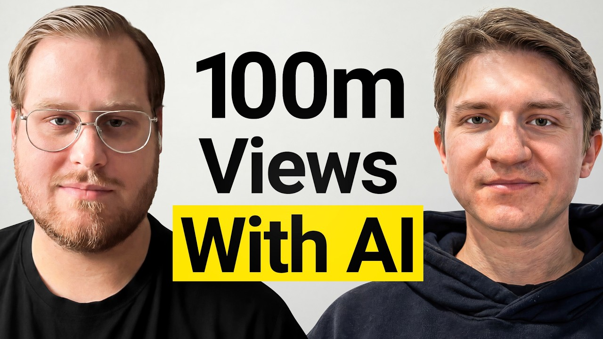

# The App Marketing Strategy No One Talks About

Start building & deploying paywalls in 10 minutes flat: https://superwall.com/

## Table of Contents

* [00:00:00] – Intro
* [00:00:25] – 300,000 Instagram comments case study
* [00:00:43] – How the phone automation works
* [00:00:56] – Cold email logic applied to IG comments
* [00:01:20] – Why transparent comments convert best
* [00:01:44] – Scaling to 1,000 devices (21M comments/month)
* [00:03:22] – How comment-based growth actually works
* [00:04:53] – Comment angles and creative formats
* [00:06:15] – Timing, context, and why it matters
* [00:07:38] – The comment → profile → link funnel
* [00:08:55] – TikTok automation origin story
* [00:12:06] – Why platforms tolerate UGC automation
* [00:14:43] – Full funnel breakdown and learnings
* [00:15:16] – 7,000 clicks from 300,000 comments
* [00:16:39] – Scaling math and reach potential
* [00:18:23] – Future of AI + UGC distribution
* [00:49:58] – Platform preview for social agents
* [00:52:03] – Why copywriting is the key lever
* [00:55:00] – Closing thoughts and sign-off

## [00:00:00] – Intro

What if the secret to organically growing an app wasn't making content, but making comments instead? And what if you could do it at a scale that seems virtually impossible? You got 7,000 clicks on the campaign. And how many comments did that did that take? >> I believe around 300,000 maybe. [00:00:00 → 00:00:19]

Yeah, I I guess around that. >> You did not hear that wrong. 300,000 Instagram comments from one campaign. [00:00:19 → 00:00:27]

## [00:00:25] – 300,000 Instagram comments case study

The crazy thing is this isn't a team of 100 virtual assistants. This is two guys, Nick and Ivan, and an army of automated phones. >> We automated a bunch of physical devices, and we did our own version of Android that can load and unload the ROM of the whole device. [00:00:25 → 00:00:43]

## [00:00:43] – How the phone automation works

So, each account will have basically its own unique phone. >> After 8 years of working together, from running Minecraft servers to building a consumer app for flights, they stumbled upon a new way to grow. and they realize that getting app users on social media is a lot like B2B sales. [00:00:43 → 00:00:59]

## [00:00:56] – Cold email logic applied to IG comments

This this kind of reminds me of cold email a little bit where people are warming up these inboxes and if you want to send, you know, 50,000 cold emails, you have to set up dozens of inboxes and spread the emails across all of these inboxes. They're literally applying the science of cold email to the art of Instagram comments. But the part that blew my mind is that the comments that work best aren't spammy or super subversive or anything like that. [00:00:59 → 00:01:24]

## [00:01:20] – Why transparent comments convert best

They're just straight up transparent. [music] >> When you test these things, you find things that work surprisingly good. So, you might think that being upfront about this being your own app, your own company, and so on would, you know, harm your engagement, but it does the opposite often. So, people like it. >> And with just 60 phones, they're already generating massive results, but they're not stopping. [00:01:24 → 00:01:45]

## [00:01:44] – Scaling to 1,000 devices (21M comments/month)

They're scaling to a,000 devices which would be able to post 21 million comments a month. >> What we can do with 1,000 devices. So in one month that's almost 1. 5 million videos and 21 million comments. So just just as a you know scale perspective that's like replying to every single person on Mr. [00:01:45 → 00:02:03]

Beast reels on Instagram within like a month. >> In this episode, Nick and Ivan pull back the curtain on the future of distribution. The arts of building a technical moat that your competitors can't copy. how to write comments that actually convert with a 15% click-through rate from profile to link and how they're turning this underground agency into a platform to let anyone command an army of automated social media agents. This is the playbook for distribution using a channel you might not have thought of before at a scale you've definitely never seen before. [00:02:03 → 00:02:33]

Let's get into it. This is the Superall podcast and I'm Joseph Choy, founder of Consumer [music] Club. the members in the consumer club Discord and the founders I interview on the pod build apps at a median of about a million dollars ARR. In my conversations with dozens of these founders every week, one thing I've noticed is most of them AB test their payw walls to increase their conversion rates and make more money. Now, most people know that one of the best ways to AB test payw walls is Superwall. [00:02:31 → 00:02:55]

But one thing you might not know is Superwal has a lot of data on the thousands of apps that use their payw walls. So recently they actually put together a tool that takes 422 profitable paywall experiments and put those into a paywall experiment generator where you can upload a screenshot of your own payw wall and it'll give you an experiment idea to increase your revenue. You can use it for free at paywallexperiments. com. All right, let's get into the podcast. [00:02:55 → 00:03:20]

Most people think of app growth through either organic or ads. [00:03:17 → 00:03:22]

## [00:03:22] – How comment-based growth actually works

You're either posting content or you're putting content in ads and people see the content in the ads. But for you guys, you're posting comments on other people's content. So there's other content that's going viral or is relevant to a niche and then you're posting comments and getting users through that. Can you just explain how that works and how you got started figuring this out? >> Yes. [00:03:22 → 00:03:45]

So the way it works is uh we create accounts uh we brand them uh we set them up configure them uh and uh the goal is to make the real speed uh of their of these accounts show the trending content in the niche that we want to target. So we don't want to target random content. We want to specifically find like trending viral videos uh or videos that have potential to go viral. So that's why we can't just rely on search. we need to specifically set up the for you page feed in a right way. [00:03:45 → 00:04:17]

And uh the way it works is uh we we warm up the accounts using AI filters. So uh we basically set up this uh prompts the system that analyzes the videos what's going on in them and uh it uh finds the videos that are the right fit and we engage with these videos. We skip the videos that we want don't want to engage with. Uh the accounts you can see they are u branded to look like official sub pages for interns of the company that we promote. So if it's an app then that's uh just an account that represents this app and uh yeah the bio fits and uh the link and bio is just the app store. [00:04:17 → 00:04:53]

## [00:04:53] – Comment angles and creative formats

So simple uh on this side. So like I said if if the content is the right fit we engage with it. If it's not we skip it. uh the comments are analyzed to fi 2 so that we see if there's the potential to reply to people and if there's the potential potential to comment on the video if there are tons and tons of uh comments that are like irrelevant then people won't read the comment section so we need to skip it and uh if people are already highly engaged in this comment section then it's probably can be a good idea to also reply there so we see the comments that are a fit and those that are and obviously we skip those that are not relevant and we focus on those that are so comments can look in a lot of ways. There's always multiple sub campaigns to test what works best. [00:04:53 → 00:05:35]

There are a ton of approaches that you can take. So, uh one of them for example is we can answer the specific question that people ask in the comment section. The questions are related to the video that is that we target and uh yeah we just target to this uh we just answer this uh questions and then only at the end of the comment we add some sort of CDA to you know check out our page. Uh other option could be instead to ask a question. So our accounts also want to engage in a conversation. [00:05:35 → 00:06:03]

So we ask questions to people and then we for example name drop the app. So yeah can be a lot of ways that it can look like uh the third option is for example the story and doesn't even include any kind of call to action but has some sort of engagement starter like mentioning something that is going on on some certain app or even our pages everywhere but like doesn't ask for anything. [00:06:03 → 00:06:24]

## [00:06:15] – Timing, context, and why it matters

It just makes people wonder uh and wants to check out our page. Uh so yeah, we see we don't we don't reply to everyone. We don't want to target people who just say thank you, thanks for the video and so on. We only target people who actively engage, who ask questions or state their opinions and so on. So yeah, and comments and replies are basically UGC and text form. [00:06:24 → 00:06:43]

So the same principles that apply to UGC videos, they apply to comments and replies. For example, in this uh in this uh comment, we specifically say that uh you know some sort of story and that we use this specific app for uh our exercises. And this naturally makes people wonder what what kind of app are you talking about like what what's this app? And some people will ask it inside our replies and some people will just go straight to profile and go from there. Yeah. [00:06:43 → 00:07:09]

Another example is like I said uh positioning our accounts as you know uh workers of this brand, workers of this app or friends of founders. of like founders themselves and so we provide some sort of value first and then mention something about the app. Another option is also like UGC type thing where it's some kind of buddy that recommended the app and so our accounts are going to try it out too. >> So can you go back go back to that first screenshot example in the slide seven? [00:07:09 → 00:07:38]

## [00:07:38] – The comment → profile → link funnel

>> Yep. >> Yeah. So can you explain why are these good comments like what are these doing? >> I think it comes down to two things. So obviously the comment must be context dependent. [00:07:38 → 00:07:48]

It cannot be copy paste uh you know random thing uh the straight promotion uh it needs to be context dependent. It needs to talk about what's going on in the video and what people already talking about in the comments. So the comment itself has to be of good quality. Uh for example it it starts with a story which already makes people you know it's like a hook inside the videos but the same thing applies to text. Uh and yeah in it ends with a very soft like it's not even a call to action. [00:07:48 → 00:08:14]

It's just a mention like you know saying a fact and uh yeah that that makes people engage with this content. The second part of it is not just the the comment itself is the video under which it's posted and the timing of the video. So uh if we find the videos that have viral potential and we one of the f first people to post under it uh then our comment will be on the top and it will have much more potential to you know go kind of go viral inside the comment section and if the video is already too old then there's basically no point to you know uh leave a comment there because they won't go viral. It's interesting like yeah so basically the scripts for these comments uh this one says like once I tried working out by myself thinking I was an expert just because I watched a few videos. [00:08:14 → 00:09:02]

## [00:08:55] – TikTok automation origin story

Let's just say I ended up with all my muscles sore and spent a week in bed laughing emoji. It's wild how much I learned though. Now I use an app for my exercises. So it's like that's the soft CTA you're talking about. And so then how does that actually work? [00:09:02 → 00:09:20]

Do people then wonder like, oh, what I wonder what app they're they're using and then they ask in the reply and then you follow up again with the name of the app or are they going and clicking the profile and seeing a link in bio? >> We actually do both. Uh so sometimes people can uh just reply and we will follow up on them. It's actually something that we developed somewhat recently. And also uh all of our accounts have either a mention uh of our client in the bio or uh just a website link to the client's app. [00:09:20 → 00:09:56]

>> Interesting. And these are like this is multiple comments on a single on a single post then. >> Yep. >> Yeah. It depends on the algorithm. [00:09:53 → 00:10:04]

Sometimes we just post multiple comments and sometimes we do a lot of replies depending on the video itself. >> Yeah. >> Interesting. Okay. Okay. [00:10:02 → 00:10:12]

So, this is like the story format. And then could you go to slide eight again? Okay. And then these are Let's see. This says, "Calories can vary so much based on what you use. [00:10:12 → 00:10:22]

Instead of counting them, focus on how these pancakes can fuel your day with nutrients. If you're curious about smart eating habits, check out the health app co-ounded by my friends and me. It has tips just like this. " So, that was more of a hard CTA. Um, still not naming the app, right? [00:10:22 → 00:10:40]

but >> a little bit more of a like, hey, I'm actually a founder of this app. I'm providing like a useful comment about uh calories. It's like an educational comment, but also I'm being very transparent up front that hey, I am I'm talking about my company here, but I imagine at scale if you post like, you know, [music] if you post this on every video about calories, it starts to add up. Like this comment has 800 likes. So, how many like how many uh people should you expect to click on the profile on a comment that has something like 800 likes? [00:10:40 → 00:11:15]

>> Uh oh, yeah. It heavily depends on the call to action. Uh in this case, and yeah, it's it's not trackable to be clear, but um based on this one, it's like it it can usually be like thousands of profile visits surprisingly. So, some people don't even press like, they just go straight to profile. And uh yeah, then the question is how many of them will click uh on the link? [00:11:13 → 00:11:36]

And that's why the profile branding is also very important because we want to optimize for people who not just click on our profile and and leave but to either engage with our profiles which would feature for example the uh content about the app and obviously click on the link in bio to you know install the app. The interesting thing is that this kind of confounder angle uh that you know me and my friends created this app it worked like surprisingly well. So we didn't expect that but yeah when you test these things you uh find things that work surprisingly good. [00:11:36 → 00:12:06]

## [00:12:06] – Why platforms tolerate UGC automation

So uh yeah you might think that you know being upfront about you know this being your own app your own company and so on would uh you know harm your engagement but it does the opposite often. So people like it people like you being upfront and this is not something that they usually encounter. Yeah, I feel like you see that same it's almost like an anti- pattern where the established normal pattern is everyone trying to be covert and trying to be like hidden advertising, but I feel like people value authenticity and like things just stand out when you go against the grain. Um, kind of reminds me of Reddit posts where like uh these artist posts that go viral where it's like the person with their face like holding up their piece of art and it's like those get a lot more engagement than just the art itself because like I don't know people just people like that oh this person's like building a company and they're passionate about enough to you know share it with random people in Instagram comments. It's like a um it's a way to like create the connection. [00:12:06 → 00:13:10]

And then you said the second step of that connection is actually when the people go to the profile and then you see the profile. So could you go back up to the where you where you showed me that first profile? Yeah. So this is like um Lena the wellness girl. So this is not an example of one of the founder profiles or would you use this also for >> it's it's sim it's similar. [00:13:10 → 00:13:32]

So it it says representing and then the app name. So yeah for example for example within this bundle of like social agents as we call them uh you would have certain you know angles to see which one of them for example convert better from profile to actual click right and very important part of it is bio and the name of the account uh and and the content on the account so that's why for example it can it can go like on this screenshot saying like uh fitness and tech but it also can start with saying that you know I founded this app and the name of the app, for example. So, and then we'll see which one of them will work better. >> Yeah, I feel like founder stories generally do pretty well on Tik Tok and Instagram. Like I've I've heard of a lot of app founders doing uh pretty good like founder content for UGC. [00:13:32 → 00:14:21]

So, I guess it makes sense that it would also work in comments. >> Yeah, in this one the kind of again it's it's not necessarily call to actions in you know as they usually are. It just says that, you know, my buddy recommended some kind of app and I'm going to try it out. So, it's also kind of this soft approach, but it but it again at least it includes something at the end of the comment, right? [00:14:21 → 00:14:44]

## [00:14:43] – Full funnel breakdown and learnings

To point the people into to our direction because usually if you have nothing uh at the end of the comment, then like you're kind of expecting people to just visit your profile on their own like curiosity. And there are things and there are hacks that you can uh use to also use that to your advantage of course. Uh but yeah, usually you want at least something inside the comment to you know point people in the right direction. Yeah, this one on the left just says that about the app that uh you know our uh page loves uh and that it offers some kind of tips. Now this one surprisingly also got like a lot of engagement uh from people uh I guess because it's it's very specific especially at the beginning of the comment like it specifically talks about the condition that is uh you know the video is about so and that it affects daily life. [00:14:44 → 00:15:30]

## [00:15:16] – 7,000 clicks from 300,000 comments

So yeah, uh this one might look like something more on the more hard pitch side, but it still works sometimes. The right one is also interesting because it doesn't say about the app, it talks about the clip about the app. So it's like uh it's like they it directs people to our profile to check the video. And we are using something like this a lot right now for example. So we'll do even more uh approach like that because it also it also makes people like wonder like uh talking about the app it's kind of more direct and not not everyone is ready to install another app but watching another video while they are on Instagram that's a an interesting thing. [00:15:30 → 00:16:08]

So that makes them visit the profile and engage from there. As I'm reading all these examples of different angles for the comments, it makes me think that there must have been a pretty long iteration process for you guys to figure out what types of content are in the meta right now and start to saturate and start to feel like AI comments >> and lead which like leads you to pivot and [music] continue to try to stand out. Is that accurate? Do you feel like you always have to get ahead of like what consumers are used to and then changing up the content? [00:16:08 → 00:16:47]

## [00:16:39] – Scaling math and reach potential

>> Yeah, even even more than that they change with time. Yes, we we don't only want to stay ahead for the consumer behavior but also to algorithms. For example, uh there was a situation when u uh one of our angles for one of our clients uh it worked for two two weeks and then it just stopped working without any changes on our site. it just Instagram would start detecting it and uh just wouldn't even let it through. And we fixed that by changing it. [00:16:45 → 00:17:12]

Even within the same angle, we still use different like prompts uh to you know different examples, different context for AI to generate them better. >> I'm curious. Let me let's like zoom out and I want to learn about your guys like founding story. Like how did you get into >> this Instagram? Did it start with Instagram comments or was there something before? [00:17:12 → 00:17:35]

Yeah, we've worked together for like the last eight years as a team and uh we've started uh as a Minecraft modeling team. So, we had a Minecraft server and uh went tech heavy on it. We did a bunch of custom uh games and uh like uh modes and uh uh eventually it was very fun. We learned like a lot of development stuff and a lot of how to talk to people, how to get uh customers, how to get uh more money out of our customers and stuff like this was very funny. Um eventually it got acquired and we uh pivoted at the time to even more uh tech heavy private blockchain development and uh after uh that uh we decided to develop a AI uh native uh plane ticket search basically. [00:17:32 → 00:18:30]

## [00:18:23] – Future of AI + UGC distribution

Uh so that was a B2C app and uh we had to reinvent basically we had to find the way to find uh clients and uh one of our buddies at the time recommended us trying Tik Tok UGC style videos. Uh they were just uh on the horizon back then. So with our technical background we've uh decided to just uh automate Tik Tok instead of just recording these videos. So uh yeah [clears throat] we got uh 100 million views out of it. Uh we uh mostly we just promoted our clients music. [00:18:26 → 00:19:06]

Then we switched to Instagram uh because of the Tik Tok ban. Yeah. So that's our story. >> So you were building your your own flights app, a consumer app, and you were trying to promote it through Tik Tok. So you did Tik Tok content automation. [00:19:06 → 00:19:20]

What? you got hundreds of millions of views on Tik Tok. What were those what was that content about? >> Yeah, mostly mostly it was memes and uh sometimes it was videos made by our clients. So, UGC type videos, videos that are requested from their uh main accounts, uh videos with some edits. [00:19:20 → 00:19:38]

Uh and yeah, mostly it was like pure entertainment. >> I see. So, it wasn't promoting anything. >> Some of them are promotional uh and some of them are not. But uh yeah, some of them were just uh more on the uh again soft pitch side and uh yeah we we did the same thing for example with watermarks. [00:19:38 → 00:19:55]

So we test a lot of things. >> Interesting. What was the most interesting result that you got from the the Tik Tok views? uh in terms of views like I would say the most there were crazy results all the time like uh some accounts they perform amazingly well like since day one and you just you just don't expect this type of results but they uh but you get them so like 200,000 views on the sec on the first video and uh one one time I believe we even had like 900,000 views on the first video that was crazy times uh the highest we got per one video was around 2 million views and it it was also very surprising Because yeah, the video it was actually an image and it just showed some kind of random thing without any kind of text without anything like we had we had promotion in the description but we the video itself is is just a static image and people just went crazy like 2 million views and I don't remember like tens of thousands of comments I think. So it's it's like crazy. [00:19:55 → 00:20:56]

>> So all of these like viral Tik Toks were mostly just >> Was it kind of like a proof of concept for you guys? let's just try to go viral on Tik Tok. There was no like business behind it necessarily. >> I would say uh it was part of the business to just prove the concept that our uh automation uh system can uh run Tik Tok accounts and they can get a lot of views and also we did promotion for the like we included uh the music of our clients in these Tik Toks and uh they made for uh 1 million views. Yeah, one of the goals that we wanted to reach at at that time was to make people film their own videos uh by you know first so we use the client's music inside our video and people just uh click on the sound and click use this sound and record their own videos and so for example when we included call to actions about this specific action. [00:20:53 → 00:21:48]

So go and film out your own video uh we had like we had results from this but yeah on the business side uh it wasn't like it wasn't the best thing ever. It was more of a proof of concept than proof of the technical detail because we are not we ourselves are not a content creation team and uh this type of thing requires client to you know provide their own content or provide concepts for the content uh and so on and yeah we had to do everything our most of the things ourselves and uh yeah this this is too difficult. So that's one of the biggest reasons why we switched to comments because comments are much easier to iterate and we can just focus on you know coming up with creative ideas and developing tech. >> So that's that's an interesting nuance that I don't think many people like are going to catch. So what you just said is that you don't make the content. [00:21:48 → 00:22:36]

So when you were making Tik Toks all you did was automate the posting of the content. So can you just explain why is that necessary? Why? Like that's you said that that's your that was almost your whole business just the automation of the posting while your clients would actually make the content. So why why was that so valuable? [00:22:36 → 00:22:56]

Um or why is that so valuable to businesses? >> I would start with the fact that beside besides the uploading itself, it's also account engagement and account warm-up. So you want your accounts to not just uh post videos and leave the app. You want them to engage with the app. We want them to engage with other people and so on. [00:22:56 → 00:23:13]

And this is a lot of work like uh why why companies wouldn't do it themselves? Well, they do, but this requires hiring VAS, hiring clippers, hiring people that you need to manage most of the time. And uh these people uh even then if you were able to manage all of them, they are still people and they can't do a thousand things at once. They can't automate. They can't uh use 1,000 phones at once, most of them at least. [00:23:13 → 00:23:40]

And so yeah, this is a question of scale. This is the question of uh practicality and the question of do you want to manage a ton of people uh who often don't want to be managed and do want to do their own thing or do you want like the system that works just 24/7 uh like with very little moderation on your side. >> Okay. So it's a question of scale. When companies like when businesses like post content, they're not just posting on a single account. [00:23:37 → 00:24:04]

They're posting on how many accounts would they post on? >> Yep. I I think a lot of businesses want to do as as much as possible >> and uh the more accounts you have on one device uh the less trust you will have from the social media. I think on Tik Tok you can add somewhat close to 10 accounts per one device and the more you have the less trust you get the less views you get the less engagement you get. Basically algorithm detects that you are uh abusing it and that's it. [00:24:04 → 00:24:35]

>> So normal people can't run too many accounts. So what you're saying is the there there's there's kind of like a value chain in this whole like organic content economy where it starts with the content creation. So you make the content and then you well even before that it's like figuring out what what content to make in the first place. So content strategy and like creative research. Um then it's okay now how do I take these concepts and strategy and make a bunch of content. [00:24:33 → 00:25:12]

So that's like generative AI platforms. And then third is how do we actually post the content? Because like you just said, Tik [music] Tok and Instagram have, you know, anti-botting algorithms and they don't want you to have too many accounts on a single phone. And they definitely don't want you to have, you know, 100 accounts all posting um, you know, content all the time, every day. >> But you guys do that. [00:25:12 → 00:25:41]

Um, so what does it take to be able to do that? >> [music] >> We automated a bunch of physical devices and uh uh we did uh our own version of Android uh that can load and unload the ROM of the whole device. So each account uh will have basically its own unique phone. By this design, we can just change account uh by demand uh giving us like I like 20 accounts on Instagram and around like I think 100 or 200 accounts on Tik Tok per day per device. And uh with uh with all of that we also have our own system how to uh press buttons uh to be undetected by the algorithm. [00:25:41 → 00:26:28]

how to will basically how to interact with the phone in a way that ith will think that we are actual real humans. >> It's pretty insane. That's like the that's kind of like the core like secret sauce of this whole thing. And it's it is a real bottleneck for certain scale. Like once you crack an organic format, imagine what you do next. [00:26:25 → 00:26:46]

Well, you want to multiply it. You want to post it like five more times. >> What are you going to do? Post it five more times on like one single account? Probably not. [00:26:46 → 00:26:54]

Like if you're going to post a hundred times, you know, and it's a format that works really well, then you're probably going to need more accounts, more phones. So you guys like have that infrastructure. So um >> yeah. >> Yeah, that's really interesting. What do you think is the limitation? [00:26:54 → 00:27:15]

Like why are why are more people not doing this? >> Well, at first a lot of companies are starting to do that actually. I think UGC uh stuff is just uh starting to show up on our radars. Just a couple of years ago, there was like a few companies that did that and right now we have uh VCs investing in uh phone uh infrastructure startups and uh yeah uh quite a bunch of them actually. So I think it will be the future of content distribution in the very short uh period of time. [00:27:12 → 00:27:48]

It feels like this is a very like almost controversial topic in the I guess like app or creator economy or UGC space. And if you think about it like right now all the platforms Tik Tok, Instagram, Meta like they have all of the leverage. They have literally infinite like power. They have all the distribution, right? Like what else are you going to spend like 6 hours a day on like there's no apps that really contest like Tik Tok, Tik Tok, Instagram, YouTube and startups seem like they're kind of fighting back and and like you said VCs are almost like funding this idea that let's just you know like these platforms have their rules because they want to protect their platforms against like people taking distribution into their own hands. [00:27:48 → 00:28:39]

And it seems like you guys are like part of that like that startup wave of like let's try to like sidestep their game almost. It's a completely new world. I think normally I on this channel I I talk to a lot of um founders that are doing UGC sort of by the book, but something something that not a lot of people think about is UGC organic is inherently competitive to to Tik Tok's interest. like they don't want you to go viral with UGC [music] and make money from it because they would rather have you spend money on ads, right? Like if you're just paying creators, Tik Tok gets none of that on a big picture. [00:28:39 → 00:29:20]

Like they're incentivized for masscaled UGC operations, they're incentivized for those to just not work, which is why they fight so hard to like uh shut down these kinds of things. So does that ever scare you guys? Like do you feel like you're up against kind of this like huge machine that's always trying to like shut you down? >> Not at all actually. It's quite uh the opposite on Instagram. [00:29:20 → 00:29:42]

Uh like only like the smallest percentage of people are creating the content. Most of the people are consuming the content. So there is uh like a giant gap between uh content creators and content consumers. So we with uh with any content that performs which is the only content that works in terms of uh advertisement in terms of UGC uh that does perform you are helping the social media app actually you're uh filling this endless well you're filling the void uh of uh missing content for people to consume. Social media apps are craving people that create content, great content. [00:29:42 → 00:30:26]

And uh if we distribute content that doesn't perform, that doesn't doesn't get any views, doesn't get any engagement, then well, nobody's afraid of that. Why would you be? Uh nobody's going to see it. Uh it doesn't harm anyone. So yeah, only the content that doesn't that does perform shows up on the feed. [00:30:26 → 00:30:47]

And if it if it shows up in the feed, it uh gets social media engagement up uh therefore we are helping the social medias. >> Yeah. >> Yeah. Uh I would also add to it that it it's really even more relevant in like underserved niches like there are categories of content that not that many people create but people want to consume. And so if like Instagram and Facebook, they want to like have everyone on their platform that they would need to serve their interests. [00:30:47 → 00:31:16]

And then again uh for their own ads, they need to be able to target people who express interests in certain things. And why wouldn't they would like to do it from within their platform? when people consume like things inside the categories that they want to consume, uh the meta would be able to target them and show them ads in this specific niche. So, that's a win-win. >> So, when you reach out to creators and you're about to invest into organic social and maybe boosting those videos with paid ads, you don't want to just let the creators do whatever they want. [00:31:16 → 00:31:47]

Most of the app founders I talked to on this channel basically have the same content philosophy. The videos need to go viral but also convert and promote an app and ideally are also repeatable. And those formats are like gems and really hard to find. That's why Tik Tok can sometimes feel like a lottery system. So what a lot of consumer club members do is they use this tool called spy talk which brain rot scrolls hundreds of thousands of Tik Toks and just finds the most viral ones that promote apps. [00:31:45 → 00:32:15]

So here I search for fitness, gym, workouts. Let's say you like run a fitness app. I'm gonna sort by most viral. And here's this 106x outlier video that promotes a fitness app. And it shows a text hook. [00:32:15 → 00:32:27]

It shows the image in the background. And then on the second slide, it has this CTA in a really creative way. And spy talk has been the secret weapon for growth strategy for 11 Labs and AMO and Voodoo, which is the app studio that owns Bereal. So I recommend Spy Talk. It really is the only other tool I explicitly recommend on this channel other than Superwall. [00:32:27 → 00:32:49]

Yeah, >> that's that's a really interesting take and I feel like that actually is that take is has evidence to back it up because if you look at um like the meta AI or Sora, they're completely leaning into the idea that yeah, there's underserved um content needs and like there's big audiences that want certain types of content. Let's not wait for other people to make it. We'll just make it ourselves. So now they have full feeds of just pure AI content. Some people say that's dystopian, but from the platforms perspectives, >> they see that people want certain types of content, so they're supplying it. [00:32:49 → 00:33:30]

Um, what what was in the rest of this um of these slides and we we can keep going. >> Yeah, this is just the overview of the funnel. Yeah, if you want that. I'm not sure that. >> Yeah, this is interesting. [00:33:30 → 00:33:42]

Yeah. So yeah, explain this funnel. Yeah. So the commenting uh funnel is very simple. Uh basically uh once we found people to reply to or once we found videos to comment on uh we obviously post our things and people see the comment that they like they uh if if the comment doesn't mention the specific app then the only option for the person is to either uh reply to us and ask about the app that we promote or visit our profile. [00:33:42 → 00:34:07]

uh once we visit once they visit our profile they engage with content that we have and the goal is for them to click on a link and bio and once they do that they obviously get to the app store or uh the website that we promote or the main uh IG page of the brand that we promote. So some some accounts don't even have links in bio they just have mentions in bio and mention leads to the main brand page which obviously is full of content and social proof and so on and yeah from there they just convert. So it's uh installs, signups, email optins, follows uh on socials and so on. This is just the results for one of the campaigns and uh yeah the next slide will show even like you know more concrete details. So the campaign is the campaign that we run is uh USA based healthcare app. [00:34:07 → 00:34:57]

So it's about uh fitness, it's about nutrition, it's about sleep quality and yeah the campaign is still ongoing and so far we did like almost a half of the campaign and based on the metrics that we have we project like this campaign to bring like 4x to return. The numbers are here. >> So the the main thing that's interesting here is the clicks. So, you got 7,000 clicks um on the campaign. And how many comments did that did that take? [00:34:57 → 00:35:26]

>> I believe around 300,000 maybe. Yeah, I I guess around that. >> 300,000 comment 300,000 Instagram comments and you got 7,000 clicks on that. So, like how many of those comments are actually getting a decent number of likes and kind of like hitting the algo so to speak within the comment section? smallest percentage of uh comments are getting enough exposure to generate the results. [00:35:22 → 00:35:49]

So like with uh the UGC videos you get like uh 100 videos now of them like 10 are performing great and others are kind of low and so you generate your almost entire results with uh [music] just a small percentage of the >> right cont. >> Yeah. Yeah. The important part is that in the beginning we have a lot of problems with this uh campaign. So in the beginning you basically like you post comments and you get nowhere and so you have to iterate you have to change angles completely not just you know slight changes but significant changes and so it took some time for us to figure out that you know these angles that we showed before like co-founder angles and friend made this with me uh angle that this angles actually work and then again like I said it's an ongoing process so within the within the sub campaigns that we run we also need to do this tweaks and changes like changing the whole account identities uh like the way that they look. [00:35:49 → 00:36:44]

Uh so that's also very important. Uh some a lot of comments are just like experimental ones. >> How many comments are you posting on each phone per day? You know, 3,000 300,000 comments in total. That I'd imagine that's got to be a lot of phones and a lot of comments per account. [00:36:44 → 00:37:04]

>> Yeah. Yeah. I would say actually not. So our current like size of our intra is pretty small and so we are able to achieve even this results with a very small amount of devices and u uh the the numbers are basically the phones uh on Instagram we run from 12 to 24 account accounts per day per each phone and uh each account posts uh up to 60 comments. So that's it. [00:37:02 → 00:37:30]

Yeah, >> 60 comments a day. That's that's pretty crazy. So, it's like, you know, 10 to 20 accounts per phone. And then, um, that's a lot of accounts per phones. And that's I guess that's because of some of the, you know, remote uh I don't know exactly how you guys do it, but you know, the the tech stuff that you're that you're doing. [00:37:30 → 00:37:50]

Um, and then 60 accounts. This is kind of reminds me of cold email a little bit where people are warming up these inboxes. And I think the standard nowadays is like, you know, you can only send like 15 emails per day and you have to spread that across like a 100 different mailboxes. So if you want to send, >> you know, 50,000 cold emails, you have to set up, you know, dozens of inboxes and spread the emails across all of these inboxes. Yeah. [00:37:50 → 00:38:19]

Do you feel like this has parallels to the cold email? Do you guys talk to like cold email people at all? >> Uh, we didn't talk much to cold email people. just I remember can I can only remember one person but uh it's really an awesome analogy because even with like uh cold email with instantly you have this uh automatic uh warm-up where you would literally send the emails that are less uh like you know have less potential to go to spam than like your normal uh you know sales emails right and we do basically the same thing like some of our comments are so harmless like they have no call to actions at all they have no mentions of anything just to show that, you know, this is an uh this is a good account. This is an account that engage like a normal person. [00:38:19 → 00:39:01]

So sometimes they would mention something that they did with their friends and sometimes they would just talk about what's going on in the video and that's it. So yeah, same thing as in cold email. That's really wild. It's like uh that's so crazy to think about. And a lot of people don't even realize that that's how all of these B2B SAS companies that raise, you know, hundreds of millions of dollars, they're all they all run on cold email. [00:39:01 → 00:39:26]

They all run on sending what some people would think of as like spammy content, but that's how you do outbound. It's like you just have to uh reach a ton of eyeballs and a certain percentage of those people will be interested and send a reply or you know visit your website and yeah it seems like this idea is like coming into into B toc and I guess it's kind of always been here but you guys are kind of >> leading like a pretty interesting angle on it. Cool. Is what was the next slide? >> Yep. [00:39:26 → 00:39:55]

That's a bit about like scaling potential. So you ask us how many devices uh we have and this is kind of a small uh math thing about like what we can do with 1,000 devices. So 1,000 devices is let's say on average is 60,000 active accounts. So 60 accounts per phone. Kind of small number. [00:39:55 → 00:40:14]

We can go higher but let's settle on this uh number. So each each one of them posts three videos a day and 45 comments a day like not even 60 which is also possible. And so in one month that's almost [music] 1. 5 million uh videos and 21 million comments. So just just as a you know scale perspective that's like replying to every single person on Mr. [00:40:14 → 00:40:35]

Beast reels on Instagram within like a month. So that's a crazy amount of exposure that you can get. And obviously like with campaign of this size people will start talking about this like posting about it on Twitter, posting about it on uh like Reddit, posting articles like you know discussing this and this basically makes the company go viral. So that's and that's with one month of posting. >> How many devices do you have right now? [00:40:33 → 00:40:58]

Is it a thousand? >> Right now we only have 60 because of the optimizations that we can do on the phones. It's enough to provide uh valuable results. Yeah, but it's thousand is not big by the way. So like thousand is the first step and then like it's it's thousands from there. [00:40:57 → 00:41:18]

>> Yeah. So you guys want to scale this more. So you have 60 phones right now. You want to have you know a,000 um which could create 21 million comments per month. Thousand is just the beginning. [00:41:16 → 00:41:31]

Like you could do >> more and create you know hundreds of millions of comments a day. >> Exactly. >> Yeah. Yeah, >> that's our plan. >> Interesting thing that you said was like there's a gap in the market where there's audiences that want content and there isn't enough there aren't enough people to make that content. [00:41:31 → 00:41:49]

So, what you're saying is if you if you have thousands of devices making all this content, will all the will the majority of the content in the feed including the comments be like completely AI in the future? I actually believe this will be the future because most of the time uh like 99% of the time uh ress that you see in your feed aren't from your friends, they're from some big creators that uh do this uh all the time. So uh social aspect of of uh social media is actually not creating the content or consuming the content that your friends uh produced but uh is sharing this content between your friends. So most of the time people just uh share uh memes and uh well useful videos like tips and advices and stuff like this between themselves and the group or between individuals. So that's the actual social aspect of the social media. [00:41:49 → 00:42:49]

>> That makes sense. Yeah. And I guess what you're doing is you're basically just replacing these big content teams like these production teams where you're saying that the content out there already is automated. It's just not completely AI generated, but it's still automated in a way because there's a huge team with tons of money behind it to create super high volumes of content like the Mr. Beast channel and the dozens of other channels that that company has. [00:42:46 → 00:43:16]

Um, and now you can automate maybe [music] Mr. Beast is not going to AI, you know, all his videos, but if a team that is smaller than Mr. doesn't have that production capacity, wants to create more content, they're probably going to need to leverage AI in some way to, you know, get the volume up. It's almost the case. Uh, but I don't feel like we are replacing them. [00:43:16 → 00:43:43]

I feel like we are creating ways to work with them. Like there are guys that uh will provide you a ton of uh UGC videos for money. they will uh hire a bunch of students and they will just pay them for the content that they create. So we can just redistribute this content uh instead of these uh students they can just focus on the video creation and not the account warm-ups and stuff like this and uh huge teams uh I don't think we are going to kill them because they put so much effort and uh well care into their content. I think uh like they will be evergreen and uh again with some of them we can just work together to create more of their cont content and distribute it uh quicker. [00:43:43 → 00:44:33]

>> Yeah, you're like arming the rebels uh in a way but you know there's >> I'm sure there's cert certain amounts of AI that all that like teams of any size could could implement. >> Ivan, would you tell more about uh the AI thing? I think we have a friend in the niche. Yeah. So I would say that it works uh positively for both like AI and uh like purely uh human humanmade uh like content because uh again for humans it will allow you to just you know you just create videos and every single part about social media works on autopilot. [00:44:30 → 00:45:07]

So you don't need to manage any accounts. You don't need to manage like anything. You just create videos one click and everything is working. So I I think that's like the and that's the near future that will be possible soon. So even if you don't use a lot of AI, you would still get so much more productive by removing this like boring tasks that it's already a lot of value. [00:45:05 → 00:45:30]

And for AI like AI as of now the AI videos uh especially especially videos they aren't that good yet. uh but able to but like pretty soon they will become better and better like we already noticed it like every month there's looks like some kind of advancement in video genai and so we have a friend uh in the Higsfield team one of the biggest video genis out there and we have also we also know people from other like startups in the space so and we'll get like we'll know even more of them because we want to work together we want to basically amplify both of our systems like uh they they help create the videos and we help distribute them. So that's a win-win for both parties, right? With time uh I believe like even outside of like fully AI made videos, the AI will help to you know create human uh videos even more productively. So you know fixing some small mistakes, fixing fixing things that are very tedious to edit. [00:45:27 → 00:46:26]

So a lot of video editing AI is also starting to uh be created that is professional that is not just you know a one-click uh you know video repurposing that's simple uh but actually fixing the specific problems that video editors and video production teams have and so AI plays like a giant role in like making this whole industry even more efficient I believe and even more like being able to come up with more creative ideas which is the key point at the end of the day like people want this controversial, new, unique, uh, interesting ideas, uh, and they want to see them in like across all sorts of mediums, including videos and images, too. >> Makes sense. >> Yeah. This just an example counts. >> I see. [00:46:26 → 00:47:09]

So, this is 5,690 profile activity. Okay. So, that's like 4,900 visits, profile visits, and 700 of those like 5,000 people are clicking the link in bio. Yep. >> Um, so that's that's decent. [00:47:09 → 00:47:31]

That's what what's that? 7 750 divided by 5K. That's like 15%. That's actually like a decent clickthrough rate. Is that like a a good um benchmark that you guys go for? [00:47:31 → 00:47:44]

15%. >> It varies. Depends on the campaign. I think it's from like uh it can be 3% in some bad cases. uh it it can be like up to I think our best was about 50 or 60% when the content was engaging and the profile uh was uh set up in the right way. [00:47:44 → 00:48:04]

>> But I'd say 15% is a good benchmark. Yeah. >> Yeah. So I wanted to talk about like how people can access this. Like you said that you serve clients right now and you'll do like the the mass commenting as a service. [00:48:01 → 00:48:17]

So I understand that you guys kind of like have a agency service around that but then you when we were talking earlier you said that you're working on a platform as well. >> So we'll build an MVP like within a week. So it's it's very you know it it's our highest priority right now basically. So we want to we wanted to provide this as a platform for quite a long time now. Uh and uh yeah the way it will work is as you can see you'll be able to manage your whole like fleet of uh social agents. [00:48:17 → 00:48:44]

So for example the the main platforms is uh the main platforms are Tik Tok and Instagram right and so across each of the networks you have this uh dashboard when we can see which one which every single account is doing so what are they doing at this exact moment and uh yeah you can see like even the specific uh you know flows that they go through. Dominic, if you can scroll down, uh yeah, you'll see detailed stats that will show like your uh total um engagement and total results and total volume of content and uh comments and other things. And you'll also be able to break them down by each agent uh and export them in like beautiful format. And the way that you'll create this automations is you basically you'll be able to just type it in plain English and you'll get this whole flow built for you. You can then customize it the way you want or you can ask AI to customize it. [00:48:44 → 00:49:36]

Uh the second option is to select one of the community templates. So since this will be a platform where like everyone can use it, uh we'll know which uh approaches work the best and so you'll be able to customize them again for your specific use case and just use one of those and we'll give you a few of our own templates. Like the right now, like you said, we provide the comments uh as a as a service, but you won't need us for this. [00:49:36 → 00:50:02]

## [00:49:58] – Platform preview for social agents

you'll just be able to click uh one click uh within this uh uh dashboard and you'll get your own like service. So basically that's the same thing that we use right now on our back end. You'll have access to it directly and you can do whatever you want with them. You can test different approaches uh at scale uh and so on. Yeah. [00:50:02 → 00:50:20]

The last one is just you'll be able to obviously also control the branding for uh each agent. So can change their names, can change their bios, every everything that is available from within the apps. You can do like the same goes for even Instagram stories and highlights. So they would never look like bots that people usually do and talk about. This will look like purely like humanmade accounts. [00:50:20 → 00:50:46]

>> Mhm. Yeah, this is really fascinating. I think one thing that comes to mind whenever a niche way of doing distribution becomes productized into a platform like this is it makes me think um there's not that many people who know the art of doing that service. So for example, if you do viral Tik Tok UGC with just regular humans and you try to turn that and that's an agency and someone do does that as as a service where they, you know, manage each creator, they come up with the hooks, they do 30 minutes a day of scrolling and finding winning formats. That's like that's the art of it. [00:50:43 → 00:51:25]

And then the science of it is how do you scale that across like a bunch of different people um and build a process around it. And what you guys are doing here is kind of like building a process around IG commenting. But I would I would think that if people are signing up to do this, you still have to have the art side of it. Like you can't just click a couple buttons and then your startup blows up, you know, like there's there has to be strategy and not everyone who uses, you know, a platform and automates the logistics of the thing is necessarily going to win. So what do you think is that core thing that people need to be thinking about? [00:51:25 → 00:52:03]

## [00:52:03] – Why copywriting is the key lever

If all the of the logistics is automated away and they want to do mass commenting, how can someone get really good at figuring out how to actually manage this the creativity side? >> That's a good question and I think it applies to any kind of platform like the same thing goes for Facebook ads for example or Google ads for any kind of ads. Uh like if you if you want good results you need to work on it right you can't just expect the platform to do everything for you. So yeah, the good options I mean they are quite obvious. You need like like they always say copyrightiting and storytelling. [00:52:03 → 00:52:32]

So like we said in the like we showed in the examples before uh the comments cannot be strictly promotional. You can't just spam one thing and expect results from this. No the platform and nor the audience are going to like it. So you need to you need to came up with the structure of the of each comment uh so that it will capture people's attention and then convert them right. So make them curious to visit your profile or make them curious to go to the app store and type in your app name. [00:52:32 → 00:52:59]

Uh whatever you're trying to achieve, you would need like these basic principles like the a framework or any kind of other copyrightiting framework that there are. And we'll I guess we'll show uh some like simple guides from within the platform to like direct people into the right way. Uh but yeah, it's h the people who already know how to do it will just be able to scale their skills um infinitely with this. Uh, and yeah, people who are just starting out, they'll have to learn a little bit. >> How did you guys get good at copywriting? [00:52:59 → 00:53:26]

Because you've done it for a few clients and it seems like you you've gotten pretty good results. So, curious how you guys like got good at copyrightiting. >> Just a ton of iterations actually. Sometimes you just uh sit and watch a video and uh and then go come up in your head because you just uh heard uh something in the video. Uh so sometimes we just brainstorm uh any uh angles uh and then we just come up with a few examples and sometimes well AI can suggest a few well I wouldn't say suggest a few ideas but the directions of ideas that's just a creative process I guess. [00:53:26 → 00:54:06]

Yeah, I think I think I would add that a lot of YouTube videos. So like I personally watched a ton of them. Uh and audio books too like uh influence uh one of the best like books about practical psychology and so it the same things applies to copyrightiting to video creation to to anything like to any sort of communication between uh people. So um yeah I guess that's what people should also consume if they want to you know do it and then it it comes to practice. So you start with some principles. [00:54:06 → 00:54:34]

Uh the YouTube is full full of videos that you know talk about it and then you just go and practice it in a while and you get better with editing. >> Last question to you guys. Is there any Yeah. What's next for you guys? What are you excited about? [00:54:34 → 00:54:48]

And yeah, what's next? What are what are you guys excited about? >> Right now we are developing our platform. We are getting the MVP. We are getting our first uh design partners and uh also we are doing all the paperwork right now to get uh to get to USF in a couple of months. [00:54:48 → 00:55:06]

## [00:55:00] – Closing thoughts and sign-off

Uh uh we have uh a few friends there that uh want to talk with us and uh yeah uh working on this stuff. >> Awesome. Well, yeah, I'll I'll leave your your links and everything in the description so people can check you out. And yeah, thanks so much for the talk. This is like a little more unconventional than uh what I normally put on the channel, but I'm someone who always loves learning about what is on the absolute edge of distribution. [00:55:06 → 00:55:39]

I was calling things like clipping or UGC like a year or two ago. I was like every consumer app should be doing this and people were like no like this is ridiculous. Like ads, >> you know, influencers are better or ads are better. And there's a lot of other things that I also called that were wrong. So, I'm not saying I'm like a crystal ball, but if if you want to innovate and be at the edge of distribution, like you kind of I think it's helpful to look at like new things and this is like definitely really interesting and you can take away things uh like a lot of learnings from it. [00:55:39 → 00:56:10]

>> One more thing that I wanted to say is uh we actually got uh a couple of our first uh design partners from your uh consumer club. It's uh actually pretty interesting because we had a friend that uh was a longtime member of your club and he suggested that he would post like a little post about our work uh I I think about a year ago and uh we yeah we got our uh I guess best performing clients out of your club. So thanks for that and I uh well I suggest everyone to join it. [laughter] >> That's awesome. I did not prompt this uh consumer club pitch, but I appreciate the testimonial. [00:56:08 → 00:56:53]

It's great to hear that you found like really good talent uh from the group. That's that's great to hear. Thanks for being on the pod, guys. >> Thank you so much for the opportunity. >> Yeah, thanks a lot. [00:56:53 → 00:57:05]

>> Something you might not know, most of the founders I cover on this podcast are hanging out right now in the Consumer Club Discord, sharing with each other what's working now for consumer apps. So, you can apply to join consumer club if that sounds interesting to you. And this is the Superwall podcast. Of course, you got to check out superwhile. com. [00:57:03 → 00:57:21]
