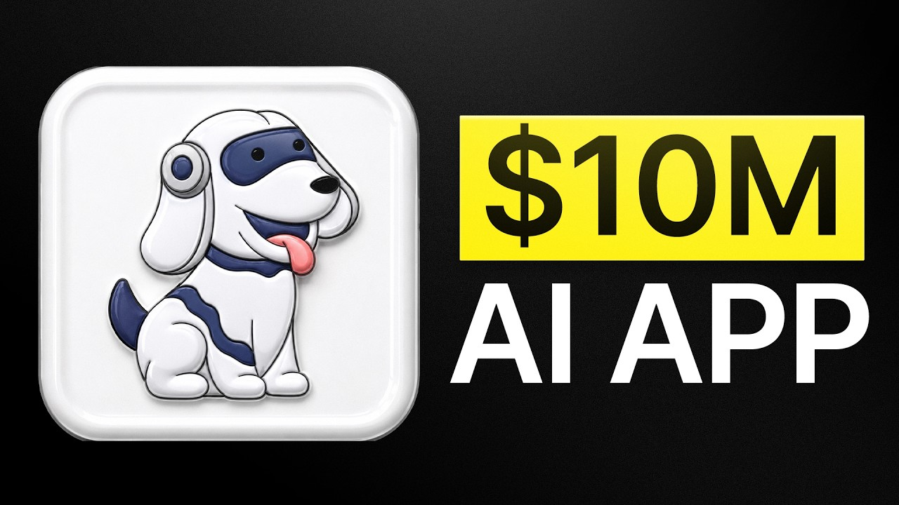

# The EXACT System to Go From 0-$10M+ With Your App

Start building & deploying paywalls in 10 minutes flat: https://superwall.com/

## Table of Contents

* [00:00:00] Study Fetch: 7 Million Users and 2 Billion Views
* [00:01:03] Why UGC Is Becoming Less Effective and What Comes Next
* [00:02:55] The First Viral Video That Got Tens of Thousands of Signups Overnight
* [00:04:35] How Study Fetch Thinks About App Growth Today
* [00:06:36] Virality at All Costs vs Targeting the Right Audience
* [00:07:04] A Look at the Product and How It Works
* [00:08:15] From Bootstrapped to an 11.5 Million Series A
* [00:08:33] Breaking Down the Creator Program and Top Performing Accounts
* [00:09:01] The Zero Follower Account Strategy With High-End Influencers
* [00:10:39] All Three Creator Strategies and Which Drives Results
* [00:12:05] What to Look for in Influencers Before Paying Five Figures a Month
* [00:14:09] Engagement Rate Benchmarks and Why Comments Matter Most
* [00:15:44] How Much to Pay Influencers for New Account Deals
* [00:17:46] When the Zero Follower Account Strategy Fails
* [00:19:03] TikTok vs Instagram Reels: Conversion Rate Differences
* [00:20:46] How to Hit 80% US Audience on TikTok and Why It Matters
* [00:22:40] How Study Fetch Sources and Qualifies Creators
* [00:24:53] Why TikTok Shop Creators Convert So Well
* [00:25:40] How Creative Direction Changes Based on the Creator
* [00:26:19] How to Present the Product Demo Without Losing Engagement
* [00:28:10] Hard vs Soft CTAs and When to Use Each
* [00:30:38] Formats That Work: Vlogging Humor and Lifestyle Integration
* [00:33:00] The 75 Million View Lecture Hall Video Breakdown
* [00:35:20] Getting Marketing Inspiration From Outside the App Space
* [00:36:05] How the Marketing Team Evolved After the Series A
* [00:37:30] Team Structure: Outbound Recruiting vs Creator Management
* [00:40:48] How the Bonus Structure Works and What Creators Get Paid
* [00:42:55] How Many Creators Study Fetch Manages at Any Given Time
* [00:43:29] What Skills the Creator Management Team Actually Needs
* [00:45:15] Who to Hire First If You Know Nothing About TikTok
* [00:48:02] Why TikTok Shop Talent Makes a Great First Marketing Hire
* [00:49:13] Advice for Solopreneurs Just Starting Out

## [00:00:00] Study Fetch: 7 Million Users and 2 Billion Views

StudyFetch now has over 7 million users. That we've acquired over the last 2 and 1/2 years. We are at seven figures in monthly recurring revenue, eight figures in annual recurring revenue, and over the past couple years we've ranked up over 2 billion views by now. The first video I made was a TikTok that I cross-posted to Instagram Reels. The TikTok got like 3 million views overnight, which was pretty insane. [00:00:00 → 00:00:21]

And I remember we had like tens of thousands of sign-ups. >> This is Kieran. He runs the entire marketing engine at StudyFetch AI. This startup bootstrapped their app for 18 months just by posting viral TikToks without any venture funding. Then they actually raised an 11. [00:00:21 → 00:00:36]

5 million dollar series A with the college board, the company that runs the SAT and AP exams backing the round. But what's so interesting is how they reached such a massive scale even before the funding. Most apps are scaling their UGC programs by hiring more cheap creators that mass post content, but StudyFetch does the opposite. They pay five figures a month to influencers with 750k followers to start brand new accounts from zero. And those zero follower accounts are outperforming everything else. [00:00:36 → 00:01:05]

## [00:01:03] Why UGC Is Becoming Less Effective and What Comes Next

>> UGC is becoming less and less effective because audiences are starting to understand that the videos that they're watching are straight-up ads. So this is kind of our version of what's next to kind of hedge against that mentality from these audiences. >> In this episode, Kieran is going to walk you through his entire growth system step-by-step from the exact selection criteria he runs every week to pick the creators who will actually generate downloads to the zero follower account playbook that's replacing traditional UGC, and how the team plans product features to go viral before even a single video gets filmed. By the end you'll have the exact playbook Kieran used to make StudyFetch from a TikTok account to 7 million users, and the specific moves you can copy to blow up your own app. This is the Superwall podcast. [00:01:03 → 00:01:45]

I'm Joseph Choi, founder of Consumer Club, a Discord where top consumer app founders trade alpha and what's working now in growth. I've been talking to members doing a million ARR, and they tell me they've been using these two tools. Superwall has this free AI tool trained on 422 profitable paywall experiments across thousands of successful apps. You upload a screenshot of your paywall and it gives you an experiment idea to make more revenue with the same number of users at paywallexperiments. com. [00:01:45 → 00:02:10]

And if your app's doing at least 100k MRR, we host vetted dinners in SF and New York to hang out and network with other top app founders. You can apply with the typeform in the description. Also, these app founders have been telling me they use Roark. I met Daniel, the founder of Roark, at a dinner and I got genuinely really excited when he told me about Roark Max, which is out now and has honestly changed the game for coding mobile apps. It's AI that one-shots full native iOS apps with Swift code, camera, sensors, haptics, payments, the whole stack. [00:02:10 → 00:02:36]

And as you vibe code with Roark, you can install prototypes directly onto your iPhone with one click and then publish to the App Store in two clicks. If you've been waiting for AI coding that actually does native iOS apps well, this is it. I got you guys a discount. You can use the code superwall or use the link below. So, I've actually seen StudyFetch on my Instagram ads and my like organic feed for a couple years, I think, now. [00:02:36 → 00:03:00]

## [00:02:55] The First Viral Video That Got Tens of Thousands of Signups Overnight

It's It's been viral for a very long time. Give me some cool stats. >> StudyFetch now has over 7 million users uh that we've acquired over the last 2 and 1/2 years. We are at seven figures in monthly recurring revenue, eight figures in annual recurring revenue, and over the past couple years we've ranked up over 2 billion views by now. >> 2 billion views. [00:03:00 → 00:03:18]

Wow. Okay, so seven figures MRR, eight figures ARR. That means like at least a million in MRR and at least 10 million in annual revenue, which is pretty insane. When did you start this? >> Just for context, Joseph, I'm a founding team member. [00:03:18 → 00:03:33]

I'm not one of the founders of the company. StudyFetch was founded in uh September 15th, 2023. That was the launch date. I was asked to join the company to make some TikToks about the product on launch day initially by uh our co-founder and CEO, Ethan. The first couple of videos that I created instantly went viral, which was pretty cool. [00:03:33 → 00:03:51]

Uh they were very basic. I just kind of pointed a camera at the uh computer screen and just show off showcase the features in real time. Uh both like at like a desk uh while I was still in college and also at school uh like in my lectures. Um and that's kind of how um the company or my involvement and the marketing kind of took off. >> So, how viral did those initial videos go? [00:03:51 → 00:04:16]

>> The first video I made was a TikTok that I cross-posted to Instagram Reels. The TikTok got like 3 million views overnight, which was pretty insane. And I remember we uh had like tens of thousands of sign-ups. Uh it was like a pretty intense uh 24 hours. >> Tens of thousands of sign-ups from your first ever viral video. [00:04:14 → 00:04:33]

Was there any thought that you put into the video? [00:04:33 → 00:04:37]

## [00:04:35] How Study Fetch Thinks About App Growth Today

Like did you have a feeling it would go viral? >> To be honest with you, no. We did a lot of ideating on like what the type of content what type of content was going to uh work for like the platform. And complete transparency, it's the first time that I'd ever like made a TikTok about a product. Um I have a background in photography and videography, so I knew how to like work a camera, but uh putting together the video and editing it was it was the first time I was really doing it. [00:04:35 → 00:05:00]

A lot of the reason that it went viral was the initial features that I showcased and then also the time that the video was released mixed with a little bit of luck. >> I want to dive into your mind and like how you think about marketing and how you've grown this app over the past couple years to such a huge user base. But I also want to just to start out like how do you think about app growth in general? Like what are some frameworks that you've developed over the past couple years of working at Study Fetch? >> In terms of marketing a product, I think that in today's day and age short-form content is very saturated. [00:05:00 → 00:05:36]

So, coming up with like an original idea or original features is uh very important. Having something, in my opinion, that a lot of people have created already, if you don't put your like unique spin on it and showcase that differentiation online, it can be a little tough to take off. But for us, as that's Study Fetch, and we've been doing this more and more, is we've been really focused on brand and authenticity. Because of how saturated UGC is currently, we've been really trying to take a step back and just really cater towards the people that are very receptive to our videos. So, those are people like med students, type A learners, people who really like don't mind that the video is an ad because they are genuinely interested in school and actually find what we're showing off uh pretty interesting. [00:05:36 → 00:06:19]

>> So, it's not like virality at all costs. It's more like find the people like try to get views amongst the audience that will actually care about studying. Like, you don't want to just get like any student to watch the video. You want people who will watch the video and like enjoy studying content. [00:06:17 → 00:06:38]

## [00:06:36] Virality at All Costs vs Targeting the Right Audience

>> Exactly, yeah. And it's definitely been a shift. I think when we when we were first marketing the platform, it was virality at all costs because every time we'd post a video and it would get views, obviously, we'd get users and subscribers. But um we've kind of started to shift our mindset uh as time kind of went on to really dive into the type of uh content that really works for our current user base. >> Let's go into some of the actual videos that you post to see which ones are actually driving downloads and revenue. [00:06:36 → 00:07:05]

## [00:07:04] A Look at the Product and How It Works

Right before that, let's look at the actual product. Uh so, this is your landing page, Study Fetch. Um could you explain like quickly like what is the what is the product? >> So, Study Fetch is a AI-powered learning platform that's built for students. The core product turns any course material that a student already has, so like lecture slides, textbooks, and written notes into personalized study tools. [00:07:04 → 00:07:26]

So, they'll get back an AI-generated study plan that contains practice quizzes, flashcards, and also comes with an AI tutor named Sparky that references their course material uh along their learning journey. Overall, though, the goal of the platform is to focus on better learning outcomes for students. >> How did this product start like with the founders? Like was it there there like a team to begin with? Um did you guys raise money? [00:07:26 → 00:07:47]

>> So the two founders uh Essyn and Ryan, they uh initially created an essay writing platform a little earlier on in 2023 that was doing pretty well. But then they decided to pivot to a learning platform for a variety of reasons. The main one being that they really wanted to contribute to education and they they didn't really feel like a cheating platform was doing that. The initial team was a team of seven. We were bootstrapped for the first year and a half and then uh right around this time last year we raised uh an 11. [00:07:45 → 00:08:13]

5 billion dollar series A from Owl Ventures and the College Board. [00:08:13 → 00:08:17]

## [00:08:15] From Bootstrapped to an 11.5 Million Series A

>> Okay, that's kind of insane. I actually didn't know that. You said 11 million dollars? >> 11. 5 million dollars. [00:08:15 → 00:08:22]

>> 11. 5 million series A after being bootstrapped. So you basically just skipped like seed, pre-seed. >> We did, yeah. >> Because you had a lot of revenue already. [00:08:20 → 00:08:28]

Okay, that's that's pretty crazy. Okay, so you explained the product. Let's go into some of these uh TikToks. [00:08:28 → 00:08:34]

## [00:08:33] Breaking Down the Creator Program and Top Performing Accounts

You have 2 billion plus views on social media. What are what are these like examples that you're showing? >> These are a few of our our most successful creators. Um some of them are influencers and some of them are creators. We've worked with a variety of people who post content online and we found that like a mix of both works best for us. [00:08:34 → 00:08:51]

Gemma is an influencer that uh has 100,000 followers on her main account and really people really look up to her for uh study advice and social and just her as an influencer. [00:08:51 → 00:09:03]

## [00:09:01] The Zero Follower Account Strategy With High-End Influencers

We kind of took like a UGC approach with these influencers. Typically, you know, a lot of the times people who do UGC are like kind of like not necessarily beginning creators, but people who are like in it for UGC. Like that their goal is to create content online and promote either promoting a product or, you know, building up their own personal brand. It was a little bit of a learning curve and like a little bit of a hump to get over with some of these influencers to get them to post videos on like a separate account cuz they're not very used to that. But Gemma, for example, has an awesome following full of people that really look up to her. [00:09:03 → 00:09:33]

So when we were able to um collab with her on a on a creator on a separate creator account, a StudyFetch creator account. A lot of her following followed over, um which was awesome because a lot of people look up to her for study advice. So, every time that she showcased StudyFetch, people really took it seriously and and came over and converted. >> You're saying there's like there's difference between influencers who have a lot of followers and some loyalty in their audience versus people that just want to make money with UGC by making videos and maybe they don't have a lot of followers already. And you're saying that you're kind of doing both combined. [00:09:33 → 00:10:08]

She already had an influencer following and she had her own account and she talked about studying in school. But then you had her create a new account from scratch with zero followers. But then her follower base like somehow just found her new account and just kept following her. >> Correct. And a lot of people look up to her as well as the many of the other influencers that we work with. [00:10:05 → 00:10:28]

Like when they see their faces, they think school and studying. So, the the audience kind of followed along, yeah. >> Are you only doing this strategy where it's just you only hire influencers and have them make new accounts or are you also doing just paid influencer promotions or just random UGC people who don't have existing audiences? [00:10:28 → 00:10:48]

## [00:10:39] All Three Creator Strategies and Which Drives Results

>> Our normal creator program is comprised of over hundreds of creators currently. Um we'll do a mix of everything. Really kind of depends on what our goals are uh for that specific month or quarter. Our uh typical structure is we have a lot of normal creators that will post videos promoting the platform and then we'll also have some influencers that we work with create separate accounts and then sometimes we'll bake in some sponsored posts depending on um our goals for that uh time period. >> It's like kind of all three. [00:10:46 → 00:11:14]

So, you have influencers that uh have, you know, new brand pages and then you have one-off like influencer posts and then you also have sounds like, you know, hundreds of like UGC accounts. Do you have an idea of which one drives the most results? >> It's very tough and this is the, you know, the the the hard question of attribution with with and it comes to UGC. We know for a fact that the influencers are working well because we see a lot of people in the comment section talking about the product and like you know, saying things like oh my god, do you use this? Or like tell me more about this thing that you're using because they look up to that person basically when it comes to school and studying. [00:11:14 → 00:11:51]

But yeah, I think the mix the combination has been really beneficial to us. >> What are you doing now? Is it um like for new when you're trying to sign new creators, are you doing kind of an even mix of everything or is there anything you're you're weighted more towards? >> In general, it's an even mix. [00:11:51 → 00:12:07]

## [00:12:05] What to Look for in Influencers Before Paying Five Figures a Month

Influencers that we work with typically when it comes to opening a separate account, it get can get very expensive. These creators, you know, they have big followings and a brand behind them and people know their names and their face. So sometimes it can get pretty expensive. So it'll really kind of depend. Having the mix has been um very beneficial as a whole. [00:12:05 → 00:12:25]

>> Okay, so it's actually more expensive you're saying to to have an influencer create a new account compared to just paying for the post on their own account. >> It is, yeah. Because when we were first reaching out to influencers, they hadn't really heard about this strategy of of UGC or opening up a separate account. So you know, when they were quoting us, you know, for 20-30 videos a month on that separate account, they would quote us as if they were posting on their main account. And you know, it typically can get very expensive just like with the sponsored post with somebody who you know, averages a lot of views per video. [00:12:24 → 00:12:53]

We had to structure the deals in a certain way that was appealing for them and then also beneficial to us. Um but these were higher end retainer deals that we did with them. >> But that was in the beginning and it sounds like over time it's become more known among the creator community that you know, it's it's a thing that you can set up a new account and have the rates come down since then. >> 100% yeah. And UGC has been exploding as a whole. [00:12:52 → 00:13:18]

>> How much have the rates gone down for that? Like what what should you aim to to be paying for? I mean I guess it depends on the sizes of the of the influencers and stuff like that. But yeah, is there like a how how much is it really come down? >> It really depends on the influencer as a whole. [00:13:16 → 00:13:31]

You know, some of these deals that we've done are in like the five-figure a month range for like multiple months, and other times it can go you know, a little smaller than that, but typically it's like usually 10 to 20 times as much as you pay like a UGC creator which can be anywhere from like couple hundred bucks a month to a couple thousand, but it really depends and you know, some creators that we reach out to it doesn't really end up working out because there's misalignment, but it is a relatively new concept and it is a little more difficult I think to have separate accounts for influencers rather than like creators. >> What types of influencers are you looking for for the for when you want them to create a separate account? [00:13:31 → 00:14:09]

## [00:14:09] Engagement Rate Benchmarks and Why Comments Matter Most

Or like is there a certain follower account range, engagement rates, benchmarks, anything like that? >> The main thing that we're really we're really looking at is uh engagement. Even somebody that gets like 10,000 views a video, but their comment section is filled with people engaging with them, that's a great sign to us. Um it means they the following, it means they have a bit of a brand behind them, and you know, if they're getting hundreds of thousands of views a video, and they they have proportional comment sections in terms of or proportional numbers in terms of their comment sections, that's definitely a good sign. Um because you know, there are influencers out there that you know, get a lot of views, but they don't really have a following behind them. [00:14:09 → 00:14:44]

So for us, when we end up working with them, their followers will kind of see the things that they're using when they open up that separate account. Um and they can really you know, look up to them and they see the platforms that they use, uh and then they'll go ahead and want to go try it themselves. >> It's more about the engagement rate than the absolute numbers. What's what's a good benchmark for like if a if a video video gets like 100,000 views, how many like are you looking at comments, bookmarks, likes, all all of the above? >> We really like to look at comments, uh see how how people like engage with the video cuz I feel like once somebody leaves a comment on a video, they're very they're very present when they're watching, especially now when everybody's just kind of like scrolling through videos. [00:14:44 → 00:15:21]

Um so if they're leaving a comment, then they're very intentional, which means that they are like receiving the video well. So, when they go make a video for us, it's safe to assume that that viewer is viewing that video about StudyFetch very well. >> Like this video got 160,000 views, and it got uh 1,600 bookmarks, which seems pretty good, and then like 33 comments. Is that like a a decent uh engagement rate that you're looking for? [00:15:21 → 00:15:45]

## [00:15:44] How Much to Pay Influencers for New Account Deals

>> Yeah, totally. And if you look at the comments right now, everybody's commenting about the platform, which means that we really cut through to people. >> Like, for example, this has been a great strategy for us because, like, in my opinion, as a whole, UGC is becoming less and less effective because audiences are starting to understand that the videos that they're watching are straight-up ads. Um, and people don't really like getting sold to, or tricked, or deceived. Uh, so, this is kind of our version of like what's next, uh, and to kind of hedge against that uh mentality from these audiences. [00:15:44 → 00:16:13]

>> Do you see that same level of kind of like skepticism from when you do regular UGC, like from people who don't have existing audiences? >> I mean, it's pretty common now. If you were to go see a UGC video from like any sort of platform, you'll always see that one comment that talks about like, "Oh my god, this is an ad. " Um, and, you know, a lot of people might get behind them, and they get upset because what they just watched was an ad. So, we try and be as authentic as possible. [00:16:11 → 00:16:40]

Um, all of our creators have uh StudyFetch in their name. Um, so, people can uh have association when they watch the videos on their For You page. Um, so, we try and be as authentic as possible and just showcase the real value of the platform in each one of our videos. >> I want to kind of like like paint the picture for someone who's maybe starting a UGC program for the first time, or trying to revamp their current one. What do you expect to pay for people these days? [00:16:40 → 00:17:03]

Like, maybe I think you said in the five-figure range per month for uh for an influencer who has a very engaged audience for them to create a new account and be posting one time per day. Is that standard, or are you guys doing any other like bonus structures or anything anything else? >> I would say that's pretty standard uh especially if you're contacting an influencer that has like a huge following behind them. Um we also do have a bonus structure with them um and these contracts with them can really vary depending on what uh they'd like. So sometimes the the rate per month that we'll pay will be in the lower end uh but then the bonus structure will be very high because they understand that they can get a lot of views or comments etc. [00:17:03 → 00:17:44]

Um so it can really depend. [00:17:44 → 00:17:48]

## [00:17:46] When the Zero Follower Account Strategy Fails

>> So how how many followers did she have on her main account? >> Close to 750,000. >> Okay. So this this is like a five-figure a month. So you're looking at people who are maybe about at the million follower range, maybe half a million to a million. [00:17:46 → 00:18:00]

>> Yeah. >> And you can you can expect to pay maybe 10,000 a month for a video every day for that month. >> 10,000 a month as a whole not not for each and every video. >> Is it kind of like a commitment like you don't know how how well their engagement is going to go cuz I feel like when you're starting a new account it's kind of scary where you're like it's a brand new account, zero followers, you have no idea. I guess like if you just trust in the for you page and you know that this creator can make good content then it should it should just work. [00:17:59 → 00:18:28]

Has it ever not worked before where you just an influencer has a lot of followers and they have great engagement but then they just it doesn't work on the new account. >> Yeah, it happens all the time and even with like normal creators too, right? Every time you hire a whether it's somebody for UGC or like an influencer like you never really know if it's going to work. You know sometimes you run into like an issue where the videos get shadow banned or for whatever reason they're just not reaching the audience that you thought that they would. Um but you know, that's why uh it can be a numbers game sometime. [00:18:28 → 00:18:58]

>> Okay, so this one's Reels, 60,000 followers. So this seems to be going well too. Oh, and this this video was posted yesterday. [00:18:55 → 00:19:04]

## [00:19:03] TikTok vs Instagram Reels: Conversion Rate Differences

This seems pretty active. Are there any differences between that you see between Reels and TikTok these days? >> In general I find that Tik Tok's audience is way higher intent than Instagram's. Um I think it's because people go on Instagram to like relax, and I think that there's a lot more educational style content on Tik Tok instead of Instagram Reels. But, we'll have videos that go viral on Tik Tok uh that we'll see great conversion rates from, but then we'll also have videos that go viral on Instagram, and the conversion rate will be close to none. [00:19:04 → 00:19:39]

Um I think a big reason for this is a lot of the audience on Instagram Reels is uh from places like across the world where conversion rates might not be as high um where Tik Tok might be banned. >> That kind of makes sense, actually. Like, when you post something on Tik Tok, how likely is it that you actually reach non-US audiences? >> I mean, I think it really depends. Sometimes you can't control where the video gets pushed to. [00:19:39 → 00:20:04]

Um you can do your best to try and get it to get pushed to the US, but sometimes it just lands somewhere else. Um I think that uh I mean, the US converts the highest out of out of out of any other country um just because I think we have like the one of the largest consumer economies. >> What are you trying to go for with a Tik Tok like for the demographics? Are you looking at like 80% plus US viewers? >> Yeah. [00:20:03 → 00:20:27]

So, if our creators are based in the US, and we have a couple people that are located across the world, but if our creators are located in the US, we're typically going for like over 80% of a US audience. Um but, it's pretty safe to assume if you're hiring somebody in the US, and they're posting in the United States that uh their video will also land to that same audience. [00:20:27 → 00:20:48]

## [00:20:46] How to Hit 80% US Audience on TikTok and Why It Matters

>> Okay. But, then on Reels, it's not That's not the case. >> Yeah, on Reels it can go to I found that it can go to like a whole wide of a whole range of people. Um sometimes you'll have a video posted, and you open up the comment section, and um it's you know, the the comments might be in other languages. >> On average, like if you were to guess for this video, cuz this video did great. [00:20:46 → 00:21:07]

It's like it's only posted like a day ago and it's got 37,000 views on Reels right now. Um and this guy's posting every day and they're he's consistently doing pretty well. Actually, let's use this one. 800,000 views. Like where do you think what what would you estimate the the percentage US is for this video? [00:21:07 → 00:21:29]

>> I would say probably over 80%. Um >> Okay. >> You know, I I've just look at the comment section. I feel like a lot of this this humor is uh is is is probably from the US. >> I see. [00:21:26 → 00:21:37]

I see. Do you think that's true for most of the videos on this account or are there certain videos that will just hit like non-US? >> Yeah, I would assume so. Sebastian's actually based here in LA and uh I think a lot of his demographic is uh from the US. >> Oh, okay. [00:21:37 → 00:21:51]

So, when you're saying that Tik Tok is banned in certain countries, so that's more likely that you hit US on Tik Tok, is that under just certain other cases or like in what in what cases is that? Do you do you maybe hit like the wrong audience in on Reels? >> I would definitely say if like a creator that you hire is um overseas and also posting on Reels, the the audience can sometimes be misaligned with with your goals. But, if somebody's in the US, generally their their audience goes to uh the US. >> So, it's more like if the if the creator is not from the US, um you should probably have them post on Tik Tok instead of Reels because uh there's just a higher likelihood that they'll hit other countries in Reels. [00:21:51 → 00:22:37]

>> It doesn't hurt to have them post on both Instagram and Tik Tok, but yeah, Tik Tok for sure. [00:22:35 → 00:22:42]

## [00:22:40] How Study Fetch Sources and Qualifies Creators

>> But, do you have like a significant portion of your creators as uh non-US? >> I wouldn't say significant. We have a couple people uh in countries like Australia, uh New Zealand, um Eastern Europe. >> I've heard that Instagram is sometimes easier to get views over time because people actually follow the account. But, then Tik Tok is higher converting. [00:22:40 → 00:23:02]

Yeah, how do you approach sourcing? >> Our creator team focuses on sourcing. We have a pretty efficient system, but back to what you were saying about sourcing somebody like from Instagram Reels, for example. A lot of the times, if we find a creator that we really like that does very well on Instagram, we'll cross-reference to see if they're also on TikTok. And if they're on TikTok and they're not really doing the best performance-wise there, we probably wouldn't end up reaching out. [00:23:02 → 00:23:27]

We are looking in general for people who do well on TikTok as a whole. And then yeah, and then we'll we'll we'll go through there. >> We're looking for people who like are very very engaging. One, obviously, can captivate an audience. Two, people who can sell a product well and showcase the value of something is very important to us. [00:23:27 → 00:23:45]

So, we look at a lot of like TikTok Shop creators, creators who have done brand partnerships before in the past, or UGC creators who have worked with other companies in similar similar or different industries. But those I would say are like the three things that we really typically look for. >> So, let me show you this. >> A lot of app founders I talk to have a feeling their app has viral potential, but don't want to be the person brain rot scrolling an hour a day hunting for formats, or worse, burning thousands on creators shooting videos that just flop. Recently, I've been telling every founder I meet about SpyTalk. [00:23:45 → 00:24:16]

It's basically an AI TikTok viral marketer that I've seen a lot of top app growth teams using. You just paste a link to your app and this agent scrolls hundreds of thousands of TikToks for you, finds the outlier videos from competitors who've already cracked the best formats that are driving installs in the niche of your app. And then it remixes the hooks, the angles, and then it makes playbooks so you can pretty much copy-paste virality. And then it alerts you when it detects new breakout formats that would also work for your app. This is the only growth tool I 100% vouch for on this channel because there's a ton of gen AI content tools out there, but none of them tell you what to make. [00:24:16 → 00:24:48]

SpyTalk makes sure you're never in the dark about what's actually working. Now, I'll put the link in the description. [00:24:48 → 00:24:54]

## [00:24:53] Why TikTok Shop Creators Convert So Well

Cuz TikTok Shop creators, they're getting paid on affiliate, so they have to make videos that convert. What do you What do you feel like are the biggest differences in skill sets that TikTok Shop creators have? Is it just the the way that they talk on camera or is it knowing what captions or something else? >> Yeah, I think uh TikTok Shop it's very like you need to sell the thing because if you don't sell the thing well on your video, you're not going to get sales. Um so, for us it's uh you know, it's all these the the TikTok Shop creators that we do work with, they just really sell the product very well. [00:24:54 → 00:25:25]

And we're very focused on outcomes as a platform. So, if they're you know, we instruct them to really sell the outcome of like, you know, you will get better grades if you use our products, which is very true statement. Um so, that's like one of the biggest things of one of these reasons why we like TikTok Shop creators. >> Do you ever change the formats that you have different creators of different backgrounds make? [00:25:25 → 00:25:46]

## [00:25:40] How Creative Direction Changes Based on the Creator

>> Yeah, all the time. I mean, I think different formats work for different creators, right? And when we work with our creators, we try not to intervene too much creatively in terms of what that creator's natural style is that does well for them on other accounts. So, Sebastian for example, like these type of comedic style videos do very well for him on his main account. Um so, when we work with him, we try not to like lose sight of that like of what he's really good at because if we do, then um the videos won't do as well. [00:25:44 → 00:26:13]

And the same goes for every different creator that we work with, whether they are an influencer or a UGC creator, whatever they're good at, we really try and hone into that. [00:26:13 → 00:26:21]

## [00:26:19] How to Present the Product Demo Without Losing Engagement

>> How do you like tell people to put in the product demo? >> Back when the platform was first released, uh we really and we were releasing features, we really tried to make sure they were optimized for uh virality online. And what I mean by that is like they're very visual. So, like our live lecture feature that auto takes notes for students in class so that they could focus on what the professor's saying, uh it would literally stream in notes from like like you click stop recording and it would just come up on the screen like this. Like it would just list down uh all of your notes. [00:26:19 → 00:26:49]

So, when I was when I would be in class like filming the feature, um I would make sure to like make get the computer screen in the shot and then under the computer screen is obviously the keyboard and my hands wouldn't be near the keyboard. So, that was kind of like the wow factor of like the feature itself. Um so, we really try and make sure that like the creators are tap are like have that in mindset in their head when they're showing off the platform a lot of the time just to make sure that like they hit like the wow factor and we can showcase how cool some of the features are as well as uh you know, with the overlying theme of you know, the outcome that uh students get when they use our platform. >> So, the like the way that you tell them to CTA isn't really that specific it sounds like. It's it's more like a product decision where you have to make the feature look good on camera and then you just tell them just use it and then it'll kind of convert on its own or is there are there like specific ways that you have them present the product? [00:26:49 → 00:27:40]

>> I would say usage is the first thing. The second thing is having a very clear CTA and that it's it's very clear the platform itself is the focus of the video a lot of the times. What I mean by this is like for like the last like four five seconds of the video a lot of times what we'll have the creators do is literally just put like the website at the top and uh so, as you can see right now it says website studyfetch. com right there at the bottom. It's very easy to read, very clear. [00:27:38 → 00:28:01]

Um he just showed the value prop of the our tutor me feature um and then at the very bottom it's like here's how you can go try this out yourself. This is what the website is. >> That's really interesting. [00:28:01 → 00:28:11]

## [00:28:10] Hard vs Soft CTAs and When to Use Each

Like showing the the actual URL right in the middle of the of the screen. You would think that if you have like hard CTA like that it's it might hurt the engagement. Do you do the same CTAs on all the videos? It seems like on some of them it's more of a soft CTA. Like this on this TikTok account. [00:28:11 → 00:28:28]

Like some of these videos are getting like 10, 30,000 views. Um but this one it seems like the CTA is like pretty invisible. >> So, yeah, this kind of goes back to what I was saying about like each creator is different and good at their own thing. So, like we won't have a set of rules that like every creator needs to abide by. So, Helene for example, right? [00:28:28 → 00:28:47]

Her main account is super big. it's awesome. She does a great job. She's a Harvard student and you know, she's basically posting the same style of content that she's posts on her main account. And we saw her and we were like, okay, let's you know, let's approach her with this angle in terms of creative style and you know, what we did is we had her just do her typical lifestyle stuff that she's known for and so awesome at and we just had her integrate Study Fetch naturally into the video like multiple times throughout the video. [00:28:47 → 00:29:15]

This accomplishes a couple things. One, it showcases a real life scenario of somebody using the platform and how that they could use it. Two is it showcases the many different things that the platform can be used for because our platform is very extensive. So for example, in one the first part of the video, she might start out by showing off the study calendar and then the second part of the video, she'll showcase like some of the flashcards that her study plan created her and then the last part of the video, maybe she wraps up with like a quiz. And in between those things is she showcases her doing very normal things, going to get like a matcha or like whatever it may be. [00:29:15 → 00:29:48]

For her, this is the type of creative style that we'll do. We don't necessarily need to have a super present CTA in there because people are naturally curious. They know her, she has a brand. They want to know what she's using anyways. We don't have to like you know, shill the product too hard in front of people's faces. [00:29:48 → 00:30:05]

>> I feel like this day in the lifestyle is very authentic. It doesn't shill the product super hard, but it's naturally a part of her study routine and and it allows her to insert the product demo like two or three times throughout the video, but it feels very natural. Like she's definitely not pitching it at all. She's not really talking about the benefits or the features that much. It's kind of just naturally weaved into the story. [00:30:02 → 00:30:35]

Have you seen like more problem solution type of videos working at all on organic? [00:30:30 → 00:30:41]

## [00:30:38] Formats That Work: Vlogging Humor and Lifestyle Integration

>> They worked very well for us a couple years ago, But I think it's gotten a little harder to do because of how many products are out there right now. And there's a lot of, you know, copycats of each other and things like that. So, I think in general it can be a little tough. But if your product is genuinely showcasing a solution for somebody and making somebody's life easier, I don't think that, you know, they'll have any any troubles showcasing that product online. >> Are there any other formats that reveal the product besides vlogging and kind of like the humorous style? [00:30:39 → 00:31:15]

Cuz it seems like the other TikTok like this one was also vlogging. This one was vlogging and then this one was kind of like skits or like meme videos. >> So, this is a style that's worked very well for us. It's literally just all she's doing is using the product. And she's using our tutor me feature, which you can upload all your course material onto it. [00:31:15 → 00:31:39]

And Sparky, our AI tutor, will walk you through everything. You can talk directly to him. So, here you can see she has the computer screen open. And all through the entire video is her just talking to it. So, and with the CTA at the bottom, of course. [00:31:37 → 00:31:51]

So, this is an example of the format that's worked well for us because of the feature itself. I think when the product itself is the reason that the video does well, then you're in the green. That's it's going to convert very very very well. But when you include too many things around the product throughout the video, for example, if the whole video is about something else and then you loop in the product at the very like last like 5 seconds, it's not going to convert well. >> Have you seen this work across like other niches of apps too where they're using like a cool some kind of wow factor with the with the product? [00:31:51 → 00:32:25]

Like is there any any niches that you're inspired by? >> To be honest with you, man, not really. >> You just come up with everything yourself? >> Yeah, yeah, yeah, pretty much. We we really look I mean, we'll look at videos that are like we've built some internal viral dashboards that will have like trending that will ping us when there's like a trending video in another niche. [00:32:25 → 00:32:46]

It will like uh it scans across like a whole group of niches and we kind of pull video ideas and concepts from a whole variety of them. >> I want to talk about this. 75 million views on this one video. And you know what this reminded me of? [00:32:44 → 00:33:00]

## [00:33:00] The 75 Million View Lecture Hall Video Breakdown

It reminds me of Coconote cuz I interviewed Coconote a few weeks ago and they're like they also had a a video like this and it got 50 or 100 million views or something like that. And it was this lecture hall format where it's like okay so your caption is I thought finals were supposed to be hard crying face emoji. It goes down to the laptop. It's recording the lecture and then now you have the wow factor. It's like generating the the notes automatically. [00:33:00 → 00:33:31]

And this video was posted When was this posted? Three I think this was like November or December of 2023. >> Okay, November or December 2023. Yeah, so that's that's a while ago. Um but it's just crazy how like the lecture hall format just does just went so crazy. [00:33:28 → 00:33:47]

Is there something about this that's possibly reproducible today in 2026? >> I definitely think it is reproducible. This video itself actually got us like hundreds of thousands of sign ups. I think that like the biggest thing about making a video like this is that the product genuinely has to be original and very innovative. This video was the first time that we were able to like really showcase our product and what we've created to a mass audience. [00:33:47 → 00:34:14]

And at the at this time and I I just I just checked the date it it was December 2023. There weren't many products like this out there. A lot of like a lot of the AI study tools that you've seen today hadn't like been created yet. We were we were definitely on the early side and nobody had really seen like this type of technology being used in school like this. And I think that like to get a view count this high would you know one of the only ways you can do it is just coming up with a with an original and really cool product. [00:34:14 → 00:34:44]

Um as you can see this video itself is like all about the product. Um the the I I would remember I was a junior in college when um when I made this video. I was just in one of my classes. And uh I just like started recording the lecture and then pan down the real-life use case. Back to what we were talking about like Kalina of how the lifestyle post about how she was using it in school. [00:34:44 → 00:35:03]

Me being in a college lecture using it uh was able to I was able to just really showcase like a real-life use case. Uh so that everybody watching it can go ahead and think to themselves, "Okay, I can use this in my lectures, too. " >> What are those original ideas that you can really put on social media? [00:35:03 → 00:35:20]

## [00:35:20] Getting Marketing Inspiration From Outside the App Space

Which is kind of why I asked the the other niches question cuz I feel like a lot of times we the way to find novel ideas is to just go outside your niche and maybe look at other verticals. But maybe it's like even beyond that. Maybe it's like e-commerce or you like look at completely different industries. Do you get marketing inspiration from anywhere besides the app space? >> I'm a huge fan of how larger companies spend a lot of quality time on all their videos and are not focused on volume whatsoever. [00:35:20 → 00:35:52]

Uh you know, now they do have the luxury of doing that because they've reached a certain you know growth growth point in their company that they don't need to like worry about acquiring new users in volume. It's kind of just happening naturally. Um but I do I'm a I'm a big fan of very very high-quality content. We've made this kind of pivot uh on our main account uh right here if you don't mind clicking on it that kind of showcases the brand a little more rather than just showing off the product. [00:35:50 → 00:36:16]

## [00:36:05] How the Marketing Team Evolved After the Series A

Um so we've been doing these like cafe pop-ups that really help establish like an emotional connection to our users. Um which has been super awesome. Uh but like I do take a lot of inspiration from like uh companies that really are putting a lot of effort and resources into in-person activations and marketing their brand as a whole. In terms of UGC, I think I think we just kind of take inspiration from whatever whatever's doing well. >> What you said about the brand marketing and like the kind of bigger company um more like highly produced videos, are you doing is would you say that's the main change in marketing um like since you've since you guys have done the series A? [00:36:16 → 00:36:56]

Are there any any other like structural changes to how you approach marketing? >> Prior to the series A, we had a creator program that was doing very well and we felt like we were at a point where we could really scale that up if we just uh raised some capital. Uh so a lot of that series A money went towards obviously providing a better user experience, but two is really scaling up the creator program and then also investing in some more quality content like this. Uh it's just so that we could start thinking a little more bigger picture and start marketing our brand as a whole rather than like just the product. >> I'm curious how the team structure is now. [00:36:56 → 00:37:27]

Like how a team like yours thinks about the breakdown in roles on the marketing team. [00:37:27 → 00:37:34]

## [00:37:30] Team Structure: Outbound Recruiting vs Creator Management

>> Prior to making >> uh >> full-time hires, we worked with contractors to help out with like the operational side of our creator program, which didn't really work out that well because of the of just like misaligned incentives and sometimes it's tough to get you know, a lot of dedication from somebody who isn't necessarily like full-time. So we have a couple different roles that you know, are on the creator program team that contribute to our marketing. The way we kind of structured it is we have like an an outbound team, so people who are constantly like sourcing creators, reaching out to them, establishing deals. You know, typically I know a lot of people do inbound for creator program for their creator program, but we really appreciate outbound because we really want to work with creators that want to work with us. Um and creators who really like like the brand and and in our mission and also believe in like showcasing the product in the right ways. [00:37:32 → 00:38:26]

It's all very important now. So, we are I would say on the pickier side of the creators that we do end up working with. Our creator scouting team and our outsourcing team focuses on that end. And then we also have create full-time creative managers. These managers are the ones that are talking to the creators on a daily basis, working through viral formats, coming up with new creative ideas, answering any questions that creators might have throughout that process. [00:38:26 → 00:38:49]

And then we have a head of our creator program who manages the entire creator program as a whole. >> What you said about outbound just also totally makes sense. Like if you're if you put out a job application, you take in 100 applications, and then you just take the best one out of those. Like mathematically, you're not getting the best talent. You have to reach everyone in the world who is qualified, and then like hunt those people down because they're not going to like not every qualified person is going to be applying inbound to your job application. [00:38:49 → 00:39:15]

Is that what you mean by inbound? Like what do you what do you see other teams doing for inbound? Is it just like post a job application, or is it like posting on marketplaces? Um do you guys just go direct to DMs? Is that what you mean by outbound? [00:39:15 → 00:39:29]

>> Yeah, yeah. Um when I was talking about outbound, I was talking about like outbound for the creators itself could the creators themselves. Um typically what I've seen other teams do is, you know, they'll have creator job applications on like Tally or you know, any other sort of place that they can put a listing up. And a lot of people will will see their creator videos online and be like, "Oh, I would like to do this, too. " and they'll go and apply. [00:39:28 → 00:39:53]

Well, we do have a creator website. It's a creators. sidehustle. com where we do appreciate a lot of the people that come and apply. You know, there's some really talented people in there, but we combine our inbound with a lot of outbound to creators that we really want to work with as a whole. [00:39:53 → 00:40:11]

>> Yeah, that makes a lot of sense. So, you have like the two sides of your creator program, which is the the recruiting and then the managing. Um so for recruiting, like what do you find is the best way to do outbound? Is it just like TikTok, Instagram DMs? >> Yeah, I think a combination of like uh TikTok and Instagram DMs, uh email. [00:40:09 → 00:40:33]

Uh both those are very standard to us. Um but when we really want to reach somebody, we will sometimes message them on LinkedIn um or find some other way of communicating with them. Sometimes when we really want somebody, we will really go far to like try and hire them as a creator uh because we really think that they'll add a lot of value. [00:40:33 → 00:40:51]

## [00:40:48] How the Bonus Structure Works and What Creators Get Paid

>> This is a pretty good pitch. It's like "Earn up to $1,200 per hour creating content. " Um and then your job application is like we know we offer between $50 to $2,500 per post with opportunity for more, which makes sense because you give the bonuses. Um it's it's a good it's a good pitch for people that are super motivated to hit those big bonuses. Um how do you structure those bonuses, by the way? [00:40:48 → 00:41:17]

Is it like CPM or uh any other like structure? >> Our current structure is uh based on views. Uh $100 for every 100,000 views uh that they get on on on a on either TikTok or Instagram. It's pretty standard um across I think like some other creator programs as well. Um and uh you know, sometimes we'll make individual deals with creators or like if somebody really wants to structure their contract or their deal, you know, a certain way, um we might change it up. [00:41:17 → 00:41:46]

Sometimes lower it, sometimes make it higher. Uh it really depends. >> This $2,500 is like in that case that would be like 2. 5 million views on one single post. And then this $50, is that just the base retainer like per video? [00:41:44 → 00:42:01]

>> That number right there, the 50 to 2,500 is actually a base rate per video. Um we've we've paid historically anywhere from 50 to 2,500 per video as a whole. Um this This even counting bonuses. >> Oh, I see. That's a pretty high base rate. [00:41:59 → 00:42:15]

It Do you offer that to people who don't have like even people who are non-influencers who don't have as much experience? >> If they're a great creator, then yes. We really like to like pay for, you know, great creator talent. >> And it seems like you can you can tell if they're a good creator talent even if they don't have existing videos by just looking at their submissions. So like you ask for a submission video or a portfolio an existing video showcasing content that you made tells a story and let your personality shine. [00:42:15 → 00:42:47]

It's a pretty general application it seems like. It's not too like, "Hey, make this exact type of video. " It's more just you're just looking for like general talent. [00:42:47 → 00:42:55]

## [00:42:55] How Many Creators Study Fetch Manages at Any Given Time

>> Yeah, correct. >> So how like how many creators do you have now? >> Currently, we are in the hundreds range. We've gone up to almost a thousand before in the past. Really kind of depends on like what our goals are. [00:42:55 → 00:43:08]

You know, depending on the period sometimes we're more efficient working with a small group of creators and other times we're more efficient working with a bigger group of creators. It really depends what we're aiming for. You know, like if we're going for views, which we aren't anymore, you know, we will hire as many creators as possible. But if we're going for like high-quality converting content to a specific type of audience, we'll work with a smaller group of creators that can really get that done. [00:43:08 → 00:43:31]

## [00:43:29] What Skills the Creator Management Team Actually Needs

>> Going back to the two the two sides of the team, this is like really interesting to me. So the the first side it was like the recruiting, finding the talent, big focus on outbound, but then there's also this inbound and filtering through the applications, interviewing people. But then on the other side is like training and managing. So on that side, what type of people are on your team right now for for um managing creators and what skills do they need to have? >> Everybody on the team right now is very attuned to short-form content. [00:43:29 → 00:44:03]

They know what short-form content works, they know what short-form content doesn't. Everybody on the team is very adaptable in terms of like shifting priorities around and making sure that like what we're trying to get done gets done in the right way. Everybody as a whole is is an expert on content. You know, we have people who are very great on calls. We have people who are great with working with creators, which can be difficult very difficult sometimes. [00:44:01 → 00:44:26]

We also have people who are in general just like great marketers and they know what uh you know, how to sell a story, how to sell a product to an audience. >> I think a lot of app teams are kind of afraid of this or sort of like intimidated by this role. I talked to a lot of founders who are not Gen Z and they're just scared of organic social as a whole because they're like you know, I know how to do marketing. I grew up in the SEO era or the Facebook ads era or whatever it was. I just don't know TikTok. [00:44:26 → 00:44:57]

Do I need to hire someone who's native to TikTok? Do I need to hire a Gen Z kid? Do you feel like you need to hire someone who really knows TikTok in order to do well as a creator manager or would you rather just hire someone who's generally good at marketing and then you teach them TikTok? [00:44:57 → 00:45:17]

## [00:45:15] Who to Hire First If You Know Nothing About TikTok

>> I think TikTok and short form is just another channel. So, if you're good at marketing, you just have to take your marketing knowledge and efficiently put it into that channel. For example, like I never made a TikTok video before you know, 2 and 1/2 years ago when when the company first got started and I think that like everything is is teachable, everything is learnable. I think if somebody's good at marketing, they can translate that into short form content. >> If you were to try to replace yourself over the next 12 months, you need to find someone who will eventually become like the next CMO, like what type of person would you be looking for? [00:45:15 → 00:45:50]

That's a great question. I definitely think I'd be looking for somebody who's very curious about the world as a whole and then also like how our specific product is making an impact and how it can make more of an impact. I also think adaptability is is very very very huge thing. You know, the world is constantly moving. Nothing is ever set in stone and I think that being able to adapt efficiently while being able to achieve goals, both personal goals, company goals, whatever may be is also very important. [00:45:50 → 00:46:17]

I think those are a couple of qualities that I would look for. >> Maybe creators themselves then. I feel like creators are like pretty entrepreneurial, pretty adaptable. >> You know, there are a lot of important qualities that come from me and creator besides just being able to put out content. You know, I think uh you know, creators are you know, the brands that they build around them are businesses themselves. [00:46:17 → 00:46:34]

Um you know, being able to be like sell like an Amazon storefront in their link in their bio or you know, being able to sell themselves as a brand uh is is you know, those are important uh business qualities. >> For that type of founder that I mentioned where maybe they're a multiple-time like serial founder and they have more experience, maybe they're a little bit older, they're not Gen Z. Um and they're pretty good at marketing, they're good at selling, they're good at team building, but they just don't know TikTok at all. What type of like what do you think is the first hire for that type of team? They already have an engineering team, they already have design, um but they just don't know marketing. [00:46:34 → 00:47:16]

Like what What do you think is the first hire? >> I think the first hire would be somebody who's um a very skilled generalist. Somebody who really understands growth uh and marketing and how growth plays into product um and somebody who's very operationally minded while also like having like creative ability. You know, those are some qualities under under the term generalist generalist that I would say. Somebody because TikTok yes, it's very creative. [00:47:14 → 00:47:41]

Yes, it can seem like uh you know, to somebody who doesn't understand it, it can seem daunting, but at the end of the day, it's really just a formula of trial and error and being able to adapt and being able to test different things and make decisions based off of those off of the results of those tests. But, I would say yeah, I would say a first hire would definitely be like a some sort of marketing or growth generalist. [00:47:41 → 00:48:04]

## [00:48:02] Why TikTok Shop Talent Makes a Great First Marketing Hire

>> So, it sounds like just like hiring a generalist. Would you go for just TikTok Shop talent? Like, I feel like that's my hunch. Just like, if you want to find someone who will kind of like be the first full-time hire, maybe like, you know, you you need the general marketing knowledge, but then if you're missing like the the actual channel like doing the operational stuff. Um do you feel like TikTok Shop is a good niche of of person to go for for the execution side, or is there any other like archetypes you look for? [00:48:02 → 00:48:31]

>> Yeah, I think TikTok Shop is great because, you know, if you hire somebody that knows TikTok Shop, that means they know how to sell, which is obviously a very, very important quality to have uh as a marketer. And somebody who is very knowledgeable about like the UGC space and just the like the current standing of like the landscape, I think. Um not not knowledge is power, and I think, you know, you know, you don't want to start some random like format or start doing a a channel that's like very saturated and outdated, you know, just because of a knowledge gap, you know? Um I see a lot of people, you know, making viral formats or trends that like, you know, were like from a year ago, and they're confused why it's not working, and it's really just because of the knowledge gap that like, you know, they didn't know that that stuff is like past past now. So, I think somebody who is very knowledgeable is very important as well. [00:48:29 → 00:49:15]

## [00:49:13] Advice for Solopreneurs Just Starting Out

>> And then going back to the other end of the spectrum, maybe this will be the last like closing segment. Um for someone who's just starting out, uh you know, solopreneur, no, you know, past exits anything. Any any mistakes that you feel like people make in the in the beginning of the entrepreneurial journey that that you've learned from from your own experience? >> I would say to not get too caught up on things. So, if you try something and it doesn't work, I think just go ahead and jump in and try in the next thing. [00:49:13 → 00:49:43]

People get too hung up on like, you know, they'll try something out and it doesn't really work, and then they'll just like, you know, be like, "Oh, that didn't work. " Uh but, I think that, you know, it's important to really look into what you're doing and like see what else more you could be doing. There's a lot of missed opportunity and when it comes to experimentation for people. Through experimentation, you can find an efficient channel that like nobody else has tried before or new format that nobody's tried before. I think that people just need to start experimenting more and like having fun with what they're doing and just really just trying stuff. [00:49:41 → 00:50:14]

That's like that's that that's it at the end of the day is just to try different things. >> Thanks so much. This is a this is a great interview. I loved hearing about the Study Fetch creator program and just how you think about marketing and everything. Um where can people find you? [00:50:14 → 00:50:26]

And also are you are you guys hiring? Is there anything else you want the audience to know? >> Yeah, we are hiring summer marketing interns if anybody's interested. Um you can reach me at kieran@studyfetch. com. [00:50:26 → 00:50:41]

Um my Twitter is just @kdxcreative. Um my LinkedIn is just my name. I would also say we're also constantly looking for marketing talent. So um if you're interested in possibly joining the team, I would uh reach out to me. >> Thanks so much, Kieran. [00:50:38 → 00:50:52]

It's great to have you. >> Yeah, thank you so much, Justin. See you. >> Something you might not know, most of the founders I cover on this podcast are hanging out right now in the Consumer Club Discord sharing with each other what's working now for consumer apps. So you can apply to join Consumer Club if that sounds interesting to you. [00:50:52 → 00:51:07]

And this is the Superwall podcast, of course you got to check out superwall. com. We have more videos on the channel, so dig into those to learn from app founders who are willing to share super tactical stuff about app growth. [00:51:07 → 00:51:18]
