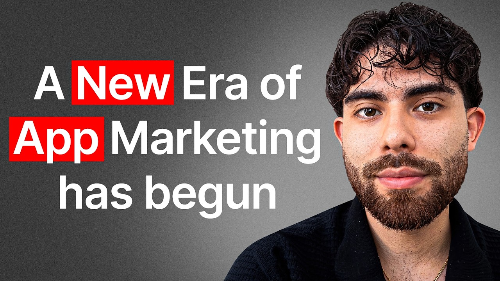

# The NEW App Content Strategy Dominating in 2026

Start building & deploying paywalls in 10 minutes flat: https://superwall.com/

## Table of Contents

* [00:00:00] Intro
* [00:03:31] Why Cloning Is 90% of Campaigns
* [00:04:51] The 20% Clone Rule
* [00:06:45] Cloning a Competitor Post
* [00:10:17] Launching Accounts in 20 Countries
* [00:12:46] Dubbing Videos Into New Languages
* [00:15:28] The Best Countries to Expand Into
* [00:16:49] Hook and Stitch Explained
* [00:18:39] Evergreen Campaigns on Autopilot
* [00:29:06] Ranking on AI Search
* [00:35:21] Post Seeding and Comment Seeding
* [00:39:02] The Four Channels of Distribution

## [00:00:00] Intro

We've moved pretty fast. We've gone from zero to 8 million a year within six months, making us one of the fastest growing companies in Canada. And the entire goal of the company is to do one thing, and that's just solve distribution. We currently do a quarter of a billion views a month for companies like OpusClip, Super Wall, also a customer, and Typing. com. [00:00:00 → 00:00:18]

Those numbers made a lot more sense once Matt showed me how Clover actually produces app content. His team starts with a format that has already worked, changes one part of it, and then publishes those versions across different accounts and countries. I asked him how much of a successful campaign is built this way. >> Cloning content is really about 90% of any campaign that we've done and then 10% is really kind of the crazy experiments worth testing. When Matt says cloning, he means keeping what earns attention while testing a different hook, CTA, visual, creator, language, or product demo. [00:00:18 → 00:00:48]

He says the typical variation gets about 20% of the original post views, but he has also seen new versions perform two to six times better. Once one of them clears a performance threshold, this is what happens next. >> And then you could essentially split the video, hook and stitch, and then change the hook, change the demo, and launch on another account. So you could have one UC creator that's just continually posting for you and then change every aspect about the video completely on autopilot, but only for videos that are performing after a certain view threshold or after a certain filter. So Matt showed me the whole workflow on screen. [00:00:48 → 00:01:19]

I got to see where Clover finds formats worth testing, how the team decides what to change, how those versions launch across accounts and countries, and how the winners feed the next round of content. If you market an app, this gives you a repeatable way to find content that works without rebuilding every post from zero. This is the Super Wall podcast. I'm Joseph Choy, founder of Consumer Club, a Discord where top consumer app founders trade alpha and what's working now in growth. I've been talking to members doing a million AR and they tell me they've been using these two tools. [00:01:19 → 00:01:48]

Superwall has this free AI tool trained on 422 profitable paywall experiments across thousands of successful apps. You upload a screenshot of your payw wall and it gives you an experiment idea to make more revenue with the same number of users at paywallexperiments. com. And if your app's doing at least 100K MR, we host vetted dinners in SF and New York to hang out and network with other top app founders. You can apply with the type form in the description. [00:01:48 → 00:02:09]

Also, these app founders have been telling me they use ROR. I met Daniel, the founder of Ror, at a dinner, and I got genuinely really excited when he told me about Ror Max, which is out now and has honestly changed the game for coding mobile apps. It's AI that oneshots full native iOS apps with Swift code, camera, sensors, haptics, payments, the whole stack. And as you vibe code with Ror, you can install prototypes directly onto your iPhone with one click and then publish to the app store in two clicks. If you've been waiting for AI coding that actually does native iOS apps, well, this is it. [00:02:09 → 00:02:37]

I got you guys a discount. You can use the code superwall or use the link below. Tell me about your about your stuff. What are you working on? >> Yeah, I run a company called Clover. [00:02:37 → 00:02:46]

We've moved pretty fast. We've gone from zero to 8 million a year within six months, making us one of the fastest growing companies in Canada. And the entire goal of the company is to do one thing, and that's just solve distribution. We currently do a quarter of a billion views a month for companies like Opus Clip. Super Wall is also a customer. [00:02:44 → 00:03:01]

I'd love to be able to chat about kind of the experiments we've been able to run and some of the learnings we've had from that. >> Yeah, there's a lot of interesting takes on the whole like organic game. This is all organic, right? Not paid ads. >> Exactly. [00:03:01 → 00:03:14]

>> Yeah. Show me some of those case studies like you said. Um, a bunch of like pretty cool companies that are doing this. And it's interesting. Some of them are uh B2B as well. [00:03:13 → 00:03:21]

Like a mix of like B2B and consumer. >> Yes, exactly. Yeah. I think both work super well. Some like obviously consumer has a better uh retention play, but uh B2B is kind of more of an awareness aspect. [00:03:21 → 00:03:31]

## [00:03:31] Why Cloning Is 90% of Campaigns

I would say generally speaking, one of the biggest learnings that we have had has been uh cloning content is really about 90% of any campaign that we've done. Uh and then 10% is really kind of the you know crazy experiments worth testing. So this is an example of a pretty basic slideshow. It's just 10 trucker essential Amazon edition and kind of promoting a bunch of different products. This one slideshow has done 110k use. [00:03:31 → 00:03:54]

And using the ecosystem, which is one of the products within Clover, we simply just cloned this exact same thing in a single click and then created different variations. And so there's another one. Again, all we already changed is we made this truck be blue. It kind of changed like some micro details about it. So it's on this detectable by Tik Tok as a not a new video. [00:03:54 → 00:04:19]

>> So it's like it stays as original content. >> Yes. So yeah, this is like blue and then now we also change the images a little bit and then we promote the product >> because otherwise you'll get like shadowbound or detected, right? >> Yeah, that's right. And then here we kind of just mention the product directly. [00:04:17 → 00:04:31]

Uh so we kind of switch one of the slides to the one that we want to focus on. And then collectively uh we just have one channel for example just posting the same exact content because we know that it's as good performing content. And collectively in the last, you know, this is about a week and a half worth of content has done 34,000 views, which again is about a third of the original content piece. [00:04:31 → 00:04:52]

## [00:04:51] The 20% Clone Rule

And so generally speaking, we've noticed that the median of clone content is about 20% of the original content. So as an original content piece is doing 100k, uh if we clone it even slight variations is not on not detectable by the social platforms, it would do about 20% of how well it would perform. Uh, and so realistically, as long as you do around five to 10 more times of that same post, you end up reaching the same amount of volume as the original post. But that's like the median case. The actual extreme case is that some of these actually do two to six times better than the original clone content piece. [00:04:52 → 00:05:27]

>> It's very random. It's like if you post a video and you get 100,000 views, maybe you could have gotten like at the extreme case 6x more. Like you could have gotten 600k views on that video if there was like a tiny tweak. Like it looks like you're tweaking the font and the actual copywriting of the hook as well, right? Um in addition to the like colors and stuff. [00:05:25 → 00:05:48]

>> Exactly. Yeah. So, we're essentially testing a couple different items. So, generally it's it's hook CTA and then the avatar themselves. In this case, the avatar is a truck, but we're able to really kind of test out those. [00:05:46 → 00:05:59]

And then depending on what's working the best, uh we're then able to change those aspects for for future campaigns. And again, this is just like one account that just uh we noticed generally speaking like especially for slideshows, the aesthetic of the account matters more than anything else. And so aesthetically pleasing, like this is just a a bunch of trucks in the single account that we just recently launched. Let's look at the other accounts. But first, this is exactly like Facebook ads, like tweaking the CTA, tweaking the hook, and tweaking like one small visual thing about the thing as you scale creative. [00:05:59 → 00:06:29]

[music] And I have I've never seen this being done to this scientific level for organic before. So this is pretty pretty insane. But wait for so right before we go to the next one, what is the original video? Did you how did you create that >> or the slide the original slide? [00:06:29 → 00:06:47]

## [00:06:45] Cloning a Competitor Post

>> Yeah, sure. I can show you a a useful case with Jake's Super Wall Founder. His app is called Natural, which is digital camera. Uh we launched this campaign about 5 days ago. It's at about 100,000 views um organically and driven about $1,000 in downloads and about like 200 signups just from this type same approach. [00:06:45 → 00:07:04]

And so what we determined uh is that Daz is like one of their competitors and these are the top five content pieces that are worth cloning for his particular setup. And so in this scenario, let's say I wanted to clone this content piece. It's a pretty basic content. It's, you know, this individual has kind of like X plus flash and then they do comment seating to then mention Dascam as the option to use. And so all we can do is just copy this link. [00:07:04 → 00:07:34]

We can then go to uh the platform. Uh we can then directly clone these slides. Typically it takes a minute, but I'll kind of show you what the result would be. So these kind of the variations and then individually I can then choose how many variations per slide I want to change. So in this scenario, I can choose, hey, maybe I want the avatar to be different or maybe I want the background to be lighter. [00:07:34 → 00:07:54]

I can also choose the how hard of a variance to go. So in the trucker example, that was a moderate change because I was still kind of changing the truck size or whatever. But if I wanted a subtle change, maybe the mountains removed, that will kind of automatically do that. And so what's really interesting here is that this is a near promptless way to be able to clone content because I can individually choose I want to change the avatar, I want to change the background, but the AI has gotten so good that we can essentially just, you know, take the exact content and then choose subtle, moderate or dramatic changes. Um, and then it will clone the exact same content pieces. [00:07:54 → 00:08:26]

So you can even see in slide three here, all we did is just increase the lighting of this particular image. In this one, I think we kind of change the mountain just a little bit slightly to the right. Some of the clouds are a little bit different. And again, it's near undetectable uh to Tik Tok. And for some scenarios, if you wanted to make it even more undetectable, we would just move the slider from low subtle to more dramatic type of changes. [00:08:26 → 00:08:49]

>> This is your tool, right? So, it seems like there's like the creation part and then there's also the like when we were looking at Jake's uh app, it was like or sorry, the Daz like you were looking at the top formats for that app. Is that what is that looking at like Tik Tok and Instagram pages? >> Exactly. Yeah. [00:08:48 → 00:09:07]

So, we currently have a database of about 4 million Tik Tok and Instagram like pages accounts and kind of scrape them continuously and then we also do a live search. So in this scenario, if I wanted to find videos that related to Dascam, I can also do it through this way. And I can just see that this is the one worth cloning in a single click, I can just clone this exact video, and it'll be able to just be cloned into our our main database. And then once it's cloned, I I have a template of this clone content. And then all I did in this scenario is I just changed the image that it was displaying from the original content piece to Jake's logo. [00:09:07 → 00:09:39]

Uh so then it would be just be Jake's logo plus flash, Jake's logo plus flash. And then very easily I could then create variations of this particular set. I could then create um in this case three different slideshow variations of this set and then launch the campaign based on like a single cloned edit. But this entire process like was probably in total around six to seven minutes including the image generation uh per set because we can do parallel processing on per image. So as I kind of showed you when we clone the content we did four but in theory I could have done 20 and it would take the same amount of time because image typically takes about a minute minute and a half to clone. [00:09:39 → 00:10:15]

>> Okay. So then clearly like content creation is not the bottleneck anymore. [00:10:13 → 00:10:19]

## [00:10:17] Launching Accounts in 20 Countries

What is the bottleneck? Is it just like posting on phones? Like how do you actually get these posts out there? We typically use our our own like phone network to be able to then choose what phones uh make the most sense. What's really interesting, I would say, is that the type of accounts and so I think majority of our folks are still mostly using US- based accounts. [00:10:17 → 00:10:35]

What we have within our system is we can actually launch accounts across 20 different countries. And so I essentially like mass create a bunch of accounts. Let's say I'm going to choose 10. I'm going to choose actual camera. In this case, I'm going to choose half Tik Tok, half Instagram. [00:10:35 → 00:10:47]

And here are all the different countries I can actually launch a campaign for. The exact same way you can launch it on Facebook. So if I wanted to launch a Spanish speaking campaign and maybe an Australian speaking campaign, I can do so. Uh I could then configure uh the age demographics, the male, the search terms that would be live and then even choose male or female and then it would just generate all the accounts in one go. It would verify that all these accounts are available, have usernames, have platforms, and then I can just request all the accounts uh set up, the usernames, the Instagram accounts, uh the locations of where these accounts would be, and then even like the bio and the search terms that would be used. [00:10:47 → 00:11:24]

>> That was really fast. Are you like making these on virtual devices? >> No, we use physical devices to to create the accounts. It's a mix of physical devices and then renting other people's phones just because to to be able to do the physical side at scale with the amount of people we're bringing in. It's near impossible to kind of bulk order a bunch of phones. [00:11:22 → 00:11:40]

And so we also uh do around half of our campaigns uh by just renting other people's uh existing phone uh situations >> for the other countries. If you want to launch like globally in multiple other countries, you're like renting those probably. >> Exactly. Yeah. >> And then for like Canada or like closer, you're like doing um you just have your [music] own phone network. [00:11:40 → 00:12:00]

>> Yeah. which have our own fun network for like the main North American setup. >> Wow, this is crazy. So, how many countries was that like they uh >> in I just did two. So, I did Spain and Australia, but we can currently launch across 20 different countries of more countries kind of coming in every other week. [00:11:58 → 00:12:15]

>> I haven't seen many people launch internationally like from the very start. Like I talked to lots do you know lots? He's like the this app founder that did uh Preycreen and he did like three different apps and like sold each of them for multiple six figures each. Oftent times when he sold his app, the buyer was trying to buy because they were going to internationally expand and they saw like a 5 10x potential, but instead of instead of doing that, you could just launch in all the countries yourself. >> Well, how what about the language part? [00:12:13 → 00:12:48]

## [00:12:46] Dubbing Videos Into New Languages

Like are you um uh are you like doing different languages at the same time? Let me show you that that this I think is actually probably the most exciting piece. It's a good example of a company called Rhyme. They do like travel type of apps. And this one video is not ai. [00:12:46 → 00:13:01]

It's a real content piece. Uh has done 37. 4 million views. Uh and it's a very basic video. So you have the hook, you have the avatar, and then the CTA goes to the app where they're kind of just demoing the app. [00:12:58 → 00:13:11]

Um however, they wanted to launch in different speaking languages. And so we just did the exact same video uh but we did it in German. And in this situation is that um we just had it where we just changed we removed the text and we added our own text on top. That's is still the same Tik Tok font. Uh and we kind of kept the same avatar. [00:13:11 → 00:13:30]

Uh and then it's the same exact video but then we would launch it in Germanspeaking campaign. [music] But the more interesting one is when you do subbing and dubbing. So this is an example of a content piece. So in this scenario again real avatar uh she's speaking English and it was English text and again German was apparently their highest converting audience at outside of North America and so we had the video subbed dubbed and also mouth synced into German. The text also changes based on what they're speaking from the original video we just switched it to German. [00:13:30 → 00:14:02]

And in this mouthspeaking audience, which is the hardest part is that, you know, there's different dialects. And so even if someone's speaking Spanish, the text that could be a different type of Spanish, we actually have it matched. And so whatever the person is speaking is the right translation type um of the German that's the dialect that's supposed to be said. And we take the exact same content and then launch it on the German account. And then that alone adds about a 20% lift across any view campaign per new country we we set. [00:14:02 → 00:14:29]

And so if you're doing let's say a million views a month already for your campaign just by launching in a new country set uh typically there's around five that work super well. Germany is one of them. Uh you can then add additional 200k views on top of the existing a million you already existing uh doing per month. >> And you said that Germany for this campaign was the highest converting. Why why was why do you think it was higher converting than like US for example? [00:14:29 → 00:14:54]

>> I think it's mostly the user set. And so what they already noticed from their data from people that have purchased is that Germany just like had a higher purchase and repurchase rate. And so even though the conversion was pretty much around the same, there was two aspects that were interesting. One is that there's no like real audience or like you know app that was doing it in that particular language or set. So it was a competition of like you blue ocean type of moment for them. [00:14:52 → 00:15:16]

And the second big case is that those types of individual buyers already do repurchase. And so you have the ability of a blue ocean times the ability of the repurchase uh increasing over general north uh American speaking audiences. [00:15:16 → 00:15:29]

## [00:15:28] The Best Countries to Expand Into

>> You said there were a few countries that have performed the best so far for you. Which which ones are those? >> The easiest lift is is honestly Spain. So you can kind of do a couple areas within Spain within the platform. Uh Germany is like another big one as well. [00:15:28 → 00:15:43]

And I would say uh Australia is also like adjacent enough where generally most people in Australia like have high purchasing power. So I think those top three are the ones worth worth exploring with like secondary being like Italy um or like Brazil >> and then that's all in addition to like US and Canada. >> Exactly. Yeah, of course. Even if you think about it, if you don't want to do translation, just launch in Canadian speaking audience set. [00:15:41 → 00:16:06]

And so anyone who's done ads knows that if you run US campaigns just from uh US and then you just, you know, add Canada as an option for people that get your ads, it's an easy 20% lift on any ad set. The same is true of organic. you just add say Canada on top and then you get more views uh cuz people have not seen the same content piece. >> It's so obvious to someone who lives in who who like is from Canada that you should do this but like it like for some reason I feel like America like US people are just like so US- ccentric that we just forget that like oh Canada is like almost the same purchasing power almost the same like conversion rates on on ads and organic and stuff. So yeah, easy low hanging fruit there. [00:16:06 → 00:16:48]

Yeah. Did you have like any other case studies to share? [00:16:48 → 00:16:50]

## [00:16:49] Hook and Stitch Explained

>> I think I've shared like what carousel cloning looks like. I've shared like what subbing translation looks like across different uh accounts in different countries. But I think the last one is which is really interesting is that uh there's generally good hooks and demos. And most of the hooks and demo videos that have performed organically typically can be attributed to really good hooks. We can actually as long as you have a good hook set, you can then switch the demo to the one that you're looking to to promote. [00:16:49 → 00:17:14]

And so we've also done that as well for uh creators that are looking to uh run additional campaigns. So this is an example of a pretty basic video. Uh there's an Asian girl covers her mouth. You have a hook and it goes to the demo. And so what we're able to do uh on the platform is you can essentially extract the hook from the demo. [00:17:14 → 00:17:32]

In this example, I've taken this exact video clip uh and I kind of do a node structure. I can do a bunch of different edits to the video at scale, but in this example, I'm just do going to do a hook and stitch. And so I've essentially split this video from the hook, which is the first like two seconds of the video, and the demo, which is the second half. And what's really interesting here is I can manually choose the exact time. But if I wanted to do a bulk amount of tons of hooks, I can actually autodetect a cut point using AI. [00:17:32 → 00:17:58]

So AI will be able to determine there's a big enough change between this slide to this uh cut scene in the video, which means that they will determine that's a hook and that's a demo. And then it would autosplit the video. So you then have the hook and you have the demo. And if you wanted to then switch what the hooks and demos would be, uh you could then merge different demo cases. So I can have like a whole library of variations or I can switch tons of different hook variations. [00:17:58 → 00:18:22]

I can choose like more variations for hooks. In this case, I can choose the same exact hook but then choose my own demo uh on top. And then I can even change the text overlay. In this case, I want to say like this is new or like I can have whatever text overlay on top. And then I can autopublish it into a collection. [00:18:22 → 00:18:37]

I can even auto publish it into a campaign. [00:18:37 → 00:18:39]

## [00:18:39] Evergreen Campaigns on Autopilot

And so the next level of what this really looks like of where I'm really excited is that you can have a gentic evergreen campaigns. And so the reason we call them evergreen is because you can imagine let's say you have 20 UGC creators posting you know 100 times a day across all the creators or I guess the math would be around 40 times a day across all the creators cuz each of them are posting about two times a day. And then what you want to do is you want to track all those creators on the platform and the second any viral creator let's say hits a certain threshold. So let's say the threshold is like a million views. So essentially you could have a collection of of any popular video that hits a million views, right? [00:18:39 → 00:19:14]

And then you could essentially split the video hook and stitch and then change the hook, change the demo and launch on another account. So you can have one UC creator that's just continually posting for you and then change every aspect about the video completely on autopilot, but only for videos that are performing after a certain view threshold or after a certain filter. >> Interesting. And would you post those on the same account that it was posted from originally? No, you would post on different accounts. [00:19:14 → 00:19:38]

Just kind of like magic. So, you can imagine uh you essentially are able to 5x the volume of testing from one creator by just having five different accounts. And again, it could be the five different countries. It could be five different audience sets. It could be warmed up across five different niches and then do edits across one uh video set to like five of them. [00:19:38 → 00:19:54]

Let's say you get one viral video from one of your UGC creators and then you would post it on this separate account and then let's say you have but then are you basically doing one reposting account per creator that you have or like if you're sourcing from multiple sources then how does that work? Like are you trying to maintain consistency across accounts and not post different faces or different characters or anything like that? >> It depends on two things. So the volume of the UGC creator is important. So let's say one UC creator is posting two times a day. [00:19:54 → 00:20:27]

Uh that means over you know 30 days you're doing 60 different posts and maybe out of the 60 posts there's only around 10 of those that actually have any significance and and reach your threshold. Those are just the 10 that are then repurposed again into another account that would just have 10 new videos. But then what's really interesting is that these 10 new videos would then be able to have data sets or even audience sets that are different. But even if you look at it uh on the 10 video side, you can actually take the same video and this is true of Instagram, less true of Tik Tok and just take the same video and post it again without any hard restrictions. And so even though it's 10 videos on a new account, you can really triple the video set. [00:20:27 → 00:21:05]

So you can change the hook, change the avatar, change like any aspect about the video. And so that same video base case could then become three videos. So you can eventually just match the same video set of 60 videos, but you only use the top 10. You make three variations of each of them. uh that's already performing and posting again to then get to the to 30. [00:21:05 → 00:21:26]

>> So, this sort of relies on you having uh at least one creator who's posting consistently. Like you don't want to do this for this basically multiplies content if you're already you have at least one account that's like making a bunch of videos. But then the other part of your tool is like creating a bunch of videos by copying and and tweaking. So, you kind of like cover both sides of it, I guess. >> Yeah. [00:21:22 → 00:21:47]

Uh, in theory, you can take any competitor post organically and then take the same hooks and then switch to your demos. >> And then this this tool, what is it called? I'll put the I'll put the link in the description. >> Yeah, it's called Echo. So, try echo. [00:21:47 → 00:21:58]

com. >> This tool is really cool. The the hook stitch is it feels so obvious like people have been doing that for a while, but it's just so manual. So, I like I like this. Um, are there other like nodes in this that you feel like are are useful? [00:21:58 → 00:22:14]

>> Yeah, there's a couple. So what's really interesting is that all the example cases I have shown have just come from this node structure and because of this setup you can do really any node setup. So you can imagine again imported video uh let's say you forget about the hook stitch situation uh and maybe just want to do another set. So let's say imported video uh this just one video set or I guess I could do I'll do top performing videos that are performing in a certain niche that reach a certain view amount of let's say let's say a million views. So then if if it has over a million views, it's you within your discovery feed, we'll be able to scrape those and then immediately be able to let's say translate that video to a different language. [00:22:12 → 00:22:50]

So in this case, I want to translate it to Spanish. I could then add my own text overlay. So maybe I want to actually remove whatever text exists. So, if there's already text on the video, I could just remove uh the text on top of the video, add my own text, which again could also be translated, and then I could then publish the video into its own evergreen campaign. And that's example of where I could take viral videos, translate them, remove the caption, add my own text that's um you know, the translation, and then publish them all within five nodes, and it'll do it automatically. [00:22:50 → 00:23:21]

And you could even have if you wanted to approve each of them a human in the loop element where you can have a text overlay and have a human in the loop and then do a publish. The what is the most tokenheavy part of this translation thing. >> The translation part that's really hard is the matching the text translation to the text overlay to get that like really synced up is by far the most difficult part of uh some of this aspect. >> And are you are you using sonnet for these or does it does the model not matter? The model generally doesn't matter. [00:23:21 → 00:23:50]

I would say we can switch between any model and like the same would be true. Like for example, removing caption, we've noticed like Google setup for removal caption is better than majority because the rest of them kind of leave a weird like fuzziness to it. So we've kind of tested across the board. So even though we have like base default sets that we recommend, you can really plug any model into it. >> What this reminds me of is like creators. [00:23:50 → 00:24:11]

There used to be this I mean I think they still exist but there's a startup that would take if you're a creator if you're like an influencer and you have millions and millions of views in one language they'll take a revenue share of your content and then just translate it into a bunch of other languages and it's like an agency model because it's like takes so much work to translate all your content into a different language and then re-upload it to a new channel and like Mr. Beast sort of like pioneered this, you know, but now you can just use like the AI tool and just auto node it to all the languages at the same time. It's this is like pretty crazy. I would say that the translations are actually really good. As someone who speaks Spanish, uh when I see the Spanish speaking clips that we produced, I'm like, this is about as perfect as going to get in terms of the output. [00:24:11 → 00:24:59]

And so I would say generally speaking what I've seen across the board across any language is that we've actually gotten there as a society with AI to get it like pretty much 98% there uh on the output. >> Yeah, that makes sense. Like with LLMs like Google Translate used to be limited, I guess by just like directly translating the words, but now with like the LLM, it's kind of like catching some of the nuances and stuff. That's interesting. >> I think the big thing is the is the mouth movements have been probably the biggest development in the last couple months. [00:24:59 → 00:25:26]

And I think that's kind of the final like brittle, you know, nail nail nail in the coffin of how translation has been able to work. >> So, let me show you this. A lot of app founders I talk to have a feeling their app has viral potential, but don't want to be the person brain rot scrolling an hour a day hunting for formats or worse burning thousands on creators shooting videos that just flop. Recently, I've been telling every founder I meet about Spy Talk. It's basically an AI Tik Tok viral marketer that I've seen a lot of top app growth teams using. [00:25:26 → 00:25:54]

You just paste a link to your app and this agent scrolls hundreds of thousands of Tik Toks for you, finds the outlier videos from competitors who've already cracked the best formats that are driving installs in the niche of your app and then it remixes the hooks, the angles, and then it makes playbooks so you can pretty much copy paste virality. And then it alerts you when it detects new breakout formats that would also work for your app. This is the only growth tool I 100% vouch for on this channel because there's a ton of Genai content tools out there, but none of them tell you what to make. Spy talk makes sure you're never in the dark about what's actually working. Now I'll put the link in the description. [00:25:54 → 00:26:27]

>> Okay, that's cool. What what else you got? >> The other aspects are just around more of the campaign aspect. So I can share how campaigns can be launched as I think entire goal of the platforms that we're trying to create is to really have the entire content stack and then get data sets. So we have the discovery aspect, the clone, the cloning aspects, the variants and then finally we have the the mass publishing. [00:26:26 → 00:26:46]

Let me quickly show you um how similar it is to meta to be able to launch a campaign. We kind of go here. We can choose an awareness campaign similar to how it is on on Facebook. Uh in this case, I'm going to say like a [snorts] million a million view campaign. Uh I could then choose the budget. [00:26:46 → 00:27:00]

So I can choose that it will stop raw running after you hit a million views. I can choose the start date. In this case, I'll just choose like halfway throughout next month. Uh I also choose the region. So in this case, I have [music] um 13 accounts based in the US, 13 accounts based in Tik Tok. [00:27:00 → 00:27:16]

Uh unfortunately, I don't have any other accounts anywhere else. But if I wanted to choose, let's say, Canada based, see there's no accounts available. But I want to choose, let's say, US-based, I can see what other campaigns are currently running for, so they're not double dipping. Uh, in this case, I'm just going to choose these two. And what's really interesting here is that each of these accounts are logged to do two to three posts per day. [00:27:16 → 00:27:35]

It is a random variable, so it's not um as, you know, forced to be two or forced to be three. And then I can click on next. See, they're busy in other campaigns, but I can just still schedule content. And here is kind of the template that I was showing before. And so I can actually just choose this one example case. [00:27:35 → 00:27:48]

Choose a playbook. These are the three posts are going to be published. And then I'll have them auto schedule for September 15th for just these three or these two accounts that I've chosen. All I have to do is click on publish and I'll be able to launch uh those campaigns. It's just telling me to randomize the music for more variants and then I can click on publish right after. [00:27:48 → 00:28:07]

>> You're paying CPM for these campaigns. >> It varies. So some campaigns are performance-based, others are like a pure number of a post uh and number of accounts based. I would say base plus performance is the best scenario. And the reason why is you can go a lot lower on the performance. [00:28:04 → 00:28:20]

And so we even have campaigns that are doing let's say $3 per post, but then you have like 3. 5 CPM and others are just doing way higher CPM and they don't care about the base. They're willing to take the risk. So I would generally say it depends on the campaign set. If you're doing purely clone content, I would overindex on base to CPM. [00:28:20 → 00:28:38]

But if you're just doing like new experimentations, then you should just do CPMs. And it'll it'll probably be like a high CPM because you want to just like find formats that work. And then once you find the formats that work, then you want to pay a lower base uh because you know it's going to work. You don't want to pay high CPM on that. Um and then you play the Yeah. [00:28:38 → 00:28:57]

Okay, that makes sense. >> Exactly. Yeah. >> It It's basically the same way as like regular UGC works. Like you want to pay high CPM in the beginning and then you switch to base as you like find your winners. [00:28:57 → 00:29:06]

## [00:29:06] Ranking on AI Search

Do you have like AI search stuff too? So, I think the other untapped market, which I actually haven't heard anyone from the videos that you've you've done before in the past, everyone's always talking about UGC and influencers, uh, is really around AI search. And I think it's probably one of the most untapped markets, especially for consumer apps. And to be able to rank on search isn't really that hard hard of a science. There's really two approaches we end up kind of uh, playing into the system. [00:29:06 → 00:29:30]

As one of the Clover products, the one we kind of started off with was AI search and then since then we've moved over to Tik Tok and Instagram as new channels. But we started off with just like uh mass publishing on Reddit and blogs and been able to get tons of data. Uh and so right now just on AI search we generate about 150 million views across all customer bases and that's a mix of blogs or Reddit content that we do for customers. But to be able to do the process well there's really around like three to four steps. The first thing is that I would search uh 2,000 prompts um and then I would determine one what the search volume of each of those prompts are uh and then two uh the citations of those prompts. [00:29:30 → 00:30:05]

So, you can imagine, let's say you're an app that's doing food uh tracking. Uh you'd probably want to rank for what is the best app for food tracking. And then you can determine that that particular search term on Google might be doing 15,000 impressions per month for that particular search query. You could then assume what we typically assume is a 30% rate for AI search. And so in this case, it would be around let's say 5,000 uh impressions particularly just to that same search query on AI search. [00:30:05 → 00:30:32]

And so this is like still a very viable set. You can imagine that's just one prompt or one search query. And if you do that 2,000 times, you can find some really good uh nuggets that are really worthwhile to to do. But generally speaking, the Google representation of search can just be almost attributed to AI search because there's no good prompt volume that exists online. So you kind of have to do estimates on what exists on existing search uh queries. [00:30:32 → 00:30:55]

And there's like a lot of existing SEO tools for that u where you can just like you search up any SEO tool and then you just find like regular Google search queries uh you find the volume on that and you estimate 30% of that volume is probably going to LLM searches then interesting is there like a particular method you like to use to find those queries I would generally say general href's uh Google search type of uh console is like typically sufficient to find the queries. I think the harder part is finding the citations per queries and that's where you can actually really change the edits on AI search. So again in the same example if you were to do best calories tracking app 2026 uh if you do that on Google you get you know six 10 results on the first page. If you do that on AI search you end up getting citations and that's the equivalent of what that would look like. And with the citations, that's where a lot of the changing of the response can can kind of [music] come about and you know on chat uh it's kind of decreased a little bit for Reddit citations, but it's still pretty strong on blogs. [00:30:55 → 00:31:55]

Uh but it's actually increased for Reddit across every other social platform. And so in the last uh 3 weeks, I would say that Gemini, Perplexity, a lot of these other tools, even AI overview from Google have increased the community aspect. So Reddit, Kora, Pinterest uh citations over what it used to be. And so we've actually noticed that across the board. And I'll quickly show you what that looks like. [00:31:55 → 00:32:16]

For example, if the search query here would be best mobile app development agency for an MVP, you can see that this particular Reddit URL is being cited for these five search queries. And these are really good search queries. And they're not just being cited for chat, they're also being cited for Google AI overview and Gemini. And so if you just uh are able to take on this one Reddit post, you end up automatically being cited in five different prompts because they're all being cited across each of these. But not just five different prompts, three different channels. [00:32:16 → 00:32:45]

So Gemini, Chat, GGBT, Google AI overview. So sometimes Gemini instead of Google AI overview are all citing this one URL. And so when you actually view the post details, you can see that they're actually just listing out uh different uh ones. It's kind of an open question on the right development agency. And then the comments is actually what's swaying the objections on which is the best one. [00:32:45 → 00:33:06]

But if you were to simply just rank or you know put um the one that you recommend uh you essentially get automatically be ranking on that particular search query and you can imagine doing that across all these opportunity sets on like which is the best one to to attack. >> So then what is the actionable step once you have all of all this intel in this example you can see that they're shortlisting five firms. They're pretty smart about this here. So these ones are actually the ones that are going to be uh indexed directly on search based on the uh posts themselves. And I would say generally speaking in the last 6 months, as long as you had, you know, maybe a couple links on the post itself and maybe a couple aspects here, links on the comments, that was generally sufficient. [00:33:06 → 00:33:44]

What I would say has changed the game a lot recently in search is that they're sometimes not citing the actual post themselves. They're citing like a random comment underneath. And what we've noticed across what comments have actually performed the best. It's generally speaking ones like these. And so uh what's interesting here is that you can have let's say he he did like let's see he did this exact place he did 22 different [music] uh top agencies he recommends for design and he listed out all his personal list which again is now being indexed his personal list is now being indexed as the source of truth uh on AI search. [00:33:44 → 00:34:18]

So he's saying like this is going to be the number one set and if you actually go to the queries I showed before this is going to be the one that's being mentioned because this is actually the comment that's being cited. Uh, however, you can see that he's also made edits based on the comments of what other people recommend. But if you really wanted to, uh, he can actually just remove all of them and let's say this is his own agency, uh, and he could just have just one and chat GBT when they do the next refresh and they do refreshes on live searches would actually just end up quering one instead of all of these. And so you could eventually have a set where you're looking for the best product agencies. You list out a bunch of competitors, but then in reality you can edit the prompt, edit the setup to then just mention the one that is actually the most important. [00:34:18 → 00:34:57]

Are you creating these Reddit posts yourself? Like you're finding all the So first step one, you you figure out the search terms on Google. Then you uh translate those over to LLM prompts. You search up with the LLM's uh those prompts. And then you look at the citations. [00:34:57 → 00:35:15]

And then once you see the citations, are you basically cloning the citations with your own like Reddit posts and your own Reddit comments? [00:35:15 → 00:35:22]

## [00:35:21] Post Seeding and Comment Seeding

>> There's two ways to approach it. One is that you can either do post seeding or comment seating. So post seeding would be we already know this title and this general body of text is ranking, which means if we can outrank this post, we can essentially push this one uh down and have ours higher. So that's one way to approach. The other way to approach it is common seating. [00:35:21 → 00:35:40]

Uh and so we we kind of do both because there's a lot of ones to kind of attack. So comment seating would be >> [music] >> uh this particular user as I showed gave some really good value in the top 20. And so we typically h have our own hot take about these are our definition of of the top 20. And so that essentially allows for both options to exist and then uh have it where this one becomes more value ad to then increase uh people up voting or sharing that with other folks. >> And would you place that comment in the same exact Reddit [music] post? [00:35:40 → 00:36:10]

>> That's right. we post the exact same Reddit post because we know that Reddit post and the comment is being cited. What you can also do is uh comment on the existing one that's already being cited. And so if you list out the top 20, you could be like actually my favorite one is number five and have that being said five different times. And so that entire thread is the one that's being cited. [00:36:08 → 00:36:28]

And so even the sentiment of the initial analysis is the one that's being being mentioned. And so with that particular thread thread case, uh it's that you know everyone's saying that's a great list, that's a great list. So that becomes a source of truth in terms of how search is being determined. >> Yeah. So you can just see where the traffic is going and then just put your comment in that existing thread. [00:36:28 → 00:36:49]

And then the other way is to create your own thread, you know, create your own Reddit post probably like in the same subreddit or like similar subreddits and then you're iterating on, you know, whatever the the top performing one was before. Is there like a a specific method to that? Like does the tool help with that at all? >> Yeah. So the the main thing that we offer, which is similar to how we offer it on on Echos, which is the Tik Tok, Instagram, is we just own a a large amount of two aspects. [00:36:49 → 00:37:17]

We own about 4,000 different subreddits across tons of different niches. So we're able to help people, you know, make sure that the post stays live and like the comment stays live for those niches. And the second big set is we own a bunch of different accounts uh that can either be customer accounts or existing accounts that we use as user bases to then, you know, see these comments and see these posts on top. >> That's great. And this is the same tool. [00:37:17 → 00:37:38]

>> Yeah, same tool. >> Okay. Wow. So for consumer apps, do you recommend people start with AI search and like organic social at the same time? >> What I generally say, especially for consumers, you want everyone to know about you and the best consumer plays have gone as hard as possible to win. [00:37:37 → 00:37:56]

And I would say generally speaking to do both at the same time, assuming capital and resources make the most sense. Do you ever see that people from the organic social end up flowing into the organic search stuff? Like are they're like searching up terms and stuff and then finding it uh finding stuff there or is it just like direct to direct to app store and then it's like two separate funnels? >> Yeah. So generally there is some overlay well from what we've seen uh from like testing both products where if a viral video would be able to draw traffic to the app store typically a Reddit post or citation or blog would still surface up in the initial query of like just listing out your app name and you know being able to have dominance and like be able to show that you know your app is able to do what it does within that post is also important. [00:37:54 → 00:38:41]

>> Yeah, it's like that marketing principle of like someone should see your thing seven times before they're being convinced to buy. I was a little bit skeptical when you said you saw distribution, but I I'm a little bit more convinced now. There's like organic social, there's AI search. Are there are there any other channels that you feel like are important for distribution that you're trying to tackle? [00:38:40 → 00:39:04]

## [00:39:02] The Four Channels of Distribution

>> It's really funny cuz the entire thought process around Clover is that I think there's actually four big channels to win and we're kind of just moving the play into each of them. Again, we're a year and like three weeks old so we've been moving as quickly as possible. The first one is search and so we do Reddit, blogs, black links, all that stuff within the first product. The second big thing is video. So we we attack Instagram, Tik Tok. [00:39:02 → 00:39:23]

We're going to be adding YouTube at ads, Snapchat very soon. And that's going to be able to increase the amount of volume you're doing with the already content discovery uh virality. The third leaf is what we call it uh is going to be ads. And so you can imagine the next big play is organic or organic to paid conversions. So that's going to be Google ads, meta ads, Tik Tok ads that are fully agentic and then adapting based on the learnings and principles we have from organic. [00:39:23 → 00:39:47]

And then the last leaf uh which I feel super strongly about which works better for B2B is um outreach and so you know mass uh outreach across uh different social platforms like LinkedIn, Twitter uh andor uh email. >> Anything else you wanted to share? >> I I think it's worth talking about where the next maybe place is going to be going towards. So you have the four leaves. to each solve a different pillar of distribution and the next game after that is is is hardcore towards private equity. [00:39:47 → 00:40:09]

So I think if if we can just in theory take do a single click launch all four different leaves for a new company or an existing company is already going to be have some of the best training and data sets that exist because we're kind of doing our own test to be able to figure out what's working. You can imagine I can launch a new app, launch a new consumer product, launch a new e-commerce brand and then run this exact play of like true growth agents to then uh against that that funnel and that product >> eventually you can like buy companies and then just run distribution on them like very >> fully fully agentically essentially. >> Are there certain types of companies that you would do that with? >> It's it's always mass TAM because all these products are are essentially based on the thesis of like consumers and so consumer plays will change over time. I think a lot of people are betting on existing consumer behaviors like hook and demos, but hook and demos might not work forever, right? [00:40:09 → 00:40:58]

Uh and so our entire thesis is that we're essentially cloning or using what's already working in the market today and then distributing that um at scale. >> It makes sense. I I feel like o overall in general as well, people just underestimate how much you can juice the views on on the stuff that you're doing already. Like people, it's just like sort of a limiting belief, I think. you if you're doing a million views a month, if you do all the things like you said like the tweaking the countries, changing the CTA, changing the colors, changing the hooks, you can get like 5 to 10x more than you're already getting for just a little bit more effort of, you know, enabled by AI. [00:40:58 → 00:41:38]

So, yeah, it's it's what I think people under underestimate that in general. >> Yeah, I think so, too. >> Do you have a discount code, by the way, or is it just a >> We offer a free month for anyone that's watching. >> Okay, nice. Awesome. [00:41:38 → 00:41:48]

Well, thanks, Matt. This is great. Uh, thanks for being on the pod. >> Yeah, of course. Anytime. [00:41:48 → 00:41:53]

>> Something you might not know, most of the founders I cover on this podcast are hanging out right now in the Consumer Club Discord, sharing with each other what's working now for consumer apps. So, you can apply to join consumer club if that sounds interesting to you. And this is the Superwwell podcast. Of course, you got to check out superwall. com. [00:41:51 → 00:42:07]

We have more videos on the channel. So dig into those to learn from app founders who are willing to share super tactical stuff about app growth. [00:42:07 → 00:42:15]
