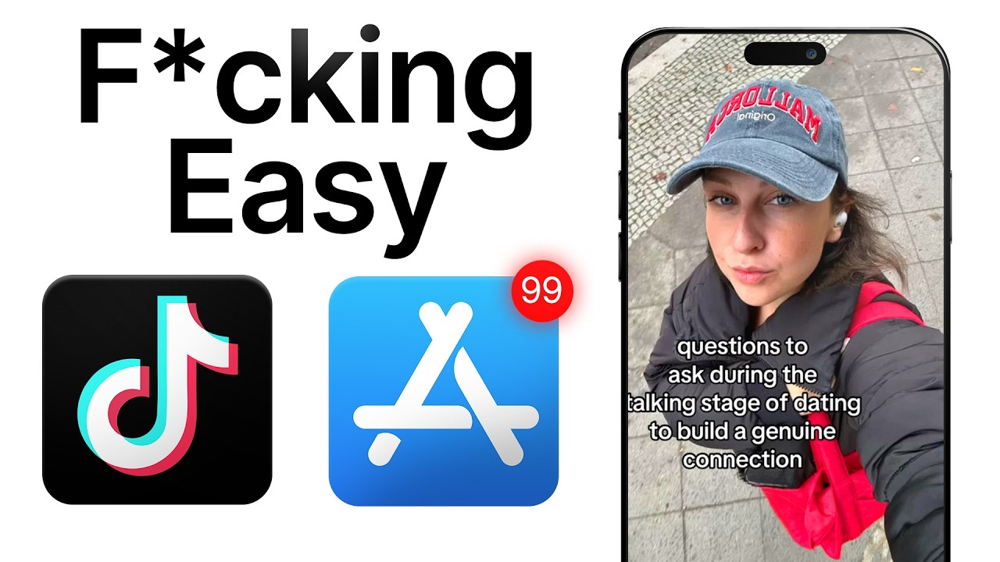

# The NEW Short Form Strategy Dominating For App Growth

Start building & deploying paywalls in 10 minutes flat: https://superwall.com/

## Table of Contents

* [00:00:00] 300 Million Views and 3 to 5 Million Downloads Without Creators
* [00:01:02] Who Is Yannis and How He Got Into App Marketing
* [00:02:51] Starting From Scratch: Posting Manually and Finding the Friction
* [00:04:12] Why He Keeps Creative Control In House Instead of Using UGC
* [00:06:06] The Reposter Model and How It Scales Differently Than Influencers
* [00:07:55] How to Find Viral Formats That Actually Convert to Downloads
* [00:11:30] The Comment Bait Method and How It Drives App Store Installs
* [00:13:45] Going Viral vs Actually Converting: The Key Difference
* [00:17:00] How to Separate Format From Content When Researching TikTok
* [00:23:35] The Magic Moment: What Actually Makes Someone Download Your App
* [00:29:00] Using Spytok to Correlate Views With App Store Rankings
* [00:36:00] Duration Strategy and Why Video Length Changes by Niche
* [00:44:00] How to Find High Converting Formats Before You Build Your App
* [00:52:00] Current Numbers: 50 to 100 New Accounts Per Week

## [00:00:00] 300 Million Views and 3 to 5 Million Downloads Without Creators

Last year, consolidated, maybe we did 300 million views. We're opening 50 to 100 accounts per week, making anywhere from 10 to 15 million views per month. >> What kind of downloads are you seeing from that? I want to say 3 million to 5 million downloads. This is Yiannis. [00:00:00 → 00:00:18]

Surprisingly, he's not a marketer. He's a machine learning scientist who spent years reverse engineering TikTok virality to figure out how to crack app marketing. Five years later, he created a unique approach to social media marketing that opens 50 brand new TikTok accounts and produces of videos mass promoting his app. But the thing is, he does all of this without ever hiring any creators or influencers. So in this video, we walk through his whole system step by step from the creative research framework he runs and exact tools he uses every week to identify which viral formats to copy to the comment bait method that actually drives installs to his app, not just views, and how he creates specific TikTok formats that AI can mass produce while still going viral. [00:00:16 → 00:00:57]

By the end, you'll have the exact playbook that you can copy and start using today to mass market your app in a way that actually drives installs and generates revenue. [00:00:57 → 00:01:06]

## [00:01:02] Who Is Yannis and How He Got Into App Marketing

This is the Superwall Podcast. I'm Joseph Choi, founder of Consumer Club, a Discord where top consumer app founders trade alpha and what's working now in growth. I've been talking to members doing a million ARR tell me they've been using these two tools. Superwall has this free AI tool trained on 422 profitable paywall experiments across thousands of successful apps. You upload a screenshot of your paywall and it gives you an experiment idea to make more revenue with the same number of users at paywallexperiments. [00:01:06 → 00:01:30]

com. And if your app's doing at least 100K MRR, we host vetted dinners in SF and New York to hang out and network with other top app founders. You can apply with the type form in the description. Also, these app founders have been telling me they use Rorke. I met Daniel, the founder of Rorke, at a dinner and I got genuinely really excited when he told me about Rorke Max, which is out now and has honestly changed the game for coding mobile apps. [00:01:30 → 00:01:51]

It's AI that one-shots full native iOS apps with Swift code, camera, sensors, haptics, payments, the whole stack. And as you vibe code with Rework, you can install prototypes directly onto your iPhone with one click and then publish to the App Store in two clicks. If you've been waiting for AI coding that actually does native iOS apps well, this is it. I got you guys a discount. You can use the code superwall or use the link below. [00:01:51 → 00:02:11]

Introduce yourself. What's your story and what do you do? I studied thousands of apps, 10,000s of apps, millions of posts, you know. I have a machine learning background, mostly research. My foray into growth marketing, marketing in general has has started a couple years ago, maybe right after COVID, where I kind of saw with my engineering mindset that there was something to try there and I was always attracted to consumer. [00:02:11 → 00:02:38]

Before that, I was only B2B, a bit you could say boring. And so I was like, "Okay, maybe if I put my engineering hat and apply those principles to, you know, growth marketing and especially TikTok at the time, maybe I could figure something out. [00:02:38 → 00:02:53]

## [00:02:51] Starting From Scratch: Posting Manually and Finding the Friction

" So I started first by doing my own account, right? So posting manually, maybe 50 to 100 times in French. And I went through all the friction that everyone encounters, right? So how do you make views and then how do you create engagement? Because when you make views, it doesn't necessarily translate into, you know, followers. [00:02:53 → 00:03:15]

And then, "Okay, I got followers now, but I got no conversion into what I'm trying to do. " And so it translates to no traffic. And so you see like all the steps that goes into when you discover that yes, viral, being viral or doing organic is looks magic and is very rewarding when it works, but actually every step is actually something you need to solve into the mechanic that you incorporate in your creative process, in your creative process. The next step would be, you know, how do you scale this, right? Like it at some points like, "Oh, me with my own little, you know, process of analyzing the post, posting myself, going through, figure out the right hooks etc. [00:03:15 → 00:03:54]

Was like just if I was just a solo founder or someone who just wanted to treat it as a you know a side hustle project but to actually incorporate some scalability that would mean >> [music] >> making the system more robust and scaling the number of accounts and creative that you produce etc. [00:03:54 → 00:04:13]

## [00:04:12] Why He Keeps Creative Control In House Instead of Using UGC

And so I continued in that vein where I was like okay now how do you scale this into multiple accounts? And so everyone went through that uh phase as well. I guess at the time it was mostly in e-commerce. I don't know if you remember the tabs chocolate guy. It was my main inspiration to understand how you could scale you know multiple accounts. [00:04:13 → 00:04:34]

He was going through UGC regular. I was trying to get more programmatic. It's pre I don't know if it's pre LLM. I think it's pre LLM. So it was really and pre all the generative stuff. [00:04:34 → 00:04:46]

So it was really bare-bones. But basically I took everything that I learned from posting myself and launched it for one of my friends and partner in the dating space and we scaled our first fleet of I call them reposters where we would just take enough of the human aspect of creating an account which is the warm-up and like the regular behavior but we would produce the creative and keep the creative control cuz something I've never liked is externalizing the creative process to other people. Here it would be a creator right? So what happens and I talked to a lot of founders who have UGC teams is basically you hire a lot of people and then you figure out seven to 10 people usually that are quite creative, understand the product and you kind of externalize or delegate the creative process to them and I was a bit uncomfortable about this because I feel like when you build a product especially consumer the The is a function that needs to be integrated, right? It's like an end-to-end process from having a good product, knowing how to communicate about it, is kind of like should be part of the team and the people who build the product. [00:04:46 → 00:05:59]

And so, that's why I always try to keep as little as possible outside in terms of the creative process. [00:05:59 → 00:06:06]

## [00:06:06] The Reposter Model and How It Scales Differently Than Influencers

And so, that's what led to like more programmatic stuff. So, first we build like, you know, slideshow creation at scale and then a bit of, you know, animations and then we thought figured out some formats around, you know, texting. So, basically it was a dating product and you had Reese GPT at the time, all those guys, and we incorporated those techniques where I built like a clone of Tinder and then only the iMessage and we would generate conversations that were viral and incorporate the product in it, but it was fully programmatic, right? And so, that would allow us to test various angles and we just I would just let the computer run and screen record all those conversations on a Tinder messaging clone. Really interesting. [00:06:06 → 00:06:51]

I think there's two parts that I want to dive into in this conversation. The first one is how do you find those angles and the formats that will go viral and then also get you engagement and then also ultimately get you downloads for an app and >> [music] >> to actually drive revenue. And then the second piece is after you figure out what those formats are, how do you actually create the content and then scale the content? And then as a part of that second part, like you have this very like centralized approach where instead of hiring influencers or even UGC creators, you just hire what you call reposters and you just centrally create all the content yourself because you have this like creativity engine where you know exactly what formats will convert and go viral. And then you just give it to random people to post on their phones and their accounts that get warmed up. [00:06:51 → 00:07:45]

So, the first part is like the formats and the second part is like how do you scale that? Would it make sense to start with the like the finding formats? Like how do you make a video that actually goes viral and converts? [00:07:45 → 00:08:00]

## [00:07:55] How to Find Viral Formats That Actually Convert to Downloads

>> The goal is to really get be one with the target market. You understand there are two things. One, who is your audience? How do they talk? Etc. [00:07:55 → 00:08:09]

But especially how do they talk on the platform? And so, it's very different how people communicate with creative viral past and they communicate in real life. And there is this real language and trend and way of structuring the ideas inside the post that people know they're on TikTok. People know they're like someone is going to talk about finance or someone is going to talk about health or someone is going to talk, you know, about any of those things. There's like this whole language going on in the post. [00:08:09 → 00:08:43]

And so, what I usually do is just spend a lot of time looking at post where I know, I mean on Spike Talk, I know they have some kind of engagement. So, usually this is basically what I do, right? I just go and look most likely at the most saved or something like that. Filter by industry. I'm just going to look at what are the core foundational ideas in terms of angle. [00:08:43 → 00:09:06]

So, here you can look like trying to save 10K by June. So, maybe the saving angle. The I want to have 10K that are, right? Or a news angle. So, all those things are important, yes? [00:09:06 → 00:09:17]

So, the angles. But then you can look at more in detail. So, that means maybe when it's a news, people want it to be red and maybe they want, you know, those screenshots overlay which are very common on TikTok, right? But when it's trying to save, it's maybe more organic. It's a bit more, you know, with a face hook, etc. [00:09:17 → 00:09:35]

So, I just look holistically at the creatives and try to integrate yes the message like okay trying to save something or talking about a news that is important to know about but also like how it's communicated through the creatives. So I wouldn't do a news you know post with this type of you know face type of communication right visual communication. So I try to understand the visual language the angles that people are talking about and then I go more into details where basically the mechanism are always intertwined but you can transfer the ideas so that's the difficult part. Say I have a financial app I cannot just use the same format of another financial app. I need to think about what is the idea that was viral that I can transfer. [00:09:35 → 00:10:24]

So sometimes it's not possible right like I want to have 10k saved if I have a trading app I cannot say directly I want to have 10k saved without thinking about how it translates to a trading app right and so maybe this is not the right angle in terms of just the messaging but maybe the visual of someone trying to say I want to earn 10k by May is interesting right? So this is where the subtlety lies is that you cannot directly copy but I'm really big on mapping exactly the format right? So I want to communicate exactly like everyone is [music] communicating and have this kind of very deep understanding of the structure but I want to understand the variables I'm going to have to iterate on within this compass right? So I don't know if it's clear but basically I'm trying to understand the underlying structures of the best post in my audience and in my you know niche and then figure out the right dimensions to where I can play with within those constraints yeah. So what are we looking at here? [00:10:22 → 00:11:27]

So that post had like you know 10 million views and then like you click on it and then it kind of breaks down all those variables that you're mentioning like what is the gist of it? [00:11:27 → 00:11:37]

## [00:11:30] The Comment Bait Method and How It Drives App Store Installs

Okay, it's a high stakes financial goal prompts that leverages crowdsourcing to drive engagement cuz it's like hey, give me your most unhinged ways and side hustle. So it's it's comment bait which it seems like it worked. There's like 5. 4 K comments and then she's like writing the caption in a very like Tik Tok native way all lower case. I want to have 10 K saves by May. [00:11:37 → 00:11:57]

Give me your most unhinged. It doesn't mention the app at all but I'm guessing that you could put in the app name in the comments or reply to people's comments and stuff like that. Basically this post was really designed for engagement on platform. You you see like 10 million views, a million likes. You know, these are not small numbers and so clearly this was uh made as like a viral bait, right? [00:11:57 → 00:12:22]

It's still targeting the right audience but most likely it's not going to convert as much if you don't show the app and stuff like that. But what you can do with this is like two things, right? Like there are multiple methods to then transition to the app. One, you're talking about the problem. So anyways you're talking about the right pain point. [00:12:22 → 00:12:40]

Uh here it's uh I want to have 10 K saves by May. You can look at all the mechanism that I talked about. So here it's it's detailed here but it's like you have a specific financial goal, you have a time bounded financial goal, uh you have a realistic of or unrealistic financial goal. All of those can be transferred to a creative that converts. Now if you want to do that exact method, here it's it's it's you're going to play on the on the aura of this post. [00:12:40 → 00:13:08]

So all the posts that you're going to post after can be talking about solving this goal, right? So usually when you get a 10 million post views, all the posts after are going to have this uh ripple effect of views anyways uh just because >> Oh, because actually because you mentioned actually because you mentioned have chocolate, I remember uh Oliver has talked about this where it's like you go viral once and you get like a million views or in this case 10 million views and it's not the purpose is not really to convert but then because the for you page knows like oh this person watched this whole video to the end they'll probably show you the next video from that account and that video is actually designed to convert is that kind of the goal of this? [00:13:08 → 00:13:50]

## [00:13:45] Going Viral vs Actually Converting: The Key Difference

So that's one of the main methods right like the comments it's become a bit crowded this one I don't know why people don't do it as much obviously you're going to have another magnitude less conversions on this post but you target the right audience and so all the post that you post after can be highly targeted and solution oriented because this post targets the right audience right if you're a saving app budgeting app it's specifically viral among this this audience and so all the post after are going to be going to be targeting the the same one yeah All these like outlier posts are for a specific app right it's like claim I think it was I mean I don't know them all by heart but it's like budgeting with like most likely it's a it's a budgeting app so I have all my apps plugged here that I'm trying it's just apps that I own though and I you can basically adapt this post this structure you can adapt it for is here it's claim because I'm working on a claims app it's not claim but I'm using the same profile as claim to this stuff yeah So even if you don't have your app built yet you just like you find a relevant competitor you put that into Spytalk and then it'll give you like >> exactly we're in the process of building a a claim basically a claim competitor and so I just don't tell the app and I I use it to see how it would how it would evolve with this structure yeah I feel like you teed up the like high converting idea really well so it's like first you post this, you get a bunch of views and a bunch of engagement. And then like let's say you have this creator, they just posted this. What kind of video actually drives downloads? I think going into the theory and then examples will be cool like cuz I think you broke it down really well in the slideshows. We're still at the creative level. [00:13:50 → 00:15:41]

Then we can talk more about how do you scale this process, but it's important to understand what to look for in a creative. The process that I like to to look at and we started to do a bit is look at the as inspiration. It's a creative research process is always a bit messy, but you try to figure out uh the structure around your past, what are the best angles to try etc. and get a feel of visually what it's going to look [music] like and how your audience market talk again in a visual grammar, the visual uh aspects on platform. So, those systems are are uh in a loop always like we work in batch now. [00:15:41 → 00:16:21]

So, we would do like one creative research, find a format, uh scale the content around that format, then deploy it on a subset of uh ops management, you know, on the repo stairs, and then we would look back. Sometimes we parallelize, right? Like we have a creative research that is around one angle, another creative research around one other format, etc. and we would like parallelize those, but it's basically the same kind of looping process where you iterate and try to to uh to improve on your results, but it's very very iterative. The faster you go, uh the best result you get, right? [00:16:21 → 00:16:57]

Like there is no secret. You can sometimes have uh success first shot, first iteration. [00:16:57 → 00:17:01]

## [00:17:00] How to Separate Format From Content When Researching TikTok

Most likely you're going to have to iterate a couple times. The main question that everyone has with organic is like does it actually drive real results in terms of installs and conversions? And I agree this is the most difficult exercise cuz it's always shiny on the outside. Uh and a lot of people make views. Maybe I'm going to show you a sneak peek of something I've been I've been working on, you know, to track the actual download correlation, but um you never know when you look on the outside if an app is successful or not in terms of downloads. [00:17:01 → 00:17:35]

And so, that's what this presentation is about, like how do you I had a lot of failures around being viral, no downloads. So, that's that's that's the goal, like what actually drove drove downloads in in what I've been [music] doing. And so, and you do have a compound effect, which you don't have on on any other type of content, especially I mean SEO you can talk about it, but like in virality, there is like a lot of things that you can reproduce and scale that you cannot really do easily on others except with spend, right? So, if we talk about paid ads, it's basically like paying more, but here you can really squeeze your success to the end, where it's not really possible as much on the other on the other platform. That's a really interesting point, actually. [00:17:35 → 00:18:20]

Cuz when you think about like Facebook ads, like people think of Facebook ads as the most scalable channel, which basically is, but the problem is like you have a you get a you hit a winner, and you get like 2x ROAS, but then you scale it to 10x the spend, and then your ROAS goes down to like, you know, 20% net margin. But on the other hand, with organic content, you make one hit, it goes super viral. Now you can multiply that by 10, have have a bunch of other reposters make almost the same video, and it cost what, like $20 to make each of those, you know, reposters put it on their account, and then you get you just like fully maximize your time like in a day. That's the the beauty and the difficulty, right? My my whole journey on organic has been to how do you reproduce or scale virality, you know, and not make it like a random success and just then you don't know what to do because you don't know what happened, you don't know how to reproduce it. [00:18:20 → 00:19:22]

And so, that's was my whole journey is like, how do you get viral again and again once you figure out the right format. It's so difficult and it's magical and that's why it's addictive that you're like, okay, now I need to do it. I don't know if you've seen Cheater Buster or all those people, but once I figured out the format, they just rinse it and figure out how to scale it and there's no diminishing return on this right away. Like you would really can ride a big bigger wave than most people think. But the hybrid model was very well as well. [00:19:22 → 00:19:56]

I can mostly doing I mean, for bigger clients, I'm doing a lot of hybrid which we can talk about as well, but the compound effect itself hybrid is very important. So, Yeah, yeah. So, now most people and most likely people who watch this video, if they haven't started organic, they're really pondering between all the acquisition channel depending on the stage they're at. It's really a question where you have to consider that it's an acquisition channel which will incur some costs and some, you know, work and you got to figure out if it's really for you or not. How I like to think about is what's good is the, you know, the CPM, the price point for a reposter, right? [00:19:53 → 00:20:40]

As opposed to an ambassador ads, but the speed of scale is lower because you have to figure out your posting methods, how you're going to create your formats, all of those. So, everything where you remove dollars, you're going to have to add, you know, your own type time spend and work on your side, right? So, this is where you have to figure out your balance where okay, are you ready to generate creative, to really dig into what it means to be viral and to convert, but you're basically off loading the work on you. So, it's not a magical formula, and that's why I like to have this in the heads like if you have a budget, maybe to go faster, do a bit of paid ads, and figure out if your product is good and converts. And maybe for some products especially, it's more of a profitable model. [00:20:37 → 00:21:31]

Like the organic model works for very, you know, impulse type of installs, or if you have a novelty factor, if you have all those things, this is worth considering. And obviously, if you have a lower budget, this is worth considering. But, really think about each channel as a source of benefits and of, you know, potential drawbacks. And I've seen both sides, right? Like I've seen people having a huge novelty factor, spending way too much money on ads because and and their ticket is way too low to make it work. [00:21:31 → 00:22:05]

But, I've seen the other side where some people could have had way more success, you know, using ambassadors for example, and they went the reposter route, and they didn't have time or the skills or anything to manage the creative internally. [music] And so, I've seen all of those configurations, and that's why it's worth, you know, making a good choice early on, right? It seems like ambassadors and reposters, they're both I guess organic, so to speak. Like you're not putting spends behind them to get impressions. But then, the difference is that reposters is that centralized strategy we we mentioned before, and then ambassadors is like you outsource the creativity. [00:22:04 → 00:22:44]

They're more like influencers or creators. Is that how you think about the difference? Yeah, yeah, yeah. So, I think about delegating the creativity to ambassadors basically, and that's also removes some of the predictability. To to me, it's like if I'm dependent on someone else, like say they have a good account. [00:22:44 → 00:23:02]

I mean, with reposters, you can one spin off new accounts pretty quickly, right? Like warm them up, use the same type of creatives. Boom, you can have more accounts and they're going to have approximately the same, you know, success rate every time. Uh but with ambassadors, like you're relying on that guy to manage the account and to be creative and to post himself at the right like you can train him, you can brief him, but at the end of the day, he's the owner of this account. Let's say it's not only relying on the ambassador, it's relying on his account. [00:23:02 → 00:23:33]

So, you get shadowbanned or you want to, you know, scale one day and you just are limited by just one account at this ambassador, you know? [00:23:31 → 00:23:40]

## [00:23:35] The Magic Moment: What Actually Makes Someone Download Your App

So, like when you're doing creative research and format research, where you're trying to find these viral high-converting formats, is that better for ambassador approach or re-poster approach or both? Uh you always have to find viral uh converting formats. So, on one side, you need to create a good brief. So, when you manage ambassadors, you really need I mean, depends. Everyone has its own little recipe now, but with the people I work with, usually they do very strong briefs and they leave some leeway for creativity. [00:23:40 → 00:24:13]

So, they're like, "Okay, what are you most comfortable being and showing, you know? For example, if it's kids. " Uh but also like linked to your personality, your, [music] you know, persona in general, what do you represent on the market is uh is biased, right? So, obviously, if I have 10 creators, one is a college student, two girls, the content is going to have to be adapted to what they are, right? And so, this is where you're going to have to leave them some leeway, but then the brief has to be very, very strict on, you know, >> [music] >> where they have freedom versus where they have to follow a structure. [00:24:13 → 00:24:50]

And yeah, I mean, the main method is also leaving them even some freedom on the post, but it's like 80% of the post you have to respect a structure, 20% you can explore and try your own spin on what we're trying to do. So, it sounds like no matter what you do, like whether you're doing influencer or like creator accounts, or you're doing like more centralized creative, you want to have a lot more control and a lot more like specific direction than most people think. I feel like a lot of people think of influencer marketing and they're like, "Oh, I'm just going to talk to influencers and then tell them about my app and then just let them come up with a thing because I'd rather have them be creative. " But, you're saying, "No, you're the one who knows your company and your product and your target customer the best. You should do the research, figure out what formats are already working on TikTok, and then just give those pre-validated formats to your creators or to your reposters, whatever like strategy you're doing. [00:24:50 → 00:25:46]

" This is where it's like, if you know your audience well, you're going to know like what I said about the red background for the news on the text overlay, right? This is something if you live and breathe your target audience, this is something that you need to brief your ambassadors about or your influencers about because they're going to miss some of the stuff. Or, if you just give them total freedom, you just pray and hope that some of them are going to have the, you know, uh all right already knowledge if they're already in target market and or like this my creative mind to iterate and do their own research. Basically, that's just like at some point someone has to do the research. I don't believe in a genius in an ivory tower that just create creatives out of the top of his head or something. [00:25:46 → 00:26:34]

We're not artists. We're not artists. We're like people who understand the culture, the trends, what's happening on platform, and try to map as much as possible to create a business. We are not here to, you know, be playful. It's here to We have a recipe. [00:26:34 → 00:26:50]

We're trying to convert some people. Try to uh convey a message the best way possible and that's it, you know? That's a very unique take and but it makes complete sense. It's and it also makes sense with your background like applying a machine learning background to going viral and and making money from social media. But I love the framework. [00:26:50 → 00:27:10]

Let's get into the format. So how do you how do you find like good gems? >> The gem is really a couple of questions I ask myself when I look on on SpyTok mostly is is it reproducible, right? So there is a difference between one of success and reproducible recipes. And usually you're going to see it emerge, right? [00:27:09 → 00:27:32]

Like because people follow each other especially on the mobile app now market and you're going to see for example these days, maybe I can show examples after but there is this alarm trend, right? Like alarm mobile apps where to wake up in the morning you have to go and take a picture of something, right? So they all follow the same shot-by-shot creative because it goes consistently viral. It doesn't mean it's a hit every time. It means that assuming you have a good warmed-up account one out of X post are going to go viral if you follow this exact format. [00:27:32 → 00:28:10]

And so how I look at it is when I find a gem that means I found hopefully cross accounts and cross posts. So let's say between five and 10 or 20 posts that went viral with the same, you know, shot-by-shot type of post, right? The canonical example now is like the hook demo but now there is a very very, you know, we can go into a lot of details about like what does that mean a hook demo now? But my first real converting success was basically a hook demo, right? You look at tabs chocolate, you're like, "Oh, there is someone shocked. [00:28:10 → 00:28:45]

" Then there is, uh know, a text overlay and then there is like the reveal, which has to be some kind of something that respond to the shock of the hook. But, you see those posts emerging, you see the common structure, and you're like, "Okay, it does regularly go viral. [00:28:45 → 00:29:01]

## [00:29:00] Using Spytok to Correlate Views With App Store Rankings

" And it's uh is it because of the format or of the content? So, the structure of a hook demo can be transferred into a lot of, you know, type of content. But, some, uh for example, the news finance thing is very domain specific, right? So, I cannot really transfer it to another domain. But, the hook demo, I can transfer it to any other type of market. [00:29:01 → 00:29:24]

I don't know if it's clear, but basically, you have to sep- you separate the content from the format. So, let me show you this. A lot of app founders I talk to have a feeling their app has viral potential, but don't want to be the person brain rot scrolling an hour a day hunting for formats, or worse, burning thousands on creators shooting videos that just flop. Recently, I've been telling every founder I meet about SpyTalk. It's basically an AI TikTok viral marketer that I've seen a lot of top app growth teams using. [00:29:24 → 00:29:51]

You just paste a link to your app, and this agent scrolls hundreds of thousands of TikToks for you, finds the outlier videos from competitors who've already cracked the best formats that are driving installs in the niche of your app, and then it remakes the hooks, the angles, and then it makes playbooks, so you can pretty much copy paste virality. And then it alerts you when it detects new breakout formats that would also work for your app. This is the only growth tool I 100% vouch for on this channel, because there's a ton of gen AI content tools out there, but none of them tell you what to make. SpyTalk makes sure you're never in the dark about what's actually working now. I'll put the link in the description. [00:29:51 → 00:30:23]

That makes it so much easier. Like, when I'm looking at a TikTok, and it has like 10 million views, sometimes you wonder, like, okay, is it the angle of the camera? Is it like the specific way that they wrote the text? Like, it's hard to kind of piece it apart, like, which parts actually made it viral and and high converting. But, it's like this makes it easier. [00:30:23 → 00:30:42]

It's like it's just format and then content. It's like hook and demo is the format and then the content is what does the hook say and then what does the demo look like? Yeah, yeah, yeah. And uh you can have this problem also with people trying to copy um you know, famous faces say like uh somebody like a famous person, right? The format is viral consistently because this person has uh you know, uh occupied a niche on Tik Tok where he's always there. [00:30:42 → 00:31:09]

People recognize him. He doesn't need to be that famous, but it's just like his face is actually recognizable in that submarket. >> [music] >> And so, people stop because they know what he's going to talk about, who he is, and whatever, but it's not about the actual format he's doing. And a lot of talking heads is like that, right? So, if you go into the trading or the you know, wellness manifestation communities, you're going to see a lot of the same faces and the same girls in the manifestation there are a lot of girls that you can recognize even if they don't have, you know, millions of followers. [00:31:09 → 00:31:45]

>> [music] >> They do consistently a lot of views and it's not so much about the format, but it's about her, right? Like her face. I know most of the girls that are interested in topic topic are going to stop, right? So, you have to be careful about separating content format. And then the next thing I look at I look obviously is how scalable is it. [00:31:44 → 00:32:08]

So, how much work do I need to put in [music] in creating a generator specific or leveraging the generate the latest, you know, AI models. And really you want to have understanding of what is scalable what is scalable what is not. So, for example, again, Cheater Buster and all those families of cheating busting apps, they have very difficult formats to reproduce by just, you know, trying to map them because one they figured out how to go viral with the same premise and scenarios, but it's not always the same shots. It's not It's like a very skit-based and it's a lot persona-based. So, it's really relies on the quality of the actors and the quality of you know, the setup. [00:32:08 → 00:32:55]

And so, all of that you can try to play around with VO and all those models, but in at the end of the day like you're not going to have a lot of room to scale, basically. Cuz it takes so much time to map, [music] you know, a video that is viral than trying to play with as many skits and as many shots, you're going to have a very hard time getting consistently viral like that, right? >> So, even when you're searching for good formats and good content, you want it to be something that you can either like mass produce with AI or at least like mass produce with humans. Like if there's too many variables, like the cheater buster example is like they do street interviews and like skits. And a street interview just has so many variables. [00:32:55 → 00:33:39]

It's like where are the people standing? How charismatic are they when they talk? Can you actually create a situation that is controversial or crazy? There's just like so many variables and it's just that's an example something that's like mega viral, but in order for you to actually copy that, so many things have to go right. Whereas this example that you're showing right here, it's like a slideshow where it's like how well do you know your girlfriend with a simple background. [00:33:39 → 00:34:04]

This format has been rinsed, right? Like I'm sure you've seen it and it's evolved it evolved over time and you you you will see those trends, right? Like you see that basically how it happens on on TikTok and all those things is like it's basically now it this is how it looks like, right? So, if you look at the couple question domain, you still have a lot of viral post, right? That have engagement and everything, but now they're leveraging AI to differentiate. [00:34:04 → 00:34:33]

But, how do you differentiate or how do you scale, right? So, you still have the same premise, which is >> [music] >> X questions for your boyfriend. This hasn't changed, right? Like, look at those posts. So, the most viral post in this hasn't changed. [00:34:31 → 00:34:46]

What has changed though is you need to catch the attention differently because people are blind to this format now, and so you're trying to put it on the street. Now, I haven't even seen those, but now it's in the street in the snow, right? Uh on a condom, you know. And so, they're trying to differentiate through Okay, it's still centered. It's still five questions for your boyfriend, and they tried all those variations, right? [00:34:46 → 00:35:12]

Like, five uncomfortable questions for your boyfriend, five intimate questions for your etc. But, you stay in the same realm, and you scale and iterate around the same premise, right? >> Here's the magic moment of the whole episode. How do you actually make money from this? >> I've always struggled understanding what actually converted. [00:35:12 → 00:35:32]

My first thoughts with all the creatives that I was seeing was when I would try the same format, and people are like, "Oh, it's successful. Look at me. I made this viral post, etc. " I would try to reproduce it, right? And I would go viral as well on some occasions, but it wouldn't convert most of the time. [00:35:32 → 00:35:50]

And I would always struggle like, "Do I need to add a CTA? Do I need to do this comment strategy? Do I need to, you know, integrate the app demo at some point? " All those things are kind of true, but there is a layer of subtlety when I actually had success, where I was like, "This is not enough. [00:35:50 → 00:36:08]

## [00:36:00] Duration Strategy and Why Video Length Changes by Niche

There There is something more, and this is super hard to find what I'm talking about right now, which is like inspiration of posts that actually convert. " Because if you just stop at do I see an app demo in it, you're not going to get the right examples, right? Because most people, they can go viral, show an app demo, not convert as much as you think. And so, I can give my discoveries, right? Or we can talk after about other apps, but what I found that is I have a good example of this. [00:36:08 → 00:36:42]

I had this viral format. It's an app who had a scratch map, right? So, a scratch map is basically you go over the world and you can scratch and discover parts of the world and you can It's kind of a gamification of just you walking around, right? And this had a huge visual element, which is basically This is satisfying to show a map getting discovered. And so, I could play along with the speed, the shape. [00:36:42 → 00:37:06]

I could play around with a lot of things to increase the retention and the virality of the post. But now, in order to do conversion of that post, it was actually very, very difficult. So, I would add a text hook over that map. I would go regularly viral, right? Like we would post hundreds of times and a lot of them would go viral and I would add text overlay like post breakup was one, right? [00:37:06 → 00:37:28]

And so, post breakup activity is like someone just wandering around the campus and so, that would make sense in the narrative and I would be like maybe people will wonder, I want to do it as well and they would wonder what's the app and maybe they would want to download it, right? Or you you can even show the name of the app and and they would try to download it. Actually, it did This had zero success, right? So, I would I tried a lot of situations on the text overlay and I still What did I do? It was procrastinating for my exams or something. [00:37:28 → 00:38:01]

Like just a a reason for you to use the scratch map. And this one, I don't exactly know why. I have my doubts, but this one basically made the app jump in the App Store in several countries, right? And so, just Yes, because it's exactly the same creative. Like if I show you the creative, you cannot distinguish them except from a couple words on it, right? [00:38:01 → 00:38:30]

And so, those words, because it's so relatable and because like everyone procrastinates for their exams, is my guess, is like they were looking for something to do and it was around the period of the exams in US, it would trigger the download. But, post-breakup activity, it's like, "Oh, yeah, it's relatable because everyone goes through a breakup, but I'm not a breakup right now. I don't care, you know? I'm not going to download the app right now. " So, there is this layer of intent that you have to build up that is way more difficult than people think. [00:38:28 → 00:39:02]

You're getting views with the with the post-breakup format, but it just wasn't converting. Yeah, yeah, yeah. I would get millions of views. >> Yeah, because you get you get engagement, right? Like, all girls can relate on a post-breakup type of, you know, what do I do post-breakup to not feel bad about myself? [00:39:02 → 00:39:18]

It's like a very big recurring theme that I found in my research on TikTok for for this uh format is like breakups and post-breakup stuff is like uh this is this is a generic topic pick, basically. It's like something that all the girls feel that pain and know about the post-breakup X, right? And so, I used that and people understood the narrative about, "Okay, it's a post-breakup activity of me wandering around the campus in random shapes, right? " So, it's a bit funny, it's a bit, you know, it's a it's an activity of the app to do a spiral on the campus and say post-breakup activity, right? Um but, it wasn't enough to trigger a download. [00:39:18 → 00:40:01]

Uh I was showing the app, I was getting viral, but I wasn't uh converting. When I changed that to procrastination, whatever, but like basically uh exam procrastinating me procrastinating for exams, this triggered the download, right? And it's just a couple words. Was Amaro like the main example that you wanted to show? Was there something else? [00:39:59 → 00:40:20]

Yeah, so I have tons and tons of those, right? So, when you do your research, this looks like this, right? Like I have so many of those, you know, tables and reference summaries and, you know, TikTok sounds. The sounds are super important in those platforms. I I guess it deserves a mention where the the the sounds are like basically what drives the trend, right? [00:40:20 → 00:40:42]

So, I would have like I would curate sounds per angle, and then I would map them uh on the different type of creatives, but it's as important to map the visuals with the sound that you're using. You have to not forget that TikTok is sounds-based first, right? Like it was it it started as a as a music platform, and we don't think about it because it's literally not visible, but the comfort and relatability of the post, I don't have the right English word, but when you arrive on a post, you start to hear a trending sound, and it's not even bigger trend, you know exactly where to put that post. And because it's audio, we forget about it, but it's part of stopping on a on a video. You know what you're going to watch, or at least the you know, the direction it's going to go at, just based off the sound. [00:40:42 → 00:41:35]

And what's crazy to me because I've done it for uh you know, four, five, six years, is that it's the same like some sounds are still there. They're still used. Maybe they've been distorted, maybe they've been accelerated, but a lot of the sounds that we use today, I don't know if you noticed it as well, but they're still from like years ago, and they're just they have spin-offs of it, right? And it's the same as the conversation we had earlier about, you know, the the spin-offs on the visuals, it's the same intent, it's the same songs, but they've been like, you know, used for evolving trends, or they've been accelerated, or they've been, you know, but I would say like 20 a good 20% of the good sounds are sounds that have been or 30 even have been here for ages. So, that's good to curate as well and that's part of how you organize your your [music] uh content bank. [00:41:35 → 00:42:29]

Obviously, I you do collections, I do trend analysis on the on the durations. The duration very important, right? If you're talking about a deep topic that needs a lot of explanations in certain topics like health, finance, so all those, people are used to have long content. If you have a short type of content in health, it's not even about whether you have a lot of things to say or not. It's just because on this, you know, niche, you need expensive content just because this is how it's favored in the algorithm, right? [00:42:29 → 00:43:01]

Having a very short financial bait and switch, it's really uh you're not talking to the right people, basically. Yeah, yeah. So, you can go viral, but just going to go viral in the wrong market. It's like, how do I make a million dollars in uh 5 minutes or I can't believe I found this app type of hooks on finance without building up trust, without being building up, you know, credibility around the news or anything like that. You're just going to, you know, there, you know, like this is how it works. [00:43:01 → 00:43:32]

So, duration, I go up to Okay, how many seconds, basically? Like for me, you have the quick 7 to 9 seconds, then you have like the anywhere between 9 to 15 seconds with a bit more build-up, when the app needs a bit more explanation of the how or something like that or the mechanics. And then you have, you know, the full skit, like the pranks apps these days which are doing very well. So, like [music] full skit is like couple like 30 seconds when you do full narrative going on with the hook, the build-up, the reveal or the mechanic of the app and then the actual reveal of the butt of the joke, the prank. [00:43:32 → 00:44:05]

## [00:44:00] How to Find High Converting Formats Before You Build Your App

So, all of these things you know, a good 30 seconds. and then you go further with, you know, the talking heads and all those things. So, >> [music] >> duration is very important as well, yeah. We talked about this problem of conversions, and if I can provide some value in this podcast, it's not so much about scaling or finding the right creatives, but it's actually about how do you make something that converts, right? And that was your question earlier. [00:44:05 → 00:44:28]

So, now what I'm doing is like I'm using this new feature where it's correlating the actual movements in the app uh of the in the App Store with the creatives that went viral. >> [music] >> Cuz basically, you have a mixed marketing problem where most apps, when they're too big, they have multiple channel of acquisitions, they go a bit viral, they do a lot of paid on the other side, etc. And so, you have like of a blend uh that would mix up the message on what actually drives downloads. So, you couldn't look only about the rankings and trying to see if it's organic or not, right? But, the new apps that go viral, you can literally see if their creatives are appearing at the time where you have, you know, appearance in the app rankings, right? [00:44:28 → 00:45:20]

So, for example, this one, you see Bed Outs. Uh it's a French app, but you see literally the 600,000 views, 100,000 views, 300,000 views, 200,000 views appears in the App Store, disappears, right? So, you can see that there was something there in terms of the outliers, but then it died down because one, no more outliers, but also because, I mean, this is a lot of views to get only 117 productivity, but no this, but you see how much views uh bring how much rankings, right? >> [music] >> And so, sometimes for the pranking apps, let me see if I can find one. The pranking apps do a lot of views for a a bit of movement, but they don't convert as much as some other apps that are like, you know, in the 100k to 200k outlier views and just jump in the App Store. [00:45:20 → 00:46:14]

And that's what I'm really studying these days is like, is there a reproducible format? So, here you have very strong movements from Blake Anderson, but you see how they use the same mechanics showing a bottle, you know, here they're all showing a bottle. And they all have the same type of discourse and they all appeared here, jumped in the App Store, try something else, and then appeared again here, right? With the same format. So, that's the thing I'm looking for is like the million view post that actually drove downloads, another million view post reentered in the App Store, right? [00:46:14 → 00:46:53]

So, that's what I'm playing with. It's not a perfect science, but definitely those apps are way more ground truth in terms of their organic posting than anything else you're going to find anywhere else, right? This is so crazy. I don't think So, I'm live reacting to this cuz I haven't seen this by talk update until like just now, but this I think this is the first time I've ever seen someone try to attempt this with like correlating the views with the the downloads as and then also like the charts cuz like these are trending apps, so they're kind of new. And then the other thing is like they're in other countries, too, cuz I feel like a lot of people they'll scroll TikTok and they'll do competitive intel with that, like find new apps that are getting promoted, but if you're scrolling in your own country, you're not going to see these other ones and like find these trends. [00:46:51 → 00:47:41]

Oh, yeah, I'm looking at the big four because when organic, especially early days, so you want to obviously you want to catch trends before they're mainstream. And so early days, the movements in the App Store don't really appear in US easily, but you're going to say and and and what's good with TikTok is every time I had movements in the App Store rankings, it was usually appearing in multiple countries at the same time where you had a lot of English-speaking people, but it wouldn't appear easily in the US App Store. It's very difficult. It's the Super Bowl, so earlier on when you have organic success, you see those rankings emerging in other countries because TikTok pushes the content everywhere. So, that's why it's also a very good indicator that is organic strategies because it's moving in the App Store everywhere. [00:47:39 → 00:48:29]

It's not someone targeting with paid ads, right? I mean, most likely removes this factor. So, that's why I love looking at this. It's just you see the real the real ones. You know what I mean? [00:48:29 → 00:48:41]

It's like you see the ones that are really working. Menace, for example. Menace, you see that 16 million view post. You're like, "Great. That must have been a great, [music] you know, movement in the rankings. [00:48:41 → 00:48:56]

" Nothing, right? So, you see how, you know, 7 million views and you don't get more than 170 here. Like, I know people who do a million views on a post and jump like top 100, you know, and they have multiple posts like this. So, this is where you can get a feel of what actually not only drive conversions. So, they do drive conversions, right? [00:48:56 → 00:49:17]

Like, they wouldn't be here otherwise. But, you want to get the most bang for your buck cuz so difficult to make 5 million views that if you can make 100 K with a million view post, but high conversion, this is the best, right? And so, yeah, I mean, this is this is just something I've been just looking at. >> is the What does the number mean? Like, the 300 on the TikToks? [00:49:17 → 00:49:41]

So, yeah. So, that's the outlier, right? So, outlier is out of all the posts. It's like how much this post outperformed the rest of the account, right? So, it had the viral factor, meaning this post uh really blew up the performance of this account, right? [00:49:41 → 00:49:59]

So, it had above 200x the median views of the account it was taken from. So, that gives you a very good indicator of whether this like taken out of context this post outperformed his peers, right? Cuz an account can be doing a lot of views, and so if you do a a million views consistently, I'm not interested in you because I don't know exactly why you're viral. If I see a an account that does, >> [music] >> you know, 10k views, 10k views, 10k views, a million views, 10k views, I want to see that million view post cuz there is something different about it. And so, it's curating only like the post that outperform the median, and yeah, so >> eliminates the like famous person effects that you mentioned before where like maybe the format isn't what actually made them viral. [00:49:59 → 00:50:48]

It's just that the account always does well anyway because the person's well-known or they kind of own that format. But this is like it controls for, you know, the outlier for the median of that account. So, you're only finding stuff that's actually hitting for you page regardless of how well they normally do. And all these videos seem like they're like very relevant to the actual apps. It's not just like random viral videos. [00:50:48 → 00:51:14]

>> Yeah, yeah, yeah, yeah. So, for example here, I mean, those guys they worked super well, right? Like I'm just seeing this is super native TikTok, right? They give value because they're giving the exercises. So, I don't know if you know about this app, but it's like they give value about how to actually train your face and whatever in the niche, and then they place your app as an evaluation evaluation screen straight right away, right? [00:51:12 → 00:51:38]

So, they have everything I don't know if you see the first screen, but it's the evaluation as thumbnail from the app. So, basically they did a very good job at being in the niche with those exercises giving value and at the same time placing the app as incorporating the mechanic of the app as an evaluation method basically. Because you could have an exercise app and you wouldn't give that value in the Tik Tok but here they give the evaluation part of the of the user journey so the scores as the app. [00:51:38 → 00:52:10]

## [00:52:00] Current Numbers: 50 to 100 New Accounts Per Week

So you want to go and see your score, you thankful because of the exercises and very native format again. So how would you use this tool if you're starting out and you're [music] just like you're currently building your app and you're starting to plan your organic marketing. Like what how would you like get the most value out of this? And then second like if you already have a successful app and you just want to like find new formats to go viral and get traffic from from Tik Tok like how would you use this? Yes, so basically say I want to be in finance, right? [00:52:10 → 00:52:44]

What I wouldn't try to do let me start like this is tackle a topic outside of what's been used in the finance realm on Tik Tok, right? Even if I have, you know, something that is not viral inherently on Tik Tok, I would try to figure out an angle where I would incorporate the themes that are viral. So that's the first thing, right? So if I look at finance app I can see here that there are only a couple angles that convert so jump the ranks in the App Store and have organic posts. And so I would try to find my place here. [00:52:44 → 00:53:22]

So that means I see a couple claim and settlement finders, right? Like that was a big trend for a for for for a time. It's still going. I would try to look at the budgeting. I would try to look at all those angles and see where my app or idea most makes sense, right? [00:53:22 → 00:53:39]

And so if it's say settlement, I would just try first to go viral with this format and then I would try to figure out how to because I know it's converting, so I don't have this problem anymore of conversions. I would just try to go viral and test if I can go viral as well and then I do just build my app. Like I wouldn't build my app without trying to go viral first with a high converting format, right? It kind of reverses the recipe a bit because I start with I know this format is viral. I know this format converts. [00:53:39 → 00:54:13]

I want to do something in the finance realm. I would just try first to have some a couple of one account go viral consistently with this format at least a couple times and then I can build my app. Yeah, it's just like the reverse approach. You don't need to wait. Uh even the way I phrased the question, I think it was wrong. [00:54:12 → 00:54:30]

It's like, "Oh, what would you do if you're like building an app and then you're planning on doing a marketing launch? " It's like the wrong order. You just like validate the thing first and then and it seems like it's not too hard like if you wanted to replicate that format you just you don't really need to find a bunch of creators and scale. You just find one creator or you just do it yourself and then like make the the video. And then I think SpyTok like breaks down the different parts of the video so you understand how to make it, too. [00:54:30 → 00:54:57]

Basically, right? So, I would advise any founder to try to post themselves first even just as a to go through the motions and understand what your team is going to go through. It's not that much of a dedication in terms of like it's a good investment. If you want to do organic, there is no way you're just going to delegate to someone that is not part of your core team and make it a success consistent, right? Like you have to go through the motions or someone from your team has to go through the pain of doing the research and posting etc. [00:54:55 → 00:55:26]

because you cannot manage a team in this realm without going through the motions. So, that's the first thing. If you have an idea before validating it, you could still make it work, but it would require a way more iterations. So, it's just you can see it as you have a cake recipe and I give you this a good cake recipe and you're like, "Yeah, but I want to add strawberries with it. I want to make a strawberry recipe, but I gave you a chocolate recipe, right? [00:55:26 → 00:55:58]

" And you're like, "Oh, yeah, but I want to make a strawberry recipe. " I'm like, "Sure, but at least look at the order of how you mix the ingredients, at least look at maybe the cooking time, and try to figure out what changes between those two, right? If you really want to make your strawberry cake, there are some stuff that is different, but some of the fundamentals of making a cake is the same, right? So, if you want to do say here a product productivity app and make it work in organic, I would try to figure out the common ground, like the the recipes that they're using, use as much as possible. Uh if you have to stray away a bit from it, it's at your own risk, right? [00:55:58 → 00:56:40]

Whether you have a successful app or you're just starting out, the the creative research is is very similar. What views are you getting right now? How many downloads are you getting for some of the apps that you're trying? 300 million views, something like that. Um this year uh I didn't work as much cuz I've been holding on a couple apps, so I didn't scale as much, but uh I'm about maybe 50 million views, but it's a lot of testing. [00:56:40 → 00:57:07]

So, we're opening about 50 anywhere from 50 to 100 accounts per week, making anywhere from 10 to 50 million views per per month. 10 to 50 million views per month. And then last year you were doing Is it 300 million views? Like what what kind of downloads are you seeing from that? I want to say 3 million to 5 million downloads. [00:57:07 → 00:57:27]

Most clients won't communicate uh to you the hybrid uh results. So, it's like [music] if they push, you know, a couple of clients pushed in 250 million views one post, I don't know how much is but and I converted a lot and so I don't know how much of it you can attribute to me, for example. This is a great part. I learned a lot. This is like super interesting stuff and this is our real live reaction. [00:57:27 → 00:57:50]

I have not seen this Byte Track update yet, but thanks so much for being on the pod. Where can people find you? I guess on X. I still look at my DMs. Sounds good. [00:57:50 → 00:57:59]

Something you might not know, most of the founders I cover on this podcast are hanging out right now in the Consumer Club Discord sharing with each other what's working now for consumer apps. So, you can apply to join Consumer Club if that sounds interesting to you. And this is the Superwall podcast. Of course, you got to check out superwall. com. [00:57:59 → 00:58:15]

We have more videos on the channel, so dig into those to learn from app founders who are willing to share super tactical stuff about app growth. [00:58:15 → 00:58:23]
