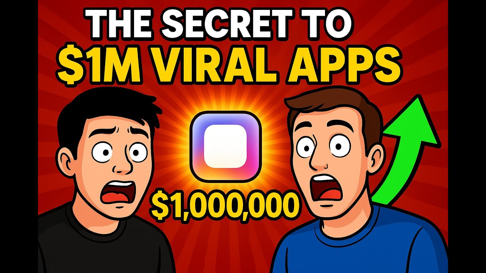

# The Secrets of Consumer Club: Insights from Joseph Choi - Superwall Podcast

Joseph Choi of Consumer Club

## Table of Contents

* [00:00:00] Introduction to Consumer Club and Joseph's Background
* [00:03:13] The Essence of Distribution in Business
* [00:05:56] Learning from E-commerce and Affiliate Marketing
* [00:08:57] The Evolution of TikTok and Distribution Strategies
* [00:12:08] Finding the Edge in Distribution
* [00:15:04] Converting Attention into Downloads
* [00:18:01] The Role of Comments in Conversion
* [00:20:55] Building a Viral Marketing Strategy
* [00:23:53] Creating a Tool for Predictable Marketing
* [00:30:32] Navigating Influencer Marketing Challenges
* [00:33:07] Creating Content with Intent
* [00:35:20] Insights from Consumer Club Events
* [00:39:51] Understanding Distribution Strategies
* [00:42:25] The Evolution of App Marketing Trends
* [00:45:53] Starting with Content and Distribution
* [00:49:33] The Future of Content Creation and Authenticity
* [00:59:38] Authenticity in Content Creation
* [01:01:14] The Future of Consumer Apps
* [01:04:11] Leveraging Influencer Audiences
* [01:08:15] Content as Apps: A New Paradigm
* [01:12:42] The Role of Media in Business
* [01:14:22] Building in Public: Risks and Rewards
* [01:18:23] Understanding Underpriced Distribution Channels
* [01:22:29] The Accessibility of App Development
* [01:29:39] Actionable Steps for Aspiring App Creators

## [00:00:00] Introduction to Consumer Club and Joseph's Background

All right. We're back with another Superwall podcast today. I have Joseph, who is the founder of the esteemed consumer club. Joseph is the guy that everyone wants to go to if they want to know how to blow up their consumer app. And I think we have a lot of interesting stuff to get into today. [00:00:00 → 00:00:20]

So, let's start with introductions, Joseph. As I said, founder of consumer club, would love to hear a little bit more sort of about your background and what led to you starting consumer club and then we can actually dive into what consumer club is and why so many people are in it and talking about it. For sure. Yeah. Yeah, I actually just kind of accidentally found myself in this like app space. [00:00:20 → 00:00:39]

I'm kind of just a an internet marketer. Like I've always just been interested in how to make money online and that is weird like I I think I I've always thought about distribution and growth hacks and finding underpriced channels and stuff like that cuz I started out in drop shipping and e-commerce. I just went on YouTube when I was in college and I was like, how to make money online? And I found like these videos, how to start a drop shipping store on Shopify and do like Facebook ads and stuff cuz in 2018 I think you know, Facebook ads was still somewhat underpriced. I did like Instagram meme pages, but anyway, I I worked in tech like worked at Google for a while as well. [00:00:39 → 00:01:21]

Did startup consulting, but Consumer club basically is just the place on the internet that I always wish existed, which is combining the kind of the scrappy growth hack people with the really smart like product minded just scalable like people who think in scale. Like how how do you build a tech company out of these uh uh growth hacks instead of just doing you know, drop shipping. Not that drop shipping is bad. I think drop shipping taught me a lot about business and marketing, but so consumer club is a place where app founders come to learn from each other about just chasing the current distribution edge and trying to find how to how to go viral on TikTok. Going viral on TikTok is kind of the the thing right now, but who knows what it is in like a year or two. [00:01:21 → 00:02:14]

Maybe TikTok doesn't exist and is something else, but it's really about how do you how do you find an edge in this business? Awesome. Okay, so it sounds like you had sort of a background in tech, grew up on the internet as a lot of these sort of like internet money marketers or or product builders do and you were looking for a place to sort of collect like a community of of people like yourself who are who are good at what they do and who are able to make money online. Is that right? And that's sort of what the genesis was for consumer club. [00:02:14 → 00:02:46]

Totally. Yeah. Got it. Awesome. Okay, so cool. [00:02:44 → 00:02:48]

So, consumer club for those who don't know, it's a it's a Discord community, right? And there are founders who range from, you know, indie solo indie devs making, you know, upwards of millions of dollars in ARR all the way to venture backed founders who are taking, you know, these really big swings at like billion dollar markets, right? And I think the thing that's really interesting to me about this sort of group of people is while, you know, the sort of swings that they're taking might be different, right? [00:02:48 → 00:03:17]

## [00:03:13] The Essence of Distribution in Business

Like an indie dev, you know, like a solo founder versus like you know, a venture backed founder who who might have raised millions of dollars, it sounds like everyone sort of collected in this community because everyone sort of seeking that same thing, which is like this edge in distribution, right? And you kind of referenced it a little bit at at the beginning there, but I'd love to hear a little bit more just from like you know, you sort of your own perspective. Like is that right? Like these despite these founders, you know, being seemingly different, everyone's kind of seeking the same thing. Yeah. [00:03:17 → 00:03:44]

Yeah. I mean I mean I think that's I mean, isn't that what business is about? Like you're trying to find some sort of edge and like fill a gap in the market. And whether your goal is to make 10 million dollars and then like go like sit on a beach or if it's like to change the world and like build this like VC backed company, either way like you want to figure out what consumers want and like solve a problem with a product. So, if you want to do that like starting with I think people say like, oh, start with distribution. [00:03:44 → 00:04:19]

It's really just like start with the market. Like understand what does the market want? And one way to do that is to look at TikTok and see what people are like what content are people consuming cuz that's an insight into like what are the pain points, what do people talk about? So, TikTok is like I think people it's like this weird mystical thing and people have different takes about, but one way that I like to see it is it's just it's basically like talking to millions of people at the same time and like doing research and understanding like what the world cares about. And so, whether you're like a venture backed founder or you just want to make a few million dollars, like you're you have to like understand humans. [00:04:19 → 00:05:02]

Absolutely. Yeah, no, I I appreciate that a lot. So, I think something that's really interesting is a tweet that you actually tweeted a while back when you're sort of introducing like the thesis of consumer club. And the tweet, you know, in it you basically said like, hey, for consumer club, this is really for founders who, you know, are trying to or who rather who recognize that distribution can beat product in many cases. And for those who see that business to B2B founders often learn from consumer and consumer founders often learn from e-com and e-com often learns from affiliate. [00:05:00 → 00:05:38]

There's a few more things that you you said in that tweet, but I want to break those two down just a little bit. Can you tell me a little bit more about sort of what you mean by those two things? Yeah. I mean I saw it first when I was when I came from e-com cuz um I I'm going to sound like a broken record, but I always talk about Oliver Brocato and Tabs Chocolate. [00:05:38 → 00:05:57]

## [00:05:56] Learning from E-commerce and Affiliate Marketing

So, Tabs Chocolate is this e-com brands that went from zero to 10 million in 1 year with purely TikTok organic, no ads. And it's really interesting cuz they just like they they didn't do influencer marketing and they kind of broke the TikTok game by realizing that, oh, you don't need people to have audiences to talk about your product. You can just hire a bunch of kids or a bunch of teenagers and just like have them talk about your product like very organically. On brand new accounts with zero followers and if it's good as long as it's good content and you show the product in the video, then it'll it'll get views. And it worked very well, but then this guy he moved on from Tabs Chocolate and now he he did Study Buddy, which is a a software company. [00:05:57 → 00:06:48]

So, and in public I remember like the day he tweeted this, he was like, I'm going to now go into consumer SaaS instead of e-com because sure, this works in e-com, but like we could just do run back the same exact strategy, but then do it on uh for a product that has better exit multiples, better margins, less headache of like fulfillment and manufacturing all that. And yeah, there's some barrier to entry of like building a tech product, but if you know how to code a little bit or you know AI code now in 2025, like yeah, like you can use the same tactics, but I think why why do tactics start in e-commerce and then they kind of go up to uh tech? I think it's like it's basically just like how much of a commodity is the product. So, like you mentioned affiliate. So, you know, think about like these affiliate marketers that earn 10% of revenue that they drive to a gambling site. [00:06:48 → 00:07:51]

All these gambling sites are like basically similar and then all the affiliates, they're just promoting the same offer. So, they're all competing with each other on the same exact product. So, of course they have to find different ways to compete with each other and make their marketing better and better. So, affiliates I think are the best consumer marketers. And then you go up one level to e-commerce you're also kind of in a commoditized product. [00:07:51 → 00:08:20]

You're just selling like consumer goods that you know, are not hyper differentiated. There's no like tech edge. It's basically it's a branding edge unless it's a completely new invention, but for a lot of these categories like food and beverage and clothing and beauty skin care and stuff like this, a lot of it is just the same products just re-repackaged. So, you're also very competitive in that space. So, the marketing tactics have to be better. [00:08:20 → 00:08:48]

And then consumer tech like now, there's still some barrier to entry to building an app, but it's becoming less and less. [00:08:48 → 00:08:59]

## [00:08:57] The Evolution of TikTok and Distribution Strategies

So, like I'm even seeing like people in the consumer tech world now complaining about people copying their apps, but then the e-com guys are just like that's that's just the game. Like the more a product becomes commoditized, like the more you're going to get copied. So, yeah. But I think it's a good thing. Like yeah, the more competitive the marketing that the more advanced the tactics get and it's it's fun to it's fun to follow. [00:08:59 → 00:09:26]

Yeah, absolutely. Okay, so that's really interesting. So, just taking a step back a little bit you know, at the very beginning of this topic, you basically mentioned that like, hey, like um you know, there was there was sort of like a really big I would say like step right when people recognized that um you could get a lot of eyeballs on things without having like a a really large audience or really, you know, big massive followers, right? Just by virtue of the way that the TikTok algorithm worked and then which eventually shifted like the the Instagram Reels algorithm. Like you didn't need these these massive followers or influencers to put your product in front of you know a lot of different people. [00:09:24 → 00:10:02]

Um and I feel like that sort of was like one of the steps in creating this new sort of like meta of distribution, right? In terms of of getting whether it was e-com or affiliate or you know even apps at this point. It it sort of spawned this whole new set of strategies for people competing with edge, right? Um and so something that I'm really curious to hear a little bit more about is um you know you've mentioned this um in some other podcasts and you know you even mentioned it on this podcast podcast right now like it's not necessarily um about TikTok per se, it's more so about um figuring out what this like underpriced distribution edge is, right? Um so I'd love to learn a little bit more about that, you know, like what are um you know, what are some uh pieces of alpha or strategies that you know, some some uh founders in the consumer club have been applying um when it comes to finding the sort of like edge in distribution. [00:10:02 → 00:11:00]

Yeah. Yeah, definitely. Um yeah, as perfectly articulated. I feel like people are Yeah, people are focused on TikTok but even within TikTok there's like micro trends. So um I'm going to show you a couple of things. [00:10:57 → 00:11:12]

Um so I'm just I'm just a student of the scroll. So I I stole that phrase from someone else like they were like, "How do you like find all these ideas? " I'm like, "Oh, I just like scroll TikTok a lot and then I save them in bookmark folders and then I think about like, "Wait, why did that make me feel something? " And I put it into the category of folder. So I just I just study this stuff cuz it's fun to me. [00:11:12 → 00:11:34]

Um but here's an example of like here's all my bookmark folders. Um I'm just sharing screen. But Yeah. for example like talking head um this format is several years old. So this is kind of like the the classic like influencer video. [00:11:34 → 00:11:52]

Like, "Hey guys, today I'm going to talk to you about whatever like product. " Um so this this is still like kind of big. Um and with an app you kind of have to show show the product somehow. Like with e-commerce it's really easy like you hold it in your hand. [00:11:52 → 00:12:09]

## [00:12:08] Finding the Edge in Distribution

You can like show it on video. But with apps it's a little bit tricky. You have to like figure out how to show it on the screen. Um so one way is like just is just like green screen. So you can just put it behind you um and then have like the talking head like green screens in front of you. [00:12:09 → 00:12:25]

Um another way is like phone app demo. So if you have like the you literally put the phone in front of your other phone to record the like record what's happening on the screen and show yourself using the app. Um but talking head I mean this is like a couple years old. A a couple of the newer things like it kind of shifted last year to to slideshows when people realized like you could just get a lot of views by doing uh TikTok carousels and slideshows instead of like full videos. And this is there's some alpha in this because it's so easy to make. [00:12:25 → 00:13:01]

Like for example this like these ones like these they're they're like they're these like story time things where it's like Right. Here's the here's the truth about visiting Japan. And then there's just filler slides with kind of interesting content and then at the end they plug some product. So this one is for the shower head like Oh, by the way there you know, they Japan has these shower these water filters in all their shower heads. And oh, I just realized like oh, you don't even need to go to Japan to get these. [00:13:01 → 00:13:35]

They're just they're on Amazon. Like what what what do you know? They're on Amazon. Right. So crazy. [00:13:35 → 00:13:40]

And this has like this has like what? Mil- millions of I see it has two almost almost a quarter million likes. Right? Yeah. Yeah. [00:13:40 → 00:13:47]

I mean this one has 200,000 likes. Um I don't know how many views it has. But they they make this account and they post it they post these videos Mhm. like every day. So not every video hits but I mean they're getting around you know, 5 10,000 views per video and then some of them really hit and it's like a million 2 million views. [00:13:47 → 00:14:11]

Yeah, which is which is crazy cuz they're basically taking like basically like a a paragraph or two worth of text and they're turning that and then some like filler photos, right? And they're turning that into like millions of eyeballs for distribution. Like what would previously take you know, thousand tens of thousands of dollars to you know, pump that on like Facebook ads or Google ads. Like you're you're basically getting you know, for um I don't know maybe 30 minutes of your time and like really well structured like you know, but broken up into a few paragraphs worth of writing. Like that's crazy. [00:14:09 → 00:14:41]

Right? Exactly. Yeah. Okay, so you and and this sort of like let leads into the um the trend that you were mentioning earlier where basically app founders are like learning from people who have been doing this for a while in e-com and obviously people who you know, do like affiliate are all competing for the same kind of attention. And I feel like this this leads to like another interesting kind of segue which is like um I I feel like as we're getting closer and closer and e-com e-com people are probably like really well versed in this. [00:14:41 → 00:15:09]

## [00:15:04] Converting Attention into Downloads

But ultimately like the two things that are going to really like determine some of the success of your business is one like your ability to um capture attention, right? And then your ability to convert that attention into like a download or a purchase or you know, that sort of thing. So um I'd be curious to know a little bit more about um you know, how people are are discussing that like within the consumer club. Um I I know that there's a really big emphasis on generating attention um but I'd be curious to know, you know, sort of what people are thinking about for actually converting that attention into a download. Um can you speak a little bit more about that? [00:15:09 → 00:15:49]

Yeah. Yeah. Yeah. I mean organic and ads are a little bit different. Like if you come from the world of Facebook ads, you're used to just forcing your content in front of people's eyeballs by paying Facebook money. [00:15:49 → 00:16:00]

But with organic you're you're kind of you have to you you have to hack the algorithm which which the algorithm is really just how do you hack attention and then hold attention long enough to plug your product. So like um like some other formats that I've seen working are uh just these storytelling. I mean you kind of saw it with the slide the slideshows too. But as long as you like you you have to talk about the products. Like so in the influencer marketing days you would just get a bunch of views and then you'd have a call to action at the end and say, "Hey guy Here today I'm going to be talking about these pain points. [00:16:00 → 00:16:46]

Hey, do you relate to this or this? " Um well, I have a solution for that. Um here's my my promo code. Use this code at checkout for 20% off. And then people would go into the influencer's link in bio and then click the link. [00:16:46 → 00:17:02]

But like people don't really click links in bios anymore. Uh especially for apps it's kind of hard to like put a app store link in your bio especially if you have like other links that you want to promote and that the conversion rate is just not very good. So a lot of times what people actually are doing is they're just closing the app. Like they see a TikTok video, they literally close the app, they go to the app store and they search the name of the app that was mentioned in the video. So a lot of times the calls to actions are a lot softer. [00:17:02 → 00:17:29]

Um I mean even with like Cal-A-I Mhm. they they don't even mention the app at all. They just show the app and the name of the app on the screen. So I'm I'm seeing like the calls to actions being a lot um a lot lighter. Mhm. [00:17:28 → 00:17:46]

Yeah, one of the members of consumer club uh Laurent he's the founder of Focus Tree Mhm. and uses these faceless creators in the study talk niche where there's these students showing their books and their aesthetic like study setups. And in you know, a couple seconds they flash like the screen of Focus Tree and a lot of times the conversion actually happens in the comments where Mhm. [00:17:45 → 00:18:09]

## [00:18:01] The Role of Comments in Conversion

since it's get since it got flashed and it was like an interesting novel interface it's like, "Oh, you're using this app that has like a digital tree like for your focus. What are you What are you talking about like what is that app? " And then they'll reply the creator will reply to the comment and say, "Oh, it's Focus Tree. " And that kind of takes advantage of the behavior of people reading the comments and scrolling through comments as they're watching videos. Um and people do that cuz it's you know, it feels like a social experience. [00:18:09 → 00:18:37]

Totally. So Wait, that's that's super interesting. So let's let's double click on that for a bit cuz you mentioned two apps that I think have done that kind of like marketing really well. So Cal-A-I I think is is the first one you mentioned and um for those who who don't yet know Blake Anderson and Zach um who built Cal-A-I and one of the ways that they like um really rocketed to success was by doing the sort of like um this distribution hack where um sort of like a like a mini niche in and of itself where they showed like the screen with um you know, predominantly like sort of like fitness um related content, right? Like people going to the gym and then like you know, making this like really healthy food and then very very briefly only for like a second or two using the app to like scan the food to get the caloric content. [00:18:36 → 00:19:25]

Don't mention it otherwise. And that's like that has also been popularized by uh Laurent uh with Focus Tree, right? Just in a different in a different vertical studying versus you know, calorie tracking. This is awesome. Yeah, so I think you can actually kind of see it, right? [00:19:25 → 00:19:40]

It's like this really quick kind of like cut frame where you're only seeing the app you know, maybe even for like half a second, right? And it's this is interesting because it kind of like builds intrigue and curiosity. And you you kind of mentioned it earlier where people then take to the comments to try and figure this out. I've sort of likened this as like the comment section of TikTok is where you know, where all the conversion kind of happens. It's kind of like the Reddit, you know, comments are are actually where all the gold is found or it's sort of like a little mini Yelp review for what, you know, the app is. [00:19:40 → 00:20:12]

Can you can you speak a little bit more on that? Yeah. Yeah, yeah. Um yeah, it goes a couple layers deep. So, like you can convert people on the like in the comment section of the video itself. [00:20:12 → 00:20:26]

You can also reply to to a comment and make another video out of like a video reply and that will first of all show it to to the person that you're replying to. Like it'll directly show up in their notifications. But then a lot of times if you're scrolling through TikTok sometimes you'll find if you really enjoyed a video like the next day you're going to see that reply because you engaged so deeply with that original video. So, you it's almost like a Facebook retargeting campaign where you're targeting the same people that engaged with that original video with the video reply. [00:20:26 → 00:21:01]

## [00:20:55] Building a Viral Marketing Strategy

So, sometimes the video reply is where the conversion happens as well where someone in the comments says what is it what is the app and then you reply to that and say and then you and then that's where you hard sell because now you're able to retarget all those millions of people that watched the first video and then actually follow up with a CTA the next day or the next you know, few hours whenever you make the video. Yeah, but yeah, definitely. I mean TikTok TikTok comment sections are great great source of just market research like seeing what people actually people are very unfiltered in in TikTok comments. Yeah, definitely. You can see like the the heartbeat of of like culture and like what people are actually thinking. [00:21:01 → 00:21:44]

Definitely heartbeat heartbeat is such a good way to describe it. So, for for someone who's like um starting out and and building you know, a consumer app. What's what's like the one two three checklist that you would give to them if they wanted to start basically get started with like you know, marketing through TikTok for their app. Like you know, what direction would you point them in other than you know, consumer club being the first step. What what would you what would you point them towards? [00:21:42 → 00:22:13]

Yeah, yeah. I mean if if if it's your first business like first business or first app. Like do you do you have some experience? Yeah, that's that's a good clarification. I think just to make it easier let's say that um you're you're not new to like business or app building, but you you want to get more involved in like sort of like TikTok distribution or you know, a method of distribution that isn't just like forcing eyeballs via paid ads. [00:22:11 → 00:22:39]

Like what would you where would you point someone? Right, right. Um yeah, the the thing is like the viral ideas like there isn't necessarily a an existing viral idea for every single app. So, a lot of times it actually starts with the um reverse engineering like what would make a good viral moment on TikTok and then building that as a feature into your product. So, to go back to CalA I, that's basically what CalA I was like the real retention and like what makes CalA I a business is the calorie tracking. [00:22:39 → 00:23:19]

It's like retaining the user every day telling them here's over time how many calories you're you're you're eating and the macros which is the same thing as MyFitnessPal, but you know, who was the dominant app in the space for a long time. But CalA I is like it's the it's using using the AI vision to look at take a picture of your food and then do the calorie tracking. So, the main part of the app is not even really the scan. It's really the the tracking. So, if you have an if you have an app and let's say it's like you know, workout tracking you you might not be able to make a viral TikTok out of just workout tracking. [00:23:19 → 00:23:59]

## [00:23:53] Creating a Tool for Predictable Marketing

So, a lot of times it comes down to like how do I how do I think of an I a piece of content that's already out there on TikTok that gets views already and then how do I turn that into slightly change modify that to make it turn into a video that plugs my product. I can give another screen share. Yeah, absolutely. Um I'm going to plug this tool. I actually built this tool. [00:23:59 → 00:24:29]

So, just shilling my own stuff right now. That's that's what we want, yeah. I built I built the tool because of just the insights of people in the consumer club and they trying to figure out like how do you how do you get that find those winning formats that promote products. So, let's say you're in like um let's say you're doing like uh something like with mental health or like a lot of these AI wrapper apps are using either voice or chat to like talk people through journaling or mental health issues or um you know, things like that. So, one thing you can do is you can do this on TikTok search. [00:24:29 → 00:25:07]

You can just search for videos, but if we want to find like okay, what what is out there already? So, let's just find like ADHD, mental health journaling um sometimes like think of adjacent niches like oh, people who are having like relationship problems they're maybe that's a source of like mental health issues. So, relationships. So, let's just search some of these keywords. And then what let's find videos that are currently doing well in those niches and then figure out how do we make how do we slightly modify these videos to plug an app? [00:25:07 → 00:25:47]

So, like some of these um First off, that's such a sick tool that that you just pull all the metrics on that like right from the jump. Yeah, yeah. So, we have the main like the main metrics like views, engagement, but then the number here is like how many how many times more views did this video get compared to the median engagement for that account. So, this is like it's not just the account is a is a strong account. It's that the video itself actually did better than the account. [00:25:46 → 00:26:24]

So, that means like the algorithm is picking it up and it's not just getting views because of the followers. So, let's remove ADHD keyword cuz that's like seems to be taking up everything. Here's a here's a great format. My So, here's This is an interesting format. It's like a 7-second video that just has a song playing in the background and some B-roll of a some the car. [00:26:23 → 00:26:50]

And it's just long text. So, it kind of it's a hack where the video loops over and over again because people are taking a long time to read the thing. So, then in the TikTok analytics the watch time is like 5x retention because people watch the video like five times in order to read the whole text. But then but then the text has to actually be good and like interesting. So, this one says my therapist told me when someone constantly asks if you love like we love them or if you're mad at them it's not because they're So, it's just kind of this tidbit about mental health and therapy, but then you could you could definitely plug some sort of app maybe hint at some kind of app, but then not name the app because that might be a little bit too aggressive and then maybe some people in the comments will be like oh, like any apps you recommend to you know, deal with this issue and then you can plug the app. [00:26:51 → 00:27:44]

So, Totally. Totally. Yeah, it's all I've seen um I've seen a few apps like take advantage of that where you have you know, and and there I think the interesting thing with all of these is like there are layers and like metas to each individual layer, right? Like I've seen I think something that a lot of people be familiar with is like Minecraft B-roll, right? In the background where there's like someone playing Minecraft like jumping around on different blocks. [00:27:44 → 00:28:08]

You know, in this case it's like the video of someone driving, right? With like text on it. And it's interesting because they're all they all are trying to accomplish the same thing, right? But the way that they like hack attention or that you know, the way that their hooks are just like slightly different is really really really intriguing. And yeah, I guess I'd love I'd love to know a little bit more about sort of like what inspired you to like want to even build this tool in the first place because I I imagine that a lot of people were probably trying to do this manually, right? [00:28:06 → 00:28:37]

By like going through accounts and seeing what the you know, median views were for someone's videos and then you know, like using a spreadsheet to calculate this. So, I'd be curious to know a little bit more about what like drove the inspiration for building this. Yeah. Yeah, I mean yeah, it's just like how do you how do you find how do you make this type of marketing feel more scientific and more predictable cuz a lot of times it just feels like a lottery. Um you post a TikTok and then you don't know like why it went viral why it didn't go viral. [00:28:37 → 00:29:08]

But it's just like because TikTok is you know, it's a content graph. Like it you like the content itself is what gets the views based on engagement or retention whatever. So, if you can find those videos that are already doing well then it's just it's just a hack to to find to get to to get views and to validate your market first before maybe maybe even before launching or like even before like hiring expensive influencers that like more expensive like high production content you can you can hire creators to just copy videos and you can charge you can you can pay a lot less for that compared to giving a creator like free rein over the full creative direction of the video, just saying like, "Hey, make a video for me promoting this app. " Then they have to storyboard it, think of do the research themselves. But if you just say, "Hey, here's a video that you can just copy it like second for second and just modify this little part. [00:29:08 → 00:30:14]

" Then you're doing the creative, and then you're just paying the creator for their time. Um uh instead of like their creativity. So, I So, yeah, a lot of people in Consumer Club were were trying to figure out, "Okay, how do you not pay like a thousand, two thousand dollars just for one video? [00:30:14 → 00:30:34]

## [00:30:32] Navigating Influencer Marketing Challenges

" And uh like the answer a lot of times is just hiring people um like doing the creative yourself and then giving um giving creators like a really well well-defined brief. So, this is just a way to um do that. But I mean, if you if you have creators that um that make high-production videos too, like you can like you can give them these videos as well. Leverage that. Yeah, totally. [00:30:34 → 00:31:01]

And for anyone who uh has experimented with influencer marketing, um I think it's really funny because I you know, for you'll go and talk to like an influencer and they'll say like, "Hey, I want you know, two or three thousand dollars for this video, and you'll have to pay me like a retainer fee on top of that. " And it's funny because you know, they might post the video on TikTok and it could flop. It could get like 800 views. So, this is kind of a way to protect against that, right? It's like you're able to sort of create these with a more scalable blueprint in a more sort of like scientific or at least measurable way without having to like rely on this audience that may or may not come through from you actually paying an influencer. [00:31:01 → 00:31:41]

Yeah, yeah. I mean, and this still relies on you like deciding that this content has somewhat of like commercial intent. Um so, you can't just like get views and then magically just hope that it'll get conversions. Like there should be some hypothesis behind why you're choosing this type of content. Like for this one, for example, I see the last line is like "Hey, did you know people who struggle with anxiety, depression, can't remember a lot, blah blah blah. [00:31:39 → 00:32:09]

" And the last line says, "If this is you, maybe this account can help. " That is a call to action. That's saying like, "Hey, check out this TikTok account. " But you could change that CTA to something like, "If this is you, maybe you should try out meditation apps, or maybe you should try out, you know, something else. " And then that's like the CTA. [00:32:09 → 00:32:31]

So, um there should there should still be some sort of um like goal to to getting the views. Right. That's actually a really good distinction that I think is probably worth calling out. Like um I think a lot of people get started in this game and they start to uh have tunnel vision on views, but I think that there's a really important distinction there that just because your video gets, you know, a million, two million views, if you don't have the right kind of content with like a good CTA, that won't necessarily translate to like app downloads, right? And I think that that's that's probably a frustration that a lot of people have to hurdle first because if you've never made any content before and you're just getting started, you have to have that whole bridge of like learning how to make the content and learning how to, you know, hack attention and then actually, you know, create something that is sustains attention beyond just the first second, but then how do you how can you shape the content actually like generate that sort of curiosity or intrigue, right? [00:32:31 → 00:33:33]

## [00:33:07] Creating Content with Intent

Yeah. So, one shortcut to that is like if you know uh if you know somewhat of the current meta of what types of content do get views and convert, you can specifically look out for that type of content and then iterate on that. So, for example, like if you know that phone-in-hand content converts well for apps, you can just find like phone screen Mhm. and then find videos that actually show a phone screen on the video. Um so, that's another thing that uh another use case for for this tool. [00:33:31 → 00:34:10]

But like just scrolling TikTok as well, like if you ever find videos that are like uh that that that sell an app or that have a phone on on the screen or or you know, um or exist in the format that you want to um replicate, then uh you should save those in bookmarks. Absolutely. Yeah, and and I think that that's something that's like really interesting, right? It's like um I think people can kind of tend to like overthink it, but there is something like inherently just like interesting about literally showcasing the app like up front, right? Like some some of these videos end up doing really really well. [00:34:10 → 00:34:49]

Um I think that, you know, you can kind of focus it and shape it to be a little bit more interesting. Like for for example, Cali's um marketing techniques, right? They're only showing it for like a second or two. But if you're just starting out, I think that this is like a reasonable way to get started and see, you know, how you um how you can at least start to get better at like the skill of creating content. And obviously, this is like a really good tool that you can use to be like, "Okay, here's what a lot of other apps are doing, you know, and and here's their videos that's actually working really well. [00:34:47 → 00:35:16]

" Right? This is like a great way to actually get started with that. [00:35:16 → 00:35:22]

## [00:35:20] Insights from Consumer Club Events

Yeah, definitely. Absolutely. Okay, so let's let's take it a step back. Um something that is really interesting about Consumer Club is outside of just like focusing on like distribution metas and strategies, um you're actually hosting events for people, right? So, I think I saw this morning you tweeted um that you love meeting founders in New York City. [00:35:20 → 00:35:38]

It looks like you hosted a founder dinner um with just like a really impressive group of attendees. I'm just reading off of your tweet and you say a 400k MRR study app, uh dating app with over 300,000 downloads from TikTok organic with zero spent on ads, someone posting 15 UGC vids per day. Um yeah, like would love to hear a little bit more um about one, the events that you're hosting with Consumer Club, and then two, specifically this, like what are, you know, some of the most interesting tidbits that you pulled from this dinner or things that you think might just be worth sharing in general? Yeah, yeah. Um yeah, this was interesting. [00:35:38 → 00:36:15]

So, this this this last one blew my mind a lot cuz I've always thought that you you can only post three videos per day. Like it's it's sort of like this meta like common knowledge if you're in the space that you you can't post more than three times a day on an account, or else you're probably going to get shadowbanned by TikTok. Um but the way that this guy does it is basically he just has five accounts per phone and still post three times per day. So, it's it ends up being 15 videos per day, but across five different accounts. Um but then each person who has a phone can now do it can now do 15 per day. [00:36:15 → 00:36:58]

So, like her uh like for for the whole operation, it's 15 times however many people he has. crazy scale. Yeah. So, this is the guy that um Alex tweeted about, who's like uh Alex came to the dinner as well, but they he he was saying how um he actually flew to the like this founder flew to the Philippines, gave iPhones with US SIM cards to his creators, and then uh trained them on how to warm up the accounts, you know, the posting times, make sure you don't like post 15 all on the same account. Make sure you like spread it out in this way. [00:36:58 → 00:37:39]

Right. So, this is just very like yeah, he he just kind of like understood all the different pieces and then just executed it like really really well. That's Yeah, that's crazy dedication. So, and just for those who don't know, like uh within Consumer Club and I think I would say that just like this part of Twitter in general, people are like sharing insights about like, you know, metas for distribution. And one of those things that we we mentioned earlier is like you know, there seems to be a correlation between posting a lot, you know, posting more than three or three to five times a day and then not getting any views on the subsequent videos after. [00:37:35 → 00:38:11]

And so, this guy really just took things into his own hands, got a bunch of phones with US SIM cards so he could ensure that he was reaching a US audience, right? And then basically took this upon himself to go scale the operation, which is crazy. Um yeah, so I I guess I would love to hear a little bit more about um some of the other interesting things that you found from um these consumer events. I know that you hosted uh a consumer event in LA. Um there's as you as you see here, the Consumer Tech Cabal. [00:38:11 → 00:38:38]

Um yeah, would love to hear a little bit more about um some interesting things that you've gleaned from like the founders in this um in this area. Yeah, yeah. LA was fun. Um Nikita Bier showed up to our LA mixer. We hosted at this uh mansion at the Wombo House, and it was um yeah, Nikita showed up. [00:38:38 → 00:38:58]

Like some of the people who are in this like sort of consumer social, but actually pretty monetized space. So, like the NGL founders came and yeah, it was just it was really interesting to hear from them, too, cuz they like they've been in this for a long time. Like they were like some of the founders were uh they did Zoom University. I don't know if anyone remembers like the Facebook group Zoom University like back in 2020. And they kind of like it I don't know how they did that, but maybe it was just keyword. [00:38:58 → 00:39:28]

They're like the first Facebook group to like hop onto the like Zoom University concepts, but they built a they built a a mobile app out of the concept of Zoom University and like a video I think it was like a video streaming thing. But then they moved on to do NGL, and then now Hunter's doing bags. Um but yeah, I mean these people they're also just very hacky mindset. [00:39:28 → 00:39:51]

## [00:39:51] Understanding Distribution Strategies

Like I mean they're like some of these apps are making millions millions a year just cash flowing, but they're like yeah, they they definitely have like the distribution um mindset. I mean for NGL it was, you know, the the high schools like seeding high schools with the influencer accounts and stuff. I think it just comes down to like understanding human nature. Cuz I think one thing with a high school accounts is like the main psychology principle behind that was you if you're if you're a kid in high school and you get followed by a private account and it has the name of your high school plus the app name. Like let's say it's NGL uh whatever high school and then the logo of the account is like your high school's logo plus like the app or whatever. [00:39:51 → 00:40:42]

Like you're going to be pretty interested. It's it's almost like alumni networks, you know, like if you see someone else that went to your same college, there's just it is immediate like trust. Um or, you know, someone who also worked at the same company as you. There's just this like tribal like feeling that you get. So they followed mass, you know, everyone in the high school um with these accounts and then they got a lot of follow backs. [00:40:42 → 00:41:08]

And then the first post that they post on that account is going to have all these eyeballs of like the kids in that school. So, you know, gets a boost. So it's uh yeah, like stuff like that where they just have like this insight into if we try this, I bet this will be very powerful. Like Right. And then you're referring to like NGL, this is the same kind of like genre of like questionnaire app that like Nikita Beer obviously has like done two times over. [00:41:08 → 00:41:38]

Um like this distribution method where they basically like primed all these high school students, right, to get ready to like download the app and then they launched it at once. Yeah. Which is crazy. I mean I I guess the other thing that uh a lot of people I think would be curious to know is like um I think that there's this notion that like, oh no, are are things like is this like drop shipping? Like will will there be saturation? [00:41:38 → 00:42:01]

Like are, you know, can you try like one idea multiple times over and over? Um you know, I'd be curious to to hear your perspective on that just because I've seen a lot of apps that are almost identical that still fare really well and to the extent where they're even copying the others like exact distribution method and channel. Like almost like pixel for pixel like copied on TikTok. Would love to hear a little bit more about that. [00:42:01 → 00:42:28]

## [00:42:25] The Evolution of App Marketing Trends

Yeah. Uh yeah, I think there will be copycats and that's just that's just like that's just the game. Like but I do think that innovation is happening so fast like AI innovation is happening so fast. Like a new model comes out like every month it seems like. And I think that'll enable like a hundred new rappers. [00:42:28 → 00:42:50]

Every time a new model comes out, there's going to be like a hundred new apps that just attack slightly different markets. There might be like you know, one you know, some of these like food scanning apps like you could probably do a verticalized um Cal AI that makes a tenth of the revenue, but that's still $2 million a month. I think the last time I saw they're making like well, yeah, they're they're making $2 million a month. So you a tenth of that was like 200k. What if you made Cal AI, but only for like vegans, right? [00:42:50 → 00:43:25]

Like it it specializes in like a a special like a certain niche. Um so you can you can attack different audiences or you could just be a first mover into whatever new model that comes out. Like Tollan is this app that launched. They're member of Consumer Club. Yeah. [00:43:25 → 00:43:41]

Um they launched a couple weeks ago and they hit number one or they're number two in um in the App Store and they're just this like AI companion app that talks to you. And it like I'm sure they have some interesting special like AI thing in the background, but from what I can see like anyone can make something like somewhat similar to this Mhm. Um using the new the newest voice models from Open AI or or Anthropic or Cloud or whatever like Deep Seek. Clearly you uh and then just reskin it. Like this one is like cartoons. [00:43:41 → 00:44:17]

Like not everyone's going to want to download this. They hit number one, but you know, some other people might want a completely faceless voice model app, you know, that doesn't have like a character attached or maybe like some one for an older audience. You know, there's there's just so many different audiences that you can tackle with each new um yeah, different audiences, different products um with each new like tech innovation. Totally. Yeah, and that's that's super interesting because it's like it kind of hearkens back to what you were describing earlier, right? [00:44:17 → 00:44:47]

Which is where I guess it kind of goes against conventional product building in the sense where it's like you almost start with distribution in mind, right? Like you start with that like viral TikTok moment or you start with like what that's going to look like and then build outward from that. And you know, you like you've worked in tech. Like you understand sort of like what the traditional like product building model is. And so I I'd love to hear a little bit more about like it's it's kind of crazy that you could sort of start with what is what does the TikTok video look like and then build outward from that, right? [00:44:47 → 00:45:21]

Like to think like say you're going to do the the vegan Cal AI and your your edge there is literally just targeting vegans, right? And you accept that, you know, you're not going to hit $2 million a month, but like even if you hit a tenth of that, right? Like that would be that would be like life changing for a lot of people. Um Yeah. So I'd be curious to hear like um you know, from the people in Consumer Club do you feel like there's been this like shift towards starting with like the content, like starting with the media, starting with the distribution and working backwards from there? [00:45:19 → 00:45:55]

## [00:45:53] Starting with Content and Distribution

Yeah. Yeah. I mean um yeah, I think starting with the content like I I've heard people refer to it as like start with a channel. So like if you think if you if you deeply study or you you at least like understand um the channel where a consumer where your target customer is. So let's say it's TikTok. [00:45:53 → 00:46:14]

Just knowing what the content is going to look like first um yeah, can definitely help cuz if you don't know what it's going to look like, then you start with a product and then you you build it and then it it comes time to market it and then you're like okay, like what content should we do? And then at that point it might be too late cuz like maybe there is no content that will ever resonate with the audience that you're trying to go after. So I think it's just it's like a way to de-risk. Um I think like tech building in general like I think the reason why people come at it from the opposite is because consumer tech has always been about winner take all. Everyone wants to be the next Facebook. [00:46:14 → 00:46:56]

So you just have to make a really great product. It doesn't have to have like it doesn't have to resonate with a very specific audience on a specific channel. You just have to make a good product and then seed it to, you know, in Facebook's case it was just seed it to all the colleges and then everyone else will use it. But with consumer products these days you don't have to beat Facebook to build you know, just build a $10 million business or a $1 million business. You can um you can start with distribution um attack it from almost like in a way that an e-com e-commerce founder would would do it. [00:46:54 → 00:47:34]

So Right. Um yeah, there's definitely people I mean I've talked to some recent Consumer Club members. Uh they're anonymous because they're like they they have VC funding and they come and talk to me and they're like I actually don't really like my company anymore cuz we're going after this like broad giant market. Yeah. And I'm seeing all these kids making $10 million uh AI rappers and I kind of would rather just like start with distribution, think of a an idea that's TikTok viral cuz they're like they're they had this big idea and now it's time to market it and they've been grinding for like a year or two or like multiple years trying to get users. [00:47:34 → 00:48:17]

Right. like they're seeing all these kids just doing like going viral on TikTok making millions like right now cash flow. Right. They're they're getting FOMO. So I totally it's kind of funny just seeing seeing like the shift in the way that people are thinking about building businesses. [00:48:17 → 00:48:37]

Absolutely. Yeah, that that is actually that is crazy. I mean again, all all due respect to to Zach and Blake for building Cal AI into the like whatever $25 million a year business it is, but I I can imagine for VC backed founders who have been grinding for years and then just being literally undercut by like you know, kids who like don't have that much experience, but obviously have like the knowledge and the executional skills. I can imagine that that would feel like, you know, sort of a a cut at the knees. Um it was so that's an interesting segue into into sort of this like I guess broader sort of like question of like saturation, right? [00:48:35 → 00:49:13]

Because like as more and more people learn about the success that um you know, some kids or or other people are having with sort of these like smaller businesses, like the ability to get started right away, the ability to generate like meaningful revenue, right, within 30 60 days. Um I think there's sort of like the obvious question of like at what point does this run out? And so what I'm what I really want to ask about is I think you had a tweet a few weeks ago where you said, hey, if you're an app founder and you want to know what's next for underpriced master distribution, just look at e-com. [00:49:13 → 00:49:44]

## [00:49:33] The Future of Content Creation and Authenticity

You said like, you know, there are basically these trends that have occurred over the past, you know, 4 years. And so, in 2021, you said it was influencers, right? In 2022, it was like TikTok mass UGC. This is kind of like that Oliver Broccato like tabs chocolate sort of strategy, right? Um in 2023, it was slides. [00:49:44 → 00:50:03]

And and obviously, you know, you know, a lot of these still work today. Um and then you have uh for 2024, HeyGen with slides behind. And you say flux avatars in 2025. So, can you expand on this uh on this tweet a little bit and and describe some of these things? Yeah, definitely. [00:50:03 → 00:50:19]

Yeah, I mean, um every time like someone sees that a format works, then a bunch of marketers come in and copy it and then it saturates. So, then you have to find a a new format that works better. So, you know, with e-com, there's this progression. And all of these still work. I mean, even within e-com, it's just like what is the what is the newest edge? [00:50:19 → 00:50:38]

But influencers, yeah, like I mean, even like if you talk to the biggest companies, like the most like boomer companies, they don't even know what influencer marketing is. They've never even heard of it. So, we're still like very early. Like I In that tweet, I said influencer was the old way. But like for for most people, it's still the new way. [00:50:38 → 00:50:58]

Like we're on the cutting cutting edge of this. So, like yeah, UGC mass UGC is obviously still works, slides still work. Um HeyGen with slides, I'm just referring to like instead of just the slides um that are like a pure carousel, it's more like um you put the AI actor. So, now there's like you can AI generate um these face it like faces and they're fake people and they they can speak and emote and like on screen, I can show you an example like Yeah. And you put the you put the slides in the background. [00:50:58 → 00:51:36]

So, you can put the slide the same slides that you would normally put in a carousel, you just put in the background. And then you put the green screen like AI actor in the foreground. Um and have them like you can use 11 Labs to narrate the voice. Right. HeyGen, I think does all of this for you. [00:51:37 → 00:51:59]

Um and yeah, this I mean, this is going crazy in the e-com. Wait, this is this is crazy. So, just this is an AI-generated person, right? Yeah, this is fake person. That's crazy. [00:51:59 → 00:52:12]

Like very few people, unless you're like in this space. Like if you're just scrolling TikTok, like you're not really going to recognize that, right? Like crazy crazy. And and really the advantage of this is that you can just scale this in like an absurd way, right? It's sort of like the the main advantage. [00:52:10 → 00:52:25]

Like instead of you having to either hire someone or talk into your phone yourself, you can generate all of this with like all these different variations for like script and that sort of thing really quickly. Yeah. Yeah. You can use I mean, there's so many AI tools now that are doing it. I mean, HeyGen is one of them. [00:52:25 → 00:52:44]

Arc Ads like there's a if you just Google search like AI avatar or AI UGC actor, um it's basically like the UGC actor uh format, but then you just use AI to like make it faster and cheaper. Mhm. Um so, yeah. And like people like I hear two complaints about this. The what's one complaint is like, oh, this is uh this looks like how like this like if you listen to the voice, like you can tell it's not a real person. [00:52:44 → 00:53:20]

Like uh like people are not that dumb. But like you just look at the comments and like there's a call to action. It's like, oh, comment this word. People are literally just commenting the word. Like they're they're treating this as a as a normal person. [00:53:20 → 00:53:39]

There's one comment here that says, this is AI crying emoji. The next one is like, OMG, bro, it took me a sec to notice. Like Like so, like the average person, I think just can't tell anymore. I think it's like And there there's some ethical concerns with this as well. Like I'm not going to go into that, but you can uh use your own judgment for what like how you want to do this, but um yeah, they're Yeah, I don't know if you had more to say there, but I wanted to show you another another format as well. [00:53:39 → 00:54:10]

Yeah, absolutely. No, that's that's really sick. I would love would love to see the other format. Yeah, um so, there's also this other format. Um I I call it like faceless storytelling. [00:54:10 → 00:54:26]

So, instead of doing the AI-generated face, you just ignore the face completely and then you just use B-roll. [00:54:24 → 00:54:35]

So, you you just do AI voice instead of face. So, eventually, I could see a world where faces become not trustworthy, less trustworthy than voices in a way. Like right now, like AI uh you know, avatars are trustworthy because it's like, oh, it's a human saying this. But then eventually, once people catch on that oh, anyone can just fake a face, then eventually, we might go back to the voice where voices are more trusted than faces. So, this this video is telling story about Erewhon's smoothies. [00:54:39 → 00:55:15]

And they're just using um B-roll of Erewhon smoothies um and the health benefits and stuff. Um and there's there's just an AI voice. But the AI voice sounds really good. And then at the at the end, they promote this adaptogenic mushroom like supplement thing. Um so, Right. [00:55:15 → 00:55:42]

this is another format of like using AI to mass-produce content. Yeah, that's crazy. And I feel like a theme that we're like seeing with all of these is like there is some kind of trend and then there's like saturation cuz people copy that. And then there's there's almost like an inversion of that, right? As like a way to get like back on the trend, right? [00:55:42 → 00:56:02]

Like so, for for instance, in this case, like all this is like very very bleeding edge, but just as an example, like that that what you just referenced, right? Like faces becoming untrustworthy, so then you're going back to voices, right? And it's like then the inversion on that would probably be using a face again in like sometimes. So, it's just it's interesting because I guess what what I've noticed and I'd be curious if this is your perspective, too, is like it literally is a playground. Like there are some things that are are like slightly evergreen if you know how to like harness like the current zeitgeist of things, you know, like slides will probably be be around forever, right? [00:56:02 → 00:56:37]

It's just like how can you tweak it just like a little bit to like maintain that attention. Um so, it's really funny because I I feel like a lot of people, at least from Superwall's perspective, you know, they'll be like, hey, like what are some things that you're seeing with like successful companies when it comes to like marketing and that sort of thing. And I I feel like I feel like there's no right answer. Like it is literally a playground. Like it's it's just it's up to whomever to like go experiment, right? [00:56:37 → 00:57:00]

And there's like no right like one way to skin the proverbial cat. Yeah. No, I I completely agree. I think one thing that people get scared of when I talk about or when like TikTok is brought up is like, oh, I don't want to be a part of this like inauthenticity where you're just like spamming content. But like you said, there's the inversion that happens. [00:57:00 → 00:57:25]

And like if you you can follow the trend, yeah, but then you can also pave your own trends, too. Like um you know, once people get sick of one format, there's there's a market for for authenticity. Like people do want authentic content, whatever form that comes in, whether it's like voices instead of faces. Or I mean, one this is a YouTube example, but I like to think about Sam Sulek. So, there's this like Yeah. [00:57:25 → 00:57:51]

Yeah, yeah. bodybuilder guy. Like if you think about like Mr. Beast, it's like, oh, this is the current meta of YouTube. You know, like crazy thumbnail, crazy title, like crazy faces in the in the thumbnails, like spending tons of money on all the videos. [00:57:51 → 00:58:07]

And then you have like Sam Sulek and he's just this like bodybuilder guy. I mean, he's he he's an impressive bodybuilder, but his videos are like 40, 50 minutes long. And then there's just these really long take cuts. They're just like talking really slowly to the camera. Right. [00:58:05 → 00:58:27]

And then him just doing exercises, like kind of narrating it. He has a mic. He just has this like calming voice. And it's like 50 minutes long. And like I don't know who watches this, but it Minimal, stripped back like antithetical like very big contrast to like what Mr. [00:58:24 → 00:58:44]

Beast is, right? It's just like you're you're literally watching a guy in the gym, right? Like Yeah. I think that's a great example of inversion. Yeah. [00:58:44 → 00:58:52]

Yeah, yeah. He's just blowing up on the YouTube algo. I mean, the same with me, right? I I posted a TikTok on a brand new account and I got 50,000 views on the first on the first video. And I'm like I'm kind of like Sam Sulek a little bit. [00:58:52 → 00:59:06]

Like I I talk a little bit slowly. I have sort of like a monotone voice. But like I can still get views um just by like I I just literally I I did not retention edit the video at all. Like it was a 3-minute long video. I was just rambling like kind of slowly. [00:59:06 → 00:59:22]

But I had a decent hook. And like it got the views. So, I think like as long as you know kind of the fundamentals of like here's a piece of content that you kind of think people will be interested in. Um and then you just be yourself. Like you can still you can still do well. [00:59:22 → 00:59:39]

I'll go. [00:59:37 → 00:59:38]

## [00:59:38] Authenticity in Content Creation

Totally. I think that I think that's such a great like illumination of or or maybe like rebuttal of like I don't want to do like inauthentic spamming like it there are so many different ways that like work for anyone, right? It's just a matter of like getting out there and like trying it yourself. Like I think that that's the other really interesting thing is I don't know this might sound like ridiculous and it is, but like so few people have literally just like picked up TikTok and like talked into their phone, you know? Like like very few people have done that and I feel like they've got caught up in the weeds of like what's like the best thing to do and it's like you can you can actually just generate like hundreds of thousands of views just by just by picking up your phone, which is kind of kind of crazy. [00:59:38 → 01:00:20]

Maybe maybe a uh an uncomfortable truth, but a truth nonetheless. Yeah. Yeah, that's the easiest way. You just pick up the phone, start start yapping. Just the practice of like of speaking into the phone, you'll immediately start to modify it. [01:00:19 → 01:00:37]

Like that video that I mentioned that got 50,000 views, it was 2 minutes long, but that video actually took me an hour to to finish. Not because I was like hyper editing anything, but because I would talk and then I'd be like, "Oh, wait. That's not good that's not interesting. Like let me change the way I said that. " And then I I kept doing I did that like 20 times for like the same like a few second clip. [01:00:37 → 01:01:03]

Um just just just like recording yourself with your phone, it kind of like changes the way that you think about marketing cuz you imagine like someone else watching it. Um and it becomes a little bit more real. [01:01:03 → 01:01:16]

## [01:01:14] The Future of Consumer Apps

Totally. Totally. No, it it is. It's like it it's like a mask is like put on or something, right? It's like the stage stage presence you uh really comes out. [01:01:14 → 01:01:24]

Yeah, it's just funny. Okay, so I want to I want to take a step back and I want to go go back to something that you mentioned earlier which is like you know some VC-backed founders have like seen the success that some of these like bootstrapped founders have with some of these like basically just like smaller scale businesses. Um I guess I'd just be curious to see like from like a future outlook, you know, from from your perspective like where do you see like the next big wave of like consumer app success coming from? Like do you do you feel like it's going to be more driven by like the more scrappy kind of like younger like e-com style like growth hackers or you know, kids or do you feel like do you feel like it's going to come you know, I guess do you feel like the venture-backed players are going to be able to like harness those growth strategies and like use their capital advantage to to really surpass? Yeah. [01:01:24 → 01:02:19]

Yeah, I I want to give like somewhat of a balanced take here. Like I don't think like everyone loves to on VC founders because it's easy. Like they have money, so it's like fun to make fun of them. But it's like like the capital advantage, yes, but a lot of times the VC founders have a lot of experience and network as well. So they know kind of the game of business and they can use the capital to hire the best experts because they know how to identify the experts. [01:02:18 → 01:02:48]

So these kids that are making a million dollars a year um well, I don't know. Let's say they're making $100,000 a year, but they're actually the best like TikTok growth hackers. They just don't know how to build technology or like they don't have the experience to build like a lasting business. That TikToker would get a lot of value from being employed by the VC-backed founder that has a ton of experience in the space because maybe that kid wants to become you know, an app founder someday. So I think that the VC founders that actually are thoughtful about leveraging the current distribution channels like they they will win just as much as the as the scrappy kids and probably more because they have the capital and they have the experience. [01:02:48 → 01:03:41]

If you get funded off of pure narrative and you have no like actual experience or no like interest in following the current trends and like you know, really understanding marketing as it is today, then yeah, I don't think they're going to make it. Right. And it's probably better to just be a scrappy kid like who actually knows the market. But yeah, the top the top founders that really know what they're doing and they have the money to invest, then yeah, I think they're those are the ones who will win the biggest, I think. [01:03:39 → 01:04:13]

## [01:04:11] Leveraging Influencer Audiences

Got it. Okay, that's that's super helpful. It's interesting because I think it kind of reminds me of like I remember we were I I was introduced to this founder whose business was oriented it was sort of a similar model where they're basically they're empowering people who are able to like command attention. So they're going to people who are like really great fitness coaches or you know, like online fitness coaches. Like I think right now there's like that really big meme of like what's the dude's name? [01:04:11 → 01:04:39]

Ashton Hall who's like you know, has the the Saratoga like water. He's like dumping his face in the bowl. He's like rubbing the banana peel on his face. So anyway, their business was like basically going to these people who are able to like command you know, massive amounts of of attention and building an app for them. And you mentioned this you know, really early on at the beginning of this of this podcast, but it's like it it's a really interesting like apps are a very interesting revenue channel because unlike like a physical good like e-com, right? [01:04:39 → 01:05:09]

The margins are much higher. Like the distribution is far easier because you don't have to deal with like shipping logistics. And you also can harness like recurring revenue that you might not otherwise get if you just sold someone like a PDF on Gumroad, right? So I'd be curious to know if if you've seen you know, anyone sort of like trying to contact you or come into this space who's like, "Hey, I don't really know much about this business, but like you know, I have this really big audience or I have the ability to you know, market this this sort of app to to the people who follow me. " Have you seen anything like that? [01:05:09 → 01:05:46]

Yeah. I mean this happens several times a week. There's this this guy who just joined Consumer Club. He's a Well, I'll just I'll just screen share so that we can help this guy find a co-founder, but Nice. Let me screen share. [01:05:46 → 01:06:02]

He's so he's a poker influencer. Mhm. And he went viral on Reels this past year. Uh did really well. Slick Rick Poker. [01:06:02 → 01:06:15]

And his Reels get a lot of views. And they're pretty simple. They just do like have relatable captions about poker and he's a he's a pro. Like he he plays in tournaments and stuff, but then he he's relatable at the same time and he's young. He's also an MBA student. [01:06:12 → 01:06:33]

Um so he's actually like you know, he's business-minded as well, but he just doesn't have a ton of experience in apps. So he joined Consumer Club cuz he's like, "Hey, I have this audience. I'm looking for like someone to you know, with a product and technical experience like build an app. " He's going to build a a poker app. So That's so sick. [01:06:31 → 01:06:50]

I think this is that's such a good example. And you're saying like it's not just him, right? There are multiple people who are coming to you Yeah. Yeah, I mean like I'm advising uh I don't know if you know like Alex Lieberman Yeah, Morning Brew. But yeah, he founded Morning Brew newsletter business, but he has all these other like agency businesses as well and now he's looking to start an app too. [01:06:50 → 01:07:14]

So he's going to I connected him with someone in Consumer Club. They're co-founding. I'm advising. And um they're they're doing an app. I don't know how much is public, so I won't leak it, but yeah, but they're like Alex, you know, doesn't build apps, but he has the audience and he has a lot of connections to other influencers in his niche, which is like you know, the young business you know, professional or entrepreneur. [01:07:14 → 01:07:43]

So All right. Yeah, people all sorts all sorts of backgrounds. Right, that's super sick. I love that a lot. Yeah, I feel like I feel like that's that's something that that we will start to see more and more, right? [01:07:43 → 01:07:54]

It's like apps as like a revenue channel for people who have audiences. And then the the last thing that I really wanted to touch on is like kind of you know, it all hearkens back to like building starting with that like TikTok moment. I've seen the some people talk about this on Twitter, some people talk about it in Consumer Club where they can see a world where like apps are content. [01:07:53 → 01:08:15]

## [01:08:15] Content as Apps: A New Paradigm

Like like like the content is apps and I think like a really good example of this again building from a lot of what we've talked about previously is Oasis. Oasis I think it was an initially Oasis water app and now it's Oasis health app. And Cormac who's one of the Consumer Club founders, I think has like done this exceptionally well where he's all of the content for this is basically just like him green screening himself like talking head style over uh a background of of Oasis app. And I think he did really well because he's like talking about I think the app initially started out as just water. Like it would rank water quality for different kinds of like water brands. [01:08:15 → 01:08:56]

And now he's expanded out into like air quality and even even like protein bars is his next segment. So I think it's it's easy to see sort of like the expansion of this, right? Where you started out with the niche in water, you established some form of like domain authority, you have eyeballs, you have views. And then you know, you expand out from there. And as far as I'm aware, I think it's just like a one-person business. [01:08:56 → 01:09:17]

Like I don't I don't know you know, what his operations look like, but I'd be curious to sort of I guess learn a little bit more about your perspective when it comes to the idea of like content as apps um in that space in general. Yeah. No, yeah. I mean that makes a lot of sense. I mean, I I did it, too, in a way with Consumer Club. [01:09:17 → 01:09:37]

Like, I just started Consumer Club started it was just it was a group chat of the most interesting app founders I knew at the time and they were doing really crazy growth hacks and we did they were just talking about it in the group chat and then I started tweeting about it and I wasn't building an app I mean, I was building apps myself by I wasn't a successful app founder. I just started tweeting about the growth hacks and I think my skill is just like articulating uh concepts in a way that people understand um and also just scavenging. Like, I'm a I'm a obsessive researcher and I talk to like dozens of people a week just cuz I'm interested in the space. Um I just started talking about the concepts in public and then people were like, "Oh, how do I meet other people? " And then I so I built the community and then you know, now people can have a place where they want to meet other people who are doing these tactics. [01:09:37 → 01:10:28]

Um so, yeah, it's just starts with like getting attention first and then yeah, a lot of times you can like build build later. I had the I had this idea for um uh drinks, too. Like, like CPG space. Like, I'm I'm really into um energy drinks these days, but I feel like a lot of energy drinks are like kind of cringe or that they're at least like tongue-in-cheek cringe. It's like, "Haha, I'm drinking Red But, there aren't like brands that are like oh, like I'm actually proud to be drinking this energy drink. [01:10:26 → 01:11:01]

Like, it's like it's cool. So, I'm trying to like do some research on that and I had this idea in my head like, "Oh, what if I made what if I started making threads on like ranking the best energy drinks and like rating them? Like, hey, I tried 50 of the newest energy drinks so that you don't have to. Here's my take on all of them. " Like, that could that could easily become a an energy drink business if I, you know, wanted to get into that business, but Right. [01:11:01 → 01:11:24]

Yeah, just like thinking about the content first and building an audience of people that really I mean, that's that's the other reason why I got into this space is like I had a little bit of experience in the newsletter space. So, I would like write viral LinkedIn posts saying like, "Here's how you get this this type of job. If you want to work in tech, but you're non-technical, here is the types of jobs like product marketing and product product management and sales. Like, here's these types of jobs. " And then um and then I built a newsletter around it cuz people wanted to keep getting those like job postings and just like educational content. [01:11:24 → 01:12:02]

Um and then that funneled into just advertising. So, I would like plug plug like uh you know, edtech programs or talent matching programs. And that was the monetization. So, uh ended up not really building a product, but I was advertising other products um by just building the media first and then plugging the products. 100%. [01:12:01 → 01:12:27]

Okay, so then I have a few more questions for you before we adjourn, but um in today's age, would you say that um media is like a requirement for starting a business? Content and media, is it a is it a requirement? Um for for consumer, yes. [01:12:27 → 01:12:45]

## [01:12:42] The Role of Media in Business

Like, everything is media, right? Like, even if you're doing ads, it's it's still content. It's just that you're paying for it. Like, you're you end up paying for content in some way. It's either organic, you pay the creator, it's organic, you make it yourself, which is time time is money, or you're paying for ads, radio ads, TV ads, Facebook ads, whatever it is. [01:12:45 → 01:13:07]

You're just paying for media. So, like, you don't have you don't have to own media to build um a business, um but you you have to interact with media in some in some in some kind of way. So, um I think that it's better to own the media um uh just because it's it's so much easier to do it now than ever before. So, why not uh why not do that instead of like renting other people's audiences and paying for ads continuously? So, um yeah, it's not a knock on ads, either. [01:13:05 → 01:13:39]

Like, I do I do know that you you kind of have to use ads at some point to like scale um in certain phases, but um having organic just gives you a lot of insights into the audience as well. So, I think it's like I yeah, I I wouldn't really do it any other way. Totally. Next question. Um do you feel like the trend of like building in public in excuse me, building in public will become less popular as like the the ability to build products, you know, slowly trends towards zero? [01:13:37 → 01:14:08]

Is it too big of a competitive risk to build in public? Because you you're you're it's like interesting, right? Like, you're gaining you're gaining um some like initial eyeballs or like traction by building in public, but you obviously are exposing yourself to, you know, other people who might want to copy you. So, I'd be curious to hear what you think about that. [01:14:06 → 01:14:25]

## [01:14:22] Building in Public: Risks and Rewards

That's really interesting. I think it depends on I I feel like the build in public movement was started in like the Indie SaaS space. And because of that, that you got the added benefit of your audience actually buying your product. Um so, you're you're like building in public was actually it doubled as marketing for your product. But, if you're like building an app in iOS and then you're talking about and then you market it on TikTok, that's where your main users are and then you start talking about your strategies on Twitter, then yeah, maybe people are going to maybe people are going to copy you and you don't get as much benefit. [01:14:22 → 01:15:04]

But, then you do get some benefits because you'll start to meet other people that are really interesting and you can share tactics. So, I think the more commoditized your product is, then maybe you shouldn't talk about it. But, if you're building a more unique product, um can be more worth it to talk about. But, also just depends on like how trusted the the people are. Like, if you're if you meet if you build like one-on-one connections, you meet a person over a video call or you meet a person in real life, you know that you're not going to copy each other's stuff. [01:15:04 → 01:15:34]

Like, I think it's totally worth it to share ideas. I'm I'm pretty open with people about like sharing ideas um that you know, I know that we're not competitors. Right. No, that makes sense. And I think the other thing interesting just to like point out there is I think Blake tweeted this like the other day, but he said something like Cali AI is going to be like the most copycatted app like on the App Store, which I think is like you know, it's funny like I would I would generally agree that I think a lot of people are just like like creating copycats of Cali AI, but like they're obviously not going to lose because the true edge is in the in the in the distribution, right? [01:15:34 → 01:16:12]

Like, the distribution is the moat. So, if you build in public and you can back up your distribution, I don't think there's, you know, as much of a a competitive risk. Yeah, there's also like the talent pool stuff. Like, people are like the the most talented growth hackers and iOS developers want to work for Blake and Zach now because they're they're cool. Like, they they have they have the attention of a lot of different people and people want to work for them. [01:16:12 → 01:16:36]

So, I think it's smart for them to like even if they let's say their their competition gets um you know, the increased competition, you know, drives their business in half even. Like, I would say that's still worth it because like they can start another app like with access to the absolute best talent um and other connections that they're making in the space. So, I think it's I think it's still worth it um for them at least in the way that they're doing it. Totally. No, that makes a lot of sense. [01:16:36 → 01:17:08]

And then out of everything that we've discussed, is there anything that I haven't asked you that that you wish I had? Is there anything that that you want to share that maybe just hasn't come up? Um interesting. Let me think. Mm. [01:17:08 → 01:17:25]

I feel like you feel like you covered feel like you covered a lot of it. I mean, there's a lot to talk about. We could talk about I feel like we could talk about dozens of dozens of more things if we if we thought of the if we thought of the topics, but um What's top of mind? Oh, maybe like the concept of agencies. Like, I wish Yeah, let's talk about that. [01:17:32 → 01:18:06]

I wish more people understood like the concept of agencies in a new in a new underpriced distribution channel. Like, whenever there's a new underpriced distribution channel, um it's underpriced because there's not very many marketers who've mastered the channel. [01:18:03 → 01:18:24]

## [01:18:23] Understanding Underpriced Distribution Channels

And everyone comes to me and they're like, "Who's the best organic expert you know? " And like, "There are none. There like the ones that are the that are the best are the founders because they're the ones who are the most obsessed and they're most financially incentivized to figure out the channel. There's not going to be that many marketers that are willing to just work for you on retainer when they're one of five people in the whole world who know how to do this stuff. So, I really think that you need like with underpriced distribution, you kind of have to understand it yourself. [01:18:23 → 01:18:58]

Um then you can hire someone to um uh to take over the the thing that you figured out. Totally. Okay, that's really really interesting. So, let's let's expand that just for people who might not like totally understand the space and what you're talking about. So, basically what you're saying is like when it comes to um underpriced distri- distribution methods, right? [01:18:56 → 01:19:18]

Like, in today's age, TikTok, um there aren't going to be a lot of agencies who are like really really good or like really really effective because the people who are really really good or really really effective are just going to be those who are building their own apps themselves, right? Like like Blake, right? Like probably one of the best in the world of doing it and why would he have any incentive to go off and like create an agency when he can just reap all of the benefits himself. So, that's really interesting. Um yeah, I'd be curious to know a little bit more about like you know, if say you wanted to get started in this world and you see a lot of agencies with like different offerings, like would you approach them with caution or how how would you think about agencies like you know, for TikTok in general? [01:19:18 → 01:20:02]

I would approach them with caution and just like I think there's certain experts and service providers and agencies that do do a good job, but I feel like their lifespan is no more than like like no more than 6 months because they either they take on too many clients and then there's the service quality just goes down because there's just too many people to to take care of. Um or they're so good that they just decide to stop doing stuff for clients and they just build their own products. So, there's a couple agencies in the space that are literally doing that. If you go on their Twitter is you can see they're like building their own apps now. Right. [01:20:02 → 01:20:42]

And then there're the certain and then I would also be aware of like people that say, oh, we'll just make content for you on autopilot with like a tech platform. But like a tech platform for what? Like to host so that creators can sign up and then but to make content for you, but it but then that still depends on the creator being good, like the talent. Like it's really all about talent pool. So, it's just about if you if you have a handle on the space and you have an idea of what type of content you want to make um or what type of content will do well, then it's really about like finding the people who can make that content. [01:20:40 → 01:21:22]

And I think you kind of just have to do that yourself. Like it's just it's really hard to just find an expert who who can reliably say like, yeah, I know people who will just blow up your app on autopilot. I think it's we'll definitely get to that point at a certain point, but yeah, I like I don't want people to just think, oh, this is a this is a TikTok gold rush. Let's let's get into it and then the first agency they meet they're like, oh, this person is going to solve all my problems. It's just so it's just easier to like want to be lazy and like not Right. [01:21:20 → 01:21:57]

Do the work as a founder to like figure out the channel. So, Right. Totally. That's that's super super interesting. Um Yeah, that's really really interesting. [01:21:57 → 01:22:08]

I think that uh the the avoidance of pain or like the the avoidance of like wanting to hop in and and you know, talk to the camera or like hop in and do editing, I think it probably holds a lot of people back from being able to you know, get more downloads or or you know, at least at the very least just like generate more views. Um I'd be curious to to know a little bit more about like you know, I'm sure you're in contact with a lot of people who are like really really interesting. [01:22:05 → 01:22:33]

## [01:22:29] The Accessibility of App Development

I remember you had a tweet that you where you were talking about like there are some like eight-figure e-com people who are like trying to move into the consumer app space. Um One I mean one like let's just take a step back and like think about like the range of people that are in this space, right? Like you have 17-year-olds who have you know, a $25 million a year business and on the other end you have like VC-backed founders and you have like eight-figure, you know, e-com people moving into the space. What is like one of the most surprising things that you think you've learned from operating Consumer Club um you know, since its inception? Yeah. [01:22:33 → 01:23:10]

I guess Yeah, now like when you mentioned like some of those people, I my mind immediately goes to um web-to-app founders. Mhm. I guess that one of the most surprising things is like often there's entire markets of tons of people making a ton of money that you just have no idea about. Like some of the people listening to this pod might be going like, wow, I had I had no idea people are making so much money on TikTok organic. But then there's so many layers to it like like you know, a few weeks ago I or a few months ago I like found these this this whole concept of like web-to-app and like people just building these web funnels where it funnels the person to the iOS app after going through like web. [01:23:10 → 01:23:58]

There's a lot of people making money in that, too. And um uh a lot of those people come from affiliate or e-com backgrounds. So, it's just yeah, there's a lot of there's a lot of channels that you just have no idea exist until you start meeting more people. Yeah, okay. So, quick Superwall shoutout. [01:23:58 → 01:24:19]

We're actually building that product um and it is it is really really sick. So, for those who don't know, um basically like imagine you're running like a like a paid Facebook ad or something for your app. Someone clicks on your ad, you can actually run through like a little mini onboarding um on web and then have them pay at the end of it, you know, through Stripe. Um and then you can you know, uh direct them to download your app and then they'll they'll have the subscription already and they they won't have to go through you know, the friction of like downloading, onboarding and then selling them in the app. Um which I think is just going to be like a crazy boost. [01:24:19 → 01:24:55]

Like I think we're going to see a lot of people make like way more money um with those with that sort of like web-to-app funnel. Um so, quick quick Superwall plug there. That's huge. I'm I'm pretty hyped for that launch. I I will uh I'll be spreading that launch to you. [01:24:54 → 01:25:09]

Yeah, it's going to it's going to be crazy. Yeah, we've been testing internally with it with a few people and it's it's it's really really exciting. So, um Let's see. The uh another thing that I'd be really curious to hear you know, your perspective on is like do you feel like anyone can go and like make like make an app and like generate like a a living for themselves nowadays? Like I feel like you know, we talked earlier that there used to be kind of this like moat or friction in terms of like not everyone knew how to code, not everyone knew how to like um stand up an app, you know, um but with advancements in AI like a lot of people are are talking about vibe coding. [01:25:08 → 01:25:51]

Um you know, a lot of people on Twitter are asking like, hey, can I do this if I have like no technical knowledge? Um I'd be I'd be curious to hear your perspective. Like can anyone do this? Like can anyone go build an app and make money? Like what's your perspective on that? [01:25:49 → 01:26:04]

Yeah, yeah. I mean I studied CS in college and like that taught me nothing about coding viral apps. So, I feel like the knowledge is just all out there and the tools are out there. Like you can you can use AI coding for your app. I mean Blake Anderson famously used ChatGPT to build his apps. [01:26:02 → 01:26:25]

Um yeah, I I I don't think there's like as long as you're smart like you can just figure stuff out. Like even if you think about like dropshipping with e-commerce, it's still somewhat technical. Like you have to figure out how to use Shopify. That's a that's a tech tool, right? Just like typing in ChatGPT is a tech tool. [01:26:25 → 01:26:46]

Like typing in Shopify in like the no-code builder and making sure that you know, it's well designed and copy writing it well and making sure the user experience you know, flows through the checkout and stuff. Like that's that's somewhat of a technical skill to make a Shopify website and the same way you know, there's a technical skill to build an app, but it's just getting easier with AI. So, I think there's still somewhat of a hurdle of figuring out how to prompt and there's there's still a skill there. So, I don't think absolutely anyone can do it, but um like on day one, but but for sure everyone can do it if you're smart and you just figure it out after a couple iterations. Like AI, there's there's nothing that makes like the like AI has not been around for that long at least in the chat like AI coding interface that we've that we know about now. [01:26:43 → 01:27:42]

So, you know, people who have a year more of experience than you do AI prompting and AI to make a to make an app, you know, they only have 1 year on you. So, Right. there's not as much of like that institutional mode anymore for sure. Mhm. No, absolutely. [01:27:42 → 01:28:02]

Like it's uh Anyone can get started, right? I think I think Blake is actually a really good example of that where like I think he he studied CS in school, right? But then came out of I mean you don't you don't really like learn how to build an iOS app in college unless you take like a class dedicated to it, right? And it's like you can't I I think that that's I sort of touches on like a broader topic here, which is like not not that it is get rich quick, but I think that like now is a time where because of all the distribution methods available and the ease of access to creating things, like you might not get rich quick, but I think now more than ever by far is like a time where you can build something that is like ramen profitable, right? Where you can like create a living for yourself without needing to have you know, years of experience doing it. [01:28:02 → 01:28:55]

No, for sure. Yeah. Yeah, definitely. I don't I don't think Yeah, like people um I forgot what I was going to say, but yeah, I agree. Yeah, it's crazy. [01:28:52 → 01:29:06]

It's crazy. Um well, yeah, I I uh let's see. I mean I think that I think that we've covered a lot of really good ground here. Um Um I yeah, I guess I'll I guess I'll end it with like if is is there anything else that um you know, you would direct to someone if they were like, "Okay, cool. I'm like I'm watching this podcast. [01:29:06 → 01:29:26]

I understand what you know, Consumer Club is to an extent. I understand what Super Bowl is to an extent. You know, they have like some like basic knowledge of what consumer apps are. Like and they're like, "Hey, I want to give this a shot. " Like what would you recommend they do? [01:29:26 → 01:29:41]

Um yeah, I would just go with like the like the first app that you think of. [01:29:38 → 01:29:44]

## [01:29:39] Actionable Steps for Aspiring App Creators

Like the one that you've been thinking about for like a couple weeks, couple months. Like just just try that one. Um but then first like do a little bit of research. Like figure out what type of content that you think could do well on TikTok. Um it might not even be TikTok, too. [01:29:43 → 01:30:01]

Like it could be ads. It could be some other channel. Figure out what channel like where do your where do your customers hang out and then just yeah, dive into the distribution. Like think of think of a few hypotheses for distribution. Try them. [01:30:01 → 01:30:16]

And then if it doesn't work, then go back to the hypothesis and think, "Okay, why like was the hypothesis like not true then? Like did this did this content format not work? Or did the content just suck? " Like that's the thing that that's the main hurdle that people um start to get into like when they when they start. So just choosing like three content formats. [01:30:14 → 01:30:37]

Like find TikToks that are already doing well in your niche. Try to copy them or do videos similar to them. And then and then just see if you see if you can get see if you can crack like 5,000 views. If you can do that, then there's like something to it and you should just like keep going. Awesome. [01:30:37 → 01:30:55]

I think that's actually really actionable. Like get get to 5,000 views with an app that you know, you thought of and then just iterate and test and experiment from there. I think that's I think that's really actionable advice. Um awesome, man. Well, I guess the just to to cap this off, um where should people go if they want to find out more about you or Consumer Club? [01:30:55 → 01:31:14]

Just Twitter? Yeah, just Twitter. Um Joseph Choi on Twitter. Um I also have like a Twitter list. I don't know if you guys have like show notes, but I have a Twitter list of like the people that I follow who are in the consumer app space. [01:31:14 → 01:31:27]

So if you want to like see like what other people are talking about without being in like Consumer Club in the private chat. I think the private chat is better because people are people know it's private, so they talk about more interesting things. But people do talk about stuff on Twitter, too. So um you can follow my Twitter list. Awesome. [01:31:27 → 01:31:47]

Well, dude, it's been a pleasure having you. Um thanks so much for coming on the podcast and hope you have a great day, man. Thanks. It's great being here. [01:31:45 → 01:31:54]
