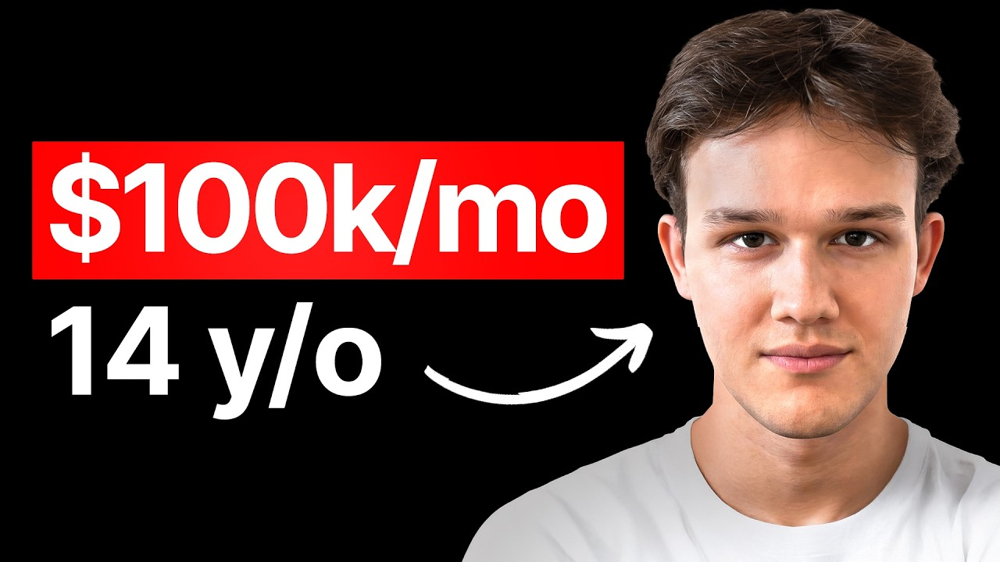

# this 14 yr old makes $100k/mo PROFIT building apps with ai (here's how)

Start building & deploying paywalls in 10 minutes flat: https://superwall.com/

## Table of Contents

* [00:00:00] – Intro
* [00:01:36] – Turning viral memes into profitable mobile games
* [00:03:26] – First exit and influencer game launches
* [00:06:07] – The DaBaby meme game and monetization with ads
* [00:09:22] – Learning distribution through TikTok growth
* [00:13:23] – Transitioning from mobile games to consumer apps
* [00:17:41] – Ideation: Finding app ideas in TikTok comment sections
* [00:22:12] – High-leverage tools and hiring through Discord/Twitter
* [00:24:57] – Using consumer psychology and "sunk cost" in app onboarding
* [00:29:19] – The rise of hyper-realistic AI influencers
* [00:31:20] – Rafael’s "big swing" in the mental health and wellness space
* [00:33:12] – Masterclass in influencer outreach and positioning
* [00:38:19] – Aligning incentives through equity and partnership
* [00:43:56] – Next Steps

## [00:00:00] – Intro

How many times have you seen someone ride a viral trend that you actually found first and thought, "I should have made that. " Well, the reality is that capitalizing on massive trends is one of the hardest things you can try to do. And there are dozens of failed attempts across the internet. Despite all that, Raphael Kramer cracks the code. He turns viral memes into profitable apps over 50 times. [00:00:00 → 00:00:20]

And at just 14 years old, he turned a viral meme into a simple game that pulled in over six figures in profit in a single month. >> I saw it on my phone like the day it released. Then I just thought I'm going to pull an allnighter, make a game about this, uh, put it on the app store and then I promoted it on Tik Tok. I had like a personal brand with like a couple hundred thousand followers, just made a video and then from there like spread like wildfire. Got like 2 million downloads in a in a month or so. [00:00:20 → 00:00:44]

>> His secret isn't a massive budget or a team of genius engineers. [music] In the beginning, he used no code tools to create these games. Not because he couldn't code, but because speed was the only thing that mattered. >> I was just kind of bored and I just kind of searched up on YouTube how to make money. I used like no code tools in the beginning which made him like a lot easier as a 13-year-old kid who had like zero coding experience. [00:00:42 → 00:01:03]

>> Rafael developed a rare skill, a viral trend sense. [music] His playbook was to find a meme before it peaked, build a simple interactive game around it, and launch it to get millions of downloads. >> So that was like my whole strategy. I would find something that pops off, find it early, make a game, put on the app store, and then make videos about it and hope they go viral. >> And the way he monetized was really simple. [00:01:00 → 00:01:20]

No [music] complex inapp purchases, just ads. I just like smacked ads in there pretty much Google Ad Mob. Um, you know, every second time you died, you would have ad pop up. If you wanted to revive uh to continue playing, you would watch a 30 secondond ads. And uh that drove in all the revenue, like didn't even have inner purchases. [00:01:20 → 00:01:38]

## [00:01:36] – Turning viral memes into profitable mobile games

>> But after running this playbook dozens of times, Raphael realized his true talent wasn't just making games. It was really mastering distribution. >> Like, I've never been a product guy. I just want to like market stuff. That's what I'm good at. [00:01:36 → 00:01:48]

Fast forward to today and he's applying his hard one trend riding expertise to his biggest swing ever. [music] A wellness app he's truly passionate about to prove that the viral sense can be applied to any app in any category. >> Like I can clearly get downloads. I can clearly get views. I can clearly [music] do the marketing side. [00:01:48 → 00:02:04]

I've just never had a good product. So my next step is going to be uh it's more like in the therapy, wellness, mental health space, but like that's going to be my very big swing. So, in this episode, Rafael Kramer breaks down his system for developing a viral trend sense. [music] How he turns these fleeting cultural moments into profitable ad monetized apps [music] to the art of finding trends and building a distribution engine before the market gets saturated. Also, you can take his lessons and apply them to your own projects. [00:02:04 → 00:02:31]

This is a master class in the power of distribution. Let's get into it. This is the Superwall podcast and I'm Joseph Choy, founder of Consumer Club. The members in the consumer club discord and the founders I interview on the pod build apps at a median of 1 million ARR. A lot of these apps that make the most money run AB tests on their payw walls to make more revenue with the same number of users. [00:02:31 → 00:02:50]

Superwall has a lot of data on the thousands of apps that use their payw walls. So recently they put together a free AI tool trained on 422 profitable paywall experiments. It lets you upload a screenshot of your own paywall and gives you an experiment idea to increase your revenue. You can use it for free at paywalexperiments. com. [00:02:50 → 00:03:08]

Also, if you're building a mobile app doing at least 100K a month in revenue, SuperWell hosts dinners in San Francisco and New York. They keep each gathering small, thoughtful, genuinely useful for everyone. If you meet this criteria of 100K a month in revenue and want an invite, apply using the type form in the description. Let's get into the pod. You've got 50 plus apps built and 100 million social media views, three exits. [00:03:06 → 00:03:33]

## [00:03:26] – First exit and influencer game launches

Um, I want to go to the first exit. So, how much did you exit for your first app? And how old were you when you did that? >> So the first one uh wasn't an app actually. It was a company. [00:03:30 → 00:03:42]

So that was a company that I started when I was 15 years old. After kind of like you know making my own games and promoting them, I actually founded a company that teamed up with influencers that helped influencers launch their own games. And that like we had like 10 employees at one point. We had like a couple big launches. One of them was uh Escape the Toilet mobile game which was pretty fun. [00:03:42 → 00:04:03]

Uh that was like a really really big month. And uh yeah, I sold that for about dollars and I was 17 years old. >> That's insane. And was that like the Steam one? >> No, it was a mobile game. [00:04:01 → 00:04:12]

It's actually not up anymore, but you can still find videos of it online. Um I mean the reason that we had to take it down uh can't be disclosed either. It's like a little bit of a messy situation, but uh it was like a really big launch. It was doing super super well for like 2 weeks and we got like 2 million downloads, two maybe three million downloads even across iOS and Android. >> Wow. [00:04:12 → 00:04:31]

And was this with YouTube influencers? >> So, I actually reached out to the creator of Skippy Toilets, um, the boom. And I kind of called him a little bit earlier before he completely blew up. I mean, he has like more than 50 million subscribers, I believe, at the moment. But, uh, at the time he had like 5 million subscribers. [00:04:31 → 00:04:49]

So, he literally did one YouTube shorts promotion. He made like one video uh on the game and that got like more than 50 million views. Uh, and that drove like a bunch of downloads. And then from there it was kind of also word of mouth which was a big factor. >> Wow. [00:04:49 → 00:05:02]

Okay. So you worked directly with the Skibbity toilet guy. Yeah. So how how did you get in contact with the influencer? Like you you did this and you said you did it with other influencers too. [00:05:02 → 00:05:13]

>> Yeah. So I mean we work with a bunch of influencers. There's also like a bunch of like mobile games that we made and never really launched. Um but there were quite a couple big ones. And the way that I reached out to them was like mostly through Instagram. [00:05:12 → 00:05:26]

Like we at one point did have like relationship managers that would just like cold email influencers every single day and like you know send like 50 emails a day, 100 emails a day. But what I found works best is really just you know having like a decent Instagram profile. Uh you know having a bunch of mutuals with influencers and then kind of like building up that profile so you're credible when you actually message them. >> Makes sense. So when you were 15 years old and you and you sold for at least six figures, what was that like having like six figures at 15? [00:05:26 → 00:05:55]

I mean, the funny thing is I actually was making more money before. So, I started making mobile games when I was 13 and when I was 14, I had my first month where I made 100K in one month. Uh, so that was a little bit more impressive I think than when I was 15. [00:05:55 → 00:06:10]

## [00:06:07] – The DaBaby meme game and monetization with ads

Uh, which is funny. Uh, so I I was kind of desensitized to it to be honest. Um, but obviously it was still cool. >> Let's talk about that one then. What was the Yes. [00:06:10 → 00:06:18]

>> What was the app? >> So, it was the game. It was about this rapper called The Baby. Um, not sure if you're familiar with him. He's pretty big. [00:06:17 → 00:06:23]

He was much bigger back then in 2020, 2021. And there was basically this meme about his head being a car. It was it was like super viral on Tik Tok and I saw it on my phone like the day it released and I just thought, "Okay, it. I'm going to pull an allnighter, make a game about this, uh, put it on the app store and then I promoted it on TikTok. " I had like a personal brand with like a couple hundred thousand followers. [00:06:23 → 00:06:48]

Just made a video and then from there like spread like wildfire. Got like 2 million downloads in a in a month or so. And there in one month I made more than 100 grand. If you scroll down a little bit more you'll probably find Yeah. So that's the baby game. [00:06:48 → 00:07:00]

You can see one of them has 4 million views. Uh that was like the one that kind of like kickstarted it. I remember like they want it got like 300k downloads and then from there actually the K factor you know had much more of a role than the actual Tik Toks because people would play on their lunch break obviously like it was mainly middle schoolers maybe even high schoolers. They would show it to their friends. Their friends would try and beat their high scores. [00:07:00 → 00:07:22]

they would see on the top charts. We actually got number two on the app store I believe in total and on games or in racing I think we were even number one and that obviously like if people see on the charts they see like the baby's face on there uh they click on it like instantly gets curious and that's kind of like how it spread like wildfire. >> I vaguely remember this meme where it like >> maybe as a car. Why was it your first thought to like make a game about this? >> Yeah. [00:07:22 → 00:07:45]

So, I mean, if you look at the history on my profile, you'll actually see that I was making a bunch of games about these memes. So, that was like my whole strategy. I would find something that pops off, find it early, make a game, put on the app store, and then make videos about it and hope they go viral. So, the kind of reason behind that was, you know, I I kind of believe that a game is much more interactive than a meme and it can kind of like expand upon the meme or expand upon the trend. And, you know, a trend is kind of like 2D, right? [00:07:45 → 00:08:13]

you kind of see it, you laugh at it, you scroll. But if you can actually interact with it, you can actually be the baby in a game, you can actually, you know, uh do whatever the meme is doing in an interactive way. That's just much more funny and people will kind of automatically share that itself. >> That's interesting. And did you just learn game development on your own? [00:08:13 → 00:08:33]

How did you actually learn like how to make these games? Yeah. So, back then it was the Corona pandemic, so I was just kind of bored and I just kind of searched up on YouTube how to make money. And then I just came across a video that was talking about the mobile game business and I was like, "Okay, you know, why not? I like games. [00:08:33 → 00:08:47]

I'll try it myself. " And then, uh, I used like no code tools in the beginning, uh, which made it like a lot easier as a 13-year-old kid who had like zero coding experience. So, most of the games, even the game was just built with like a no code mobile game builder. Um, and then like once I started making money, I just hired Unity developers like pretty much immediately. I wouldn't like say that I'm too technical. [00:08:47 → 00:09:08]

>> I see. What no code builder were you using? >> It was Buildbox. I mean, back then it was pretty good, but to be honest, like these days it's not really usable, but yeah, buildbox. com. [00:09:06 → 00:09:17]

>> That's pretty crazy. So, going back to the Babies, how did you actually monetize this game? [00:09:15 → 00:09:24]

## [00:09:22] – Learning distribution through TikTok growth

>> Yeah. So, I mean, funny enough, if I would have monetized it better, I could have made much more money. Uh, but I I just like smacked ads in there pretty much. Google ADM Mob. Um, you know, every second time you died, you would have ad pop up. [00:09:22 → 00:09:35]

If you wanted to revive uh to continue playing, you would watch a 30 secondond ads and uh that drove in all the revenue like didn't even have inapp purchases, >> right? So, ADM Mob would just do it for you. Did you have an idea of how many downloads you need to get or how many users to like actually earn money from ads? >> I mean, you can earn money off ads at a somewhat low scale. like if you have a couple hundred people playing a day, couple thousand. [00:09:35 → 00:09:59]

Um, and I mean I kind of like slowly started getting more and more users. Like every single game I made just had more views because I kind of understood better how to make the videos. So, you know, like the first time I made money when when I was 13 years old, I would see like $30 on the dashboard cuz I got like 5,000 downloads on a on a game, right? Um, and then I would kind of just like go up there. Like essentially, it's like 10 cents per user on average on like a somewhat poorly monetized game, which isn't a lot at all. [00:09:59 → 00:10:25]

Like most mobile games these days, they can get up to like 80 cents, $1, uh, per user. But back then, it was really just like super low retention, like all kind of gimmicky just to get the downloads, just to like kind of make videos about it on Tik Tok. Now, like the game was developed to be good on a Tik Tok video. >> It seems like the premise of these Tik Toks is basically just starting with the meme and then showing the process of you building the game for it and then just playing the game. It seems like extremely. [00:10:25 → 00:10:54]

Is there any like trick to these Tik Toks though? Cuz some of them are getting a lot of views. >> Yeah. So, I mean, I was pretty obsessive when it came to figuring out how to get views on Tik Tok. Um, I it definitely changed since back then. [00:10:54 → 00:11:07]

Uh, like today the metals are different, but back then it was um yeah, I mean, I would like make these dev logs. I would kind of like see what words I would have to say, what frames I would have to show. I would like do a lot of AB testing in my very early videos where you could kind of see um that you know I would like say a different hook and then find like a hook that works. And what I found worked back then was really good. Making a game about the baby or making a game about this vegan teacher, right? [00:11:07 → 00:11:31]

And then obviously like the core thing was actually just in general making a video uh about something that was trending at the moment cuz that would naturally be pushed out and then it just had to be like kind of not boring uh so people would watch it. >> Let's see this one. Day four of making the baby mobile game today. >> Day four of making the game. >> Yeah. [00:11:31 → 00:11:50]

Yeah. >> Let's add two new characters. Like I do with the other characters, I built them off the original the baby car. The first one being the Mexican for which I added a >> just kind of like add on to the meme. >> Yeah, pretty much. [00:11:50 → 00:12:01]

Pretty much. And then like people would like comment ideas and they would be like, "Oh, this add that. " And then I would add it. Yeah, >> that's crazy. So you made basically like there it seems like there's not that many. [00:12:01 → 00:12:12]

There's like 1 2 3 4 5 6 7 8 nine nine total videos about this game and >> they each got around 100k to a million views each and that was that was all the downloads you needed and like how many downloads did you get total from from this game? >> Yeah, it must have been it must have been like one and a half 2 million uh in in like a month. Yeah, but I don't think all of them came from Tik Tok. I think like just the initial badge came from Tik Tok. >> Yeah. [00:12:12 → 00:12:39]

um maybe like I think yeah 300k downloads, 400k downloads just from like the first couple videos and then from then it was really just people like sharing it with their friends like we immediately charted right so that like again you know just seeing like the baby on the actual app store charts will kind of get people to be curious click on it download the game um unfortunately not play for that long again the retention was pretty bad uh but you know at least got a couple cents of ad revenue out of that >> so you said like over time you've gotten better with the retention ion and stuff and you know making them more monetized, making them more like engaging. What have been some of your more recent apps and how have you improved the retention and just the overall experience? >> So I would say for these Tik Tok games that I made when I was 14 15 like I didn't consider retention at all. [00:12:39 → 00:13:28]

## [00:13:23] – Transitioning from mobile games to consumer apps

It really was just kind of like the growth side of it. Um, and then once I transitioned to making influencer apps, the company that I eventually sold, uh, the one that actually work with influencers, I had, you know, hired developers, um, and, you know, apparently they were able to, cuz I didn't want to focus on the game at all. I just wanted to focus on the influencer side. Like I've never been a product guy. I just want to like market stuff. [00:13:28 → 00:13:48]

That's what I'm good at. But then it was just kind of like in their hands to like implement, you know, for mobile games specifically, it's like, you know, level ups and uh, people like characters u, just kind like giving like an incentive to play. But to be honest, we never really cracked retention. Like that was never really the strong suit. It was always kind of like the distribution edge of having like a really big influencer like the skip toilet guy to promote it. [00:13:46 → 00:14:09]

And that's why I got millions of downloads. It wasn't like an inherently good mobile game. So I mean I did that playbook for like yeah like almost 50 apps. uh and then like recently in 2025 I decided to start consumer apps and that's obviously where you know retention is much more important but also the barrier to entry to making a product is much lower because for a mobile game you need you know 3D animations you need like all these graphics you need all these models versus a consumer app you can just kind of make it solve a problem and then actually uh you know start promoting it so I've had like a decent amount of success already with consumer apps just cuz uh I don't have to like care too much about the product to be honest. >> I see. [00:14:09 → 00:14:48]

What are your like recent apps? >> So, one of the recent ones is DBLI and this is actually one of the exits uh the one that we sold. So, this was kind of like we like I've launched like three consumer apps in 2025 and then this was the third one and the one that actually did somewhat well. It was like a looks maxing up like with a slightly different angle. >> Interesting. [00:14:48 → 00:15:08]

And do you have any interesting stats on this? >> What's interesting is with this one the marketing was actually super super easy. Um, I mean we got like 40,000 downloads, but like that didn't take that much effort to be completely honest. It was more so just hiring a couple people to run, you know, faceless UGC pages, which were pretty profitable just cuz they were so cheap to run and then also uh running it on Tik Tok ads, which initially was super super profitable. Like we were paying a couple cents per download at one point and then, you know, once we started spending more, it kind of equaled out. [00:15:08 → 00:15:40]

But uh yeah, it was definitely like a super good learning experience just to like completely shift from mobile games to consumer apps. >> Interesting. Yeah. So there was like a arbitrage period it sounds like where maybe there was no apps on the app store doing this type of like deep bloat um concept. So you're getting like couple cent downloads and then how how quickly did that saturate? [00:15:40 → 00:16:03]

I mean, the couple send downloads saturated in a couple days and then like the next few weeks it was still profitable but like less like maybe like 30% profit based off ad spends and I mean yeah it was definitely like an original idea hadn't been done before but now looking back at it um it was like like we probably should have scaled it more before selling it to be honest cuz now there's like a bunch of copycats some of them are doing like 20 30k a month and uh yeah cuz like people realize that a dlo app in itself like it makes sense to make So, how did you come up with the idea for this app? >> So, I would say like a lot of the ideas that I've come up with in general. Like the best successes were just kind of me doom scrolling and me being a consumer myself. So, I I wouldn't say that I built this app for myself, but I've definitely like watched some looks maxing content online. I kind of know that people want to have a debloated face. [00:16:03 → 00:16:53]

Uh, so it was just kind of like a, you know, me and my co-founder back then were just like kind of like jotting down ideas and I was like, "Oh, wait. Like what about you know debloating? Like that's a problem that people have. That's a problem that hasn't really been solved yet other than an actual you know product in terms of you know taking a pill and debloating which you know people don't really trust. >> That makes a lot of sense. [00:16:53 → 00:17:14]

Like even if you just you just look up like debloat on Tik Tok. There's so much content on mostly like e-commerce products as >> Yeah. Exactly. >> solutions. That's an interesting category. [00:17:14 → 00:17:24]

Would you say that this is a good way to do ideation for apps still like look at popular like e-commerce categories and then making apps for those? >> I I mean I didn't necessarily uh find it through the looking at it through an e-commerce lens. I kind of just saw it as like a problem that people wanted to have solved. [00:17:24 → 00:17:42]

## [00:17:41] – Ideation: Finding app ideas in TikTok comment sections

Like people were obviously concerned with how bloated they were on TikTok. And if you would go into the comment section which is a really good indicator of how strong a problem is, you would see people saying like how do I debloat? Like if you would see a transformation video of a guy be like bloated before and then not bloated after, there would be like 100 people in the comments asking how how. Right. >> That makes sense. [00:17:42 → 00:18:03]

And then when you made your content, you were doing UGC accounts. You said um it looked like this account was like slides. Um was it mainly slides content or did you also do like face content? >> Uh so for the actual uh faces you see it was pretty much just slides. I think we had like I don't know eight accounts or something and you know we would pay these guys like not a lot at all. [00:18:03 → 00:18:28]

Uh so it was like just basically free installs compared to like what we paid them and they were just kind of incentivized to figure out how to get views on their own. Um you know we would just pay them off a CPM basis. >> Interesting. How did you find the creators to do this? So, I have a friend who actually was also running up that strategy with a taller app. [00:18:28 → 00:18:45]

And then I just asked him like, "Hey, you know, who are these guys? " And then he sent me one of them that he wasn't working with anymore. And then he knew like a bunch of more guys. So, it was kind of like they weren't necessarily like, you know, advertising themselves publicly. They were just kind of like already doing that type of work. [00:18:45 → 00:19:00]

>> Yeah. Do you think that freelancers and agencies and like people that are managing the creators, is it like sort of like a word of mouth? cuz I feel like a lot of the viral growth stuff is really new and there's just not that many people who know how to do it really well. Um, so there's just a handful of people that, you know, their names are not really shared in public that much. >> Yeah. [00:18:58 → 00:19:22]

I mean, I feel like it's pretty teachable. I feel like like something people sleep on is just getting like a couple high school guys that want to make some extra money and just kind of like teach them teaching them how to make these slideshows or teaching them how to, you know, uh, make UGC content. I mean, why not, right? It's not like you have to be extremely smart or something to be able to do this. You just kind of have to doom scroll yourself, kind of have the sense of, you know, what does well. [00:19:22 → 00:19:46]

I think it's more intuitive uh than logical as well. Like, if you just find someone who doom scrolls, they could probably make viral content themselves without even knowing actually. >> Right. Yeah. When you make these ads, are you like hiring editors and then coming up with the everything else like the script yourself or are you outsourcing like almost everything? [00:19:46 → 00:20:05]

So, I've tried outsourcing scripts before, but what I found is that like scripts haven't, you know, I haven't been able to find people that do it too well. But editing definitely like like editing is a super lowle leverage task in my opinion. So, I just always try and outsource that like as soon as possible. >> And do you have separate editors to do [music] the captions and the cuts versus the graphics or is it just one person that can do the whole video? >> It's always one person that can do the whole video. [00:20:05 → 00:20:29]

I kind of like just giving responsibility to making like a high engagement video. Like when I look for editors, I don't necessarily look for someone who can do good captions or who can do good motion graphics. It's more like can you make a video that is entertaining and people want to watch and then I send you like the script. I send the idea and then you know you make sure that you visually keep the users or the viewers attention. >> Do you hire from Upwork and just like video job sites? [00:20:29 → 00:20:55]

I've tried a lot of Upwork, but I actually haven't had the best experience with with Upwork. I've had like a couple good gems on Upwork, but what I found uh works better is just like, you know, making a Twitter post like, "Hey, does anyone know any good editors? " You know, maybe some of your friends have editors. And then also Discord server recruiting is actually I haven't heard much like many people talking about that. But um I've like hired quite a couple people uh also for scripts, but again, those weren't too good. [00:20:55 → 00:21:19]

But editors of like Discord servers. Yeah, cuz like I feel like Discord servers are like where people are they're like actively searching for work. Um, so >> yeah. Yeah. And like a good thing is you can also ask for free samples. [00:21:19 → 00:21:33]

Uh, usually like with these high competition spaces like everyone's just kind of like trying to get like a gig, right? So, you know, just send them a video, you know, get a free sample and if you like it, you hire them. Um, and if not, you're kind of like filtered out um, you know, hiring someone that, you know, doesn't necessarily make good videos. >> That's a great point. Yep. [00:21:33 → 00:21:50]

So, when you reach out to creators and you're about to invest into organic social and maybe boosting those videos with paid ads, you don't want to just let the creators do whatever they want. Most of the app founders I talked to on this channel basically have the same content philosophy. The videos need to go viral, but also convert and promote an app and ideally are also repeatable. And those formats are like gems and really hard to find. That's why Tik Tok can sometimes feel like a lottery system. [00:21:50 → 00:22:15]

## [00:22:12] – High-leverage tools and hiring through Discord/Twitter

So what a lot of consumer club members do is they use this tool called spy talk which brain rot scrolls hundreds of thousands of Tik Toks and just finds the most viral ones that promote apps. So here I search for fitness gym workouts. Let's say you like run a fitness app. I'm going to sort by most viral. And here's this 106x outlier video that promotes a fitness app. [00:22:15 → 00:22:38]

And it shows a text hook. It shows the image in the background. And then on the second slide, it has this CTA in a really creative way. And Spy Talk has been the secret weapon for growth strategy for 11 Labs and Ammo and Voodoo, which is the app studio that owns Bereal. So I recommend Spy Talk. [00:22:38 → 00:22:56]

It really is the only other tool I explicitly recommend on this channel other than Superwall. You basically do all of the high lever things yourself. So you're like doing the scripting and then the actual app itself. Are you also doing like the onboarding and pay walls yourself? >> So, I had a good co-founder that kind of took care of the whole product side and just led me with the marketing. [00:22:56 → 00:23:18]

But I do like what I like is kind of like consumer psychology. So, I definitely like helped a lot with kind of the framing of things kind of which angles we should like present in the onboarding. But then technically at the end of the day, you know, I'm not in Figma um moving stuff around. I'm kind of just like, okay, this is like what we should do and this is why it will work. Um, and I feel like that also goes into marketing because you have to like understand the user. [00:23:18 → 00:23:41]

I feel like that's why I've been able to get so many views and get so many downloads and just kind of like get a lot of attention on social media is because I was able to put myself into the shoes of the user and kind of understand the problem from their perspective. >> Mhm. I feel like the co-founder dynamic that a lot of people don't talk about [music] is that it's not always just marketing versus product because with the product there's psychology and there's like sort of marketing within the product as well >> and how you frame the onboarding and the payw wall. Um yeah, so I'm curious just like how you approach that like what were the consumer psychology things that you uh had input on? I kind of hate to say this because it's not as tactical, but I feel like it's just more intuitive. [00:23:41 → 00:24:24]

I feel like if you actually understand, you know, why a user would like go on the video, you know, maybe they feel insecure, why they would download the app, then you can just like kind of make these small decisions like, you know, what text should be here or kind of like, you know, maybe we show this before that, uh, right? You know, maybe, you know, show showing social proof, stuff like that. I feel like it's just like an intuitive process of of going through the app and then you know maybe a co-founder who's more technical did some like certain stuff where I would be like hey you know why would you do that you know the user isn't here for that reason he's here cuz he's insecure and he wants to like fix this issue that he has >> um and one of the thing that worked well for us was just like doing the face scan before the actual payw wall. [00:24:24 → 00:25:04]

## [00:24:57] – Using consumer psychology and "sunk cost" in app onboarding

So you would kind of have the sunk cost fallacy of actually, you know, taking the picture. We actually showed the rating and then it was like a little bit exaggerated. So it was like, okay, you're really bloated and then, you know, here you have to fix it now. And then that would be like the the actual pay wall. >> Yeah. [00:25:04 → 00:25:16]

The intuition and the consumer psychology. And if you're already making the ads, then you're probably you have in your mind like what the user is thinking and feeling in the moment when they download the app. So you've already written the ad script and then from the moment they download you can just have that persona in mind and you need that um mindset to guide all the decisions. >> I think it really helps if you're also kind of in the same age range as your you know average user >> because you could just like much better like put yourself in the shoes of the actual user. Right. [00:25:16 → 00:25:48]

>> Right. >> So back then when I was making the meme mobile games you know I would laugh so hard at you know the baby meme. like maybe today I wouldn't laugh as hard as I laughed when I was 14. But back then I genuinely thought it was hilarious and I genuinely would have downloaded that my game like that game myself if I would have seen on my for you page. So I actually feel like a lot of people or a lot of founders operate this way that they kind of like make an app that they themselves would use. [00:25:48 → 00:26:12]

But I feel like there's a lot of untapped potential for, you know, making these apps for, you know, maybe boomers or maybe like certain problems that you couldn't even like the average founder probably couldn't like put himself in that in those shoes as well, right? You know, like I don't think a lot of app founders are obsessed with, you know, keeping their garden nice and watering their plants, but at the same time, there's an app for that that, you know, makes probably like 3 million a month, right? So, I feel like there's a lot of potential if you can actually, you know, get that skill of putting yourself in those shoes and going into other niches as well that are outside of the average founder age range. >> That's so true. Yeah. [00:26:12 → 00:26:46]

I mean, plant identification apps, right? Those are >> Yeah, exactly. >> Yeah. >> Yeah. >> So, you had three exits. [00:26:46 → 00:26:54]

So, Debbie was the first one and then this one was um Deeplo and then what was your third? >> The third exit was actually just like a quick small exit. It's called Amanda AI. That was just a relationship coach. Um, it was like a consumer app that we launched and then we actually weren't able to uh run ads on it that well because we made certain ads that kind of like got not banned from Tik Tok ads but kind of like restricted and suppressed because of the relationship advisory niche I guess and uh someone just kind of like liked the app and wanted to buy it um just for the actual app itself and not necessarily the numbers behind it. [00:26:54 → 00:27:30]

>> Why did you decide to build this and then why did you decide to sell it? So, I still think it has a lot of potential to be honest just generally. Like I know for a fact like I have two sisters, right? I know for a fact like teenagers when they're having like relationship problems or you know their crush is not texting them back, they go to chatbt and they upload it and ask it for validation or advice, right? So, I feel like there's just like generally like the use case of using AI to validate uh you know your feelings or like problems in a relationship. [00:27:27 → 00:27:58]

I feel like that's a a big use case and that like that's definitely what consumers do. And then also kind of the more unique thing with that was you were able to upload a screenshot of a text and kind of like analyze uh what that meant. What did the other person mean? I just don't think honestly the app was executed that great. Like the branding isn't that good. [00:27:58 → 00:28:17]

Um and then again we kind of like once we launched this uh we were actually working on DBL AI in parallel and once that started you know doing better we kind of like just like didn't focus on it. and then like a buyer came and we were like, "Okay, you know, why not now? We're probably not going to work on this anymore, so you may as well have it. " >> Yeah, that's an interesting insight. I like the concept of this app, though. [00:28:17 → 00:28:37]

It's very like I like that you can upload the screenshot thing, too, cuz that probably makes for good content on TikTok. >> Yeah, I definitely think like that like if this is properly marketed uh just in general, this app idea could definitely do super well. >> Interesting. What are your most recent projects that you can talk about? Yeah. [00:28:35 → 00:28:55]

So, after DBL TI, there actually wasn't that many. Um, we are we actually just got an approved today on the app store, which is like again a looks maxing app. It's uh honestly just more of a cash grab. Like it's not necessarily something too long-term, but uh I don't necessarily want to share the app itself, but I can kind of share the growth strategy behind it because, you know, for this specific one, it's pretty interesting. So, if you go to Tik Tok, uh I can show you like a couple accounts. [00:28:52 → 00:29:21]

## [00:29:19] – The rise of hyper-realistic AI influencers

So, like this is like this is crazy cuz like this is AI. Um, and I just would have never like like if you look at the the actual videos, like it it looks pretty real to me. When I first saw this influencer, it was like it was kind of like yeah, I I I thought it was real, but like this is actually AI, which is pretty crazy. Um, so I feel like there's like this new wave of uh just like these really really hyper realistic AI influencers that, you know, people also believe. I mean now in the comments people are saying it but you know the guys behind this account run accounts that people don't even know are AI like you can see in the comments people are asking how how did you do this transformation etc etc so I just immediately you know once these guys uh launch their page I immediately DM' them and I was like you know let's launch an app so we're launching an app with these guys um you know and then we're also just training a bunch of people to make the the same type of videos >> that's insane so the the like the entire thing is AI like the before and after. [00:29:21 → 00:30:19]

>> Yeah. Everything's AI. >> Oh my gosh. It's It's very realistic. Yeah. [00:30:17 → 00:30:24]

>> Yeah. Yeah. So, I mean, I don't want to like spill their sauce too much, but like it's not that complex. Like, it's just like they're like the reason the videos do well is cuz they're good at making viral videos in general. Like they're also behind a bunch of other projects. [00:30:22 → 00:30:34]

Um, and this is actually like this account has already been exposed for being AI because like actual people made videos on them being AI. That's why you see in the comments people are commenting AI. But these guys also have other accounts that actually like people genuinely believe that it's real. >> Um I I probably shouldn't show them otherwise it's exposed at their AI, but like this stuff looks realistic for sure. >> Wow. [00:30:34 → 00:30:56]

We've definitely entered the era of you just can't tell anymore. [laughter] So, you said that you don't really agree with this like ideology and this movement and you have this skill of like building apps and it seems like in the long term you're interested in like building apps that more like align with you and are a little bit more of like a long-term thing. Do you have um like niches or or ideas for kind of like the big swing type of apps? [00:30:56 → 00:31:22]

## [00:31:20] – Rafael’s "big swing" in the mental health and wellness space

>> Yeah. So, I mean this is kind of like what everything has been leading up to. So, my next app, which is obviously not going to be a looks maxing app, is going to be like the biggest swing ever. So, I feel like I just like I've like I can clearly get downloads, I can clearly get views, I can clearly do the marketing side. I've just never had a good product. [00:31:20 → 00:31:37]

Um, and also honestly like never really a product that I've been too proud of like long term. Like, you know, I don't want to be 25 saying like, "Oh yeah, like I I'm the founder of a Skippy toilet mobile game. " You know, it's cool when you're 15 or 14 or 16 or whatever. Uh but like slowly I'm like trying to like you know I know how to do marketing now. I know the app space now. [00:31:37 → 00:31:57]

So my next hab is going to be uh it's more like in the therapy, wellness, uh mental health space. I don't want to reveal the idea exactly. I'm probably like going to reveal it on my Twitter like in the next couple weeks, but like that's going to be my very big swing. And I feel like I can just like take all of this knowledge that I've gotten, you know, even just from operating, hiring people, firing people, uh, you know, making bunch of mistakes, finding the wrong influencers, and just kind of like put it all towards this app that, you know, I can actually make a good product out of. >> Yeah, that's awesome. [00:31:55 → 00:32:25]

I'm curious about the influencer collabs part of this cuz you've >> so many iterations of getting like basically just cracking distribution through UG influencers. What's the biggest lesson you've learned overall? Um, I guess it's it's kind of a hard question to answer, but we'll we'll get more into it. I'm curious like what have you learned? >> I mean, I've learned a bunch of things. [00:32:25 → 00:32:48]

Like on the one aspect, I've learned really really well how to reach out to influencers because like now my influencer response rate is like insane. Um, like at the beginning like it always got better and better, but like now that I have certain stuff in place like like almost like I I DM influencers all the time just to have the connection, right? Like last night I was scrolling, I had an idea, DM three influencers and I wake up to like two responses, right? So like on the actual outreach side, like a lot of people kind of get this wrong. [00:32:46 → 00:33:14]

## [00:33:12] – Masterclass in influencer outreach and positioning

But the most important part is positioning yourself as one of them almost. So if you have like a really good Instagram profile, if they see that people follow you that they know already, um if you have like a couple decent posts, maybe you have like a blue check mark, have like a decent amount of followers, they're much more likely to respond to you. And then for the actual distribution part, I have definitely found that like there's a very specific type of influencer. And I mean for this specifically, like we made games with influencers and we did 50/50 splits. So it would be kind of like working together to make a game. [00:33:14 → 00:33:47]

And there's a very very specific type of influencer that can actually do that and actually has an audience that is even interested in a game. I remember this one influencer that we work with, you know, he had 5 million followers. you would get like 2 million views a video, but the game completely flopped uh just because, you know, it wasn't an adequate uh influencer for making a game. You have to like find the influencer with the right audience and you can kind of like tell that based off the comments, kind of like tell that based off if the content revolves around something that you can turn into a game or turn into an app. So, that was like a big learning and now I can kind of like identify that um better than before. [00:33:47 → 00:34:21]

>> That's a great point. Yeah, like the follower count is does not always indicate even like the engagement in the video doesn't always indicate that you can make an app out of this. What are other things that you look for? >> So, I mean it's different like for mobile games uh compared to consumer apps. I couldn't even say with consumer apps to be honest, but with mobile games it's usually uh you know they have like either like a big inside joke where like let's say like a YouTuber has like a big forehead, right? [00:34:19 → 00:34:43]

you could kind of like make a game about their big forehead and how you have to like clean their forehead or something like you have to make something that's an extension of their content that's funny and like people will comment on be like oh no way he made this game blah blah blah let me go download it. So that's like a way to like integrate into the content and not just like smack him into like uh you know a runner game which is kind of boring or like they can have like a universe around them. Like for example for the Skibbly Toilet mobile game you know he uploaded videos about this saga of like these characters and this universe that he built and his audience was invested in it but it was only in video format. They couldn't actually enter that world and interact with it. So that was like a prime example of uh you know an influencer where a game just makes sense. [00:34:43 → 00:35:24]

And unfortunately, you know, that didn't really uh end up being a long-term thing, but even just in the couple weeks that we had it launched, it was performing really well. >> Yeah. Like actually being an audience member of an influencer or YouTuber seems helpful cuz you can you know the actual culture of the audience and >> you know what is the real thing that people are drawn to with this and then how can we turn that feeling into some kind of app or game or experience. >> Yeah, exactly. And I think that's like the essence of being like a distribution person quote unquote. [00:35:24 → 00:35:57]

Um like you know again like you just have to like I I I never watched the Toilet before making the game. I'm not necessarily an audience member but I was able to put myself in the shoes of it or shoes of like the people that would watch it and then be like okay you know this deserves to have a mobile game made about it. >> Yeah. So when you're looking at the kind of like therapy and wellness space and you're looking at influencers that are in that space, what's your research process? Are you just watching Tik Toks and getting a sense? [00:35:57 → 00:36:26]

Like when you're watching a Tik Tok of a a therapy or mental health creator, what are you taking notes on? I think like the biggest indicator of if an audience is good, I mean like obviously like there's always influencers that have really good views, but they like they charge 5,000 per post and then you know like it completely flops. It's not going to get you like literally any downloads. Uh and the way you can avoid that is by seeing if they have like an actual active community and you can just tell that based off the comments, you know, like are people responding to each other? Are people uh you know commenting on the video or are people just like sending a flame emoji which is like like that's not engagement, right? [00:36:26 → 00:37:01]

they're not commenting on the video. Like does this person actually have people that care about them? Do they have influence over uh you know their following? So that's like a big thing. And then also uh just like you know kind of like try and see if they already did promotions in the past, but that's not a criteria. [00:37:01 → 00:37:15]

Like you can kind of coach an influencer on how to make a good promotion. >> Yeah, that makes sense. So you said you've made 50 plus apps. Were most of those from the uh influencer partnership company or did you are you just making tons of apps that are like apps and game? Yeah, I mean I was like pumping out games like crazy. [00:37:15 → 00:37:33]

Like a lot of them aren't even up because I just didn't renew my Apple subscription. Uh cuz like they, you know, they were just like games I made as a kid. But that was like a big chunk of it. And then the actual influencer apps, that was like the biggest chunk. Uh that app store account isn't live anymore either. [00:37:33 → 00:37:47]

Uh but I still have like access to the apps. Uh but that was like yeah, like we would literally like every single influencer we could get our hands on, we would make it. And that wasn't a good strategy because a lot of influencers as mentioned aren't suited for a game. But then like you know every now and then we would have like a game that really popped off uh because the influencer was so good and then we were like with time able to identify what they had like in common. >> So you've done a lot of different types of distribution channels. [00:37:47 → 00:38:11]

You've done influencer, you've done like faceless UGC, you've also done ads. >> Is there a channel that you think is just the best or just a channel that you prefer? [00:38:11 → 00:38:20]

## [00:38:19] – Aligning incentives through equity and partnership

I feel like for consumer apps, like if you can crack ads, like that's perfect because it's like so logical, right? You know, you just spend money um you know, and then you get a return, you know, you spend 100 bucks, you get 150 back and then you just make more good ads. So that's like something I want to crack. Uh and then also uh like I've heard of like friends who just have like a couple good influencers and they're just kind of like riding off that. So they have like a couple influencers on retainers uh for consumer apps and it's just like you know these influencers have like a 3x rows because like their audience is perfect for the app. [00:38:20 → 00:38:54]

So being able to identify those in your niche like who is that and then getting them locked in on the contracts I think that's also like uh like a really big thing right now that like everyone should like try and take advantage of. >> Have you explored ads a lot yourself or have you gone more down the influencer side? I mean ads like only for deep bloats. Uh that was kind of like the first proper time we were running ads. Um and Darrow was really just kind of like yeah just like making a bunch of videos and then scaling up those that were doing well. [00:38:54 → 00:39:24]

Um you know I'm not really an expert with ads but like just in general like the concept of being able to do paid ads is like super fascinating to me cuz like you can just put money in and more money comes out like hopefully like if you do it right. Uh so that's like something that I want to get really good at. >> Yeah. Does it seem like you you had a natural sense for the ad scripting for the influencer marketing? Did you give them scripts the same way that you do the scripts for ads? [00:39:24 → 00:39:50]

>> So, that's actually something I'm really trying to avoid. Specifically for the influencer collaborations, maybe once I start doing more paid promotions, I will have like certain guidelines in place. But for the influencer collabs, you don't want to work with an influencer who can't make viral videos. You want to work with an influencer who you can incentivize to make a lot of videos and a lot of content and then let them figure out how to get as many views as possible because at the end of the day, they know their audience the best. They know how to get the videos. [00:39:49 → 00:40:15]

They just have to be incentivized with 50% ownership of the actual game uh to like include the game in there. Like you really have to make them feel like it's their game, which it is. Um and then they do the rest. If you did the influencer partnership strategy for an app instead of a game like Deeplo or therapy app or your looks maxing or any niche, would you give that much equity? >> I think it's a little bit different for an app just cuz people view apps differently. [00:40:15 → 00:40:42]

People view apps as like more of a company, more of like a little bit of a startup even versus a mobile game which is more gimmicky. Right? If you're making a mobile game about someone's forehead where you have to clean the foreheads, they're, you know, obviously going to want half of it because it's just kind of like a little bit of a cash bar to be honest. Uh, but for the app, yeah, I mean, I haven't done it, but I think it's like like if I would want to make money like super quick, like that would be like a really good way to just do it. Um, because you have like like it it cannot not work if you have the right influencer. [00:40:42 → 00:41:10]

You know, you just have to, you know, make a solid product at the end of the day that fits their audience and then, you know, you have guaranteed distribution. Yeah, that makes a lot of sense. Significant equity is probably the quickest way to align incentives. If you don't give a lot of equity, is there any other way in like in your experience working with so many influencers to motivate people to like actually drive results without having a lot of equity? Is it purely in like the vetting process like you talked about in finding the right person and the right fit or are there like additional ways that you've found in like building the relationship and negotiating and um like motivating people? [00:41:10 → 00:41:52]

>> I mean I've always been generous with the actual equity because it was more of like I I wouldn't even say it was like it was just like ref share right like we're making games together. It's your game. Um, but what I found with that specific case really, really helps and is like pretty much transformational to be honest, is really making them feel like it's their game. Like, you know, they give ideas. Uh, you know, even if at the end of the day you don't necessarily implement all of their ideas cuz maybe they're not even the best ideas, but you just like have like let them have involvement. [00:41:50 → 00:42:18]

Let them be part of the process. You know, we had like weekly calls of like updates on how the game is going. Send character updates. like really let them feel like this is something that they're launching, which at the end of the day it is, right? So, you're basically building a business together with the influencer, even if it's not like a business business, it's just like a little project. [00:42:18 → 00:42:36]

Um, it's, you know, from their perspective, it's something that they're building, packaging, they want it to look nice, and then they're like showing their audience. >> That's really good advice. Well, this has been an awesome interview. I learned a lot. I actually didn't know very much about the the gaming side of things as much, so that was really interesting. [00:42:36 → 00:42:54]

and how you've transitioned into apps and all the lessons learned is very very cool to hear. Are you hiring anyone? Like I want to you let you just talk to the audience and like I think it would be a really amazing opportunity to work with you if someone's like earlier on their journey or even like midway like I feel like there's a lot of experience and learning you have to offer. So here's your your Twitter profile, but are you looking for anyone any like types of people? I mean, yeah, like for the for the next app that I'm working on, uh, the mental health wellness therapy app, again, I can't really reveal the idea too much. [00:42:52 → 00:43:25]

Um, but like if you're talented in any aspect, you know, you know, even if it's design, you know, if it's if you're just motivated and you want to like text influencers all day, uh, just like hit me up, like any sort of talent and we'll kind of like figure it out. Like I really want to build like a really really big app, really really cool product uh for the next project. So, it's going to be super exciting to work on that. Um, yeah, engineers, uh, designers, influencers, even whoever you like. I'm I'm down to talk to anyone, uh, who's talented. [00:43:25 → 00:43:52]

Uh, so yeah, just just hit me up and and we'll talk. >> Cool. Well, thanks so much for being on the pod. >> Thank you so much for having me. [00:43:52 → 00:43:58]

## [00:43:56] – Next Steps

>> Something you might not know, most of the founders I cover on this podcast are hanging out right now in the Consumer Club Discord, sharing with each other what's working now for consumer apps. So, you can apply to join Consumer Club if that sounds interesting to you. And this is the Superwwell podcast. Of course, you got to check out superwwell. com. [00:43:56 → 00:44:14]
