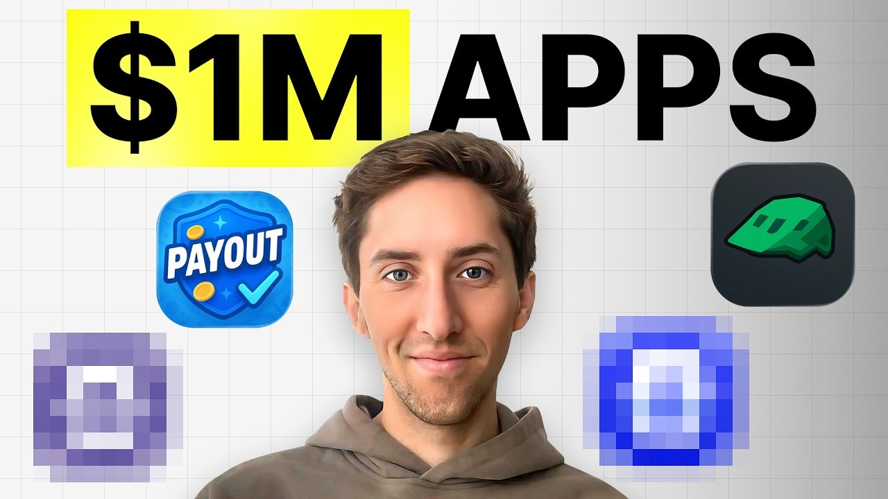

# This 23 Yr Old Genius Makes $1M/Year with No-Code Apps. Here's How

Start building & deploying paywalls in 10 minutes flat: https://superwall.com/

## Table of Contents

* [00:00:00] – Intro
* [00:02:04] – Why Influencers + Equity Beat Paid Promotions
* [00:03:17] – Connor’s Apps & $45K/month From Influencers
* [00:05:07] – TikTok, Instagram, YouTube & ManyChat Attribution
* [00:07:35] – What Makes Influencers Convert (Formats & Niches)
* [00:11:17] – Reaching Influencers: Email vs DMs
* [00:14:23] – Standing Out With Mockups & Audience-First Ideas
* [00:18:20] – Equity vs Paid Influencer Deals (When to Switch)
* [00:22:13] – App Ideation Framework Using Trends & App Store Data
* [00:26:00] – Tech Stack: Swift vs React Native + Vibe Coding
* [00:31:12] – Why Equity Changes Creator Motivation
* [00:35:10] – Picking the Right Niche (Not Too Broad, Not Too Narrow)
* [00:38:36] – Long-Term Thinking: Bootstrapping vs Unicorn Chasing
* [00:43:10] – Sunk Cost Traps & When to Sell Apps
* [00:46:22] – Daily Habits, Leverage & Founder Mindset

## [00:00:00] – Intro

Think about the classic trap that most app founders are stuck in. Build an app, ship it, and then hope people will download it. But Connor, the guy I talked to today, is doing something completely different. He's 23 years old, he's making over a million dollars a year, and he's done it by completely flipping how app developers think about distribution. His main app, Payout, is pulling in $45,000 a month, and almost all of that is coming from one place, influencers. [00:00:00 → 00:00:23]

But here's the thing, he actually [music] doesn't pay the influencers to make posts. Instead, he gives them equity and then builds the app specifically for their audience. >> You know, I built this app specifically around his audience. Like before we had an idea of what we're going to build, like I was like, "Okay, this is, you know, what his audience does like is looking for. " I actually can't went through a list of like maybe five ideas of different apps, and I made some like Figma mock-ups for them. [00:00:23 → 00:00:46]

I was like, "Which one of these do you think like resonates the most with your with your audience because I think these all have potential to convert off of it. " >> Of course, this is the complete opposite of how most people approach influencer partnerships. You build app first, then try to convince an influencer to promote it. Connor asks the influencer what their audience wants, and then builds it. And because the influencer now has equity in the app, they actually care about making it succeed. [00:00:46 → 00:01:08]

And so the videos they make are getting high views and convert well. >> You're going to actually find that these influencers you're working with are very entrepreneurial. Like they can be gritty and get stuff done. But here's the problem, how do you even reach these influencers in the first place? Most founders make the same mistake, they slide into DMs and it doesn't work. [00:01:08 → 00:01:26]

But Connor figured out something way better. There's absolutely no reason to to try to DM these larger creators. Like it was funny, I emailed them in maybe April, and just like a week ago one of these influencers responded like, "Hey, like you know, just remembered about this email. " Hopped on a call with them. Like I explained to them like, "Oh, this is, you know, this is your account. [00:01:26 → 00:01:43]

This is >> [music] >> what I think we could build. " And they seemed super interested in this, and now like that's moving forward. So I'd say email is much better. So now he's got the influencer, he's got the audience, he's got the equity deal, but how does he know which app idea will actually work? It seemed almost too good to be true how every launch seems to go so well. [00:01:43 → 00:02:00]

So I asked if he uses any kind of system, and his answer was surprisingly specific. [00:02:00 → 00:02:07]

## [00:02:04] – Why Influencers + Equity Beat Paid Promotions

>> I'd say like there is an app already out there that works for any influencer. A lot of these influencers are already getting brand deals from apps. So in this episode, Connor breaks down everything from how to outreach to influencers to actually get responses, how to build an app that's designed for their audience, not the general market, and to the daily habits he started from zero all the way to his current 1 million ARR. Let's dive in. This is the Superwall podcast, and I'm Joseph Troy, founder of Consumer Club. [00:02:05 → 00:02:32]

The members in the Consumer Club Discord and the founders I interview on the pod build apps at a median of about a million dollars ARR. In my conversations with dozens of these founders every week, one thing I've noticed is most of them AB test their paywalls to increase their conversion rates and make more money. Now most people know that one of the best ways to AB test paywalls is Superwall. But one thing you might not know is Superwall has a lot of data on the thousands of apps that use their paywalls. So recently, they actually put together a tool that takes 422 profitable paywall experiments and put those into a paywall experiment generator where you can upload a screenshot of your own paywall and it'll give you an experiment idea to increase your revenue. [00:02:32 → 00:03:10]

You can use it for free at paywallexperiments. com. All right, let's get into the pod. I guess first question, what app are you building and how much how much money does it make? [00:03:10 → 00:03:20]

## [00:03:17] – Connor’s Apps & $45K/month From Influencers

>> So I've got right now four or five apps that I like I'm making money from. They're kind of all over the place. The one that I mostly like publicly talk about is the Payout app. The rest of them I actually keep like pretty much private just because I have partners on those apps and they prefer to keep things private. You know, I was debating whether or not I should start talking about what they are exactly, but I think I'm trying to get a couple of them sold, and once I sell them, then I'll talk more about them. [00:03:17 → 00:03:43]

This main app is the Payout app. The one that you can kind of see right there on that Twitter post that you've got pulled up. It's basically like a class action lawsuit discovery app. There's like a couple of them out there. It's nothing too crazy unique. [00:03:43 → 00:03:58]

I'd say like the only thing that really differentiates my app from the other apps is that it's like very private. Um Like all the information, like we don't store any of it, we don't save any of it. I don't know if the other apps are doing that. I assume they are. Also, we have the ability to let people like mail in like their own forms if they're interested in that, which I think some people might be. [00:03:57 → 00:04:18]

Interesting. And how much does this make monthly? It's, you know, rapidly growing, and I just like these past couple days have been setting up like a UGC campaign through SideShift. Shout out. And yeah, so that's starting up. [00:04:18 → 00:04:33]

But right now off of just influencers, it's doing around 45,000 a month. Wow. Just from influencers. So are you doing like TikTok and Instagram? Yeah, TikTok, Instagram, YouTube, Facebook. [00:04:33 → 00:04:45]

A lot of the times it'll be like cross posting these influencer posts. So one of the influencers and like my partner for this app, his name's Casper, and he has been driving like insane traffic to the app. I think he's driven probably around 35,000 clicks to the website, more honestly. And that's just clicks without like tracking any of our organic install volume from his videos alone. Interesting. [00:04:45 → 00:05:07]

## [00:05:07] – TikTok, Instagram, YouTube & ManyChat Attribution

So that's like link in bio clicks? It'll be link in bio or the ManyChat integration, like the drop a comment and we'll send you some type thing. Yeah, surprisingly effective. Yeah. That is that's interesting cuz I feel like a lot of organic I feel like a lot of organic social marketing is very untrackable and it's like hard to do attribution. [00:05:07 → 00:05:27]

But if you do ManyChat automations, are you able to see what percentage of your revenue is coming from ManyChat versus just regular like organic influencer marketing? Yeah, definitely. Everything that we do, if there's the potential for a link, like it's set up with a custom product page in the app the app store so we can get all the analytics on it. It's like actually surprisingly even, I'd say, between the ManyChat integration and like the people who see it and they go and download it organically. That was something I was surprised about. [00:05:27 → 00:05:57]

Like a lot of the times we'll see the numbers look very very similar for days that like posts go up for those integrations versus organic. Yeah. I I think you're one of the first people I've talked to that cross-post to Facebook video. I mean, a lot of you talk about Instagram Reels, TikTok, YouTube Shorts. Those are like the big three. [00:05:57 → 00:06:15]

But then of course there's still Facebook video. And if you for some reason have the Facebook app still installed on your phone, if you go onto the video tab, there's a lot of views on those videos actually. Do you feel like it's a underpriced channel or do you just cross-post there because why not? >> We cross-post there I guess mostly because why not, but like these these influencers do have followers on these platforms. Um It's kind of like a might as well. [00:06:15 → 00:06:42]

I don't think they're driving most of the revenue, but if the influencer has a Facebook account, and now you can when you upload a reel on Instagram, you can have it post to all of your platforms like automatically. There's So there's no reason to like not post on Facebook. Interesting. I see. So can we look at some of these TikToks? [00:06:42 → 00:07:00]

Yeah, let me send you a link to one of the videos that he's made recently. Is it true that I can make a thousand dollars from your lawsuit? Yeah, and some people can make up to five thousand dollars from it. Whoa, do you know how I can apply for this too? Fine, but you didn't hear this from me. [00:07:00 → 00:07:14]

First, you go to this app, find the Temu lawsuit. There's a bunch of other ones on here, too. Click claim, see how long you have to file, and if you need proof. Then click get started, fill out a simple form, and once the settlement ends, you'll get your payout from Temu and any other company you applied for. Just comment claim and I'll send you the app. [00:07:14 → 00:07:35]

## [00:07:35] – What Makes Influencers Convert (Formats & Niches)

Hey Temu, is Interesting. What types of influencers are you having make these videos for you? So Casper is one of my friends. So I like I'm partnered with him on this app. He has this app if you look at his account, he has a very similar format that he does for a lot of his videos. [00:07:35 → 00:07:51]

And he gets pretty good views on his videos here. So I'm not really I guess responsible for coming up with formats. That's kind of his job. But as far as like the influencers that we're reaching out to for this specific product is like we're looking for influencers who make these kind of finance related I wouldn't consider it like a finance content. I don't really know exactly what to describe it, but it's like kind of like life hacky finance savings type influencers. [00:07:50 → 00:08:16]

>> Right. Yeah. There's a handful of them. And because he's been in this like space for a bit making this type of content, he's like very familiar with a lot of these content creators. Okay, that makes sense. [00:08:16 → 00:08:28]

Yeah, it's like financial life hacks, like Costco secret savings hack, Amazon Prime Day savings hack. It's all about like how to save or make money or do side hustles. And then that video that we just watched got 288,000 views. Which is um kind of in line with the views that he normally gets. So yeah. [00:08:28 → 00:08:49]

>> Yeah. And that's not the first video that he's posted. He's posted a good amount of them. Some of them, you know, got like 45,000 views, didn't perform super well. You know, I think that was the best one. [00:08:47 → 00:08:57]

Actually, that was the most recent one. There's also, you know, his YouTube channel. You know, I know I know that video did really good on YouTube as well. I see. So yeah, so you cross-post the same stuff on YouTube Shorts, Facebook, TikTok. [00:08:57 → 00:09:09]

Is there a specific channel that or is there a platform that outperforms usually or are they all around similar? Yeah, I'd say that is like Instagram is definitely performing better than TikTok. YouTube, I'd say it's about the same. Like I'm looking at that reel now on YouTube, and it got 206,000 views. And I think that actually it's hard to tell because a lot of the YouTube the call to action is not like through ManyChat, so we can't really see how many clicks it's driving, but it did seem like the day that he uploaded it to YouTube, it performed or we had a like a lot higher traffic for downloads. [00:09:09 → 00:09:47]

So in the video, he basically starts out with settlement ends, you'll get your payout from Temu and any other company you applied for. Just comment claim and I'll send you the app. So, that's the ManyChat part where he says, "Here, this is what the app is. " It's interesting cuz it's like it's not that hard cuz he he says the name of the app and shows it in the in the video, and he shows you like downloading it from the App Store. But then, I guess people are just kind of lazy. [00:09:47 → 00:10:14]

>> [laughter] >> They just want to know like exactly what the name of the app or uh the link of it. So, the call to action is just comment the word claim and I'll send you the app. And then, there's 9,400 people who've commented. Uh or maybe it's like half that cuz he replies to all of the comments as well. Um so, it's like 4,000 people that are getting getting the link to the download. [00:10:14 → 00:10:37]

And then, in the beginning of the video, it's like a skit. No, that's one thing about his content style that definitely like was not very intuitive for me. It's like I see it as like it's relatively processed. Um you know, it has a script. It's not necessarily like comedy or surprising. [00:10:37 → 00:10:52]

It's like pretty straightforward ad, if you ask me. And like while I don't resonate with that type of content, like clearly he's built like a successful, you know, influencer audience with it. So, it performs well on his channel. Oh, I was going to say, yeah, like I definitely think I've learned a lot about like the influencer space through working with Casper on this. And it's something that I think like all these I see so many indie developers on like Twitter and whatever Reddit and all that talking about like launching these apps and building these apps. [00:10:52 → 00:11:24]

## [00:11:17] – Reaching Influencers: Email vs DMs

And I definitely think that like these indie developers need to just start like spamming influencers. I reached out to Casper before I was friends with him and, you know, had a mutual connection. And he was like, "Oh, like I have this friend, he's an influencer. Like you should talk to him. " I was like, "All right, sure. [00:11:21 → 00:11:39]

" And, you know, I built this app specifically around his audience before he was like before we had an idea of what we're going to build. Like I was like, "Okay, this is, you know, what his audience does like is looking for. " I actually kind of went through a list of like maybe five ideas of different apps and I made some like Figma mock-ups for them. I was like, "Which one of these do you think like resonates the most with your with your audience? " Because I think these all have potential to convert off of it. [00:11:39 → 00:12:03]

Um and then, eventually we narrowed in on one of them and we said, "All right, we're going to build this one. " And I definitely think that's like what indie devs should be doing because there's so many influencers out there who are like trying to figure out how they can build something that has value rather than just doing brand deals. And I like this is super appealing to I think most influencers. Yeah. Do you know what his monetization was like before partnering with you on this app? [00:12:03 → 00:12:29]

Was he just doing like link in bio brand deals, basically? Yeah, it'd be like they'd pay him to post and then put the link in the bio and he would get maybe, you know, some amount for the post and like an affiliate commission. So, a little bit rev share affiliate, a little bit of um brand deals. But I've noticed that theme as well. Like a lot of influencers are pretty unmonet- like under monetized. [00:12:29 → 00:12:52]

Um or they're making like decent money, but it feels like a hamster wheel cuz it's not stable. And a lot of people, I think in the dev world, don't quite understand that psychology. Because as a dev, you're usually like working at a company and you have a stable income. And you actually want the opposite, you want the freedom. But on the other side, as a creator, you have the freedom, but you also have to like eat what you kill. [00:12:52 → 00:13:17]

You can't You don't just get money for doing your work. Like you have to chase after these brand deals, negotiate all the time. And it's not consistent. So, it's actually a great value proposition to influencers to reach out to them and propose like a an equity deal. Do you partner with different influencers for each app that you do and have equity partnerships with with different influencers for each app? [00:13:17 → 00:13:41]

Yeah. Right now, I'm like in the process of um building out more apps with influencers. Um and yeah, like different influencers depending on their size and how complicated the app is, like I'll have different kind of structures for that. But yeah, like every app that I've built, basically, is like I'm working with a different partner on that app. That's a really interesting approach. [00:13:41 → 00:14:04]

I feel like a lot of people struggle with the very first step of just reaching out to influencers and figuring out how to get noticed. Cuz if they have, you know, 2. 7 million followers, they probably get a lot of inbound. So, how do you think that you stood out when you were initially reached out to Casper? [00:14:04 → 00:14:23]

## [00:14:23] – Standing Out With Mockups & Audience-First Ideas

Cuz uh you said that you kind of created a bunch of Figma mock-ups and asked like, "Hey, which one do you think you would want to do? " Is Is there anything else that you feel like made you stand out? And then like how did that conversation go? Yeah, so for Casper, we had a mutual connection. So, I didn't actually build out those Figma mock-ups until we had already had like our first kind of FaceTime call. [00:14:23 → 00:14:41]

I think it was on FaceTime. And but for these other influencers that I've reached out to, like I'd say if you can find an email address, that's easily the best. Um if they don't have an agency and they're managing their own emails, I think I've seen like much better response rates from those people. Um like recently, like it was funny, I emailed them in maybe April. And just like a week ago, one of these influencers responded like, "Hey, like you know, just remembered about this email. [00:14:41 → 00:15:11]

" Hopped on a call with them. Like I explained to them like, "Oh, this is, you know, this is your account. This isn't what I think we can build. " And they seemed super interested in it. So, now like that's moving forward. [00:15:11 → 00:15:22]

So, I'd say email is much better. Like there's no reason to message these guys. They have notifications off. They get like a million notifications a month. There's absolutely no reason to to try to DM these larger creators. [00:15:22 → 00:15:33]

Most of these viral organic strategies come back to finding and tweaking formats that are already working. And it's not that hard to find viral TikToks. You can just scroll the for you page. But it is hard to find viral TikToks that actually promote apps in a subtle way. So, a consumer club member actually built a tool that does that. [00:15:33 → 00:15:50]

It's called SpyTok. Basically, it brain rot scrolls TikTok for you and then finds TikToks in your niche that promote apps. Let me show you here. SpyTok found this viral Outliers slideshow in the love and relationships niche that promotes the Lovers Widget. So, it shows you the exact slides, the engagement metrics, the AI tags that describe what kind of video it is. [00:15:50 → 00:16:14]

And then you can bookmark and save them for inspiration. Yes, this is a sponsored segment. I partnered with SpyTok to bring this tool to the Consumer Club and the Superwall audiences. It's used by top consumer app teams like Amo, Voodoo, Eleven Labs to fuel the creative research for their organic social growth. This isn't one of those tools that promises you'll generate thousands of videos with zero effort and just go viral overnight. [00:16:14 → 00:16:36]

But in my opinion, creative research is the bedrock of all organic growth strategy. So, I actually highly recommend spytok. com. Okay, so look for the email address and especially if it's a unmanaged influencer that has like a Gmail or like a personal name. >> Uh rather than a management company. [00:16:36 → 00:16:56]

Also, on YouTube, if they have YouTube as well as Instagram or Facebook or whatever you're reaching out on, on YouTube, you can usually find their email address. Like in this case, you're looking at Casper, he has like a partnerships email address there. But if you can't find it on their Instagram, a lot of the times it will be like part of their YouTube um somewhere in there. Yeah, if you see like that view email address, you have to do this little CAPTCHA. And um you'll actually be able to see like what their email is. [00:16:54 → 00:17:23]

Uh Uh in this case, he already had it somewhere else, but that's a good a big a big trick Right. That's really good cuz like this also like this this reward This is a little bit alpha cuz it rewards uh the manual reach out because of the CAPTCHA. You There There aren't There's probably fewer bots crawling all over YouTube trying to find email addresses and spam. So, if you can just manually find a creator and then just do the little CAPTCHA and then find the email, that's actually pretty good. Underrated channel, probably, to find creators. [00:17:23 → 00:17:53]

>> Yeah. And I think like it's one of those things that like it's a going to be a volume game. Like you're going to reach out to a bunch of people and not everyone's going to respond. But it is one of those things that is if you partner with a creator, you're you're pretty much instantly going to win. Um I have another friend who recently launched an app called Ride Pal. [00:17:51 → 00:18:10]

And it's doing super great. You know, I think he launched with an influencer um an Instagram influencer. And even on their first day, I think they had like I don't know exactly how many downloads, but it was like over 10,000 downloads, I'm pretty sure. [00:18:10 → 00:18:26]

## [00:18:20] – Equity vs Paid Influencer Deals (When to Switch)

And they last I checked had like tens of thousands of active users on this app. And a large portion of their downloads coming from these influencers that they partner with before they even launched the app. And building some sort of equity deal with them because it's just the fastest way to to get off the ground. Yeah, it's like such a great win-win. And I feel like this like shift in mindset from, "Hey, I want to build a startup. [00:18:23 → 00:18:47]

" to, "I want to build a business. " like enables this business model. Cuz I feel like a lot of the old advice that people would give in the startup industry is like, "Oh, don't give equity to an influencer because eventually you're going to outgrow them and you want to scale to, you know, billions uh in valuation. " But for these apps, you're not you're not really trying to go for a unicorn. You're just making a useful app that solves a problem. [00:18:47 → 00:19:12]

And it's completely reasonable to partner in an equity way with influencers. Yeah. And another thing is if these influencers have audiences, like I don't If you want to scroll um maybe probably down. Uh maybe up, I don't know. Yeah, you'll see this guy here that has driving some good views. [00:19:12 → 00:19:30]

Yeah, one one MTB. You know, he has a decent channel. And like to get to, you know, 100,000 followers on Instagram, like you have to be an intelligent person. Like you're not just going to stop I mean, there's going to be the occasional person who stumbles upon random luck. But like you're going to actually find that these influencers you're working with are very entrepreneurial. [00:19:30 → 00:19:48]

Like they can be gritty and get stuff done. Like I definitely don't see it as like one of those things where it's like ah like I'm just giving this equity away whatever. It's like no this is like a partner and like they're going to contribute and be like valuable. It's not like you're just losing it to the void by any means. Right. [00:19:48 → 00:20:04]

That's interesting. How do you stand out as the dev side? So if you're the one that's vibe coding apps or just you know developing the app. Like from their perspective from the influencers perspective, it sounds cool but I I get a feeling that there's going to be more devs that want to partner with creators now and in the future. I I feel like we're still very early to it because the sentiment is generally not quite there yet. [00:20:04 → 00:20:32]

But are you afraid that other devs are reaching out or are you just does it just not matter? You just like There are a lot of influencers out there. I'd say if you want to stand out as a dev, now it's easier for me right cuz I have some sort of track record. If I reach out to an influencer I say like hey this is an influencer I built an app with recently. Like here's some numbers. [00:20:32 → 00:20:51]

They're going to be like wow I want those numbers. So it's easier as you build out that portfolio and it just compounds eventually like it takes time. Like you have to build some apps, you know, maybe by yourself. Like I built apps before doing this influencer strategy. You know, it took a couple years to get to an app that was like able to support myself and like continue doing that and having a portfolio of apps like that you can show like even if they're not making that much money. [00:20:50 → 00:21:16]

You can like there will definitely be influencers who just are interested in having an app because like who doesn't want an app? Like anyone who has a phone like they use apps like it's it's just cool to have an app. So >> Mhm. Um >> Yeah. I think make sure you're not like timid about it too. [00:21:16 → 00:21:28]

Like you have to you want to be confident. Like you're going to build them a good app. Yeah. >> You know, I wouldn't go into it being like oh like it might do well. It's like no like you you know it's going to do well and go with that attitude. [00:21:28 → 00:21:39]

Right. I think a lot of that confidence comes from a very structured thoughtful ideation process. Um because if you just go in with a random app idea that you don't really know is going to work then you're not going to be able to actually be confident. But if you go in with hey I actually know this market I can see the audience that this person has and I think that this product would mesh really well with this audience. Um you're going to you know be able to credibly like be a lot more confident. [00:21:39 → 00:22:13]

So do you have an ideation framework or how how to think about app ideas that match well with influencers? [00:22:10 → 00:22:18]

## [00:22:13] – App Ideation Framework Using Trends & App Store Data

I'd say like there is an app already out there that works for any influencer. A lot of these influencers are already getting brand deals from apps. So I would say like you could ask them what apps are reaching out to you. That's pretty basic one. They'll probably say these are the apps. [00:22:18 → 00:22:31]

You'll be like let's build one of those. Another thing is you can you know go look at you know in that category. So like when I was looking around for the payout app, I was looking around on the app store. I was like okay what's doing well. I was looking around on TikTok and I was like what kind of trends am I seeing on TikTok? [00:22:31 → 00:22:48]

And then from there I'll come up with maybe you know a handful of different apps. I'm like oh like another app that I was debating building was like kind of daily there's like a lot of these daily quote widget type apps out there. Um and I was thinking like it would be interesting if there was like something like that for like financial advice. You know, like I know a lot of people they like subscribe to that kind of content on on YouTube, Instagram where it's like oh like here's like some Roth IRA savings thing and then it could be like oh like little daily things that's like oh here's a way you can prepare for your future something like that. So there's a bunch of different random kind of concepts I would come up with for like you know saving money for this instance and I just picked one of them that I thought was trending well and I was like oh I can we can do this. [00:22:48 → 00:23:35]

Interesting. So you look at trends that are on TikTok to kind of get a sense for what people are talking about in the market and you could probably create an app idea out of that. And then you also just look at what's on the app store making money already because you know it's validated already. You don't need to come up with a brand new app idea. Yeah. [00:23:32 → 00:23:50]

I'd say if you're trying to build you know some billion dollar app like Strava or something like that like you're going to need your own idea. But if your goal is to make something that will give you the ability to do whatever you want like you know not have to have a job. Um you don't have to invent anything new. Like you can see what's out there and make your own like combination of different apps and stuff like that. >> Were you coding before this? [00:23:50 → 00:24:18]

Like are you a developer? Yeah. So I went to school for the computer science. I had built all my previous apps like in Swift just like pre AI like just me stack overflow and way too much time. So yeah I'm I'm definitely not like uh completely reliant on AI to code. [00:24:15 → 00:24:36]

Um but these days I actually do like no coding at all. It's actually kind of like slightly frustrating cuz I'm like getting I'm like okay you want like I'm going to try to build something in a new language I've never used before. Like right now I'm building a workout kind of app. It's like a calisthenics body weight workout app. One of my friends convinced me to try to use Swift UI and there's so many problems with Swift UI and you could say like oh like I don't know what I'm doing and that's definitely true. [00:24:36 → 00:25:02]

But also even as I dig into it I'm like oh like I feel like I'm so dependent on AI. So there'll be like tiny little thing I'm like oh like I know exactly how I do this in UI Kit and then I have to try to still guess work my way to that. Yeah bunch of random little things I could think of that are specific but uh Yeah. So yeah I think that's a long answer to the question like yes I I spent a lot of time like coding. >> Yeah. [00:25:02 → 00:25:24]

What's your vibe coding stack now for building apps? Right now I'm like right on the fence of whether I like Claude code or cursor more. So a lot of the times like I kind of just arbitrarily choose one that I'm going to use but it's mostly cursor. That's really it. Cursor. [00:25:24 → 00:25:39]

Cursor and then are you making these apps in React Native then? Depends on the app. So for the payout app that was built in React Native. The app I'm working on now is built in Swift UI and a lot of my previous apps have been built in UI Kit. Do you have opinions going forward on what languages to use for building these apps or you is it does it just depend on what app it is? [00:25:39 → 00:26:06]

## [00:26:00] – Tech Stack: Swift vs React Native + Vibe Coding

I prefer Swift because I think it just feels very high quality. Like the apps that you output like they they've done a really good job building these frameworks that everything is just very reactive and smooth. I know you can do it in React Native but I think that would take a lot of time to dive into and I've seen that pretty much at maximum 15% of our revenue will come from Android which you could say is pretty good. I would say I'd rather I'd still rather do it in Swift honestly and build it just for iOS. So these days my goal is going to be to build them all in Swift. [00:26:06 → 00:26:40]

Yeah I like that. Yeah and then it keeps a high quality like super iOS Apple native. And to elaborate on that I definitely think it's based on the complexity of the app. If I'm building like a very simple app like this app is relatively simple. I like built it in around 2 weeks. [00:26:40 → 00:26:57]

And I think if that's the case sure I'll do it in React Native why not? If I know it's going to be a pretty iterative process that I'm going to spend a lot of time building it then I'm definitely going to build it in a language I'm more familiar with. So now that you've partnered with a few apps sorry with a few influencers to build apps in different niches. Do you feel like you have a little more leverage to own 100% of the apps that you build in the future and start paying influencers instead of partnering with equity? Um I'd say my take is if you have the capital to pay the influencers, it makes most sense to do that. [00:26:55 → 00:27:36]

Like going forward I likely will be not partnering with influencers anymore just because I have a couple apps now that are doing enough revenue that I can pay influencers rather than partnering with them. Especially like I'm I'm thinking I'm going to go and build like a full app studio and like hire you know engineers and distribution people in the next like year or so. So I would definitely would not be like really partnering with any influencers for specific apps. Now if there's like an influencer that is also really good at distribution and like managing these UGC campaigns stuff like that, that's like a completely different story but um just like for an influencer for the sake of them driving sales through just their account like I think once you get to a point where you have enough like capital then you might as well just pay them. And like how much would you pay them at that point? [00:27:36 → 00:28:24]

>> Depends on the influencer. They might have somewhere between 500,000 to like 1 million followers and we're paying somewhere around like $1,500 for that. Per video? Yeah. We are getting like a good rate because you know my partner he has like some connections. [00:28:22 → 00:28:42]

So I'd say like I'd be willing probably to spend like a couple thousand dollars on that. And I know some other people that are doing influencer campaigns for other apps and you know some of them are spending like four or five thousand dollars on these influencers that have two or three million followers. So you don't want to go into it and spend like couple thousand dollars on an influencer that like doesn't convert in your like niche that you're trying to sell your product in. So That makes sense. How do you figure out like how the conversions are? [00:28:42 → 00:29:08]

Are you just asking the influencer like hey I saw you did this brand deal did did you get ROI? Yeah like you can ask how much that is. A lot of it like for me is like my own I guess sense of like looking at the video and being like this is a good video. Like if you you know like this guy like you can see his content is like high quality and the way he integrates the videos the the app into the videos is like very seamless. Um and he has like a dedicated like a very deep audience. [00:29:08 → 00:29:36]

Like they they like him for who he is and they like him for his content. It's not just like very shallow audience which I think is like super valuable. If you can find an influencer with like you know the people are like asking them about their family and their wedding date and all sorts of stuff like that. Like you know that this person's going to be able to convert, you know? >> Right. [00:29:36 → 00:29:53]

And you determine that by looking at the like the comment section on their >> Yeah, definitely. Yeah. Like you'll see like these people are Are they commenting just like wow, amazing? Or are they commenting like kind of more high-quality comments? >> Like this is a good one. [00:29:53 → 00:30:09]

Like this He's like, "Oh, mountain biking hack hacks in 2025. " And he just show shows a bunch of hacks. And then the top comment is uh or one of the top comments is like do square wheels. It's like they're they're kind of like interacting and telling him like, "Oh, I want to see this type of content. " implying that like they're you know, they they actually want to see more of his content. [00:30:09 → 00:30:29]

They're like kind of a dedicated viewer, not just like random people uh >> Yeah, definitely. >> up on the For You For You page. That's a good way to yeah, to assess. But then again, like a lot of times when it comes time to actually promoting a brand their video that they create for the brand deal usually will get fewer views than their normal videos. Do you basically just combat that with ManyChat and like do the engagement hack? [00:30:29 → 00:30:56]

Or are you are you trying to like uh or do you kind of like price that in for you know, they're normally doing 100k views uh but if we do a brand deal, they'll probably get like you know, half that amount. Is there like a Yeah, I would I definitely don't expect my videos to perform as well as their normal videos because I typically go for a more like hard integration. [00:30:56 → 00:31:19]

## [00:31:12] – Why Equity Changes Creator Motivation

Like I'm not I don't want them to just subtly mention it. Like I I want them to make sure they're like really selling it. So yeah, I would expect the videos to get less views. But one thing that's nice again about partnering with these content creators and like maybe you you know, have they have less of a a stake in the app if you don't really care about them being more than just an influencer. But then you don't really have to worry about any of that. [00:31:19 → 00:31:40]

You can kind of just be like, you know what? Post as much as you want. Like you know, here's my my expectations of how much you should be posting. But it becomes a lot simpler when you know that you're both in it together. >> That's really true. [00:31:40 → 00:31:53]

I feel like like we're it feels like we're kind of debating between oh, equity or versus non-equity in terms of just purely the business model and hey, is there ROI? But what people are not really thinking about is the the business model changes just the human dynamic of >> Oh, definitely. Like if they're if they have equity, they're going to be more motivated and the videos will do will do better. They're >> Yeah, 100%. Yeah. [00:31:53 → 00:32:18]

I want to talk about this video for a second. So in this video, it looks like he goes um Stranded on my mountain bike and it led to a million-dollar idea. It was my first time riding a trail, but it was getting dark fast and I had no clue where to go. So I checked out Trailforks to find a map, but got stuck on the sign-up screen because the app was so outdated. That's when it hit me. [00:32:18 → 00:32:37]

What if I just made a better ride tracking app for mountain bikers? As soon as I got home, I called up some friends and they said, "We're in. " Not only can you find and track trails, but you can connect >> Good idea. >> riders from all across the globe. Yeah, so he started with like a very long intro like storytelling, explaining the problem space, and then goes into like the actual features of the app. [00:32:37 → 00:32:59]

>> Yeah, it's really good hybrid of like strong hook um kind of like comparing your app to another app while mixing in like the founder story. He's like, you know what? Like I built this. Like this is my thing. So I think he that this is a really good video. [00:32:57 → 00:33:14]

Um Yeah. Very impressed. Okay, one thing that yeah, like the business savvy thing is I also feel like that's an relatively new concept in the like creator influencer world because originally when Instagram came out and there were influencers, most people thought of influencers as people that do like basically beauty products and get ready with me and like dancing videos. Yeah. And those people are not they're not the the type of people that are like grinding to like build a business. [00:33:14 → 00:33:47]

They're they're kind of just like sharing their lifestyle and making some money from it from brand deals here and there. Versus this type of creator, this guy, you know, he has 100k followers, but the followers are very niche. They're about, you know, mountain biking, which is like he and he's providing like expert almost like expertise content or like expert content within this niche. So are there niches? Like obviously this is a very good niche. [00:33:45 → 00:34:11]

Are there niches that you gravitate towards or niches that you avoid when you're thinking about partnering with um like expert creators like this? Yeah, that's a good question. And I'd say like even when I'm building apps myself, right now like it's kind of an optimization problem where the larger app you build, there's going to be larger competitors is one thing. And there's going to be more people bidding for those eyeballs. Like if you were trying to compete with you know, in uh beauty fashion, there's a lot more people. [00:34:11 → 00:34:45]

So that's like the balancing factor. It's like a lot more people, but you're also competing with Kim Kardashian and all sorts of people that are you know, have these massive followings and lots of money to spend on their uh user acquisition. So I found like there's a good And if you go too deep uh and you pick something that's like you know, an app that teaches dogs how to do handstands or something, like you're never going to find anyone that's going to pay for your app. But there is a good middle ground and I tend to think of it like okay, you got super broad, super niche. [00:34:45 → 00:35:13]

## [00:35:10] – Picking the Right Niche (Not Too Broad, Not Too Narrow)

I go like right in the middle and then I go like slightly more niche and that's where I am where I kind of try to build apps right now. Especially cuz my goal is to make apps that are somewhere between you know, 30 to maybe a couple hundred thousand dollars of revenue a month. That's like kind of my goal for the apps I'm building right now. Um I'm not trying to build something that's going to make $10 million a month right now because I want to kind of train my skills a little bit more, learn more about the industry. While I do think like you know, maybe it's possible I could do it. [00:35:13 → 00:35:41]

It's just uh it'd be nice to have like the capital and like the confidence to to build that. And also like as I've built more apps that are like kind of slowly scaling up like I've met more people that I'm like, wow, this would be someone I would like absolutely love to partner with on like a larger project. And then I build like a slightly larger project and in the process I meet someone else I'm like, wow, this person would be super cool to build a project with, too. And then next thing you know, like I'm operating with like all these people who are like, you know, the top 1% of their field. And it's like I would love to work with any of these people on any of these projects, um which I think is super cool. [00:35:41 → 00:36:15]

Yeah, I'd say like especially for people who are just trying to start out trying to build an app. If you're trying to look for an influencer, like find something that's kind of niche. Like uh you know, like this guy Justin has 100 followers on 100,000 followers on Instagram. Like as far as the creator scale goes, like he's still a small creator. Like he's There's creators out there with, you know, probably 100 million followers on Instagram. [00:36:15 → 00:36:38]

But you can see like he's still able to drive tens of thousands of downloads. Like that's going to be more than enough users for most people to be able to have an app that they consider successful in their eyes. Um you know, maybe like Disney is not going to reach out to this guy to help build an app cuz like they're building massive things. But yeah. That's a good like entrepreneurship framework in general, too. [00:36:38 → 00:36:58]

Cuz I feel I feel like a lot of people start out with okay, what do people want? Like build something that people want. And but that's just too broad of a question. It's like you need to figure out okay, what do people want that also has the level of execution risk that matches with my experience. So if you've never built a $30,000 a month business before, then why are you trying to build a $500,000 a month business that has like a ton of competition from all these like big players that have a lot of leverage already? [00:36:58 → 00:37:29]

Yeah, that's definitely something that I like see a lot of um like being in San Francisco, like there's so many people that are trying to build these massive companies. They go through Y Combinator and they're raising all this money. We're going to build a $10 billion unicorn. And I think it's kind of funny because these people are like maybe they dropped out of college, maybe they're like just finished high school. Like they have not done they've never reason to believe they should do this besides confidence. [00:37:29 → 00:37:56]

And like that can get you really far, um but I think like they would be so much more successful if they started off bootstrapping. Um or maybe even just raising a small amount and building something that's like decent, you know? It's like you don't have to go straight from like zero experience to building like the next Salesforce. Like you might as well start off, spend like a year or two, build something that makes enough money that look, I never have to pay for food or rent or anything like that ever again. I learned all this about negotiating, about optimizing these funnels. [00:37:56 → 00:38:28]

Um and then you can go and like build whatever you want because you have these connections, you have a lot of understanding. That sounds like a great setup to me. Like you you make some money, you never have to pay rent, you learned a bunch of stuff, learned how to build funnels. [00:38:28 → 00:38:41]

## [00:38:36] – Long-Term Thinking: Bootstrapping vs Unicorn Chasing

You built connections with people that you respect. Who cares if you didn't build a billion-dollar [laughter] company? Like maybe you can do it now. Like now that you've built this like really great business. That's cool. [00:38:41 → 00:38:50]

Like what What in your journey led you to that conclusion where you decided like hey, I actually want to build a business that is around this ambition level. Like what's your like motivation? One thing that like is super I think I guess can like I consider unique about the way that I operate is like I think I operate like very much like I don't really plan things, honestly. Like I pretty much never use a calendar for anything ever. I don't have like deadlines that I set for myself. [00:38:50 → 00:39:23]

I basically wake up in the morning. I'm like, I'm just going to do what I think is the highest leverage thing. And there's a degree of like foresight. Like I'm not just like a lizard that can only think 30 minutes in the future. But um it's definitely a lot of like I'm going to figure out what the highest leverage thing is in this like shorter time window. [00:39:21 → 00:39:39]

Like if you ask me what I'm doing two weeks from now or where I'll be in two weeks from now. I've no clue. No idea. Like that's not I don't think that far ahead. Um so I'd say like I just see that that as the highest leverage thing. [00:39:39 → 00:39:52]

I wouldn't say like I planned out like okay, I'm going to slowly upgrade my uh ambition levels for these companies and I think it kind of just ended up that way based off of me deciding that was the highest leverage thing to do. Like even when I first started building apps, it was purely out of just like I had an app idea for like some social event app that would you know, you could post a pin on the map and anyone could see that pin and like you know, if you want to have a pickup basketball game, you like put it on the map and like anyone nearby could come join you for that pickup basketball game. And I built that app and then that you know, I got to a point where I was like all right, well I like this app, but I'm ready to start something new and that first app got to maybe like a couple thousand a month and then I built a second app and that got to like you know, a couple uh 10 20,000 a month and then you know, it slowly kind of just ended up that way rather than really planning it out. >> That's interesting. Like the um like the IRL map like hangout with friends app. [00:39:52 → 00:40:51]

I feel like that's generally the first type of app that most entrepreneurs think of. It's like hmm, what do I like to do? I like to hang out with friends. Okay. What's the software that I can use to uh make that easier? [00:40:51 → 00:41:02]

Okay, I'll make an IRL like uh friend hangout app. But you actually made money with that. >> one. Which is a little bit ironic. I feel like a lot of people build that app and then nobody downloads it. [00:41:02 → 00:41:13]

No, that one never made money. Uh that one's you know, that was my first app. That you know, that was um much more of a learning project. Yeah. Uh but it gave me the confidence to build in my next app that was able to make money. [00:41:11 → 00:41:26]

>> Is that how you're thinking about this one too? I was looking at your um App Store profile and you're you're this is the posture um calisthenics app you're talking about. Oh, no, this is a different one. Uh this is just a posture app. Um >> Yeah. [00:41:24 → 00:41:38]

Like targeted exclusively to posture. Uh this app I honestly kind of built, uh but I immediately had another idea that I wanted to build right after and I didn't spend the time distributing this. It's done maybe somewhere around four or five thousand dollars in in revenue over the past couple months. So it's not like completely dead, um but it is not as monetized as I think it should be. And I actually am talking with some influencers about like potentially making this app like curated for them. [00:41:38 → 00:42:07]

Um like you know, there's like these little guys in the pictures and whatnot. I was like, you know what? Like what if I find one of these influencers who has a couple million followers and I just say like, hey, I'm going to replace every single one of these guys with a picture of you doing the exercise and we're going to make this like your app and you're going to drive your couple million eyeballs to this and like you'll get an app pretty much that's finished and I don't have to think about distribution for this cuz I don't really want to cuz I've it you know, this like I was saying with my like I was kind of leveling up. Like oh, I did this app and then this app was bigger and this app was bigger. This one kind of just got caught in the middle of like an app that was bigger than this one right after and I was like, well, all right, like I guess I'm just going to like it's like maybe not as high leverage. [00:42:07 → 00:42:47]

But I really like this app. I think it's one of my favorite apps that I've built honestly. Uh I put a lot of time into like making these little random like quality features that like didn't really weren't super valuable, but I it was fun to build. Yeah. Yeah. [00:42:47 → 00:43:04]

That's a that's another like good application of the framework that we already talked about, which is like think about what is the highest leverage thing I can do right now. [00:43:02 → 00:43:13]

## [00:43:10] – Sunk Cost Traps & When to Sell Apps

And for this app, like the highest leverage thing you could do if you had nothing else to do would be to reach out to tons of influencers, find people who do posture videos, find people who do fitness videos, maybe partner with as an equity partnership with one of them and then pay the rest. Um and then evolve the app, but because you don't want to do that and you have other ideas, like you don't want to just let it die. So what's the highest leverage thing for this specifically is just like give a bunch of equity to like one influencer and like let them handle everything and then you basically have to do nothing. Um Oh, yeah. >> Like let them promote. [00:43:13 → 00:43:48]

Yeah. And you're not going to get as much revenue out of it as you could, but you're not just like you know, letting it die. Yeah, like I have two options here. It's like I let this sit here and make you know, some revenue or like if I gave away I would be willing to give away like who knows like 60 70% of this app cuz I'm not going to do anything with it. And like maybe they're able to bring in 10,000 dollars of revenue a month and it's like, all right, that's better than doing nothing with it. [00:43:48 → 00:44:10]

And it's like there's always a lot of these I think this is one thing that's like sunk in costs where it's like people are like, oh, but I built this app. Like I'm not going to sell it. Like I'll do something with it later. Like no, you're not. You're not going to do something with it later. [00:44:10 → 00:44:22]

Maybe you are, but probably not. So just figure out something to do with it that's high leverage, move on to the next thing. Yeah, like there's been people that I've reached out to and I see an app that I like on the App Store because honestly the same way like people will scroll on TikTok and Instagram, like I try not to do that. Um The highest leverage they could do for this app that's been they haven't updated it in two years. They're not it's not making any money. [00:44:22 → 00:44:43]

It's like, you should just sell it to me, but they're not going to um because they have some sort of sunken cost. Like, oh, I spent a couple months building it. Yeah. Yeah. Or maybe they see it like an art piece to them. [00:44:43 → 00:44:51]

In that case, totally justified. They like the app because they made it and they like how it looks, but um a lot of the times I think the best opportunity for those people should be like just figure out what the highest leverage thing to do is assuming you're going to go do something else. Yeah. Yeah. That's really good advice. [00:44:51 → 00:45:05]

Yeah, I feel like a lot of people have a almost like a hoarder's mentality. I I get stuck in this myself. Like people offer to buy this or that or like partner and I'm like and then you like the temptation is to maximize every single opportunity. So then you negotiate too hard then you and then it just doesn't go through. And then later you're like, oh, actually it probably would have been better to have a win instead of like zero. [00:45:05 → 00:45:28]

Like a small win is better than zero. Like you sure you can try to optimize for the big win, but you know, if the opportunity isn't right in front of you, like kind of just it's these small wins can compound. Yeah, exactly. That's that's the thing. It's like, okay, maybe for this app here. [00:45:28 → 00:45:42]

Like if somebody offered me a couple thousand dollars for it, like I'd have to really think, okay, like in a couple months maybe it would make that. But if they offered me like you know, 10,000 dollars for this app, I would be like, you know what? Like why not? I'll sell that. It would give me some more capital to spend on influencers for future projects. [00:45:41 → 00:45:55]

You know, maybe I get like a Twitter post that goes viral that's like, I just sold this app. You know, a lot of people maybe that turns into like me being able to connect with somebody that is you know, someone I've been wanting to connect with, who knows. And the alternative is like I just like you know, potentially make that money over the next year. It's like, who knows. See if I can turn this into something that is worthwhile. [00:45:55 → 00:46:16]

So. Yeah. I guess to to close out, one thing you said is you scroll the App Store to get inspiration. [00:46:16 → 00:46:25]

## [00:46:22] – Daily Habits, Leverage & Founder Mindset

Are there any other habits or mindsets that you have day-to-day that you feel like give you good inspiration for ideas? One thing like like I was kind of mentioning before is like I like try to be as present as possible in any given moment. And it's become a habit at this point. I don't know if I like actively like, oh, like I need to you know, whatever. It's like I'm not meditating constantly, but I think that allows me to like I'm like constantly thinking about the things I'm doing. [00:46:25 → 00:46:49]

Like I'm not thinking about things I need to do. I'm not thinking about things I did in the past. Like I'm just kind of like analyzing things. And then when new problems come up, I think I'm very aware of like this being a problem and then deciding like is this something that I think I'm interested in solving. I guess one way to describe it is like keeping like your horizon that you're looking at like kind of vague and like hazy in the sense that like don't have your mind entirely set on what you're trying to do and like don't just like march forward blindly, but instead like if you can kind of pay more attention to what you're actually like doing in your like more local environment, then it has a lot of benefits that a lot of people don't think about. [00:46:49 → 00:47:26]

They're way too focused on what's what next year's goal is. Like think about like today's goal. Yeah. Thanks so much, Connor. This is a great this is a great talk. [00:47:26 → 00:47:33]

I learned a lot and it was great to hear your thoughts on stuff. Yeah, thanks for having me on. This is fun. I always like talking about this kind of stuff. It's like one of it's like my passion, so yeah, I love it. [00:47:33 → 00:47:43]

>> Yeah, nice. Something you might not know, most of the founders I cover on this podcast are hanging out right now in the Consumer Club Discord sharing with each other what's working now for consumer apps. You can apply to join Consumer Club if that sounds interesting to you. And this is the Superwall podcast. Of course, you got to check out superwall. [00:47:41 → 00:47:58]

com. We have more videos on the channel. So dig into those to learn from app founders who are willing to share super tactical stuff about app growth. [00:47:58 → 00:48:08]
