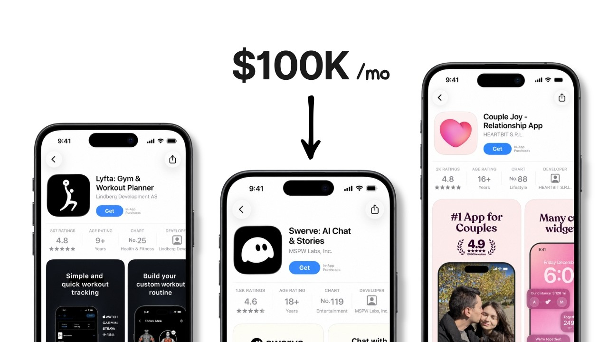

# How these $100K/mo apps actually get users (New Strategy)

🎯 Get Arcads AI: https://go.heyjasonlee.com/arcads 📂 Download the FREE Silent UGC skill: https://www.thebreadcrumb.co/resources/silent-ugc

## Table of Contents

* [00:00:00] Intro
* [00:00:52] The Problem
* [00:01:52] Silent UGC
* [00:04:10] Tools You Need
* [00:05:35] Preparing References
* [00:06:18] Cloning Repo
* [00:09:52] Result
* [00:10:10] Creating Multiple Videos at Once
* [00:11:18] Results
* [00:12:10] Caveats / Best Practices
* [00:14:10] The Cost

## [00:00:00] Intro

We talk a lot about building apps and the truth is it's getting a lot easier to vi code an app. But the big question is how do we market the app? And I think that's part of the equation that a lot of people skip. It's getting a lot easier and easier to build software. But if you can't get people to pay for it, what is the point? [00:00:00 → 00:00:14]

Well, today I'm going to talk about how to market your app. I want to share one specific strategy that is very effective. In fact, this is something that a lot of the big apps are doing to make their apps go viral and get tons of customers. And some of the apps that we're going to talk about today are making 100K per month, 200K per month, 300K per month by exactly doing this. So this strategy is proven to work by these guys and something that you can actually replicate very easily with the tools that you already have. [00:00:14 → 00:00:38]

So if you've been on the fence about building an app cuz you don't know how to market it by the end of this video, I think this is going to open your mind and realize that this is actually more achievable than you think. So let's dive in. All right. So before I get to the exact strategy, let me start with this cuz this will lay out some groundwork and it will give you an understanding in what I'm about to tell you. [00:00:38 → 00:00:56]

## [00:00:52] The Problem

So you probably heard that UGC or user generated videos just like this are very effective in selling products, right? Cuz they look raw, unpolished, and because of that, it doesn't look like an ad. Now, the problem is creating this UGC videos is not cheap cuz you got to hire influencers and it can set you back a few hundred or a couple thousand dollar depending on their audience size or the amount of reach they can get. Right now, because of AI, we now have UGC videos with AI actors. And I'm sure you've probably seen AI videos like this everywhere on social media. [00:00:56 → 00:01:25]

And these AI videos has gotten so good, you can ask it to hold any product that you want and they look amazing. But the big question is, is this actually good if you are trying to market an app? Cuz that's what we care about, right? Do these videos convert views into paying customers for our app? So, I did some research and the answer is not really. [00:01:25 → 00:01:42]

I mean, they could work if you're selling physical products, but definitely not for apps. But the good news is that I found a particular UGC format that actually works for apps. And this is what a lot of the big apps are actually using, and it's been working exceptionally well for them. [00:01:42 → 00:01:57]

## [00:01:52] Silent UGC

And this is called Silent UC. So, I'm going to give you an example of this. So, there's this app called Lipa. This is a gym workout or a fitness app. They are making $300,000 a month with this app. [00:01:57 → 00:02:06]

And this is the UGC video that they're running to promote the app. So, this one's got 4 million views. If I click on this, and you probably seen this type of videos before. It's a video where the actor is quiet. She doesn't talk, but there's a text overlay as the hook here. [00:02:06 → 00:02:20]

Three years in the gym. And now I find this. And in the second part of the video, you show the app that you're promoting. As simple as that. And they're not the only one. [00:02:20 → 00:02:27]

There's another app, Swerve AI Chat. This is also another consumer app that's doing 100K per month. And this is the sound UGC that they're running. As you can see, there's no talking, but the hook is basically the text itself, right? And I've got another app here, Couple Joy, making 200K per month. [00:02:27 → 00:02:43]

And you'll see this entire channel is actually made to promote this app. You can see that by looking at the URL here. And again, there's no talking. It is just the hook and it goes to the app demo. So, there are countless of examples here cuz it really works, right? [00:02:43 → 00:02:57]

And what's crazy is that this one here does not even have a video of the app and they just mention it in the description here and people are still able to find it. That's how effective this format really is. and everything is driven by the text hook here. So, how can we now take this idea or this format to promote our app? Now, obviously, we're not going to hire influencers and we're not going to film this ourselves. [00:02:57 → 00:03:20]

So, we're going to use AI to do all of this for us, right? And I'm going to show you how to do that. It's going to create all the characters, come up with all the hooks, and stitch the entire video for us. Now, if you think about it, because of how simple this video format is, is actually perfect for AI to generate cuz there's going to be less room for errors. Because if you were to create a video like this, I find that sometimes it still looks like AI. [00:03:20 → 00:03:43]

The expression is kind of exaggerated and sometimes the voice is not natural. So, we're not there yet as of today. And you really don't know how many tries it really takes to achieve this result. And if you are creating an entire account of 30 50 videos, that's going to cost you with time and also with credits. And today I'm going to show you how to take a viral Tik Tok video like this, put it into Claude, and it will clone that video with your own model to promote your own app. [00:03:43 → 00:04:08]

All right, so in order to do this, we're just going to need two tools. [00:04:08 → 00:04:11]

## [00:04:10] Tools You Need

Cloud code to plan and orchestrate the video. And then we're going to ask Claude to connect to Arcat AI, who is a sponsor of today's video, to generate the images and videos using Nanabanana and Cedense 2. 5. So I feel like Arcatz has really good models. They've got the latest video models like Cance 2. [00:04:11 → 00:04:26]

5 and they do have an MCP connector to cloud code which makes everything a lot easier to create. All right, so the first thing I want to show you is how to clone a viral Tik Tok video. So let's say you found this video by this user here and you want to clone this. So you want to copy the expression, the emotion, the camera movement and all these things and of course you want to change the second scene here to your own app. Now that is just cloning one single video. [00:04:26 → 00:04:48]

But what if you want to create an entire Tik Tok account, all these videos based on the same character. This way we can test out different styles with different text hooks and see which ones work and then you can probably scale that with paid ads. Now before we start prompting, I have created a skill called sound UGC. So I'm going to provide this in the link in the description below. You can grab this and put into cloud. [00:04:48 → 00:05:09]

This way your cla session is going to have a lot of context in what we're trying to achieve here. So you have to reexplain everything from scratch. And again, this scale will allow you to do two different things here. It will help you clone a single video or you can ask it to create a Tik Tok account with, you know, 20, 30, 50 different videos using the same character that's consistent in every video, but with different hooks. So, let's start prompting. [00:05:09 → 00:05:34]

So, I'm in my cloud code session here, and I've connected this session to a specific folder. [00:05:34 → 00:05:39]

## [00:05:35] Preparing References

So, it's called silent UGC live. And the only thing inside of this folder is just the subfolder called assets here. And here I have the reference model and this is the model that I just found randomly on Google that I want to replace this original video with. And the second file here is just a sample demo of our app. And basically this is the second scene that will be in every single video. [00:05:39 → 00:06:01]

And this is the only manual thing that you got to do in the beginning. Just record the app that you're promoting like this. And you can use it multiple times in every video because what matters here is actually the first scene which is the model and the hook. That is the thing that's going to drive engagement and then you don't want to show your app until the end. [00:06:01 → 00:06:19]

## [00:06:18] Cloning Repo

Right? So you can say something simple like this. Install the skill and just hit enter and it will install this skill in that folder. Now while we wait for that you want to make sure that you connect to ARATS using a connector so that claude will have access to the image and video models. Right? [00:06:19 → 00:06:31]

So I'm going to go to connectors here in my cloud settings. And I already have this connected now. But if you're doing this for the first time, you can just click on add add custom connector and name it arats. And then just paste in this URL mcp. archs. [00:06:31 → 00:06:45]

ai. And then it's going to authenticate your account. And make sure you have some credits there. And then you should be good to go. And now it's installed the scale and it's saying that Arcad MCP is live. [00:06:45 → 00:06:54]

And it did recognize that I have included a reference model which is this one here. So it's going to use that to replace the original video. And it also was able to detect the demo app video that is in that folder as well. Now, it's going to ask me a question whether I want to clone one video or do I want to create 10 to 20 videos in one go. Now, obviously, we're going to start with one first and we're going to use this as a baseline to make sure that everything generates correctly according to what you want and then we're going to multiply that into 10 to 20 videos. [00:06:54 → 00:07:25]

But let's start with this one first. I'm going to click on this and it's going to ask you what is the goal for these videos. And the purpose of this question here is to figure out what you're trying to do here. Are you trying to get people to install your app or just go for a free trial or you just want awareness? So the goal here that you pick is going to help Claude understand your intention and create the correct hooks for you. [00:07:25 → 00:07:47]

So I'm going to click app installs for this purpose and it's just going to get to work. And now it's asking for the Tik Tok URL. So what is the Tik Tok video that we're trying to clone here which is this one. And also the app. So, what app are we promoting? [00:07:47 → 00:08:01]

So, I'm going to say clone this Tik Tok video. And I'm just going to give it the URL to that video. And also, for this example, we're going to pretend that we're promoting this Lifter app here cuz I already have the video of the app demo. So, I'm just going to give that URL to the app store so it can study the app and get more context about what the app does. So, it's going to be able to come up with the right hooks as well. [00:08:01 → 00:08:23]

Right. So, I'm going to hit go and let it work. All right. Just in a few minutes came back with an answer. It analyzed that source video and it also studied the app that was trying to promote here, Lifa. [00:08:23 → 00:08:33]

And it has all the context that it needs and also gave me a few options for the text, right? What angle do you want to go for? Do you want a direct clone of the store structure? Cuz the original video says I could kiss the flight attendant who showed me this. So, I could go with that, but adjust it to the gym app. [00:08:33 → 00:08:48]

I could kiss the gym girl that showed me this, or I could kiss the trainer that showed me this app. Or we can go with the pricing angle. My my PT charges $80 for a session for this exact plan. So, there's a lot of different angles that you can go for here that CL thinks it's going to perform well. Obviously, when we are creating 20, 30 different videos, we can test all these hooks, right? [00:08:48 → 00:09:09]

But now, since we're just doing one video first, I'm probably going to just pick one here. And it did ask me this questions here. And I think for this example, I'm just going to go with this one. And then I'm going to hit submit. All right. [00:09:09 → 00:09:21]

In just a few minutes, it's ready. The first part of the video is actually here. So, I can play this real quick. I think that looks exactly like the original video. It said it's just the first part of the video. [00:09:21 → 00:09:32]

It's asking me to approve it before it goes on to stitch everything together. But this looks exactly like this original video here. And it actually used my model as well that I gave it to replace the face. All right. So, I'm going to approve this one and move on. [00:09:32 → 00:09:46]

And that is done. So, I'm going to play this one. This one's 12 seconds. So, I'm going to make this bigger. And if I just compare this side by side, so you got the original on the left here and the clone on the right side, you'll see that it is quite similar, right? [00:09:46 → 00:09:58]

## [00:09:52] Result

With all the movements, everything is the same except that the second scene is adapted for our own app. Now, I'm going to talk about how much this videos will actually cost you in terms of credits. And I'm going to do that towards the end of the video, but let's first do the second part where we actually create 5, 10, 20 videos of the same character, right? [00:09:58 → 00:10:17]

## [00:10:10] Creating Multiple Videos at Once

So, I can say something like this. Let's go to account mode. Now, I want to create six videos based on our AI model here, but each with different hooks. Choose the hooks that will match the model's expression. And there's no audio. [00:10:17 → 00:10:28]

And because you already have the silent UGC skill installed, Claude already knows what you're trying to do here. So, you really don't have to be too detailed with your prompt. And notice that I say no audio here. It also already has that instruction in the scale. So, I don't really have to say this if I don't want to. [00:10:28 → 00:10:46]

So, now I can hit go and let it create everything. Now, every time you ask it to generate multiple videos, Cloud will actually ask you to approve the first scene. So, if you don't like something, you can ask it to correct it before it produces the entire video cuz that's going to burn credits, right? So, it will give you something like this. You just need to approve it and then it will stitch everything together nicely. [00:10:46 → 00:11:05]

And now it's pretty much done. It took a little bit longer for this one because we're actually generating six different videos and stitching everything together and then adding the text here on the screen. And I want to show you what this look like. And I think you can see it better here because it's a lot bigger to see. [00:11:05 → 00:11:20]

## [00:11:18] Results

So I've got six videos here and here is the first one. And then it goes to the app demo. And maybe let's play this one here. Yeah. So no audio. [00:11:20 → 00:11:30]

The text is on the screen. And let's play this one as well. Yep. And let's do this one. So imagine doing this very quickly with AI. [00:11:30 → 00:11:39]

You can create an entire account like this. 300,000 views, 1. 3 million views here. and she doesn't even have that many videos. I would say 20 30 videos maximum. [00:11:39 → 00:11:48]

With AI, you can recreate this in just about 20 minutes, which is amazing. And again, the beauty here is that you don't have to get the AI to talk. There's no script involved or you don't have to worry if the voice sounds natural or not cuz that entire element is removed from this format. And also, the nice thing about this is that these scenes are customizable. Like this one's in the car, this one's in the kitchen. [00:11:48 → 00:12:11]

## [00:12:10] Caveats / Best Practices

You can ask Claw to update the skills. So, it's customized to your preferences. All right. So, just a few caveats to this. Number one, this silent UGC format works best for consumer apps. [00:12:11 → 00:12:22]

And you know, by consumer apps, I mean like dating apps, fitness apps, obviously, you know, travel, calorie tracking, budgeting apps. I don't see this format used a lot for B2B apps. But if you are building a particular app, I think the easiest way to do research is you want to type in the name of the app in Tik Tok here. For example, if I type Lifa, you're going to see the top videos that are promoting this app. So, you can get an idea of what format works for them and then take that format for your own app. [00:12:22 → 00:12:50]

Or if you want to see other variations of this silent UGC format, you can search for something more general like I can't believe and then it will show all the videos that are using this format. Like for example, okay, so this one's getting 70,000 views. Maybe you can click on this and then see if they're actually promoting any type of app. Or you can use another phrase like I just found out or no one told me. And I think as you do more research and you get deeper into this, you will see the trend of what is working and what is not working. [00:12:50 → 00:13:17]

And also the other thing is that when you are trying to upload multiple videos, you want to make sure that you warm up your Tik Tok account if you're starting with a fresh one. So you can just dump 30 videos in there at once, otherwise you're going to get banned. Now on how exactly to do this warm-up is beyond the scope of this video, but there's tons of resources on this topic. But I just want to remind you that this is something that you need to be aware of. And number three, what I'm showing you here is just one example of what these apps are doing to drive traffic. [00:13:17 → 00:13:42]

It is not the only way because a lot of these apps are also running ads, but this is a good way to start if you're starting from zero. Cuz when you do this first, you will start to collect data and see what videos are getting views and then you can take those videos and put an ad spend behind them and get even more traffic cuz that's what exactly this app Lyft is doing as well. So if you go to meta ads library and search by lifta here and you'll see that they are actually taking this silent new video because basically this is the same exact video just like this one that you see on Tik Tok and they've proven this to be getting a lot of traction and maybe they can attribute the sales to the video so they put ads behind it. [00:13:42 → 00:14:18]

## [00:14:10] The Cost

All right so if you guys are wondering how much all of this costs right so if you guys look at my account here generating one video with Cance 2. 5 cost me about 75 credits. There were some videos that were created by Cling as well with similar amount of credits required. And if you look at Arcad's pricing plan here, if you look at the $88 per month plan will give you about 8,000 credits. And if each video generation costs you 75 credits, that means you get about 106 videos on this plan. [00:14:18 → 00:14:45]

And if you're on the starter plan here, 88 divid by 106, that gives you 83 cents per video generated with Cense. So, if you're creating a channel with 30 videos, for example, that will cost you around $24, which is very similar to an account like this. And yes, we did use Nano Banana to generate the images for the model. But if you notice, if you're on this plan here, you actually get 200 free Nanabanana images included in this plan. So, if you don't go beyond 200, any images you generate was actually free. [00:14:45 → 00:15:15]

Now, keep in mind that prices here or the credit usage can change from time to time, but you'll get a picture of how inexpensive this is compared to hiring real influencers for a very similar output. And of course, when you're getting started, you'll probably use more credits cuz you're going to be doing a lot of trial and error, and that's what I went through when I was creating that skill. But I think in the long run, as you dial in your prompts, as you have that skill customized to your preferences, you have a system in place, right? And in the long run, I think that will lower your cost. All right? [00:15:15 → 00:15:43]

So, I hope that's been helpful. Let me know in the comments, guys, what you think about this format. Are you going to be trying this out? But now that you know how marketing works for apps, how do we actually build the app? Now, I recently created a video on how I vipcoded this fitness app for seniors that's making 100K per month, all completely with AI. [00:15:43 → 00:16:00]

Now, if you're non-technical, don't know how to code, I think this is a perfect video for you. So, if you want to watch that video, click here and I'll see you [00:16:00 → 00:16:09]
